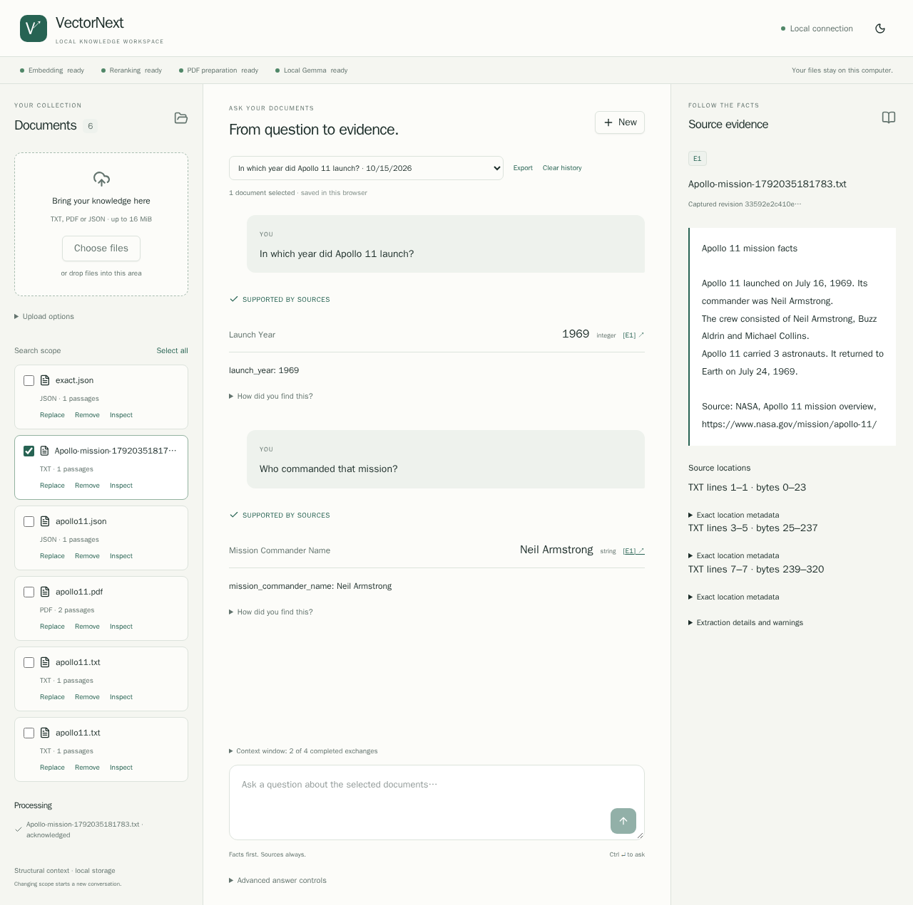
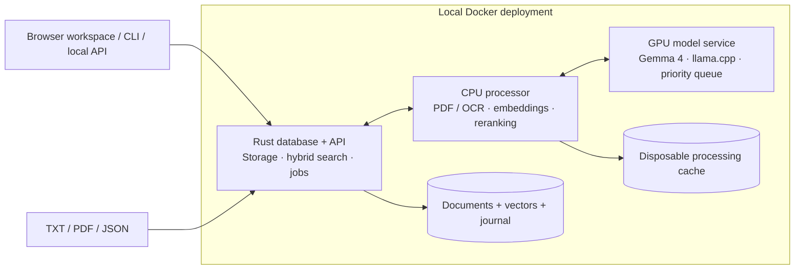

# VectorNext

**A Rust vector database for local, source-linked answers.**

Drop in TXT, PDF and JSON documents, type a question, and follow each answer back to its source. A local browser workspace brings the document library, conversation and original evidence together.

VectorNext implements its own storage engine, exact vector search, BM25 keyword index and ranking fusion in Rust. A three-service Docker deployment connects that core to local document processing and Gemma 4 generation. After setup, document processing and inference run offline.

The Rust API uses **Axum + utoipa**, with interactive documentation bundled locally. Once the app is running, open [API docs](http://localhost:8088/docs) to inspect endpoints and try requests, or download the [OpenAPI specification](http://localhost:8088/openapi.json). You can also use the **API docs** link in the workspace. Upload and removal requests in the documentation act on your local collection; response displays and downloads preserve exact numeric text.

[Try it](#quickstart) · [Architecture](#architecture) · [Measured results](#measured-results) · [Developer guide](docs/development.md) · [AGPL-3.0 license](LICENSE)



## From a document to an answer

Start with real mission data from [NASA's Voyager 1 page](https://science.nasa.gov/mission/voyager/voyager-1/): launched in **1977**, Jupiter flyby in **1979**, Saturn flyby in **1980**. The repository includes an attributed text snapshot of that page.

In the browser, select the document and ask: **“In which year was Voyager 1 launched?”** A local planning call proposes the answer fields automatically. Click the answer's citation to inspect the passage.

Advanced users can specify fields and presentation through the interface or existing API:

```json
{
  "question": "In which year was Voyager 1 launched, and in which years did it fly past Jupiter and Saturn?",
  "fields": {
    "launch_year": {"kind": "integer"},
    "jupiter_year": {"kind": "integer"},
    "saturn_year": {"kind": "integer"}
  },
  "template": "Voyager 1 | Launch: {launch_year} | Jupiter: {jupiter_year} | Saturn: {saturn_year}"
}
```

```text
Voyager 1 | Launch: 1977 | Jupiter: 1979 | Saturn: 1980
```

The response also includes retrieved passages, source locations, field proofs and processing timings. Answers distinguish supported facts, ambiguous questions and insufficient evidence. Optional prose drafts stay separate from validated fields and original sources.

[Explore the NASA source snapshot](evals/independent/fixtures/voyager1.txt) · [Verified demo](docs/reports/t11-readme-demo.json) · [Source attribution](evals/independent/README.md) · [Inspect the answer contract](docs/answers.md)

## What is built

| Capability | Implementation |
| --- | --- |
| **A local browser workspace** | React + TypeScript + shadcn/ui, served by Rust. Drag-and-drop uploads, ordinary questions, clickable citations, document replacement/removal, themes and browser history. |
| **An original database core** | Content-addressed originals, checksummed journal, atomic document revisions, immutable snapshots, checkpoints and recovery. |
| **Hybrid retrieval** | Exact cosine similarity, per-field BM25, typed filters, reciprocal rank fusion and source-preserving deduplication. |
| **Document-aware ingestion** | TXT passages with byte mappings; PDF text, tables and OCR with page coordinates; JSON records with exact types and pointers. |
| **Local contextual retrieval** | Plain, structural and optional generated context, followed by CPU reranking and evidence expansion within token budgets. |
| **Experimental field coverage** | Per-field reranking, bounded passage selection and JSON output constrained to existing typed source paths, with a frozen comparison against ranked two/five. |
| **Answers with inspectable sources** | Typed fields, exact quotes or JSON pointers, deterministic templates, conversational context and separate presentation drafts. |
| **Readable workflow reports** | CLI commands, high-level function references and readable ingestion/search/answer steps, with saved Markdown and offline capture replay. |
| **Recovery and diagnostics** | Visible coordinator failures, bounded busy retries, PDF warnings before publication and rejected-answer diagnostics with unvalidated drafts. |
| **Durable local operation** | Resumable ingestion jobs, explicit retries, bounded processing queues, capability readiness and checksummed export/restore. |

For explicit JSON values, the model selects the record and pointer; Rust reads the original value. Zero, a stored `null`, a missing field and a string such as `"007"` retain their distinct meanings. Generated context is stored separately and never becomes source evidence.

## Architecture



The Rust API is the sole database writer. Parsing and model calls run outside write transactions. The CPU processor has no database mount; only the generation service receives GPU access. Interactive generation runs ahead of waiting background enrichment, while active inference finishes without interruption.

**Query flow:** original question → optional local field planning → embedding + keyword search → rank fusion → CPU reranking → source-context expansion → answerability assessment → typed extraction → validation and formatting. Field planning cannot invent answer values, filters, JSON pointers or a replacement search question.

The default generation profile uses **Gemma 4 26B A4B QAT Q4_0**, with CPU expert offload to fit the tested RTX 4060. MiniLM embeddings and reranking run on CPU; Docling and Tesseract handle PDFs. Models, preprocessing identities and runtime configuration are pinned. Local volumes and bounded caches keep the deployment to three services.

[Architecture and decisions](docs/architecture.md) · [Storage contract](docs/storage.md) · [Retrieval contract](docs/retrieval.md)

## Measured results

Measured on an **RTX 4060 with 8 GB VRAM, Ryzen 5 7600 and approximately 64 GB system RAM**, using Docker on Windows/WSL 2.

**Latest: question-aware evidence coverage (T14).** Eight new NASA/USGS sources, 201 chunks and 16 frozen questions compare three strategies across 96 local requests:

| Configuration | Exact outcomes, each pass | Median, cold / warm |
| --- | --- | --- |
| Ranked five — default | 8/16 | 29.18 / 28.53 s |
| Ranked two | 7/16 | 18.19 / 17.34 s |
| Field coverage — experimental | 8/16 | 16.50 / 15.86 s |

Coverage reduced median latency by **43.5–44.4%**, but did not increase strict answer accuracy or clear the adoption gate. **Ranked five remains the default.** The experiment distinguishes missing candidates, evidence selection and quote-validation failures. One question also permits a reasonable interpretation different from its frozen ambiguity label; the score and source-review exception are both retained. This is a small diagnostic corpus, not an independently administered benchmark.

T14 found numeric proof defects. **T15 repairs them:** exact English grouped numbers and named-month date years validate, while shortened numeric quotes are checked against the complete supplied passage. For example, `3,000` supports `3000`; clipping it to `3` cannot support `3`. Original quotes, exact values and historical scores are preserved. These mechanical checks do not guarantee factual correctness. [T15 verification and limits](docs/reports/t15-numeric-proofs.md) · [T14 results](docs/reports/t14-evidence-coverage.md) · [Readable coverage trace](docs/reports/t14-coverage-workflow.md) · [Try the experimental option](evals/coverage/README.md).

**Earlier public-source comparison (T11):** **20 NASA/USGS documents and 28 questions**, with the same corpus, models and retrieval settings for both passage limits. Its corpus/annotation protocol differs from T14, so the answer rates are not directly comparable.

| Answer configuration | Median, cold cache | Median, warm cache | Correct outcomes / planned |
| --- | --- | --- | --- |
| Structural context, five primary passages — default | 22.27 s | 21.17 s | 16/28 in each pass |
| Structural context, two primary passages — opt-in experiment | 11.08 s | 11.51 s | 15/28 in each pass |

Two passages reduced median response time by **46–50%**, but lost a three-document answer and a conversational follow-up that five handled. It improved one answer by removing a numeric distractor. **Five remain the default.** Latencies include errors and abstentions; faster responses do not necessarily mean successful answers.

Only **18/20 documents were admitted, producing 658 chunks**. One PDF failed strict partial-extraction admission; the other hit a busy processing lane. Their six questions remain in the denominator. This exposes real ingestion and evidence-selection gaps, and does not establish PDF retrieval quality. The 112 requests repeat 28 questions across four blocks. Codex authored and reviewed this public-source set; it is independent of the old synthetic corpus, not an independently administered benchmark. The original six holdout questions remain unused.

A separate **core-only capacity probe** searched **12,800 supplied 384-dimensional vectors across 400 synthetic documents** in **9.95 ms median**, with **79.3 MiB peak process RSS**. This measures hybrid search capacity; it excludes document parsing, embeddings and answer generation.

T14 verification passed **217 automated checks** (101 Rust, 116 Python), plus formatting, lint and Compose validation. Those checks are separate from answer quality and the newly recorded numeric-boundary diagnostic. T13 also completed a CPU recovery/PDF drill; see [results](docs/reports/t13-reliability.md). T11 found and fixed a UTF-8 ingestion panic; the earlier failed attempt is retained.

The earlier synthetic development comparison passed 13/13 questions with both limits. Generated context increased its five-file ingestion from **24.76 s to 72.16 s** without improving final answers, so structural context remains the default. Broader quality and sustained-load performance remain open.

[Public-source evaluation and failures](docs/reports/t11-independent.md) · [Machine-readable evidence](docs/reports/t11-independent.json) · [Dataset and reproduction](evals/independent/README.md) · [Earlier development/capacity results](docs/reports/t10-evaluation.md)

## Quickstart

Use Docker Desktop with WSL 2, Linux containers and NVIDIA GPU support. The tested PC has an RTX 4060 (8 GB VRAM) and about 64 GB RAM. The generation container has reached about **23 GiB including mapped model/file cache**. The model file alone is approximately **14.44 GB**, plus CPU/PDF models and images.

### Windows: setup once, then double-click

1. Clone or download this repository. Start Docker Desktop.
2. Double-click **[VectorNext.cmd](VectorNext.cmd)** and choose **Setup**. This checks Docker/GPU access, downloads and verifies pinned models, builds the three services, and opens the app. Existing valid models are reused. First setup needs internet access and can take a while.
3. On later visits, double-click **[Start VectorNext.cmd](Start%20VectorNext.cmd)**. It reuses the installed images and models, then opens **[localhost:8088](http://localhost:8088)**. The header shows each capability while models finish loading.

Inside the app: **choose or drop files → select documents → type a question → click a citation**. Try [the Apollo 11 notes](tests/fixtures/ui/apollo11.txt) and ask “In which year did Apollo 11 launch?” TXT, PDF and JSON are accepted up to 16 MiB each. IDs and ordinary answer fields are automatic. Replace and Remove are in the library; removal asks for confirmation.

Use **VectorNext.cmd → Stop** to stop only this application while keeping documents, models and caches. Choose **Rebuild** after pulling code changes. Routine Start never builds or downloads. The equivalent scripted actions are `powershell -File deployment/VectorNext.ps1 -Action Setup`, `Start`, `Rebuild`, `Stop` or `Status`.

Conversations and captured evidence live in **IndexedDB in this browser**, not on the server. Use **Export** before clearing browser data or changing profiles. Different hostnames/ports have separate histories; use the same `localhost:8088` address consistently. Only the last four supported question/answer exchanges are sent as context. Changing document scope starts a new conversation. Historical passages stay captured after a document is replaced or removed. See [browser/API details and limits](docs/browser-api.md).

### Troubleshooting

- **Docker is unavailable:** start Docker Desktop and enable Linux containers/WSL 2. Setup checks GPU visibility inside Docker.
- **Models are still loading:** browse documents while the capability indicators update. GPU contention or insufficient system RAM can slow generation. Stop other GPU experiments before launching this stack.
- **Upload is busy or interrupted:** the interface retains its upload identity, reconciles saved work and offers Retry. Saved processing failures require explicit retry. A failed replacement must finish before that document can be removed.
- **PDF was rejected:** inspect the failure; strict extraction is the default. Enable partial extraction in Upload options only when incomplete extraction is acceptable. Warnings remain available with evidence.
- **Question planning fails:** rephrase the question or supply fields in Advanced. Corpus totals/aggregates remain unsupported. Supported results still require human semantic review.
- **Browser storage failed:** keep the tab open and export conversations. Clear space or use a persistent browser profile; private mode/history deletion can remove saved conversations. Use one active tab to avoid competing workspace saves.
- **Updated code is not visible:** choose Rebuild, then reload the browser. Start deliberately reuses installed images.

### Command-line setup and automation

The existing CLI and JSON API remain available. For manual setup:

#### 1. Get the repository and models

```sh
git clone https://github.com/dpittaluga76/VectorNext.git
cd VectorNext

docker compose -f compose.models.yaml -f compose.models.26b.yaml build model-download
docker compose -f compose.models.yaml -f compose.models.26b.yaml run --rm --no-deps model-download
docker compose -f compose.processor.yaml build processor
docker compose -f compose.processor.yaml run --rm pdf-setup
```

Initial setup needs network access. Model downloads are checksum-verified and reused when already present. Weights stay outside images in `models/`; normal operation uses local files.

#### 2. Start the application

```sh
docker compose -f compose.app.yaml build
docker compose -f compose.app.yaml up -d --no-build --pull never
docker compose -f compose.app.yaml run --rm client ready
```

Repeat the readiness check until all capabilities are available. The measured model restart took about **137 seconds** on the test PC; loading time varies. The API listens at `http://127.0.0.1:8088`. Keep other VectorNext GPU experiments stopped while using this stack.

#### 3. Ingest, search and ask

```sh
docker compose -f compose.app.yaml run --rm client ingest /app/evals/independent/fixtures/voyager1.txt --document voyager-demo --job voyager-demo-v1 --wait
docker compose -f compose.app.yaml run --rm client search "Voyager 1 launch Jupiter Saturn"
docker compose -f compose.app.yaml run --rm client ask /app/tests/fixtures/answers/voyager.json
```

The last command returns the full JSON answer report. In PowerShell, display just the formatted answer:

```powershell
$result = docker compose -f compose.app.yaml run --rm client ask /app/tests/fixtures/answers/voyager.json | ConvertFrom-Json
$result.formatted
```

To try your own files, create a `documents` folder in the repository and place a TXT, PDF or JSON file there. Mount it read-only; replace `example.pdf` with your filename:

```powershell
docker compose -f compose.app.yaml run --rm -v "${PWD}/documents:/input:ro" client ingest /input/example.pdf --document my-document --job my-document-v1 --wait
```

Use unique document/job names for different files. JSON arrays nested inside an object can use an explicit record pointer, such as `--record-pointer /features`. For another question, copy the [request example](tests/fixtures/answers/voyager.json) into that folder as `question.json`, edit its question/fields/template, then run:

```powershell
docker compose -f compose.app.yaml run --rm -v "${PWD}/documents:/input:ro" client ask /input/question.json
```

PDF ingestion is strict by default: unprocessed illustrations or uncertain OCR can cause rejection even when useful text was recovered. The ingest command supports `--allow-partial` when partial text extraction is acceptable for your document; extraction warnings remain attached to the stored document.

Stop with `docker compose -f compose.app.yaml stop`. Documents and models persist; subsequent starts use `up -d`. See the [operations guide](docs/development.md) for job inspection, retry, document replacement and backup commands.

#### 4. See how the workflow ran

Append `--explain` for a readable account of the input, processing steps, selected source passages and answer:

```sh
docker compose -f compose.app.yaml run --rm client ask /app/tests/fixtures/answers/voyager.json --explain
```

Use `--report` to save Markdown and `--capture` for offline replay. Reports include the client invocation, API handler and high-level function references beside the steps. See the [real Voyager workflow report](docs/reports/t12-voyager-workflow.md) and [commands for saving a complete workflow](docs/workflow-debugging.md).

## Verification

The core and fixture checks run in Docker without a GPU or model downloads. The first image build requires network access; test containers run with networking disabled.

```sh
docker compose build core evals
docker compose run --rm core
docker compose run --rm core cargo fmt --check
docker compose run --rm core cargo clippy --locked --offline --all-targets -- -D warnings
docker compose run --rm evals
docker compose run --rm evals python -m unittest evals.test_validate evals.test_score -v
docker compose run --rm -v "${PWD}:/workspace:ro" evals python -m unittest evals.independent.test_protocol evals.independent.test_summary -v
docker compose run --rm -v "${PWD}:/workspace:ro" evals python -m unittest deployment.test_workflow -v
```

These commands cover the 122 Rust checks, 54 original fixture/scorer/protocol checks and 26 workflow/client checks. T14 adds `evals.coverage.test_coverage` and `model_worker.test_coverage`; reliability checks are in `deployment.test_reliability`. T15 passed 108 Rust/90 Python checks plus format/lint, its deterministic numeric probe and a release API startup check; no GPU benchmark was needed. The final two commands mount the repository read-only and work in PowerShell or a POSIX shell. Model-worker checks, disk-volume recovery tests and live inference experiments have their own setup in the [developer guide](docs/development.md) and [evaluation guide](evals/README.md). Tests never regenerate sources or gold labels automatically.

Browser verification runs entirely in Docker:

```sh
docker build -f docker/ui-test.Dockerfile -t vectornext-ui-test:t19 .
docker run --rm --network none vectornext-ui-test:t19 npm test
docker run --rm --network none --ipc=host vectornext-ui-test:t19 npm run e2e -- workspace.spec.ts
```

T16–T18 passed 116 Rust, 118 Python unit/regression checks, five live HTTP checks, five frontend component checks, nine offline browser scenarios and a production-browser scenario with real Gemma. [Results, retained failures and limitations](docs/reports/t16-t18-local-app.md). These are operational checks, not a new retrieval-quality benchmark.

T19 additionally passed the frozen 71-case HTTP comparison, two OpenAPI schema checks and two browser scenarios against the real Axum adapter, including exact numeric requests/responses. See [the migration report](docs/reports/t19-axum.md) for isolated reproduction commands, rollback and limitations.

## Explore the implementation

| Start here | What to look for |
| --- | --- |
| [`src/`](src/) and [storage specification](docs/storage.md) | Record contracts, journal recovery, atomic publication and snapshots |
| [`src/search/`](src/search/) | Exact cosine, BM25, typed filtering, fusion and retrieval traces |
| [`src/ingestion/`](src/ingestion/) and [`processor/`](processor/) | Durable stages, format-aware chunking and source mappings |
| [`src/answers.rs`](src/answers.rs) and [`model_worker/`](model_worker/) | Evidence assembly, local models, exact JSON reads and generation scheduling |
| [`src/service/`](src/service/) and [`deployment/`](deployment/) | Shared database ownership, API, CPU admission and client |
| [`evals/`](evals/) and [public-source evaluation](docs/reports/t11-independent.md) | Frozen sources, paired comparisons, source-aware scoring, timings and retained failures |

## Project status and next steps

T01–T19 are complete: storage, retrieval, TXT/JSON/PDF ingestion, local models, answers, Docker deployment, frozen evaluations, readable workflow reports, recovery diagnostics, experimental field-aware evidence selection and numeric proof validation. The app is ready for local experimentation. The browser workspace, Windows launcher and Axum API with offline OpenAPI documentation are implemented. The public API is still evolving; multi-user authentication remains out of scope.

T13 adds coordinator supervision, PDF diagnostics before publication, bounded busy retries and rejected-answer diagnostics; see the [recovery guide](docs/reliability.md) and [verified operational workflow](docs/reports/t13-operational-workflow.md). After the T19 API migration, the next work to scope is field-specific candidate retrieval and clearer ambiguity evaluation. Corpus-wide aggregation, storage compaction and approximate indexes remain outside the implemented scope; measured need should determine when they are added.

For contributions, start with the [architecture](docs/architecture.md), [build plan](docs/plan.md) and [working instructions](AGENTS.md). Reproducible retrieval failures with shareable source files are especially useful.

## License

Repository code is licensed under the [GNU Affero General Public License v3.0](LICENSE). Downloaded model weights, third-party dependencies and [NASA/USGS source snapshots](evals/independent/README.md#source-attribution-and-reuse) retain their respective terms. Their inclusion does not imply agency endorsement.
