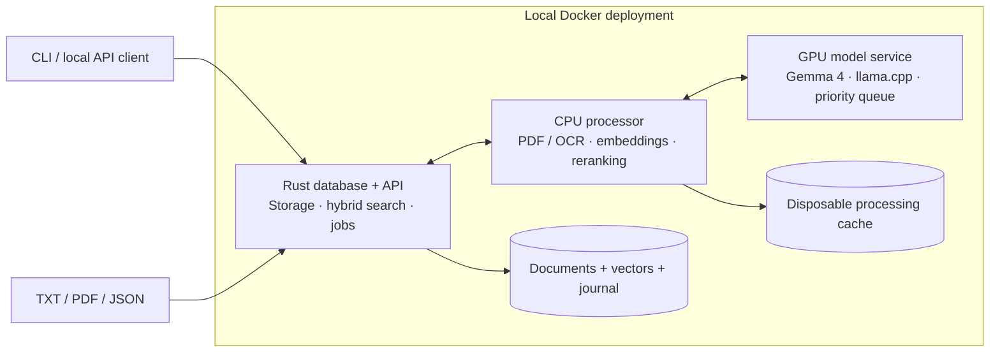

# VectorNext

**A Rust vector database for local, source-linked answers.**

Turn TXT, PDF and JSON documents into searchable evidence. Combine semantic search with exact terms, retrieve the passages that matter, and ask a local LLM for structured answers you can inspect back to the source.

VectorNext implements its own storage engine, exact vector search, BM25 keyword index and ranking fusion in Rust. A three-service Docker deployment connects that core to local document processing and Gemma 4 generation. After setup, document processing and inference run offline.

[Try it](#quickstart) · [Architecture](#architecture) · [Measured results](#measured-results) · [Developer guide](docs/development.md) · [AGPL-3.0 license](LICENSE)

## From a document to an answer

Start with real mission data from [NASA's Voyager 1 page](https://science.nasa.gov/mission/voyager/voyager-1/): launched in **1977**, Jupiter flyby in **1979**, Saturn flyby in **1980**. The repository includes an attributed text snapshot of that page.

Ask for the timeline and specify the fields and presentation you need:

```json
{
  "question": "In which year was Voyager 1 launched, and in which years did it fly past Jupiter and Saturn?",
  "fields": {
    "launch_year": {"kind": "integer"},
    "jupiter_year": {"kind": "integer"},
    "saturn_year": {"kind": "integer"}
  },
  "template": "Voyager 1 | Launch: {launch_year} | Jupiter: {jupiter_year} | Saturn: {saturn_year}"
}
```

```text
Voyager 1 | Launch: 1977 | Jupiter: 1979 | Saturn: 1980
```

The response also includes retrieved passages, source locations, field proofs and processing timings. Answers distinguish supported facts, ambiguous questions and insufficient evidence. Optional prose drafts stay separate from validated fields and original sources.

[Explore the NASA source snapshot](evals/independent/fixtures/voyager1.txt) · [Verified demo](docs/reports/t11-readme-demo.json) · [Source attribution](evals/independent/README.md) · [Inspect the answer contract](docs/answers.md)

## What is built

| Capability | Implementation |
| --- | --- |
| **An original database core** | Content-addressed originals, checksummed journal, atomic document revisions, immutable snapshots, checkpoints and recovery. |
| **Hybrid retrieval** | Exact cosine similarity, per-field BM25, typed filters, reciprocal rank fusion and source-preserving deduplication. |
| **Document-aware ingestion** | TXT passages with byte mappings; PDF text, tables and OCR with page coordinates; JSON records with exact types and pointers. |
| **Local contextual retrieval** | Plain, structural and optional generated context, followed by CPU reranking and evidence expansion within token budgets. |
| **Answers with inspectable sources** | Typed fields, exact quotes or JSON pointers, deterministic templates, conversational context and separate presentation drafts. |
| **Durable local operation** | Resumable ingestion jobs, explicit retries, bounded processing queues, capability readiness and checksummed export/restore. |

For explicit JSON values, the model selects the record and pointer; Rust reads the original value. Zero, a stored `null`, a missing field and a string such as `"007"` retain their distinct meanings. Generated context is stored separately and never becomes source evidence.

## Architecture



The Rust API is the sole database writer. Parsing and model calls run outside write transactions. The CPU processor has no database mount; only the generation service receives GPU access. Interactive generation runs ahead of waiting background enrichment, while active inference finishes without interruption.

**Query flow:** original question → embedding + keyword search → rank fusion → CPU reranking → source-context expansion → answerability assessment → typed extraction → validation and formatting.

The default generation profile uses **Gemma 4 26B A4B QAT Q4_0**, with CPU expert offload to fit the tested RTX 4060. MiniLM embeddings and reranking run on CPU; Docling and Tesseract handle PDFs. Models, preprocessing identities and runtime configuration are pinned. Local volumes and bounded caches keep the deployment to three services.

[Architecture and decisions](docs/architecture.md) · [Storage contract](docs/storage.md) · [Retrieval contract](docs/retrieval.md)

## Measured results

Measured on an **RTX 4060 with 8 GB VRAM, Ryzen 5 7600 and approximately 64 GB system RAM**, using Docker on Windows/WSL 2.

The latest comparison uses **20 public NASA/USGS documents and 28 new questions**, with the same corpus, models and retrieval settings for both passage limits.

| Answer configuration | Median, cold cache | Median, warm cache | Correct outcomes / planned |
| --- | --- | --- | --- |
| Structural context, five primary passages — default | 22.27 s | 21.17 s | 16/28 in each pass |
| Structural context, two primary passages — opt-in experiment | 11.08 s | 11.51 s | 15/28 in each pass |

Two passages reduced median response time by **46–50%**, but lost a three-document answer and a conversational follow-up that five handled. It improved one answer by removing a numeric distractor. **Five remain the default.** Latencies include errors and abstentions; faster responses do not necessarily mean successful answers.

Only **18/20 documents were admitted, producing 658 chunks**. One PDF failed strict partial-extraction admission; the other hit a busy processing lane. Their six questions remain in the denominator. This exposes real ingestion and evidence-selection gaps, and does not establish PDF retrieval quality. The 112 requests repeat 28 questions across four blocks. Codex authored and reviewed this public-source set; it is independent of the old synthetic corpus, not an independently administered benchmark. The original six holdout questions remain unused.

A separate **core-only capacity probe** searched **12,800 supplied 384-dimensional vectors across 400 synthetic documents** in **9.95 ms median**, with **79.3 MiB peak process RSS**. This measures hybrid search capacity; it excludes document parsing, embeddings and answer generation.

The latest verification recorded **167 passing automated checks**: 91 Rust, 54 fixture/scorer/protocol and 22 worker/answer/scheduler/transport checks, plus formatting, lint and Compose validation. These software checks are separate from the end-to-end answer scores above. T11 also found and fixed a UTF-8 ingestion panic; the earlier failed attempt is retained.

The earlier synthetic development comparison passed 13/13 questions with both limits. Generated context increased its five-file ingestion from **24.76 s to 72.16 s** without improving final answers, so structural context remains the default. Broader quality and sustained-load performance remain open.

[Public-source evaluation and failures](docs/reports/t11-independent.md) · [Machine-readable evidence](docs/reports/t11-independent.json) · [Dataset and reproduction](evals/independent/README.md) · [Earlier development/capacity results](docs/reports/t10-evaluation.md)

## Quickstart

The current interface is a CLI and localhost JSON API. Use Docker with Linux containers and NVIDIA GPU support; the verified Windows setup uses Docker Desktop with WSL 2. The tested generation profile uses substantial system RAM as well as GPU memory: the generation container reached about **23 GiB including mapped model/file cache**. The model file alone is approximately **14.44 GB**, with additional space needed for CPU/PDF models and images.

### 1. Get the repository and models

```sh
git clone https://github.com/dpittaluga76/VectorNext.git
cd VectorNext

docker compose -f compose.models.yaml -f compose.models.26b.yaml build model-download
docker compose -f compose.models.yaml -f compose.models.26b.yaml run --rm --no-deps model-download
docker compose -f compose.processor.yaml build processor
docker compose -f compose.processor.yaml run --rm pdf-setup
```

Initial setup needs network access. Model downloads are checksum-verified and reused when already present. Weights stay outside images in `models/`; normal operation uses local files.

### 2. Start the application

```sh
docker compose -f compose.app.yaml build
docker compose -f compose.app.yaml up -d
docker compose -f compose.app.yaml run --rm client ready
```

Repeat the readiness check until all capabilities are available. The measured model restart took about **137 seconds** on the test PC; loading time varies. The API listens at `http://127.0.0.1:8088`. Keep other VectorNext GPU experiments stopped while using this stack.

### 3. Ingest, search and ask

```sh
docker compose -f compose.app.yaml run --rm client ingest /app/evals/independent/fixtures/voyager1.txt --document voyager-demo --job voyager-demo-v1 --wait
docker compose -f compose.app.yaml run --rm client search "Voyager 1 launch Jupiter Saturn"
docker compose -f compose.app.yaml run --rm client ask /app/tests/fixtures/answers/voyager.json
```

The last command returns the full JSON answer report. In PowerShell, display just the formatted answer:

```powershell
$result = docker compose -f compose.app.yaml run --rm client ask /app/tests/fixtures/answers/voyager.json | ConvertFrom-Json
$result.formatted
```

To try your own files, create a `documents` folder in the repository and place a TXT, PDF or JSON file there. Mount it read-only; replace `example.pdf` with your filename:

```powershell
docker compose -f compose.app.yaml run --rm -v "${PWD}/documents:/input:ro" client ingest /input/example.pdf --document my-document --job my-document-v1 --wait
```

Use unique document/job names for different files. JSON arrays nested inside an object can use an explicit record pointer, such as `--record-pointer /features`. For another question, copy the [request example](tests/fixtures/answers/voyager.json) into that folder as `question.json`, edit its question/fields/template, then run:

```powershell
docker compose -f compose.app.yaml run --rm -v "${PWD}/documents:/input:ro" client ask /input/question.json
```

PDF ingestion is strict by default: unprocessed illustrations or uncertain OCR can cause rejection even when useful text was recovered. The ingest command supports `--allow-partial` when partial text extraction is acceptable for your document; extraction warnings remain attached to the stored document.

Stop with `docker compose -f compose.app.yaml stop`. Documents and models persist; subsequent starts use `up -d`. See the [operations guide](docs/development.md) for job inspection, retry, document replacement and backup commands.

## Verification

The core and fixture checks run in Docker without a GPU or model downloads. The first image build requires network access; test containers run with networking disabled.

```sh
docker compose build core evals
docker compose run --rm core
docker compose run --rm core cargo fmt --check
docker compose run --rm core cargo clippy --locked --offline --all-targets -- -D warnings
docker compose run --rm evals
docker compose run --rm evals python -m unittest evals.test_validate evals.test_score -v
docker compose run --rm -v "${PWD}:/workspace:ro" evals python -m unittest evals.independent.test_protocol evals.independent.test_summary -v
```

These commands cover the 91 Rust checks and 54 fixture/scorer/protocol checks. The last command mounts the repository read-only and works in PowerShell or a POSIX shell. Model-worker checks, disk-volume recovery tests and live inference experiments have their own setup in the [developer guide](docs/development.md) and [evaluation guide](evals/README.md). Tests never regenerate sources or gold labels automatically.

## Explore the implementation

| Start here | What to look for |
| --- | --- |
| [`src/`](src/) and [storage specification](docs/storage.md) | Record contracts, journal recovery, atomic publication and snapshots |
| [`src/search/`](src/search/) | Exact cosine, BM25, typed filtering, fusion and retrieval traces |
| [`src/ingestion/`](src/ingestion/) and [`processor/`](processor/) | Durable stages, format-aware chunking and source mappings |
| [`src/answers.rs`](src/answers.rs) and [`model_worker/`](model_worker/) | Evidence assembly, local models, exact JSON reads and generation scheduling |
| [`src/service/`](src/service/) and [`deployment/`](deployment/) | Shared database ownership, API, CPU admission and client |
| [`evals/`](evals/) and [public-source evaluation](docs/reports/t11-independent.md) | Frozen sources, paired comparisons, source-aware scoring, timings and retained failures |

## Project status and next steps

T01–T11 are complete: storage, retrieval, TXT/JSON/PDF ingestion, local models, answers, Docker deployment, development evaluation and the first public-source comparison. The app is ready for local experimentation. The public API is still evolving, and there is no web UI or multi-user authentication.

The next proposed tasks address the failures this evaluation exposed: **T12** for ingestion recovery, PDF diagnostics and bounded busy retries; **T13** for evidence coverage, conversational retrieval and structured pointer selection, measured on new frozen data. Corpus-wide aggregation, storage compaction and approximate indexes remain outside the implemented scope; measured need should determine when they are added.

For contributions, start with the [architecture](docs/architecture.md), [build plan](docs/plan.md) and [working instructions](AGENTS.md). Reproducible retrieval failures with shareable source files are especially useful.

## License

Repository code is licensed under the [GNU Affero General Public License v3.0](LICENSE). Downloaded model weights, third-party dependencies and [NASA/USGS source snapshots](evals/independent/README.md#source-attribution-and-reuse) retain their respective terms. Their inclusion does not imply agency endorsement.
