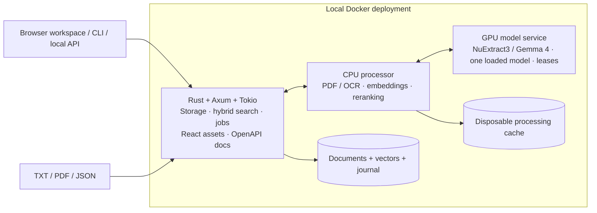

# VectorNext

**A Rust vector database for local, source-linked answers.**

Drop in TXT, PDF and JSON documents, type a question, and follow each answer back to its source. A local browser workspace brings the document library, conversation and original evidence together.

VectorNext implements its own storage engine, exact vector search, BM25 keyword index and ranking fusion in Rust. A three-service Docker deployment connects that core to local document processing and Hybrid NuExtract3/Gemma 4 answering. After setup, document processing and inference run offline.

The Rust API uses **Axum + utoipa**, with interactive documentation bundled locally. Once the app is running, open [API docs](http://localhost:8088/docs) to inspect endpoints and try requests, or download the [OpenAPI specification](http://localhost:8088/openapi.json). You can also use the **API docs** link in the workspace. Upload and removal requests in the documentation act on your local collection; response displays and downloads preserve exact numeric text.

[Try it](#quickstart) · [Technology stack](#technology-stack) · [Architecture](#architecture) · [API reference](#http-api-and-openapi) · [Measured results](#measured-results) · [Developer guide](docs/development.md) · [AGPL-3.0 license](LICENSE)


## From a document to an answer

Start with real mission data from [NASA's Voyager 1 page](https://science.nasa.gov/mission/voyager/voyager-1/): launched in **1977**, Jupiter flyby in **1979**, Saturn flyby in **1980**. The repository includes an attributed text snapshot of that page.

In the browser, select the document and ask: **“In which year was Voyager 1 launched?”** A local planning call proposes the answer fields automatically. Click the answer's citation to inspect the passage.

Advanced users can specify fields and presentation through the interface or existing API:

```json
{
  "question": "In which year was Voyager 1 launched, and in which years did it fly past Jupiter and Saturn?",
  "fields": {
    "launch_year": {"kind": "integer"},
    "jupiter_year": {"kind": "integer"},
    "saturn_year": {"kind": "integer"}
  },
  "template": "Voyager 1 | Launch: {launch_year} | Jupiter: {jupiter_year} | Saturn: {saturn_year}"
}
```

```text
Voyager 1 | Launch: 1977 | Jupiter: 1979 | Saturn: 1980
```

The response also includes retrieved passages, source locations, field proofs and processing timings. Answers distinguish supported facts, ambiguous questions and insufficient evidence. Optional prose drafts stay separate from validated fields and original sources.

[Explore the NASA source snapshot](evals/independent/fixtures/voyager1.txt) · [Verified demo](docs/reports/t11-readme-demo.json) · [Source attribution](evals/independent/README.md) · [Inspect the answer contract](docs/answers.md)

## What is built

| Capability | Implementation |
| --- | --- |
| **A local browser workspace** | React + TypeScript + shadcn/ui, served by Rust. Drag-and-drop uploads, ordinary questions, clickable citations, document replacement/removal, themes and browser history. |
| **An Axum API with local documentation** | Tokio execution, utoipa OpenAPI schemas and vendored Swagger UI. Existing browser/CLI contracts, bounded admission and exact numeric response text. |
| **An original database core** | Content-addressed originals, checksummed journal, atomic document revisions, immutable snapshots, checkpoints and recovery. |
| **Hybrid retrieval** | Exact cosine similarity, per-field BM25, bounded scalar/document/media filter indexes with exact scan fallback, reciprocal rank fusion and source-preserving deduplication. |
| **Document-aware ingestion** | TXT passages with byte mappings; PDF text, tables and OCR with page coordinates; JSON records with exact types and pointers. |
| **Local contextual retrieval** | Plain, structural and optional generated context, followed by CPU reranking and evidence expansion within token budgets. |
| **Automatic question planning** | One local model call proposes bounded fields from the original question/history, with reported counts, follow-ups, independent numeric types and explicit clarification/aggregation errors. Advanced fields bypass planning. |
| **Hybrid answers with durable jobs** | NuExtract first, one queued Gemma fallback when needed, or a forced model. Stable request IDs, revision-bound attempts, cancellation, reload recovery and exact diagnostic exports. |
| **Experimental evidence selection** | Opt-in `facet_coverage_v1` expands candidates with up to four field queries and selects complementary passages. Earlier `coverage_v1` remains available; ranked 30/20/5 stays the default. Both experiments retain their frozen results and failures. |
| **Answers with inspectable sources** | Typed fields, exact quotes or JSON pointers, deterministic templates, conversational context and separate presentation drafts. |
| **Readable workflow reports** | CLI commands, high-level function references and readable ingestion/search/answer steps, with saved Markdown and offline capture replay. |
| **Recovery and diagnostics** | Visible coordinator failures, bounded busy retries, PDF warnings before publication and rejected-answer diagnostics with unvalidated drafts. |
| **Durable local operation** | Resumable ingestion jobs, explicit retries, bounded processing queues, capability readiness and checksummed export/restore. |

For explicit JSON values, the model selects a record and a type-compatible RFC 6901 pointer constrained to the admitted evidence; Rust reads the original value. Ranked and coverage modes share these source-bound constraints, including escaped keys and arrays. A valid path still requires semantic review. Zero, a stored `null`, a missing field and a string such as `"007"` retain their distinct meanings. Generated context is stored separately and never becomes source evidence.

## Technology stack

These are the versions pinned in this repository, not a claim about the latest upstream releases.

| Layer | Technologies | Responsibility |
| --- | --- | --- |
| Database core | **Rust 2024**, Rust **1.87** toolchain; Serde, arbitrary-precision `serde_json`, SHA-256 and CRC32 | Original storage engine, deterministic ingestion, vector/keyword search, revision validation and typed answers. |
| Public HTTP API | **Axum 0.8.9 + Tokio 1.48.0** | Shared application state, routing, bounded asynchronous body reads and blocking application execution. |
| API documentation | **utoipa 5.4.0**, **utoipa-axum 0.2.0**, **utoipa-swagger-ui 9.0.2** | OpenAPI 3.1 definitions registered with routes; locally bundled, interactive Swagger UI. |
| Browser workspace | **React 19.3.1**, **TypeScript 7.0.2**, **Vite 8.3.4**, **Tailwind CSS 4.3.3**, shadcn/ui components built on Radix UI, Lucide icons | Document library, conversations, exact evidence inspection, accessible controls and themes. |
| CPU model workers | **Python 3.12**, **ONNX Runtime 1.31.0**, **Tokenizers 0.23.3**, NumPy | Actual token counting, MiniLM embeddings and cross-encoder reranking. |
| PDF processing | **Docling Slim 2.139.0**, Heron layout, TableFormer, **Tesseract 5.5.0**, CPU PyTorch and Poppler | Reading order, tables, native text/OCR, page regions and extraction diagnostics. |
| Local generation | **llama.cpp b11617**, CUDA **12.8**, two pinned GGUF models, Python supervisor and admission wrapper | Schema-constrained field planning, optional contextual annotations, answerability assessment, extraction and optional prose. |
| Packaging and checks | Docker Compose; Rust tests/Clippy, Python unittest/JSON Schema, **Vitest 5.0.4**, **Playwright 1.64.1** | Three runtime services, offline regression checks and browser verification. |

Dependency and artifact sources: [Cargo.toml](Cargo.toml), [Cargo.lock](Cargo.lock), [frontend package manifest](frontend/package.json), [CPU model dependencies](model_assets/requirements.txt), [PDF dependency lock](processor/requirements.lock), [supported artifact lock](model_assets/setup.lock.json) and [Docker build definitions](docker/). `tiny_http` remains only as a development dependency for test servers; production traffic uses Axum.

## Architecture



The Rust API is the sole database writer. Parsing and model calls run outside write transactions. The CPU processor has no database mount; only the generation service receives GPU access. Interactive generation runs ahead of waiting background enrichment, while active inference finishes without interruption.

**Query flow:** original question → optional local field planning → embedding + keyword search → rank fusion → CPU reranking → source-context expansion → answerability assessment → typed extraction → validation and formatting. Field planning cannot invent answer values, filters, JSON pointers or a replacement search question.

The versioned `field-planning-v3` operation uses only the original question and bounded conversation history. It defines the requested facts before evidence retrieval: reported counts and separate facts are allowed, calculations across records are unsupported, and unresolved references require clarification. Types are selected independently per field; ordinary missing evidence is not a nullable value. Each attempt plans fields independently with strict input/output bounds. Hybrid starts with NuExtract at temperature 0.2 and allows one Gemma attempt at temperature 0 when the result is not supported and validated; it never invents fallback fields or uses a rejected answer as evidence. Diagnostics record the planner version, original-input hash, prompt/schema/model identities and timings. [Planner contracts](docs/browser-api.md) · [Planner verification](docs/reports/t26-planning.md).

### Storage, transactions and recovery

VectorNext owns the database and search algorithms. It does not wrap another vector database or search engine, and the runtime needs neither MinIO nor Redis.

- **Original evidence:** immutable files live under `blobs/<sha256>`. A document revision stores parsed blocks, chunks, source locations, typed attributes, context and vectors. Original evidence and generated annotations remain separate.
- **Atomic publication:** a checksummed append-only journal records prepare/commit pairs, with file synchronization before acknowledging a generation. Complete revisions become searchable together; partial ingestion drafts do not. Expected-revision checks prevent stale replacement/removal.
- **Consistent readers:** queries use immutable snapshots. Existing readers retain their generation while new readers see a complete committed replacement. A process-held writer lock protects the database directory.
- **Recovery:** startup validates checkpoints, committed records and originals, then replays journal entries. Incomplete uncommitted tails can be repaired; complete corrupt frames fail closed. Stable operation receipts make publication retries idempotent.
- **Streaming checkpoints:** The checkpoint format removes the aggregate 64 MiB snapshot limit with numbered 1 MiB segments, per-frame CRCs and a terminal SHA-256 manifest. Legacy snapshots remain readable; older binaries reject new snapshots. Verified checkpoint, forced-restart recovery and export/restore at both formerly failing benchmark sizes. Individual journal/job frames still have a 64 MiB limit, and exports retain an 8 GiB total bound. [Format and rollback boundary](docs/storage.md#t21-bounded-checkpoint-stream) · [Verification](docs/reports/t21-checkpoints.md).
- **Durable jobs:** stage state is stored in separate atomic checksummed files. Interrupted work can resume; saved failures require explicit retry. Checkpoints do not reclaim old journal entries, blobs or receipts; storage compaction remains future work.
- **Portable backups:** offline export includes originals, records, vectors, ingestion jobs and an exact file/hash manifest. Operational answer-job history needs a separate stopped-volume copy; browser conversations have their own export. Restore validates into a new destination under the exclusive writer lock. Linux/Docker storage is supported; native Windows filesystem durability is not.

Vectors are stored as `float32`; exact cosine accumulates in `float64`. Each embedding space hashes the model artifact, tokenizer, preprocessing, dimensions, limits, prefixes and normalization. Equal vector dimensions do not make two spaces interchangeable. Disposable in-memory indexes are built from a committed snapshot and space identity; the application caches up to four spaces and rebuilds for a new generation. There is no approximate nearest-neighbor index yet.

[Storage contract](docs/storage.md) · [Deployment and backup contract](docs/deployment.md) · [Storage implementation](src/)

### Ingestion and chunking

The durable pipeline is `Uploaded → Parsed → Chunked → Contextualized → Embedded → Committed`. Browser PDF preparation happens before durable job acknowledgement and is shown separately. Upload identities survive retries; an uncertain response is reconciled before resubmission.

| Format | Parsing and chunk boundaries | Evidence retained |
| --- | --- | --- |
| TXT | Strict UTF-8; normalized newlines; explicit Markdown headings, paragraphs and lists. Neighboring blocks combine within a section; oversized passages split at sentence/word boundaries where possible. | Original bytes, normalized-to-original byte mappings, one-based lines and section ancestry. |
| PDF | CPU extraction recovers reading order, headings, native/OCR text and tables. Prose can cross page boundaries within a section. Table rows retain header/caption/unit context; oversized rows split with those references. | Original PDF, page numbers and regions, extraction method, table coordinates, OCR diagnostics and partial-extraction warnings. |
| JSON | Root arrays become records, or a caller supplies a nested record-array pointer. Small records stay together; oversized containers split at child boundaries and long strings split as narrative text. Duplicate keys/record IDs are rejected. | Exact numbers and types, full record attributes, selected subtrees, record identity and revision-scoped RFC 6901 pointers. |

The API uses a **180-token chunk target**, checked with the actual encoder. The current MiniLM embedding input has a **256-token hard limit**, including context, prefixes, separators and special tokens. TXT uses zero overlap; answer assembly can expand into neighboring source passages. Oversized indivisible values or required context fail explicitly instead of being silently truncated. PDF extraction is strict by default; `allow_partial` is an explicit opt-in, and warnings remain attached to evidence.

Context policies are `plain` (evidence), `structural` (structure plus evidence, the default) and `generated` (an additional separate annotation). Generated context reserves 64 embedding tokens and enriches eligible prose/list chunks; explicit JSON and tables retain structural context. Its input scope, prompt/configuration identity and outcome are recorded. It can improve retrieval inputs but cannot become answer evidence.

[TXT/JSON contract](docs/ingestion.md) · [PDF/OCR contract](docs/pdf-ingestion.md) · [Model/context contract](docs/model-ingestion.md)

### Retrieval and answer integrity

1. **Preserve the request.** Each ordinary-question attempt adds one schema-constrained call to its selected model to propose field names/types. Explicit fields bypass it. The original question, bounded history and caller-selected document scope remain authoritative.
2. **Retrieve candidates.** Exact cosine and our own per-field BM25 index run over the selected snapshot/space. Explicit typed filters apply before branch selection. Numeric filters use exact decimal comparisons; missing values, nulls, strings and numbers have distinct semantics.
3. **Fuse and rerank.** Weighted reciprocal rank fusion combines branch ranks, followed by conservative source-preserving deduplication and CPU cross-encoder reranking. Default answer budgets are **30 candidates per branch / 20 reranked / 5 primary passages**.
4. **Assemble evidence.** Include original spans, required headings/table labels, complete JSON records and eligible neighbors within the rendered prompt budget: **3,328 input tokens + 768 reserved output tokens** in a 4,096-token context. Skipped expansions are recorded.
5. **Assess and extract.** The selected model separately assesses answerability, then extracts schema-constrained fields for supported requests. Ambiguous and insufficient-evidence outcomes remain explicit; invalid proofs are rejected.
6. **Resolve and validate.** For JSON evidence, the model selects an existing record/pointer and Rust materializes the exact source value. For prose, Rust checks typed values, quoted evidence and numeric boundaries against the supplied source. Templates format validated values; optional generated prose stays a labelled draft.

Opt-in facet coverage adds field-derived candidate searches and replaces the final passage selector. It keeps at most 20 reranker candidates and five primaries, suppresses heading-only/substantially overlapping passages, and records planned versus admitted evidence. Neighbor expansion is disabled for this mode; required source labels and complete JSON records still accompany admitted evidence. [Facet selection contract](docs/answers.md#facet-coverage-t25-opt-in).

BM25 uses separate evidence, structural and generated fields with `k1=1.2`, `b=0.75`; RRF defaults to `k=60`. Unicode keyword normalization handles case/diacritics without modifying source evidence. The application sets structural/generated keyword weights to 1 independently of ingestion policy; a fully plain comparison must set both to 0. The underlying search library defaults generated weight to 0. Rankings, filter exclusions, suppressed duplicates, evidence, model identities and stage timings are inspectable.

An explicit `structured_lookup` request can scan selected JSON records and materialize pointer values without model extraction. It requires caller-supplied fields/scope; automatic planning cannot invent pointers or filters. Corpus-wide aggregation is unsupported. Mechanical validation establishes source/type support, not universal semantic correctness.

[Retrieval contract](docs/retrieval.md) · [Answer contract](docs/answers.md) · [Workflow reports](docs/workflow-debugging.md)

### Local models and scheduling

| Component | Pinned choice | Execution |
| --- | --- | --- |
| Embeddings | all-MiniLM-L6-v2 | CPU ONNX; 384 dimensions, 256-token encoder limit. |
| Reranking | ms-marco-MiniLM-L-6-v2 | CPU ONNX cross encoder. |
| First attempt | NuExtract3 Q4_K_M, requested-facts-v1 | GPU, temperature 0.2. |
| Fallback / optional enrichment | Gemma 4 12B QAT Q4_0 | GPU, temperature 0. |
| PDF extraction | Heron, accurate TableFormer, English Tesseract | CPU with extraction/OCR provenance and diagnostics. |

**Hybrid is the default answer mode.** It accepts NuExtract only after a supported factual answer passes schema, exact-value and source-proof checks. Otherwise it queues one independent Gemma attempt using the original question, history, scope and retrieval settings. Gemma's final outcome can legitimately be ambiguous or insufficient evidence. Invalid requests, pre-inference aggregation rejection, stale bindings, cancellation and admission failures do not trigger fallback. Optional prose failure does not discard validated facts. Mechanical validation is not a guarantee of semantic correctness.

Choose **Gemma only** or **NuExtract only** to disable fallback. These are the only two supported models. Both retain 4,096-token context, one inference slot, f16 KV, seed 42, disabled reasoning, two-call assessment/extraction and `cache_prompt: false`. Retrieval remains ranked 30/20/5. Generated ingestion context always uses its saved Gemma policy, independently of answer mode.

The durable Rust coordinator admits at most **16 unfinished answer jobs** and reserves diagnostic capacity inside a **256 MiB** retention limit. Completed records stay until explicitly cleared. Work is grouped by model; the coordinator hands off when that queue empties, after four attempts with opposite-model work waiting, or after an opposite-model wait of 30 seconds once active work finishes. A next-attempt wait of 15 minutes expires visibly. Model loading is additional latency, especially for fallback on an 8 GB GPU.

The generation supervisor owns one llama.cpp backend. A model lease spans planning, template rendering, token counting, assessment, extraction and optional prose. Switching stops and reaps the old backend before loading/verifying the next, with a 240-second activation budget. Interactive work takes priority over waiting enrichment; active inference is not interrupted. Cancellation blocks subsequent generation stages. Uncertain attempts are never silently replayed after restart.

Production locks and verified download/encoder utilities live in [`model_assets/`](model_assets/). Exact model/runtime identities separate caches and audits. Setup prepares both generators. Old alternative generators, temperature/KV/single-call switches and their runners are preserved through the [historical source archive](archives/llm/README.md), outside the supported app.

### HTTP API and OpenAPI

**Axum + Tokio** handles public HTTP traffic. Routes share an `Arc<Application>`; synchronous storage/application/processor calls execute through `spawn_blocking`. A semaphore admits **16 requests immediately** and returns the existing `503 busy` envelope when full. Running work retains its permit after client cancellation. The HTTP migration adds no automatic operation retries or new operation deadlines.

`utoipa-axum` registers routes and collects OpenAPI definitions together. Explicit wire schemas describe stable envelopes without changing existing Rust serialization. The browser, CLI and documentation use the same local address. Vendored Swagger UI disables external validation and uses local scripts compatible with the content-security policy. Its custom renderer and raw-response download preserve the original JSON text.

| Purpose | Routes |
| --- | --- |
| Health and diagnostics | `GET /healthz`, `GET /readyz`, `GET /v1/metrics` |
| CLI document ingestion/inspection | `POST /v1/ingest`, `GET /v1/documents`, `POST /v1/document` |
| Durable ingestion jobs | `GET /v1/jobs`, `POST /v1/job`, `POST /v1/retry` |
| Search and explicit-field answers | `POST /v1/search`, `POST /v1/ask` |
| Browser library and multipart uploads | `GET /v1/ui/library`, `POST /v1/ui/upload`, `POST /v1/ui/upload-status` |
| Revision-bound changes and evidence | `POST /v1/ui/remove`, `POST /v1/ui/source`, `GET /v1/ui/original` |
| Compatibility questions | `POST /v1/ui/ask`, `POST /v1/ask` (same durable coordinator; omitted mode is Hybrid) |
| Durable answers | `POST /v1/answer-jobs`, `GET /v1/answer-jobs`, `GET /v1/answer-jobs/{request_id}` |
| Answer cancellation / explicit clearing | `POST /v1/answer-jobs/{request_id}/cancel`, `POST /v1/answer-jobs/{request_id}/clear` |
| Local documentation | `GET /openapi.json`, `GET /docs` and bundled assets under `/docs/` |

All POST requests require `X-VectorNext-Client: 1`, a positive `Content-Length` and the documented content type. JSON is limited to **64 KiB**, except base64 ingestion at **23 MiB**. Multipart upload requires exactly one `metadata` JSON-text field (up to 8 KiB) and one binary `file` (up to 16 MiB), within a 16 MiB + 16 KiB envelope. Browser origins must match the loopback host exactly; CLI clients can omit Origin. The adapter explicitly preserves existing method/query/error behavior rather than inheriting Axum's default rejections or automatic HEAD success.

Errors retain machine-readable envelopes: invalid input/rejected legacy answers use 400, unrelated origins 403, revision conflicts 409, and busy/unavailable capabilities 503. Browser answer outcomes additionally distinguish rejected results without promoting their drafts to facts. Liveness and capability readiness are separate, so documents remain inspectable during model outages.

Replacement supplies the current revision through upload metadata; removal also requires it. Both reject changes while that document has unfinished ingestion work. Sources and original PDFs are revision-checked. Browser answer values cross the JavaScript boundary as **text plus their types**, and diagnostic reports remain opaque JSON text for exact export.

[Interactive API docs](http://localhost:8088/docs) · [OpenAPI JSON](http://localhost:8088/openapi.json) · [Browser wire contract](docs/browser-api.md) · [HTTP implementation](src/service/http.rs) · [Migration verification](docs/reports/t19-axum.md)

### Frontend and local persistence

The three-panel workspace contains the library, conversation and source evidence. Vite builds the React/TypeScript assets in a Docker stage; the API image serves them with local fonts/icons/assets. Normal use needs no Node process, frontend server or external CDN. shadcn/ui/Radix controls provide the interaction primitives; Tailwind handles layout and light/dark styling.

IndexedDB stores conversations, captured evidence, upload/answer recovery IDs, answer mode and theme in the current browser/origin. There is no server-side chat store. Operational answer jobs, including their original requests and exact diagnostics, live beside the database at `/storage/db.answer-jobs`; database exports exclude that history. One pending turn per conversation is reserved in IndexedDB, including across tabs. Other conversations and callers can queue concurrently. Only the last four complete supported exchanges enter request history, with a 4-KiB limit per turn and no silent shortening. Scope changes start a new conversation. Historical evidence remains captured after replacement/removal; it is never silently substituted with the latest document revision. Processing views show actual state and elapsed time, not estimated stage percentages.

### Deployment, isolation and configuration

The normal Compose project runs these three services:

| Service | Image | Resource limits | Data access |
| --- | --- | --- | --- |
| `vectornext` | `vectornext-app:t37-hybrid` | 2 CPUs, 4 GiB RAM | Sole read/write mount of the `data` volume at `/storage`; API, React and docs on host loopback port 8088. |
| `processor` | `vectornext-app-processor:t37-hybrid` | 4 CPUs, 6 GiB RAM | Read-only model files and disposable `cache` volume; no database mount or GPU. |
| `llm` | `vectornext-app-llm:t37-hybrid` | 8 CPUs, 32 GiB RAM, NVIDIA GPU | Read-only GGUF weights; internal network endpoint with the llama.cpp backend behind the scheduler. |

These are configured limits, not typical utilization. Containers use read-only root filesystems, bounded temporary storage, dropped capabilities and `no-new-privileges`. Processor/generator communication stays on an internal Docker network; only the API publishes a host port. CLI and offline-admin containers run on demand through the `tools` profile. The admin tool has no network and requires exclusive database ownership for export/restore.

| Setting | Default | Meaning |
| --- | --- | --- |
| `VECTORNEXT_PORT` | `8088` | Host loopback port for the workspace/API. |
| `VECTORNEXT_DEFAULT_ANSWER_MODE` | `hybrid` | Initial mode for a browser without a saved choice: `hybrid`, `gemma` or `nuextract`. |
| `VECTORNEXT_DATA` | `/storage/db` | Database directory inside the persistent data mount. |
| `VECTORNEXT_MODELS_DIR` | `./models` | Host model directory mounted read-only. |
| `VECTORNEXT_BACKUPS_DIR` | `./backups` | Host export/restore directory for the admin container. |
| `VECTORNEXT_STRUCTURAL_WEIGHT` | `1` | Structural-context BM25 weight, finite range 0–10. |
| `VECTORNEXT_GENERATED_WEIGHT` | `1` | Generated-context BM25 weight, finite range 0–10. |

The CPU worker uses existing 420-second operation deadlines, extended to 720 seconds for the multi-call answer operation; PDF subprocess work has a 185-second outer deadline. Failed stages remain explicit instead of being retried indefinitely. Remote authentication, multi-user isolation, token streaming, integrated PDF bounding-box highlighting and automatic storage compaction remain outside the implemented scope.

[Compose configuration](compose.app.yaml) · [Architecture and decisions](docs/architecture.md) · [Operational commands](docs/development.md) · [Recovery guide](docs/reliability.md)

## Measured results

### Hybrid answering and model comparisons

The supported app uses NuExtract3 first and queues one Gemma attempt when its factual result fails validation or does not answer the question. Forced Gemma and NuExtract modes make behavior explicit. The bounded integration check passed **8/8 cases in each mode**: five source-supported answers and three correct negative/API outcomes. Hybrid accepted all five supported NuExtract answers and used fallback for two of seven admitted questions. These are observed regression cases, not independent quality evidence.

| Observed integration result | Hybrid | NuExtract only | Gemma only |
| --- | ---: | ---: | ---: |
| Correct cases under rules frozen before testing | 8/8 | 8/8 | 8/8 |
| Median attempt work, five common supported answers | 3.62 s | 3.54 s | 12.55 s |
| Model fallbacks | 2 | 0 | 0 |

Attempt work excludes queueing and model loading and includes CPU retrieval. **Fallback is substantially slower:** the measured missing-evidence case took **90.29 s**, including 60.94 s loading Gemma. The batch timing comparison also includes cold switches and an overnight PC-sleep interruption, retained in raw captures and excluded from derived latency summaries. Live switching, backend failure and API restart checks passed with at most one backend observed across 236 samples. [Complete measurements, scoring corrections and limitations](docs/reports/t37-hybrid.md) · [Frozen protocol](docs/t37-protocol.md) · [Reproduce](experiments/t37/README.md).

The [historical model comparisons](archives/llm/comparisons.md) retain the complete 12B/26B table, pointer-constraint changes, accuracy/latency measurements, NuExtract planning repair and limitations. Archived model experiments are not runtime choices. MiniLM remains the embedding/reranking default; [embedding/reranker measurements](docs/reports/t32-replacements.md) remain separate from generation routing.

### Database comparison: PostgreSQL + pgvector

The database benchmark compares the existing VectorNext core with **PostgreSQL 18.6 + pgvector 0.8.7**, using identical synthetic 384-dimensional vectors and equal limits of **2 CPUs / 4 GiB per database**. PostgreSQL exact search was faster in all tested warm query groups; both exact engines returned correct results throughout.

| Vectors | VectorNext exact median | PostgreSQL exact median | PostgreSQL HNSW median (ef=40) | HNSW recall@10 |
| ---: | ---: | ---: | ---: | ---: |
| 12,800 | 8.818 ms | 5.673 ms | 0.586 ms | 100% |
| 51,200 | 43.862 ms | 22.729 ms | 0.843 ms | 99.0625% |

These are **warm, unfiltered client timings**, with 32 independent query vectors repeated three times per corpus. The full run includes filtered and empty searches: 4,096 timed requests, no query errors, and 2,048/2,048 exact requests correct. This measures supplied-vector search/storage, not semantic relevance or end-to-end answer quality; HTTP/PostgreSQL protocols and storage schemas differ.

**The benchmark exposed a checkpoint limit:** VectorNext's snapshot exceeded its 64 MiB frame at both sizes, while PostgreSQL checkpointed successfully. **Streaming checkpoints fix that limit** with streamed checkpoints: fresh copies now checkpoint, recover after SIGKILL, export and restore, with 768/768 exact-query checks passing. The original benchmark results remain unchanged; no new comparative speed claim follows. PostgreSQL remains benchmark tooling, not a production dependency. [Checkpoint results and compatibility](docs/reports/t21-checkpoints.md).

[Full results, filters and limitations](docs/reports/t20-pgvector.md) · [Measurements and hashes](docs/reports/t20-pgvector.json) · [Run the benchmark](experiments/t20/README.md)

### Indexed filter execution

The filter benchmark profiles the same synthetic stores with baseline and optimized Rust release binaries. At 51,232 vectors, warm in-process scalar equality fell from **16.302 ms to 0.252 ms**, empty-result filtering from **16.693 ms to 0.059 ms**, and numeric-range queries from **25.177 ms to 1.024 ms**. All 4,224 requests matched complete response hashes across repeated groups. Index construction costs more; nested JSON/container predicates retain scan behavior. These exclude HTTP/serialization and are not new PostgreSQL comparison results. [Protocol, full measurements and limitations](docs/reports/t22-filters.md).

The candidate-retrieval experiment tests evidence retrieval on **12 fresh NIST references / 188 chunks**, using real CPU embeddings and reranking. Across 96 successful requests, question-focused candidate expansion improved complete evidence coverage in the 20-passage shortlist from **18/20 to 20/20 questions**, but final-five coverage stayed **16/20**. This motivated the separate final-evidence selection experiment below. These are agent-authored literal-source coverage measurements, not generated-answer accuracy or independent human adjudication. [Frozen protocol, results and limitations](docs/reports/t23-evidence.md) · [Reproduce](evals/evidence/README.md).

The final-selection experiment holds the expanded shortlist constant and tests final passage selection on **10 fresh NASA references / 388 chunks**. Facet-focused selection improves complete frozen final evidence coverage from **16/20 to 18/20 questions**, with no measured regressions, but median uncached retrieval latency rises from **685 ms to 1,437 ms**. All 96 requests succeeded. The application exposes this selector as an opt-in mode; those frozen scores measure authored facets and passage coverage, not the automatic app or generated-answer quality. [Results, cost and source-review limitations](docs/reports/t24-final-selection.md) · [Reproduce](evals/selection/README.md).

### Automatic field-planning verification

The planner repair addresses follow-up/count failures exposed during application integration, then separately addresses a mixed numeric-type failure discovered during verification. Its final `field-planning-v3` candidate passed:

| Check | Result |
| --- | --- |
| Newly frozen planner cases | **12/12** — independent field types, counts, follow-ups, units/date constraints, raw nulls and appropriate refusals. |
| Fresh source-backed API workflows | **8/8** — TXT/PDF/JSON, separate document counts, a conversational follow-up, exact decimal/zero/null values, missing evidence and invalid requests. |
| Previously observed planner failures and controls | **5/5** — regression checks kept separate from the new cases. |
| Live browser workflow | Automatic questions, history/scope handling, clickable sources, IndexedDB reload and exact diagnostic export passed. |

The final planner's median call took **7.11 seconds** on its 12-case set. Ordinary questions add this one planning operation before retrieval and the existing answer operations; explicit fields bypass it. These small, agent-authored synthetic checks establish the tested integration behavior. Broad semantic accuracy remains unproven. The first candidate's decimal-type failure and all original scores remain recorded. [Results and retained failures](docs/reports/t26-planning.md) · [Machine-readable results](docs/reports/t26-planning.json) · [Reproduce with isolated data](experiments/t26/README.md).

### Retrieval and answer evaluations

Measured on an **RTX 4060 with 8 GB VRAM, Ryzen 5 7600 and approximately 64 GB system RAM**, using Docker on Windows/WSL 2.

**Public-source answer comparison: question-aware evidence coverage.** Eight new NASA/USGS sources, 201 chunks and 16 frozen questions compare three strategies across 96 local requests:

| Configuration | Exact outcomes, each pass | Median, cold / warm |
| --- | --- | --- |
| Ranked five — default | 8/16 | 29.18 / 28.53 s |
| Ranked two | 7/16 | 18.19 / 17.34 s |
| Field coverage — experimental | 8/16 | 16.50 / 15.86 s |

Coverage reduced median latency by **43.5–44.4%**, but did not increase strict answer accuracy or clear the adoption gate. **Ranked five remains the default.** The experiment distinguishes missing candidates, evidence selection and quote-validation failures. One question also permits a reasonable interpretation different from its frozen ambiguity label; the score and source-review exception are both retained. This is a small diagnostic corpus, not an independently administered benchmark.

The evidence-coverage experiment found numeric proof defects. **The numeric validator repairs them:** exact English grouped numbers and named-month date years validate, while shortened numeric quotes are checked against the complete supplied passage. For example, `3,000` supports `3000`; clipping it to `3` cannot support `3`. Original quotes, exact values and historical scores are preserved. These mechanical checks do not guarantee factual correctness. [Numeric-proof verification and limits](docs/reports/t15-numeric-proofs.md) · [Evidence-coverage results](docs/reports/t14-evidence-coverage.md) · [Readable coverage trace](docs/reports/t14-coverage-workflow.md) · [Try the experimental option](evals/coverage/README.md).

**Earlier public-source comparison:** **20 NASA/USGS documents and 28 questions**, with the same corpus, models and retrieval settings for both passage limits. Its corpus/annotation protocol differs from the evidence-coverage suite, so the answer rates are not directly comparable.

| Answer configuration | Median, cold cache | Median, warm cache | Correct outcomes / planned |
| --- | --- | --- | --- |
| Structural context, five primary passages — default | 22.27 s | 21.17 s | 16/28 in each pass |
| Structural context, two primary passages — opt-in experiment | 11.08 s | 11.51 s | 15/28 in each pass |

Two passages reduced median response time by **46–50%**, but lost a three-document answer and a conversational follow-up that five handled. It improved one answer by removing a numeric distractor. **Five remain the default.** Latencies include errors and abstentions; faster responses do not necessarily mean successful answers.

Only **18/20 documents were admitted, producing 658 chunks**. One PDF failed strict partial-extraction admission; the other hit a busy processing lane. Their six questions remain in the denominator. This exposes real ingestion and evidence-selection gaps, and does not establish PDF retrieval quality. The 112 requests repeat 28 questions across four blocks. Codex authored and reviewed this public-source set; it is independent of the old synthetic corpus, not an independently administered benchmark. The original six holdout questions remain unused.

A separate **core-only capacity probe** searched **12,800 supplied 384-dimensional vectors across 400 synthetic documents** in **9.95 ms median**, with **79.3 MiB peak process RSS**. This measures hybrid search capacity; it excludes document parsing, embeddings and answer generation.

Evidence-coverage verification passed **217 automated checks** (101 Rust, 116 Python), plus formatting, lint and Compose validation. Those checks are separate from answer quality and the newly recorded numeric-boundary diagnostic. Reliability verification also completed a CPU recovery/PDF drill; see [results](docs/reports/t13-reliability.md). The earlier public-source evaluation found and fixed a UTF-8 ingestion panic; the earlier failed attempt is retained.

The earlier synthetic development comparison passed 13/13 questions with both limits. Generated context increased its five-file ingestion from **24.76 s to 72.16 s** without improving final answers, so structural context remains the default. Broader quality and sustained-load performance remain open.

[Public-source evaluation and failures](docs/reports/t11-independent.md) · [Machine-readable evidence](docs/reports/t11-independent.json) · [Dataset and reproduction](evals/independent/README.md) · [Earlier development/capacity results](docs/reports/t10-evaluation.md)

## Quickstart

Use Docker Desktop with WSL 2, Linux containers and NVIDIA GPU support. The tested PC has an RTX 4060 (8 GB VRAM) and about 64 GB RAM. Setup installs **both** supported GGUFs, plus CPU/PDF models; allow additional disk space for images and documents. The Hybrid integration run sampled **7,735 MiB whole-device GPU use**, leaving only 453 MiB at that sample. One model is loaded at a time. These observations are not minimum system requirements or a guarantee that concurrent GPU workloads fit; WDDM paging was not instrumented. See [artifact sizes and hashes](model_assets/setup.lock.json) and [hardware measurements](docs/reports/t37-hybrid.md).

### Windows: setup once, then double-click

1. Clone or download this repository. Start Docker Desktop.
2. Double-click **[VectorNext.cmd](VectorNext.cmd)** and choose **Setup**. This checks Docker/GPU access, downloads and verifies pinned models, builds the three services, and opens the app. Existing valid models are reused. First setup needs internet access and can take a while.
3. On later visits, double-click **[Start VectorNext.cmd](Start%20VectorNext.cmd)**. It reuses the installed images and models, then opens **[localhost:8088](http://localhost:8088)**. The header shows each capability while models finish loading.

Inside the app: **choose or drop files → select documents → type a question → click a citation**. Try [the Apollo 11 notes](tests/fixtures/ui/apollo11.txt) and ask “In which year did Apollo 11 launch?” TXT, PDF and JSON are accepted up to 16 MiB each. IDs and ordinary answer fields are automatic. Replace and Remove are in the library; removal asks for confirmation.

Automatic field planning works with both Ranked and Facet coverage. A follow-up can refer to a subject from the visible conversation context; the answer still needs supporting document evidence. Advanced controls let you supply fields directly, choose retrieval options or request a separately labelled prose draft. A missing fact produces an insufficient-evidence outcome rather than a guessed value.

Use **VectorNext.cmd → Stop** to stop only this application while keeping documents, models and caches. Choose **Rebuild** after pulling code changes. Routine Start never builds or downloads. The equivalent scripted actions are `powershell -File deployment/VectorNext.ps1 -Action Setup`, `Start`, `Rebuild`, `Stop` or `Status`.

Conversations and captured evidence live in **IndexedDB in this browser**, not on the server. Use **Export** before clearing browser data or changing profiles. Different hostnames/ports have separate histories; use the same `localhost:8088` address consistently. Only the last four supported question/answer exchanges are sent as context. Changing document scope starts a new conversation. Historical passages stay captured after a document is replaced or removed. See [browser/API details and limits](docs/browser-api.md).

### Try facet coverage

Open **Advanced answer controls → Evidence selection → Facet coverage (experimental)** before asking a question. The app derives up to four focused searches from the requested answer fields, merges candidates, and picks up to five complementary source passages. **How did you find this?** shows the recorded facet queries and planned/admitted passages. Extra CPU searches and reranking can take longer; Ranked stays the default. The choice resets on page reload, while saved answers retain their recorded workflow.

The API accepts `"options":{"evidence_strategy":"facet_coverage_v1"}` on `/v1/ui/ask` or `/v1/ask`; CLI users can add `--evidence-strategy facet_coverage_v1`. The mode requires 1–4 fields, reranking enabled, at most 20 reranker candidates and five primaries. It preserves explicit document scope, exact JSON values and source validation.

Facet selection remains experimental: the final-selection passage-coverage results do not establish end-to-end answer accuracy. The planner repair addresses the measured automatic-planning failures from its application integration; broader relevance and ambiguity handling still need evaluation. [Planning results](docs/reports/t26-planning.md) · [Historical integration results](docs/reports/t25-facet-integration.md).

### Troubleshooting

- **Docker is unavailable:** start Docker Desktop and enable Linux containers/WSL 2. Setup checks GPU visibility inside Docker.
- **Models are still loading:** browse documents while the capability indicators update. GPU contention or insufficient system RAM can slow generation. Stop other GPU experiments before launching this stack.
- **Upload is busy or interrupted:** the interface retains its upload identity, reconciles saved work and offers Retry. Saved processing failures require explicit retry. A failed replacement must finish before that document can be removed.
- **PDF was rejected:** inspect the failure; strict extraction is the default. Enable partial extraction in Upload options only when incomplete extraction is acceptable. Warnings remain available with evidence.
- **A year from a range is rejected:** only exact endpoints from complete unsigned two-segment ranges are accepted, with guards for dates, signs, identifiers and clipped numbers. Interior values and duration calculations remain unsupported. [Range rules and verification](docs/reports/range-endpoints.md).
- **Question planning fails:** a clarification error asks for a subject and requested fact; an aggregation error means a calculation across records is unsupported. Ask for separately reported facts or supply fields in Advanced. Invalid plans fail explicitly. Supported results still require human semantic review.
- **Browser storage failed:** keep the tab open and export conversations. Clear space or use a persistent browser profile; private mode/history deletion can remove saved conversations. Use one active tab to avoid competing workspace saves.
- **Answer is waiting or loading:** inspect Answer jobs for queue state, model loading, fallback reason and both attempts. Switching models costs time beyond inference. Cancellation stops queued work immediately and prevents the next stage after an active call.
- **Answer history is full:** export and explicitly clear terminal answer-job records. No diagnostic history is silently evicted.
- **Interrupted answer:** reload to poll its saved ID. An uncertain NuExtract attempt in Hybrid may use its remaining Gemma attempt after backend reconciliation; uncertain Gemma/forced attempts require explicit resubmission.
- **Upgrade refused:** an unfinished ingestion job requires an old generator. Finish it with the previous deployment; its saved policy is never rewritten.
- **Updated code is not visible:** choose Rebuild, then reload the browser. Start deliberately reuses installed images.

### Command-line setup and automation

The existing CLI and JSON API remain available. For manual setup:

#### 1. Get the repository and models

```sh
git clone https://github.com/dpittaluga76/VectorNext.git
cd VectorNext

docker compose -f compose.models.yaml build model-download
docker compose -f compose.models.yaml run --rm --no-deps model-download
docker compose -f compose.processor.yaml build processor
docker compose -f compose.processor.yaml run --rm pdf-setup
```

Initial setup needs network access and verifies both supported generators plus CPU assets. Existing checksum-valid files are reused. Weights stay outside images in `models/`; normal Start uses local files without builds or downloads. Legacy launcher model selection upgrades visibly to Hybrid. Use `./deployment/VectorNext.ps1 -Action Start -AnswerMode hybrid` (or `gemma` / `nuextract`) to choose the initial mode for new browser workspaces. Existing browser selections remain remembered.

#### 2. Start the application

```sh
docker compose -f compose.app.yaml build
docker compose -f compose.app.yaml up -d --no-build --pull never
docker compose -f compose.app.yaml run --rm client ready
```

Repeat the readiness check until the queue and model capabilities are available. Loading time depends on the selected model and storage; inspect the recorded activation time rather than treating warm inference as startup latency. The API listens at `http://127.0.0.1:8088`. Keep other VectorNext GPU experiments stopped while using this stack.

#### 3. Ingest, search and ask

```sh
docker compose -f compose.app.yaml run --rm client ingest /app/evals/independent/fixtures/voyager1.txt --document voyager-demo --job voyager-demo-v1 --wait
docker compose -f compose.app.yaml run --rm client search "Voyager 1 launch Jupiter Saturn"
docker compose -f compose.app.yaml run --rm client ask /app/tests/fixtures/answers/voyager.json
```

The last command submits a durable Hybrid answer job, prints its ID to stderr, reconciles uncertain acknowledgement and returns the exact full JSON report. Add `--answer-mode gemma` or `--answer-mode nuextract` to force a model. Inspect/resume with `client answer-job ID`; list with `client answer-jobs`, cancel with `client cancel-answer ID`, and explicitly clear a terminal record with `client clear-answer ID`. [Job API, timing and recovery contracts](docs/answer-jobs.md). In PowerShell, display just the formatted answer:

```powershell
$result = docker compose -f compose.app.yaml run --rm client ask /app/tests/fixtures/answers/voyager.json | ConvertFrom-Json
$result.formatted
```

To try your own files, create a `documents` folder in the repository and place a TXT, PDF or JSON file there. Mount it read-only; replace `example.pdf` with your filename:

```powershell
docker compose -f compose.app.yaml run --rm -v "${PWD}/documents:/input:ro" client ingest /input/example.pdf --document my-document --job my-document-v1 --wait
```

Use unique document/job names for different files. JSON arrays nested inside an object can use an explicit record pointer, such as `--record-pointer /features`. For another question, copy the [request example](tests/fixtures/answers/voyager.json) into that folder as `question.json`, edit its question/fields/template, then run:

```powershell
docker compose -f compose.app.yaml run --rm -v "${PWD}/documents:/input:ro" client ask /input/question.json
```

PDF ingestion is strict by default: unprocessed illustrations or uncertain OCR can cause rejection even when useful text was recovered. The ingest command supports `--allow-partial` when partial text extraction is acceptable for your document; extraction warnings remain attached to the stored document.

Stop with `docker compose -f compose.app.yaml stop`. Documents and models persist; subsequent starts use `up -d`. See the [operations guide](docs/development.md) for job inspection, retry, document replacement and backup commands.

#### 4. See how the workflow ran

Append `--explain` for a readable account of the input, processing steps, selected source passages and answer:

```sh
docker compose -f compose.app.yaml run --rm client ask /app/tests/fixtures/answers/voyager.json --explain
```

Use `--report` to save Markdown and `--capture` for offline replay. Reports include the client invocation, API handler and high-level function references beside the steps. See the [real Voyager workflow report](docs/reports/t12-voyager-workflow.md) and [commands for saving a complete workflow](docs/workflow-debugging.md).

## Verification

The core and fixture checks run in Docker without a GPU or model downloads. The first image build requires network access; test containers run with networking disabled.

```sh
docker compose build core evals
docker compose run --rm core
docker compose run --rm core cargo fmt --check
docker compose run --rm core cargo clippy --locked --offline --all-targets -- -D warnings
docker compose run --rm evals
docker compose run --rm evals python -m unittest evals.test_validate evals.test_score -v
docker compose run --rm -v "${PWD}:/workspace:ro" evals python -m unittest evals.independent.test_protocol evals.independent.test_summary -v
docker compose run --rm -v "${PWD}:/workspace:ro" evals python -m unittest deployment.test_workflow -v
```

These commands cover Rust storage/retrieval/application regressions, fixture/scorer integrity and workflow/client contracts. Coverage checks include `evals.coverage.test_coverage` and `model_worker.test_coverage`; reliability checks are in `deployment.test_reliability`. The final two commands mount the repository read-only and work in PowerShell or a POSIX shell. Model-worker checks, disk-volume recovery tests and live inference experiments have their own setup in the [developer guide](docs/development.md) and [evaluation guide](evals/README.md). Tests never regenerate sources or gold labels automatically.

Browser verification runs entirely in Docker:

```sh
docker build -f docker/ui-test.Dockerfile -t vectornext-ui-test:t37 .
docker run --rm --network none vectornext-ui-test:t37 npm test
docker run --rm --network none --ipc=host vectornext-ui-test:t37 npm run e2e -- workspace.spec.ts
```

The planner/profile contract tests need no models or GPU calls. Once the processor image is built:

```sh
docker run --rm --network none vectornext-app-processor:t37-hybrid /opt/model-env/bin/python -m unittest model_worker.test_planning model_worker.test_generator_profile -v
```

Hybrid verification passed Rust regressions and formatting/Clippy, **89 Python checks**, 71 frozen HTTP cases, five browser boundaries, three OpenAPI checks, six component checks and thirteen offline workspace scenarios, plus two real-adapter documentation/browser scenarios. The 24-question integration comparison and separate switching/outage drill are retained with their raw diagnostics. The existing library survived verified backup/restore and activation; a live source-linked browser answer, PDF opening, reload and export passed. [Verification, retained interruptions and rollback](docs/reports/t37-hybrid.md). The original holdout remains unused.

Browser workspace and launcher verification passed 116 Rust, 118 Python unit/regression checks, five live HTTP checks, five frontend component checks, nine offline browser scenarios and a production-browser scenario with real Gemma. [Results, retained failures and limitations](docs/reports/t16-t18-local-app.md). These are operational checks, not a new retrieval-quality benchmark.

The Axum migration additionally passed the frozen 71-case HTTP comparison, two OpenAPI schema checks and two browser scenarios against the real Axum adapter, including exact numeric requests/responses. See [the migration report](docs/reports/t19-axum.md) for isolated reproduction commands, rollback and limitations.

## Explore the implementation

| Start here | What to look for |
| --- | --- |
| [`src/`](src/) and [storage specification](docs/storage.md) | Record contracts, journal recovery, atomic publication and snapshots |
| [`src/search/`](src/search/) | Exact cosine, BM25, typed filtering, fusion and retrieval traces |
| [`src/ingestion/`](src/ingestion/) and [`processor/`](processor/) | Durable stages, format-aware chunking and source mappings |
| [`src/answers.rs`](src/answers.rs) and [`model_worker/`](model_worker/) | Evidence assembly, local models, exact JSON reads and generation scheduling |
| [`model_worker/planning.py`](model_worker/planning.py) and [`experiments/t26/`](experiments/t26/) | Field-only planning, strict output contracts, frozen checks and retained failures |
| [`model_worker/generator_profiles.json`](model_worker/generator_profiles.json) and [`model_assets/`](model_assets/) | The two supported generator profiles, immutable locks and download/encoder utilities |
| [`experiments/t28/`](experiments/t28/) and [Pointer-constrained results](docs/reports/t28-ranked-pointers.md) | Frozen pointer-contract checks, 208-request replay and conditional 12B rollout |
| [`src/service/`](src/service/) and [`deployment/`](deployment/) | Shared database ownership, API, CPU admission and client |
| [`frontend/`](frontend/) and [browser contracts](docs/browser-api.md) | React workspace, browser-only history, exact text rendering and Playwright scenarios |
| [`evals/`](evals/) and [public-source evaluation](docs/reports/t11-independent.md) | Frozen sources, paired comparisons, source-aware scoring, timings and retained failures |

## Project status and next steps

Implemented capabilities include storage, retrieval, TXT/JSON/PDF ingestion, local models, answers, Docker deployment, frozen evaluations, readable workflow reports, recovery diagnostics, experimental field-aware evidence selection, numeric proof validation, a reproducible pgvector comparison, bounded large-state checkpoints/exports, indexed scalar filtering, candidate/final-evidence retrieval experiments, automatic field-planning repairs and a gated 12B/26B model comparison. The app is ready for local experimentation within its documented limits. The browser workspace, Windows launcher and Axum API with offline OpenAPI documentation are implemented. The public API is still evolving; multi-user authentication remains out of scope.

Recovery includes coordinator supervision, PDF diagnostics before publication, bounded busy retries and rejected-answer diagnostics. Hybrid is the active default, with durable answer jobs and a single GPU backend switching between NuExtract and Gemma. Search includes bounded filter indexes and opt-in facet coverage; ranked 30/20/5 and MiniLM remain defaults. Pointer-constrained JSON extraction and conservative numeric range endpoints preserve exact source proofs. Historical model and retrieval comparisons remain linked with their failures. Broader planning reliability, semantic range interpretation and clearer ambiguity evaluation remain future quality work. Corpus-wide aggregation, storage compaction and approximate indexes remain outside the implemented scope; measured need should determine when they are added.

For contributions, start with the [architecture](docs/architecture.md), [active task tracker](docs/plan.md) and [working instructions](AGENTS.md). Completed task definitions, verification and historical handoffs are in the [task archive](docs/tasks-done.md). Reproducible retrieval failures with shareable source files are especially useful.

## License

Repository code is licensed under the [GNU Affero General Public License v3.0](LICENSE). Downloaded model weights, third-party dependencies and [NASA/USGS source snapshots](evals/independent/README.md#source-attribution-and-reuse) retain their respective terms. Their inclusion does not imply agency endorsement.
