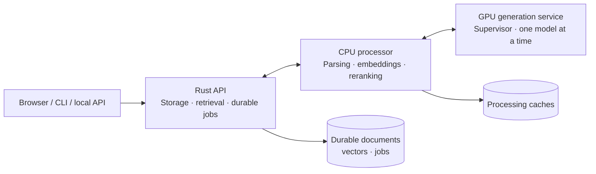

# VectorNext

**A Rust vector database for local, source-linked answers.**

Upload TXT, PDF or JSON documents, ask a question, and inspect the passages behind the answer. VectorNext combines its own storage engine, exact vector search and BM25 keyword index with a browser workspace and local NuExtract3/Gemma 4 inference.

The **Axum + utoipa API**, CPU document processor and GPU generation service run in three Docker containers. After setup, normal document processing and inference work offline.

[Quickstart](#quickstart) · [Usage](#usage) · [API docs](#http-api-and-openapi) · [Architecture](#architecture) · [Results](#measured-results) · [Developer guide](docs/development.md)


## What is built

| Capability | What you can do |
| --- | --- |
| Document workspace | Upload, replace and remove TXT, PDF and JSON; inspect processing jobs and extraction warnings. |
| Original vector database | Store documents, chunks, typed attributes and vectors with atomic revisions, crash recovery, verified export/restore and offline compaction/GC. |
| Hybrid retrieval | Combine exact cosine search, BM25, typed filters, reciprocal-rank fusion and CPU cross-encoder reranking. |
| Source-linked answers | Ask ordinary questions or supply structured fields; inspect exact values, citations, JSON pointers and PDF page references. |
| Local inference | Use NuExtract by default, or explicitly select Gemma or Hybrid; only one model occupies the GPU at a time. |
| Durable answer jobs | Queue questions, recover their status after reload, inspect attempts and export diagnostics. |
| Browser, CLI and HTTP API | Use the same application through a React workspace, command-line client or locally documented API. |

## Quickstart

Use Docker Desktop with WSL 2, Linux containers and NVIDIA GPU support. The tested PC has an **RTX 4060 with 8 GB VRAM and about 64 GB RAM**; this is a tested configuration, not a minimum specification. Setup prepares both supported generators plus CPU/PDF models. Allow disk space for their [pinned artifacts](model_assets/setup.lock.json), Docker images and documents. GPU headroom is limited; see the [hardware observations](docs/reports/t37-hybrid.md).

### Windows: setup once, then double-click

1. Clone or download this repository and start Docker Desktop.
2. Double-click **[VectorNext.cmd](VectorNext.cmd)** and choose **Setup**. It checks Docker/GPU access, downloads and verifies models, builds the services and opens the app. Existing valid models are reused; first setup needs internet access.
3. On later visits, double-click **[Start VectorNext.cmd](Start%20VectorNext.cmd)** to open **[localhost:8088](http://localhost:8088)** using installed images and models.

**Start** performs no builds or downloads. **Rebuild** applies repository changes; **Stop** stops only the normal VectorNext project and preserves documents, models and caches. **Status** shows its services. The launcher can also run from PowerShell:

```powershell
powershell -File deployment/VectorNext.ps1 -Action Start
```

### Command-line setup

For a fresh installation, clone the repository and run the setup commands:

```powershell
git clone https://github.com/dpittaluga76/VectorNext.git
cd VectorNext
docker compose -f compose.models.yaml build model-download
docker compose -f compose.models.yaml run --rm --no-deps model-download
docker compose -f compose.processor.yaml build processor
docker compose -f compose.processor.yaml run --rm pdf-setup
docker compose -f compose.app.yaml build
docker compose -f compose.app.yaml up -d --no-build --pull never
docker compose -f compose.app.yaml run --rm client ready
```

Open [localhost:8088](http://localhost:8088). Readiness can initially report unavailable capabilities while models load; document browsing remains available. For later starts, reuse `up -d --no-build --pull never`. Stop with `docker compose -f compose.app.yaml stop`. For upgrades, use the launcher and follow the [saved-job and rollback instructions](docs/reports/t37-hybrid.md).

## Usage

1. **Upload documents.** Drop TXT, PDF or JSON files into the library, up to 16 MiB each. Document and job IDs are automatic.
2. **Choose your sources and ask.** Select documents and type an ordinary question. The app plans answer fields automatically.
3. **Inspect the evidence.** Click a citation to see the exact passage, TXT location, PDF page or JSON pointer. Revision-checked original PDFs can open separately.
4. **Understand the result.** Expand **How did you find this?** for recorded workflow steps, timings and detailed function references. Outcomes distinguish supported answers, ambiguity, insufficient evidence and rejected output.

Replace and Remove are available in the library; removal asks for confirmation. Saved evidence stays tied to the document revision that produced it.

### From a document to an answer

Upload the attributed [Voyager 1 source snapshot](evals/independent/fixtures/voyager1.txt), select it and ask **“In which year was Voyager 1 launched?”** The source records **1977**. Click the citation to inspect its passage.

The [structured request example](tests/fixtures/answers/voyager.json) also asks for the Jupiter and Saturn flyby years and formats the validated fields as:

```text
Voyager 1 | Launch: 1977 | Jupiter: 1979 | Saturn: 1980
```

See the [recorded demo](docs/reports/t11-readme-demo.json), [source attribution](evals/independent/README.md#source-attribution-and-reuse) and [answer contract](docs/answers.md). Optional prose is a separately labelled draft; original evidence and validated fields remain available.

### Answer modes

| Mode | Behavior |
| --- | --- |
| **Hybrid** | Try NuExtract3 first. Accept a supported, validated answer; otherwise queue one Gemma attempt when the failure is eligible for fallback. |
| **Gemma only** | Use Gemma 4 12B QAT Q4_0 without fallback. |
| **NuExtract only — default** | Use NuExtract3 Q4_K_M with requested-facts-v1 without fallback. |

NuExtract-only is the default for new work, including optional generated enrichment. On upgrade, the browser and launcher apply this preference once and show a notice; saved turns and jobs retain their original modes. Gemma and Hybrid can still be selected explicitly. Existing Gemma enrichment keeps its saved policy. See [verification and rollback, including fractional-temperature compatibility](docs/reports/t39-measurement.md).

The browser remembers your choice and records it per question. Validation checks types and source support; it cannot guarantee semantic correctness. A model switch adds loading and queue time to inference latency. Invalid requests, stale sources, cancellation and admission failures do not trigger fallback.

Answer jobs show recorded queue, loading, attempt and completion states. Open job history to inspect both attempts, export diagnostics, cancel work or explicitly clear terminal records. Cancellation prevents later stages after an active call finishes. See [answer-job behavior and recovery](docs/answer-jobs.md).

### Advanced controls and history

Advanced options expose fields, templates, optional prose and retrieval settings. Defaults use **30 candidates / 20 reranked / 5 primary passages**, structural context and MiniLM. JSON record selection and partial PDF extraction are explicit options. Experimental facet coverage is available for 1–4 fields and adds CPU retrieval work; see its [contract and limits](docs/answers.md#facet-coverage-t25-opt-in).

Conversations and captured evidence live in **IndexedDB in this browser**, at the current origin. Use export before clearing browser storage and keep the same hostname/port. The visible context window includes at most four complete, validated exchanges; oversized turns are rejected rather than silently shortened. Changing document scope starts a new conversation.

Each conversation allows one unfinished turn. Reload recovers saved job IDs, and historical evidence is displayed as captured without substituting newer documents. Server-side answer-job records are separate from browser conversations and **excluded from database exports**; back them up with a stopped-volume copy. See [browser persistence](docs/browser-api.md) and [backup instructions](docs/development.md).

### CLI examples

The bundled fixture supports an end-to-end example:

```powershell
docker compose -f compose.app.yaml run --rm client ingest /app/evals/independent/fixtures/voyager1.txt --document voyager-demo --job voyager-demo-v1 --wait
docker compose -f compose.app.yaml run --rm client search "Voyager 1 launch Jupiter Saturn"
docker compose -f compose.app.yaml run --rm client ask /app/tests/fixtures/answers/voyager.json --explain
```

Add `--answer-mode gemma` or `--answer-mode nuextract` to force a model. Without `--explain`, the client preserves raw JSON response text, including exact numbers. It submits a durable job and reconciles uncertain HTTP outcomes instead of resending inference blindly.

```powershell
docker compose -f compose.app.yaml run --rm client answer-jobs
docker compose -f compose.app.yaml run --rm client answer-job YOUR_JOB_ID
docker compose -f compose.app.yaml run --rm client cancel-answer YOUR_JOB_ID
docker compose -f compose.app.yaml run --rm client clear-answer YOUR_JOB_ID
```

To ingest your own file, create a `documents` directory, place the file there and mount it read-only. Choose IDs appropriate to your document and ingestion attempt:

```powershell
docker compose -f compose.app.yaml run --rm -v "${PWD}/documents:/input:ro" client ingest /input/example.pdf --document my-document --job my-document-v1 --wait
```

JSON record selection uses `--record-pointer`; partial PDF extraction requires `--allow-partial`. Mount your own structured question file similarly when using `ask`. For readable reports, raw captures and offline inspection, see the [workflow debugging guide](docs/workflow-debugging.md).

## HTTP API and OpenAPI

Open **[interactive API docs](http://localhost:8088/docs)** or download **[openapi.json](http://localhost:8088/openapi.json)**. Swagger UI assets are bundled locally and require no CDN. Response displays and downloads preserve exact raw numeric text. “Try it out” uses the current origin and required client header; uploads and removals act on your local collection.

| Interface | Purpose |
| --- | --- |
| `/healthz`, `/readyz` | Liveness and capability readiness. |
| `/v1/documents`, `/v1/search` | Document inspection and retrieval. |
| `/v1/ui/` | Browser uploads, library summaries, revision-checked changes/sources and ordinary questions. |
| `/v1/answer-jobs` | Durable submission, listing, status/results, cancellation and clearing. |
| `/v1/ask`, `/v1/ui/ask` | Synchronous compatibility adapters over the answer-job coordinator. |

Requests preserve strict browser-origin checks; CLI requests can omit `Origin`. POST requests require `X-VectorNext-Client: 1`, the documented content type and positive `Content-Length`. Multipart uploads contain JSON metadata as text plus a binary file. See [HTTP contracts](docs/deployment.md), [browser endpoints](docs/browser-api.md) and [answer-job endpoints](docs/answer-jobs.md) for exact paths, limits and payloads.

## Architecture



The API is the sole database writer and serves the React app and API documentation. The CPU processor has no database mount; only the generation service has GPU access. Parsing and inference stay outside database transactions. Original evidence, generated annotations and formatted answers remain separate.

The database uses checksummed journals, streaming checkpoints and immutable query snapshots. Exact `float32` vectors are bound to immutable embedding-space identities; scalar/document/media indexes accelerate eligible filters with a scan fallback. JSON answers select constrained record pointers, then Rust materializes the exact source value and validates it. Prose proofs are checked against full source boundaries.

Read the [current architecture](docs/architecture.md), [storage contract](docs/storage.md), [retrieval contract](docs/retrieval.md) and [ingestion contract](docs/ingestion.md) for implementation details and invariants.

### Technology stack

| Layer | Technology |
| --- | --- |
| Database and HTTP | Rust; Axum + Tokio; utoipa, utoipa-axum and locally bundled Swagger UI. Blocking application work has bounded admission. |
| Browser | React + TypeScript + Vite, Tailwind CSS and shadcn/ui components; IndexedDB history, light/dark themes. |
| CPU processing | Python, ONNX Runtime and MiniLM embeddings/reranking; Docling, Tesseract and Poppler for PDF/OCR. |
| GPU generation | Pinned llama.cpp CUDA runtime, GGUF artifacts, model supervisor and bounded scheduling. Gemma uses temperature 0; NuExtract uses 0.2. |
| Packaging | Docker Compose, local assets and models, Windows PowerShell launcher. |

Pinned versions live in [Cargo.lock](Cargo.lock), [frontend/package-lock.json](frontend/package-lock.json), [CPU model requirements](model_assets/requirements.txt), [PDF requirements](processor/requirements.lock) and the [model setup lock](model_assets/setup.lock.json). The [architecture](docs/architecture.md) documents runtime budgets and model identities.

### Compose files

| File | Use |
| --- | --- |
| [compose.app.yaml](compose.app.yaml) | Normal three-service application plus CLI/admin utilities. |
| [compose.models.yaml](compose.models.yaml) | Explicit supported-model downloads and GPU setup checks. |
| [compose.processor.yaml](compose.processor.yaml) | PDF model preparation and CPU processing tools. |
| [compose.yaml](compose.yaml) | Core and evaluation development checks. |
| [compose.ingestion.yaml](compose.ingestion.yaml) | Developer ingestion tools using separate storage. |

Standalone experiment Compose files were removed from the active repository; their purpose and recovery references remain in [history](docs/tasks-done.md#experiment-compose-cleanup).

## Limits and troubleshooting

VectorNext targets **local, single-user operation**. Authentication and remote hosting are not included. Source validation does not establish general answer accuracy. Corpus-wide aggregation, approximate nearest-neighbor search, token streaming and integrated PDF bounding-box highlights remain outside the current app.

**Disk maintenance:** offline compaction reclaims obsolete journal data and unreferenced blobs while preserving ingestion history, provenance and retry receipts. Stop the API and run `admin storage-plan /storage/db` through Compose to inspect reclaimable space. Follow the [backup, apply and recovery guide](docs/maintenance.md) before applying changes. History has no automatic expiry, so compaction does not promise a fixed disk bound.

- **Docker unavailable:** start Docker Desktop with Linux containers/WSL 2. Setup checks NVIDIA access inside Docker.
- **Models loading or slow answers:** check capability indicators and job states. Model switches take time; competing GPU workloads and limited RAM can slow inference. Browsing remains available during loading.
- **Busy or interrupted uploads:** use the saved upload identity and explicit Retry. The app reconciles uncertain submissions; saved processing failures require an explicit retry. Partial PDF extraction is rejected unless enabled.
- **Token-budget failures:** MiniLM's 256-token embedding limit is separate from reranking and generation limits. Whole JSON records or long labels can exceed those budgets; the app reports failures rather than silently truncating evidence.
- **Clarification or insufficient evidence:** narrow the question and document scope, or provide explicit fields. Aggregation requests remain unsupported.
- **Browser storage failure:** export conversations and diagnostics before clearing storage. History is browser-local; concurrent-tab history merging is not supported.
- **Answer-job storage full:** export needed diagnostics, then explicitly clear terminal jobs. The queue never silently deletes retained records to admit new work.
- **Interrupted inference:** uncertain attempts are not silently repeated. Hybrid may use its remaining Gemma attempt after reconciliation; interrupted Gemma or forced-mode attempts require explicit resubmission. See [recovery rules](docs/answer-jobs.md).
- **Changes not visible after a pull:** choose **Rebuild**. For saved ingestion policies, backups and older deployments, follow [upgrade/rollback instructions](docs/reports/t37-hybrid.md); do not rewrite saved job identities.

## Measured results

Results belong to specific versions, datasets and hardware; they are not blanket quality claims about the current application. Full comparison tables, scores and caveats from the former README are preserved in [historical README results](docs/tasks-done.md#historical-readme-results).

| Area | Results and limitations |
| --- | --- |
| Hybrid answering | [Integration, fallback latency, switching and hardware observations](docs/reports/t37-hybrid.md). |
| Generator comparisons | [Archived model evaluations](archives/llm/README.md), [12B/26B comparison tables](archives/llm/comparisons.md) and [NuExtract planner repair](docs/reports/t36-planning.md). |
| Answer quality | [Public NASA/USGS comparison](docs/reports/t11-independent.md), [evidence-coverage comparison](docs/reports/t14-evidence-coverage.md) and [development evaluation](docs/reports/t10-evaluation.md). |
| Evidence selection | [Candidate retrieval](docs/reports/t23-evidence.md), [final passage selection](docs/reports/t24-final-selection.md) and [application integration](docs/reports/t25-facet-integration.md). |
| Database performance | [PostgreSQL/pgvector comparison](docs/reports/t20-pgvector.md), [checkpoint repair](docs/reports/t21-checkpoints.md) and [filter indexing](docs/reports/t22-filters.md). |
| Storage maintenance | [Offline compaction, retention and crash-recovery verification](docs/reports/t38-compaction.md). |
| Embeddings and reranking | [CPU profile comparison](docs/reports/t32-replacements.md). |
| Answer integrity | [Automatic field planning](docs/reports/t26-planning.md) and [numeric proof validation](docs/reports/t15-numeric-proofs.md). |
| API and browser | [Axum/OpenAPI verification](docs/reports/t19-axum.md), [workspace and launcher](docs/reports/t16-t18-local-app.md) and [reliability checks](docs/reports/t13-reliability.md). |

Offline measurement can rescore retained captures without running models. See the [outcome matrix and stage-latency results](docs/reports/t39-measurement.md) and [measurement commands](evals/measurement/README.md). These observed regression sets do not establish general semantic accuracy.

The [removal/compaction audit](docs/reports/t39-residue.md) confirms that historical ingestion jobs retain removed originals and retry receipts; removal is not erasure.

The completed [measurement pilot](docs/reports/t39-internal-results/README.md) reports strategy comparisons, stage timings, question-only controls and oracle/validator diagnostics. Its frozen string/field-name contract produces many failures, so read the [interpretation and limits](docs/reports/t39-internal-results/findings.md) before treating the scores as general accuracy. NuExtract and ranked-five remain selected. The pilot uses clean-render PDFs and JSON tables, exposed candidates and an undersized primary set; it does not establish independent quality, original-layout PDF handling or table extraction. Historical NASA/USGS results remain separate.

## Verification

Rebuild test images after changing the corresponding sources. Core tests use supplied vectors and need no model service:

```powershell
docker compose build core evals
docker compose run --rm core
docker compose run --rm core cargo fmt --check
docker compose run --rm core cargo clippy --locked --offline --all-targets -- -D warnings
docker compose run --rm evals
docker compose run --rm evals python -m unittest evals.test_validate evals.test_score -v
docker compose run --rm -v "${PWD}:/workspace:ro" evals python -m unittest evals.independent.test_protocol evals.independent.test_summary -v
docker compose run --rm -v "${PWD}:/workspace:ro" evals python -m unittest deployment.test_workflow -v
```

Browser checks run without external networking after the image is built:

```powershell
docker build -f docker/ui-test.Dockerfile -t vectornext-ui-test:t37 .
docker run --rm --network none vectornext-ui-test:t37 npm test
docker run --rm --network none --ipc=host vectornext-ui-test:t37 npm run e2e -- workspace.spec.ts
```

Planner/profile checks use the built processor image:

```powershell
docker run --rm --network none vectornext-app-processor:t39 /opt/model-env/bin/python -m unittest model_worker.test_planning model_worker.test_generator_profile model_worker.test_measurement -v
```

Initial image builds may need network access. Fixture validation must not regenerate sources or gold labels. See [development commands](docs/development.md), [evaluation guidance](evals/README.md) and [contributor instructions](AGENTS.md). Current work is tracked in [the plan](docs/plan.md); completed work is in [the task archive](docs/tasks-done.md).

## License

VectorNext is licensed under [AGPL-3.0](LICENSE). Model weights, dependencies and attributed [NASA/USGS fixtures](evals/independent/README.md#source-attribution-and-reuse) retain their own terms. Source attribution does not imply endorsement.
