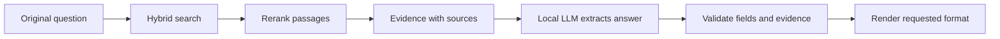
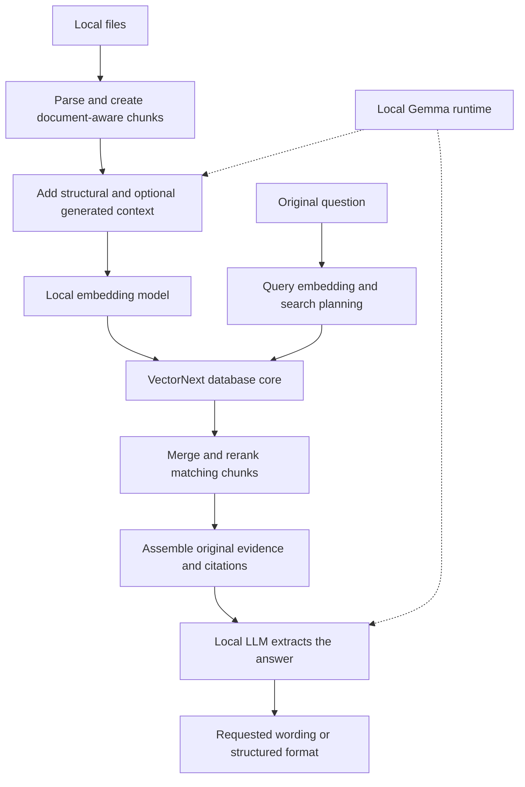
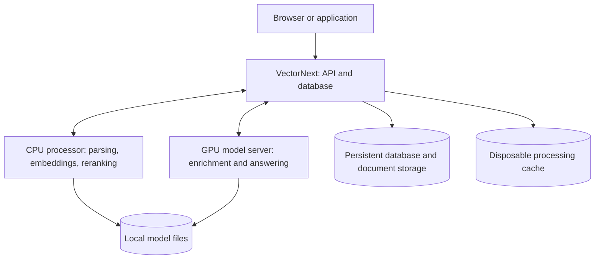

# Brainstorm vector database design

> Let's brainstorm this project together, I want to create a state-of-the-art vector db, so it should go beyond what already exists, I am thinking about uploading documents via minio, having redis as caching and serving the the chunks of the document in a vector db
>
> Do you have a better idea or can help me in the creative phase?

<details><summary>6 previous messages</summary>

> I’ll look at the current vector database landscape and check what’s already in this project so we can find a useful differentiator.
>
> <details><summary>Ran a command, searched the web</summary>
>
> - Ran `Get-Location; rg --files -g AGENTS.md -g README* -g '*design*' -g '*architecture*' -g package.json -g Cargo.toml -g pyproject.toml -g go.mod -g '!node_modules' -g '!.git' -g '!vendor'`
>
> Searched the web for `site.qdrant.tech documentation hybrid search multitenancy quantization ...`
>
> </details>
>
> Which part of VectorNext interests you most: inventing the underlying search/storage engine, or building a better document-to-context product for developers?
> - Document-to-context product
> - New search/storage engine
> - Explore both before choosing
>
> <details><summary>Ran a command, searched the web</summary>
>
> Searched the web for `site.qdrant.tech documentation multivectors late interaction reranking ...`
>
> - Ran `Get-Content -LiteralPath 'C:\Users\Usuario\VectorNext\README.md'; foreach ($instructionPath in @('C:\AGENTS.md','C:\Users\AGENTS.md','C:\Users\Usuario\AGENTS.md','C:\Users\Usuario\VectorNext\AGENTS.md')) { if (Test-Path -LiteralPath $instructionPath) { Write-Output $instructionPath; Get-Content -LiteralPath $instructionPath } }`
>
> </details>
>
> The current products already cover hybrid search, multivector retrieval, and storage backed by object stores. A promising direction to explore is how VectorNext handles whole documents: preserving structure, tracking changes, and assembling useful context within a size or latency budget. I’d treat that as a hypothesis to test against existing systems.
>
> <details><summary>Searched the web</summary>
>
> Searched the web for `https://github.com/minio/minio`
>
> </details>
</details>

Yes—my strongest initial idea is **a vector database that understands document structure, versions, and the context needed to answer a question.** Your object storage + cache + vector index architecture could support that well.

The creative challenge is deciding what VectorNext should do measurably better. The components provide a foundation; the advantage would come from how we organize, retrieve, and maintain information.

I checked the current landscape: Qdrant already combines semantic search, keyword search, and multivector reranking; turbopuffer builds around object storage and local caches. Those are useful starting points, but would not establish novelty by themselves. [Qdrant](https://qdrant.tech/documentation/tutorials-basics/reranking-hybrid-search/), [turbopuffer](https://turbopuffer.com/docs/architecture)

Three directions seem worth exploring:

| Direction | What users would experience | What we would need to prove |
|---|---|---|
| **Documents as native objects** | Upload a manual; retrieve passages with their headings, relevant tables, definitions, and citations. | More complete evidence with fewer irrelevant tokens. |
| **Reliable retrieval as documents change** | Replace a document, inspect previous versions, and see exactly which version supported a result. | Correct results during updates, deletions, and changes to permissions. |
| **Search within a budget** | Request the best context within a token limit and latency target. | Better retrieval quality for the same cost or response time. |

These are research and product hypotheses, not claims that nobody has attempted them. For example, Lance already supports branching and version history, so versioning alone would need a sharper advantage. [Lance](https://www.lancedb.com/blog/branching-and-shallow-clone)

**I would explore the first direction, with document updates designed in from the beginning.**

Imagine a technical manual containing:

- A paragraph explaining an operating limit.
- A table listing different limits by model.
- A footnote describing an exception.

A useful VectorNext result would connect those pieces, preserve their source locations, and fit them into the requested context size.

That suggests an interesting design principle: **store stable document structure, then assemble context dynamically for each query.** Index smaller passages for precise matching, but retain their relationships to sections, tables, captions, and neighboring passages. The engine could expand a match when its meaning depends on surrounding material.

This is where your chunking idea becomes more ambitious: the returned context does not have to have the same boundaries as the indexed chunks.

For an initial prototype, I would give the components these responsibilities:

| Component | Responsibility |
|---|---|
| **S3-compatible object storage** | Original files and versioned parsing outputs. |
| **Document catalog, initially PostgreSQL** | Document identity, active versions, permissions, processing status, and chunk relationships. |
| **Background workers** | Parsing, structure extraction, embedding, and indexing, with retries. |
| **Search engine** | Vector and keyword indexes, searchable metadata, and chunk text for fast retrieval. |
| **Context assembler** | Rerank matches, expand relevant surroundings, remove duplication, and return cited passages within a token limit. |
| **Redis, when measurements justify it** | Reusable embeddings and selected retrieval results, with version and permission information included in cache keys. |

I would keep Redis optional initially. It adds value when we know which repeated work is expensive; it should remain safe to lose its contents.

One relevant change to your storage choice: the **MinIO community repository was archived on April 25, 2026**, and states that it is no longer maintained. I would target the S3 API and keep the storage provider replaceable. [MinIO repository](https://github.com/minio/minio)

There is also a deeper database challenge here: when a document changes, **publish its new searchable version as one coherent unit**. Readers should not accidentally receive half the old document and half the new one. That connects document storage, indexing, and caching through a meaningful guarantee.

To earn “state of the art,” I would start with a focused experiment: a collection of changing technical manuals, questions with known supporting passages, and a strong hybrid-search baseline. Measure evidence completeness, irrelevant context, response time, update visibility, and total cost—including parsing and embeddings.

If building the underlying engine is what excites you most, we can take a different route: investigate a document-aware index that reduces storage reads when retrieving related passages. That would need its own benchmark against established engines.

**Which feels closer to your ambition: inventing the search/storage engine itself, or making VectorNext the best way for developers to turn documents into reliable context?**

> **Which part of VectorNext interests you most: inventing the underlying search/storage engine, or building a better document-to-context product for developers?**
>
> Explore both before choosing

Then let’s explore both around a shared idea: **what would a vector database look like if documents were its primary objects, and it managed embeddings as derived indexes?**

That gives us two distinct opportunities:

| | Invent a database engine | Build a document-to-context product |
|---|---|---|
| Users choose it because… | It searches a particular workload faster, more cheaply, or with stronger guarantees. | It makes reliable document retrieval much easier. |
| We would own… | Storage layout, indexing, query execution, updates, and recovery. | Document processing, retrieval orchestration, context assembly, and developer experience. |
| Evidence of success | Better recall, latency, memory use, or update performance against competitive engines. | Better supporting evidence, fewer irrelevant tokens, and less integration work. |
| Main risk | A clever algorithm may lose its advantage under realistic workloads. | A convenient integration may be easy for competitors to reproduce. |

The interesting possibility is that **a document-focused product could reveal the workload that deserves a new engine.**

**For the engine, I see three research directions worth investigating.**

1. **Store and retrieve related evidence efficiently.**
   A retrieved paragraph often needs its heading, neighboring passages, or a referenced table. We could design storage so that fetching those pieces requires very few disk or object-storage reads.

   The hard problem is balancing document locality with semantic locality: related ideas may live in completely different documents. Packing everything by document could make similarity search worse. That tradeoff is something we can benchmark.

2. **Choose the amount of search work dynamically.**
   Some questions need an exact identifier lookup; others benefit from semantic search and expensive reranking. An engine could choose its retrieval strategy, candidate count, and representation based on the query, filters, available cache, and latency target.

   The ambitious part would be a planner that makes those choices reliably. A few hand-written routing rules would be a useful starting experiment, but would not establish a breakthrough.

3. **Make changing documents a native database operation.**
   Replacing a document could create a new version, reuse unchanged processing outputs, build its indexes, and publish it atomically. Queries would read a consistent version while updates happen.

   Reuse would need care: an unchanged paragraph may require a new embedding if its heading, surrounding context, or embedding model changed.

Of these, **document locality plus coherent updates** feels like the most tightly connected engine thesis for your idea. Object storage and caching already exist in competitors, so the advantage would need to come from how the engine uses them. [turbopuffer’s architecture](https://turbopuffer.com/docs/architecture)

**For the product, I would explore “upload documents, retrieve evidence ready to use.”**

Imagine this developer request:

> Find the installation requirements for model X. Include relevant exceptions and source locations. Fit the evidence within 2,000 tokens.

VectorNext would manage:

- **Structure:** headings, paragraphs, tables, captions, and references.
- **Retrieval:** exact terms, semantic matches, and ranking.
- **Assembly:** enough surrounding context to interpret each passage, with duplicates removed.
- **Traceability:** document version, page or section, and the original supporting text.

A particularly useful feature could be an **evidence inspector**: show what matched, what surrounding material was included, and what was excluded by the context limit. That would help developers diagnose bad retrieval before changing prompts or models.

Another promising feature is **safe retrieval experiments**: try a new parser, embedding model, or chunking strategy against a saved question set, compare results, then promote or roll back the configuration. Its value would come from making improvements measurable and reproducible.

Your proposed components fit these paths differently. For the product prototype, S3-compatible storage, an existing search engine, a document catalog, and optional Redis are reasonable. For a custom engine, I would investigate caching index blocks in local memory and SSD first; adding a Redis network hop to every index lookup would need evidence that it helps.

**We can explore both without committing to two full builds.** I’d design one document model and one retrieval interface, then compare an established search backend with a small experimental engine on the same workload.

For example: technical manuals containing tables, repeated terminology, cross-references, and revised editions. The product experiment asks whether we return more complete evidence within a fixed token budget. The engine experiment asks whether we can deliver that evidence with fewer reads, lower memory use, or faster updates.

The next useful choice is the workload: **are you most drawn to technical manuals and PDFs, company knowledge, or source code and developer documentation?** Each exposes different opportunities for the engine.

> what is important for us to achieve is the search, it should be able to find the relevant text for a give question, retrieve it and then be able to ask a question about the data, for instance, we have soccer data that says:
> Pele scored 3 goals against Argentina in 1954
>
> Our app should be able to :
> Locate the data, extract the chunks, ask for a request rewrite if question is: How many goals did Pele score against Argentina in 1954, create a prompt like: then I questioned myself, how many goals did Pele score on that match?
> same for the response
> instead of: Pele scored 3 goals against Argentina in 1954, return: Match year 1954, Pele goals: 3, rival: Argentina
>
> our app should work in the local and using local LLMs such as Gemma 4.
>
> you get my idea?

Yes. **You want a local search system that finds supporting text, answers questions from that evidence, and can transform both the question and the answer into a requested style or format.**

I understand “rewrite” as changing wording or presentation while preserving the meaning and facts.

Using your sentence as **hypothetical source data**, the flow would be:

1. **Receive the question**
   “How many goals did Pele score against Argentina in 1954?”

2. **Locate the evidence**
   Search the documents and retrieve:
   “Pele scored 3 goals against Argentina in 1954.”

   Keep its document ID and source location attached so the answer can be traced back.

3. **Optionally rewrite the question**
   Following the caller’s style instructions:
   “Then I wondered: how many goals did Pelé score in that match?”

4. **Answer from the retrieved evidence**
   Extract the relevant facts: player = Pelé, goals = 3, opponent = Argentina, year = 1954.

5. **Present the answer in the requested format**
   “Match year: 1954, Pelé goals: 3, rival: Argentina.”

**One important detail: the rewritten question must retain access to its original context.** “That match” only makes sense when the opponent and year are available. We should preserve the original question and evidence internally, even when the displayed wording changes.

I would make these three independently controllable capabilities:

| Capability | Responsibility |
|---|---|
| **Search** | Find relevant passages using meaning, names, dates, and exact terms. |
| **Answer** | Resolve the question using those passages and identify the supporting sources. |
| **Transform** | Apply instructions such as “make the question conversational” or “return the answer as labeled fields.” |

For your soccer example, search should combine semantic matching with exact details. “How often did Pelé score?” may resemble the question semantically, but the opponent and year determine which evidence is relevant. If several matches fit, the system should ask which match you mean or return clearly separated results.

**The entire pipeline should work locally:**

- Local documents and extracted text.
- A local embedding model to make passages searchable by meaning.
- Local keyword and vector indexes.
- A local LLM for question rewriting, answering, and response formatting.
- Source references and processing records stored locally.

We can keep the generation model interchangeable so your chosen local model can be used without changing the retrieval system. The embedding model and answering model can be different models.

This makes our first experiment much clearer: give VectorNext a small soccer dataset containing similar statements with different players, opponents, and years. Check whether it retrieves the correct evidence, preserves the facts through rewrites, and handles missing or ambiguous information correctly.

**That search → evidence → answer → transformation workflow is the core I would design first.** It gives us a concrete way to evaluate an existing vector engine and, later, any engine we invent.

> how does OpenAI and other companies do this?

<details><summary>5 previous messages</summary>

> I’ll check the public documentation from OpenAI and a few other providers, focusing on retrieval, rewriting, and what we can reproduce locally.
>
> <details><summary>Explored a file</summary>
>
> - Read `~/.codex/skills/.system/openai-docs/SKILL.md`
>
> </details>
>
> I’m using the OpenAI Docs skill to verify the API behavior. I’ll distinguish documented features from internal details the companies haven’t published.
>
> <details><summary>Called 7 tools, searched the web</summary>
>
> MCP tool call
>
> openaiDeveloperDocs.search_openai_docs
>
> ```json
> {
>   "query": "file search retrieval query rewriting",
>   "limit": 5
> }
> ```
>
> ```text
> {"hits":[{"url":"https://developers.openai.com/api/docs/guides/retrieval#query-rewriting","url_without_anchor":"https://developers.openai.com/api/docs/guides/retrieval","anchor":"query-rewriting","content":"Certain query styles yield better results, so we’ve provided a setting to automatically rewrite your queries for optimal performance. Enable this feature by setting rewrite_query=true when performing a search.\r\nThe rewritten query will be available in the result’s search_query field.\r\nI’d like to know the height of the main office building.\r\nprimary office building height\r\nWhat are the safety regulations for transporting hazardous materials?\r\nsafety regulations for hazardous materials\r\nHow do I file a complaint about a service issue?\r\nservice complaint filing process","type":"content","hierarchy":{"lvl0":"Documentation","lvl1":"Retrieval","lvl2":"Semantic search","lvl3":"Query rewriting","lvl4":null,"lvl5":null,"lvl6":null},"objectID":"10-https://developers.openai.com/api/docs/guides/retrieval","_snippetResult":{"content":{"value":"… <span class=\"algolia-docsearch-suggestion--highlight\">query</span>=true when performing a <span class=\"algolia-docsearch-suggestion--highlight\">search</span>.\r\nThe rewritten <span class=\"algolia-docsearch-suggestion--highlight\">query</span> will …","matchLevel":"partial"}},"_highlightResult":{"content":{"value":"Certain <span class=\"algolia-docsearch-suggestion--highlight\">query</span> styles yield better results, so we’ve provided a setting to automatically rewrite your queries for optimal performance. Enable this feature by setting rewrite_<span class=\"algolia-docsearch-suggestion--highlight\">query</span>=true when performing a <span class=\"algolia-docsearch-suggestion--highlight\">search</span>.\r\nThe rewritten <span class=\"algolia-docsearch-suggestion--highlight\">query</span> will be available in the result’s <span class=\"algolia-docsearch-suggestion--highlight\">search</span>_<span class=\"algolia-docsearch-suggestion--highlight\">query</span> field.\r\nI’d like to know the height of the main office building.\r\nprimary office building height\r\nWhat are the safety regulations for transporting hazardous materials?\r\nsafety regulations for hazardous materials\r\nHow do I <span class=\"algolia-docsearch-suggestion--highlight\">file</span> a complaint about a service issue?\r\nservice complaint filing process","matchLevel":"partial","fullyHighlighted":false,"matchedWords":["file","search","query"]},"hierarchy":{"lvl0":{"value":"Documentation","matchLevel":"none","matchedWords":[]},"lvl1":{"value":"<span class=\"algolia-docsearch-suggestion--highlight\">Retrieval</span>","matchLevel":"partial","fullyHighlighted":true,"matchedWords":["retrieval"]},"lvl2":{"value":"Semantic <span class=\"algolia-docsearch-suggestion--highlight\">search</span>","matchLevel":"partial","fullyHighlighted":false,"matchedWords":["search"]},"lvl3":{"value":"<span class=\"algolia-docsearch-suggestion--highlight\">Query</span> <span class=\"algolia-docsearch-suggestion--highlight\">rewriting</span>","matchLevel":"partial","fullyHighlighted":true,"matchedWords":["query","rewriting"]}}}}],"nbHits":1,"page":0}
> ```
>
> MCP tool call
>
> openaiDeveloperDocs.search_openai_docs
>
> ```json
> {
>   "query": "structured outputs JSON schema",
>   "limit": 3
> }
> ```
>
> ```text
> {"hits":[{"url":"https://developers.openai.com/api/docs/guides/structured-outputs#for-anyof-the-nested-schemas-must-each-be-a-valid-json-schema-per-this-subset","url_without_anchor":"https://developers.openai.com/api/docs/guides/structured-outputs","anchor":"for-anyof-the-nested-schemas-must-each-be-a-valid-json-schema-per-this-subset","content":null,"type":"lvl4","hierarchy":{"lvl0":"Documentation","lvl1":"Structured model outputs","lvl2":"Supported schemas","lvl3":null,"lvl4":"For anyOf, the nested schemas must each be a valid JSON Schema per this subset","lvl5":null,"lvl6":null},"objectID":"68-https://developers.openai.com/api/docs/guides/structured-outputs","_highlightResult":{"hierarchy":{"lvl0":{"value":"Documentation","matchLevel":"none","matchedWords":[]},"lvl1":{"value":"<span class=\"algolia-docsearch-suggestion--highlight\">Structured</span> model <span class=\"algolia-docsearch-suggestion--highlight\">outputs</span>","matchLevel":"partial","fullyHighlighted":false,"matchedWords":["structured","outputs"]},"lvl2":{"value":"Supported <span class=\"algolia-docsearch-suggestion--highlight\">schemas</span>","matchLevel":"partial","fullyHighlighted":false,"matchedWords":["schema"]},"lvl4":{"value":"For anyOf, the nested <span class=\"algolia-docsearch-suggestion--highlight\">schemas</span> must each be a valid <span class=\"algolia-docsearch-suggestion--highlight\">JSON</span> <span class=\"algolia-docsearch-suggestion--highlight\">Schema</span> per this subset","matchLevel":"partial","fullyHighlighted":false,"matchedWords":["json","schema"]}}}},{"url":"https://developers.openai.com/cookbook/examples/partners/schemaflow_design_guide/schemaflow_cookbook#primary-runtime-objects","url_without_anchor":"https://developers.openai.com/cookbook/examples/partners/schemaflow_design_guide/schemaflow_cookbook","anchor":"primary-runtime-objects","content":"CHANGE_TEXT\r\nInput section\r\nThe natural-language database change request\r\nchange_json\r\nStage 1\r\nStructured interpretation of the request\r\nrag_vector_store_id\r\nOptional PDF RAG section\r\nHosted vector store ID for uploaded PDF context\r\nrag_file_search_results\r\nStage 2\r\nSummary of File Search results returned to the Impact Agent\r\nimpact_json\r\nStage 2\r\nImpacted objects, risks, and assumptions\r\nplan_json\r\nStage 3\r\nRollout plan, checks, and rollback guidance\r\nsql_text\r\nStage 4\r\nDraft SQL script\r\nvalidation\r\nStage 5\r\nDeterministic SQL sanity-check result\r\nbundle\r\nFinal Bundle section\r\nConsolidated workflow output\r\nout_path\r\nSave Artifact section\r\nSaved JSON artifact path\r\npromptfoo_config\r\nPromptfoo section\r\nGenerated eval configuration","type":"content","hierarchy":{"lvl0":"Documentation","lvl1":"SchemaFlow: Agentic Database Change Impact Analysis, SQL Generation, and Eval Guardrails","lvl2":"System Design","lvl3":"Primary Runtime Objects","lvl4":null,"lvl5":null,"lvl6":null},"objectID":"40-https://developers.openai.com/cookbook/examples/partners/schemaflow_design_guide/schemaflow_cookbook","_snippetResult":{"content":{"value":"… language database change request\r\nchange_<span class=\"algolia-docsearch-suggestion--highlight\">json</span>\r\nStage 1\r\n<span class=\"algolia-docsearch-suggestion--highlight\">Structured</span> interpretation …","matchLevel":"partial"}},"_highlightResult":{"content":{"value":"CHANGE_TEXT\r\nInput section\r\nThe natural-language database change request\r\nchange_<span class=\"algolia-docsearch-suggestion--highlight\">json</span>\r\nStage 1\r\n<span class=\"algolia-docsearch-suggestion--highlight\">Structured</span> interpretation of the request\r\nrag_vector_store_id\r\nOptional PDF RAG section\r\nHosted vector store ID for uploaded PDF context\r\nrag_file_search_results\r\nStage 2\r\nSummary of File Search results returned to the Impact Agent\r\nimpact_<span class=\"algolia-docsearch-suggestion--highlight\">json</span>\r\nStage 2\r\nImpacted objects, risks, and assumptions\r\nplan_<span class=\"algolia-docsearch-suggestion--highlight\">json</span>\r\nStage 3\r\nRollout plan, checks, and rollback guidance\r\nsql_text\r\nStage 4\r\nDraft SQL script\r\nvalidation\r\nStage 5\r\nDeterministic SQL sanity-check result\r\nbundle\r\nFinal Bundle section\r\nConsolidated workflow <span class=\"algolia-docsearch-suggestion--highlight\">output</span>\r\nout_path\r\nSave Artifact section\r\nSaved <span class=\"algolia-docsearch-suggestion--highlight\">JSON</span> artifact path\r\npromptfoo_config\r\nPromptfoo section\r\nGenerated eval configuration","matchLevel":"partial","fullyHighlighted":false,"matchedWords":["structured","outputs","json"]},"hierarchy":{"lvl0":{"value":"Documentation","matchLevel":"none","matchedWords":[]},"lvl1":{"value":"<span class=\"algolia-docsearch-suggestion--highlight\">Schema</span>Flow: Agentic Database Change Impact Analysis, SQL Generation, and Eval Guardrails","matchLevel":"partial","fullyHighlighted":false,"matchedWords":["schema"]},"lvl2":{"value":"System Design","matchLevel":"none","matchedWords":[]},"lvl3":{"value":"Primary Runtime Objects","matchLevel":"none","matchedWords":[]}}}},{"url":"https://learn.chatgpt.com/docs/non-interactive-mode#create-structured-outputs-with-a-schema","url_without_anchor":"https://learn.chatgpt.com/docs/non-interactive-mode","anchor":"create-structured-outputs-with-a-schema","content":"If you need structured data for downstream steps, use --output-schema to request a final response that conforms to a JSON Schema.\nThis is useful for automated workflows that need stable fields (for example, job summaries, risk reports, or release metadata).\r\nschema.json\r\nRun Codex with the schema and write the final JSON response to disk:\r\nExample final output (stdout):","type":"content","hierarchy":{"lvl0":"Documentation","lvl1":"Non-interactive mode","lvl2":"Create structured outputs with a schema","lvl3":null,"lvl4":null,"lvl5":null,"lvl6":null},"objectID":"12-https://learn.chatgpt.com/docs/non-interactive-mode","_snippetResult":{"content":{"value":"… response that conforms to a <span class=\"algolia-docsearch-suggestion--highlight\">JSON</span> <span class=\"algolia-docsearch-suggestion--highlight\">Schema</span>.\nThis is useful …","matchLevel":"partial"}},"_highlightResult":{"content":{"value":"If you need <span class=\"algolia-docsearch-suggestion--highlight\">structured</span> data for downstream steps, use --output-<span class=\"algolia-docsearch-suggestion--highlight\">schema</span> to request a final response that conforms to a <span class=\"algolia-docsearch-suggestion--highlight\">JSON</span> <span class=\"algolia-docsearch-suggestion--highlight\">Schema</span>.\nThis is useful for automated workflows that need stable fields (for example, job summaries, risk reports, or release metadata).\r\n<span class=\"algolia-docsearch-suggestion--highlight\">schema</span>.<span class=\"algolia-docsearch-suggestion--highlight\">json</span>\r\nRun Codex with the <span class=\"algolia-docsearch-suggestion--highlight\">schema</span> and write the final <span class=\"algolia-docsearch-suggestion--highlight\">JSON</span> response to disk:\r\nExample final output (stdout):","matchLevel":"partial","fullyHighlighted":false,"matchedWords":["structured","json","schema"]},"hierarchy":{"lvl0":{"value":"Documentation","matchLevel":"none","matchedWords":[]},"lvl1":{"value":"Non-interactive mode","matchLevel":"none","matchedWords":[]},"lvl2":{"value":"Create <span class=\"algolia-docsearch-suggestion--highlight\">structured</span> <span class=\"algolia-docsearch-suggestion--highlight\">outputs</span> with a <span class=\"algolia-docsearch-suggestion--highlight\">schema</span>","matchLevel":"partial","fullyHighlighted":false,"matchedWords":["structured","outputs","schema"]}}}}],"nbHits":25,"page":0,"nextCursor":"eyJwYWdlIjoxLCJvZmZzZXRzIjpbMF0sImhpdHNQZXJJbmRleCI6M30="}
> ```
>
> MCP tool call
>
> openaiDeveloperDocs.fetch_openai_doc
>
> ```json
> {
>   "url": "https://developers.openai.com/api/docs/guides/retrieval"
> }
> ```
>
> ````text
> # Retrieval
>
> The **Retrieval API** allows you to perform [**semantic search**](#semantic-search) over your data, which is a technique that surfaces semantically similar results—even when they match few or no keywords. Retrieval is useful on its own, but is especially powerful when combined with our models to synthesize responses.
>
> 
>
> The Retrieval API is powered by [**vector stores**](#vector-stores), which serve as indices for your data. This guide will cover how to perform semantic search, and go into the details of vector stores.
>
> ## Quickstart
>
> <li className={s.StandaloneLi} data-number={1}>
>   **Create vector store** and upload files.
> </li>
>
> Create vector store with files
>
> ```javascript
> import OpenAI from "openai";
> const client = new OpenAI();
>
> const vector_store = await client.vectorStores.create({
>   // Create vector store
>   name: "Support FAQ",
> });
>
> await client.vectorStores.files.uploadAndPoll(
>   vector_store.id,
>   // Upload file
>   fs.createReadStream("customer_policies.txt")
> );
> ```
>
> ```python
> from openai import OpenAI
>
> client = OpenAI()
>
> vector_store = client.vector_stores.create(        # Create vector store
>     name="Support FAQ",
> )
>
> client.vector_stores.files.upload_and_poll(        # Upload file
>     vector_store_id=vector_store.id,
>     file=open("customer_policies.txt", "rb")
> )
> ```
>
> ```go
> package main
>
> import (
> 	"context"
> 	"fmt"
> 	"os"
>
> 	"github.com/openai/openai-go/v3"
> )
>
> func main() {
> 	client := openai.NewClient()
> 	vectorStore, err := client.VectorStores.New(context.Background(), openai.VectorStoreNewParams{Name: openai.String("Support FAQ")})
> 	if err != nil {
> 		panic(err)
> 	}
> 	file, err := os.Open("customer_policies.txt")
> 	if err != nil {
> 		panic(err)
> 	}
> 	defer file.Close()
> 	_, err = client.VectorStores.Files.UploadAndPoll(context.Background(), vectorStore.ID, openai.FileNewParams{
> 		File:    openai.File(file, "customer_policies.txt", "text/plain"),
> 		Purpose: openai.FilePurposeAssistants,
> 	}, 1000)
> 	if err != nil {
> 		panic(err)
> 	}
> 	fmt.Println(vectorStore.ID)
> }
> ```
>
> ```java
> import com.openai.client.OpenAIClient;
> import com.openai.client.okhttp.OpenAIOkHttpClient;
> import com.openai.models.files.FileCreateParams;
> import com.openai.models.files.FilePurpose;
> import com.openai.models.vectorstores.VectorStoreCreateParams;
> import com.openai.models.vectorstores.files.FileRetrieveParams;
> import com.openai.models.vectorstores.files.VectorStoreFile;
> import java.nio.file.Path;
>
> var store =
>     client.vectorStores().create(VectorStoreCreateParams.builder().name("Support FAQ").build());
> var uploaded =
>     client
>         .files()
>         .create(
>             FileCreateParams.builder()
>                 .file(Path.of(System.getenv("OPENAI_EXAMPLE_FILE_PATH")))
>                 .purpose(FilePurpose.ASSISTANTS)
>                 .build());
> var file =
>     client
>         .vectorStores()
>         .files()
>         .create(
>             store.id(),
>             com.openai.models.vectorstores.files.FileCreateParams.builder()
>                 .fileId(uploaded.id())
>                 .build());
> while (file.status().equals(VectorStoreFile.Status.IN_PROGRESS)) {
>   Thread.sleep(1000);
>   file =
>       client
>           .vectorStores()
>           .files()
>           .retrieve(file.id(), FileRetrieveParams.builder().vectorStoreId(store.id()).build());
> }
> System.out.println(store.id());
> ```
>
> ```ruby
> require "openai"
> require "pathname"
>
> client = OpenAI::Client.new
> store = client.vector_stores.create(name: "Support FAQ")
> file = client.vector_stores.files.upload_and_poll(
>   store.id,
>   file: Pathname("customer_policies.txt"),
>   timeout: 600
> )
> raise "File ingestion ended with status: #{file.status}" unless file.status == OpenAI::VectorStores::VectorStoreFile::Status::COMPLETED
>
> puts(store.id)
> ```
>
>
> <li className={s.StandaloneLi} data-number={2}>
>   **Send search query** to get relevant results.
> </li>
>
> Search query
>
> ```javascript
> const userQuery = "What is the return policy?";
>
> const results = await client.vectorStores.search(vector_store.id, {
>   query: userQuery,
> });
> ```
>
> ```python
> user_query = "What is the return policy?"
>
> results = client.vector_stores.search(
>     vector_store_id=vector_store.id,
>     query=user_query,
> )
> ```
>
> ```go
> package main
>
> import (
> 	"context"
> 	"fmt"
>
> 	"github.com/openai/openai-go/v3"
> )
>
> func main() {
> 	client := openai.NewClient()
> 	results, err := client.VectorStores.Search(context.Background(), "vs_123", openai.VectorStoreSearchParams{
> 		Query: openai.VectorStoreSearchParamsQueryUnion{OfString: openai.String("What is the return policy?")},
> 	})
> 	if err != nil {
> 		panic(err)
> 	}
> 	fmt.Println(results.Data)
> }
> ```
>
> ```java
> import com.openai.client.OpenAIClient;
> import com.openai.client.okhttp.OpenAIOkHttpClient;
> import com.openai.models.vectorstores.VectorStoreSearchParams;
>
> String vectorStoreId = "vs_123";
>
> var results =
>     client
>         .vectorStores()
>         .search(
>             vectorStoreId,
>             VectorStoreSearchParams.builder().query("What is the return policy?").build());
>
> System.out.println(results.data());
> ```
>
> ```ruby
> require "openai"
>
> client = OpenAI::Client.new
> results = client.vector_stores.search("vs_123", query: "What is the return policy?")
> puts(results.data&.first&.content)
> ```
>
>
> To learn how to use the results with our models, check out the [synthesizing
>   responses](#synthesizing-responses) section.
>
> ## Semantic search
>
> **Semantic search** is a technique that leverages [vector embeddings](https://developers.openai.com/api/docs/guides/embeddings) to surface semantically relevant results. Importantly, this includes results with few or no shared keywords, which classical search techniques might miss.
>
> For example, let's look at potential results for `"When did we go to the moon?"`:
>
> | Text                                              | Keyword Similarity | Semantic Similarity |
> | ------------------------------------------------- | ------------------ | ------------------- |
> | The first lunar landing occurred in July of 1969. | 0%                 | 65%                 |
> | The first man on the moon was Neil Armstrong.     | 27%                | 43%                 |
> | When I ate the moon cake, it was delicious.       | 40%                | 28%                 |
>
> _(Keyword similarity uses [intersection over union](https://en.wikipedia.org/wiki/Jaccard_index); semantic similarity uses [cosine similarity](https://en.wikipedia.org/wiki/Cosine_similarity) with `text-embedding-3-small`.)_
>
> Notice how the most relevant result contains none of the words in the search query. This flexibility makes semantic search a powerful technique for querying knowledge bases of any size.
>
> Semantic search is powered by [vector stores](#vector-stores), which we cover in detail later in the guide. This section will focus on the mechanics of semantic search.
>
> ### Performing semantic search
>
> You can query a vector store using the `search` function and specifying a `query` in natural language. This will return a list of results, each with the relevant chunks, similarity scores, and file of origin.
>
> Search query
>
> ```javascript
> const results = await client.vectorStores.search(vector_store.id, {
>   query: "How many woodchucks are allowed per passenger?",
> });
> ```
>
> ```python
> results = client.vector_stores.search(
>     vector_store_id=vector_store.id,
>     query="How many woodchucks are allowed per passenger?",
> )
> ```
>
> ```go
> package main
>
> import (
> 	"context"
> 	"fmt"
>
> 	"github.com/openai/openai-go/v3"
> )
>
> func main() {
> 	client := openai.NewClient()
> 	results, err := client.VectorStores.Search(context.Background(), "vs_123", openai.VectorStoreSearchParams{
> 		Query: openai.VectorStoreSearchParamsQueryUnion{OfString: openai.String("How many woodchucks are allowed per passenger?")},
> 	})
> 	if err != nil {
> 		panic(err)
> 	}
> 	fmt.Println(results.Data)
> }
> ```
>
> ```java
> import com.openai.client.OpenAIClient;
> import com.openai.client.okhttp.OpenAIOkHttpClient;
> import com.openai.models.vectorstores.VectorStoreSearchParams;
>
> String vectorStoreId = "vs_123";
>
> var results =
>     client
>         .vectorStores()
>         .search(
>             vectorStoreId,
>             VectorStoreSearchParams.builder()
>                 .query("How many woodchucks are allowed per passenger?")
>                 .build());
>
> System.out.println(results.data());
> ```
>
> ```ruby
> require "openai"
>
> client = OpenAI::Client.new
> results = client.vector_stores.search(
>   "vs_123",
>   query: "How many woodchucks are allowed per passenger?"
> )
> puts(results.data&.first&.content)
> ```
>
>
> Results
>
> ```json
> {
>   "object": "vector_store.search_results.page",
>   "search_query": "How many woodchucks are allowed per passenger?",
>   "data": [
>     {
>       "file_id": "file-12345",
>       "filename": "woodchuck_policy.txt",
>       "score": 0.85,
>       "attributes": {
>         "region": "North America",
>         "author": "Wildlife Department"
>       },
>       "content": [
>         {
>           "type": "text",
>           "text": "According to the latest regulations, each passenger is allowed to carry up to two woodchucks."
>         },
>         {
>           "type": "text",
>           "text": "Ensure that the woodchucks are properly contained during transport."
>         }
>       ]
>     },
>     {
>       "file_id": "file-67890",
>       "filename": "transport_guidelines.txt",
>       "score": 0.75,
>       "attributes": {
>         "region": "North America",
>         "author": "Transport Authority"
>       },
>       "content": [
>         {
>           "type": "text",
>           "text": "Passengers must adhere to the guidelines set forth by the Transport Authority regarding the transport of woodchucks."
>         }
>       ]
>     }
>   ],
>   "has_more": false,
>   "next_page": null
> }
> ```
>
>
> A response will contain 10 results maximum by default, but you can set up to 50 using the `max_num_results` parameter.
>
> ### Query rewriting
>
> Certain query styles yield better results, so we've provided a setting to automatically rewrite your queries for optimal performance. Enable this feature by setting `rewrite_query=true` when performing a `search`.
>
> The rewritten query will be available in the result's `search_query` field.
>
> | **Original**                                                          | **Rewritten**                              |
> | --------------------------------------------------------------------- | ------------------------------------------ |
> | I'd like to know the height of the main office building.              | primary office building height             |
> | What are the safety regulations for transporting hazardous materials? | safety regulations for hazardous materials |
> | How do I file a complaint about a service issue?                      | service complaint filing process           |
>
> ### Attribute filtering
>
> Attribute filtering helps narrow down results by applying criteria, such as restricting searches to a specific date range. You can define and combine criteria in `attribute_filter` to target files based on their attributes before performing semantic search.
>
> Use **comparison filters** to compare a specific `key` in a file's `attributes` with a given `value`, and **compound filters** to combine multiple filters using `and` and `or`.
>
> Comparison filter
>
> ```json
> {
>   "type": "eq" | "ne" | "gt" | "gte" | "lt" | "lte" | "in" | "nin",  // comparison operators
>   "key": "attributes_key",                           // attributes key
>   "value": "target_value"                             // value to compare against
> }
> ```
>
>
> Compound filter
>
> ```json
> {
>   "type": "and" | "or",                                // logical operators
>   "filters": [...]
> }
> ```
>
>
> Below are some example filters.
>
>
>
> Region
>
>     Filter for a region
>
> ```json
> {
>   "type": "eq",
>   "key": "region",
>   "value": "us"
> }
> ```
>
>   
>
>   
>
>     
> Date range
>
>     Filter for a date range
>
> ```json
> {
>   "type": "and",
>   "filters": [
>     {
>       "type": "gte",
>       "key": "date",
>       "value": 1704067200  // unix timestamp for 2024-01-01
>     },
>     {
>       "type": "lte",
>       "key": "date",
>       "value": 1710892800  // unix timestamp for 2024-03-20
>     }
>   ]
> }
> ```
>
>   
>
>   
>
>     
> Filenames
>
>     Filter to match any of a set of filenames
>
> ```json
> {
>   "type": "in",
>   "property": "filename",
>   "value": ["example.txt", "example2.txt"]
> }
> ```
>
>   
>
>   
>
>     
> Exclude filenames
>
>     Filter to exclude drafts by filename
>
> ```json
> {
>   "type": "nin",
>   "property": "filename",
>   "value": ["draft.txt", "internal_notes.md"]
> }
> ```
>
>   
>
>   
>
>     
> Complex
>
>     Filter for top secret projects with certain names in english
>
> ```json
> {
>   "type": "or",
>   "filters": [
>     {
>       "type": "and",
>       "filters": [
>         {
>           "type": "or",
>           "filters": [
>             {
>               "type": "eq",
>               "key": "project_code",
>               "value": "X123"
>             },
>             {
>               "type": "eq",
>               "key": "project_code",
>               "value": "X999"
>             }
>           ]
>         },
>         {
>           "type": "eq",
>           "key": "confidentiality",
>           "value": "top_secret"
>         }
>       ]
>     },
>     {
>       "type": "eq",
>       "key": "language",
>       "value": "en"
>     }
>   ]
> }
> ```
>
>
>
> ### Ranking
>
> If you find that your file search results are not sufficiently relevant, you can adjust the `ranking_options` to improve the quality of responses. This includes specifying a `ranker`, such as `auto` or `default-2024-08-21`, and setting a `score_threshold` between 0.0 and 1.0. A higher `score_threshold` will limit the results to more relevant chunks, though it may exclude some potentially useful ones. When `ranking_options.hybrid_search` is provided you can also tune `hybrid_search.embedding_weight` (`rrf_embedding_weight`) and `hybrid_search.text_weight` (`rrf_text_weight`) to control how reciprocal rank fusion balances semantic embedding matches vs. sparse keyword matches. Increase the former to emphasize semantic similarity, increase the latter to emphasize textual overlap, and ensure at least one of the weights is greater than zero.
>
> ## Vector stores
>
> Vector stores are the containers that power semantic search for the Retrieval API and the [file search](https://developers.openai.com/api/docs/guides/tools-file-search) tool. When you add a file to a vector store it will be automatically chunked, embedded, and indexed.
>
> Vector stores contain `vector_store_file` objects, which are backed by a `file` object.
>
> | Object type | Description                                                                                                                                                                           |
> | -------------------------------------------------------------------------- | ------------------------------------------------------------------------------------------------------------------------------------------------------------------------------------- |
> | `file`                                                                     | Represents content uploaded through the [Files API](https://developers.openai.com/api/reference/resources/files). Often used with vector stores, but also for fine-tuning and other use cases.                      |
> | `vector_store`                                                             | Container for searchable files.                                                                                                                                                       |
> | `vector_store.file`                                                        | Wrapper type specifically representing a `file` that has been chunked and embedded, and has been associated with a `vector_store`. <br />Contains `attributes` map used for filtering. |
>
> ### Pricing
>
> You will be charged based on the total storage used across all your vector stores, determined by the size of parsed chunks and their corresponding embeddings.
>
> | Storage                        | Cost         |
> | ------------------------------ | ------------ |
> | Up to 1 GB (across all stores) | Free         |
> | Beyond 1 GB                    | $0.10/GB/day |
>
> See [expiration policies](#expiration-policies) for options to minimize costs.
>
> ### Vector store operations
>
>
>
> Create
>
>     Create vector store
>
> ```javascript
> await client.vectorStores.create({
>   name: "Support FAQ",
>   file_ids: ["file_123"],
> });
> ```
>
> ```python
> client.vector_stores.create(
>     name="Support FAQ",
>     file_ids=["file_123"]
> )
> ```
>
> ```go
> package main
>
> import (
> 	"context"
> 	"fmt"
>
> 	"github.com/openai/openai-go/v3"
> )
>
> func main() {
> 	client := openai.NewClient()
> 	vectorStore, err := client.VectorStores.New(context.Background(), openai.VectorStoreNewParams{
> 		Name:    openai.String("Support FAQ"),
> 		FileIDs: []string{"file_123"},
> 	})
> 	if err != nil {
> 		panic(err)
> 	}
> 	fmt.Println(vectorStore.ID)
> }
> ```
>
> ```java
> import com.openai.client.OpenAIClient;
> import com.openai.client.okhttp.OpenAIOkHttpClient;
> import com.openai.models.vectorstores.VectorStoreCreateParams;
>
> String fileId = "file_123";
>
> var store =
>     client
>         .vectorStores()
>         .create(
>             VectorStoreCreateParams.builder().name("Support FAQ").addFileId(fileId).build());
>
> System.out.println(store.id());
> ```
>
> ```ruby
> require "openai"
>
> client = OpenAI::Client.new
> store = client.vector_stores.create(
>   name: "Support FAQ",
>   file_ids: ["file_123"]
> )
> puts(store.id)
> ```
>
>   
>
>   
>
>     
> Retrieve
>
>     Retrieve vector store
>
> ```javascript
> await client.vectorStores.retrieve("vs_123");
> ```
>
> ```python
> client.vector_stores.retrieve(
>     vector_store_id="vs_123"
> )
> ```
>
> ```go
> package main
>
> import (
> 	"context"
> 	"fmt"
>
> 	"github.com/openai/openai-go/v3"
> )
>
> func main() {
> 	client := openai.NewClient()
> 	vectorStore, err := client.VectorStores.Get(context.Background(), "vs_123")
> 	if err != nil {
> 		panic(err)
> 	}
> 	fmt.Println(vectorStore.ID)
> }
> ```
>
> ```java
> import com.openai.client.OpenAIClient;
> import com.openai.client.okhttp.OpenAIOkHttpClient;
>
> String vectorStoreId = "vs_123";
>
> System.out.println(client.vectorStores().retrieve(vectorStoreId).id());
> ```
>
> ```ruby
> require "openai"
>
> client = OpenAI::Client.new
> store = client.vector_stores.retrieve("vs_123")
> puts(store.id)
> ```
>
>   
>
>   
>
>     
> Update
>
>     Update vector store
>
> ```javascript
> await client.vectorStores.update("vs_123", {
>   name: "Support FAQ Updated",
> });
> ```
>
> ```python
> client.vector_stores.update(
>     vector_store_id="vs_123",
>     name="Support FAQ Updated"
> )
> ```
>
> ```go
> package main
>
> import (
> 	"context"
> 	"fmt"
>
> 	"github.com/openai/openai-go/v3"
> )
>
> func main() {
> 	client := openai.NewClient()
> 	vectorStore, err := client.VectorStores.Update(context.Background(), "vs_123", openai.VectorStoreUpdateParams{
> 		Name: openai.String("Support FAQ Updated"),
> 	})
> 	if err != nil {
> 		panic(err)
> 	}
> 	fmt.Println(vectorStore.Name)
> }
> ```
>
> ```java
> import com.openai.client.OpenAIClient;
> import com.openai.client.okhttp.OpenAIOkHttpClient;
> import com.openai.models.vectorstores.VectorStoreUpdateParams;
>
> String vectorStoreId = "vs_123";
>
> var store =
>     client
>         .vectorStores()
>         .update(
>             vectorStoreId,
>             VectorStoreUpdateParams.builder().name("Updated knowledge base").build());
>
> System.out.println(store.name());
> ```
>
> ```ruby
> require "openai"
>
> client = OpenAI::Client.new
> store = client.vector_stores.update("vs_123", name: "Updated knowledge base")
> puts(store.name)
> ```
>
>   
>
>   
>
>     
> Delete
>
>     Delete vector store
>
> ```javascript
> await client.vectorStores.delete("vs_123");
> ```
>
> ```python
> client.vector_stores.delete(
>     vector_store_id="vs_123"
> )
> ```
>
> ```go
> package main
>
> import (
> 	"context"
> 	"fmt"
>
> 	"github.com/openai/openai-go/v3"
> )
>
> func main() {
> 	client := openai.NewClient()
> 	deleted, err := client.VectorStores.Delete(context.Background(), "vs_123")
> 	if err != nil {
> 		panic(err)
> 	}
> 	fmt.Println(deleted.Deleted)
> }
> ```
>
> ```java
> import com.openai.client.OpenAIClient;
> import com.openai.client.okhttp.OpenAIOkHttpClient;
>
> String vectorStoreId = "vs_123";
>
> System.out.println(client.vectorStores().delete(vectorStoreId).deleted());
> ```
>
> ```ruby
> require "openai"
>
> client = OpenAI::Client.new
> deleted = client.vector_stores.delete("vs_123")
> puts(deleted.deleted)
> ```
>
>   
>
>   
>
>     
> List
>
>     List vector stores
>
> ```javascript
> await client.vectorStores.list();
> ```
>
> ```python
> client.vector_stores.list()
> ```
>
> ```go
> package main
>
> import (
> 	"context"
> 	"fmt"
>
> 	"github.com/openai/openai-go/v3"
> )
>
> func main() {
> 	client := openai.NewClient()
> 	vectorStores, err := client.VectorStores.List(context.Background(), openai.VectorStoreListParams{})
> 	if err != nil {
> 		panic(err)
> 	}
> 	fmt.Println(vectorStores.Data)
> }
> ```
>
> ```java
> import com.openai.client.OpenAIClient;
> import com.openai.client.okhttp.OpenAIOkHttpClient;
>
> System.out.println(client.vectorStores().list().data());
> ```
>
> ```ruby
> require "openai"
>
> client = OpenAI::Client.new
> stores = client.vector_stores.list(limit: 10)
> puts((stores.data || []).length)
> ```
>
>
>
> ### Vector store file operations
>
> Some operations, like `create` for `vector_store.file`, are asynchronous and may take time to complete—use our helper functions, like `create_and_poll` to block until it is. Otherwise, you may check the status. Removing files from a vector store is eventually consistent, and search results may still include content from a removed file for a short period.
>
> Adding files is rate limited per vector store ID. Requests to [`/vector_stores/{vector_store_id}/files`](https://developers.openai.com/api/reference/resources/vector_stores/subresources/files/methods/create) and [`/vector_stores/{vector_store_id}/file_batches`](https://developers.openai.com/api/reference/resources/vector_stores/subresources/file_batches/methods/create) share a per-vector-store limit of 300 requests per minute.
>
>
>
> Create
>
>     Create vector store file
>
> ```javascript
> await client.vectorStores.files.createAndPoll("vs_123", {
>   file_id: "file_123",
> });
> ```
>
> ```python
> client.vector_stores.files.create_and_poll(
>     vector_store_id="vs_123",
>     file_id="file_123"
> )
> ```
>
> ```go
> package main
>
> import (
> 	"context"
> 	"fmt"
>
> 	"github.com/openai/openai-go/v3"
> )
>
> func main() {
> 	client := openai.NewClient()
> 	file, err := client.VectorStores.Files.NewAndPoll(context.Background(), "vs_123", openai.VectorStoreFileNewParams{
> 		FileID: "file_123",
> 	}, 1000)
> 	if err != nil {
> 		panic(err)
> 	}
> 	fmt.Println(file.ID)
> }
> ```
>
> ```java
> import com.openai.client.OpenAIClient;
> import com.openai.client.okhttp.OpenAIOkHttpClient;
> import com.openai.models.vectorstores.files.FileCreateParams;
>
> String vectorStoreId = "vs_123";
>
> String fileId = "file_123";
>
> var file =
>     client
>         .vectorStores()
>         .files()
>         .create(vectorStoreId, FileCreateParams.builder().fileId(fileId).build());
>
> System.out.println(file.id());
> ```
>
> ```ruby
> require "openai"
>
> client = OpenAI::Client.new
> file = client.vector_stores.files.create("vs_123", file_id: "file_123")
> puts(file.id)
> ```
>
>   
>
>   
>
>     
> Upload
>
>     Upload vector store file
>
> ```javascript
> await client.vectorStores.files.uploadAndPoll(
>   "vs_123",
>   fs.createReadStream("customer_policies.txt")
> );
> ```
>
> ```python
> client.vector_stores.files.upload_and_poll(
>     vector_store_id="vs_123",
>     file=open("customer_policies.txt", "rb")
> )
> ```
>
> ```go
> package main
>
> import (
> 	"context"
> 	"fmt"
> 	"os"
>
> 	"github.com/openai/openai-go/v3"
> )
>
> func main() {
> 	client := openai.NewClient()
> 	file, err := os.Open("customer_policies.txt")
> 	if err != nil {
> 		panic(err)
> 	}
> 	defer file.Close()
> 	result, err := client.VectorStores.Files.UploadAndPoll(context.Background(), "vs_123", openai.FileNewParams{
> 		File:    openai.File(file, "customer_policies.txt", "text/plain"),
> 		Purpose: openai.FilePurposeAssistants,
> 	}, 1000)
> 	if err != nil {
> 		panic(err)
> 	}
> 	fmt.Println(result.ID)
> }
> ```
>
> ```java
> import com.openai.client.OpenAIClient;
> import com.openai.client.okhttp.OpenAIOkHttpClient;
> import com.openai.models.files.FileCreateParams;
> import com.openai.models.files.FilePurpose;
> import com.openai.models.vectorstores.files.FileRetrieveParams;
> import com.openai.models.vectorstores.files.VectorStoreFile;
> import java.nio.file.Path;
>
> String vectorStoreId = "vs_123";
> var uploaded =
>     client
>         .files()
>         .create(
>             FileCreateParams.builder()
>                 .file(Path.of(System.getenv("OPENAI_EXAMPLE_FILE_PATH")))
>                 .purpose(FilePurpose.ASSISTANTS)
>                 .build());
> var file =
>     client
>         .vectorStores()
>         .files()
>         .create(
>             vectorStoreId,
>             com.openai.models.vectorstores.files.FileCreateParams.builder()
>                 .fileId(uploaded.id())
>                 .build());
> while (file.status().equals(VectorStoreFile.Status.IN_PROGRESS)) {
>   Thread.sleep(1000);
>   file =
>       client
>           .vectorStores()
>           .files()
>           .retrieve(
>               file.id(), FileRetrieveParams.builder().vectorStoreId(vectorStoreId).build());
> }
> System.out.println(file.id());
> ```
>
> ```ruby
> require "openai"
> require "pathname"
>
> client = OpenAI::Client.new
> vector_store_file = client.vector_stores.files.upload_and_poll(
>   "vs_123",
>   file: Pathname("customer_policies.txt"),
>   timeout: 600
> )
> raise "File ingestion ended with status: #{vector_store_file.status}" unless vector_store_file.status == OpenAI::VectorStores::VectorStoreFile::Status::COMPLETED
>
> puts(vector_store_file.id)
> ```
>
>   
>
>   
>
>     
> Retrieve
>
>     Retrieve vector store file
>
> ```javascript
> await client.vectorStores.files.retrieve("file_123", {
>   vector_store_id: "vs_123",
> });
> ```
>
> ```python
> client.vector_stores.files.retrieve(
>     vector_store_id="vs_123",
>     file_id="file_123"
> )
> ```
>
> ```go
> package main
>
> import (
> 	"context"
> 	"fmt"
>
> 	"github.com/openai/openai-go/v3"
> )
>
> func main() {
> 	client := openai.NewClient()
> 	file, err := client.VectorStores.Files.Get(context.Background(), "vs_123", "file_123")
> 	if err != nil {
> 		panic(err)
> 	}
> 	fmt.Println(file.ID)
> }
> ```
>
> ```java
> import com.openai.client.OpenAIClient;
> import com.openai.client.okhttp.OpenAIOkHttpClient;
>
> String fileId = "file_123";
>
> String vectorStoreId = "vs_123";
>
> System.out.println(
>     client
>         .vectorStores()
>         .files()
>         .retrieve(
>             fileId,
>             com.openai.models.vectorstores.files.FileRetrieveParams.builder()
>                 .vectorStoreId(vectorStoreId)
>                 .build())
>         .id());
> ```
>
> ```ruby
> require "openai"
>
> client = OpenAI::Client.new
> file = client.vector_stores.files.retrieve("file_123", vector_store_id: "vs_123")
> puts(file.id)
> ```
>
>   
>
>   
>
>     
> Update
>
>     Update vector store file
>
> ```javascript
> await client.vectorStores.files.update("file_123", {
>   vector_store_id: "vs_123",
>   attributes: { key: "value" },
> });
> ```
>
> ```python
> client.vector_stores.files.update(
>     vector_store_id="vs_123",
>     file_id="file_123",
>     attributes={"key": "value"}
> )
> ```
>
> ```go
> package main
>
> import (
> 	"context"
> 	"fmt"
>
> 	"github.com/openai/openai-go/v3"
> )
>
> func main() {
> 	client := openai.NewClient()
> 	file, err := client.VectorStores.Files.Update(context.Background(), "vs_123", "file_123", openai.VectorStoreFileUpdateParams{
> 		Attributes: map[string]openai.VectorStoreFileUpdateParamsAttributeUnion{
> 			"key": {OfString: openai.String("value")},
> 		},
> 	})
> 	if err != nil {
> 		panic(err)
> 	}
> 	fmt.Println(file.ID)
> }
> ```
>
> ```java
> import com.openai.client.OpenAIClient;
> import com.openai.client.okhttp.OpenAIOkHttpClient;
> import com.openai.core.JsonValue;
> import com.openai.models.vectorstores.files.FileUpdateParams;
>
> String fileId = "file_123";
>
> String vectorStoreId = "vs_123";
>
> var file =
>     client
>         .vectorStores()
>         .files()
>         .update(
>             fileId,
>             FileUpdateParams.builder()
>                 .vectorStoreId(vectorStoreId)
>                 .attributes(
>                     FileUpdateParams.Attributes.builder()
>                         .putAdditionalProperty("category", JsonValue.from("policy"))
>                         .build())
>                 .build());
>
> System.out.println(file.id());
> ```
>
> ```ruby
> require "openai"
>
> client = OpenAI::Client.new
> file = client.vector_stores.files.update("file_123", vector_store_id: "vs_123", attributes: { category: "policy" })
> puts(file.id)
> ```
>
>   
>
>   
>
>     
> Delete
>
>     Delete vector store file
>
> ```javascript
> await client.vectorStores.files.delete("file_123", {
>   vector_store_id: "vs_123",
> });
> ```
>
> ```python
> client.vector_stores.files.delete(
>     vector_store_id="vs_123",
>     file_id="file_123"
> )
> ```
>
> ```go
> package main
>
> import (
> 	"context"
> 	"fmt"
>
> 	"github.com/openai/openai-go/v3"
> )
>
> func main() {
> 	client := openai.NewClient()
> 	deleted, err := client.VectorStores.Files.Delete(context.Background(), "vs_123", "file_123")
> 	if err != nil {
> 		panic(err)
> 	}
> 	fmt.Println(deleted.Deleted)
> }
> ```
>
> ```java
> import com.openai.client.OpenAIClient;
> import com.openai.client.okhttp.OpenAIOkHttpClient;
>
> String fileId = "file_123";
>
> String vectorStoreId = "vs_123";
>
> System.out.println(
>     client
>         .vectorStores()
>         .files()
>         .delete(
>             fileId,
>             com.openai.models.vectorstores.files.FileDeleteParams.builder()
>                 .vectorStoreId(vectorStoreId)
>                 .build())
>         .deleted());
> ```
>
> ```ruby
> require "openai"
>
> client = OpenAI::Client.new
> deleted = client.vector_stores.files.delete("file_123", vector_store_id: "vs_123")
> puts(deleted.deleted)
> ```
>
>   
>
>   
>
>     
> List
>
>     List vector store files
>
> ```javascript
> await client.vectorStores.files.list("vs_123");
> ```
>
> ```python
> client.vector_stores.files.list(
>     vector_store_id="vs_123"
> )
> ```
>
> ```go
> package main
>
> import (
> 	"context"
> 	"fmt"
>
> 	"github.com/openai/openai-go/v3"
> )
>
> func main() {
> 	client := openai.NewClient()
> 	files, err := client.VectorStores.Files.List(context.Background(), "vs_123", openai.VectorStoreFileListParams{})
> 	if err != nil {
> 		panic(err)
> 	}
> 	fmt.Println(files.Data)
> }
> ```
>
> ```java
> import com.openai.client.OpenAIClient;
> import com.openai.client.okhttp.OpenAIOkHttpClient;
>
> String vectorStoreId = "vs_123";
>
> System.out.println(client.vectorStores().files().list(vectorStoreId).data());
> ```
>
> ```ruby
> require "openai"
>
> client = OpenAI::Client.new
> files = client.vector_stores.files.list("vs_123")
> puts((files.data || []).length)
> ```
>
>
>
> ### Batch operations
>
>
>
> Create
>
>     Batch create operation
>
> ```javascript
> await client.vectorStores.fileBatches.createAndPoll("vs_123", {
>   files: [
>     {
>       file_id: "file_123",
>       attributes: { department: "finance" },
>     },
>     {
>       file_id: "file_456",
>       chunking_strategy: {
>         type: "static",
>         static: {
>           max_chunk_size_tokens: 1200,
>           chunk_overlap_tokens: 200,
>         },
>       },
>     },
>   ],
> });
> ```
>
> ```python
> client.vector_stores.file_batches.create_and_poll(
>     vector_store_id="vs_123",
>     files=[
>         {
>             "file_id": "file_123",
>             "attributes": {"department": "finance"}
>         },
>         {
>             "file_id": "file_456",
>             "chunking_strategy": {
>                 "type": "static",
>                 "max_chunk_size_tokens": 1200,
>                 "chunk_overlap_tokens": 200
>             }
>         }
>     ]
> )
> ```
>
> ```go
> package main
>
> import (
> 	"context"
> 	"fmt"
>
> 	"github.com/openai/openai-go/v3"
> )
>
> func main() {
> 	client := openai.NewClient()
> 	batch, err := client.VectorStores.FileBatches.NewAndPoll(context.Background(), "vs_123", openai.VectorStoreFileBatchNewParams{
> 		Files: []openai.VectorStoreFileBatchNewParamsFile{
> 			{
> 				FileID: "file_123",
> 				Attributes: map[string]openai.VectorStoreFileBatchNewParamsFileAttributeUnion{
> 					"department": {OfString: openai.String("finance")},
> 				},
> 			},
> 			{
> 				FileID: "file_456",
> 				ChunkingStrategy: openai.FileChunkingStrategyParamUnion{OfStatic: &openai.StaticFileChunkingStrategyObjectParam{
> 					Static: openai.StaticFileChunkingStrategyParam{MaxChunkSizeTokens: 1200, ChunkOverlapTokens: 200},
> 				}},
> 			},
> 		},
> 	}, 1000)
> 	if err != nil {
> 		panic(err)
> 	}
> 	fmt.Println(batch.ID)
> }
> ```
>
> ```java
> import com.openai.client.OpenAIClient;
> import com.openai.client.okhttp.OpenAIOkHttpClient;
> import com.openai.core.JsonValue;
> import com.openai.models.vectorstores.StaticFileChunkingStrategy;
> import com.openai.models.vectorstores.filebatches.FileBatchCreateParams;
> import com.openai.models.vectorstores.filebatches.FileBatchRetrieveParams;
> import com.openai.models.vectorstores.filebatches.VectorStoreFileBatch;
>
> String vectorStoreId = "vs_123";
> String fileId = "file_123";
> String fileId2 = "file_456";
> var first =
>     FileBatchCreateParams.File.builder()
>         .fileId(fileId)
>         .attributes(
>             FileBatchCreateParams.File.Attributes.builder()
>                 .putAdditionalProperty("department", JsonValue.from("finance"))
>                 .build())
>         .build();
> var second =
>     FileBatchCreateParams.File.builder()
>         .fileId(fileId2)
>         .staticChunkingStrategy(
>             StaticFileChunkingStrategy.builder()
>                 .maxChunkSizeTokens(1200)
>                 .chunkOverlapTokens(200)
>                 .build())
>         .build();
>
> var batch =
>     client
>         .vectorStores()
>         .fileBatches()
>         .create(
>             vectorStoreId,
>             FileBatchCreateParams.builder().addFile(first).addFile(second).build());
> while (batch.status().equals(VectorStoreFileBatch.Status.IN_PROGRESS)) {
>   Thread.sleep(1000);
>   batch =
>       client
>           .vectorStores()
>           .fileBatches()
>           .retrieve(
>               batch.id(),
>               FileBatchRetrieveParams.builder().vectorStoreId(vectorStoreId).build());
> }
> System.out.println(batch.status());
> ```
>
> ```ruby
> require "openai"
>
> client = OpenAI::Client.new
> batch = client.vector_stores.file_batches.create_and_poll(
>   "vs_123",
>   files: [
>     {
>       file_id: "file_123",
>       attributes: { department: "finance" }
>     },
>     {
>       file_id: "file_456",
>       chunking_strategy: {
>         type: :static,
>         static: {
>           max_chunk_size_tokens: 1_200,
>           chunk_overlap_tokens: 200
>         }
>       }
>     }
>   ],
>   timeout: 600
> )
> raise "File ingestion ended with status: #{batch.status}" unless batch.status == OpenAI::VectorStores::VectorStoreFileBatch::Status::COMPLETED
>
> raise "File ingestion failed for #{batch.file_counts.failed} file(s)" if batch.file_counts.failed.positive?
>
> # Live validation of per-file batches returned default chunking despite overrides.
> file = client.vector_stores.files.retrieve("file_456", vector_store_id: "vs_123")
> strategy = file.chunking_strategy
> unless strategy.is_a?(OpenAI::StaticFileChunkingStrategyObject) &&
>        strategy.static.max_chunk_size_tokens == 1_200 &&
>        strategy.static.chunk_overlap_tokens == 200
>   raise "Requested chunking was not applied to #{file.id}: #{strategy.to_json}"
> end
>
> puts(batch.status)
> ```
>
>   
>
>   
>
>     
> Retrieve
>
>     Batch retrieve operation
>
> ```javascript
> await client.vectorStores.fileBatches.retrieve("vsfb_123", {
>   vector_store_id: "vs_123",
> });
> ```
>
> ```python
> client.vector_stores.file_batches.retrieve(
>     vector_store_id="vs_123",
>     batch_id="vsfb_123"
> )
> ```
>
> ```go
> package main
>
> import (
> 	"context"
> 	"fmt"
>
> 	"github.com/openai/openai-go/v3"
> )
>
> func main() {
> 	client := openai.NewClient()
> 	batch, err := client.VectorStores.FileBatches.Get(context.Background(), "vs_123", "vsfb_123")
> 	if err != nil {
> 		panic(err)
> 	}
> 	fmt.Println(batch.ID)
> }
> ```
>
> ```java
> import com.openai.client.OpenAIClient;
> import com.openai.client.okhttp.OpenAIOkHttpClient;
>
> String fileBatchId = "vsfb_123";
>
> String vectorStoreId = "vs_123";
>
> System.out.println(
>     client
>         .vectorStores()
>         .fileBatches()
>         .retrieve(
>             fileBatchId,
>             com.openai.models.vectorstores.filebatches.FileBatchRetrieveParams.builder()
>                 .vectorStoreId(vectorStoreId)
>                 .build())
>         .status());
> ```
>
> ```ruby
> require "openai"
>
> client = OpenAI::Client.new
> batch = client.vector_stores.file_batches.retrieve(
>   "vsfb_123",
>   vector_store_id: "vs_123"
> )
> puts(batch.status)
> ```
>
>   
>
>   
>
>     
> Cancel
>
>     Batch cancel operation
>
> ```javascript
> await client.vectorStores.fileBatches.cancel("vsfb_123", {
>   vector_store_id: "vs_123",
> });
> ```
>
> ```python
> client.vector_stores.file_batches.cancel(
>     vector_store_id="vs_123",
>     batch_id="vsfb_123"
> )
> ```
>
> ```go
> package main
>
> import (
> 	"context"
> 	"fmt"
>
> 	"github.com/openai/openai-go/v3"
> )
>
> func main() {
> 	client := openai.NewClient()
> 	batch, err := client.VectorStores.FileBatches.Cancel(context.Background(), "vs_123", "vsfb_123")
> 	if err != nil {
> 		panic(err)
> 	}
> 	fmt.Println(batch.Status)
> }
> ```
>
> ```java
> import com.openai.client.OpenAIClient;
> import com.openai.client.okhttp.OpenAIOkHttpClient;
>
> String fileBatchId = "vsfb_123";
>
> String vectorStoreId = "vs_123";
>
> System.out.println(
>     client
>         .vectorStores()
>         .fileBatches()
>         .cancel(
>             fileBatchId,
>             com.openai.models.vectorstores.filebatches.FileBatchCancelParams.builder()
>                 .vectorStoreId(vectorStoreId)
>                 .build())
>         .status());
> ```
>
> ```ruby
> require "openai"
>
> client = OpenAI::Client.new
> batch = client.vector_stores.file_batches.cancel(
>   "vsfb_123",
>   vector_store_id: "vs_123"
> )
> puts(batch.status)
> ```
>
>   
>
>   
>
>     
> List
>
>     List files in a batch
>
> ```javascript
> await client.vectorStores.fileBatches.listFiles("vsfb_123", {
>   vector_store_id: "vs_123",
> });
> ```
>
> ```python
> client.vector_stores.file_batches.list_files(
>     "vsfb_123",
>     vector_store_id="vs_123"
> )
> ```
>
> ```go
> package main
>
> import (
> 	"context"
> 	"fmt"
>
> 	"github.com/openai/openai-go/v3"
> )
>
> func main() {
> 	client := openai.NewClient()
> 	files, err := client.VectorStores.FileBatches.ListFiles(context.Background(), "vs_123", "vsfb_123", openai.VectorStoreFileBatchListFilesParams{})
> 	if err != nil {
> 		panic(err)
> 	}
> 	fmt.Println(files.Data)
> }
> ```
>
> ```java
> import com.openai.client.OpenAIClient;
> import com.openai.client.okhttp.OpenAIOkHttpClient;
>
> String fileBatchId = "vsfb_123";
>
> String vectorStoreId = "vs_123";
>
> System.out.println(
>     client
>         .vectorStores()
>         .fileBatches()
>         .listFiles(
>             fileBatchId,
>             com.openai.models.vectorstores.filebatches.FileBatchListFilesParams.builder()
>                 .vectorStoreId(vectorStoreId)
>                 .build())
>         .data());
> ```
>
> ```ruby
> require "openai"
>
> client = OpenAI::Client.new
> files = client.vector_stores.file_batches.list_files(
>   "vsfb_123",
>   vector_store_id: "vs_123"
> )
> puts((files.data || []).length)
> ```
>
>
>
> When creating a batch you can either provide `file_ids` with optional `attributes` and/or `chunking_strategy`, or use the `files` array to pass objects that include a `file_id` plus optional `attributes` and `chunking_strategy` for each file. The two options are mutually exclusive so that you can cleanly control whether every file shares the same settings or you need per-file overrides.
>
> For higher-throughput ingestion into a single vector store, we recommend batch creation whenever possible. Batches can include up to 500 files in one request, which usually reduces contention and improves end-to-end latency versus sending many single-file create requests.
>
> ### Attributes
>
> Each `vector_store.file` can have associated `attributes`, a dictionary of values that can be referenced when performing [semantic search](#semantic-search) with [attribute filtering](#attribute-filtering). The dictionary can have at most 16 keys, with a limit of 256 characters each.
>
> Create vector store file with attributes
>
> ```javascript
> await client.vectorStores.files.create("<vector_store_id>", {
>   file_id: "file_123",
>   attributes: {
>     region: "US",
>     category: "Marketing",
>     date: 1672531200, // Jan 1, 2023
>   },
> });
> ```
>
> ```python
> client.vector_stores.files.create(
>     vector_store_id="<vector_store_id>",
>     file_id="file_123",
>     attributes={
>         "region": "US",
>         "category": "Marketing",
>         "date": 1672531200      # Jan 1, 2023
>     }
> )
> ```
>
> ```go
> package main
>
> import (
> 	"context"
> 	"fmt"
>
> 	"github.com/openai/openai-go/v3"
> )
>
> func main() {
> 	client := openai.NewClient()
> 	file, err := client.VectorStores.Files.New(context.Background(), "<vector_store_id>", openai.VectorStoreFileNewParams{
> 		FileID: "file_123",
> 		Attributes: map[string]openai.VectorStoreFileNewParamsAttributeUnion{
> 			"region":   {OfString: openai.String("US")},
> 			"category": {OfString: openai.String("Marketing")},
> 			"date":     {OfFloat: openai.Float(1672531200)},
> 		},
> 	})
> 	if err != nil {
> 		panic(err)
> 	}
> 	fmt.Println(file.ID)
> }
> ```
>
> ```java
> import com.openai.client.OpenAIClient;
> import com.openai.client.okhttp.OpenAIOkHttpClient;
> import com.openai.core.JsonValue;
> import com.openai.models.vectorstores.files.FileCreateParams;
>
> String vectorStoreId = "<vector_store_id>";
>
> String fileId = "file_123";
>
> var file =
>     client
>         .vectorStores()
>         .files()
>         .create(
>             vectorStoreId,
>             FileCreateParams.builder()
>                 .fileId(fileId)
>                 .attributes(
>                     FileCreateParams.Attributes.builder()
>                         .putAdditionalProperty("category", JsonValue.from("policy"))
>                         .build())
>                 .build());
>
> System.out.println(file.id());
> ```
>
> ```ruby
> require "openai"
>
> client = OpenAI::Client.new
> file = client.vector_stores.files.create("<vector_store_id>", file_id: "file_123", attributes: { category: "policy" })
> puts(file.id)
> ```
>
>
> ### Expiration policies
>
> You can set an expiration policy on `vector_store` objects with `expires_after`. Once a vector store expires, all associated `vector_store.file` objects will be deleted and you'll no longer be charged for them.
>
> Set expiration policy for vector store
>
> ```javascript
> await client.vectorStores.update("vs_123", {
>   expires_after: {
>     anchor: "last_active_at",
>     days: 7,
>   },
> });
> ```
>
> ```python
> client.vector_stores.update(
>     vector_store_id="vs_123",
>     expires_after={
>         "anchor": "last_active_at",
>         "days": 7
>     }
> )
> ```
>
> ```go
> package main
>
> import (
> 	"context"
> 	"fmt"
>
> 	"github.com/openai/openai-go/v3"
> )
>
> func main() {
> 	client := openai.NewClient()
> 	vectorStore, err := client.VectorStores.Update(context.Background(), "vs_123", openai.VectorStoreUpdateParams{
> 		ExpiresAfter: openai.VectorStoreUpdateParamsExpiresAfter{Days: 7},
> 	})
> 	if err != nil {
> 		panic(err)
> 	}
> 	fmt.Println(vectorStore.ExpiresAfter)
> }
> ```
>
> ```java
> import com.openai.client.OpenAIClient;
> import com.openai.client.okhttp.OpenAIOkHttpClient;
> import com.openai.core.JsonValue;
> import com.openai.models.vectorstores.VectorStoreUpdateParams;
>
> String vectorStoreId = "vs_123";
>
> var store =
>     client
>         .vectorStores()
>         .update(
>             vectorStoreId,
>             VectorStoreUpdateParams.builder()
>                 .expiresAfter(
>                     VectorStoreUpdateParams.ExpiresAfter.builder()
>                         .anchor(JsonValue.from("last_active_at"))
>                         .days(7)
>                         .build())
>                 .build());
>
> System.out.println(store.expiresAfter().orElseThrow());
> ```
>
> ```ruby
> require "openai"
>
> client = OpenAI::Client.new
> store = client.vector_stores.update(
>   "vs_123",
>   expires_after: {
>     anchor: :last_active_at,
>     days: 7
>   }
> )
> puts(store.expires_after)
> ```
>
>
> ### Limits
>
> The maximum file size is 512 MB. Each file should contain no more than 5,000,000 tokens per file (computed automatically when you attach a file).
>
> ### Chunking
>
> By default, `max_chunk_size_tokens` is set to `800` and `chunk_overlap_tokens` is set to `400`, meaning every file is indexed by being split up into 800-token chunks, with 400-token overlap between consecutive chunks.
>
> You can adjust this by setting [`chunking_strategy`](https://developers.openai.com/api/reference/resources/vector_stores/subresources/files/methods/create#vector-stores-files-createfile-chunking_strategy) when adding files to the vector store. The strategy has certain limitations:
>
> - `max_chunk_size_tokens` must be between 100 and 4096 inclusive.
> - `chunk_overlap_tokens` must be non-negative and should not exceed `max_chunk_size_tokens / 2`.
>
>
>
> #### Supported file types
>
>
>
> _For `text/` MIME types, the encoding must be one of `utf-8`, `utf-16`, or `ascii`._
>
> | File format | MIME type                                                                   |
> | ----------- | --------------------------------------------------------------------------- |
> | `.c`        | `text/x-c`                                                                  |
> | `.cpp`      | `text/x-c++`                                                                |
> | `.cs`       | `text/x-csharp`                                                             |
> | `.css`      | `text/css`                                                                  |
> | `.doc`      | `application/msword`                                                        |
> | `.docx`     | `application/vnd.openxmlformats-officedocument.wordprocessingml.document`   |
> | `.go`       | `text/x-golang`                                                             |
> | `.html`     | `text/html`                                                                 |
> | `.java`     | `text/x-java`                                                               |
> | `.js`       | `text/javascript`                                                           |
> | `.json`     | `application/json`                                                          |
> | `.md`       | `text/markdown`                                                             |
> | `.pdf`      | `application/pdf`                                                           |
> | `.php`      | `text/x-php`                                                                |
> | `.pptx`     | `application/vnd.openxmlformats-officedocument.presentationml.presentation` |
> | `.py`       | `text/x-python`                                                             |
> | `.py`       | `text/x-script.python`                                                      |
> | `.rb`       | `text/x-ruby`                                                               |
> | `.sh`       | `application/x-sh`                                                          |
> | `.tex`      | `text/x-tex`                                                                |
> | `.ts`       | `application/typescript`                                                    |
> | `.txt`      | `text/plain`                                                                |
>
>
>
>
>
> ## Synthesizing responses
>
> After performing a query you may want to synthesize a response based on the results. You can leverage our models to do so, by supplying the results and original query, to get back a grounded response.
>
> Perform search query to get results
>
> ```javascript
> import OpenAI from "openai";
>
> const client = new OpenAI();
>
> const userQuery = "What is the return policy?";
>
> const results = await client.vectorStores.search(vector_store.id, {
>   query: userQuery,
> });
> ```
>
> ```python
> from openai import OpenAI
>
> client = OpenAI()
>
> user_query = "What is the return policy?"
>
> results = client.vector_stores.search(
>     vector_store_id=vector_store.id,
>     query=user_query,
> )
> ```
>
> ```go
> package main
>
> import (
> 	"context"
> 	"fmt"
>
> 	"github.com/openai/openai-go/v3"
> )
>
> func main() {
> 	client := openai.NewClient()
> 	results, err := client.VectorStores.Search(context.Background(), "vs_123", openai.VectorStoreSearchParams{
> 		Query: openai.VectorStoreSearchParamsQueryUnion{OfString: openai.String("What is the return policy?")},
> 	})
> 	if err != nil {
> 		panic(err)
> 	}
> 	fmt.Println(results.Data)
> }
> ```
>
> ```java
> import com.openai.client.OpenAIClient;
> import com.openai.client.okhttp.OpenAIOkHttpClient;
> import com.openai.models.vectorstores.VectorStoreSearchParams;
>
> String vectorStoreId = "vs_123";
>
> var results =
>     client
>         .vectorStores()
>         .search(
>             vectorStoreId,
>             VectorStoreSearchParams.builder().query("What is the return policy?").build());
>
> System.out.println(results.data());
> ```
>
> ```ruby
> require "openai"
>
> client = OpenAI::Client.new
> results = client.vector_stores.search(
>   "vs_123",
>   query: "What is the return policy?"
> )
> puts(results.data)
> ```
>
>
> Synthesize a response based on results
>
> ```javascript
> const formattedResults = formatResults(results.data);
> // Join the text content of all results
> const textSources = results.data
>   .map((result) => result.content.map((c) => c.text).join("\n"))
>   .join("\n");
>
> const completion = await client.chat.completions.create({
>   model: "gpt-6-astra",
>   messages: [
>     {
>       role: "developer",
>       content:
>         "Produce a concise answer to the query based on the provided sources.",
>     },
>     {
>       role: "user",
>       content: `Sources: ${formattedResults}\n\nQuery: '${userQuery}'`,
>     },
>   ],
> });
>
> console.log(completion.choices[0].message.content);
> ```
>
> ```python
> # Use results and user_query from the preceding search step.
> formatted_results = format_results(results.data)
>
> "\n".join("\n".join(c.text for c in result.content) for result in results.data)
>
> completion = client.chat.completions.create(
>     model="gpt-6-astra",
>     messages=[
>         {
>             "role": "developer",
>             "content": "Produce a concise answer to the query based on the provided sources.",
>         },
>         {
>             "role": "user",
>             "content": f"Sources: {formatted_results}\n\nQuery: '{user_query}'",
>         },
>     ],
> )
>
> print(completion.choices[0].message.content)
> ```
>
> ```go
> package main
>
> import (
> 	"context"
> 	"fmt"
> 	"strings"
>
> 	"github.com/openai/openai-go/v3"
> )
>
> func main() {
> 	client := openai.NewClient()
> 	userQuery := "What is the return policy?"
> 	results, err := client.VectorStores.Search(context.Background(), "vs_123", openai.VectorStoreSearchParams{
> 		Query: openai.VectorStoreSearchParamsQueryUnion{OfString: openai.String(userQuery)},
> 	})
> 	if err != nil {
> 		panic(err)
> 	}
>
> 	completion, err := client.Chat.Completions.New(context.Background(), openai.ChatCompletionNewParams{
> 		Model: "gpt-6-astra",
> 		Messages: []openai.ChatCompletionMessageParamUnion{
> 			openai.DeveloperMessage("Produce a concise answer to the query based on the provided sources."),
> 			openai.UserMessage(fmt.Sprintf("Sources: %s\n\nQuery: %q", formatResults(results.Data), userQuery)),
> 		},
> 	})
> 	if err != nil {
> 		panic(err)
> 	}
> 	fmt.Println(completion.Choices[0].Message.Content)
> }
>
> func formatResults(results []openai.VectorStoreSearchResponse) string {
> 	var sources strings.Builder
> 	sources.WriteString("<sources>")
> 	for _, result := range results {
> 		fmt.Fprintf(&sources, "<result file_id=%q file_name=%q>", result.FileID, result.Filename)
> 		for _, content := range result.Content {
> 			fmt.Fprintf(&sources, "<content>%s</content>", content.Text)
> 		}
> 		sources.WriteString("</result>")
> 	}
> 	sources.WriteString("</sources>")
> 	return sources.String()
> }
> ```
>
> ```java
> import com.openai.client.OpenAIClient;
> import com.openai.client.okhttp.OpenAIOkHttpClient;
> import com.openai.models.chat.completions.ChatCompletionCreateParams;
> import com.openai.models.vectorstores.VectorStoreSearchParams;
> import java.util.stream.Collectors;
>
> String vectorStoreId = "vs_123";
>
> String query = "What is the return policy?";
> var results =
>     client
>         .vectorStores()
>         .search(vectorStoreId, VectorStoreSearchParams.builder().query(query).build());
> String sources =
>     results.data().stream()
>         .map(
>             result ->
>                 "<result file_id='"
>                     + result.fileId()
>                     + "' file_name='"
>                     + result.filename()
>                     + "'>"
>                     + result.content().stream()
>                         .map(content -> "<content>" + content.text() + "</content>")
>                         .collect(Collectors.joining())
>                     + "</result>")
>         .collect(Collectors.joining());
>
> var completion =
>     client
>         .chat()
>         .completions()
>         .create(
>             ChatCompletionCreateParams.builder()
>                 .model("gpt-6-astra")
>                 .addDeveloperMessage(
>                     "Answer the query concisely using only the provided sources.")
>                 .addUserMessage(
>                     "Sources: <sources>" + sources + "</sources>\n\nQuery: " + query)
>                 .build());
>
> completion.choices().stream()
>     .flatMap(choice -> choice.message().content().stream())
>     .forEach(System.out::println);
> ```
>
> ```ruby
> require "openai"
>
> client = OpenAI::Client.new
> query = "What is the return policy?"
> results = client.vector_stores.search("vs_123", query: query)
> sources = (results.data || []).map do |result|
>   content = result.content.map { |part| "<content>#{part.text}</content>" }.join
>   "<result file_id='#{result.file_id}' file_name='#{result.filename}'>#{content}</result>"
> end.join
>
> completion = client.chat.completions.create(
>   model: "gpt-6-astra",
>   messages: [
>     {
>       role: :developer,
>       content: "Answer the query concisely using only the provided sources."
>     },
>     {
>       role: :user,
>       content: "Sources: <sources>#{sources}</sources>\n\nQuery: #{query}"
>     }
>   ]
> )
> puts(completion.choices.fetch(0).message.content)
> ```
>
>
> ```json
> "Our return policy allows returns within 30 days of purchase."
> ```
>
> This uses a sample `format_results` function, which could be implemented like
> so:
>
> Sample result formatting function
>
> ```javascript
> function formatResults(results) {
>   let formattedResults = "";
>   for (const result of results.data) {
>     let formattedResult = `<result file_id='${result.file_id}' file_name='${result.filename}'>`;
>     for (const part of result.content) {
>       formattedResult += `<content>${part.text}</content>`;
>     }
>     formattedResults += formattedResult + "</result>";
>   }
>   return `<sources>${formattedResults}</sources>`;
> }
> ```
>
> ```python
> def format_results(results):
>     formatted_results = ""
>     for result in results.data:
>         formatted_result = (
>             f"<result file_id='{result.file_id}' file_name='{result.file_name}'>"
>         )
>         for part in result.content:
>             formatted_result += f"<content>{part.text}</content>"
>         formatted_results += formatted_result + "</result>"
>     return f"<sources>{formatted_results}</sources>"
> ```
>
> ```go
> package main
>
> import (
> 	"fmt"
> 	"strings"
>
> 	"github.com/openai/openai-go/v3"
> )
>
> func main() {
> 	results := []openai.VectorStoreSearchResponse{{
> 		FileID:   "file-12345",
> 		Filename: "woodchuck_policy.txt",
> 		Content:  []openai.VectorStoreSearchResponseContent{{Text: "Each passenger may carry up to two woodchucks."}},
> 	}}
> 	fmt.Println(formatResults(results))
> }
>
> func formatResults(results []openai.VectorStoreSearchResponse) string {
> 	var sources strings.Builder
> 	sources.WriteString("<sources>")
> 	for _, result := range results {
> 		fmt.Fprintf(&sources, "<result file_id=%q file_name=%q>", result.FileID, result.Filename)
> 		for _, content := range result.Content {
> 			fmt.Fprintf(&sources, "<content>%s</content>", content.Text)
> 		}
> 		sources.WriteString("</result>")
> 	}
> 	sources.WriteString("</sources>")
> 	return sources.String()
> }
> ```
>
> ```java
> import com.openai.models.vectorstores.VectorStoreSearchResponse;
> import java.util.List;
>
> System.out.println(formatResults(results.data()));
>
> static String formatResults(List<VectorStoreSearchResponse> results) {
>   var formatted = new StringBuilder("<sources>");
>   for (var result : results) {
>     formatted
>         .append("<result file_id='")
>         .append(result.fileId())
>         .append("' file_name='")
>         .append(result.filename())
>         .append("'>");
>     for (var part : result.content()) {
>       formatted.append("<content>").append(part.text()).append("</content>");
>     }
>     formatted.append("</result>");
>   }
>   return formatted.append("</sources>").toString();
> }
> ```
>
> ```ruby
> results = [
>   {
>     file_id: "file-12345",
>     filename: "woodchuck_policy.txt",
>     content: [{ text: "Each passenger may carry up to two woodchucks." }]
>   }
> ]
>
> sources = results.map do |result|
>   content = result.fetch(:content).map { |part| "<content>#{part.fetch(:text)}</content>" }.join
>   "<result file_id=\"#{result.fetch(:file_id)}\" file_name=\"#{result.fetch(:filename)}\">#{content}</result>"
> end
>
> puts("<sources>#{sources.join}</sources>")
> ```
> ````
>
> MCP tool call
>
> openaiDeveloperDocs.fetch_openai_doc
>
> ```json
> {
>   "url": "https://developers.openai.com/api/docs/guides/structured-outputs"
> }
> ```
>
> ````text
> # Structured model outputs
>
> JSON is one of the most widely used formats in the world for applications to exchange data.
>
> Structured Outputs is a feature that ensures the model will always generate responses that adhere to your supplied [JSON Schema](https://json-schema.org/overview/what-is-jsonschema), so you don't need to worry about the model omitting a required key, or hallucinating an invalid enum value.
>
> Some benefits of Structured Outputs include:
>
> 1. **Reliable type-safety:** No need to validate or retry incorrectly formatted responses
> 1. **Explicit refusals:** Safety-based model refusals are now programmatically detectable
> 1. **Simpler prompting:** No need for strongly worded prompts to achieve consistent formatting
>
> In addition to supporting JSON Schema in the REST API, the OpenAI libraries for [Python](https://github.com/openai/openai-python/blob/main/helpers.md#structured-outputs-parsing-helpers) and [JavaScript](https://github.com/openai/openai-node/blob/master/helpers.md#structured-outputs-parsing-helpers) also let you define object schemas using [`pydantic.BaseModel`](https://docs.pydantic.dev/latest/) and [`z.object`](https://zod.dev/) respectively. Below, you can see how to extract information from unstructured text that conforms to a schema defined in code.
>
> The Ruby SDK supports schemas defined with Sorbet `T::Struct` and returns typed parsed results.
>
>
>
> Getting a structured response
>
> ```javascript
> import OpenAI from "openai";
> import { zodTextFormat } from "openai/helpers/zod";
> import { z } from "zod";
>
> const openai = new OpenAI();
>
> const CalendarEvent = z.object({
>   name: z.string(),
>   date: z.string(),
>   participants: z.array(z.string()),
> });
>
> const response = await openai.responses.parse({
>   model: "gpt-6-astra",
>   input: [
>     { role: "system", content: "Extract the event information." },
>     {
>       role: "user",
>       content: "Alice and Bob are going to a science fair on Friday.",
>     },
>   ],
>   text: {
>     format: zodTextFormat(CalendarEvent, "event"),
>   },
> });
>
> const event = response.output_parsed;
> ```
>
> ```python
> from openai import OpenAI
> from pydantic import BaseModel
>
> client = OpenAI()
>
>
> class CalendarEvent(BaseModel):
>     name: str
>     date: str
>     participants: list[str]
>
>
> response = client.responses.parse(
>     model="gpt-6-astra",
>     input=[
>         {"role": "system", "content": "Extract the event information."},
>         {
>             "role": "user",
>             "content": "Alice and Bob are going to a science fair on Friday.",
>         },
>     ],
>     text_format=CalendarEvent,
> )
>
> event = response.output_parsed
> ```
>
> ```go
> package main
>
> import (
> 	"context"
> 	"fmt"
>
> 	"github.com/openai/openai-go/v3"
> 	"github.com/openai/openai-go/v3/responses"
> )
>
> func main() {
> 	client := openai.NewClient()
> 	schema := map[string]any{
> 		"type": "object",
> 		"properties": map[string]any{
> 			"name":         map[string]any{"type": "string"},
> 			"date":         map[string]any{"type": "string"},
> 			"participants": map[string]any{"type": "array", "items": map[string]any{"type": "string"}},
> 		},
> 		"required":             []string{"name", "date", "participants"},
> 		"additionalProperties": false,
> 	}
>
> 	response, err := client.Responses.New(context.Background(), responses.ResponseNewParams{
> 		Model: "gpt-6-astra",
> 		Input: responses.ResponseNewParamsInputUnion{OfInputItemList: responses.ResponseInputParam{
> 			responses.ResponseInputItemParamOfMessage(
> 				responses.ResponseInputMessageContentListParam{responses.ResponseInputContentParamOfInputText("Extract the event information.")},
> 				responses.EasyInputMessageRoleSystem,
> 			),
> 			responses.ResponseInputItemParamOfMessage(
> 				responses.ResponseInputMessageContentListParam{responses.ResponseInputContentParamOfInputText("Alice and Bob are going to a science fair on Friday.")},
> 				responses.EasyInputMessageRoleUser,
> 			),
> 		}},
> 		Text: responses.ResponseTextConfigParam{Format: responses.ResponseFormatTextConfigUnionParam{
> 			OfJSONSchema: &responses.ResponseFormatTextJSONSchemaConfigParam{Name: "event", Schema: schema, Strict: openai.Bool(true)},
> 		}},
> 	})
> 	if err != nil {
> 		panic(err)
> 	}
>
> 	fmt.Println(response.OutputText())
> }
> ```
>
> ```java
> import com.openai.client.OpenAIClient;
> import com.openai.client.okhttp.OpenAIOkHttpClient;
> import com.openai.core.JsonValue;
> import com.openai.models.responses.EasyInputMessage;
> import com.openai.models.responses.ResponseCreateParams;
> import com.openai.models.responses.ResponseFormatTextJsonSchemaConfig;
> import com.openai.models.responses.ResponseInputItem;
> import com.openai.models.responses.ResponseTextConfig;
> import java.util.List;
> import java.util.Map;
>
> Map<String, Object> schema =
>     Map.of(
>         "type",
>         "object",
>         "properties",
>         Map.of(
>             "name", Map.of("type", "string"),
>             "date", Map.of("type", "string"),
>             "participants", Map.of("type", "array", "items", Map.of("type", "string"))),
>         "required",
>         List.of("name", "date", "participants"),
>         "additionalProperties",
>         false);
>
> ResponseCreateParams params =
>     ResponseCreateParams.builder()
>         .model("gpt-6-astra")
>         .inputOfResponse(
>             List.of(
>                 ResponseInputItem.ofEasyInputMessage(
>                     EasyInputMessage.builder()
>                         .role(EasyInputMessage.Role.SYSTEM)
>                         .content("Extract the event information.")
>                         .build()),
>                 ResponseInputItem.ofEasyInputMessage(
>                     EasyInputMessage.builder()
>                         .role(EasyInputMessage.Role.USER)
>                         .content("Alice and Bob are going to a science fair on Friday.")
>                         .build())))
>         .text(
>             ResponseTextConfig.builder()
>                 .format(
>                     ResponseFormatTextJsonSchemaConfig.builder()
>                         .name("event")
>                         .strict(true)
>                         .schema(
>                             JsonValue.from(schema)
>                                 .convert(ResponseFormatTextJsonSchemaConfig.Schema.class))
>                         .build())
>                 .build())
>         .build();
>
> client.responses().create(params).output().stream()
>     .flatMap(item -> item.message().stream())
>     .flatMap(message -> message.content().stream())
>     .flatMap(content -> content.outputText().stream())
>     .forEach(text -> System.out.println(text.text()));
> ```
>
> ```csharp
> using OpenAI.Responses;
> #pragma warning disable OPENAI001
>
> string key = Environment.GetEnvironmentVariable("OPENAI_API_KEY")!;
> ResponsesClient client = new(key);
>
> BinaryData schema = BinaryData.FromString(
>     """
>     {
>       "type": "object",
>       "properties": {
>         "name": { "type": "string" },
>         "date": { "type": "string" },
>         "participants": {
>           "type": "array",
>           "items": { "type": "string" }
>         }
>       },
>       "required": ["name", "date", "participants"],
>       "additionalProperties": false
>     }
>     """
> );
> CreateResponseOptions options = new()
> {
>     Model = "gpt-6-astra",
>     TextOptions = new ResponseTextOptions
>     {
>         TextFormat = ResponseTextFormat.CreateJsonSchemaFormat(
>             "event",
>             schema,
>             jsonSchemaIsStrict: true
>         ),
>     },
> };
> options.InputItems.Add(
>     ResponseItem.CreateSystemMessageItem("Extract the event information.")
> );
> options.InputItems.Add(
>     ResponseItem.CreateUserMessageItem(
>         "Alice and Bob are going to a science fair on Friday."
>     )
> );
>
> ResponseResult response = await client.CreateResponseAsync(options);
>
> Console.WriteLine(response.GetOutputText());
> ```
>
> ```ruby
> # gem install openai sorbet-runtime
> require "openai"
> require "openai/helpers/sorbet"
>
> class CalendarEvent < T::Struct
>   const :name, String
>   const :date, String
>   const :participants, T::Array[String]
> end
>
> client = OpenAI::Client.new
> schema = OpenAI::StructuredOutput.from_sorbet(CalendarEvent)
>
> response = client.responses.create(
>   model: "gpt-6-astra",
>   input: [
>     {
>       role: :system,
>       content: "Extract the event information."
>     },
>     {
>       role: :user,
>       content: "Alice and Bob are going to a science fair on Friday."
>     }
>   ],
>   text: schema
> )
>
> raise "Response ended with status: #{response.status}" unless response.status == OpenAI::Responses::ResponseStatus::COMPLETED
>
> message = response.output.grep(OpenAI::Responses::ResponseOutputMessage).fetch(0)
> output_text = message.content.grep(OpenAI::Responses::ResponseOutputText).first
> raise "No structured output returned (the model may have refused)" unless output_text
>
> event = T.cast(output_text.parsed, CalendarEvent)
> puts(event.name, event.date, event.participants.join(", "))
> ```
>
>
>
> ### Supported models
>
> Structured Outputs is available in our [latest large language models](https://developers.openai.com/api/docs/models), starting with GPT-4o. For new projects, start with [`gpt-6-astra`](https://developers.openai.com/api/docs/models/gpt-6-astra). Older models like `gpt-4-turbo` and earlier may use [JSON mode](#json-mode) instead.
>
>
>
>
>   
>
> When to use Structured Outputs via function calling vs via 
>     
> text.format
>
>
>
>
> Structured Outputs is available in two forms in the OpenAI API:
>
> 1. When using [function calling](https://developers.openai.com/api/docs/guides/function-calling)
> 2. When using a `json_schema` response format
>
> Function calling is useful when you are building an application that bridges the models and functionality of your application.
>
> For example, you can give the model access to functions that query a database in order to build an AI assistant that can help users with their orders, or functions that can interact with the UI.
>
> Conversely, Structured Outputs via `response_format` are more suitable when you want to indicate a structured schema for use when the model responds to the user, rather than when the model calls a tool.
>
> For example, if you are building a math tutoring application, you might want the assistant to respond to your user using a specific JSON Schema so that you can generate a UI that displays different parts of the model's output in distinct ways.
>
> In practice:
>
>
>
>
>   - If you are connecting the model to tools, functions, data, etc. in your
>   system, then you should use function calling - If you want to structure the
>   model's output when it responds to the user, then you should use a structured
>   `text.format`
>
>
>
>
>
>   The remainder of this guide will focus on non-function calling use cases in
>     the Responses API. To learn more about how to use Structured Outputs with
>     function calling, check out the 
>     [Function Calling](https://developers.openai.com/api/docs/guides/function-calling#strict-mode) 
>     guide.
>
>
> ### Structured Outputs vs JSON mode
>
> Structured Outputs is the evolution of [JSON mode](#json-mode). While both ensure valid JSON is produced, only Structured Outputs ensure schema adherence. Both Structured Outputs and JSON mode are supported in the Responses API, Chat Completions API, Assistants API, Fine-tuning API and Batch API.
>
> We recommend always using Structured Outputs instead of JSON mode when possible.
>
> However, Structured Outputs with `response_format: {type: "json_schema", ...}` is only supported with the `gpt-4o-mini`, `gpt-4o-mini-2024-07-18`, and `gpt-4o-2024-08-06` model snapshots and later.
>
>
>
>
> |                                            | Structured Outputs                                                                                                             | JSON Mode                                  |
> |--------------------------------------------|--------------------------------------------------------------------------------------------------------------------------------|--------------------------------------------|
> | **Outputs valid JSON**                     | Yes                                                                                                                            | Yes                                        |
> | **Adheres to schema**                      | Yes (see [supported schemas](#supported-schemas))                                               | No                                         |
> | **Compatible models**                      | `gpt-4o-mini`, `gpt-4o-2024-08-06`, and later                                                                                  | `gpt-3.5-turbo`, `gpt-4-*`, `gpt-4o-*`, and compatible GPT-5 models |
> | **Enabling**                               | `text: { format: { type: "json_schema", "strict": true, "schema": ... } }`                                       | `text: { format: { type: "json_object" } }` |
>
>
> ## Examples
>
>
>
> Chain of thought
>
>     
>
> ### Chain of thought
>
> You can ask the model to output an answer in a structured, step-by-step way, to guide the user through the solution.
>
>
>
>
>   Structured Outputs for chain-of-thought math tutoring
>
> ```javascript
> import OpenAI from "openai";
> import { zodTextFormat } from "openai/helpers/zod";
> import { z } from "zod";
>
> const openai = new OpenAI();
>
> const Step = z.object({
>   explanation: z.string(),
>   output: z.string(),
> });
>
> const MathReasoning = z.object({
>   steps: z.array(Step),
>   final_answer: z.string(),
> });
>
> const response = await openai.responses.parse({
>   model: "gpt-6-astra",
>   input: [
>     {
>       role: "system",
>       content:
>         "You are a helpful math tutor. Guide the user through the solution step by step.",
>     },
>     { role: "user", content: "how can I solve 8x + 7 = -23" },
>   ],
>   text: {
>     format: zodTextFormat(MathReasoning, "math_reasoning"),
>   },
> });
>
> const math_reasoning = response.output_parsed;
> ```
>
> ```python
> from openai import OpenAI
> from pydantic import BaseModel
>
> client = OpenAI()
>
>
> class Step(BaseModel):
>     explanation: str
>     output: str
>
>
> class MathReasoning(BaseModel):
>     steps: list[Step]
>     final_answer: str
>
>
> response = client.responses.parse(
>     model="gpt-6-astra",
>     input=[
>         {
>             "role": "system",
>             "content": "You are a helpful math tutor. Guide the user through the solution step by step.",
>         },
>         {"role": "user", "content": "how can I solve 8x + 7 = -23"},
>     ],
>     text_format=MathReasoning,
> )
>
> math_reasoning = response.output_parsed
> ```
>
> ```go
> package main
>
> import (
> 	"context"
> 	"fmt"
>
> 	"github.com/openai/openai-go/v3"
> 	"github.com/openai/openai-go/v3/responses"
> )
>
> func main() {
> 	client := openai.NewClient()
> 	step := map[string]any{
> 		"type": "object",
> 		"properties": map[string]any{
> 			"explanation": map[string]any{"type": "string"},
> 			"output":      map[string]any{"type": "string"},
> 		},
> 		"required":             []string{"explanation", "output"},
> 		"additionalProperties": false,
> 	}
> 	schema := map[string]any{
> 		"type": "object",
> 		"properties": map[string]any{
> 			"steps":        map[string]any{"type": "array", "items": step},
> 			"final_answer": map[string]any{"type": "string"},
> 		},
> 		"required":             []string{"steps", "final_answer"},
> 		"additionalProperties": false,
> 	}
>
> 	response, err := client.Responses.New(context.Background(), responses.ResponseNewParams{
> 		Model: "gpt-6-astra",
> 		Input: responses.ResponseNewParamsInputUnion{OfInputItemList: responses.ResponseInputParam{
> 			responses.ResponseInputItemParamOfMessage(
> 				responses.ResponseInputMessageContentListParam{responses.ResponseInputContentParamOfInputText("You are a helpful math tutor. Guide the user through the solution step by step.")},
> 				responses.EasyInputMessageRoleSystem,
> 			),
> 			responses.ResponseInputItemParamOfMessage(
> 				responses.ResponseInputMessageContentListParam{responses.ResponseInputContentParamOfInputText("how can I solve 8x + 7 = -23")},
> 				responses.EasyInputMessageRoleUser,
> 			),
> 		}},
> 		Text: responses.ResponseTextConfigParam{Format: responses.ResponseFormatTextConfigUnionParam{
> 			OfJSONSchema: &responses.ResponseFormatTextJSONSchemaConfigParam{Name: "math_reasoning", Schema: schema, Strict: openai.Bool(true)},
> 		}},
> 	})
> 	if err != nil {
> 		panic(err)
> 	}
>
> 	fmt.Println(response.OutputText())
> }
> ```
>
> ```java
> import com.openai.client.OpenAIClient;
> import com.openai.client.okhttp.OpenAIOkHttpClient;
> import com.openai.core.JsonValue;
> import com.openai.models.responses.EasyInputMessage;
> import com.openai.models.responses.ResponseCreateParams;
> import com.openai.models.responses.ResponseFormatTextJsonSchemaConfig;
> import com.openai.models.responses.ResponseInputItem;
> import com.openai.models.responses.ResponseTextConfig;
> import java.util.List;
> import java.util.Map;
>
> Map<String, Object> schema =
>     Map.of(
>         "type",
>         "object",
>         "properties",
>         Map.of(
>             "steps",
>                 Map.of(
>                     "type",
>                     "array",
>                     "items",
>                     Map.of(
>                         "type",
>                         "object",
>                         "properties",
>                         Map.of(
>                             "explanation", Map.of("type", "string"),
>                             "output", Map.of("type", "string")),
>                         "required",
>                         List.of("explanation", "output"),
>                         "additionalProperties",
>                         false)),
>             "final_answer", Map.of("type", "string")),
>         "required",
>         List.of("steps", "final_answer"),
>         "additionalProperties",
>         false);
>
> ResponseCreateParams params =
>     ResponseCreateParams.builder()
>         .model("gpt-6-astra")
>         .inputOfResponse(
>             List.of(
>                 ResponseInputItem.ofEasyInputMessage(
>                     EasyInputMessage.builder()
>                         .role(EasyInputMessage.Role.SYSTEM)
>                         .content(
>                             "You are a helpful math tutor. Guide the user through the solution step by step.")
>                         .build()),
>                 ResponseInputItem.ofEasyInputMessage(
>                     EasyInputMessage.builder()
>                         .role(EasyInputMessage.Role.USER)
>                         .content("How can I solve 8x + 7 = -23?")
>                         .build())))
>         .text(
>             ResponseTextConfig.builder()
>                 .format(
>                     ResponseFormatTextJsonSchemaConfig.builder()
>                         .name("math_reasoning")
>                         .strict(true)
>                         .schema(
>                             JsonValue.from(schema)
>                                 .convert(ResponseFormatTextJsonSchemaConfig.Schema.class))
>                         .build())
>                 .build())
>         .build();
>
> client.responses().create(params).output().stream()
>     .flatMap(item -> item.message().stream())
>     .flatMap(message -> message.content().stream())
>     .flatMap(content -> content.outputText().stream())
>     .forEach(text -> System.out.println(text.text()));
> ```
>
> ```csharp
> using System.Text.Json;
> using OpenAI.Responses;
> #pragma warning disable OPENAI001
>
> string key = Environment.GetEnvironmentVariable("OPENAI_API_KEY")!;
> ResponsesClient client = new(key);
>
> BinaryData schema = BinaryData.FromString(
>     """
>     {
>       "type": "object",
>       "properties": {
>         "steps": {
>           "type": "array",
>           "items": {
>             "type": "object",
>             "properties": {
>               "explanation": { "type": "string" },
>               "output": { "type": "string" }
>             },
>             "required": ["explanation", "output"],
>             "additionalProperties": false
>           }
>         },
>         "final_answer": { "type": "string" }
>       },
>       "required": ["steps", "final_answer"],
>       "additionalProperties": false
>     }
>     """
> );
> CreateResponseOptions options = new()
> {
>     Model = "gpt-6-astra",
>     TextOptions = new ResponseTextOptions
>     {
>         TextFormat = ResponseTextFormat.CreateJsonSchemaFormat(
>             "math_response",
>             schema,
>             jsonSchemaIsStrict: true
>         ),
>     },
> };
> options.InputItems.Add(ResponseItem.CreateSystemMessageItem("You are a helpful math tutor. Guide the user through the solution step by step."));
> options.InputItems.Add(ResponseItem.CreateUserMessageItem("How can I solve 8x + 7 = -23?"));
>
> ResponseResult response = await client.CreateResponseAsync(options);
> using JsonDocument parsed = JsonDocument.Parse(response.GetOutputText());
> Console.WriteLine(parsed.RootElement);
> ```
>
> ```ruby
> require "openai"
>
> client = OpenAI::Client.new
> step_schema = {
>   type: :object,
>   properties: {
>     explanation: { type: :string },
>     output: { type: :string }
>   },
>   required: %w[explanation output],
>   additionalProperties: false
> }
> math_schema = {
>   type: :object,
>   properties: {
>     steps: {
>       type: :array,
>       items: step_schema
>     },
>     final_answer: { type: :string }
>   },
>   required: %w[steps final_answer],
>   additionalProperties: false
> }
>
> response = client.responses.create(
>   model: "gpt-6-astra",
>   input: [
>     {
>       role: :system,
>       content: "You are a helpful math tutor. Guide the user through the solution step by step."
>     },
>     {
>       role: :user,
>       content: "How can I solve 8x + 7 = -23?"
>     }
>   ],
>   text: {
>     format: {
>       type: :json_schema,
>       name: "math_reasoning",
>       strict: true,
>       schema: math_schema
>     }
>   }
> )
>
> puts(response.output_text)
> ```
>
> ```bash
> curl https://api.openai.com/v1/responses \
>   -H "Authorization: Bearer $OPENAI_API_KEY" \
>   -H "Content-Type: application/json" \
>   -d '{
>     "model": "gpt-6-astra",
>     "input": [
>       {
>         "role": "system",
>         "content": "You are a helpful math tutor. Guide the user through the solution step by step."
>       },
>       {
>         "role": "user",
>         "content": "how can I solve 8x + 7 = -23"
>       }
>     ],
>     "text": {
>       "format": {
>         "type": "json_schema",
>         "name": "math_reasoning",
>         "schema": {
>           "type": "object",
>           "properties": {
>             "steps": {
>               "type": "array",
>               "items": {
>                 "type": "object",
>                 "properties": {
>                   "explanation": { "type": "string" },
>                   "output": { "type": "string" }
>                 },
>                 "required": ["explanation", "output"],
>                 "additionalProperties": false
>               }
>             },
>             "final_answer": { "type": "string" }
>           },
>           "required": ["steps", "final_answer"],
>           "additionalProperties": false
>         },
>         "strict": true
>       }
>     }
>   }'
> ```
>
>
>
> #### Example response
>
> ```json
> {
>   "steps": [
>     {
>       "explanation": "Start with the equation 8x + 7 = -23.",
>       "output": "8x + 7 = -23"
>     },
>     {
>       "explanation": "Subtract 7 from both sides to isolate the term with the variable.",
>       "output": "8x = -23 - 7"
>     },
>     {
>       "explanation": "Simplify the right side of the equation.",
>       "output": "8x = -30"
>     },
>     {
>       "explanation": "Divide both sides by 8 to solve for x.",
>       "output": "x = -30 / 8"
>     },
>     {
>       "explanation": "Simplify the fraction.",
>       "output": "x = -15 / 4"
>     }
>   ],
>   "final_answer": "x = -15 / 4"
> }
> ```
>
>
>   
>
>   
>
>     
> Structured data extraction
>
>     
>
> ### Structured data extraction
>
> You can define structured fields to extract from unstructured input data, such as research papers.
>
>
>
>   Extracting data from research papers using Structured Outputs
>
> ```javascript
> import OpenAI from "openai";
> import { zodTextFormat } from "openai/helpers/zod";
> import { z } from "zod";
>
> const openai = new OpenAI();
>
> const ResearchPaperExtraction = z.object({
>   title: z.string(),
>   authors: z.array(z.string()),
>   abstract: z.string(),
>   keywords: z.array(z.string()),
> });
>
> const response = await openai.responses.parse({
>   model: "gpt-6-astra",
>   input: [
>     {
>       role: "system",
>       content:
>         "You are an expert at structured data extraction. You will be given unstructured text from a research paper and should convert it into the given structure.",
>     },
>     { role: "user", content: "..." },
>   ],
>   text: {
>     format: zodTextFormat(ResearchPaperExtraction, "research_paper_extraction"),
>   },
> });
>
> const research_paper = response.output_parsed;
> ```
>
> ```python
> from openai import OpenAI
> from pydantic import BaseModel
>
> client = OpenAI()
>
>
> class ResearchPaperExtraction(BaseModel):
>     title: str
>     authors: list[str]
>     abstract: str
>     keywords: list[str]
>
>
> response = client.responses.parse(
>     model="gpt-6-astra",
>     input=[
>         {
>             "role": "system",
>             "content": "You are an expert at structured data extraction. You will be given unstructured text from a research paper and should convert it into the given structure.",
>         },
>         {
>             "role": "user",
>             "content": (
>                 "Attention Is All You Need by Ashish Vaswani, Noam Shazeer, "
>                 "Niki Parmar, Jakob Uszkoreit, Llion Jones, Aidan N. Gomez, "
>                 "Łukasz Kaiser, and Illia Polosukhin. We propose the "
>                 "Transformer, a sequence transduction architecture based "
>                 "entirely on attention. Keywords: transformers, attention, "
>                 "sequence transduction."
>             ),
>         },
>     ],
>     text_format=ResearchPaperExtraction,
> )
>
> research_paper = response.output_parsed
> ```
>
> ```go
> package main
>
> import (
> 	"context"
> 	"fmt"
>
> 	"github.com/openai/openai-go/v3"
> 	"github.com/openai/openai-go/v3/responses"
> )
>
> const researchPaperText = "Attention Is All You Need by Ashish Vaswani, Noam Shazeer, " +
> 	"Niki Parmar, Jakob Uszkoreit, Llion Jones, Aidan N. Gomez, " +
> 	"Łukasz Kaiser, and Illia Polosukhin. We propose the Transformer, " +
> 	"a sequence transduction architecture based entirely on attention. " +
> 	"Keywords: transformers, attention, sequence transduction."
>
> func main() {
> 	client := openai.NewClient()
> 	schema := map[string]any{
> 		"type": "object",
> 		"properties": map[string]any{
> 			"title":    map[string]any{"type": "string"},
> 			"authors":  map[string]any{"type": "array", "items": map[string]any{"type": "string"}},
> 			"abstract": map[string]any{"type": "string"},
> 			"keywords": map[string]any{"type": "array", "items": map[string]any{"type": "string"}},
> 		},
> 		"required":             []string{"title", "authors", "abstract", "keywords"},
> 		"additionalProperties": false,
> 	}
>
> 	response, err := client.Responses.New(context.Background(), responses.ResponseNewParams{
> 		Model: "gpt-6-astra",
> 		Input: responses.ResponseNewParamsInputUnion{OfInputItemList: responses.ResponseInputParam{
> 			responses.ResponseInputItemParamOfMessage(
> 				responses.ResponseInputMessageContentListParam{responses.ResponseInputContentParamOfInputText("You are an expert at structured data extraction. You will be given unstructured text from a research paper and should convert it into the given structure.")},
> 				responses.EasyInputMessageRoleSystem,
> 			),
> 			responses.ResponseInputItemParamOfMessage(
> 				responses.ResponseInputMessageContentListParam{responses.ResponseInputContentParamOfInputText(researchPaperText)},
> 				responses.EasyInputMessageRoleUser,
> 			),
> 		}},
> 		Text: responses.ResponseTextConfigParam{Format: responses.ResponseFormatTextConfigUnionParam{
> 			OfJSONSchema: &responses.ResponseFormatTextJSONSchemaConfigParam{Name: "research_paper_extraction", Schema: schema, Strict: openai.Bool(true)},
> 		}},
> 	})
> 	if err != nil {
> 		panic(err)
> 	}
>
> 	fmt.Println(response.OutputText())
> }
> ```
>
> ```java
> import com.openai.client.OpenAIClient;
> import com.openai.client.okhttp.OpenAIOkHttpClient;
> import com.openai.core.JsonValue;
> import com.openai.models.responses.EasyInputMessage;
> import com.openai.models.responses.ResponseCreateParams;
> import com.openai.models.responses.ResponseFormatTextJsonSchemaConfig;
> import com.openai.models.responses.ResponseInputItem;
> import com.openai.models.responses.ResponseTextConfig;
> import java.util.List;
> import java.util.Map;
>
> Map<String, Object> schema =
>     Map.of(
>         "type",
>         "object",
>         "properties",
>         Map.of(
>             "title", Map.of("type", "string"),
>             "authors", Map.of("type", "array", "items", Map.of("type", "string")),
>             "abstract", Map.of("type", "string"),
>             "keywords", Map.of("type", "array", "items", Map.of("type", "string"))),
>         "required",
>         List.of("title", "authors", "abstract", "keywords"),
>         "additionalProperties",
>         false);
>
> ResponseCreateParams params =
>     ResponseCreateParams.builder()
>         .model("gpt-6-astra")
>         .inputOfResponse(
>             List.of(
>                 ResponseInputItem.ofEasyInputMessage(
>                     EasyInputMessage.builder()
>                         .role(EasyInputMessage.Role.SYSTEM)
>                         .content(
>                             "You are an expert at structured data extraction. You will be given"
>                                 + " unstructured text from a research paper and should convert"
>                                 + " it into the given structure.")
>                         .build()),
>                 ResponseInputItem.ofEasyInputMessage(
>                     EasyInputMessage.builder()
>                         .role(EasyInputMessage.Role.USER)
>                         .content(
>                             "Attention Is All You Need by Ashish Vaswani, Noam Shazeer,"
>                                 + " Niki Parmar, Jakob Uszkoreit, Llion Jones, Aidan N. Gomez,"
>                                 + " Łukasz Kaiser, and Illia Polosukhin. We propose the"
>                                 + " Transformer, a"
>                                 + " sequence transduction architecture based entirely on"
>                                 + " attention. Keywords: transformers, attention, sequence"
>                                 + " transduction.")
>                         .build())))
>         .text(
>             ResponseTextConfig.builder()
>                 .format(
>                     ResponseFormatTextJsonSchemaConfig.builder()
>                         .name("research_paper_extraction")
>                         .strict(true)
>                         .schema(
>                             JsonValue.from(schema)
>                                 .convert(ResponseFormatTextJsonSchemaConfig.Schema.class))
>                         .build())
>                 .build())
>         .build();
>
> client.responses().create(params).output().stream()
>     .flatMap(item -> item.message().stream())
>     .flatMap(message -> message.content().stream())
>     .flatMap(content -> content.outputText().stream())
>     .forEach(text -> System.out.println(text.text()));
> ```
>
> ```csharp
> using System.Text.Json;
> using OpenAI.Responses;
> #pragma warning disable OPENAI001
>
> string key = Environment.GetEnvironmentVariable("OPENAI_API_KEY")!;
> ResponsesClient client = new(key);
>
> BinaryData schema = BinaryData.FromString(
>     """
>     {
>       "type": "object",
>       "properties": {
>         "title": { "type": "string" },
>         "authors": { "type": "array", "items": { "type": "string" } },
>         "abstract": { "type": "string" },
>         "keywords": { "type": "array", "items": { "type": "string" } }
>       },
>       "required": ["title", "authors", "abstract", "keywords"],
>       "additionalProperties": false
>     }
>     """
> );
> CreateResponseOptions options = new()
> {
>     Model = "gpt-6-astra",
>     TextOptions = new ResponseTextOptions
>     {
>         TextFormat = ResponseTextFormat.CreateJsonSchemaFormat(
>             "research_paper",
>             schema,
>             jsonSchemaIsStrict: true
>         ),
>     },
> };
> options.InputItems.Add(ResponseItem.CreateSystemMessageItem("Extract the title, authors, abstract, and keywords from the research paper."));
> options.InputItems.Add(
>     ResponseItem.CreateUserMessageItem(
>         """
>         Attention Is All You Need by Ashish Vaswani, Noam Shazeer,
>         Niki Parmar, Jakob Uszkoreit, Llion Jones, Aidan N. Gomez,
>         Łukasz Kaiser, and Illia Polosukhin. We propose the
>         Transformer, a sequence transduction architecture based
>         entirely on attention. Keywords: transformers, attention,
>         sequence transduction.
>         """
>     )
> );
>
> ResponseResult response = await client.CreateResponseAsync(options);
> using JsonDocument parsed = JsonDocument.Parse(response.GetOutputText());
> Console.WriteLine(parsed.RootElement);
> ```
>
> ```ruby
> require "openai"
>
> client = OpenAI::Client.new
> research_paper = <<~TEXT
>   Attention Is All You Need by Ashish Vaswani, Noam Shazeer, Niki Parmar,
>   Jakob Uszkoreit, Llion Jones, Aidan N. Gomez, Łukasz Kaiser, and Illia
>   Polosukhin. We propose the Transformer, a sequence transduction architecture
>   based entirely on attention. Keywords: transformers, attention, sequence
>   transduction.
> TEXT
> paper_schema = {
>   type: :object,
>   properties: {
>     title: { type: :string },
>     authors: {
>       type: :array,
>       items: { type: :string }
>     },
>     abstract: { type: :string },
>     keywords: {
>       type: :array,
>       items: { type: :string }
>     }
>   },
>   required: %w[title authors abstract keywords],
>   additionalProperties: false
> }
>
> response = client.responses.create(
>   model: "gpt-6-astra",
>   input: [
>     {
>       role: :system,
>       content: "Extract structured data from the supplied research paper text."
>     },
>     {
>       role: :user,
>       content: research_paper
>     }
>   ],
>   text: {
>     format: {
>       type: :json_schema,
>       name: "research_paper_extraction",
>       strict: true,
>       schema: paper_schema
>     }
>   }
> )
>
> puts(response.output_text)
> ```
>
> ```bash
> curl https://api.openai.com/v1/responses \
>   -H "Authorization: Bearer $OPENAI_API_KEY" \
>   -H "Content-Type: application/json" \
>   -d '{
>     "model": "gpt-6-astra",
>     "input": [
>       {
>         "role": "system",
>         "content": "You are an expert at structured data extraction. You will be given unstructured text from a research paper and should convert it into the given structure."
>       },
>       {
>         "role": "user",
>         "content": "..."
>       }
>     ],
>     "text": {
>       "format": {
>         "type": "json_schema",
>         "name": "research_paper_extraction",
>         "schema": {
>           "type": "object",
>           "properties": {
>             "title": { "type": "string" },
>             "authors": {
>               "type": "array",
>               "items": { "type": "string" }
>             },
>             "abstract": { "type": "string" },
>             "keywords": {
>               "type": "array",
>               "items": { "type": "string" }
>             }
>           },
>           "required": ["title", "authors", "abstract", "keywords"],
>           "additionalProperties": false
>         },
>         "strict": true
>       }
>     }
>   }'
> ```
>
>
>
> #### Example response
>
> ```json
> {
>   "title": "Application of Quantum Algorithms in Interstellar Navigation: A New Frontier",
>   "authors": ["Dr. Stella Voyager", "Dr. Nova Star", "Dr. Lyra Hunter"],
>   "abstract": "This paper investigates the utilization of quantum algorithms to improve interstellar navigation systems. By leveraging quantum superposition and entanglement, our proposed navigation system can calculate optimal travel paths through space-time anomalies more efficiently than classical methods. Experimental simulations suggest a significant reduction in travel time and fuel consumption for interstellar missions.",
>   "keywords": [
>     "Quantum algorithms",
>     "interstellar navigation",
>     "space-time anomalies",
>     "quantum superposition",
>     "quantum entanglement",
>     "space travel"
>   ]
> }
> ```
>
>
>   
>
>   
>
>     
> UI generation
>
>     
>
> ### UI Generation
>
> You can generate valid HTML by representing it as recursive data structures with constraints, like enums.
>
>
>
>
>   Generating HTML using Structured Outputs
>
> ```javascript
> import OpenAI from "openai";
> import { zodTextFormat } from "openai/helpers/zod";
> import { z } from "zod";
>
> const openai = new OpenAI();
>
> const UI = z.lazy(() =>
>   z.object({
>     type: z.enum(["div", "button", "header", "section", "field", "form"]),
>     label: z.string(),
>     children: z.array(UI),
>     attributes: z.array(
>       z.object({
>         name: z.string(),
>         value: z.string(),
>       })
>     ),
>   })
> );
>
> const response = await openai.responses.parse({
>   model: "gpt-6-astra",
>   input: [
>     {
>       role: "system",
>       content: "You are a UI generator AI. Convert the user input into a UI.",
>     },
>     {
>       role: "user",
>       content: "Make a User Profile Form",
>     },
>   ],
>   text: {
>     format: zodTextFormat(UI, "ui"),
>   },
> });
>
> const ui = response.output_parsed;
> ```
>
> ```python
> from enum import Enum
>
> from openai import OpenAI
> from pydantic import BaseModel
>
> client = OpenAI()
>
>
> class UIType(str, Enum):
>     div = "div"
>     button = "button"
>     header = "header"
>     section = "section"
>     field = "field"
>     form = "form"
>
>
> class Attribute(BaseModel):
>     name: str
>     value: str
>
>
> class UI(BaseModel):
>     type: UIType
>     label: str
>     children: list["UI"]
>     attributes: list[Attribute]
>
>
> UI.model_rebuild()  # This is required to enable recursive types
>
>
> class Response(BaseModel):
>     ui: UI
>
>
> response = client.responses.parse(
>     model="gpt-6-astra",
>     input=[
>         {
>             "role": "system",
>             "content": "You are a UI generator AI. Convert the user input into a UI.",
>         },
>         {"role": "user", "content": "Make a User Profile Form"},
>     ],
>     text_format=Response,
> )
>
> ui = response.output_parsed
> ```
>
> ```go
> package main
>
> import (
> 	"context"
> 	"fmt"
>
> 	"github.com/openai/openai-go/v3"
> 	"github.com/openai/openai-go/v3/responses"
> )
>
> func main() {
> 	client := openai.NewClient()
> 	schema := map[string]any{
> 		"type": "object",
> 		"properties": map[string]any{
> 			"type":       map[string]any{"type": "string", "enum": []string{"div", "button", "header", "section", "field", "form"}},
> 			"label":      map[string]any{"type": "string"},
> 			"children":   map[string]any{"type": "array", "items": map[string]any{"$ref": "#"}},
> 			"attributes": map[string]any{"type": "array", "items": map[string]any{"type": "object", "properties": map[string]any{"name": map[string]any{"type": "string"}, "value": map[string]any{"type": "string"}}, "required": []string{"name", "value"}, "additionalProperties": false}},
> 		},
> 		"required":             []string{"type", "label", "children", "attributes"},
> 		"additionalProperties": false,
> 	}
>
> 	response, err := client.Responses.New(context.Background(), responses.ResponseNewParams{
> 		Model: "gpt-6-astra",
> 		Input: responses.ResponseNewParamsInputUnion{OfInputItemList: responses.ResponseInputParam{
> 			responses.ResponseInputItemParamOfMessage(
> 				responses.ResponseInputMessageContentListParam{responses.ResponseInputContentParamOfInputText("You are a UI generator AI. Convert the user input into a UI.")},
> 				responses.EasyInputMessageRoleSystem,
> 			),
> 			responses.ResponseInputItemParamOfMessage(
> 				responses.ResponseInputMessageContentListParam{responses.ResponseInputContentParamOfInputText("Make a User Profile Form")},
> 				responses.EasyInputMessageRoleUser,
> 			),
> 		}},
> 		Text: responses.ResponseTextConfigParam{Format: responses.ResponseFormatTextConfigUnionParam{
> 			OfJSONSchema: &responses.ResponseFormatTextJSONSchemaConfigParam{Name: "ui", Description: openai.String("Dynamically generated UI"), Schema: schema, Strict: openai.Bool(true)},
> 		}},
> 	})
> 	if err != nil {
> 		panic(err)
> 	}
>
> 	fmt.Println(response.OutputText())
> }
> ```
>
> ```java
> import com.openai.client.OpenAIClient;
> import com.openai.client.okhttp.OpenAIOkHttpClient;
> import com.openai.core.JsonValue;
> import com.openai.models.responses.EasyInputMessage;
> import com.openai.models.responses.ResponseCreateParams;
> import com.openai.models.responses.ResponseFormatTextJsonSchemaConfig;
> import com.openai.models.responses.ResponseInputItem;
> import com.openai.models.responses.ResponseTextConfig;
> import java.util.List;
> import java.util.Map;
>
> ResponseCreateParams params =
>     ResponseCreateParams.builder()
>         .model("gpt-6-astra")
>         .inputOfResponse(
>             List.of(
>                 ResponseInputItem.ofEasyInputMessage(
>                     EasyInputMessage.builder()
>                         .role(EasyInputMessage.Role.SYSTEM)
>                         .content("Convert the user request into a UI definition.")
>                         .build()),
>                 ResponseInputItem.ofEasyInputMessage(
>                     EasyInputMessage.builder()
>                         .role(EasyInputMessage.Role.USER)
>                         .content("Make a user profile form.")
>                         .build())))
>         .text(
>             ResponseTextConfig.builder()
>                 .format(
>                     ResponseFormatTextJsonSchemaConfig.builder()
>                         .name("ui")
>                         .description("A dynamically generated UI")
>                         .strict(true)
>                         .schema(
>                             ResponseFormatTextJsonSchemaConfig.Schema.builder()
>                                 .putAdditionalProperty("type", JsonValue.from("object"))
>                                 .putAdditionalProperty(
>                                     "properties",
>                                     JsonValue.from(
>                                         Map.of(
>                                             "type",
>                                                 Map.of(
>                                                     "type",
>                                                     "string",
>                                                     "enum",
>                                                     List.of(
>                                                         "div", "button", "header", "section",
>                                                         "field", "form")),
>                                             "label", Map.of("type", "string"),
>                                             "children",
>                                                 Map.of(
>                                                     "type",
>                                                     "array",
>                                                     "items",
>                                                     Map.of("$ref", "#")),
>                                             "attributes",
>                                                 Map.of(
>                                                     "type",
>                                                     "array",
>                                                     "items",
>                                                     Map.of(
>                                                         "type",
>                                                         "object",
>                                                         "properties",
>                                                         Map.of(
>                                                             "name", Map.of("type", "string"),
>                                                             "value", Map.of("type", "string")),
>                                                         "required",
>                                                         List.of("name", "value"),
>                                                         "additionalProperties",
>                                                         false)))))
>                                 .putAdditionalProperty(
>                                     "required",
>                                     JsonValue.from(
>                                         List.of("type", "label", "children", "attributes")))
>                                 .putAdditionalProperty(
>                                     "additionalProperties", JsonValue.from(false))
>                                 .build())
>                         .build())
>                 .build())
>         .build();
>
> client.responses().create(params).output().stream()
>     .flatMap(item -> item.message().stream())
>     .flatMap(message -> message.content().stream())
>     .flatMap(content -> content.outputText().stream())
>     .forEach(text -> System.out.println(text.text()));
> ```
>
> ```csharp
> using System.Text.Json;
> using OpenAI.Responses;
> #pragma warning disable OPENAI001
>
> string key = Environment.GetEnvironmentVariable("OPENAI_API_KEY")!;
> ResponsesClient client = new(key);
>
> BinaryData schema = BinaryData.FromString(
>     """
>     {
>       "type": "object",
>       "properties": {
>         "ui": { "$ref": "#/$defs/component" }
>       },
>       "required": ["ui"],
>       "additionalProperties": false,
>       "$defs": {
>         "component": {
>           "type": "object",
>           "properties": {
>             "type": { "type": "string", "enum": ["div", "button", "header", "section", "field", "form"] },
>             "label": { "type": "string" },
>             "children": { "type": "array", "items": { "$ref": "#/$defs/component" } },
>             "attributes": {
>               "type": "array",
>               "items": {
>                 "type": "object",
>                 "properties": { "name": { "type": "string" }, "value": { "type": "string" } },
>                 "required": ["name", "value"],
>                 "additionalProperties": false
>               }
>             }
>           },
>           "required": ["type", "label", "children", "attributes"],
>           "additionalProperties": false
>         }
>       }
>     }
>     """
> );
> CreateResponseOptions options = new()
> {
>     Model = "gpt-6-astra",
>     TextOptions = new ResponseTextOptions
>     {
>         TextFormat = ResponseTextFormat.CreateJsonSchemaFormat(
>             "ui",
>             schema,
>             jsonSchemaIsStrict: true
>         ),
>     },
> };
> options.InputItems.Add(ResponseItem.CreateSystemMessageItem("You are a UI generator. Convert the user request into a component tree."));
> options.InputItems.Add(ResponseItem.CreateUserMessageItem("Make a User Profile Form"));
>
> ResponseResult response = await client.CreateResponseAsync(options);
> using JsonDocument parsed = JsonDocument.Parse(response.GetOutputText());
> Console.WriteLine(parsed.RootElement);
> ```
>
> ```ruby
> require "openai"
>
> client = OpenAI::Client.new
> ui_schema = {
>   type: :object,
>   properties: {
>     type: {
>       type: :string,
>       enum: %w[div button header section field form]
>     },
>     label: { type: :string },
>     children: {
>       type: :array,
>       items: { "$ref" => "#" }
>     },
>     attributes: {
>       type: :array,
>       items: {
>         type: :object,
>         properties: {
>           name: { type: :string },
>           value: { type: :string }
>         },
>         required: %w[name value],
>         additionalProperties: false
>       }
>     }
>   },
>   required: %w[type label children attributes],
>   additionalProperties: false
> }
>
> response = client.responses.create(
>   model: "gpt-6-astra",
>   input: [
>     {
>       role: :system,
>       content: "Convert the user request into a UI definition."
>     },
>     {
>       role: :user,
>       content: "Make a user profile form."
>     }
>   ],
>   text: {
>     format: {
>       type: :json_schema,
>       name: "ui",
>       description: "A dynamically generated UI",
>       strict: true,
>       schema: ui_schema
>     }
>   }
> )
>
> puts(response.output_text)
> ```
>
> ```bash
> curl https://api.openai.com/v1/responses \
>   -H "Authorization: Bearer $OPENAI_API_KEY" \
>   -H "Content-Type: application/json" \
>   -d '{
>     "model": "gpt-6-astra",
>     "input": [
>       {
>         "role": "system",
>         "content": "You are a UI generator AI. Convert the user input into a UI."
>       },
>       {
>         "role": "user",
>         "content": "Make a User Profile Form"
>       }
>     ],
>     "text": {
>       "format": {
>         "type": "json_schema",
>         "name": "ui",
>         "description": "Dynamically generated UI",
>         "schema": {
>           "type": "object",
>           "properties": {
>             "type": {
>               "type": "string",
>               "description": "The type of the UI component",
>               "enum": ["div", "button", "header", "section", "field", "form"]
>             },
>             "label": {
>               "type": "string",
>               "description": "The label of the UI component, used for buttons or form fields"
>             },
>             "children": {
>               "type": "array",
>               "description": "Nested UI components",
>               "items": {"$ref": "#"}
>             },
>             "attributes": {
>               "type": "array",
>               "description": "Arbitrary attributes for the UI component, suitable for any element",
>               "items": {
>                 "type": "object",
>                 "properties": {
>                   "name": {
>                     "type": "string",
>                     "description": "The name of the attribute, for example onClick or className"
>                   },
>                   "value": {
>                     "type": "string",
>                     "description": "The value of the attribute"
>                   }
>                 },
>                 "required": ["name", "value"],
>                 "additionalProperties": false
>               }
>             }
>           },
>           "required": ["type", "label", "children", "attributes"],
>           "additionalProperties": false
>         },
>         "strict": true
>       }
>     }
>   }'
> ```
>
>
>
> #### Example response
>
> ```json
> {
>   "type": "form",
>   "label": "User Profile Form",
>   "children": [
>     {
>       "type": "div",
>       "label": "",
>       "children": [
>         {
>           "type": "field",
>           "label": "First Name",
>           "children": [],
>           "attributes": [
>             {
>               "name": "type",
>               "value": "text"
>             },
>             {
>               "name": "name",
>               "value": "firstName"
>             },
>             {
>               "name": "placeholder",
>               "value": "Enter your first name"
>             }
>           ]
>         },
>         {
>           "type": "field",
>           "label": "Last Name",
>           "children": [],
>           "attributes": [
>             {
>               "name": "type",
>               "value": "text"
>             },
>             {
>               "name": "name",
>               "value": "lastName"
>             },
>             {
>               "name": "placeholder",
>               "value": "Enter your last name"
>             }
>           ]
>         }
>       ],
>       "attributes": []
>     },
>     {
>       "type": "button",
>       "label": "Submit",
>       "children": [],
>       "attributes": [
>         {
>           "name": "type",
>           "value": "submit"
>         }
>       ]
>     }
>   ],
>   "attributes": [
>     {
>       "name": "method",
>       "value": "post"
>     },
>     {
>       "name": "action",
>       "value": "/submit-profile"
>     }
>   ]
> }
> ```
>
>
>   
>
>   
>
>     
> Moderation
>
>     
>
> ### Moderation
>
> You can classify inputs on multiple categories, which is a common way of doing moderation.
>
>
>
>
>   Moderation using Structured Outputs
>
> ```javascript
> import OpenAI from "openai";
> import { zodTextFormat } from "openai/helpers/zod";
> import { z } from "zod";
>
> const openai = new OpenAI();
>
> const ContentCompliance = z.object({
>   is_violating: z.boolean(),
>   category: z.enum(["violence", "sexual", "self_harm"]).nullable(),
>   explanation_if_violating: z.string().nullable(),
> });
>
> const response = await openai.responses.parse({
>   model: "gpt-6-astra",
>   input: [
>     {
>       role: "system",
>       content:
>         "Determine if the user input violates specific guidelines and explain if they do.",
>     },
>     {
>       role: "user",
>       content: "How do I prepare for a job interview?",
>     },
>   ],
>   text: {
>     format: zodTextFormat(ContentCompliance, "content_compliance"),
>   },
> });
>
> const compliance = response.output_parsed;
> ```
>
> ```python
> from enum import Enum
>
> from openai import OpenAI
> from pydantic import BaseModel
>
> client = OpenAI()
>
>
> class Category(str, Enum):
>     violence = "violence"
>     sexual = "sexual"
>     self_harm = "self_harm"
>
>
> class ContentCompliance(BaseModel):
>     is_violating: bool
>     category: Category | None
>     explanation_if_violating: str | None
>
>
> response = client.responses.parse(
>     model="gpt-6-astra",
>     input=[
>         {
>             "role": "system",
>             "content": "Determine if the user input violates specific guidelines and explain if they do.",
>         },
>         {"role": "user", "content": "How do I prepare for a job interview?"},
>     ],
>     text_format=ContentCompliance,
> )
>
> compliance = response.output_parsed
> ```
>
> ```go
> package main
>
> import (
> 	"context"
> 	"fmt"
>
> 	"github.com/openai/openai-go/v3"
> 	"github.com/openai/openai-go/v3/responses"
> )
>
> func main() {
> 	client := openai.NewClient()
> 	schema := contentComplianceSchema()
> 	response, err := client.Responses.New(context.Background(), responses.ResponseNewParams{
> 		Model: "gpt-6-astra",
> 		Input: responses.ResponseNewParamsInputUnion{OfInputItemList: responses.ResponseInputParam{
> 			responses.ResponseInputItemParamOfMessage("Determine if the user input violates specific guidelines and explain if they do.", responses.EasyInputMessageRoleSystem),
> 			responses.ResponseInputItemParamOfMessage("How do I prepare for a job interview?", responses.EasyInputMessageRoleUser),
> 		}},
> 		Text: responses.ResponseTextConfigParam{Format: responses.ResponseFormatTextConfigUnionParam{
> 			OfJSONSchema: &responses.ResponseFormatTextJSONSchemaConfigParam{
> 				Name: "content_compliance", Description: openai.String("Determines if content is violating specific moderation rules"), Schema: schema, Strict: openai.Bool(true),
> 			},
> 		}},
> 	})
> 	if err != nil {
> 		panic(err)
> 	}
> 	fmt.Println(response.OutputText())
> }
>
> func contentComplianceSchema() map[string]any {
> 	return map[string]any{
> 		"type": "object",
> 		"properties": map[string]any{
> 			"is_violating":             map[string]any{"type": "boolean", "description": "Indicates if the content is violating guidelines"},
> 			"category":                 map[string]any{"type": []string{"string", "null"}, "description": "Type of violation, if the content is violating guidelines. Null otherwise.", "enum": []any{"violence", "sexual", "self_harm", nil}},
> 			"explanation_if_violating": map[string]any{"type": []string{"string", "null"}, "description": "Explanation of why the content is violating"},
> 		},
> 		"required":             []string{"is_violating", "category", "explanation_if_violating"},
> 		"additionalProperties": false,
> 	}
> }
> ```
>
> ```java
> import com.openai.client.OpenAIClient;
> import com.openai.client.okhttp.OpenAIOkHttpClient;
> import com.openai.core.JsonValue;
> import com.openai.models.responses.EasyInputMessage;
> import com.openai.models.responses.ResponseCreateParams;
> import com.openai.models.responses.ResponseFormatTextJsonSchemaConfig;
> import com.openai.models.responses.ResponseInputItem;
> import com.openai.models.responses.ResponseTextConfig;
> import java.util.Arrays;
> import java.util.List;
> import java.util.Map;
>
> Map<String, Object> schema =
>     Map.of(
>         "type",
>         "object",
>         "properties",
>         Map.of(
>             "is_violating",
>                 Map.of(
>                     "type", "boolean",
>                     "description", "Whether the content violates the guidelines"),
>             "category",
>                 Map.of(
>                     "type", List.of("string", "null"),
>                     "enum", Arrays.asList("violence", "sexual", "self_harm", null),
>                     "description", "The violation category, or null when content is allowed"),
>             "explanation_if_violating",
>                 Map.of(
>                     "type",
>                     List.of("string", "null"),
>                     "description",
>                     "Why the content violates the guidelines, or null")),
>         "required",
>         List.of("is_violating", "category", "explanation_if_violating"),
>         "additionalProperties",
>         false);
>
> ResponseCreateParams params =
>     ResponseCreateParams.builder()
>         .model("gpt-6-astra")
>         .inputOfResponse(
>             List.of(
>                 ResponseInputItem.ofEasyInputMessage(
>                     EasyInputMessage.builder()
>                         .role(EasyInputMessage.Role.SYSTEM)
>                         .content(
>                             "Determine whether the user input violates the guidelines and explain any violation.")
>                         .build()),
>                 ResponseInputItem.ofEasyInputMessage(
>                     EasyInputMessage.builder()
>                         .role(EasyInputMessage.Role.USER)
>                         .content("How do I prepare for a job interview?")
>                         .build())))
>         .text(
>             ResponseTextConfig.builder()
>                 .format(
>                     ResponseFormatTextJsonSchemaConfig.builder()
>                         .name("content_compliance")
>                         .description("Determines whether content violates moderation rules")
>                         .strict(true)
>                         .schema(
>                             JsonValue.from(schema)
>                                 .convert(ResponseFormatTextJsonSchemaConfig.Schema.class))
>                         .build())
>                 .build())
>         .build();
>
> client.responses().create(params).output().stream()
>     .flatMap(item -> item.message().stream())
>     .flatMap(message -> message.content().stream())
>     .flatMap(content -> content.outputText().stream())
>     .forEach(text -> System.out.println(text.text()));
> ```
>
> ```csharp
> using System.Text.Json;
> using OpenAI.Responses;
> #pragma warning disable OPENAI001
>
> string key = Environment.GetEnvironmentVariable("OPENAI_API_KEY")!;
> ResponsesClient client = new(key);
>
> BinaryData schema = BinaryData.FromString(
>     """
>     {
>       "type": "object",
>       "properties": {
>         "is_violating": { "type": "boolean" },
>         "category": {
>           "type": ["string", "null"],
>           "enum": ["violence", "sexual", "self_harm", null]
>         },
>         "explanation_if_violating": { "type": ["string", "null"] }
>       },
>       "required": ["is_violating", "category", "explanation_if_violating"],
>       "additionalProperties": false
>     }
>     """
> );
> CreateResponseOptions options = new()
> {
>     Model = "gpt-6-astra",
>     TextOptions = new ResponseTextOptions
>     {
>         TextFormat = ResponseTextFormat.CreateJsonSchemaFormat(
>             "content_compliance",
>             schema,
>             jsonSchemaIsStrict: true
>         ),
>     },
> };
> options.InputItems.Add(ResponseItem.CreateSystemMessageItem("Determine whether the user input violates content guidelines."));
> options.InputItems.Add(ResponseItem.CreateUserMessageItem("How do I prepare for a job interview?"));
>
> ResponseResult response = await client.CreateResponseAsync(options);
> using JsonDocument parsed = JsonDocument.Parse(response.GetOutputText());
> Console.WriteLine(parsed.RootElement);
> ```
>
> ```ruby
> require "openai"
>
> client = OpenAI::Client.new
> compliance_schema = {
>   type: :object,
>   properties: {
>     is_violating: {
>       type: :boolean,
>       description: "Whether the content violates the guidelines"
>     },
>     category: {
>       type: %i[string null],
>       enum: ["violence", "sexual", "self_harm", nil],
>       description: "The violation category, or null when the content is allowed"
>     },
>     explanation_if_violating: {
>       type: %i[string null],
>       description: "Why the content violates the guidelines, or null"
>     }
>   },
>   required: %w[is_violating category explanation_if_violating],
>   additionalProperties: false
> }
>
> response = client.responses.create(
>   model: "gpt-6-astra",
>   input: [
>     {
>       role: :system,
>       content: "Determine whether the user input violates the guidelines and explain any violation."
>     },
>     {
>       role: :user,
>       content: "How do I prepare for a job interview?"
>     }
>   ],
>   text: {
>     format: {
>       type: :json_schema,
>       name: "content_compliance",
>       description: "Determines whether content violates moderation rules",
>       strict: true,
>       schema: compliance_schema
>     }
>   }
> )
>
> puts(response.output_text)
> ```
>
> ```bash
> curl https://api.openai.com/v1/responses \
>   -H "Authorization: Bearer $OPENAI_API_KEY" \
>   -H "Content-Type: application/json" \
>   -d '{
>     "model": "gpt-6-astra",
>     "input": [
>       {
>         "role": "system",
>         "content": "Determine if the user input violates specific guidelines and explain if they do."
>       },
>       {
>         "role": "user",
>         "content": "How do I prepare for a job interview?"
>       }
>     ],
>     "text": {
>       "format": {
>         "type": "json_schema",
>         "name": "content_compliance",
>         "description": "Determines if content is violating specific moderation rules",
>         "schema": {
>           "type": "object",
>           "properties": {
>             "is_violating": {
>               "type": "boolean",
>               "description": "Indicates if the content is violating guidelines"
>             },
>             "category": {
>               "type": ["string", "null"],
>               "description": "Type of violation, if the content is violating guidelines. Null otherwise.",
>               "enum": ["violence", "sexual", "self_harm"]
>             },
>             "explanation_if_violating": {
>               "type": ["string", "null"],
>               "description": "Explanation of why the content is violating"
>             }
>           },
>           "required": ["is_violating", "category", "explanation_if_violating"],
>           "additionalProperties": false
>         },
>         "strict": true
>       }
>     }
>   }'
> ```
>
>
>
> #### Example response
>
> ```json
> {
>   "is_violating": false,
>   "category": null,
>   "explanation_if_violating": null
> }
> ```
>
>
>
>
>
>
>
>
> How to use Structured Outputs with 
> text.format
>
>
>
>
> ## Step 1: Define your schema
>
>
>
> First you must design the JSON Schema that the model should be constrained to follow. See the [examples](https://developers.openai.com/api/docs/guides/structured-outputs#examples) at the top of this guide for reference.
>
> While Structured Outputs supports much of JSON Schema, some features are unavailable either for performance or technical reasons. See [here](https://developers.openai.com/api/docs/guides/structured-outputs#supported-schemas) for more details.
>
> #### Tips for your JSON Schema
>
> To maximize the quality of model generations, we recommend the following:
>
> - Name keys clearly and intuitively
> - Create clear titles and descriptions for important keys in your structure
> - Create and use evals to determine the structure that works best for your use case
>
>
>
>
>
>
>
> ## Step 2: Supply your schema in the API call
>
>
>
>
>
> To use Structured Outputs, simply specify
>
>
>
>
> ```json
> text: { format: { type: "json_schema", "strict": true, "schema": … } }
> ```
>
>
> For example:
>
>
>
>
> ```javascript
> const response = await openai.responses.create({
>   model: "gpt-6-astra",
>   input: [
>     {
>       role: "system",
>       content:
>         "You are a helpful math tutor. Guide the user through the solution step by step.",
>     },
>     { role: "user", content: "how can I solve 8x + 7 = -23" },
>   ],
>   text: {
>     format: {
>       type: "json_schema",
>       name: "math_response",
>       schema: {
>         type: "object",
>         properties: {
>           steps: {
>             type: "array",
>             items: {
>               type: "object",
>               properties: {
>                 explanation: { type: "string" },
>                 output: { type: "string" },
>               },
>               required: ["explanation", "output"],
>               additionalProperties: false,
>             },
>           },
>           final_answer: { type: "string" },
>         },
>         required: ["steps", "final_answer"],
>         additionalProperties: false,
>       },
>       strict: true,
>     },
>   },
> });
>
> console.log(response.output_text);
> ```
>
> ```python
> response = client.responses.create(
>     model="gpt-6-astra",
>     input=[
>         {
>             "role": "system",
>             "content": "You are a helpful math tutor. Guide the user through the solution step by step.",
>         },
>         {"role": "user", "content": "how can I solve 8x + 7 = -23"},
>     ],
>     text={
>         "format": {
>             "type": "json_schema",
>             "name": "math_response",
>             "schema": {
>                 "type": "object",
>                 "properties": {
>                     "steps": {
>                         "type": "array",
>                         "items": {
>                             "type": "object",
>                             "properties": {
>                                 "explanation": {"type": "string"},
>                                 "output": {"type": "string"},
>                             },
>                             "required": ["explanation", "output"],
>                             "additionalProperties": False,
>                         },
>                     },
>                     "final_answer": {"type": "string"},
>                 },
>                 "required": ["steps", "final_answer"],
>                 "additionalProperties": False,
>             },
>             "strict": True,
>         },
>     },
> )
>
> print(response.output_text)
> ```
>
> ```go
> package main
>
> import (
> 	"context"
> 	"fmt"
>
> 	"github.com/openai/openai-go/v3"
> 	"github.com/openai/openai-go/v3/responses"
> )
>
> func main() {
> 	client := openai.NewClient()
> 	response, err := client.Responses.New(context.Background(), responses.ResponseNewParams{
> 		Model: "gpt-6-astra",
> 		Input: responses.ResponseNewParamsInputUnion{OfInputItemList: responses.ResponseInputParam{
> 			responses.ResponseInputItemParamOfMessage(
> 				responses.ResponseInputMessageContentListParam{responses.ResponseInputContentParamOfInputText("You are a helpful math tutor. Guide the user through the solution step by step.")},
> 				responses.EasyInputMessageRoleSystem,
> 			),
> 			responses.ResponseInputItemParamOfMessage(
> 				responses.ResponseInputMessageContentListParam{responses.ResponseInputContentParamOfInputText("how can I solve 8x + 7 = -23")},
> 				responses.EasyInputMessageRoleUser,
> 			),
> 		}},
> 		Text: responses.ResponseTextConfigParam{Format: responses.ResponseFormatTextConfigUnionParam{
> 			OfJSONSchema: &responses.ResponseFormatTextJSONSchemaConfigParam{Name: "math_response", Schema: mathSchema(), Strict: openai.Bool(true)},
> 		}},
> 	})
> 	if err != nil {
> 		panic(err)
> 	}
> 	fmt.Println(response.OutputText())
> }
>
> func mathSchema() map[string]any {
> 	return map[string]any{
> 		"type": "object",
> 		"properties": map[string]any{
> 			"steps":        map[string]any{"type": "array", "items": map[string]any{"type": "object", "properties": map[string]any{"explanation": map[string]any{"type": "string"}, "output": map[string]any{"type": "string"}}, "required": []string{"explanation", "output"}, "additionalProperties": false}},
> 			"final_answer": map[string]any{"type": "string"},
> 		},
> 		"required":             []string{"steps", "final_answer"},
> 		"additionalProperties": false,
> 	}
> }
> ```
>
> ```java
> import com.openai.client.OpenAIClient;
> import com.openai.client.okhttp.OpenAIOkHttpClient;
> import com.openai.core.JsonValue;
> import com.openai.models.responses.EasyInputMessage;
> import com.openai.models.responses.ResponseCreateParams;
> import com.openai.models.responses.ResponseFormatTextJsonSchemaConfig;
> import com.openai.models.responses.ResponseInputItem;
> import com.openai.models.responses.ResponseTextConfig;
> import java.util.List;
> import java.util.Map;
>
> Map<String, Object> schema =
>     Map.of(
>         "type",
>         "object",
>         "properties",
>         Map.of(
>             "steps",
>                 Map.of(
>                     "type",
>                     "array",
>                     "items",
>                     Map.of(
>                         "type",
>                         "object",
>                         "properties",
>                         Map.of(
>                             "explanation", Map.of("type", "string"),
>                             "output", Map.of("type", "string")),
>                         "required",
>                         List.of("explanation", "output"),
>                         "additionalProperties",
>                         false)),
>             "final_answer", Map.of("type", "string")),
>         "required",
>         List.of("steps", "final_answer"),
>         "additionalProperties",
>         false);
>
> ResponseCreateParams params =
>     ResponseCreateParams.builder()
>         .model("gpt-6-astra")
>         .inputOfResponse(
>             List.of(
>                 ResponseInputItem.ofEasyInputMessage(
>                     EasyInputMessage.builder()
>                         .role(EasyInputMessage.Role.SYSTEM)
>                         .content(
>                             "You are a helpful math tutor. Guide the user through the solution step by step.")
>                         .build()),
>                 ResponseInputItem.ofEasyInputMessage(
>                     EasyInputMessage.builder()
>                         .role(EasyInputMessage.Role.USER)
>                         .content("How can I solve 8x + 7 = -23?")
>                         .build())))
>         .text(
>             ResponseTextConfig.builder()
>                 .format(
>                     ResponseFormatTextJsonSchemaConfig.builder()
>                         .name("math_response")
>                         .strict(true)
>                         .schema(
>                             JsonValue.from(schema)
>                                 .convert(ResponseFormatTextJsonSchemaConfig.Schema.class))
>                         .build())
>                 .build())
>         .build();
>
> client.responses().create(params).output().stream()
>     .flatMap(item -> item.message().stream())
>     .flatMap(message -> message.content().stream())
>     .flatMap(content -> content.outputText().stream())
>     .forEach(text -> System.out.println(text.text()));
> ```
>
> ```csharp
> using System.Text.Json;
> using OpenAI.Responses;
> #pragma warning disable OPENAI001
>
> string key = Environment.GetEnvironmentVariable("OPENAI_API_KEY")!;
> ResponsesClient client = new(key);
>
> BinaryData schema = BinaryData.FromString(
>     """
>     {
>       "type": "object",
>       "properties": {
>         "steps": {
>           "type": "array",
>           "items": {
>             "type": "object",
>             "properties": {
>               "explanation": { "type": "string" },
>               "output": { "type": "string" }
>             },
>             "required": ["explanation", "output"],
>             "additionalProperties": false
>           }
>         },
>         "final_answer": { "type": "string" }
>       },
>       "required": ["steps", "final_answer"],
>       "additionalProperties": false
>     }
>     """
> );
> CreateResponseOptions options = new()
> {
>     Model = "gpt-6-astra",
>     TextOptions = new ResponseTextOptions
>     {
>         TextFormat = ResponseTextFormat.CreateJsonSchemaFormat(
>             "math_response",
>             schema,
>             jsonSchemaIsStrict: true
>         ),
>     },
> };
> options.InputItems.Add(ResponseItem.CreateSystemMessageItem("You are a helpful math tutor. Guide the user through the solution step by step."));
> options.InputItems.Add(ResponseItem.CreateUserMessageItem("How can I solve 8x + 7 = -23?"));
>
> ResponseResult response = await client.CreateResponseAsync(options);
> using JsonDocument parsed = JsonDocument.Parse(response.GetOutputText());
> Console.WriteLine(parsed.RootElement);
> ```
>
> ```ruby
> require "openai"
>
> client = OpenAI::Client.new
> math_schema = {
>   type: :object,
>   properties: {
>     steps: {
>       type: :array,
>       items: {
>         type: :object,
>         properties: {
>           explanation: { type: :string },
>           output: { type: :string }
>         },
>         required: %w[explanation output],
>         additionalProperties: false
>       }
>     },
>     final_answer: { type: :string }
>   },
>   required: %w[steps final_answer],
>   additionalProperties: false
> }
>
> response = client.responses.create(
>   model: "gpt-6-astra",
>   input: [
>     {
>       role: :system,
>       content: "You are a helpful math tutor. Guide the user through the solution step by step."
>     },
>     {
>       role: :user,
>       content: "How can I solve 8x + 7 = -23?"
>     }
>   ],
>   text: {
>     format: {
>       type: :json_schema,
>       name: "math_response",
>       strict: true,
>       schema: math_schema
>     }
>   }
> )
>
> puts(response.output_text)
> ```
>
> ```bash
> curl https://api.openai.com/v1/responses \
>   -H "Authorization: Bearer $OPENAI_API_KEY" \
>   -H "Content-Type: application/json" \
>   -d '{
>     "model": "gpt-6-astra",
>     "input": [
>       {
>         "role": "system",
>         "content": "You are a helpful math tutor. Guide the user through the solution step by step."
>       },
>       {
>         "role": "user",
>         "content": "how can I solve 8x + 7 = -23"
>       }
>     ],
>     "text": {
>       "format": {
>         "type": "json_schema",
>         "name": "math_response",
>         "schema": {
>           "type": "object",
>           "properties": {
>             "steps": {
>               "type": "array",
>               "items": {
>                 "type": "object",
>                 "properties": {
>                   "explanation": { "type": "string" },
>                   "output": { "type": "string" }
>                 },
>                 "required": ["explanation", "output"],
>                 "additionalProperties": false
>               }
>             },
>             "final_answer": { "type": "string" }
>           },
>           "required": ["steps", "final_answer"],
>           "additionalProperties": false
>         },
>         "strict": true
>       }
>     }
>   }'
> ```
>
>
>
> **Note:** the first request you make with any schema will have additional latency as our API processes the schema, but subsequent requests with the same schema will not have additional latency.
>
>
>
>
>
>
>
> ## Step 3: Handle edge cases
>
>
>
>
>
> In some cases, the model might not generate a valid response that matches the provided JSON schema.
>
> This can happen in the case of a refusal, if the model refuses to answer for safety reasons, or if for example you reach a max tokens limit and the response is incomplete.
>
>
>
>
> ```javascript
> try {
>   const response = await openai.responses.create({
>     model: "gpt-6-astra",
>     input: [
>       {
>         role: "system",
>         content:
>           "You are a helpful math tutor. Guide the user through the solution step by step.",
>       },
>       {
>         role: "user",
>         content: "how can I solve 8x + 7 = -23",
>       },
>     ],
>     max_output_tokens: 50,
>     text: {
>       format: {
>         type: "json_schema",
>         name: "math_response",
>         schema: {
>           type: "object",
>           properties: {
>             steps: {
>               type: "array",
>               items: {
>                 type: "object",
>                 properties: {
>                   explanation: {
>                     type: "string",
>                   },
>                   output: {
>                     type: "string",
>                   },
>                 },
>                 required: ["explanation", "output"],
>                 additionalProperties: false,
>               },
>             },
>             final_answer: {
>               type: "string",
>             },
>           },
>           required: ["steps", "final_answer"],
>           additionalProperties: false,
>         },
>         strict: true,
>       },
>     },
>   });
>
>   if (
>     response.status === "incomplete" &&
>     response.incomplete_details.reason === "max_output_tokens"
>   ) {
>     // Handle the case where the model did not return a complete response
>     throw new Error("Incomplete response");
>   }
>
>   const message = response.output.find((item) => item.type === "message");
>   const math_response = message?.content[0];
>
>   if (!math_response) {
>     throw new Error("No response content");
>   }
>
>   if (math_response.type === "refusal") {
>     // handle refusal
>     console.log(math_response.refusal);
>   } else if (math_response.type === "output_text") {
>     console.log(math_response.text);
>   } else {
>     throw new Error("No response content");
>   }
> } catch (e) {
>   // Handle edge cases
>   console.error(e);
> }
> ```
>
> ```python
> try:
>     response = client.responses.create(
>         model="gpt-6-astra",
>         input=[
>             {
>                 "role": "system",
>                 "content": "You are a helpful math tutor. Guide the user through the solution step by step.",
>             },
>             {"role": "user", "content": "how can I solve 8x + 7 = -23"},
>         ],
>         text={
>             "format": {
>                 "type": "json_schema",
>                 "name": "math_response",
>                 "strict": True,
>                 "schema": {
>                     "type": "object",
>                     "properties": {
>                         "steps": {
>                             "type": "array",
>                             "items": {
>                                 "type": "object",
>                                 "properties": {
>                                     "explanation": {"type": "string"},
>                                     "output": {"type": "string"},
>                                 },
>                                 "required": ["explanation", "output"],
>                                 "additionalProperties": False,
>                             },
>                         },
>                         "final_answer": {"type": "string"},
>                     },
>                     "required": ["steps", "final_answer"],
>                     "additionalProperties": False,
>                 },
>             },
>         },
>         max_output_tokens=50,
>     )
>
>     if (
>         response.status == "incomplete"
>         and response.incomplete_details.reason == "max_output_tokens"
>     ):
>         raise Exception("Incomplete response")
>
>     message = next((item for item in response.output if item.type == "message"), None)
>     math_response = message.content[0] if message and message.content else None
>
>     if not math_response:
>         raise Exception("No response content")
>
>     if math_response.type == "refusal":
>         print(math_response.refusal)
>     elif math_response.type == "output_text":
>         print(math_response.text)
>     else:
>         raise Exception("No response content")
> except Exception as e:
>     # handle errors like finish_reason, refusal, content_filter, etc.
>     print(e)
> ```
>
> ```go
> package main
>
> import (
> 	"context"
> 	"errors"
> 	"fmt"
>
> 	"github.com/openai/openai-go/v3"
> 	"github.com/openai/openai-go/v3/responses"
> )
>
> func main() {
> 	client := openai.NewClient()
> 	response, err := client.Responses.New(context.Background(), responses.ResponseNewParams{
> 		Model: "gpt-6-astra",
> 		Input: responses.ResponseNewParamsInputUnion{OfInputItemList: responses.ResponseInputParam{
> 			responses.ResponseInputItemParamOfMessage(
> 				responses.ResponseInputMessageContentListParam{responses.ResponseInputContentParamOfInputText("You are a helpful math tutor. Guide the user through the solution step by step.")},
> 				responses.EasyInputMessageRoleSystem,
> 			),
> 			responses.ResponseInputItemParamOfMessage(
> 				responses.ResponseInputMessageContentListParam{responses.ResponseInputContentParamOfInputText("how can I solve 8x + 7 = -23")},
> 				responses.EasyInputMessageRoleUser,
> 			),
> 		}},
> 		MaxOutputTokens: openai.Int(1024),
> 		Text: responses.ResponseTextConfigParam{Format: responses.ResponseFormatTextConfigUnionParam{
> 			OfJSONSchema: &responses.ResponseFormatTextJSONSchemaConfigParam{Name: "math_response", Schema: mathSchema(), Strict: openai.Bool(true)},
> 		}},
> 	})
> 	if err != nil {
> 		panic(err)
> 	}
> 	if response.Status == "incomplete" {
> 		panic(errors.New("incomplete response"))
> 	}
>
> 	for _, output := range response.Output {
> 		if output.Type != "message" {
> 			continue
> 		}
> 		for _, content := range output.AsMessage().Content {
> 			if content.Type == "refusal" {
> 				fmt.Println(content.AsRefusal().Refusal)
> 				return
> 			}
> 			if content.Type == "output_text" {
> 				fmt.Println(content.AsOutputText().Text)
> 				return
> 			}
> 		}
> 	}
> 	panic(errors.New("no response content"))
> }
>
> func mathSchema() map[string]any {
> 	return map[string]any{
> 		"type": "object",
> 		"properties": map[string]any{
> 			"steps":        map[string]any{"type": "array", "items": map[string]any{"type": "object", "properties": map[string]any{"explanation": map[string]any{"type": "string"}, "output": map[string]any{"type": "string"}}, "required": []string{"explanation", "output"}, "additionalProperties": false}},
> 			"final_answer": map[string]any{"type": "string"},
> 		},
> 		"required":             []string{"steps", "final_answer"},
> 		"additionalProperties": false,
> 	}
> }
> ```
>
> ```java
> import com.openai.client.OpenAIClient;
> import com.openai.client.okhttp.OpenAIOkHttpClient;
> import com.openai.core.JsonValue;
> import com.openai.models.responses.EasyInputMessage;
> import com.openai.models.responses.ResponseCreateParams;
> import com.openai.models.responses.ResponseFormatTextJsonSchemaConfig;
> import com.openai.models.responses.ResponseInputItem;
> import com.openai.models.responses.ResponseStatus;
> import com.openai.models.responses.ResponseTextConfig;
> import java.util.List;
> import java.util.Map;
>
> ResponseCreateParams params =
>     ResponseCreateParams.builder()
>         .model("gpt-6-astra")
>         .inputOfResponse(
>             List.of(
>                 ResponseInputItem.ofEasyInputMessage(
>                     EasyInputMessage.builder()
>                         .role(EasyInputMessage.Role.SYSTEM)
>                         .content(
>                             "You are a helpful math tutor. Guide the user through the solution step by step.")
>                         .build()),
>                 ResponseInputItem.ofEasyInputMessage(
>                     EasyInputMessage.builder()
>                         .role(EasyInputMessage.Role.USER)
>                         .content("How can I solve 8x + 7 = -23?")
>                         .build())))
>         .text(
>             ResponseTextConfig.builder()
>                 .format(
>                     ResponseFormatTextJsonSchemaConfig.builder()
>                         .name("math_response")
>                         .strict(true)
>                         .schema(
>                             ResponseFormatTextJsonSchemaConfig.Schema.builder()
>                                 .putAdditionalProperty("type", JsonValue.from("object"))
>                                 .putAdditionalProperty(
>                                     "properties",
>                                     JsonValue.from(
>                                         Map.of(
>                                             "steps",
>                                             Map.of(
>                                                 "type",
>                                                 "array",
>                                                 "items",
>                                                 Map.of(
>                                                     "type",
>                                                     "object",
>                                                     "properties",
>                                                     Map.of(
>                                                         "explanation",
>                                                         Map.of("type", "string"),
>                                                         "output",
>                                                         Map.of("type", "string")),
>                                                     "required",
>                                                     List.of("explanation", "output"),
>                                                     "additionalProperties",
>                                                     false)),
>                                             "final_answer",
>                                             Map.of("type", "string"))))
>                                 .putAdditionalProperty(
>                                     "required",
>                                     JsonValue.from(List.of("steps", "final_answer")))
>                                 .putAdditionalProperty(
>                                     "additionalProperties", JsonValue.from(false))
>                                 .build())
>                         .build())
>                 .build())
>         .maxOutputTokens(1_024L)
>         .build();
>
> var response = client.responses().create(params);
> if (response.status().filter(ResponseStatus.INCOMPLETE::equals).isPresent()) {
>   throw new IllegalStateException("Incomplete response");
> }
>
> var content =
>     response.output().stream()
>         .flatMap(item -> item.message().stream())
>         .flatMap(message -> message.content().stream())
>         .findFirst()
>         .orElseThrow(() -> new IllegalStateException("No response content"));
>
> if (content.refusal().isPresent()) {
>   System.out.println(content.refusal().orElseThrow().refusal());
> } else {
>   System.out.println(
>       content
>           .outputText()
>           .orElseThrow(() -> new IllegalStateException("No response content"))
>           .text());
> }
> ```
>
> ```csharp
> using OpenAI.Responses;
> #pragma warning disable OPENAI001
>
> string key = Environment.GetEnvironmentVariable("OPENAI_API_KEY")!;
> ResponsesClient client = new(key);
>
> BinaryData schema = BinaryData.FromString(
>     """
>     {
>       "type": "object",
>       "properties": {
>         "steps": {
>           "type": "array",
>           "items": {
>             "type": "object",
>             "properties": {
>               "explanation": { "type": "string" },
>               "output": { "type": "string" }
>             },
>             "required": ["explanation", "output"],
>             "additionalProperties": false
>           }
>         },
>         "final_answer": { "type": "string" }
>       },
>       "required": ["steps", "final_answer"],
>       "additionalProperties": false
>     }
>     """
> );
> CreateResponseOptions options = new()
> {
>     Model = "gpt-6-astra",
>     MaxOutputTokenCount = 300,
>     TextOptions = new ResponseTextOptions
>     {
>         TextFormat = ResponseTextFormat.CreateJsonSchemaFormat(
>             "math_response",
>             schema,
>             jsonSchemaIsStrict: true
>         ),
>     },
> };
> options.InputItems.Add(ResponseItem.CreateSystemMessageItem("You are a helpful math tutor. Guide the user through the solution step by step."));
> options.InputItems.Add(ResponseItem.CreateUserMessageItem("How can I solve 8x + 7 = -23?"));
>
> ResponseResult response = await client.CreateResponseAsync(options);
> if (
>     response.Status == ResponseStatus.Incomplete
>     && response.IncompleteStatusDetails?.Reason == ResponseIncompleteStatusReason.MaxOutputTokens
> )
> {
>     throw new InvalidOperationException("The structured response was incomplete.");
> }
> if (
>     response.Status == ResponseStatus.Incomplete
>     && response.IncompleteStatusDetails?.Reason == ResponseIncompleteStatusReason.ContentFilter
> )
> {
>     throw new InvalidOperationException("The structured response was interrupted by the content filter.");
> }
> MessageResponseItem message = response.OutputItems.OfType<MessageResponseItem>().FirstOrDefault()
>     ?? throw new InvalidOperationException("The response did not include an output message.");
> ResponseContentPart content = message.Content.FirstOrDefault()
>     ?? throw new InvalidOperationException("The response did not include output content.");
> Console.WriteLine(
>     content.Kind == ResponseContentPartKind.Refusal ? content.Refusal : content.Text
> );
> ```
>
> ```ruby
> require "openai"
>
> client = OpenAI::Client.new
> step_schema = {
>   type: :object,
>   properties: {
>     explanation: { type: :string },
>     output: { type: :string }
>   },
>   required: %w[explanation output],
>   additionalProperties: false
> }
> math_schema = {
>   type: :object,
>   properties: {
>     steps: {
>       type: :array,
>       items: step_schema
>     },
>     final_answer: { type: :string }
>   },
>   required: %w[steps final_answer],
>   additionalProperties: false
> }
>
> response = client.responses.create(
>   model: "gpt-6-astra",
>   input: [
>     {
>       role: :system,
>       content: "You are a helpful math tutor. Guide the user through the solution step by step."
>     },
>     {
>       role: :user,
>       content: "How can I solve 8x + 7 = -23?"
>     }
>   ],
>   max_output_tokens: 1_024,
>   text: {
>     format: {
>       type: :json_schema,
>       name: "math_response",
>       strict: true,
>       schema: math_schema
>     }
>   }
> )
>
> if response.status == OpenAI::Responses::ResponseStatus::INCOMPLETE
>   raise "Incomplete response"
> end
>
> message = response.output.find do |item|
>   item.is_a?(OpenAI::Models::Responses::ResponseOutputMessage)
> end
> unless message.is_a?(OpenAI::Models::Responses::ResponseOutputMessage)
>   raise "No response message"
> end
>
> content = message.content.fetch(0)
> if content.is_a?(OpenAI::Models::Responses::ResponseOutputRefusal)
>   puts(content.refusal)
> else
>   puts(content.text)
> end
> ```
>
>
>
>
>
>
>
> Refusals with Structured Outputs
>
>
>
> When using Structured Outputs with user-generated input, OpenAI models may occasionally refuse to fulfill the request for safety reasons. Since a refusal does not necessarily follow the schema you have supplied in `response_format`, the API response will include a new field called `refusal` to indicate that the model refused to fulfill the request.
>
> When the `refusal` property appears in your output object, you might present the refusal in your UI, or include conditional logic in code that consumes the response to handle the case of a refused request.
>
>
>
>
> ```javascript
> const Step = z.object({
>   explanation: z.string(),
>   output: z.string(),
> });
>
> const MathReasoning = z.object({
>   steps: z.array(Step),
>   final_answer: z.string(),
> });
>
> const response = await openai.responses.parse({
>   model: "gpt-6-astra",
>   input: [
>     {
>       role: "system",
>       content:
>         "You are a helpful math tutor. Guide the user through the solution step by step.",
>     },
>     { role: "user", content: "how can I solve 8x + 7 = -23" },
>   ],
>   text: {
>     format: zodTextFormat(MathReasoning, "math_response"),
>   },
> });
>
> for (const output of response.output) {
>   if (output.type !== "message") {
>     continue;
>   }
>
>   for (const item of output.content) {
>     if (item.type == "refusal") {
>       // If the model refuses to respond, you will get a refusal message
>       console.log(item.refusal);
>       continue;
>     }
>
>     if (!item.parsed) {
>       throw new Error("Could not parse response");
>     }
>
>     console.log(item.parsed);
>   }
> }
> ```
>
> ```python
> class Step(BaseModel):
>     explanation: str
>     output: str
>
>
> class MathReasoning(BaseModel):
>     steps: list[Step]
>     final_answer: str
>
>
> response = client.responses.parse(
>     model="gpt-6-astra",
>     input=[
>         {
>             "role": "system",
>             "content": "You are a helpful math tutor. Guide the user through the solution step by step.",
>         },
>         {"role": "user", "content": "how can I solve 8x + 7 = -23"},
>     ],
>     text_format=MathReasoning,
> )
>
> for output in response.output:
>     if output.type != "message":
>         continue
>
>     for item in output.content:
>         if item.type == "refusal":
>             # If the model refuses to respond, you will get a refusal message
>             print(item.refusal)
>             continue
>
>         if not item.parsed:
>             raise Exception("Could not parse response")
>
>         print(item.parsed)
> ```
>
> ```go
> package main
>
> import (
> 	"context"
> 	"fmt"
>
> 	"github.com/openai/openai-go/v3"
> 	"github.com/openai/openai-go/v3/responses"
> )
>
> func main() {
> 	client := openai.NewClient()
> 	response, err := client.Responses.New(context.Background(), responses.ResponseNewParams{
> 		Model: "gpt-6-astra",
> 		Input: responses.ResponseNewParamsInputUnion{OfInputItemList: responses.ResponseInputParam{
> 			responses.ResponseInputItemParamOfMessage(
> 				responses.ResponseInputMessageContentListParam{responses.ResponseInputContentParamOfInputText("You are a helpful math tutor. Guide the user through the solution step by step.")},
> 				responses.EasyInputMessageRoleSystem,
> 			),
> 			responses.ResponseInputItemParamOfMessage(
> 				responses.ResponseInputMessageContentListParam{responses.ResponseInputContentParamOfInputText("how can I solve 8x + 7 = -23")},
> 				responses.EasyInputMessageRoleUser,
> 			),
> 		}},
> 		Text: responses.ResponseTextConfigParam{Format: responses.ResponseFormatTextConfigUnionParam{
> 			OfJSONSchema: &responses.ResponseFormatTextJSONSchemaConfigParam{Name: "math_response", Schema: mathSchema(), Strict: openai.Bool(true)},
> 		}},
> 	})
> 	if err != nil {
> 		panic(err)
> 	}
>
> 	for _, output := range response.Output {
> 		if output.Type != "message" {
> 			continue
> 		}
> 		for _, content := range output.AsMessage().Content {
> 			if content.Type == "refusal" {
> 				fmt.Println(content.AsRefusal().Refusal)
> 				continue
> 			}
> 			fmt.Println(content.AsOutputText().Text)
> 		}
> 	}
> }
>
> func mathSchema() map[string]any {
> 	return map[string]any{
> 		"type": "object",
> 		"properties": map[string]any{
> 			"steps":        map[string]any{"type": "array", "items": map[string]any{"type": "object", "properties": map[string]any{"explanation": map[string]any{"type": "string"}, "output": map[string]any{"type": "string"}}, "required": []string{"explanation", "output"}, "additionalProperties": false}},
> 			"final_answer": map[string]any{"type": "string"},
> 		},
> 		"required":             []string{"steps", "final_answer"},
> 		"additionalProperties": false,
> 	}
> }
> ```
>
> ```java
> import com.openai.client.OpenAIClient;
> import com.openai.client.okhttp.OpenAIOkHttpClient;
> import com.openai.core.JsonValue;
> import com.openai.models.responses.EasyInputMessage;
> import com.openai.models.responses.ResponseCreateParams;
> import com.openai.models.responses.ResponseFormatTextJsonSchemaConfig;
> import com.openai.models.responses.ResponseInputItem;
> import com.openai.models.responses.ResponseTextConfig;
> import java.util.List;
> import java.util.Map;
>
> Map<String, Object> schema =
>     Map.of(
>         "type",
>         "object",
>         "properties",
>         Map.of(
>             "steps",
>                 Map.of(
>                     "type",
>                     "array",
>                     "items",
>                     Map.of(
>                         "type",
>                         "object",
>                         "properties",
>                         Map.of(
>                             "explanation", Map.of("type", "string"),
>                             "output", Map.of("type", "string")),
>                         "required",
>                         List.of("explanation", "output"),
>                         "additionalProperties",
>                         false)),
>             "final_answer", Map.of("type", "string")),
>         "required",
>         List.of("steps", "final_answer"),
>         "additionalProperties",
>         false);
>
> ResponseCreateParams params =
>     ResponseCreateParams.builder()
>         .model("gpt-6-astra")
>         .inputOfResponse(
>             List.of(
>                 ResponseInputItem.ofEasyInputMessage(
>                     EasyInputMessage.builder()
>                         .role(EasyInputMessage.Role.SYSTEM)
>                         .content(
>                             "You are a helpful math tutor. Guide the user through the solution step by step.")
>                         .build()),
>                 ResponseInputItem.ofEasyInputMessage(
>                     EasyInputMessage.builder()
>                         .role(EasyInputMessage.Role.USER)
>                         .content("How can I solve 8x + 7 = -23?")
>                         .build())))
>         .text(
>             ResponseTextConfig.builder()
>                 .format(
>                     ResponseFormatTextJsonSchemaConfig.builder()
>                         .name("math_reasoning")
>                         .strict(true)
>                         .schema(
>                             JsonValue.from(schema)
>                                 .convert(ResponseFormatTextJsonSchemaConfig.Schema.class))
>                         .build())
>                 .build())
>         .build();
>
> var response = client.responses().create(params);
> for (var output : response.output()) {
>   if (output.message().isEmpty()) continue;
>   for (var content : output.message().orElseThrow().content()) {
>     if (content.refusal().isPresent()) {
>       System.out.println(content.refusal().orElseThrow().refusal());
>     } else {
>       content.outputText().ifPresent(text -> System.out.println(text.text()));
>     }
>   }
> }
> ```
>
> ```csharp
> using OpenAI.Responses;
> #pragma warning disable OPENAI001
>
> string key = Environment.GetEnvironmentVariable("OPENAI_API_KEY")!;
> ResponsesClient client = new(key);
>
> BinaryData schema = BinaryData.FromString(
>     """
>     {
>       "type": "object",
>       "properties": {
>         "steps": {
>           "type": "array",
>           "items": {
>             "type": "object",
>             "properties": {
>               "explanation": { "type": "string" },
>               "output": { "type": "string" }
>             },
>             "required": ["explanation", "output"],
>             "additionalProperties": false
>           }
>         },
>         "final_answer": { "type": "string" }
>       },
>       "required": ["steps", "final_answer"],
>       "additionalProperties": false
>     }
>     """
> );
> CreateResponseOptions options = new()
> {
>     Model = "gpt-6-astra",
>     TextOptions = new ResponseTextOptions
>     {
>         TextFormat = ResponseTextFormat.CreateJsonSchemaFormat(
>             "math_response",
>             schema,
>             jsonSchemaIsStrict: true
>         ),
>     },
> };
> options.InputItems.Add(ResponseItem.CreateSystemMessageItem("You are a helpful math tutor. Guide the user through the solution step by step."));
> options.InputItems.Add(ResponseItem.CreateUserMessageItem("How can I solve 8x + 7 = -23?"));
>
> ResponseResult response = await client.CreateResponseAsync(options);
> foreach (MessageResponseItem message in response.OutputItems.OfType<MessageResponseItem>())
> {
>     foreach (ResponseContentPart content in message.Content)
>     {
>         Console.WriteLine(
>             content.Kind == ResponseContentPartKind.Refusal ? content.Refusal : content.Text
>         );
>     }
> }
> ```
>
> ```ruby
> require "openai"
>
> client = OpenAI::Client.new
> math_schema = {
>   type: :object,
>   properties: {
>     steps: {
>       type: :array,
>       items: {
>         type: :object,
>         properties: {
>           explanation: { type: :string },
>           output: { type: :string }
>         },
>         required: %w[explanation output],
>         additionalProperties: false
>       }
>     },
>     final_answer: { type: :string }
>   },
>   required: %w[steps final_answer],
>   additionalProperties: false
> }
>
> response = client.responses.create(
>   model: "gpt-6-astra",
>   input: [
>     {
>       role: :system,
>       content: "You are a helpful math tutor. Guide the user through the solution step by step."
>     },
>     {
>       role: :user,
>       content: "How can I solve 8x + 7 = -23?"
>     }
>   ],
>   text: {
>     format: {
>       type: :json_schema,
>       name: "math_response",
>       strict: true,
>       schema: math_schema
>     }
>   }
> )
>
> response.output.each do |item|
>   next unless item.is_a?(OpenAI::Models::Responses::ResponseOutputMessage)
>
>   item.content.each do |content|
>     case content
>     when OpenAI::Models::Responses::ResponseOutputRefusal
>       puts(content.refusal)
>     when OpenAI::Models::Responses::ResponseOutputText
>       puts(content.text)
>     end
>   end
> end
> ```
>
>
>
> The API response from a refusal will look something like this:
>
>
>
>
> ```json
> {
>   "id": "resp_1234567890",
>   "object": "response",
>   "created_at": 1721596428,
>   "status": "completed",
>   "completed_at": 1721596429,
>   "error": null,
>   "incomplete_details": null,
>   "input": [],
>   "instructions": null,
>   "max_output_tokens": null,
>   "model": "gpt-4o-2024-08-06",
>   "output": [{
>     "id": "msg_1234567890",
>     "type": "message",
>     "role": "assistant",
>     "content": [
>       // highlight-start
>       {
>         "type": "refusal",
>         "refusal": "I'm sorry, I cannot assist with that request."
>       }
>       // highlight-end
>     ]
>   }],
>   "usage": {
>     "input_tokens": 81,
>     "output_tokens": 11,
>     "total_tokens": 92,
>     "output_tokens_details": {
>       "reasoning_tokens": 0,
>     }
>   },
> }
> ```
>
>
>
>
> Tips and best practices
>
>
>
> #### Handling user-generated input
>
> If your application is using user-generated input, make sure your prompt includes instructions on how to handle situations where the input cannot result in a valid response.
>
> The model will always try to adhere to the provided schema, which can result in hallucinations if the input is completely unrelated to the schema.
>
> You could include language in your prompt to specify that you want to return empty parameters, or a specific sentence, if the model detects that the input is incompatible with the task.
>
> #### Handling mistakes
>
> Structured Outputs can still contain mistakes. If you see mistakes, try adjusting your instructions, providing examples in the system instructions, or splitting tasks into simpler subtasks. Refer to the [prompt engineering guide](https://developers.openai.com/api/docs/guides/prompt-engineering) for more guidance on how to tweak your inputs.
>
> #### Avoid JSON schema divergence
>
> To prevent your JSON Schema and corresponding types in your programming language from diverging, we strongly recommend using native SDK schema helpers where available.
>
> If you prefer to specify the JSON schema directly, you could add CI rules that flag when either the JSON schema or underlying data objects are edited, or add a CI step that automatically generates the JSON Schema from type definitions (or vice-versa).
>
> ## Streaming
>
>
>
> You can use streaming to process model responses or function call arguments as they are being generated, and parse them as structured data.
>
> That way, you don't have to wait for the entire response to complete before handling it.
> This is particularly useful if you would like to display JSON fields one by one, or handle function call arguments as soon as they are available.
>
> We recommend relying on the SDKs to handle streaming with Structured Outputs.
>
>
>
>
> ```javascript
> import { OpenAI } from "openai";
> import { zodTextFormat } from "openai/helpers/zod";
> import { z } from "zod";
>
> const EntitiesSchema = z.object({
>   attributes: z.array(z.string()),
>   colors: z.array(z.string()),
>   animals: z.array(z.string()),
> });
>
> const openai = new OpenAI();
> const stream = openai.responses
>   .stream({
>     model: "gpt-6-astra",
>     input: [
>       { role: "user", content: "What's the weather like in Paris today?" },
>     ],
>     text: {
>       format: zodTextFormat(EntitiesSchema, "entities"),
>     },
>   })
>   .on("response.refusal.delta", (event) => {
>     process.stdout.write(event.delta);
>   })
>   .on("response.output_text.delta", (event) => {
>     process.stdout.write(event.delta);
>   })
>   .on("response.output_text.done", () => {
>     process.stdout.write("\n");
>   })
>   .on("error", (error) => {
>     console.error(error);
>   });
>
> const result = await stream.finalResponse();
>
> console.log(result);
> ```
>
> ```python
> from openai import OpenAI
> from pydantic import BaseModel
>
>
> class EntitiesModel(BaseModel):
>     attributes: list[str]
>     colors: list[str]
>     animals: list[str]
>
>
> client = OpenAI()
>
> with client.responses.stream(
>     model="gpt-6-astra",
>     input=[
>         {"role": "system", "content": "Extract entities from the input text"},
>         {
>             "role": "user",
>             "content": "The quick brown fox jumps over the lazy dog with piercing blue eyes",
>         },
>     ],
>     text_format=EntitiesModel,
> ) as stream:
>     for event in stream:
>         if event.type == "response.refusal.delta":
>             print(event.delta, end="")
>         elif event.type == "response.output_text.delta":
>             print(event.delta, end="")
>         elif event.type == "response.error":
>             print(event.error, end="")
>         elif event.type == "response.completed":
>             print("Completed")  # print(event.response.output)
>
>     final_response = stream.get_final_response()
>     print(final_response)
> ```
>
> ```java
> import com.openai.client.OpenAIClient;
> import com.openai.client.okhttp.OpenAIOkHttpClient;
> import com.openai.core.JsonValue;
> import com.openai.core.http.StreamResponse;
> import com.openai.models.responses.EasyInputMessage;
> import com.openai.models.responses.ResponseCreateParams;
> import com.openai.models.responses.ResponseFormatTextJsonSchemaConfig;
> import com.openai.models.responses.ResponseInputItem;
> import com.openai.models.responses.ResponseStreamEvent;
> import com.openai.models.responses.ResponseTextConfig;
> import java.util.List;
> import java.util.Map;
>
> ResponseCreateParams params =
>     ResponseCreateParams.builder()
>         .model("gpt-6-astra")
>         .inputOfResponse(
>             List.of(
>                 ResponseInputItem.ofEasyInputMessage(
>                     EasyInputMessage.builder()
>                         .role(EasyInputMessage.Role.SYSTEM)
>                         .content("Extract entities from the input text")
>                         .build()),
>                 ResponseInputItem.ofEasyInputMessage(
>                     EasyInputMessage.builder()
>                         .role(EasyInputMessage.Role.USER)
>                         .content(
>                             "The quick brown fox jumps over the lazy dog with piercing blue eyes")
>                         .build())))
>         .text(
>             ResponseTextConfig.builder()
>                 .format(
>                     ResponseFormatTextJsonSchemaConfig.builder()
>                         .name("entities")
>                         .strict(true)
>                         .schema(
>                             ResponseFormatTextJsonSchemaConfig.Schema.builder()
>                                 .putAdditionalProperty("type", JsonValue.from("object"))
>                                 .putAdditionalProperty(
>                                     "properties",
>                                     JsonValue.from(
>                                         Map.of(
>                                             "attributes",
>                                             Map.of(
>                                                 "type",
>                                                 "array",
>                                                 "items",
>                                                 Map.of("type", "string")),
>                                             "colors",
>                                             Map.of(
>                                                 "type",
>                                                 "array",
>                                                 "items",
>                                                 Map.of("type", "string")),
>                                             "animals",
>                                             Map.of(
>                                                 "type",
>                                                 "array",
>                                                 "items",
>                                                 Map.of("type", "string")))))
>                                 .putAdditionalProperty(
>                                     "required",
>                                     JsonValue.from(List.of("attributes", "colors", "animals")))
>                                 .putAdditionalProperty(
>                                     "additionalProperties", JsonValue.from(false))
>                                 .build())
>                         .build())
>                 .build())
>         .build();
>
> try (StreamResponse<ResponseStreamEvent> stream = client.responses().createStreaming(params)) {
>   stream.stream()
>       .forEach(
>           event -> {
>             event.outputTextDelta().ifPresent(delta -> System.out.print(delta.delta()));
>             event.refusalDelta().ifPresent(refusal -> System.out.print(refusal.delta()));
>             event.error().ifPresent(error -> System.out.println(error.message()));
>             event
>                 .completed()
>                 .ifPresent(
>                     completed -> {
>                       System.out.println("Completed");
>                       System.out.println(completed.response());
>                     });
>           });
> }
> ```
>
> ```ruby
> require "openai"
>
> client = OpenAI::Client.new
> entities_schema = {
>   type: :object,
>   properties: {
>     attributes: {
>       type: :array,
>       items: { type: :string }
>     },
>     colors: {
>       type: :array,
>       items: { type: :string }
>     },
>     animals: {
>       type: :array,
>       items: { type: :string }
>     }
>   },
>   required: %w[attributes colors animals],
>   additionalProperties: false
> }
>
> stream = client.responses.stream(
>   model: "gpt-6-astra",
>   input: [
>     {
>       role: :system,
>       content: "Extract entities from the input text."
>     },
>     {
>       role: :user,
>       content: "The quick brown fox jumps over the lazy dog with piercing blue eyes."
>     }
>   ],
>   text: {
>     format: {
>       type: :json_schema,
>       name: "entities",
>       strict: true,
>       schema: entities_schema
>     }
>   }
> )
>
> stream.each do |event|
>   case event
>   when OpenAI::Models::Responses::ResponseRefusalDeltaEvent,
>        OpenAI::Models::Responses::ResponseTextDeltaEvent
>     print(event.delta)
>   when OpenAI::Models::Responses::ResponseErrorEvent
>     warn(event.message)
>   when OpenAI::Models::Responses::ResponseCompletedEvent
>     puts("\nCompleted")
>   end
> end
> ```
>
>
>
> ## Supported schemas
>
>
>
> Structured Outputs supports a subset of the [JSON Schema](https://json-schema.org/docs) language.
>
> #### Supported types
>
> The following types are supported for Structured Outputs:
>
> - String
> - Number
> - Boolean
> - Integer
> - Object
> - Array
> - Enum
> - anyOf
>
> #### Supported properties
>
> In addition to specifying the type of a property, you can specify a selection of additional constraints:
>
> **Supported `string` properties:**
>
> - `pattern` — A regular expression that the string must match.
> - `format` — Predefined formats for strings. Currently supported:
>   - `date-time`
>   - `time`
>   - `date`
>   - `duration`
>   - `email`
>   - `hostname`
>   - `ipv4`
>   - `ipv6`
>   - `uuid`
>
> **Supported `number` properties:**
>
> - `multipleOf` — The number must be a multiple of this value.
> - `maximum` — The number must be less than or equal to this value.
> - `exclusiveMaximum` — The number must be less than this value.
> - `minimum` — The number must be greater than or equal to this value.
> - `exclusiveMinimum` — The number must be greater than this value.
>
> **Supported `array` properties:**
>
> - `minItems` — The array must have at least this many items.
> - `maxItems` — The array must have at most this many items.
>
> Here are some examples on how you can use these type restrictions:
>
>
>
> String Restrictions
>
> ```json
> {
>     "name": "user_data",
>     "strict": true,
>     "schema": {
>         "type": "object",
>         "properties": {
>             "name": {
>                 "type": "string",
>                 "description": "The name of the user"
>             },
>             "username": {
>                 "type": "string",
>                 "description": "The username of the user. Must start with @",
>                 // highlight-start
>                 "pattern": "^@[a-zA-Z0-9_]+$"
>                 // highlight-end
>             },
>             "email": {
>                 "type": "string",
>                 "description": "The email of the user",
>                 // highlight-start
>                 "format": "email"
>                 // highlight-end
>             }
>         },
>         "additionalProperties": false,
>         "required": [
>             "name", "username", "email"
>         ]
>     }
> }
> ```
>
>   
>
>   
>
>     
> Number Restrictions
>
> ```json
> {
>     "name": "weather_data",
>     "strict": true,
>     "schema": {
>         "type": "object",
>         "properties": {
>             "location": {
>                 "type": "string",
>                 "description": "The location to get the weather for"
>             },
>             "unit": {
>                 "type": ["string", "null"],
>                 "description": "The unit to return the temperature in",
>                 "enum": ["F", "C"]
>             },
>             "value": {
>                 "type": "number",
>                 "description": "The actual temperature value in the location",
>                 // highlight-start
>                 "minimum": -130,
>                 "maximum": 130
>                 // highlight-end
>             }
>         },
>         "additionalProperties": false,
>         "required": [
>             "location", "unit", "value"
>         ]
>     }
> }
> ```
>
>
>
> Note these constraints are [not yet supported for fine-tuned
>   models](#some-type-specific-keywords-are-not-yet-supported).
>
> #### Root objects must not be `anyOf` and must be an object
>
> Note that the root level object of a schema must be an object, and not use `anyOf`. A pattern that appears in Zod (as one example) is using a discriminated union, which produces an `anyOf` at the top level. So code such as the following won't work:
>
> ```javascript
> import { z } from "zod";
> import { zodResponseFormat } from "openai/helpers/zod";
>
> const BaseResponseSchema = z.object({
>   /* ... */
> });
> const UnsuccessfulResponseSchema = z.object({
>   /* ... */
> });
>
> const finalSchema = z.discriminatedUnion("status", [
>   BaseResponseSchema,
>   UnsuccessfulResponseSchema,
> ]);
>
> // Invalid JSON Schema for Structured Outputs
> const json = zodResponseFormat(finalSchema, "final_schema");
> ```
>
>
> #### All fields must be `required`
>
> To use Structured Outputs, all fields or function parameters must be specified as `required`.
>
> ```json
> {
>     "name": "get_weather",
>     "description": "Fetches the weather in the given location",
>     "strict": true,
>     "parameters": {
>         "type": "object",
>         "properties": {
>             "location": {
>                 "type": "string",
>                 "description": "The location to get the weather for"
>             },
>             "unit": {
>                 "type": "string",
>                 "description": "The unit to return the temperature in",
>                 "enum": ["F", "C"]
>             }
>         },
>         "additionalProperties": false,
>         // highlight-start
>         "required": ["location", "unit"]
>         // highlight-end
>     }
> }
> ```
>
>
> Although all fields must be required (and the model will return a value for each parameter), it is possible to emulate an optional parameter by using a union type with `null`.
>
> ```json
> {
>     "name": "get_weather",
>     "description": "Fetches the weather in the given location",
>     "strict": true,
>     "parameters": {
>         "type": "object",
>         "properties": {
>             "location": {
>                 "type": "string",
>                 "description": "The location to get the weather for"
>             },
>             "unit": {
>                 // highlight-start
>                 "type": ["string", "null"],
>                 // highlight-end
>                 "description": "The unit to return the temperature in",
>                 "enum": ["F", "C"]
>             }
>         },
>         "additionalProperties": false,
>         "required": [
>             "location", "unit"
>         ]
>     }
> }
> ```
>
>
> #### Objects have limitations on nesting depth and size
>
> A schema may have up to 5000 object properties total, with up to 10 levels of nesting.
>
> #### Limitations on total string size
>
> In a schema, total string length of all property names, definition names, enum values, and const values cannot exceed 120,000 characters.
>
> #### Limitations on enum size
>
> A schema may have up to 1000 enum values across all enum properties.
>
> For a single enum property with string values, the total string length of all enum values cannot exceed 15,000 characters when there are more than 250 enum values.
>
> #### `additionalProperties: false` must always be set in objects
>
> `additionalProperties` controls whether it is allowable for an object to contain additional keys / values that were not defined in the JSON Schema.
>
> Structured Outputs only supports generating specified keys / values, so we require developers to set `additionalProperties: false` to opt into Structured Outputs.
>
> ```json
> {
>     "name": "get_weather",
>     "description": "Fetches the weather in the given location",
>     "strict": true,
>     "schema": {
>         "type": "object",
>         "properties": {
>             "location": {
>                 "type": "string",
>                 "description": "The location to get the weather for"
>             },
>             "unit": {
>                 "type": "string",
>                 "description": "The unit to return the temperature in",
>                 "enum": ["F", "C"]
>             }
>         },
>         // highlight-start
>         "additionalProperties": false,
>         // highlight-end
>         "required": [
>             "location", "unit"
>         ]
>     }
> }
> ```
>
>
> #### Key ordering
>
> When using Structured Outputs, outputs will be produced in the same order as the ordering of keys in the schema.
>
> #### Some type-specific keywords are not yet supported
>
> - **Composition:** `allOf`, `not`, `dependentRequired`, `dependentSchemas`, `if`, `then`, `else`
>
> For fine-tuned models, we additionally do not support the following:
>
> - **For strings:** `minLength`, `maxLength`, `pattern`, `format`
> - **For numbers:** `minimum`, `maximum`, `multipleOf`
> - **For objects:** `patternProperties`
> - **For arrays:** `minItems`, `maxItems`
>
> If you turn on Structured Outputs by supplying `strict: true` and call the API with an unsupported JSON Schema, you will receive an error.
>
> #### For `anyOf`, the nested schemas must each be a valid JSON Schema per this subset
>
> Here's an example supported anyOf schema:
>
> ```json
> {
>     "type": "object",
>     "properties": {
>         "item": {
>             "anyOf": [
>                 {
>                     "type": "object",
>                     "description": "The user object to insert into the database",
>                     "properties": {
>                         "name": {
>                             "type": "string",
>                             "description": "The name of the user"
>                         },
>                         "age": {
>                             "type": "number",
>                             "description": "The age of the user"
>                         }
>                     },
>                     "additionalProperties": false,
>                     "required": [
>                         "name",
>                         "age"
>                     ]
>                 },
>                 {
>                     "type": "object",
>                     "description": "The address object to insert into the database",
>                     "properties": {
>                         "number": {
>                             "type": "string",
>                             "description": "The number of the address. Eg. for 123 main st, this would be 123"
>                         },
>                         "street": {
>                             "type": "string",
>                             "description": "The street name. Eg. for 123 main st, this would be main st"
>                         },
>                         "city": {
>                             "type": "string",
>                             "description": "The city of the address"
>                         }
>                     },
>                     "additionalProperties": false,
>                     "required": [
>                         "number",
>                         "street",
>                         "city"
>                     ]
>                 }
>             ]
>         }
>     },
>     "additionalProperties": false,
>     "required": [
>         "item"
>     ]
> }
> ```
>
>
> #### Definitions are supported
>
> You can use definitions to define subschemas which are referenced throughout your schema. The following is a simple example.
>
> ```json
> {
>     "type": "object",
>     "properties": {
>         "steps": {
>             "type": "array",
>             "items": {
>                 "$ref": "#/$defs/step"
>             }
>         },
>         "final_answer": {
>             "type": "string"
>         }
>     },
>     "$defs": {
>         "step": {
>             "type": "object",
>             "properties": {
>                 "explanation": {
>                     "type": "string"
>                 },
>                 "output": {
>                     "type": "string"
>                 }
>             },
>             "required": [
>                 "explanation",
>                 "output"
>             ],
>             "additionalProperties": false
>         }
>     },
>     "required": [
>         "steps",
>         "final_answer"
>     ],
>     "additionalProperties": false
> }
> ```
>
>
> #### Recursive schemas are supported
>
> Sample recursive schema using `#` to indicate root recursion.
>
> ```json
> {
>     "name": "ui",
>     "description": "Dynamically generated UI",
>     "strict": true,
>     "schema": {
>         "type": "object",
>         "properties": {
>             "type": {
>                 "type": "string",
>                 "description": "The type of the UI component",
>                 "enum": ["div", "button", "header", "section", "field", "form"]
>             },
>             "label": {
>                 "type": "string",
>                 "description": "The label of the UI component, used for buttons or form fields"
>             },
>             "children": {
>                 "type": "array",
>                 "description": "Nested UI components",
>                 "items": {
>                     "$ref": "#"
>                 }
>             },
>             "attributes": {
>                 "type": "array",
>                 "description": "Arbitrary attributes for the UI component, suitable for any element",
>                 "items": {
>                     "type": "object",
>                     "properties": {
>                         "name": {
>                             "type": "string",
>                             "description": "The name of the attribute, for example onClick or className"
>                         },
>                         "value": {
>                             "type": "string",
>                             "description": "The value of the attribute"
>                         }
>                     },
>                     "additionalProperties": false,
>                     "required": ["name", "value"]
>                 }
>             }
>         },
>         "required": ["type", "label", "children", "attributes"],
>         "additionalProperties": false
>     }
> }
> ```
>
>
> Sample recursive schema using explicit recursion:
>
> ```json
> {
>     "type": "object",
>     "properties": {
>         "linked_list": {
>             "$ref": "#/$defs/linked_list_node"
>         }
>     },
>     "$defs": {
>         "linked_list_node": {
>             "type": "object",
>             "properties": {
>                 "value": {
>                     "type": "number"
>                 },
>                 "next": {
>                     "anyOf": [
>                         {
>                             "$ref": "#/$defs/linked_list_node"
>                         },
>                         {
>                             "type": "null"
>                         }
>                     ]
>                 }
>             },
>             "additionalProperties": false,
>             "required": [
>                 "next",
>                 "value"
>             ]
>         }
>     },
>     "additionalProperties": false,
>     "required": [
>         "linked_list"
>     ]
> }
> ```
>
>
>
> ## JSON mode
>
> JSON mode is a more basic version of the Structured Outputs feature. While
>   JSON mode ensures that model output is valid JSON, Structured Outputs reliably
>   matches the model's output to the schema you specify. We recommend you use
>   Structured Outputs if it is supported for your use case.
>
> When JSON mode is turned on, the model's output is ensured to be valid JSON, except for in some edge cases that you should detect and handle appropriately.
>
>
>
>
> To turn on JSON mode with the Responses API you can set the `text.format` to `{ "type": "json_object" }`. If you are using function calling, JSON mode is always turned on.
>
>
> Important notes:
>
> - When using JSON mode, you must always instruct the model to produce JSON via some message in the conversation, for example via your system message. If you don't include an explicit instruction to generate JSON, the model may generate an unending stream of whitespace and the request may run continually until it reaches the token limit. To help ensure you don't forget, the API will throw an error if the string "JSON" does not appear somewhere in the context.
> - JSON mode will not guarantee the output matches any specific schema, only that it is valid and parses without errors. You should use Structured Outputs to ensure it matches your schema, or if that is not possible, you should use a validation library and potentially retries to ensure that the output matches your desired schema.
> - Your application must detect and handle the edge cases that can result in the model output not being a complete JSON object (see below)
>
>
>
> ### Handling edge cases
>
>
>
>
>
> ```javascript
> const we_did_not_specify_stop_tokens = true;
>
> try {
>   const response = await openai.responses.create({
>     model: "gpt-6-astra",
>     input: [
>       {
>         role: "system",
>         content: "You are a helpful assistant designed to output JSON.",
>       },
>       {
>         role: "user",
>         content:
>           "Who won the world series in 2020? Please respond in the format {winner: ...}",
>       },
>     ],
>     text: { format: { type: "json_object" } },
>   });
>
>   const message = response.output.find((item) => item.type === "message");
>   const messageContent = message?.content[0];
>
>   // Check if the conversation was too long for the context window, resulting in incomplete JSON
>   if (
>     response.status === "incomplete" &&
>     response.incomplete_details.reason === "max_output_tokens"
>   ) {
>     // your code should handle this error case
>   }
>
>   // Check if the OpenAI safety system refused the request and generated a refusal instead
>   if (messageContent?.type === "refusal") {
>     // your code should handle this error case
>     // In this case, the .content field will contain the explanation (if any) that the model generated for why it is refusing
>     console.log(messageContent.refusal);
>   }
>
>   // Check if the model's output included restricted content, so the generation of JSON was halted and may be partial
>   if (
>     response.status === "incomplete" &&
>     response.incomplete_details.reason === "content_filter"
>   ) {
>     // your code should handle this error case
>   }
>
>   if (response.status === "completed") {
>     // In this case the model has either successfully finished generating the JSON object according to your schema, or the model generated one of the tokens you provided as a "stop token"
>
>     if (we_did_not_specify_stop_tokens) {
>       // If you didn't specify any stop tokens, then the generation is complete and the content key will contain the serialized JSON object
>       // This will parse successfully and should now contain  {"winner": "Los Angeles Dodgers"}
>       console.log(JSON.parse(response.output_text));
>     } else {
>       // Check if the response.output_text ends with one of your stop tokens and handle appropriately
>     }
>   }
> } catch (e) {
>   // Your code should handle errors here, for example a network error calling the API
>   console.error(e);
> }
> ```
>
> ```python
> we_did_not_specify_stop_tokens = True
>
> try:
>     response = client.responses.create(
>         model="gpt-6-astra",
>         input=[
>             {
>                 "role": "system",
>                 "content": "You are a helpful assistant designed to output JSON.",
>             },
>             {
>                 "role": "user",
>                 "content": 'Who won the World Series in 2020? Respond as {"winner": "team name"}.',
>             },
>         ],
>         text={"format": {"type": "json_object"}},
>     )
>
>     message = next((item for item in response.output if item.type == "message"), None)
>     message_content = message.content[0] if message and message.content else None
>
>     # Check if the conversation was too long for the context window, resulting in incomplete JSON
>     if (
>         response.status == "incomplete"
>         and response.incomplete_details.reason == "max_output_tokens"
>     ):
>         raise RuntimeError("The response was truncated before the JSON completed.")
>
>     # Check if the OpenAI safety system refused the request and generated a refusal instead
>     if message_content and message_content.type == "refusal":
>         # your code should handle this error case
>         # In this case, the .content field will contain the explanation (if any) that the model generated for why it is refusing
>         print(message_content.refusal)
>
>     # Check if the model's output included restricted content, so the generation of JSON was halted and may be partial
>     if (
>         response.status == "incomplete"
>         and response.incomplete_details.reason == "content_filter"
>     ):
>         raise RuntimeError("The response was interrupted by the content filter.")
>
>     if response.status == "completed":
>         # In this case the model has either successfully finished generating the JSON object according to your schema, or the model generated one of the tokens you provided as a "stop token"
>
>         if we_did_not_specify_stop_tokens:
>             # If you didn't specify any stop tokens, then the generation is complete and the content key will contain the serialized JSON object
>             # This will parse successfully and should now contain  "{"winner": "Los Angeles Dodgers"}"
>             print(response.output_text)
> except Exception as e:
>     # Your code should handle errors here, for example a network error calling the API
>     print(e)
> ```
>
> ```go
> package main
>
> import (
> 	"context"
> 	"encoding/json"
> 	"fmt"
>
> 	"github.com/openai/openai-go/v3"
> 	"github.com/openai/openai-go/v3/responses"
> 	"github.com/openai/openai-go/v3/shared"
> )
>
> func main() {
> 	client := openai.NewClient()
> 	response, err := client.Responses.New(context.Background(), responses.ResponseNewParams{
> 		Model: "gpt-6-astra",
> 		Input: responses.ResponseNewParamsInputUnion{OfInputItemList: responses.ResponseInputParam{
> 			responses.ResponseInputItemParamOfMessage(
> 				responses.ResponseInputMessageContentListParam{responses.ResponseInputContentParamOfInputText("You are a helpful assistant designed to output JSON.")},
> 				responses.EasyInputMessageRoleSystem,
> 			),
> 			responses.ResponseInputItemParamOfMessage(
> 				responses.ResponseInputMessageContentListParam{responses.ResponseInputContentParamOfInputText("Who won the world series in 2020? Please respond in the format {winner: ...}")},
> 				responses.EasyInputMessageRoleUser,
> 			),
> 		}},
> 		Text: responses.ResponseTextConfigParam{Format: responses.ResponseFormatTextConfigUnionParam{
> 			OfJSONObject: &shared.ResponseFormatJSONObjectParam{},
> 		}},
> 	})
> 	if err != nil {
> 		panic(err)
> 	}
>
> 	if response.Status == "incomplete" {
> 		fmt.Println("The JSON response is incomplete.")
> 		return
> 	}
> 	for _, output := range response.Output {
> 		if output.Type != "message" {
> 			continue
> 		}
> 		for _, content := range output.AsMessage().Content {
> 			if content.Type == "refusal" {
> 				fmt.Println(content.AsRefusal().Refusal)
> 				return
> 			}
> 		}
> 	}
> 	if response.Status == "completed" {
> 		var value map[string]any
> 		if err := json.Unmarshal([]byte(response.OutputText()), &value); err != nil {
> 			panic(err)
> 		}
> 		fmt.Println(value)
> 	}
> }
> ```
>
> ```java
> import com.openai.client.OpenAIClient;
> import com.openai.client.okhttp.OpenAIOkHttpClient;
> import com.openai.errors.OpenAIServiceException;
> import com.openai.models.ResponseFormatJsonObject;
> import com.openai.models.responses.EasyInputMessage;
> import com.openai.models.responses.ResponseCreateParams;
> import com.openai.models.responses.ResponseInputItem;
> import com.openai.models.responses.ResponseStatus;
> import com.openai.models.responses.ResponseTextConfig;
> import java.util.List;
>
> ResponseCreateParams params =
>     ResponseCreateParams.builder()
>         .model("gpt-6-astra")
>         .inputOfResponse(
>             List.of(
>                 ResponseInputItem.ofEasyInputMessage(
>                     EasyInputMessage.builder()
>                         .role(EasyInputMessage.Role.SYSTEM)
>                         .content("You are a helpful assistant designed to output JSON.")
>                         .build()),
>                 ResponseInputItem.ofEasyInputMessage(
>                     EasyInputMessage.builder()
>                         .role(EasyInputMessage.Role.USER)
>                         .content(
>                             "Who won the World Series in 2020? Respond in the format {winner: ...}.")
>                         .build())))
>         .text(
>             ResponseTextConfig.builder()
>                 .format(ResponseFormatJsonObject.builder().build())
>                 .build())
>         .build();
>
> try {
>   var response = client.responses().create(params);
>   if (response.status().filter(ResponseStatus.INCOMPLETE::equals).isPresent()) {
>     String reason =
>         response
>             .incompleteDetails()
>             .flatMap(details -> details.reason())
>             .map(Object::toString)
>             .orElse("unknown");
>     System.out.println("The JSON response is incomplete. Reason: " + reason);
>     return;
>   }
>
>   for (var output : response.output()) {
>     if (output.message().isEmpty()) continue;
>     for (var content : output.message().orElseThrow().content()) {
>       if (content.refusal().isPresent()) {
>         System.out.println(content.refusal().orElseThrow().refusal());
>         return;
>       }
>       if (response.status().filter(ResponseStatus.COMPLETED::equals).isPresent()) {
>         content.outputText().ifPresent(text -> System.out.println(text.text()));
>       }
>     }
>   }
> } catch (OpenAIServiceException error) {
>   System.out.println("Request failed: " + error.getMessage());
> }
> ```
>
> ```csharp
> using OpenAI.Responses;
> #pragma warning disable OPENAI001
>
> string key = Environment.GetEnvironmentVariable("OPENAI_API_KEY")!;
> ResponsesClient client = new(key);
>
> CreateResponseOptions options = new()
> {
>     Model = "gpt-6-astra",
>     TextOptions = new ResponseTextOptions
>     {
>         TextFormat = ResponseTextFormat.CreateJsonObjectFormat(),
>     },
> };
> options.InputItems.Add(ResponseItem.CreateSystemMessageItem("You are a helpful assistant designed to output JSON."));
> options.InputItems.Add(ResponseItem.CreateUserMessageItem("Who won the World Series in 2020? Respond with the winner in JSON."));
>
> ResponseResult response = await client.CreateResponseAsync(options);
> if (
>     response.Status == ResponseStatus.Incomplete
>     && response.IncompleteStatusDetails?.Reason == ResponseIncompleteStatusReason.MaxOutputTokens
> )
> {
>     Console.WriteLine("The response was truncated before the JSON completed.");
> }
> else if (
>     response.Status == ResponseStatus.Incomplete
>     && response.IncompleteStatusDetails?.Reason == ResponseIncompleteStatusReason.ContentFilter
> )
> {
>     Console.WriteLine("The response was interrupted by the content filter.");
> }
> else if (response.Status == ResponseStatus.Completed)
> {
>     MessageResponseItem message = response.OutputItems.OfType<MessageResponseItem>().FirstOrDefault()
>         ?? throw new InvalidOperationException("The response did not include an output message.");
>     ResponseContentPart content = message.Content.FirstOrDefault()
>         ?? throw new InvalidOperationException("The response did not include output content.");
>     Console.WriteLine(
>         content.Kind == ResponseContentPartKind.Refusal ? content.Refusal : content.Text
>     );
> }
> else
> {
>     throw new InvalidOperationException($"The response ended with status: {response.Status}");
> }
> ```
>
> ```ruby
> require "json"
> require "openai"
>
> client = OpenAI::Client.new
> response = client.responses.create(
>   model: "gpt-6-astra",
>   input: [
>     {
>       role: :system,
>       content: "You are a helpful assistant designed to output JSON."
>     },
>     {
>       role: :user,
>       content: "Who won the World Series in 2020? Respond in the format {winner: ...}."
>     }
>   ],
>   text: { format: { type: :json_object } }
> )
>
> if response.status == OpenAI::Responses::ResponseStatus::INCOMPLETE
>   warn("The JSON response is incomplete.")
> else
>   refusal = response.output
>                     .grep(OpenAI::Models::Responses::ResponseOutputMessage)
>                     .flat_map(&:content)
>                     .find { |content| content.is_a?(OpenAI::Models::Responses::ResponseOutputRefusal) }
>
>   if refusal.is_a?(OpenAI::Models::Responses::ResponseOutputRefusal)
>     puts(refusal.refusal)
>   elsif response.status == OpenAI::Responses::ResponseStatus::COMPLETED
>     puts(JSON.pretty_generate(JSON.parse(response.output_text)))
>   end
> end
> ```
>
>
>
>
>
>
>
> ## Resources
>
> To learn more about Structured Outputs, we recommend browsing the following resources:
>
> - Check out our [introductory cookbook](https://developers.openai.com/cookbook/examples/structured_outputs_intro) on Structured Outputs
> - Learn [how to build multi-agent systems](https://developers.openai.com/cookbook/examples/structured_outputs_multi_agent) with Structured Outputs
> ````
>
> Searched the web for `site.anthropic.com engineering contextual retrieval BM25 reranking ...`
>
> MCP tool call
>
> openaiDeveloperDocs.search_openai_docs
>
> ```json
> {
>   "query": "Responses file search tool",
>   "limit": 2
> }
> ```
>
> ```text
> {"hits":[{"url":"https://developers.openai.com/api/docs/guides/tools","url_without_anchor":"https://developers.openai.com/api/docs/guides/tools","anchor":"","content":null,"type":"lvl1","hierarchy":{"lvl0":"Documentation","lvl1":"Using tools | OpenAI API","lvl2":null,"lvl3":null,"lvl4":null,"lvl5":null,"lvl6":null},"objectID":"0-https://developers.openai.com/api/docs/guides/tools","_highlightResult":{"hierarchy":{"lvl0":{"value":"Documentation","matchLevel":"none","matchedWords":[]},"lvl1":{"value":"Using <span class=\"algolia-docsearch-suggestion--highlight\">tools</span> | OpenAI API","matchLevel":"partial","fullyHighlighted":false,"matchedWords":["tool"]}}}},{"url":"https://developers.openai.com/api/reference/resources/responses/methods/create#(resource)%20responses%20%3E%20(method)%20create","url_without_anchor":"https://developers.openai.com/api/reference/resources/responses/methods/create","anchor":"(resource) responses > (method) create","content":"Domain-specific access programs to use for this request.\r\nWhether to run the model response in the background.\nLearn more.\r\nContext management configuration for this request.\r\nThe conversation that this response belongs to. Items from this conversation are prepended to input_items for this response request.\nInput items and output items from this response are automatically added to this conversation after this response completes.\r\nSpecify additional output data to include in the model response. Currently supported values are:\r\nweb_search_call.action.sources: Include the sources of the web search tool call.\r\ncode_interpreter_call.outputs: Includes the outputs of python code execution in code interpreter tool call items.\r\ncomputer_call_output.output.image_url: Include image urls from the computer call output.\r\nfile_search_call.results: Include the search results of the file search tool call.\r\nmessage.input_image.image_url: Include image urls from the input message.\r\nmessage.output_text.logprobs: Include logprobs with assistant messages.\r\nreasoning.encrypted_content: Includes an encrypted version of reasoning tokens in reasoning item outputs. This enables reasoning items to be used in multi-turn conversations when using the Responses API statelessly (like when the store parameter is set to false, or when an organization is enrolled in the zero data retention program).\r\nText, image, or file inputs to the model, used to generate a response.\r\nLearn more:\r\nText inputs and outputs\r\nImage inputs\r\nFile inputs\r\nConversation state\r\nFunction calling\r\nA system (or developer) message inserted into the model’s context.\r\nWhen using along with previous_response_id, the instructions from a previous\nresponse will not be carried over to the next response. This makes it simple\nto swap out system (or developer) messages in new responses.\r\nAn upper bound for the number of tokens that can be generated for a response, including visible output tokens and reasoning tokens.\r\nThe maximum number of total calls to built-in tools that can be processed in a response. This maximum number applies across all built-in tool calls, not per individual tool. Any further attempts to call a tool by the model will be ignored.\r\nSet of 16 key-value pairs that can be attached to an object. This can be\nuseful for storing additional information about the object in a structured\nformat, and querying for objects via API or the dashboard.\r\nKeys are strings with a maximum length of 64 characters. Values are strings\nwith a maximum length of 512 characters.\r\nModel ID used to generate the response, like gpt-6-astra. OpenAI\noffers a wide range of models with different capabilities, performance\ncharacteristics, and price points. Refer to the model guide\nto browse and compare available models.\r\nConfiguration for running moderation on the input and output of this response.\r\nWhether to allow the model to run tool calls in parallel.\r\nThe unique ID of the previous response to the model. Use this to\ncreate multi-turn conversations. Learn more about\nconversation state. Cannot be used in conjunction with conversation.\r\nReference to a prompt template and its variables.\nLearn more.\r\nUsed by OpenAI to cache responses for similar requests to optimize your cache hit rates. Replaces the user field. Learn more.\r\nOptions for prompt caching. Supported for gpt-5.6 and later models. By default, OpenAI automatically chooses one implicit cache breakpoint. You can add explicit breakpoints to content blocks with prompt_cache_breakpoint. Each request can write up to four breakpoints. For cache matching, OpenAI considers up to the latest 80 breakpoints in the conversation, without a content-block lookback limit. Set mode to explicit to disable the implicit breakpoint. The ttl defaults to 30m, which is currently the only supported value. See the prompt caching guide for current details.\r\nDeprecated.\r\nDeprecated. Use prompt_cache_options.ttl instead.\r\nThe retention policy for the prompt cache. Set to 24h to enable extended prompt caching, which keeps cached prefixes active for longer, up to a maximum of 24 hours. Learn more.\nThis field expresses a maximum retention policy, while\nprompt_cache_options.ttl expresses a minimum cache lifetime. The two\nfields are independent and do not interact.\nFor gpt-5.5, gpt-5.5-pro, and future models, only 24h is supported.\r\nFor older models that support both in_memory and 24h, the default depends on your organization’s data retention policy:\r\nOrganizations without ZDR enabled default to 24h.\r\nOrganizations with ZDR enabled default to in_memory when prompt_cache_retention is not specified.\r\nConfiguration options for\nreasoning models.\r\nA stable identifier used to help detect users of your application that may be violating OpenAI’s usage policies.\nThe IDs should be a string that uniquely identifies each user, with a maximum length of 128 characters. We recommend hashing their username or email address, in order to avoid sending us any identifying information. Learn more.\r\nSpecifies the processing type used for serving the request.\r\nIf set to ‘auto’, then the request will be processed with the service tier configured in the Project settings. Unless otherwise configured, the Project will use ‘default’.\r\nIf set to ‘default’, then the request will be processed with the standard pricing and performance for the selected model.\r\nIf set to ‘flex’, then the request will be processed with the Flex Processing service tier.\r\nTo opt-in to Fast mode at the request level, include the service_tier=fast or service_tier=priority parameter for Responses or Chat Completions. The response will show service_tier=priority regardless of if you specify service_tier=fast or priority in your request.\r\nIf set to ‘ultrafast’, then the request will be processed with the access-controlled Ultrafast Processing service tier. This tier is currently available for gpt-5.6-sol; a response served through it will show service_tier=ultrafast.\r\nWhen not set, the default behavior is ‘auto’.\r\nWhen the service_tier parameter is set, the response body will include the service_tier value based on the processing mode actually used to serve the request. This response value may be different from the value set in the parameter.\r\nWhether to store the generated model response for later retrieval via\nAPI.\nDefaults to true when omitted.\nIf set to true, response data will be stored for at least 30 days, subject to the data retention exceptions.\r\nIf set to true, the model response data will be streamed to the client\nas it is generated using server-sent events.\nSee the Streaming section below\nfor more information.\r\nOptions for streaming responses. Only set this when you set stream: true.\r\nWhat sampling temperature to use, between 0 and 2. Higher values like 0.8 will make the output more random, while lower values like 0.2 will make it more focused and deterministic.\nWe generally recommend altering this or top_p but not both.\r\nConfiguration options for a text response from the model. Can be plain\ntext or structured JSON data. Learn more:\r\nText inputs and outputs\r\nStructured Outputs\r\nHow the model should select which tool (or tools) to use when generating\na response. See the tools parameter to see how to specify which tools\nthe model can call.\r\nAn array of tools the model may call while generating a response. You\ncan specify which tool to use by setting the tool_choice parameter.\r\nWe support the following categories of tools:\r\nBuilt-in tools: Tools that are provided by OpenAI that extend the\nmodel’s capabilities, like web search\nor file search. Learn more about\nbuilt-in tools.\r\nMCP Tools: Integrations with third-party systems via custom MCP servers\nor predefined connectors such as Google Drive and SharePoint. Learn more about\nMCP Tools.\r\nFunction calls (custom tools): Functions that are defined by you,\nenabling the model to call your own code with strongly typed arguments\nand outputs. Learn more about\nfunction calling. You can also use\ncustom tools to call your own code.\r\nAn integer between 0 and 20 specifying the maximum number of most likely\ntokens to return at each token position, each with an associated log\nprobability. In some cases, the number of returned tokens may be fewer than\nrequested.\r\nAn alternative to sampling with temperature, called nucleus sampling,\nwhere the model considers the results of the tokens with top_p probability\nmass. So 0.1 means only the tokens comprising the top 10% probability mass\nare considered.\r\nWe generally recommend altering this or temperature but not both.\r\nDeprecated.\r\nThe truncation strategy to use for the model response.\r\nauto: If the input to this Response exceeds\nthe model’s context window size, the model will truncate the\nresponse to fit the context window by dropping items from the beginning of the conversation.\r\ndisabled (default): If the input size will exceed the context window\nsize for a model, the request will fail with a 400 error.\r\nDeprecated.\r\nThis field is being replaced by safety_identifier and prompt_cache_key. Use prompt_cache_key instead to maintain caching optimizations.\nA stable identifier for your end-users.\nUsed to boost cache hit rates by better bucketing similar requests and to help OpenAI detect and prevent abuse. Learn more.","type":"content","hierarchy":{"lvl0":"Documentation","lvl1":"Create a model response","lvl2":null,"lvl3":null,"lvl4":null,"lvl5":"Body ParametersJSONExpand Collapse","lvl6":null},"objectID":"4-https://developers.openai.com/api/reference/resources/responses/methods/create","_snippetResult":{"content":{"value":"… the <span class=\"algolia-docsearch-suggestion--highlight\">search</span> results of the <span class=\"algolia-docsearch-suggestion--highlight\">file</span> <span class=\"algolia-docsearch-suggestion--highlight\">search</span> <span class=\"algolia-docsearch-suggestion--highlight\">tool</span> call.\r\nmessage …","matchLevel":"partial"}},"_highlightResult":{"content":{"value":"Domain-specific access programs to use for this request.\r\nWhether to run the model <span class=\"algolia-docsearch-suggestion--highlight\">response</span> in the background.\nLearn more.\r\nContext management configuration for this request.\r\nThe conversation that this <span class=\"algolia-docsearch-suggestion--highlight\">response</span> belongs to. Items from this conversation are prepended to input_items for this <span class=\"algolia-docsearch-suggestion--highlight\">response</span> request.\nInput items and output items from this <span class=\"algolia-docsearch-suggestion--highlight\">response</span> are automatically added to this conversation after this <span class=\"algolia-docsearch-suggestion--highlight\">response</span> completes.\r\nSpecify additional output data to include in the model <span class=\"algolia-docsearch-suggestion--highlight\">response</span>. Currently supported values are:\r\nweb_<span class=\"algolia-docsearch-suggestion--highlight\">search</span>_call.action.sources: Include the sources of the web <span class=\"algolia-docsearch-suggestion--highlight\">search</span> <span class=\"algolia-docsearch-suggestion--highlight\">tool</span> call.\r\ncode_interpreter_call.outputs: Includes the outputs of python code execution in code interpreter <span class=\"algolia-docsearch-suggestion--highlight\">tool</span> call items.\r\ncomputer_call_output.output.image_url: Include image urls from the computer call output.\r\n<span class=\"algolia-docsearch-suggestion--highlight\">file</span>_<span class=\"algolia-docsearch-suggestion--highlight\">search</span>_call.results: Include the <span class=\"algolia-docsearch-suggestion--highlight\">search</span> results of the <span class=\"algolia-docsearch-suggestion--highlight\">file</span> <span class=\"algolia-docsearch-suggestion--highlight\">search</span> <span class=\"algolia-docsearch-suggestion--highlight\">tool</span> call.\r\nmessage.input_image.image_url: Include image urls from the input message.\r\nmessage.output_text.logprobs: Include logprobs with assistant messages.\r\nreasoning.encrypted_content: Includes an encrypted version of reasoning tokens in reasoning item outputs. This enables reasoning items to be used in multi-turn conversations when using the <span class=\"algolia-docsearch-suggestion--highlight\">Responses</span> API statelessly (like when the store parameter is set to false, or when an organization is enrolled in the zero data retention program).\r\nText, image, or <span class=\"algolia-docsearch-suggestion--highlight\">file</span> inputs to the model, used to generate a <span class=\"algolia-docsearch-suggestion--highlight\">response</span>.\r\nLearn more:\r\nText inputs and outputs\r\nImage inputs\r\n<span class=\"algolia-docsearch-suggestion--highlight\">File</span> inputs\r\nConversation state\r\nFunction calling\r\nA system (or developer) message inserted into the model’s context.\r\nWhen using along with previous_<span class=\"algolia-docsearch-suggestion--highlight\">response</span>_id, the instructions from a previous\n<span class=\"algolia-docsearch-suggestion--highlight\">response</span> will not be carried over to the next <span class=\"algolia-docsearch-suggestion--highlight\">response</span>. This makes it simple\nto swap out system (or developer) messages in new <span class=\"algolia-docsearch-suggestion--highlight\">responses</span>.\r\nAn upper bound for the number of tokens that can be generated for a <span class=\"algolia-docsearch-suggestion--highlight\">response</span>, including visible output tokens and reasoning tokens.\r\nThe maximum number of total calls to built-in tools that can be processed in a <span class=\"algolia-docsearch-suggestion--highlight\">response</span>. This maximum number applies across all built-in <span class=\"algolia-docsearch-suggestion--highlight\">tool</span> calls, not per individual <span class=\"algolia-docsearch-suggestion--highlight\">tool</span>. Any further attempts to call a <span class=\"algolia-docsearch-suggestion--highlight\">tool</span> by the model will be ignored.\r\nSet of 16 key-value pairs that can be attached to an object. This can be\nuseful for storing additional information about the object in a structured\nformat, and querying for objects via API or the dashboard.\r\nKeys are strings with a maximum length of 64 characters. Values are strings\nwith a maximum length of 512 characters.\r\nModel ID used to generate the <span class=\"algolia-docsearch-suggestion--highlight\">response</span>, like gpt-6-astra. OpenAI\noffers a wide range of models with different capabilities, performance\ncharacteristics, and price points. Refer to the model guide\nto browse and compare available models.\r\nConfiguration for running moderation on the input and output of this <span class=\"algolia-docsearch-suggestion--highlight\">response</span>.\r\nWhether to allow the model to run <span class=\"algolia-docsearch-suggestion--highlight\">tool</span> calls in parallel.\r\nThe unique ID of the previous <span class=\"algolia-docsearch-suggestion--highlight\">response</span> to the model. Use this to\ncreate multi-turn conversations. Learn more about\nconversation state. Cannot be used in conjunction with conversation.\r\nReference to a prompt template and its variables.\nLearn more.\r\nUsed by OpenAI to cache <span class=\"algolia-docsearch-suggestion--highlight\">responses</span> for similar requests to optimize your cache hit rates. Replaces the user field. Learn more.\r\nOptions for prompt caching. Supported for gpt-5.6 and later models. By default, OpenAI automatically chooses one implicit cache breakpoint. You can add explicit breakpoints to content blocks with prompt_cache_breakpoint. Each request can write up to four breakpoints. For cache matching, OpenAI considers up to the latest 80 breakpoints in the conversation, without a content-block lookback limit. Set mode to explicit to disable the implicit breakpoint. The ttl defaults to 30m, which is currently the only supported value. See the prompt caching guide for current details.\r\nDeprecated.\r\nDeprecated. Use prompt_cache_options.ttl instead.\r\nThe retention policy for the prompt cache. Set to 24h to enable extended prompt caching, which keeps cached prefixes active for longer, up to a maximum of 24 hours. Learn more.\nThis field expresses a maximum retention policy, while\nprompt_cache_options.ttl expresses a minimum cache lifetime. The two\nfields are independent and do not interact.\nFor gpt-5.5, gpt-5.5-pro, and future models, only 24h is supported.\r\nFor older models that support both in_memory and 24h, the default depends on your organization’s data retention policy:\r\nOrganizations without ZDR enabled default to 24h.\r\nOrganizations with ZDR enabled default to in_memory when prompt_cache_retention is not specified.\r\nConfiguration options for\nreasoning models.\r\nA stable identifier used to help detect users of your application that may be violating OpenAI’s usage policies.\nThe IDs should be a string that uniquely identifies each user, with a maximum length of 128 characters. We recommend hashing their username or email address, in order to avoid sending us any identifying information. Learn more.\r\nSpecifies the processing type used for serving the request.\r\nIf set to ‘auto’, then the request will be processed with the service tier configured in the Project settings. Unless otherwise configured, the Project will use ‘default’.\r\nIf set to ‘default’, then the request will be processed with the standard pricing and performance for the selected model.\r\nIf set to ‘flex’, then the request will be processed with the Flex Processing service tier.\r\nTo opt-in to Fast mode at the request level, include the service_tier=fast or service_tier=priority parameter for <span class=\"algolia-docsearch-suggestion--highlight\">Responses</span> or Chat Completions. The <span class=\"algolia-docsearch-suggestion--highlight\">response</span> will show service_tier=priority regardless of if you specify service_tier=fast or priority in your request.\r\nIf set to ‘ultrafast’, then the request will be processed with the access-controlled Ultrafast Processing service tier. This tier is currently available for gpt-5.6-sol; a <span class=\"algolia-docsearch-suggestion--highlight\">response</span> served through it will show service_tier=ultrafast.\r\nWhen not set, the default behavior is ‘auto’.\r\nWhen the service_tier parameter is set, the <span class=\"algolia-docsearch-suggestion--highlight\">response</span> body will include the service_tier value based on the processing mode actually used to serve the request. This <span class=\"algolia-docsearch-suggestion--highlight\">response</span> value may be different from the value set in the parameter.\r\nWhether to store the generated model <span class=\"algolia-docsearch-suggestion--highlight\">response</span> for later retrieval via\nAPI.\nDefaults to true when omitted.\nIf set to true, <span class=\"algolia-docsearch-suggestion--highlight\">response</span> data will be stored for at least 30 days, subject to the data retention exceptions.\r\nIf set to true, the model <span class=\"algolia-docsearch-suggestion--highlight\">response</span> data will be streamed to the client\nas it is generated using server-sent events.\nSee the Streaming section below\nfor more information.\r\nOptions for streaming <span class=\"algolia-docsearch-suggestion--highlight\">responses</span>. Only set this when you set stream: true.\r\nWhat sampling temperature to use, between 0 and 2. Higher values like 0.8 will make the output more random, while lower values like 0.2 will make it more focused and deterministic.\nWe generally recommend altering this or top_p but not both.\r\nConfiguration options for a text <span class=\"algolia-docsearch-suggestion--highlight\">response</span> from the model. Can be plain\ntext or structured JSON data. Learn more:\r\nText inputs and outputs\r\nStructured Outputs\r\nHow the model should select which <span class=\"algolia-docsearch-suggestion--highlight\">tool</span> (or tools) to use when generating\na <span class=\"algolia-docsearch-suggestion--highlight\">response</span>. See the tools parameter to see how to specify which tools\nthe model can call.\r\nAn array of tools the model may call while generating a <span class=\"algolia-docsearch-suggestion--highlight\">response</span>. You\ncan specify which <span class=\"algolia-docsearch-suggestion--highlight\">tool</span> to use by setting the <span class=\"algolia-docsearch-suggestion--highlight\">tool</span>_choice parameter.\r\nWe support the following categories of tools:\r\nBuilt-in tools: Tools that are provided by OpenAI that extend the\nmodel’s capabilities, like web <span class=\"algolia-docsearch-suggestion--highlight\">search</span>\nor <span class=\"algolia-docsearch-suggestion--highlight\">file</span> <span class=\"algolia-docsearch-suggestion--highlight\">search</span>. Learn more about\nbuilt-in tools.\r\nMCP Tools: Integrations with third-party systems via custom MCP servers\nor predefined connectors such as Google Drive and SharePoint. Learn more about\nMCP Tools.\r\nFunction calls (custom tools): Functions that are defined by you,\nenabling the model to call your own code with strongly typed arguments\nand outputs. Learn more about\nfunction calling. You can also use\ncustom tools to call your own code.\r\nAn integer between 0 and 20 specifying the maximum number of most likely\ntokens to return at each token position, each with an associated log\nprobability. In some cases, the number of returned tokens may be fewer than\nrequested.\r\nAn alternative to sampling with temperature, called nucleus sampling,\nwhere the model considers the results of the tokens with top_p probability\nmass. So 0.1 means only the tokens comprising the top 10% probability mass\nare considered.\r\nWe generally recommend altering this or temperature but not both.\r\nDeprecated.\r\nThe truncation strategy to use for the model <span class=\"algolia-docsearch-suggestion--highlight\">response</span>.\r\nauto: If the input to this <span class=\"algolia-docsearch-suggestion--highlight\">Response</span> exceeds\nthe model’s context window size, the model will truncate the\n<span class=\"algolia-docsearch-suggestion--highlight\">response</span> to fit the context window by dropping items from the beginning of the conversation.\r\ndisabled (default): If the input size will exceed the context window\nsize for a model, the request will fail with a 400 error.\r\nDeprecated.\r\nThis field is being replaced by safety_identifier and prompt_cache_key. Use prompt_cache_key instead to maintain caching optimizations.\nA stable identifier for your end-users.\nUsed to boost cache hit rates by better bucketing similar requests and to help OpenAI detect and prevent abuse. Learn more.","matchLevel":"full","fullyHighlighted":false,"matchedWords":["responses","file","search","tool"]},"hierarchy":{"lvl0":{"value":"Documentation","matchLevel":"none","matchedWords":[]},"lvl1":{"value":"Create a model <span class=\"algolia-docsearch-suggestion--highlight\">response</span>","matchLevel":"partial","fullyHighlighted":false,"matchedWords":["responses"]},"lvl5":{"value":"Body ParametersJSONExpand Collapse","matchLevel":"none","matchedWords":[]}}}}],"nbHits":35,"page":0,"nextCursor":"eyJwYWdlIjoxLCJvZmZzZXRzIjpbMF0sImhpdHNQZXJJbmRleCI6Mn0="}
> ```
>
> MCP tool call
>
> openaiDeveloperDocs.fetch_openai_doc
>
> ```json
> {
>   "url": "https://developers.openai.com/api/docs/guides/tools-file-search"
> }
> ```
>
> ````text
> # File search
>
> File search is a tool available in the [Responses API](https://developers.openai.com/api/reference/resources/responses).
> It enables models to retrieve information in a knowledge base of previously uploaded files through semantic and keyword search.
> By creating vector stores and uploading files to them, you can augment the models' inherent knowledge by giving them access to these knowledge bases or `vector_stores`.
>
> To learn more about how vector stores and semantic search work, refer to our
>   [retrieval guide](https://developers.openai.com/api/docs/guides/retrieval).
>
> This is a hosted tool managed by OpenAI, meaning you don't have to implement code on your end to handle its execution.
> When the model decides to use it, it will automatically call the tool, retrieve information from your files, and return an output.
>
> ## How to use
>
> Prior to using file search with the Responses API, you need to have set up a knowledge base in a vector store and uploaded files to it.
>
>
>
> ### Create a vector store and upload a file
>
>
> Follow these steps to create a vector store and upload a file to it. You can use [this example file](https://cdn.openai.com/API/docs/deep_research_blog.pdf) or upload your own.
>
> #### Upload the file to the File API
>
> Upload a file
>
> ```javascript
> import fs from "fs";
> import OpenAI from "openai";
> const openai = new OpenAI();
>
> async function createFile(filePath) {
>   let result;
>   if (filePath.startsWith("http://") || filePath.startsWith("https://")) {
>     // Download the file content from the URL
>     const res = await fetch(filePath);
>     const buffer = await res.arrayBuffer();
>     const urlParts = filePath.split("/");
>     const fileName = urlParts[urlParts.length - 1];
>     const file = new File([buffer], fileName);
>     result = await openai.files.create({
>       file: file,
>       purpose: "assistants",
>     });
>   } else {
>     // Handle local file path
>     const fileContent = fs.createReadStream(filePath);
>     result = await openai.files.create({
>       file: fileContent,
>       purpose: "assistants",
>     });
>   }
>   return result.id;
> }
>
> // Replace with your own file path or URL
> const fileId = await createFile(
>   "https://cdn.openai.com/API/docs/deep_research_blog.pdf"
> );
>
> console.log(fileId);
> ```
>
> ```python
> from io import BytesIO
>
> import requests
> from openai import OpenAI
>
> client = OpenAI()
>
>
> def create_file(client, file_path):
>     if file_path.startswith(("http://", "https://")):
>         response = requests.get(file_path, timeout=30)
>         response.raise_for_status()
>         file_content = BytesIO(response.content)
>         file_name = file_path.rsplit("/", 1)[-1]
>         result = client.files.create(
>             file=(file_name, file_content),
>             purpose="assistants",
>         )
>     else:
>         with open(file_path, "rb") as file_content:
>             result = client.files.create(
>                 file=file_content,
>                 purpose="assistants",
>             )
>     return result.id
>
>
> file_id = create_file(
>     client,
>     "https://cdn.openai.com/API/docs/deep_research_blog.pdf",
> )
> print(file_id)
> ```
>
> ```go
> package main
>
> import (
> 	"context"
> 	"fmt"
> 	"os"
>
> 	"github.com/openai/openai-go/v3"
> )
>
> func main() {
> 	file, err := os.Open("customer_policies.txt")
> 	if err != nil {
> 		panic(err)
> 	}
> 	defer file.Close()
>
> 	client := openai.NewClient()
> 	result, err := client.Files.New(context.Background(), openai.FileNewParams{
> 		File:    openai.File(file, "customer_policies.txt", "text/plain"),
> 		Purpose: openai.FilePurposeAssistants,
> 	})
> 	if err != nil {
> 		panic(err)
> 	}
> 	fmt.Println(result.ID)
> }
> ```
>
> ```java
> import com.openai.client.OpenAIClient;
> import com.openai.client.okhttp.OpenAIOkHttpClient;
> import com.openai.models.files.FileCreateParams;
> import com.openai.models.files.FilePurpose;
> import java.nio.file.Path;
>
> var file =
>     client
>         .files()
>         .create(
>             FileCreateParams.builder()
>                 .file(Path.of(System.getenv("OPENAI_EXAMPLE_FILE_PATH")))
>                 .purpose(FilePurpose.USER_DATA)
>                 .build());
>
> System.out.println(file.id());
> ```
>
> ```ruby
> require "openai"
> require "pathname"
>
> client = OpenAI::Client.new
> file = Pathname("customer_policies.txt")
> uploaded = client.files.create(file: file, purpose: :user_data)
> puts(uploaded.id)
> ```
>
>
> #### Create a vector store
>
> Create a vector store
>
> ```javascript
> const vectorStore = await openai.vectorStores.create({
>   name: "knowledge_base",
> });
> console.log(vectorStore.id);
> ```
>
> ```python
> vector_store = client.vector_stores.create(name="knowledge_base")
> print(vector_store.id)
> ```
>
> ```go
> package main
>
> import (
> 	"context"
> 	"fmt"
>
> 	"github.com/openai/openai-go/v3"
> )
>
> func main() {
> 	client := openai.NewClient()
> 	vectorStore, err := client.VectorStores.New(context.Background(), openai.VectorStoreNewParams{
> 		Name: openai.String("knowledge_base"),
> 	})
> 	if err != nil {
> 		panic(err)
> 	}
> 	fmt.Println(vectorStore.ID)
> }
> ```
>
> ```java
> import com.openai.client.OpenAIClient;
> import com.openai.client.okhttp.OpenAIOkHttpClient;
> import com.openai.models.vectorstores.VectorStoreCreateParams;
>
> var store =
>     client
>         .vectorStores()
>         .create(VectorStoreCreateParams.builder().name("Product docs").build());
>
> System.out.println(store.id());
> ```
>
> ```ruby
> require "openai"
>
> client = OpenAI::Client.new
> store = client.vector_stores.create(name: "Product docs")
> puts(store.id)
> ```
>
>
> #### Add the file to the vector store
>
> Add a file to a vector store
>
> ```javascript
> // Use vectorStore and fileId from the earlier create and upload steps.
> await openai.vectorStores.files.create(vectorStore.id, {
>   file_id: fileId,
> });
> ```
>
> ```python
> result = client.vector_stores.files.create(
>     vector_store_id=vector_store.id,
>     file_id=file_id,
> )
> print(result)
> ```
>
> ```go
> package main
>
> import (
> 	"context"
> 	"fmt"
>
> 	"github.com/openai/openai-go/v3"
> )
>
> func main() {
> 	client := openai.NewClient()
> 	file, err := client.VectorStores.Files.New(context.Background(), "<vector_store_id>", openai.VectorStoreFileNewParams{
> 		FileID: "file_abc123",
> 	})
> 	if err != nil {
> 		panic(err)
> 	}
> 	fmt.Println(file.ID)
> }
> ```
>
> ```java
> import com.openai.client.OpenAIClient;
> import com.openai.client.okhttp.OpenAIOkHttpClient;
> import com.openai.models.vectorstores.files.FileCreateParams;
>
> String vectorStoreId = "<vector_store_id>";
>
> String fileId = "file_abc123";
>
> var file =
>     client
>         .vectorStores()
>         .files()
>         .create(vectorStoreId, FileCreateParams.builder().fileId(fileId).build());
>
> System.out.println(file.id());
> ```
>
> ```ruby
> require "openai"
>
> client = OpenAI::Client.new
> file = client.vector_stores.files.create("<vector_store_id>", file_id: "file_abc123")
> puts(file.id)
> ```
>
>
> #### Check status
>
> Run this code until the file is ready to be used (i.e., when the status is `completed`).
>
> Check status
>
> ```javascript
> // Use vectorStore from the earlier create step.
> const result = await openai.vectorStores.files.list(vectorStore.id);
> console.log(result);
> ```
>
> ```python
> result = client.vector_stores.files.list(vector_store_id=vector_store.id)
> print(result)
> ```
>
> ```go
> package main
>
> import (
> 	"context"
> 	"fmt"
>
> 	"github.com/openai/openai-go/v3"
> )
>
> func main() {
> 	client := openai.NewClient()
> 	files, err := client.VectorStores.Files.List(context.Background(), "<vector_store_id>", openai.VectorStoreFileListParams{})
> 	if err != nil {
> 		panic(err)
> 	}
> 	fmt.Println(files.Data)
> }
> ```
>
> ```java
> import com.openai.client.OpenAIClient;
> import com.openai.client.okhttp.OpenAIOkHttpClient;
>
> String vectorStoreId = "<vector_store_id>";
>
> System.out.println(client.vectorStores().files().list(vectorStoreId).data());
> ```
>
> ```ruby
> require "openai"
>
> client = OpenAI::Client.new
> files = client.vector_stores.files.list("<vector_store_id>")
> puts(files.data&.map(&:status))
> ```
>
>
>
>
>
>
> Once your knowledge base is set up, you can include the `file_search` tool in the list of tools available to the model, along with the list of vector stores in which to search.
>
> File search tool
>
> ```javascript
> import OpenAI from "openai";
> const openai = new OpenAI();
>
> const response = await openai.responses.create({
>   model: "gpt-6-astra",
>   input: "What is deep research by OpenAI?",
>   tools: [
>     {
>       type: "file_search",
>       vector_store_ids: ["<vector_store_id>"],
>     },
>   ],
> });
> console.log(response);
> ```
>
> ```python
> from openai import OpenAI
>
> client = OpenAI()
>
> response = client.responses.create(
>     model="gpt-6-astra",
>     input="What is deep research by OpenAI?",
>     tools=[{"type": "file_search", "vector_store_ids": ["<vector_store_id>"]}],
> )
> print(response)
> ```
>
> ```go
> package main
>
> import (
> 	"context"
> 	"fmt"
>
> 	"github.com/openai/openai-go/v3"
> 	"github.com/openai/openai-go/v3/responses"
> )
>
> func main() {
> 	client := openai.NewClient()
> 	response, err := client.Responses.New(context.Background(), responses.ResponseNewParams{
> 		Model: "gpt-6-astra",
> 		Input: responses.ResponseNewParamsInputUnion{OfString: openai.String("What is deep research by OpenAI?")},
> 		Tools: []responses.ToolUnionParam{responses.ToolParamOfFileSearch([]string{"<vector_store_id>"})},
> 	})
> 	if err != nil {
> 		panic(err)
> 	}
> 	fmt.Println(response)
> }
> ```
>
> ```java
> import com.openai.client.OpenAIClient;
> import com.openai.client.okhttp.OpenAIOkHttpClient;
> import com.openai.models.responses.ResponseCreateParams;
> import java.util.List;
>
> String vectorStoreId = "<vector_store_id>";
>
> ResponseCreateParams params =
>     ResponseCreateParams.builder()
>         .model("gpt-6-astra")
>         .input("What is deep research by OpenAI?")
>         .addFileSearchTool(List.of(vectorStoreId))
>         .build();
>
> client.responses().create(params).output().stream()
>     .flatMap(item -> item.message().stream())
>     .flatMap(message -> message.content().stream())
>     .flatMap(content -> content.outputText().stream())
>     .forEach(text -> System.out.println(text.text()));
> ```
>
> ```csharp
> using OpenAI.Responses;
> #pragma warning disable OPENAI001
>
> string key = Environment.GetEnvironmentVariable("OPENAI_API_KEY")!;
> string vectorStoreId = "<vector_store_id>";
> ResponsesClient client = new(key);
>
> CreateResponseOptions options = new() { Model = "gpt-6-astra" };
> options.Tools.Add(
>     ResponseTool.CreateFileSearchTool([vectorStoreId])
> );
> options.InputItems.Add(
>     ResponseItem.CreateUserMessageItem("What is deep research by OpenAI?")
> );
>
> ResponseResult response = await client.CreateResponseAsync(options);
>
> Console.WriteLine(response.GetOutputText());
> ```
>
> ```ruby
> require "openai"
>
> openai = OpenAI::Client.new
>
> response = openai.responses.create(
>   model: "gpt-6-astra",
>   input: "What is deep research by OpenAI?",
>   tools: [
>     {
>       type: "file_search",
>       vector_store_ids: ["<vector_store_id>"]
>     }
>   ]
> )
>
> puts(response)
> ```
>
>
> When this tool is called by the model, you will receive a response with multiple outputs:
>
> 1. A `file_search_call` output item, which contains the id of the file search call.
> 2. A `message` output item, which contains the response from the model, along with the file citations.
>
> File search response
>
> ```json
> {
>   "output": [
>     {
>       "type": "file_search_call",
>       "id": "fs_67c09ccea8c48191ade9367e3ba71515",
>       "status": "completed",
>       "queries": ["What is deep research?"],
>       "search_results": null
>     },
>     {
>       "id": "msg_67c09cd3091c819185af2be5d13d87de",
>       "type": "message",
>       "role": "assistant",
>       "content": [
>         {
>           "type": "output_text",
>           "text": "Deep research is a sophisticated capability that allows for extensive inquiry and synthesis of information across various domains. It is designed to conduct multi-step research tasks, gather data from multiple online sources, and provide comprehensive reports similar to what a research analyst would produce. This functionality is particularly useful in fields requiring detailed and accurate information...",
>           "annotations": [
>             {
>               "type": "file_citation",
>               "index": 992,
>               "file_id": "file-2dtbBZdjtDKS8eqWxqbgDi",
>               "filename": "deep_research_blog.pdf"
>             },
>             {
>               "type": "file_citation",
>               "index": 992,
>               "file_id": "file-2dtbBZdjtDKS8eqWxqbgDi",
>               "filename": "deep_research_blog.pdf"
>             },
>             {
>               "type": "file_citation",
>               "index": 1176,
>               "file_id": "file-2dtbBZdjtDKS8eqWxqbgDi",
>               "filename": "deep_research_blog.pdf"
>             },
>             {
>               "type": "file_citation",
>               "index": 1176,
>               "file_id": "file-2dtbBZdjtDKS8eqWxqbgDi",
>               "filename": "deep_research_blog.pdf"
>             }
>           ]
>         }
>       ]
>     }
>   ]
> }
> ```
>
>
> ## Retrieval customization
>
> ### Limiting the number of results
>
> Using the file search tool with the Responses API, you can customize the number of results you want to retrieve from the vector stores. This can help reduce both token usage and latency, but may come at the cost of reduced answer quality.
>
> Limit the number of results
>
> ```javascript
> const response = await openai.responses.create({
>   model: "gpt-6-astra",
>   input: "What is deep research by OpenAI?",
>   tools: [
>     {
>       type: "file_search",
>       vector_store_ids: ["<vector_store_id>"],
>       // highlight-start
>       max_num_results: 2,
>       // highlight-end
>     },
>   ],
> });
> console.log(response);
> ```
>
> ```python
> response = client.responses.create(
>     model="gpt-6-astra",
>     input="What is deep research by OpenAI?",
>     tools=[
>         {
>             "type": "file_search",
>             "vector_store_ids": ["<vector_store_id>"],
>             # highlight-start
>             "max_num_results": 2,
>             # highlight-end
>         }
>     ],
> )
> print(response)
> ```
>
> ```go
> package main
>
> import (
> 	"context"
> 	"fmt"
>
> 	"github.com/openai/openai-go/v3"
> 	"github.com/openai/openai-go/v3/responses"
> )
>
> func main() {
> 	client := openai.NewClient()
> 	tool := responses.ToolParamOfFileSearch([]string{"<vector_store_id>"})
> 	tool.OfFileSearch.MaxNumResults = openai.Int(2)
> 	response, err := client.Responses.New(context.Background(), responses.ResponseNewParams{
> 		Model: "gpt-6-astra",
> 		Input: responses.ResponseNewParamsInputUnion{OfString: openai.String("What is deep research by OpenAI?")},
> 		Tools: []responses.ToolUnionParam{tool},
> 	})
> 	if err != nil {
> 		panic(err)
> 	}
> 	fmt.Println(response)
> }
> ```
>
> ```java
> import com.openai.client.OpenAIClient;
> import com.openai.client.okhttp.OpenAIOkHttpClient;
> import com.openai.models.responses.FileSearchTool;
> import com.openai.models.responses.ResponseCreateParams;
>
> String vectorStoreId = "<vector_store_id>";
>
> ResponseCreateParams params =
>     ResponseCreateParams.builder()
>         .model("gpt-6-astra")
>         .input("What is deep research by OpenAI?")
>         .addTool(
>             FileSearchTool.builder().addVectorStoreId(vectorStoreId).maxNumResults(2).build())
>         .build();
>
> client.responses().create(params).output().stream()
>     .flatMap(item -> item.message().stream())
>     .flatMap(message -> message.content().stream())
>     .flatMap(content -> content.outputText().stream())
>     .forEach(text -> System.out.println(text.text()));
> ```
>
> ```csharp
> using OpenAI.Responses;
> #pragma warning disable OPENAI001
>
> string key = Environment.GetEnvironmentVariable("OPENAI_API_KEY")!;
> // Replace this illustrative ID with your vector store ID.
> string vectorStoreId = "<vector_store_id>";
> ResponsesClient client = new(key);
>
> CreateResponseOptions options = new() { Model = "gpt-6-astra" };
> options.Tools.Add(
>     ResponseTool.CreateFileSearchTool([vectorStoreId], maxResultCount: 2)
> );
> options.InputItems.Add(
>     ResponseItem.CreateUserMessageItem("What is deep research by OpenAI?")
> );
>
> ResponseResult response = await client.CreateResponseAsync(options);
> Console.WriteLine(response.GetOutputText());
> ```
>
> ```ruby
> require "openai"
>
> client = OpenAI::Client.new
>
> response = client.responses.create(
>   model: "gpt-6-astra",
>   input: "What is deep research by OpenAI?",
>   tools: [
>     {
>       type: :file_search,
>       vector_store_ids: ["<vector_store_id>"],
>       max_num_results: 2
>     }
>   ]
> )
>
> puts(response)
> ```
>
>
> ### Include search results in the response
>
> While you can see annotations (references to files) in the output text, the file search call will not return search results by default.
>
> To include search results in the response, you can use the `include` parameter when creating the response.
>
> Include search results
>
> ```javascript
> const response = await openai.responses.create({
>   model: "gpt-6-astra",
>   input: "What is deep research by OpenAI?",
>   tools: [
>     {
>       type: "file_search",
>       vector_store_ids: ["<vector_store_id>"],
>     },
>   ],
>   // highlight-start
>   include: ["file_search_call.results"],
>   // highlight-end
> });
> console.log(response);
> ```
>
> ```python
> response = client.responses.create(
>     model="gpt-6-astra",
>     input="What is deep research by OpenAI?",
>     tools=[
>         {
>             "type": "file_search",
>             "vector_store_ids": ["<vector_store_id>"],
>         }
>     ],
>     # highlight-start
>     include=["file_search_call.results"],
>     # highlight-end
> )
> print(response)
> ```
>
> ```go
> package main
>
> import (
> 	"context"
> 	"fmt"
>
> 	"github.com/openai/openai-go/v3"
> 	"github.com/openai/openai-go/v3/responses"
> )
>
> func main() {
> 	client := openai.NewClient()
> 	response, err := client.Responses.New(context.Background(), responses.ResponseNewParams{
> 		Model:   "gpt-6-astra",
> 		Input:   responses.ResponseNewParamsInputUnion{OfString: openai.String("What is deep research by OpenAI?")},
> 		Tools:   []responses.ToolUnionParam{responses.ToolParamOfFileSearch([]string{"<vector_store_id>"})},
> 		Include: []responses.ResponseIncludable{responses.ResponseIncludableFileSearchCallResults},
> 	})
> 	if err != nil {
> 		panic(err)
> 	}
> 	fmt.Println(response)
> }
> ```
>
> ```java
> import com.openai.client.OpenAIClient;
> import com.openai.client.okhttp.OpenAIOkHttpClient;
> import com.openai.models.responses.ResponseCreateParams;
> import com.openai.models.responses.ResponseIncludable;
> import java.util.List;
>
> String vectorStoreId = "<vector_store_id>";
>
> ResponseCreateParams params =
>     ResponseCreateParams.builder()
>         .model("gpt-6-astra")
>         .input("What is deep research by OpenAI?")
>         .addInclude(ResponseIncludable.of("file_search_call.results"))
>         .addFileSearchTool(List.of(vectorStoreId))
>         .build();
>
> client.responses().create(params).output().stream()
>     .flatMap(item -> item.fileSearchCall().stream())
>     .flatMap(call -> call.results().stream())
>     .flatMap(List::stream)
>     .forEach(System.out::println);
> ```
>
> ```csharp
> using OpenAI.Responses;
> #pragma warning disable OPENAI001
>
> string key = Environment.GetEnvironmentVariable("OPENAI_API_KEY")!;
> // Replace this illustrative ID with your vector store ID.
> string vectorStoreId = "<vector_store_id>";
> ResponsesClient client = new(key);
>
> CreateResponseOptions options = new() { Model = "gpt-6-astra" };
> options.Tools.Add(ResponseTool.CreateFileSearchTool([vectorStoreId]));
> options.IncludedProperties.Add(IncludedResponseProperty.FileSearchCallResults);
> options.InputItems.Add(
>     ResponseItem.CreateUserMessageItem("What is deep research by OpenAI?")
> );
>
> ResponseResult response = await client.CreateResponseAsync(options);
> foreach (FileSearchCallResponseItem search in response.OutputItems.OfType<FileSearchCallResponseItem>())
> {
>     foreach (FileSearchCallResult result in search.Results)
>     {
>         Console.WriteLine($"{result.Filename}: {result.Text}");
>     }
> }
> ```
>
> ```ruby
> require "openai"
>
> client = OpenAI::Client.new
>
> response = client.responses.create(
>   model: "gpt-6-astra",
>   input: "What is deep research by OpenAI?",
>   include: ["file_search_call.results"],
>   tools: [
>     {
>       type: :file_search,
>       vector_store_ids: ["<vector_store_id>"]
>     }
>   ]
> )
>
> puts(response)
> ```
>
>
> ### Metadata filtering
>
> You can filter the search results based on the metadata of the files. For more details, refer to our [retrieval guide](https://developers.openai.com/api/docs/guides/retrieval), which covers:
>
> - How to [set attributes on vector store files](https://developers.openai.com/api/docs/guides/retrieval#attributes)
> - How to [define filters](https://developers.openai.com/api/docs/guides/retrieval#attribute-filtering)
>
> Metadata filtering
>
> ```javascript
> const response = await openai.responses.create({
>   model: "gpt-6-astra",
>   input: "What is deep research by OpenAI?",
>   tools: [
>     {
>       type: "file_search",
>       vector_store_ids: ["<vector_store_id>"],
>       // highlight-start
>       filters: {
>         type: "in",
>         key: "category",
>         value: ["blog", "announcement"],
>       },
>       // highlight-end
>     },
>   ],
> });
> console.log(response);
> ```
>
> ```python
> response = client.responses.create(
>     model="gpt-6-astra",
>     input="What is deep research by OpenAI?",
>     tools=[
>         {
>             "type": "file_search",
>             "vector_store_ids": ["<vector_store_id>"],
>             # highlight-start
>             "filters": {
>                 "type": "in",
>                 "key": "category",
>                 "value": ["blog", "announcement"],
>             },
>             # highlight-end
>         }
>     ],
> )
> print(response)
> ```
>
> ```go
> package main
>
> import (
> 	"context"
> 	"fmt"
>
> 	"github.com/openai/openai-go/v3"
> 	"github.com/openai/openai-go/v3/responses"
> 	"github.com/openai/openai-go/v3/shared"
> )
>
> func main() {
> 	client := openai.NewClient()
> 	tool := responses.ToolParamOfFileSearch([]string{"<vector_store_id>"})
> 	tool.OfFileSearch.Filters = responses.FileSearchToolFiltersUnionParam{
> 		OfComparisonFilter: &shared.ComparisonFilterParam{
> 			Type: shared.ComparisonFilterTypeIn,
> 			Key:  "category",
> 			Value: shared.ComparisonFilterValueUnionParam{OfComparisonFilterValueArray: []shared.ComparisonFilterValueArrayItemUnionParam{
> 				{OfString: openai.String("blog")},
> 				{OfString: openai.String("announcement")},
> 			}},
> 		},
> 	}
> 	response, err := client.Responses.New(context.Background(), responses.ResponseNewParams{
> 		Model: "gpt-6-astra",
> 		Input: responses.ResponseNewParamsInputUnion{OfString: openai.String("What is deep research by OpenAI?")},
> 		Tools: []responses.ToolUnionParam{tool},
> 	})
> 	if err != nil {
> 		panic(err)
> 	}
> 	fmt.Println(response)
> }
> ```
>
> ```java
> import com.openai.client.OpenAIClient;
> import com.openai.client.okhttp.OpenAIOkHttpClient;
> import com.openai.models.ComparisonFilter;
> import com.openai.models.responses.FileSearchTool;
> import com.openai.models.responses.ResponseCreateParams;
> import java.util.List;
>
> String vectorStoreId = "<vector_store_id>";
>
> ResponseCreateParams params =
>     ResponseCreateParams.builder()
>         .model("gpt-6-astra")
>         .input("What is deep research by OpenAI?")
>         .addTool(
>             FileSearchTool.builder()
>                 .addVectorStoreId(vectorStoreId)
>                 .filters(
>                     ComparisonFilter.builder()
>                         .type(ComparisonFilter.Type.IN)
>                         .key("category")
>                         .valueOfComparisonFilterValueItems(
>                             List.of(
>                                 ComparisonFilter.Value.ComparisonFilterValueItem.ofString(
>                                     "blog"),
>                                 ComparisonFilter.Value.ComparisonFilterValueItem.ofString(
>                                     "announcement")))
>                         .build())
>                 .build())
>         .build();
>
> client.responses().create(params).output().stream()
>     .flatMap(item -> item.message().stream())
>     .flatMap(message -> message.content().stream())
>     .flatMap(content -> content.outputText().stream())
>     .forEach(text -> System.out.println(text.text()));
> ```
>
> ```csharp
> using OpenAI.Responses;
> #pragma warning disable OPENAI001
>
> string key = Environment.GetEnvironmentVariable("OPENAI_API_KEY")!;
> // Replace this illustrative ID with your vector store ID.
> string vectorStoreId = "<vector_store_id>";
> ResponsesClient client = new(key);
>
> BinaryData filters = BinaryData.FromString(
>     """
>     { "type": "in", "key": "category", "value": ["blog", "announcement"] }
>     """
> );
> CreateResponseOptions options = new() { Model = "gpt-6-astra" };
> options.Tools.Add(
>     ResponseTool.CreateFileSearchTool([vectorStoreId], filters: filters)
> );
> options.InputItems.Add(
>     ResponseItem.CreateUserMessageItem("What is deep research by OpenAI?")
> );
>
> ResponseResult response = await client.CreateResponseAsync(options);
> Console.WriteLine(response.GetOutputText());
> ```
>
> ```ruby
> require "openai"
>
> client = OpenAI::Client.new
>
> response = client.responses.create(
>   model: "gpt-6-astra",
>   input: "What is deep research by OpenAI?",
>   tools: [
>     {
>       type: :file_search,
>       vector_store_ids: ["<vector_store_id>"],
>       filters: {
>         type: :in,
>         key: "category",
>         value: ["blog", "announcement"]
>       }
>     }
>   ]
> )
>
> puts(response)
> ```
>
>
> ## Supported files
>
> _For `text/` MIME types, the encoding must be one of `utf-8`, `utf-16`, or `ascii`._
>
> | File format | MIME type                                                                   |
> | ----------- | --------------------------------------------------------------------------- |
> | `.c`        | `text/x-c`                                                                  |
> | `.cpp`      | `text/x-c++`                                                                |
> | `.cs`       | `text/x-csharp`                                                             |
> | `.css`      | `text/css`                                                                  |
> | `.doc`      | `application/msword`                                                        |
> | `.docx`     | `application/vnd.openxmlformats-officedocument.wordprocessingml.document`   |
> | `.go`       | `text/x-golang`                                                             |
> | `.html`     | `text/html`                                                                 |
> | `.java`     | `text/x-java`                                                               |
> | `.js`       | `text/javascript`                                                           |
> | `.json`     | `application/json`                                                          |
> | `.md`       | `text/markdown`                                                             |
> | `.pdf`      | `application/pdf`                                                           |
> | `.php`      | `text/x-php`                                                                |
> | `.pptx`     | `application/vnd.openxmlformats-officedocument.presentationml.presentation` |
> | `.py`       | `text/x-python`                                                             |
> | `.py`       | `text/x-script.python`                                                      |
> | `.rb`       | `text/x-ruby`                                                               |
> | `.sh`       | `application/x-sh`                                                          |
> | `.tex`      | `text/x-tex`                                                                |
> | `.ts`       | `application/typescript`                                                    |
> | `.txt`      | `text/plain`                                                                |
>
> ## Usage notes
>
> <table>
> <tbody>
>
> <tr>
>   <th>API Availability</th>
>   <th>Rate limits</th>
>   <th>Notes</th>
> </tr>
>
> <tr>
> <td>
>
>
>     [Responses](https://developers.openai.com/api/reference/resources/responses)
>
>
>
>
>     [Chat Completions](https://developers.openai.com/api/reference/resources/chat)
>
>
>
>
>     [Assistants](https://developers.openai.com/api/reference/resources/beta/subresources/assistants)
>
>
> </td>
> <td style={{"maxWidth": "150px"}}>
> **Build**
>
> 500 RPM
>
> **Launch and Grow**
>
> 1000 RPM
>
> </td>
> <td style={{"maxWidth": "150px"}}>
> [Pricing](https://developers.openai.com/api/docs/pricing#built-in-tools) 
>
> [ZDR and data residency](https://developers.openai.com/api/docs/guides/your-data)
> </td>
> </tr>
>
> </tbody>
> </table>
> ````
>
> MCP tool call
>
> openaiDeveloperDocs.fetch_openai_doc
>
> ```json
> {
>   "url": "https://developers.openai.com/api/docs/guides/structured-outputs"
> }
> ```
>
> ````text
> # Structured model outputs
>
> JSON is one of the most widely used formats in the world for applications to exchange data.
>
> Structured Outputs is a feature that ensures the model will always generate responses that adhere to your supplied [JSON Schema](https://json-schema.org/overview/what-is-jsonschema), so you don't need to worry about the model omitting a required key, or hallucinating an invalid enum value.
>
> Some benefits of Structured Outputs include:
>
> 1. **Reliable type-safety:** No need to validate or retry incorrectly formatted responses
> 1. **Explicit refusals:** Safety-based model refusals are now programmatically detectable
> 1. **Simpler prompting:** No need for strongly worded prompts to achieve consistent formatting
>
> In addition to supporting JSON Schema in the REST API, the OpenAI libraries for [Python](https://github.com/openai/openai-python/blob/main/helpers.md#structured-outputs-parsing-helpers) and [JavaScript](https://github.com/openai/openai-node/blob/master/helpers.md#structured-outputs-parsing-helpers) also let you define object schemas using [`pydantic.BaseModel`](https://docs.pydantic.dev/latest/) and [`z.object`](https://zod.dev/) respectively. Below, you can see how to extract information from unstructured text that conforms to a schema defined in code.
>
> The Ruby SDK supports schemas defined with Sorbet `T::Struct` and returns typed parsed results.
>
>
>
> Getting a structured response
>
> ```javascript
> import OpenAI from "openai";
> import { zodTextFormat } from "openai/helpers/zod";
> import { z } from "zod";
>
> const openai = new OpenAI();
>
> const CalendarEvent = z.object({
>   name: z.string(),
>   date: z.string(),
>   participants: z.array(z.string()),
> });
>
> const response = await openai.responses.parse({
>   model: "gpt-6-astra",
>   input: [
>     { role: "system", content: "Extract the event information." },
>     {
>       role: "user",
>       content: "Alice and Bob are going to a science fair on Friday.",
>     },
>   ],
>   text: {
>     format: zodTextFormat(CalendarEvent, "event"),
>   },
> });
>
> const event = response.output_parsed;
> ```
>
> ```python
> from openai import OpenAI
> from pydantic import BaseModel
>
> client = OpenAI()
>
>
> class CalendarEvent(BaseModel):
>     name: str
>     date: str
>     participants: list[str]
>
>
> response = client.responses.parse(
>     model="gpt-6-astra",
>     input=[
>         {"role": "system", "content": "Extract the event information."},
>         {
>             "role": "user",
>             "content": "Alice and Bob are going to a science fair on Friday.",
>         },
>     ],
>     text_format=CalendarEvent,
> )
>
> event = response.output_parsed
> ```
>
> ```go
> package main
>
> import (
> 	"context"
> 	"fmt"
>
> 	"github.com/openai/openai-go/v3"
> 	"github.com/openai/openai-go/v3/responses"
> )
>
> func main() {
> 	client := openai.NewClient()
> 	schema := map[string]any{
> 		"type": "object",
> 		"properties": map[string]any{
> 			"name":         map[string]any{"type": "string"},
> 			"date":         map[string]any{"type": "string"},
> 			"participants": map[string]any{"type": "array", "items": map[string]any{"type": "string"}},
> 		},
> 		"required":             []string{"name", "date", "participants"},
> 		"additionalProperties": false,
> 	}
>
> 	response, err := client.Responses.New(context.Background(), responses.ResponseNewParams{
> 		Model: "gpt-6-astra",
> 		Input: responses.ResponseNewParamsInputUnion{OfInputItemList: responses.ResponseInputParam{
> 			responses.ResponseInputItemParamOfMessage(
> 				responses.ResponseInputMessageContentListParam{responses.ResponseInputContentParamOfInputText("Extract the event information.")},
> 				responses.EasyInputMessageRoleSystem,
> 			),
> 			responses.ResponseInputItemParamOfMessage(
> 				responses.ResponseInputMessageContentListParam{responses.ResponseInputContentParamOfInputText("Alice and Bob are going to a science fair on Friday.")},
> 				responses.EasyInputMessageRoleUser,
> 			),
> 		}},
> 		Text: responses.ResponseTextConfigParam{Format: responses.ResponseFormatTextConfigUnionParam{
> 			OfJSONSchema: &responses.ResponseFormatTextJSONSchemaConfigParam{Name: "event", Schema: schema, Strict: openai.Bool(true)},
> 		}},
> 	})
> 	if err != nil {
> 		panic(err)
> 	}
>
> 	fmt.Println(response.OutputText())
> }
> ```
>
> ```java
> import com.openai.client.OpenAIClient;
> import com.openai.client.okhttp.OpenAIOkHttpClient;
> import com.openai.core.JsonValue;
> import com.openai.models.responses.EasyInputMessage;
> import com.openai.models.responses.ResponseCreateParams;
> import com.openai.models.responses.ResponseFormatTextJsonSchemaConfig;
> import com.openai.models.responses.ResponseInputItem;
> import com.openai.models.responses.ResponseTextConfig;
> import java.util.List;
> import java.util.Map;
>
> Map<String, Object> schema =
>     Map.of(
>         "type",
>         "object",
>         "properties",
>         Map.of(
>             "name", Map.of("type", "string"),
>             "date", Map.of("type", "string"),
>             "participants", Map.of("type", "array", "items", Map.of("type", "string"))),
>         "required",
>         List.of("name", "date", "participants"),
>         "additionalProperties",
>         false);
>
> ResponseCreateParams params =
>     ResponseCreateParams.builder()
>         .model("gpt-6-astra")
>         .inputOfResponse(
>             List.of(
>                 ResponseInputItem.ofEasyInputMessage(
>                     EasyInputMessage.builder()
>                         .role(EasyInputMessage.Role.SYSTEM)
>                         .content("Extract the event information.")
>                         .build()),
>                 ResponseInputItem.ofEasyInputMessage(
>                     EasyInputMessage.builder()
>                         .role(EasyInputMessage.Role.USER)
>                         .content("Alice and Bob are going to a science fair on Friday.")
>                         .build())))
>         .text(
>             ResponseTextConfig.builder()
>                 .format(
>                     ResponseFormatTextJsonSchemaConfig.builder()
>                         .name("event")
>                         .strict(true)
>                         .schema(
>                             JsonValue.from(schema)
>                                 .convert(ResponseFormatTextJsonSchemaConfig.Schema.class))
>                         .build())
>                 .build())
>         .build();
>
> client.responses().create(params).output().stream()
>     .flatMap(item -> item.message().stream())
>     .flatMap(message -> message.content().stream())
>     .flatMap(content -> content.outputText().stream())
>     .forEach(text -> System.out.println(text.text()));
> ```
>
> ```csharp
> using OpenAI.Responses;
> #pragma warning disable OPENAI001
>
> string key = Environment.GetEnvironmentVariable("OPENAI_API_KEY")!;
> ResponsesClient client = new(key);
>
> BinaryData schema = BinaryData.FromString(
>     """
>     {
>       "type": "object",
>       "properties": {
>         "name": { "type": "string" },
>         "date": { "type": "string" },
>         "participants": {
>           "type": "array",
>           "items": { "type": "string" }
>         }
>       },
>       "required": ["name", "date", "participants"],
>       "additionalProperties": false
>     }
>     """
> );
> CreateResponseOptions options = new()
> {
>     Model = "gpt-6-astra",
>     TextOptions = new ResponseTextOptions
>     {
>         TextFormat = ResponseTextFormat.CreateJsonSchemaFormat(
>             "event",
>             schema,
>             jsonSchemaIsStrict: true
>         ),
>     },
> };
> options.InputItems.Add(
>     ResponseItem.CreateSystemMessageItem("Extract the event information.")
> );
> options.InputItems.Add(
>     ResponseItem.CreateUserMessageItem(
>         "Alice and Bob are going to a science fair on Friday."
>     )
> );
>
> ResponseResult response = await client.CreateResponseAsync(options);
>
> Console.WriteLine(response.GetOutputText());
> ```
>
> ```ruby
> # gem install openai sorbet-runtime
> require "openai"
> require "openai/helpers/sorbet"
>
> class CalendarEvent < T::Struct
>   const :name, String
>   const :date, String
>   const :participants, T::Array[String]
> end
>
> client = OpenAI::Client.new
> schema = OpenAI::StructuredOutput.from_sorbet(CalendarEvent)
>
> response = client.responses.create(
>   model: "gpt-6-astra",
>   input: [
>     {
>       role: :system,
>       content: "Extract the event information."
>     },
>     {
>       role: :user,
>       content: "Alice and Bob are going to a science fair on Friday."
>     }
>   ],
>   text: schema
> )
>
> raise "Response ended with status: #{response.status}" unless response.status == OpenAI::Responses::ResponseStatus::COMPLETED
>
> message = response.output.grep(OpenAI::Responses::ResponseOutputMessage).fetch(0)
> output_text = message.content.grep(OpenAI::Responses::ResponseOutputText).first
> raise "No structured output returned (the model may have refused)" unless output_text
>
> event = T.cast(output_text.parsed, CalendarEvent)
> puts(event.name, event.date, event.participants.join(", "))
> ```
>
>
>
> ### Supported models
>
> Structured Outputs is available in our [latest large language models](https://developers.openai.com/api/docs/models), starting with GPT-4o. For new projects, start with [`gpt-6-astra`](https://developers.openai.com/api/docs/models/gpt-6-astra). Older models like `gpt-4-turbo` and earlier may use [JSON mode](#json-mode) instead.
>
>
>
>
>   
>
> When to use Structured Outputs via function calling vs via 
>     
> text.format
>
>
>
>
> Structured Outputs is available in two forms in the OpenAI API:
>
> 1. When using [function calling](https://developers.openai.com/api/docs/guides/function-calling)
> 2. When using a `json_schema` response format
>
> Function calling is useful when you are building an application that bridges the models and functionality of your application.
>
> For example, you can give the model access to functions that query a database in order to build an AI assistant that can help users with their orders, or functions that can interact with the UI.
>
> Conversely, Structured Outputs via `response_format` are more suitable when you want to indicate a structured schema for use when the model responds to the user, rather than when the model calls a tool.
>
> For example, if you are building a math tutoring application, you might want the assistant to respond to your user using a specific JSON Schema so that you can generate a UI that displays different parts of the model's output in distinct ways.
>
> In practice:
>
>
>
>
>   - If you are connecting the model to tools, functions, data, etc. in your
>   system, then you should use function calling - If you want to structure the
>   model's output when it responds to the user, then you should use a structured
>   `text.format`
>
>
>
>
>
>   The remainder of this guide will focus on non-function calling use cases in
>     the Responses API. To learn more about how to use Structured Outputs with
>     function calling, check out the 
>     [Function Calling](https://developers.openai.com/api/docs/guides/function-calling#strict-mode) 
>     guide.
>
>
> ### Structured Outputs vs JSON mode
>
> Structured Outputs is the evolution of [JSON mode](#json-mode). While both ensure valid JSON is produced, only Structured Outputs ensure schema adherence. Both Structured Outputs and JSON mode are supported in the Responses API, Chat Completions API, Assistants API, Fine-tuning API and Batch API.
>
> We recommend always using Structured Outputs instead of JSON mode when possible.
>
> However, Structured Outputs with `response_format: {type: "json_schema", ...}` is only supported with the `gpt-4o-mini`, `gpt-4o-mini-2024-07-18`, and `gpt-4o-2024-08-06` model snapshots and later.
>
>
>
>
> |                                            | Structured Outputs                                                                                                             | JSON Mode                                  |
> |--------------------------------------------|--------------------------------------------------------------------------------------------------------------------------------|--------------------------------------------|
> | **Outputs valid JSON**                     | Yes                                                                                                                            | Yes                                        |
> | **Adheres to schema**                      | Yes (see [supported schemas](#supported-schemas))                                               | No                                         |
> | **Compatible models**                      | `gpt-4o-mini`, `gpt-4o-2024-08-06`, and later                                                                                  | `gpt-3.5-turbo`, `gpt-4-*`, `gpt-4o-*`, and compatible GPT-5 models |
> | **Enabling**                               | `text: { format: { type: "json_schema", "strict": true, "schema": ... } }`                                       | `text: { format: { type: "json_object" } }` |
>
>
> ## Examples
>
>
>
> Chain of thought
>
>     
>
> ### Chain of thought
>
> You can ask the model to output an answer in a structured, step-by-step way, to guide the user through the solution.
>
>
>
>
>   Structured Outputs for chain-of-thought math tutoring
>
> ```javascript
> import OpenAI from "openai";
> import { zodTextFormat } from "openai/helpers/zod";
> import { z } from "zod";
>
> const openai = new OpenAI();
>
> const Step = z.object({
>   explanation: z.string(),
>   output: z.string(),
> });
>
> const MathReasoning = z.object({
>   steps: z.array(Step),
>   final_answer: z.string(),
> });
>
> const response = await openai.responses.parse({
>   model: "gpt-6-astra",
>   input: [
>     {
>       role: "system",
>       content:
>         "You are a helpful math tutor. Guide the user through the solution step by step.",
>     },
>     { role: "user", content: "how can I solve 8x + 7 = -23" },
>   ],
>   text: {
>     format: zodTextFormat(MathReasoning, "math_reasoning"),
>   },
> });
>
> const math_reasoning = response.output_parsed;
> ```
>
> ```python
> from openai import OpenAI
> from pydantic import BaseModel
>
> client = OpenAI()
>
>
> class Step(BaseModel):
>     explanation: str
>     output: str
>
>
> class MathReasoning(BaseModel):
>     steps: list[Step]
>     final_answer: str
>
>
> response = client.responses.parse(
>     model="gpt-6-astra",
>     input=[
>         {
>             "role": "system",
>             "content": "You are a helpful math tutor. Guide the user through the solution step by step.",
>         },
>         {"role": "user", "content": "how can I solve 8x + 7 = -23"},
>     ],
>     text_format=MathReasoning,
> )
>
> math_reasoning = response.output_parsed
> ```
>
> ```go
> package main
>
> import (
> 	"context"
> 	"fmt"
>
> 	"github.com/openai/openai-go/v3"
> 	"github.com/openai/openai-go/v3/responses"
> )
>
> func main() {
> 	client := openai.NewClient()
> 	step := map[string]any{
> 		"type": "object",
> 		"properties": map[string]any{
> 			"explanation": map[string]any{"type": "string"},
> 			"output":      map[string]any{"type": "string"},
> 		},
> 		"required":             []string{"explanation", "output"},
> 		"additionalProperties": false,
> 	}
> 	schema := map[string]any{
> 		"type": "object",
> 		"properties": map[string]any{
> 			"steps":        map[string]any{"type": "array", "items": step},
> 			"final_answer": map[string]any{"type": "string"},
> 		},
> 		"required":             []string{"steps", "final_answer"},
> 		"additionalProperties": false,
> 	}
>
> 	response, err := client.Responses.New(context.Background(), responses.ResponseNewParams{
> 		Model: "gpt-6-astra",
> 		Input: responses.ResponseNewParamsInputUnion{OfInputItemList: responses.ResponseInputParam{
> 			responses.ResponseInputItemParamOfMessage(
> 				responses.ResponseInputMessageContentListParam{responses.ResponseInputContentParamOfInputText("You are a helpful math tutor. Guide the user through the solution step by step.")},
> 				responses.EasyInputMessageRoleSystem,
> 			),
> 			responses.ResponseInputItemParamOfMessage(
> 				responses.ResponseInputMessageContentListParam{responses.ResponseInputContentParamOfInputText("how can I solve 8x + 7 = -23")},
> 				responses.EasyInputMessageRoleUser,
> 			),
> 		}},
> 		Text: responses.ResponseTextConfigParam{Format: responses.ResponseFormatTextConfigUnionParam{
> 			OfJSONSchema: &responses.ResponseFormatTextJSONSchemaConfigParam{Name: "math_reasoning", Schema: schema, Strict: openai.Bool(true)},
> 		}},
> 	})
> 	if err != nil {
> 		panic(err)
> 	}
>
> 	fmt.Println(response.OutputText())
> }
> ```
>
> ```java
> import com.openai.client.OpenAIClient;
> import com.openai.client.okhttp.OpenAIOkHttpClient;
> import com.openai.core.JsonValue;
> import com.openai.models.responses.EasyInputMessage;
> import com.openai.models.responses.ResponseCreateParams;
> import com.openai.models.responses.ResponseFormatTextJsonSchemaConfig;
> import com.openai.models.responses.ResponseInputItem;
> import com.openai.models.responses.ResponseTextConfig;
> import java.util.List;
> import java.util.Map;
>
> Map<String, Object> schema =
>     Map.of(
>         "type",
>         "object",
>         "properties",
>         Map.of(
>             "steps",
>                 Map.of(
>                     "type",
>                     "array",
>                     "items",
>                     Map.of(
>                         "type",
>                         "object",
>                         "properties",
>                         Map.of(
>                             "explanation", Map.of("type", "string"),
>                             "output", Map.of("type", "string")),
>                         "required",
>                         List.of("explanation", "output"),
>                         "additionalProperties",
>                         false)),
>             "final_answer", Map.of("type", "string")),
>         "required",
>         List.of("steps", "final_answer"),
>         "additionalProperties",
>         false);
>
> ResponseCreateParams params =
>     ResponseCreateParams.builder()
>         .model("gpt-6-astra")
>         .inputOfResponse(
>             List.of(
>                 ResponseInputItem.ofEasyInputMessage(
>                     EasyInputMessage.builder()
>                         .role(EasyInputMessage.Role.SYSTEM)
>                         .content(
>                             "You are a helpful math tutor. Guide the user through the solution step by step.")
>                         .build()),
>                 ResponseInputItem.ofEasyInputMessage(
>                     EasyInputMessage.builder()
>                         .role(EasyInputMessage.Role.USER)
>                         .content("How can I solve 8x + 7 = -23?")
>                         .build())))
>         .text(
>             ResponseTextConfig.builder()
>                 .format(
>                     ResponseFormatTextJsonSchemaConfig.builder()
>                         .name("math_reasoning")
>                         .strict(true)
>                         .schema(
>                             JsonValue.from(schema)
>                                 .convert(ResponseFormatTextJsonSchemaConfig.Schema.class))
>                         .build())
>                 .build())
>         .build();
>
> client.responses().create(params).output().stream()
>     .flatMap(item -> item.message().stream())
>     .flatMap(message -> message.content().stream())
>     .flatMap(content -> content.outputText().stream())
>     .forEach(text -> System.out.println(text.text()));
> ```
>
> ```csharp
> using System.Text.Json;
> using OpenAI.Responses;
> #pragma warning disable OPENAI001
>
> string key = Environment.GetEnvironmentVariable("OPENAI_API_KEY")!;
> ResponsesClient client = new(key);
>
> BinaryData schema = BinaryData.FromString(
>     """
>     {
>       "type": "object",
>       "properties": {
>         "steps": {
>           "type": "array",
>           "items": {
>             "type": "object",
>             "properties": {
>               "explanation": { "type": "string" },
>               "output": { "type": "string" }
>             },
>             "required": ["explanation", "output"],
>             "additionalProperties": false
>           }
>         },
>         "final_answer": { "type": "string" }
>       },
>       "required": ["steps", "final_answer"],
>       "additionalProperties": false
>     }
>     """
> );
> CreateResponseOptions options = new()
> {
>     Model = "gpt-6-astra",
>     TextOptions = new ResponseTextOptions
>     {
>         TextFormat = ResponseTextFormat.CreateJsonSchemaFormat(
>             "math_response",
>             schema,
>             jsonSchemaIsStrict: true
>         ),
>     },
> };
> options.InputItems.Add(ResponseItem.CreateSystemMessageItem("You are a helpful math tutor. Guide the user through the solution step by step."));
> options.InputItems.Add(ResponseItem.CreateUserMessageItem("How can I solve 8x + 7 = -23?"));
>
> ResponseResult response = await client.CreateResponseAsync(options);
> using JsonDocument parsed = JsonDocument.Parse(response.GetOutputText());
> Console.WriteLine(parsed.RootElement);
> ```
>
> ```ruby
> require "openai"
>
> client = OpenAI::Client.new
> step_schema = {
>   type: :object,
>   properties: {
>     explanation: { type: :string },
>     output: { type: :string }
>   },
>   required: %w[explanation output],
>   additionalProperties: false
> }
> math_schema = {
>   type: :object,
>   properties: {
>     steps: {
>       type: :array,
>       items: step_schema
>     },
>     final_answer: { type: :string }
>   },
>   required: %w[steps final_answer],
>   additionalProperties: false
> }
>
> response = client.responses.create(
>   model: "gpt-6-astra",
>   input: [
>     {
>       role: :system,
>       content: "You are a helpful math tutor. Guide the user through the solution step by step."
>     },
>     {
>       role: :user,
>       content: "How can I solve 8x + 7 = -23?"
>     }
>   ],
>   text: {
>     format: {
>       type: :json_schema,
>       name: "math_reasoning",
>       strict: true,
>       schema: math_schema
>     }
>   }
> )
>
> puts(response.output_text)
> ```
>
> ```bash
> curl https://api.openai.com/v1/responses \
>   -H "Authorization: Bearer $OPENAI_API_KEY" \
>   -H "Content-Type: application/json" \
>   -d '{
>     "model": "gpt-6-astra",
>     "input": [
>       {
>         "role": "system",
>         "content": "You are a helpful math tutor. Guide the user through the solution step by step."
>       },
>       {
>         "role": "user",
>         "content": "how can I solve 8x + 7 = -23"
>       }
>     ],
>     "text": {
>       "format": {
>         "type": "json_schema",
>         "name": "math_reasoning",
>         "schema": {
>           "type": "object",
>           "properties": {
>             "steps": {
>               "type": "array",
>               "items": {
>                 "type": "object",
>                 "properties": {
>                   "explanation": { "type": "string" },
>                   "output": { "type": "string" }
>                 },
>                 "required": ["explanation", "output"],
>                 "additionalProperties": false
>               }
>             },
>             "final_answer": { "type": "string" }
>           },
>           "required": ["steps", "final_answer"],
>           "additionalProperties": false
>         },
>         "strict": true
>       }
>     }
>   }'
> ```
>
>
>
> #### Example response
>
> ```json
> {
>   "steps": [
>     {
>       "explanation": "Start with the equation 8x + 7 = -23.",
>       "output": "8x + 7 = -23"
>     },
>     {
>       "explanation": "Subtract 7 from both sides to isolate the term with the variable.",
>       "output": "8x = -23 - 7"
>     },
>     {
>       "explanation": "Simplify the right side of the equation.",
>       "output": "8x = -30"
>     },
>     {
>       "explanation": "Divide both sides by 8 to solve for x.",
>       "output": "x = -30 / 8"
>     },
>     {
>       "explanation": "Simplify the fraction.",
>       "output": "x = -15 / 4"
>     }
>   ],
>   "final_answer": "x = -15 / 4"
> }
> ```
>
>
>   
>
>   
>
>     
> Structured data extraction
>
>     
>
> ### Structured data extraction
>
> You can define structured fields to extract from unstructured input data, such as research papers.
>
>
>
>   Extracting data from research papers using Structured Outputs
>
> ```javascript
> import OpenAI from "openai";
> import { zodTextFormat } from "openai/helpers/zod";
> import { z } from "zod";
>
> const openai = new OpenAI();
>
> const ResearchPaperExtraction = z.object({
>   title: z.string(),
>   authors: z.array(z.string()),
>   abstract: z.string(),
>   keywords: z.array(z.string()),
> });
>
> const response = await openai.responses.parse({
>   model: "gpt-6-astra",
>   input: [
>     {
>       role: "system",
>       content:
>         "You are an expert at structured data extraction. You will be given unstructured text from a research paper and should convert it into the given structure.",
>     },
>     { role: "user", content: "..." },
>   ],
>   text: {
>     format: zodTextFormat(ResearchPaperExtraction, "research_paper_extraction"),
>   },
> });
>
> const research_paper = response.output_parsed;
> ```
>
> ```python
> from openai import OpenAI
> from pydantic import BaseModel
>
> client = OpenAI()
>
>
> class ResearchPaperExtraction(BaseModel):
>     title: str
>     authors: list[str]
>     abstract: str
>     keywords: list[str]
>
>
> response = client.responses.parse(
>     model="gpt-6-astra",
>     input=[
>         {
>             "role": "system",
>             "content": "You are an expert at structured data extraction. You will be given unstructured text from a research paper and should convert it into the given structure.",
>         },
>         {
>             "role": "user",
>             "content": (
>                 "Attention Is All You Need by Ashish Vaswani, Noam Shazeer, "
>                 "Niki Parmar, Jakob Uszkoreit, Llion Jones, Aidan N. Gomez, "
>                 "Łukasz Kaiser, and Illia Polosukhin. We propose the "
>                 "Transformer, a sequence transduction architecture based "
>                 "entirely on attention. Keywords: transformers, attention, "
>                 "sequence transduction."
>             ),
>         },
>     ],
>     text_format=ResearchPaperExtraction,
> )
>
> research_paper = response.output_parsed
> ```
>
> ```go
> package main
>
> import (
> 	"context"
> 	"fmt"
>
> 	"github.com/openai/openai-go/v3"
> 	"github.com/openai/openai-go/v3/responses"
> )
>
> const researchPaperText = "Attention Is All You Need by Ashish Vaswani, Noam Shazeer, " +
> 	"Niki Parmar, Jakob Uszkoreit, Llion Jones, Aidan N. Gomez, " +
> 	"Łukasz Kaiser, and Illia Polosukhin. We propose the Transformer, " +
> 	"a sequence transduction architecture based entirely on attention. " +
> 	"Keywords: transformers, attention, sequence transduction."
>
> func main() {
> 	client := openai.NewClient()
> 	schema := map[string]any{
> 		"type": "object",
> 		"properties": map[string]any{
> 			"title":    map[string]any{"type": "string"},
> 			"authors":  map[string]any{"type": "array", "items": map[string]any{"type": "string"}},
> 			"abstract": map[string]any{"type": "string"},
> 			"keywords": map[string]any{"type": "array", "items": map[string]any{"type": "string"}},
> 		},
> 		"required":             []string{"title", "authors", "abstract", "keywords"},
> 		"additionalProperties": false,
> 	}
>
> 	response, err := client.Responses.New(context.Background(), responses.ResponseNewParams{
> 		Model: "gpt-6-astra",
> 		Input: responses.ResponseNewParamsInputUnion{OfInputItemList: responses.ResponseInputParam{
> 			responses.ResponseInputItemParamOfMessage(
> 				responses.ResponseInputMessageContentListParam{responses.ResponseInputContentParamOfInputText("You are an expert at structured data extraction. You will be given unstructured text from a research paper and should convert it into the given structure.")},
> 				responses.EasyInputMessageRoleSystem,
> 			),
> 			responses.ResponseInputItemParamOfMessage(
> 				responses.ResponseInputMessageContentListParam{responses.ResponseInputContentParamOfInputText(researchPaperText)},
> 				responses.EasyInputMessageRoleUser,
> 			),
> 		}},
> 		Text: responses.ResponseTextConfigParam{Format: responses.ResponseFormatTextConfigUnionParam{
> 			OfJSONSchema: &responses.ResponseFormatTextJSONSchemaConfigParam{Name: "research_paper_extraction", Schema: schema, Strict: openai.Bool(true)},
> 		}},
> 	})
> 	if err != nil {
> 		panic(err)
> 	}
>
> 	fmt.Println(response.OutputText())
> }
> ```
>
> ```java
> import com.openai.client.OpenAIClient;
> import com.openai.client.okhttp.OpenAIOkHttpClient;
> import com.openai.core.JsonValue;
> import com.openai.models.responses.EasyInputMessage;
> import com.openai.models.responses.ResponseCreateParams;
> import com.openai.models.responses.ResponseFormatTextJsonSchemaConfig;
> import com.openai.models.responses.ResponseInputItem;
> import com.openai.models.responses.ResponseTextConfig;
> import java.util.List;
> import java.util.Map;
>
> Map<String, Object> schema =
>     Map.of(
>         "type",
>         "object",
>         "properties",
>         Map.of(
>             "title", Map.of("type", "string"),
>             "authors", Map.of("type", "array", "items", Map.of("type", "string")),
>             "abstract", Map.of("type", "string"),
>             "keywords", Map.of("type", "array", "items", Map.of("type", "string"))),
>         "required",
>         List.of("title", "authors", "abstract", "keywords"),
>         "additionalProperties",
>         false);
>
> ResponseCreateParams params =
>     ResponseCreateParams.builder()
>         .model("gpt-6-astra")
>         .inputOfResponse(
>             List.of(
>                 ResponseInputItem.ofEasyInputMessage(
>                     EasyInputMessage.builder()
>                         .role(EasyInputMessage.Role.SYSTEM)
>                         .content(
>                             "You are an expert at structured data extraction. You will be given"
>                                 + " unstructured text from a research paper and should convert"
>                                 + " it into the given structure.")
>                         .build()),
>                 ResponseInputItem.ofEasyInputMessage(
>                     EasyInputMessage.builder()
>                         .role(EasyInputMessage.Role.USER)
>                         .content(
>                             "Attention Is All You Need by Ashish Vaswani, Noam Shazeer,"
>                                 + " Niki Parmar, Jakob Uszkoreit, Llion Jones, Aidan N. Gomez,"
>                                 + " Łukasz Kaiser, and Illia Polosukhin. We propose the"
>                                 + " Transformer, a"
>                                 + " sequence transduction architecture based entirely on"
>                                 + " attention. Keywords: transformers, attention, sequence"
>                                 + " transduction.")
>                         .build())))
>         .text(
>             ResponseTextConfig.builder()
>                 .format(
>                     ResponseFormatTextJsonSchemaConfig.builder()
>                         .name("research_paper_extraction")
>                         .strict(true)
>                         .schema(
>                             JsonValue.from(schema)
>                                 .convert(ResponseFormatTextJsonSchemaConfig.Schema.class))
>                         .build())
>                 .build())
>         .build();
>
> client.responses().create(params).output().stream()
>     .flatMap(item -> item.message().stream())
>     .flatMap(message -> message.content().stream())
>     .flatMap(content -> content.outputText().stream())
>     .forEach(text -> System.out.println(text.text()));
> ```
>
> ```csharp
> using System.Text.Json;
> using OpenAI.Responses;
> #pragma warning disable OPENAI001
>
> string key = Environment.GetEnvironmentVariable("OPENAI_API_KEY")!;
> ResponsesClient client = new(key);
>
> BinaryData schema = BinaryData.FromString(
>     """
>     {
>       "type": "object",
>       "properties": {
>         "title": { "type": "string" },
>         "authors": { "type": "array", "items": { "type": "string" } },
>         "abstract": { "type": "string" },
>         "keywords": { "type": "array", "items": { "type": "string" } }
>       },
>       "required": ["title", "authors", "abstract", "keywords"],
>       "additionalProperties": false
>     }
>     """
> );
> CreateResponseOptions options = new()
> {
>     Model = "gpt-6-astra",
>     TextOptions = new ResponseTextOptions
>     {
>         TextFormat = ResponseTextFormat.CreateJsonSchemaFormat(
>             "research_paper",
>             schema,
>             jsonSchemaIsStrict: true
>         ),
>     },
> };
> options.InputItems.Add(ResponseItem.CreateSystemMessageItem("Extract the title, authors, abstract, and keywords from the research paper."));
> options.InputItems.Add(
>     ResponseItem.CreateUserMessageItem(
>         """
>         Attention Is All You Need by Ashish Vaswani, Noam Shazeer,
>         Niki Parmar, Jakob Uszkoreit, Llion Jones, Aidan N. Gomez,
>         Łukasz Kaiser, and Illia Polosukhin. We propose the
>         Transformer, a sequence transduction architecture based
>         entirely on attention. Keywords: transformers, attention,
>         sequence transduction.
>         """
>     )
> );
>
> ResponseResult response = await client.CreateResponseAsync(options);
> using JsonDocument parsed = JsonDocument.Parse(response.GetOutputText());
> Console.WriteLine(parsed.RootElement);
> ```
>
> ```ruby
> require "openai"
>
> client = OpenAI::Client.new
> research_paper = <<~TEXT
>   Attention Is All You Need by Ashish Vaswani, Noam Shazeer, Niki Parmar,
>   Jakob Uszkoreit, Llion Jones, Aidan N. Gomez, Łukasz Kaiser, and Illia
>   Polosukhin. We propose the Transformer, a sequence transduction architecture
>   based entirely on attention. Keywords: transformers, attention, sequence
>   transduction.
> TEXT
> paper_schema = {
>   type: :object,
>   properties: {
>     title: { type: :string },
>     authors: {
>       type: :array,
>       items: { type: :string }
>     },
>     abstract: { type: :string },
>     keywords: {
>       type: :array,
>       items: { type: :string }
>     }
>   },
>   required: %w[title authors abstract keywords],
>   additionalProperties: false
> }
>
> response = client.responses.create(
>   model: "gpt-6-astra",
>   input: [
>     {
>       role: :system,
>       content: "Extract structured data from the supplied research paper text."
>     },
>     {
>       role: :user,
>       content: research_paper
>     }
>   ],
>   text: {
>     format: {
>       type: :json_schema,
>       name: "research_paper_extraction",
>       strict: true,
>       schema: paper_schema
>     }
>   }
> )
>
> puts(response.output_text)
> ```
>
> ```bash
> curl https://api.openai.com/v1/responses \
>   -H "Authorization: Bearer $OPENAI_API_KEY" \
>   -H "Content-Type: application/json" \
>   -d '{
>     "model": "gpt-6-astra",
>     "input": [
>       {
>         "role": "system",
>         "content": "You are an expert at structured data extraction. You will be given unstructured text from a research paper and should convert it into the given structure."
>       },
>       {
>         "role": "user",
>         "content": "..."
>       }
>     ],
>     "text": {
>       "format": {
>         "type": "json_schema",
>         "name": "research_paper_extraction",
>         "schema": {
>           "type": "object",
>           "properties": {
>             "title": { "type": "string" },
>             "authors": {
>               "type": "array",
>               "items": { "type": "string" }
>             },
>             "abstract": { "type": "string" },
>             "keywords": {
>               "type": "array",
>               "items": { "type": "string" }
>             }
>           },
>           "required": ["title", "authors", "abstract", "keywords"],
>           "additionalProperties": false
>         },
>         "strict": true
>       }
>     }
>   }'
> ```
>
>
>
> #### Example response
>
> ```json
> {
>   "title": "Application of Quantum Algorithms in Interstellar Navigation: A New Frontier",
>   "authors": ["Dr. Stella Voyager", "Dr. Nova Star", "Dr. Lyra Hunter"],
>   "abstract": "This paper investigates the utilization of quantum algorithms to improve interstellar navigation systems. By leveraging quantum superposition and entanglement, our proposed navigation system can calculate optimal travel paths through space-time anomalies more efficiently than classical methods. Experimental simulations suggest a significant reduction in travel time and fuel consumption for interstellar missions.",
>   "keywords": [
>     "Quantum algorithms",
>     "interstellar navigation",
>     "space-time anomalies",
>     "quantum superposition",
>     "quantum entanglement",
>     "space travel"
>   ]
> }
> ```
>
>
>   
>
>   
>
>     
> UI generation
>
>     
>
> ### UI Generation
>
> You can generate valid HTML by representing it as recursive data structures with constraints, like enums.
>
>
>
>
>   Generating HTML using Structured Outputs
>
> ```javascript
> import OpenAI from "openai";
> import { zodTextFormat } from "openai/helpers/zod";
> import { z } from "zod";
>
> const openai = new OpenAI();
>
> const UI = z.lazy(() =>
>   z.object({
>     type: z.enum(["div", "button", "header", "section", "field", "form"]),
>     label: z.string(),
>     children: z.array(UI),
>     attributes: z.array(
>       z.object({
>         name: z.string(),
>         value: z.string(),
>       })
>     ),
>   })
> );
>
> const response = await openai.responses.parse({
>   model: "gpt-6-astra",
>   input: [
>     {
>       role: "system",
>       content: "You are a UI generator AI. Convert the user input into a UI.",
>     },
>     {
>       role: "user",
>       content: "Make a User Profile Form",
>     },
>   ],
>   text: {
>     format: zodTextFormat(UI, "ui"),
>   },
> });
>
> const ui = response.output_parsed;
> ```
>
> ```python
> from enum import Enum
>
> from openai import OpenAI
> from pydantic import BaseModel
>
> client = OpenAI()
>
>
> class UIType(str, Enum):
>     div = "div"
>     button = "button"
>     header = "header"
>     section = "section"
>     field = "field"
>     form = "form"
>
>
> class Attribute(BaseModel):
>     name: str
>     value: str
>
>
> class UI(BaseModel):
>     type: UIType
>     label: str
>     children: list["UI"]
>     attributes: list[Attribute]
>
>
> UI.model_rebuild()  # This is required to enable recursive types
>
>
> class Response(BaseModel):
>     ui: UI
>
>
> response = client.responses.parse(
>     model="gpt-6-astra",
>     input=[
>         {
>             "role": "system",
>             "content": "You are a UI generator AI. Convert the user input into a UI.",
>         },
>         {"role": "user", "content": "Make a User Profile Form"},
>     ],
>     text_format=Response,
> )
>
> ui = response.output_parsed
> ```
>
> ```go
> package main
>
> import (
> 	"context"
> 	"fmt"
>
> 	"github.com/openai/openai-go/v3"
> 	"github.com/openai/openai-go/v3/responses"
> )
>
> func main() {
> 	client := openai.NewClient()
> 	schema := map[string]any{
> 		"type": "object",
> 		"properties": map[string]any{
> 			"type":       map[string]any{"type": "string", "enum": []string{"div", "button", "header", "section", "field", "form"}},
> 			"label":      map[string]any{"type": "string"},
> 			"children":   map[string]any{"type": "array", "items": map[string]any{"$ref": "#"}},
> 			"attributes": map[string]any{"type": "array", "items": map[string]any{"type": "object", "properties": map[string]any{"name": map[string]any{"type": "string"}, "value": map[string]any{"type": "string"}}, "required": []string{"name", "value"}, "additionalProperties": false}},
> 		},
> 		"required":             []string{"type", "label", "children", "attributes"},
> 		"additionalProperties": false,
> 	}
>
> 	response, err := client.Responses.New(context.Background(), responses.ResponseNewParams{
> 		Model: "gpt-6-astra",
> 		Input: responses.ResponseNewParamsInputUnion{OfInputItemList: responses.ResponseInputParam{
> 			responses.ResponseInputItemParamOfMessage(
> 				responses.ResponseInputMessageContentListParam{responses.ResponseInputContentParamOfInputText("You are a UI generator AI. Convert the user input into a UI.")},
> 				responses.EasyInputMessageRoleSystem,
> 			),
> 			responses.ResponseInputItemParamOfMessage(
> 				responses.ResponseInputMessageContentListParam{responses.ResponseInputContentParamOfInputText("Make a User Profile Form")},
> 				responses.EasyInputMessageRoleUser,
> 			),
> 		}},
> 		Text: responses.ResponseTextConfigParam{Format: responses.ResponseFormatTextConfigUnionParam{
> 			OfJSONSchema: &responses.ResponseFormatTextJSONSchemaConfigParam{Name: "ui", Description: openai.String("Dynamically generated UI"), Schema: schema, Strict: openai.Bool(true)},
> 		}},
> 	})
> 	if err != nil {
> 		panic(err)
> 	}
>
> 	fmt.Println(response.OutputText())
> }
> ```
>
> ```java
> import com.openai.client.OpenAIClient;
> import com.openai.client.okhttp.OpenAIOkHttpClient;
> import com.openai.core.JsonValue;
> import com.openai.models.responses.EasyInputMessage;
> import com.openai.models.responses.ResponseCreateParams;
> import com.openai.models.responses.ResponseFormatTextJsonSchemaConfig;
> import com.openai.models.responses.ResponseInputItem;
> import com.openai.models.responses.ResponseTextConfig;
> import java.util.List;
> import java.util.Map;
>
> ResponseCreateParams params =
>     ResponseCreateParams.builder()
>         .model("gpt-6-astra")
>         .inputOfResponse(
>             List.of(
>                 ResponseInputItem.ofEasyInputMessage(
>                     EasyInputMessage.builder()
>                         .role(EasyInputMessage.Role.SYSTEM)
>                         .content("Convert the user request into a UI definition.")
>                         .build()),
>                 ResponseInputItem.ofEasyInputMessage(
>                     EasyInputMessage.builder()
>                         .role(EasyInputMessage.Role.USER)
>                         .content("Make a user profile form.")
>                         .build())))
>         .text(
>             ResponseTextConfig.builder()
>                 .format(
>                     ResponseFormatTextJsonSchemaConfig.builder()
>                         .name("ui")
>                         .description("A dynamically generated UI")
>                         .strict(true)
>                         .schema(
>                             ResponseFormatTextJsonSchemaConfig.Schema.builder()
>                                 .putAdditionalProperty("type", JsonValue.from("object"))
>                                 .putAdditionalProperty(
>                                     "properties",
>                                     JsonValue.from(
>                                         Map.of(
>                                             "type",
>                                                 Map.of(
>                                                     "type",
>                                                     "string",
>                                                     "enum",
>                                                     List.of(
>                                                         "div", "button", "header", "section",
>                                                         "field", "form")),
>                                             "label", Map.of("type", "string"),
>                                             "children",
>                                                 Map.of(
>                                                     "type",
>                                                     "array",
>                                                     "items",
>                                                     Map.of("$ref", "#")),
>                                             "attributes",
>                                                 Map.of(
>                                                     "type",
>                                                     "array",
>                                                     "items",
>                                                     Map.of(
>                                                         "type",
>                                                         "object",
>                                                         "properties",
>                                                         Map.of(
>                                                             "name", Map.of("type", "string"),
>                                                             "value", Map.of("type", "string")),
>                                                         "required",
>                                                         List.of("name", "value"),
>                                                         "additionalProperties",
>                                                         false)))))
>                                 .putAdditionalProperty(
>                                     "required",
>                                     JsonValue.from(
>                                         List.of("type", "label", "children", "attributes")))
>                                 .putAdditionalProperty(
>                                     "additionalProperties", JsonValue.from(false))
>                                 .build())
>                         .build())
>                 .build())
>         .build();
>
> client.responses().create(params).output().stream()
>     .flatMap(item -> item.message().stream())
>     .flatMap(message -> message.content().stream())
>     .flatMap(content -> content.outputText().stream())
>     .forEach(text -> System.out.println(text.text()));
> ```
>
> ```csharp
> using System.Text.Json;
> using OpenAI.Responses;
> #pragma warning disable OPENAI001
>
> string key = Environment.GetEnvironmentVariable("OPENAI_API_KEY")!;
> ResponsesClient client = new(key);
>
> BinaryData schema = BinaryData.FromString(
>     """
>     {
>       "type": "object",
>       "properties": {
>         "ui": { "$ref": "#/$defs/component" }
>       },
>       "required": ["ui"],
>       "additionalProperties": false,
>       "$defs": {
>         "component": {
>           "type": "object",
>           "properties": {
>             "type": { "type": "string", "enum": ["div", "button", "header", "section", "field", "form"] },
>             "label": { "type": "string" },
>             "children": { "type": "array", "items": { "$ref": "#/$defs/component" } },
>             "attributes": {
>               "type": "array",
>               "items": {
>                 "type": "object",
>                 "properties": { "name": { "type": "string" }, "value": { "type": "string" } },
>                 "required": ["name", "value"],
>                 "additionalProperties": false
>               }
>             }
>           },
>           "required": ["type", "label", "children", "attributes"],
>           "additionalProperties": false
>         }
>       }
>     }
>     """
> );
> CreateResponseOptions options = new()
> {
>     Model = "gpt-6-astra",
>     TextOptions = new ResponseTextOptions
>     {
>         TextFormat = ResponseTextFormat.CreateJsonSchemaFormat(
>             "ui",
>             schema,
>             jsonSchemaIsStrict: true
>         ),
>     },
> };
> options.InputItems.Add(ResponseItem.CreateSystemMessageItem("You are a UI generator. Convert the user request into a component tree."));
> options.InputItems.Add(ResponseItem.CreateUserMessageItem("Make a User Profile Form"));
>
> ResponseResult response = await client.CreateResponseAsync(options);
> using JsonDocument parsed = JsonDocument.Parse(response.GetOutputText());
> Console.WriteLine(parsed.RootElement);
> ```
>
> ```ruby
> require "openai"
>
> client = OpenAI::Client.new
> ui_schema = {
>   type: :object,
>   properties: {
>     type: {
>       type: :string,
>       enum: %w[div button header section field form]
>     },
>     label: { type: :string },
>     children: {
>       type: :array,
>       items: { "$ref" => "#" }
>     },
>     attributes: {
>       type: :array,
>       items: {
>         type: :object,
>         properties: {
>           name: { type: :string },
>           value: { type: :string }
>         },
>         required: %w[name value],
>         additionalProperties: false
>       }
>     }
>   },
>   required: %w[type label children attributes],
>   additionalProperties: false
> }
>
> response = client.responses.create(
>   model: "gpt-6-astra",
>   input: [
>     {
>       role: :system,
>       content: "Convert the user request into a UI definition."
>     },
>     {
>       role: :user,
>       content: "Make a user profile form."
>     }
>   ],
>   text: {
>     format: {
>       type: :json_schema,
>       name: "ui",
>       description: "A dynamically generated UI",
>       strict: true,
>       schema: ui_schema
>     }
>   }
> )
>
> puts(response.output_text)
> ```
>
> ```bash
> curl https://api.openai.com/v1/responses \
>   -H "Authorization: Bearer $OPENAI_API_KEY" \
>   -H "Content-Type: application/json" \
>   -d '{
>     "model": "gpt-6-astra",
>     "input": [
>       {
>         "role": "system",
>         "content": "You are a UI generator AI. Convert the user input into a UI."
>       },
>       {
>         "role": "user",
>         "content": "Make a User Profile Form"
>       }
>     ],
>     "text": {
>       "format": {
>         "type": "json_schema",
>         "name": "ui",
>         "description": "Dynamically generated UI",
>         "schema": {
>           "type": "object",
>           "properties": {
>             "type": {
>               "type": "string",
>               "description": "The type of the UI component",
>               "enum": ["div", "button", "header", "section", "field", "form"]
>             },
>             "label": {
>               "type": "string",
>               "description": "The label of the UI component, used for buttons or form fields"
>             },
>             "children": {
>               "type": "array",
>               "description": "Nested UI components",
>               "items": {"$ref": "#"}
>             },
>             "attributes": {
>               "type": "array",
>               "description": "Arbitrary attributes for the UI component, suitable for any element",
>               "items": {
>                 "type": "object",
>                 "properties": {
>                   "name": {
>                     "type": "string",
>                     "description": "The name of the attribute, for example onClick or className"
>                   },
>                   "value": {
>                     "type": "string",
>                     "description": "The value of the attribute"
>                   }
>                 },
>                 "required": ["name", "value"],
>                 "additionalProperties": false
>               }
>             }
>           },
>           "required": ["type", "label", "children", "attributes"],
>           "additionalProperties": false
>         },
>         "strict": true
>       }
>     }
>   }'
> ```
>
>
>
> #### Example response
>
> ```json
> {
>   "type": "form",
>   "label": "User Profile Form",
>   "children": [
>     {
>       "type": "div",
>       "label": "",
>       "children": [
>         {
>           "type": "field",
>           "label": "First Name",
>           "children": [],
>           "attributes": [
>             {
>               "name": "type",
>               "value": "text"
>             },
>             {
>               "name": "name",
>               "value": "firstName"
>             },
>             {
>               "name": "placeholder",
>               "value": "Enter your first name"
>             }
>           ]
>         },
>         {
>           "type": "field",
>           "label": "Last Name",
>           "children": [],
>           "attributes": [
>             {
>               "name": "type",
>               "value": "text"
>             },
>             {
>               "name": "name",
>               "value": "lastName"
>             },
>             {
>               "name": "placeholder",
>               "value": "Enter your last name"
>             }
>           ]
>         }
>       ],
>       "attributes": []
>     },
>     {
>       "type": "button",
>       "label": "Submit",
>       "children": [],
>       "attributes": [
>         {
>           "name": "type",
>           "value": "submit"
>         }
>       ]
>     }
>   ],
>   "attributes": [
>     {
>       "name": "method",
>       "value": "post"
>     },
>     {
>       "name": "action",
>       "value": "/submit-profile"
>     }
>   ]
> }
> ```
>
>
>   
>
>   
>
>     
> Moderation
>
>     
>
> ### Moderation
>
> You can classify inputs on multiple categories, which is a common way of doing moderation.
>
>
>
>
>   Moderation using Structured Outputs
>
> ```javascript
> import OpenAI from "openai";
> import { zodTextFormat } from "openai/helpers/zod";
> import { z } from "zod";
>
> const openai = new OpenAI();
>
> const ContentCompliance = z.object({
>   is_violating: z.boolean(),
>   category: z.enum(["violence", "sexual", "self_harm"]).nullable(),
>   explanation_if_violating: z.string().nullable(),
> });
>
> const response = await openai.responses.parse({
>   model: "gpt-6-astra",
>   input: [
>     {
>       role: "system",
>       content:
>         "Determine if the user input violates specific guidelines and explain if they do.",
>     },
>     {
>       role: "user",
>       content: "How do I prepare for a job interview?",
>     },
>   ],
>   text: {
>     format: zodTextFormat(ContentCompliance, "content_compliance"),
>   },
> });
>
> const compliance = response.output_parsed;
> ```
>
> ```python
> from enum import Enum
>
> from openai import OpenAI
> from pydantic import BaseModel
>
> client = OpenAI()
>
>
> class Category(str, Enum):
>     violence = "violence"
>     sexual = "sexual"
>     self_harm = "self_harm"
>
>
> class ContentCompliance(BaseModel):
>     is_violating: bool
>     category: Category | None
>     explanation_if_violating: str | None
>
>
> response = client.responses.parse(
>     model="gpt-6-astra",
>     input=[
>         {
>             "role": "system",
>             "content": "Determine if the user input violates specific guidelines and explain if they do.",
>         },
>         {"role": "user", "content": "How do I prepare for a job interview?"},
>     ],
>     text_format=ContentCompliance,
> )
>
> compliance = response.output_parsed
> ```
>
> ```go
> package main
>
> import (
> 	"context"
> 	"fmt"
>
> 	"github.com/openai/openai-go/v3"
> 	"github.com/openai/openai-go/v3/responses"
> )
>
> func main() {
> 	client := openai.NewClient()
> 	schema := contentComplianceSchema()
> 	response, err := client.Responses.New(context.Background(), responses.ResponseNewParams{
> 		Model: "gpt-6-astra",
> 		Input: responses.ResponseNewParamsInputUnion{OfInputItemList: responses.ResponseInputParam{
> 			responses.ResponseInputItemParamOfMessage("Determine if the user input violates specific guidelines and explain if they do.", responses.EasyInputMessageRoleSystem),
> 			responses.ResponseInputItemParamOfMessage("How do I prepare for a job interview?", responses.EasyInputMessageRoleUser),
> 		}},
> 		Text: responses.ResponseTextConfigParam{Format: responses.ResponseFormatTextConfigUnionParam{
> 			OfJSONSchema: &responses.ResponseFormatTextJSONSchemaConfigParam{
> 				Name: "content_compliance", Description: openai.String("Determines if content is violating specific moderation rules"), Schema: schema, Strict: openai.Bool(true),
> 			},
> 		}},
> 	})
> 	if err != nil {
> 		panic(err)
> 	}
> 	fmt.Println(response.OutputText())
> }
>
> func contentComplianceSchema() map[string]any {
> 	return map[string]any{
> 		"type": "object",
> 		"properties": map[string]any{
> 			"is_violating":             map[string]any{"type": "boolean", "description": "Indicates if the content is violating guidelines"},
> 			"category":                 map[string]any{"type": []string{"string", "null"}, "description": "Type of violation, if the content is violating guidelines. Null otherwise.", "enum": []any{"violence", "sexual", "self_harm", nil}},
> 			"explanation_if_violating": map[string]any{"type": []string{"string", "null"}, "description": "Explanation of why the content is violating"},
> 		},
> 		"required":             []string{"is_violating", "category", "explanation_if_violating"},
> 		"additionalProperties": false,
> 	}
> }
> ```
>
> ```java
> import com.openai.client.OpenAIClient;
> import com.openai.client.okhttp.OpenAIOkHttpClient;
> import com.openai.core.JsonValue;
> import com.openai.models.responses.EasyInputMessage;
> import com.openai.models.responses.ResponseCreateParams;
> import com.openai.models.responses.ResponseFormatTextJsonSchemaConfig;
> import com.openai.models.responses.ResponseInputItem;
> import com.openai.models.responses.ResponseTextConfig;
> import java.util.Arrays;
> import java.util.List;
> import java.util.Map;
>
> Map<String, Object> schema =
>     Map.of(
>         "type",
>         "object",
>         "properties",
>         Map.of(
>             "is_violating",
>                 Map.of(
>                     "type", "boolean",
>                     "description", "Whether the content violates the guidelines"),
>             "category",
>                 Map.of(
>                     "type", List.of("string", "null"),
>                     "enum", Arrays.asList("violence", "sexual", "self_harm", null),
>                     "description", "The violation category, or null when content is allowed"),
>             "explanation_if_violating",
>                 Map.of(
>                     "type",
>                     List.of("string", "null"),
>                     "description",
>                     "Why the content violates the guidelines, or null")),
>         "required",
>         List.of("is_violating", "category", "explanation_if_violating"),
>         "additionalProperties",
>         false);
>
> ResponseCreateParams params =
>     ResponseCreateParams.builder()
>         .model("gpt-6-astra")
>         .inputOfResponse(
>             List.of(
>                 ResponseInputItem.ofEasyInputMessage(
>                     EasyInputMessage.builder()
>                         .role(EasyInputMessage.Role.SYSTEM)
>                         .content(
>                             "Determine whether the user input violates the guidelines and explain any violation.")
>                         .build()),
>                 ResponseInputItem.ofEasyInputMessage(
>                     EasyInputMessage.builder()
>                         .role(EasyInputMessage.Role.USER)
>                         .content("How do I prepare for a job interview?")
>                         .build())))
>         .text(
>             ResponseTextConfig.builder()
>                 .format(
>                     ResponseFormatTextJsonSchemaConfig.builder()
>                         .name("content_compliance")
>                         .description("Determines whether content violates moderation rules")
>                         .strict(true)
>                         .schema(
>                             JsonValue.from(schema)
>                                 .convert(ResponseFormatTextJsonSchemaConfig.Schema.class))
>                         .build())
>                 .build())
>         .build();
>
> client.responses().create(params).output().stream()
>     .flatMap(item -> item.message().stream())
>     .flatMap(message -> message.content().stream())
>     .flatMap(content -> content.outputText().stream())
>     .forEach(text -> System.out.println(text.text()));
> ```
>
> ```csharp
> using System.Text.Json;
> using OpenAI.Responses;
> #pragma warning disable OPENAI001
>
> string key = Environment.GetEnvironmentVariable("OPENAI_API_KEY")!;
> ResponsesClient client = new(key);
>
> BinaryData schema = BinaryData.FromString(
>     """
>     {
>       "type": "object",
>       "properties": {
>         "is_violating": { "type": "boolean" },
>         "category": {
>           "type": ["string", "null"],
>           "enum": ["violence", "sexual", "self_harm", null]
>         },
>         "explanation_if_violating": { "type": ["string", "null"] }
>       },
>       "required": ["is_violating", "category", "explanation_if_violating"],
>       "additionalProperties": false
>     }
>     """
> );
> CreateResponseOptions options = new()
> {
>     Model = "gpt-6-astra",
>     TextOptions = new ResponseTextOptions
>     {
>         TextFormat = ResponseTextFormat.CreateJsonSchemaFormat(
>             "content_compliance",
>             schema,
>             jsonSchemaIsStrict: true
>         ),
>     },
> };
> options.InputItems.Add(ResponseItem.CreateSystemMessageItem("Determine whether the user input violates content guidelines."));
> options.InputItems.Add(ResponseItem.CreateUserMessageItem("How do I prepare for a job interview?"));
>
> ResponseResult response = await client.CreateResponseAsync(options);
> using JsonDocument parsed = JsonDocument.Parse(response.GetOutputText());
> Console.WriteLine(parsed.RootElement);
> ```
>
> ```ruby
> require "openai"
>
> client = OpenAI::Client.new
> compliance_schema = {
>   type: :object,
>   properties: {
>     is_violating: {
>       type: :boolean,
>       description: "Whether the content violates the guidelines"
>     },
>     category: {
>       type: %i[string null],
>       enum: ["violence", "sexual", "self_harm", nil],
>       description: "The violation category, or null when the content is allowed"
>     },
>     explanation_if_violating: {
>       type: %i[string null],
>       description: "Why the content violates the guidelines, or null"
>     }
>   },
>   required: %w[is_violating category explanation_if_violating],
>   additionalProperties: false
> }
>
> response = client.responses.create(
>   model: "gpt-6-astra",
>   input: [
>     {
>       role: :system,
>       content: "Determine whether the user input violates the guidelines and explain any violation."
>     },
>     {
>       role: :user,
>       content: "How do I prepare for a job interview?"
>     }
>   ],
>   text: {
>     format: {
>       type: :json_schema,
>       name: "content_compliance",
>       description: "Determines whether content violates moderation rules",
>       strict: true,
>       schema: compliance_schema
>     }
>   }
> )
>
> puts(response.output_text)
> ```
>
> ```bash
> curl https://api.openai.com/v1/responses \
>   -H "Authorization: Bearer $OPENAI_API_KEY" \
>   -H "Content-Type: application/json" \
>   -d '{
>     "model": "gpt-6-astra",
>     "input": [
>       {
>         "role": "system",
>         "content": "Determine if the user input violates specific guidelines and explain if they do."
>       },
>       {
>         "role": "user",
>         "content": "How do I prepare for a job interview?"
>       }
>     ],
>     "text": {
>       "format": {
>         "type": "json_schema",
>         "name": "content_compliance",
>         "description": "Determines if content is violating specific moderation rules",
>         "schema": {
>           "type": "object",
>           "properties": {
>             "is_violating": {
>               "type": "boolean",
>               "description": "Indicates if the content is violating guidelines"
>             },
>             "category": {
>               "type": ["string", "null"],
>               "description": "Type of violation, if the content is violating guidelines. Null otherwise.",
>               "enum": ["violence", "sexual", "self_harm"]
>             },
>             "explanation_if_violating": {
>               "type": ["string", "null"],
>               "description": "Explanation of why the content is violating"
>             }
>           },
>           "required": ["is_violating", "category", "explanation_if_violating"],
>           "additionalProperties": false
>         },
>         "strict": true
>       }
>     }
>   }'
> ```
>
>
>
> #### Example response
>
> ```json
> {
>   "is_violating": false,
>   "category": null,
>   "explanation_if_violating": null
> }
> ```
>
>
>
>
>
>
>
>
> How to use Structured Outputs with 
> text.format
>
>
>
>
> ## Step 1: Define your schema
>
>
>
> First you must design the JSON Schema that the model should be constrained to follow. See the [examples](https://developers.openai.com/api/docs/guides/structured-outputs#examples) at the top of this guide for reference.
>
> While Structured Outputs supports much of JSON Schema, some features are unavailable either for performance or technical reasons. See [here](https://developers.openai.com/api/docs/guides/structured-outputs#supported-schemas) for more details.
>
> #### Tips for your JSON Schema
>
> To maximize the quality of model generations, we recommend the following:
>
> - Name keys clearly and intuitively
> - Create clear titles and descriptions for important keys in your structure
> - Create and use evals to determine the structure that works best for your use case
>
>
>
>
>
>
>
> ## Step 2: Supply your schema in the API call
>
>
>
>
>
> To use Structured Outputs, simply specify
>
>
>
>
> ```json
> text: { format: { type: "json_schema", "strict": true, "schema": … } }
> ```
>
>
> For example:
>
>
>
>
> ```javascript
> const response = await openai.responses.create({
>   model: "gpt-6-astra",
>   input: [
>     {
>       role: "system",
>       content:
>         "You are a helpful math tutor. Guide the user through the solution step by step.",
>     },
>     { role: "user", content: "how can I solve 8x + 7 = -23" },
>   ],
>   text: {
>     format: {
>       type: "json_schema",
>       name: "math_response",
>       schema: {
>         type: "object",
>         properties: {
>           steps: {
>             type: "array",
>             items: {
>               type: "object",
>               properties: {
>                 explanation: { type: "string" },
>                 output: { type: "string" },
>               },
>               required: ["explanation", "output"],
>               additionalProperties: false,
>             },
>           },
>           final_answer: { type: "string" },
>         },
>         required: ["steps", "final_answer"],
>         additionalProperties: false,
>       },
>       strict: true,
>     },
>   },
> });
>
> console.log(response.output_text);
> ```
>
> ```python
> response = client.responses.create(
>     model="gpt-6-astra",
>     input=[
>         {
>             "role": "system",
>             "content": "You are a helpful math tutor. Guide the user through the solution step by step.",
>         },
>         {"role": "user", "content": "how can I solve 8x + 7 = -23"},
>     ],
>     text={
>         "format": {
>             "type": "json_schema",
>             "name": "math_response",
>             "schema": {
>                 "type": "object",
>                 "properties": {
>                     "steps": {
>                         "type": "array",
>                         "items": {
>                             "type": "object",
>                             "properties": {
>                                 "explanation": {"type": "string"},
>                                 "output": {"type": "string"},
>                             },
>                             "required": ["explanation", "output"],
>                             "additionalProperties": False,
>                         },
>                     },
>                     "final_answer": {"type": "string"},
>                 },
>                 "required": ["steps", "final_answer"],
>                 "additionalProperties": False,
>             },
>             "strict": True,
>         },
>     },
> )
>
> print(response.output_text)
> ```
>
> ```go
> package main
>
> import (
> 	"context"
> 	"fmt"
>
> 	"github.com/openai/openai-go/v3"
> 	"github.com/openai/openai-go/v3/responses"
> )
>
> func main() {
> 	client := openai.NewClient()
> 	response, err := client.Responses.New(context.Background(), responses.ResponseNewParams{
> 		Model: "gpt-6-astra",
> 		Input: responses.ResponseNewParamsInputUnion{OfInputItemList: responses.ResponseInputParam{
> 			responses.ResponseInputItemParamOfMessage(
> 				responses.ResponseInputMessageContentListParam{responses.ResponseInputContentParamOfInputText("You are a helpful math tutor. Guide the user through the solution step by step.")},
> 				responses.EasyInputMessageRoleSystem,
> 			),
> 			responses.ResponseInputItemParamOfMessage(
> 				responses.ResponseInputMessageContentListParam{responses.ResponseInputContentParamOfInputText("how can I solve 8x + 7 = -23")},
> 				responses.EasyInputMessageRoleUser,
> 			),
> 		}},
> 		Text: responses.ResponseTextConfigParam{Format: responses.ResponseFormatTextConfigUnionParam{
> 			OfJSONSchema: &responses.ResponseFormatTextJSONSchemaConfigParam{Name: "math_response", Schema: mathSchema(), Strict: openai.Bool(true)},
> 		}},
> 	})
> 	if err != nil {
> 		panic(err)
> 	}
> 	fmt.Println(response.OutputText())
> }
>
> func mathSchema() map[string]any {
> 	return map[string]any{
> 		"type": "object",
> 		"properties": map[string]any{
> 			"steps":        map[string]any{"type": "array", "items": map[string]any{"type": "object", "properties": map[string]any{"explanation": map[string]any{"type": "string"}, "output": map[string]any{"type": "string"}}, "required": []string{"explanation", "output"}, "additionalProperties": false}},
> 			"final_answer": map[string]any{"type": "string"},
> 		},
> 		"required":             []string{"steps", "final_answer"},
> 		"additionalProperties": false,
> 	}
> }
> ```
>
> ```java
> import com.openai.client.OpenAIClient;
> import com.openai.client.okhttp.OpenAIOkHttpClient;
> import com.openai.core.JsonValue;
> import com.openai.models.responses.EasyInputMessage;
> import com.openai.models.responses.ResponseCreateParams;
> import com.openai.models.responses.ResponseFormatTextJsonSchemaConfig;
> import com.openai.models.responses.ResponseInputItem;
> import com.openai.models.responses.ResponseTextConfig;
> import java.util.List;
> import java.util.Map;
>
> Map<String, Object> schema =
>     Map.of(
>         "type",
>         "object",
>         "properties",
>         Map.of(
>             "steps",
>                 Map.of(
>                     "type",
>                     "array",
>                     "items",
>                     Map.of(
>                         "type",
>                         "object",
>                         "properties",
>                         Map.of(
>                             "explanation", Map.of("type", "string"),
>                             "output", Map.of("type", "string")),
>                         "required",
>                         List.of("explanation", "output"),
>                         "additionalProperties",
>                         false)),
>             "final_answer", Map.of("type", "string")),
>         "required",
>         List.of("steps", "final_answer"),
>         "additionalProperties",
>         false);
>
> ResponseCreateParams params =
>     ResponseCreateParams.builder()
>         .model("gpt-6-astra")
>         .inputOfResponse(
>             List.of(
>                 ResponseInputItem.ofEasyInputMessage(
>                     EasyInputMessage.builder()
>                         .role(EasyInputMessage.Role.SYSTEM)
>                         .content(
>                             "You are a helpful math tutor. Guide the user through the solution step by step.")
>                         .build()),
>                 ResponseInputItem.ofEasyInputMessage(
>                     EasyInputMessage.builder()
>                         .role(EasyInputMessage.Role.USER)
>                         .content("How can I solve 8x + 7 = -23?")
>                         .build())))
>         .text(
>             ResponseTextConfig.builder()
>                 .format(
>                     ResponseFormatTextJsonSchemaConfig.builder()
>                         .name("math_response")
>                         .strict(true)
>                         .schema(
>                             JsonValue.from(schema)
>                                 .convert(ResponseFormatTextJsonSchemaConfig.Schema.class))
>                         .build())
>                 .build())
>         .build();
>
> client.responses().create(params).output().stream()
>     .flatMap(item -> item.message().stream())
>     .flatMap(message -> message.content().stream())
>     .flatMap(content -> content.outputText().stream())
>     .forEach(text -> System.out.println(text.text()));
> ```
>
> ```csharp
> using System.Text.Json;
> using OpenAI.Responses;
> #pragma warning disable OPENAI001
>
> string key = Environment.GetEnvironmentVariable("OPENAI_API_KEY")!;
> ResponsesClient client = new(key);
>
> BinaryData schema = BinaryData.FromString(
>     """
>     {
>       "type": "object",
>       "properties": {
>         "steps": {
>           "type": "array",
>           "items": {
>             "type": "object",
>             "properties": {
>               "explanation": { "type": "string" },
>               "output": { "type": "string" }
>             },
>             "required": ["explanation", "output"],
>             "additionalProperties": false
>           }
>         },
>         "final_answer": { "type": "string" }
>       },
>       "required": ["steps", "final_answer"],
>       "additionalProperties": false
>     }
>     """
> );
> CreateResponseOptions options = new()
> {
>     Model = "gpt-6-astra",
>     TextOptions = new ResponseTextOptions
>     {
>         TextFormat = ResponseTextFormat.CreateJsonSchemaFormat(
>             "math_response",
>             schema,
>             jsonSchemaIsStrict: true
>         ),
>     },
> };
> options.InputItems.Add(ResponseItem.CreateSystemMessageItem("You are a helpful math tutor. Guide the user through the solution step by step."));
> options.InputItems.Add(ResponseItem.CreateUserMessageItem("How can I solve 8x + 7 = -23?"));
>
> ResponseResult response = await client.CreateResponseAsync(options);
> using JsonDocument parsed = JsonDocument.Parse(response.GetOutputText());
> Console.WriteLine(parsed.RootElement);
> ```
>
> ```ruby
> require "openai"
>
> client = OpenAI::Client.new
> math_schema = {
>   type: :object,
>   properties: {
>     steps: {
>       type: :array,
>       items: {
>         type: :object,
>         properties: {
>           explanation: { type: :string },
>           output: { type: :string }
>         },
>         required: %w[explanation output],
>         additionalProperties: false
>       }
>     },
>     final_answer: { type: :string }
>   },
>   required: %w[steps final_answer],
>   additionalProperties: false
> }
>
> response = client.responses.create(
>   model: "gpt-6-astra",
>   input: [
>     {
>       role: :system,
>       content: "You are a helpful math tutor. Guide the user through the solution step by step."
>     },
>     {
>       role: :user,
>       content: "How can I solve 8x + 7 = -23?"
>     }
>   ],
>   text: {
>     format: {
>       type: :json_schema,
>       name: "math_response",
>       strict: true,
>       schema: math_schema
>     }
>   }
> )
>
> puts(response.output_text)
> ```
>
> ```bash
> curl https://api.openai.com/v1/responses \
>   -H "Authorization: Bearer $OPENAI_API_KEY" \
>   -H "Content-Type: application/json" \
>   -d '{
>     "model": "gpt-6-astra",
>     "input": [
>       {
>         "role": "system",
>         "content": "You are a helpful math tutor. Guide the user through the solution step by step."
>       },
>       {
>         "role": "user",
>         "content": "how can I solve 8x + 7 = -23"
>       }
>     ],
>     "text": {
>       "format": {
>         "type": "json_schema",
>         "name": "math_response",
>         "schema": {
>           "type": "object",
>           "properties": {
>             "steps": {
>               "type": "array",
>               "items": {
>                 "type": "object",
>                 "properties": {
>                   "explanation": { "type": "string" },
>                   "output": { "type": "string" }
>                 },
>                 "required": ["explanation", "output"],
>                 "additionalProperties": false
>               }
>             },
>             "final_answer": { "type": "string" }
>           },
>           "required": ["steps", "final_answer"],
>           "additionalProperties": false
>         },
>         "strict": true
>       }
>     }
>   }'
> ```
>
>
>
> **Note:** the first request you make with any schema will have additional latency as our API processes the schema, but subsequent requests with the same schema will not have additional latency.
>
>
>
>
>
>
>
> ## Step 3: Handle edge cases
>
>
>
>
>
> In some cases, the model might not generate a valid response that matches the provided JSON schema.
>
> This can happen in the case of a refusal, if the model refuses to answer for safety reasons, or if for example you reach a max tokens limit and the response is incomplete.
>
>
>
>
> ```javascript
> try {
>   const response = await openai.responses.create({
>     model: "gpt-6-astra",
>     input: [
>       {
>         role: "system",
>         content:
>           "You are a helpful math tutor. Guide the user through the solution step by step.",
>       },
>       {
>         role: "user",
>         content: "how can I solve 8x + 7 = -23",
>       },
>     ],
>     max_output_tokens: 50,
>     text: {
>       format: {
>         type: "json_schema",
>         name: "math_response",
>         schema: {
>           type: "object",
>           properties: {
>             steps: {
>               type: "array",
>               items: {
>                 type: "object",
>                 properties: {
>                   explanation: {
>                     type: "string",
>                   },
>                   output: {
>                     type: "string",
>                   },
>                 },
>                 required: ["explanation", "output"],
>                 additionalProperties: false,
>               },
>             },
>             final_answer: {
>               type: "string",
>             },
>           },
>           required: ["steps", "final_answer"],
>           additionalProperties: false,
>         },
>         strict: true,
>       },
>     },
>   });
>
>   if (
>     response.status === "incomplete" &&
>     response.incomplete_details.reason === "max_output_tokens"
>   ) {
>     // Handle the case where the model did not return a complete response
>     throw new Error("Incomplete response");
>   }
>
>   const message = response.output.find((item) => item.type === "message");
>   const math_response = message?.content[0];
>
>   if (!math_response) {
>     throw new Error("No response content");
>   }
>
>   if (math_response.type === "refusal") {
>     // handle refusal
>     console.log(math_response.refusal);
>   } else if (math_response.type === "output_text") {
>     console.log(math_response.text);
>   } else {
>     throw new Error("No response content");
>   }
> } catch (e) {
>   // Handle edge cases
>   console.error(e);
> }
> ```
>
> ```python
> try:
>     response = client.responses.create(
>         model="gpt-6-astra",
>         input=[
>             {
>                 "role": "system",
>                 "content": "You are a helpful math tutor. Guide the user through the solution step by step.",
>             },
>             {"role": "user", "content": "how can I solve 8x + 7 = -23"},
>         ],
>         text={
>             "format": {
>                 "type": "json_schema",
>                 "name": "math_response",
>                 "strict": True,
>                 "schema": {
>                     "type": "object",
>                     "properties": {
>                         "steps": {
>                             "type": "array",
>                             "items": {
>                                 "type": "object",
>                                 "properties": {
>                                     "explanation": {"type": "string"},
>                                     "output": {"type": "string"},
>                                 },
>                                 "required": ["explanation", "output"],
>                                 "additionalProperties": False,
>                             },
>                         },
>                         "final_answer": {"type": "string"},
>                     },
>                     "required": ["steps", "final_answer"],
>                     "additionalProperties": False,
>                 },
>             },
>         },
>         max_output_tokens=50,
>     )
>
>     if (
>         response.status == "incomplete"
>         and response.incomplete_details.reason == "max_output_tokens"
>     ):
>         raise Exception("Incomplete response")
>
>     message = next((item for item in response.output if item.type == "message"), None)
>     math_response = message.content[0] if message and message.content else None
>
>     if not math_response:
>         raise Exception("No response content")
>
>     if math_response.type == "refusal":
>         print(math_response.refusal)
>     elif math_response.type == "output_text":
>         print(math_response.text)
>     else:
>         raise Exception("No response content")
> except Exception as e:
>     # handle errors like finish_reason, refusal, content_filter, etc.
>     print(e)
> ```
>
> ```go
> package main
>
> import (
> 	"context"
> 	"errors"
> 	"fmt"
>
> 	"github.com/openai/openai-go/v3"
> 	"github.com/openai/openai-go/v3/responses"
> )
>
> func main() {
> 	client := openai.NewClient()
> 	response, err := client.Responses.New(context.Background(), responses.ResponseNewParams{
> 		Model: "gpt-6-astra",
> 		Input: responses.ResponseNewParamsInputUnion{OfInputItemList: responses.ResponseInputParam{
> 			responses.ResponseInputItemParamOfMessage(
> 				responses.ResponseInputMessageContentListParam{responses.ResponseInputContentParamOfInputText("You are a helpful math tutor. Guide the user through the solution step by step.")},
> 				responses.EasyInputMessageRoleSystem,
> 			),
> 			responses.ResponseInputItemParamOfMessage(
> 				responses.ResponseInputMessageContentListParam{responses.ResponseInputContentParamOfInputText("how can I solve 8x + 7 = -23")},
> 				responses.EasyInputMessageRoleUser,
> 			),
> 		}},
> 		MaxOutputTokens: openai.Int(1024),
> 		Text: responses.ResponseTextConfigParam{Format: responses.ResponseFormatTextConfigUnionParam{
> 			OfJSONSchema: &responses.ResponseFormatTextJSONSchemaConfigParam{Name: "math_response", Schema: mathSchema(), Strict: openai.Bool(true)},
> 		}},
> 	})
> 	if err != nil {
> 		panic(err)
> 	}
> 	if response.Status == "incomplete" {
> 		panic(errors.New("incomplete response"))
> 	}
>
> 	for _, output := range response.Output {
> 		if output.Type != "message" {
> 			continue
> 		}
> 		for _, content := range output.AsMessage().Content {
> 			if content.Type == "refusal" {
> 				fmt.Println(content.AsRefusal().Refusal)
> 				return
> 			}
> 			if content.Type == "output_text" {
> 				fmt.Println(content.AsOutputText().Text)
> 				return
> 			}
> 		}
> 	}
> 	panic(errors.New("no response content"))
> }
>
> func mathSchema() map[string]any {
> 	return map[string]any{
> 		"type": "object",
> 		"properties": map[string]any{
> 			"steps":        map[string]any{"type": "array", "items": map[string]any{"type": "object", "properties": map[string]any{"explanation": map[string]any{"type": "string"}, "output": map[string]any{"type": "string"}}, "required": []string{"explanation", "output"}, "additionalProperties": false}},
> 			"final_answer": map[string]any{"type": "string"},
> 		},
> 		"required":             []string{"steps", "final_answer"},
> 		"additionalProperties": false,
> 	}
> }
> ```
>
> ```java
> import com.openai.client.OpenAIClient;
> import com.openai.client.okhttp.OpenAIOkHttpClient;
> import com.openai.core.JsonValue;
> import com.openai.models.responses.EasyInputMessage;
> import com.openai.models.responses.ResponseCreateParams;
> import com.openai.models.responses.ResponseFormatTextJsonSchemaConfig;
> import com.openai.models.responses.ResponseInputItem;
> import com.openai.models.responses.ResponseStatus;
> import com.openai.models.responses.ResponseTextConfig;
> import java.util.List;
> import java.util.Map;
>
> ResponseCreateParams params =
>     ResponseCreateParams.builder()
>         .model("gpt-6-astra")
>         .inputOfResponse(
>             List.of(
>                 ResponseInputItem.ofEasyInputMessage(
>                     EasyInputMessage.builder()
>                         .role(EasyInputMessage.Role.SYSTEM)
>                         .content(
>                             "You are a helpful math tutor. Guide the user through the solution step by step.")
>                         .build()),
>                 ResponseInputItem.ofEasyInputMessage(
>                     EasyInputMessage.builder()
>                         .role(EasyInputMessage.Role.USER)
>                         .content("How can I solve 8x + 7 = -23?")
>                         .build())))
>         .text(
>             ResponseTextConfig.builder()
>                 .format(
>                     ResponseFormatTextJsonSchemaConfig.builder()
>                         .name("math_response")
>                         .strict(true)
>                         .schema(
>                             ResponseFormatTextJsonSchemaConfig.Schema.builder()
>                                 .putAdditionalProperty("type", JsonValue.from("object"))
>                                 .putAdditionalProperty(
>                                     "properties",
>                                     JsonValue.from(
>                                         Map.of(
>                                             "steps",
>                                             Map.of(
>                                                 "type",
>                                                 "array",
>                                                 "items",
>                                                 Map.of(
>                                                     "type",
>                                                     "object",
>                                                     "properties",
>                                                     Map.of(
>                                                         "explanation",
>                                                         Map.of("type", "string"),
>                                                         "output",
>                                                         Map.of("type", "string")),
>                                                     "required",
>                                                     List.of("explanation", "output"),
>                                                     "additionalProperties",
>                                                     false)),
>                                             "final_answer",
>                                             Map.of("type", "string"))))
>                                 .putAdditionalProperty(
>                                     "required",
>                                     JsonValue.from(List.of("steps", "final_answer")))
>                                 .putAdditionalProperty(
>                                     "additionalProperties", JsonValue.from(false))
>                                 .build())
>                         .build())
>                 .build())
>         .maxOutputTokens(1_024L)
>         .build();
>
> var response = client.responses().create(params);
> if (response.status().filter(ResponseStatus.INCOMPLETE::equals).isPresent()) {
>   throw new IllegalStateException("Incomplete response");
> }
>
> var content =
>     response.output().stream()
>         .flatMap(item -> item.message().stream())
>         .flatMap(message -> message.content().stream())
>         .findFirst()
>         .orElseThrow(() -> new IllegalStateException("No response content"));
>
> if (content.refusal().isPresent()) {
>   System.out.println(content.refusal().orElseThrow().refusal());
> } else {
>   System.out.println(
>       content
>           .outputText()
>           .orElseThrow(() -> new IllegalStateException("No response content"))
>           .text());
> }
> ```
>
> ```csharp
> using OpenAI.Responses;
> #pragma warning disable OPENAI001
>
> string key = Environment.GetEnvironmentVariable("OPENAI_API_KEY")!;
> ResponsesClient client = new(key);
>
> BinaryData schema = BinaryData.FromString(
>     """
>     {
>       "type": "object",
>       "properties": {
>         "steps": {
>           "type": "array",
>           "items": {
>             "type": "object",
>             "properties": {
>               "explanation": { "type": "string" },
>               "output": { "type": "string" }
>             },
>             "required": ["explanation", "output"],
>             "additionalProperties": false
>           }
>         },
>         "final_answer": { "type": "string" }
>       },
>       "required": ["steps", "final_answer"],
>       "additionalProperties": false
>     }
>     """
> );
> CreateResponseOptions options = new()
> {
>     Model = "gpt-6-astra",
>     MaxOutputTokenCount = 300,
>     TextOptions = new ResponseTextOptions
>     {
>         TextFormat = ResponseTextFormat.CreateJsonSchemaFormat(
>             "math_response",
>             schema,
>             jsonSchemaIsStrict: true
>         ),
>     },
> };
> options.InputItems.Add(ResponseItem.CreateSystemMessageItem("You are a helpful math tutor. Guide the user through the solution step by step."));
> options.InputItems.Add(ResponseItem.CreateUserMessageItem("How can I solve 8x + 7 = -23?"));
>
> ResponseResult response = await client.CreateResponseAsync(options);
> if (
>     response.Status == ResponseStatus.Incomplete
>     && response.IncompleteStatusDetails?.Reason == ResponseIncompleteStatusReason.MaxOutputTokens
> )
> {
>     throw new InvalidOperationException("The structured response was incomplete.");
> }
> if (
>     response.Status == ResponseStatus.Incomplete
>     && response.IncompleteStatusDetails?.Reason == ResponseIncompleteStatusReason.ContentFilter
> )
> {
>     throw new InvalidOperationException("The structured response was interrupted by the content filter.");
> }
> MessageResponseItem message = response.OutputItems.OfType<MessageResponseItem>().FirstOrDefault()
>     ?? throw new InvalidOperationException("The response did not include an output message.");
> ResponseContentPart content = message.Content.FirstOrDefault()
>     ?? throw new InvalidOperationException("The response did not include output content.");
> Console.WriteLine(
>     content.Kind == ResponseContentPartKind.Refusal ? content.Refusal : content.Text
> );
> ```
>
> ```ruby
> require "openai"
>
> client = OpenAI::Client.new
> step_schema = {
>   type: :object,
>   properties: {
>     explanation: { type: :string },
>     output: { type: :string }
>   },
>   required: %w[explanation output],
>   additionalProperties: false
> }
> math_schema = {
>   type: :object,
>   properties: {
>     steps: {
>       type: :array,
>       items: step_schema
>     },
>     final_answer: { type: :string }
>   },
>   required: %w[steps final_answer],
>   additionalProperties: false
> }
>
> response = client.responses.create(
>   model: "gpt-6-astra",
>   input: [
>     {
>       role: :system,
>       content: "You are a helpful math tutor. Guide the user through the solution step by step."
>     },
>     {
>       role: :user,
>       content: "How can I solve 8x + 7 = -23?"
>     }
>   ],
>   max_output_tokens: 1_024,
>   text: {
>     format: {
>       type: :json_schema,
>       name: "math_response",
>       strict: true,
>       schema: math_schema
>     }
>   }
> )
>
> if response.status == OpenAI::Responses::ResponseStatus::INCOMPLETE
>   raise "Incomplete response"
> end
>
> message = response.output.find do |item|
>   item.is_a?(OpenAI::Models::Responses::ResponseOutputMessage)
> end
> unless message.is_a?(OpenAI::Models::Responses::ResponseOutputMessage)
>   raise "No response message"
> end
>
> content = message.content.fetch(0)
> if content.is_a?(OpenAI::Models::Responses::ResponseOutputRefusal)
>   puts(content.refusal)
> else
>   puts(content.text)
> end
> ```
>
>
>
>
>
>
>
> Refusals with Structured Outputs
>
>
>
> When using Structured Outputs with user-generated input, OpenAI models may occasionally refuse to fulfill the request for safety reasons. Since a refusal does not necessarily follow the schema you have supplied in `response_format`, the API response will include a new field called `refusal` to indicate that the model refused to fulfill the request.
>
> When the `refusal` property appears in your output object, you might present the refusal in your UI, or include conditional logic in code that consumes the response to handle the case of a refused request.
>
>
>
>
> ```javascript
> const Step = z.object({
>   explanation: z.string(),
>   output: z.string(),
> });
>
> const MathReasoning = z.object({
>   steps: z.array(Step),
>   final_answer: z.string(),
> });
>
> const response = await openai.responses.parse({
>   model: "gpt-6-astra",
>   input: [
>     {
>       role: "system",
>       content:
>         "You are a helpful math tutor. Guide the user through the solution step by step.",
>     },
>     { role: "user", content: "how can I solve 8x + 7 = -23" },
>   ],
>   text: {
>     format: zodTextFormat(MathReasoning, "math_response"),
>   },
> });
>
> for (const output of response.output) {
>   if (output.type !== "message") {
>     continue;
>   }
>
>   for (const item of output.content) {
>     if (item.type == "refusal") {
>       // If the model refuses to respond, you will get a refusal message
>       console.log(item.refusal);
>       continue;
>     }
>
>     if (!item.parsed) {
>       throw new Error("Could not parse response");
>     }
>
>     console.log(item.parsed);
>   }
> }
> ```
>
> ```python
> class Step(BaseModel):
>     explanation: str
>     output: str
>
>
> class MathReasoning(BaseModel):
>     steps: list[Step]
>     final_answer: str
>
>
> response = client.responses.parse(
>     model="gpt-6-astra",
>     input=[
>         {
>             "role": "system",
>             "content": "You are a helpful math tutor. Guide the user through the solution step by step.",
>         },
>         {"role": "user", "content": "how can I solve 8x + 7 = -23"},
>     ],
>     text_format=MathReasoning,
> )
>
> for output in response.output:
>     if output.type != "message":
>         continue
>
>     for item in output.content:
>         if item.type == "refusal":
>             # If the model refuses to respond, you will get a refusal message
>             print(item.refusal)
>             continue
>
>         if not item.parsed:
>             raise Exception("Could not parse response")
>
>         print(item.parsed)
> ```
>
> ```go
> package main
>
> import (
> 	"context"
> 	"fmt"
>
> 	"github.com/openai/openai-go/v3"
> 	"github.com/openai/openai-go/v3/responses"
> )
>
> func main() {
> 	client := openai.NewClient()
> 	response, err := client.Responses.New(context.Background(), responses.ResponseNewParams{
> 		Model: "gpt-6-astra",
> 		Input: responses.ResponseNewParamsInputUnion{OfInputItemList: responses.ResponseInputParam{
> 			responses.ResponseInputItemParamOfMessage(
> 				responses.ResponseInputMessageContentListParam{responses.ResponseInputContentParamOfInputText("You are a helpful math tutor. Guide the user through the solution step by step.")},
> 				responses.EasyInputMessageRoleSystem,
> 			),
> 			responses.ResponseInputItemParamOfMessage(
> 				responses.ResponseInputMessageContentListParam{responses.ResponseInputContentParamOfInputText("how can I solve 8x + 7 = -23")},
> 				responses.EasyInputMessageRoleUser,
> 			),
> 		}},
> 		Text: responses.ResponseTextConfigParam{Format: responses.ResponseFormatTextConfigUnionParam{
> 			OfJSONSchema: &responses.ResponseFormatTextJSONSchemaConfigParam{Name: "math_response", Schema: mathSchema(), Strict: openai.Bool(true)},
> 		}},
> 	})
> 	if err != nil {
> 		panic(err)
> 	}
>
> 	for _, output := range response.Output {
> 		if output.Type != "message" {
> 			continue
> 		}
> 		for _, content := range output.AsMessage().Content {
> 			if content.Type == "refusal" {
> 				fmt.Println(content.AsRefusal().Refusal)
> 				continue
> 			}
> 			fmt.Println(content.AsOutputText().Text)
> 		}
> 	}
> }
>
> func mathSchema() map[string]any {
> 	return map[string]any{
> 		"type": "object",
> 		"properties": map[string]any{
> 			"steps":        map[string]any{"type": "array", "items": map[string]any{"type": "object", "properties": map[string]any{"explanation": map[string]any{"type": "string"}, "output": map[string]any{"type": "string"}}, "required": []string{"explanation", "output"}, "additionalProperties": false}},
> 			"final_answer": map[string]any{"type": "string"},
> 		},
> 		"required":             []string{"steps", "final_answer"},
> 		"additionalProperties": false,
> 	}
> }
> ```
>
> ```java
> import com.openai.client.OpenAIClient;
> import com.openai.client.okhttp.OpenAIOkHttpClient;
> import com.openai.core.JsonValue;
> import com.openai.models.responses.EasyInputMessage;
> import com.openai.models.responses.ResponseCreateParams;
> import com.openai.models.responses.ResponseFormatTextJsonSchemaConfig;
> import com.openai.models.responses.ResponseInputItem;
> import com.openai.models.responses.ResponseTextConfig;
> import java.util.List;
> import java.util.Map;
>
> Map<String, Object> schema =
>     Map.of(
>         "type",
>         "object",
>         "properties",
>         Map.of(
>             "steps",
>                 Map.of(
>                     "type",
>                     "array",
>                     "items",
>                     Map.of(
>                         "type",
>                         "object",
>                         "properties",
>                         Map.of(
>                             "explanation", Map.of("type", "string"),
>                             "output", Map.of("type", "string")),
>                         "required",
>                         List.of("explanation", "output"),
>                         "additionalProperties",
>                         false)),
>             "final_answer", Map.of("type", "string")),
>         "required",
>         List.of("steps", "final_answer"),
>         "additionalProperties",
>         false);
>
> ResponseCreateParams params =
>     ResponseCreateParams.builder()
>         .model("gpt-6-astra")
>         .inputOfResponse(
>             List.of(
>                 ResponseInputItem.ofEasyInputMessage(
>                     EasyInputMessage.builder()
>                         .role(EasyInputMessage.Role.SYSTEM)
>                         .content(
>                             "You are a helpful math tutor. Guide the user through the solution step by step.")
>                         .build()),
>                 ResponseInputItem.ofEasyInputMessage(
>                     EasyInputMessage.builder()
>                         .role(EasyInputMessage.Role.USER)
>                         .content("How can I solve 8x + 7 = -23?")
>                         .build())))
>         .text(
>             ResponseTextConfig.builder()
>                 .format(
>                     ResponseFormatTextJsonSchemaConfig.builder()
>                         .name("math_reasoning")
>                         .strict(true)
>                         .schema(
>                             JsonValue.from(schema)
>                                 .convert(ResponseFormatTextJsonSchemaConfig.Schema.class))
>                         .build())
>                 .build())
>         .build();
>
> var response = client.responses().create(params);
> for (var output : response.output()) {
>   if (output.message().isEmpty()) continue;
>   for (var content : output.message().orElseThrow().content()) {
>     if (content.refusal().isPresent()) {
>       System.out.println(content.refusal().orElseThrow().refusal());
>     } else {
>       content.outputText().ifPresent(text -> System.out.println(text.text()));
>     }
>   }
> }
> ```
>
> ```csharp
> using OpenAI.Responses;
> #pragma warning disable OPENAI001
>
> string key = Environment.GetEnvironmentVariable("OPENAI_API_KEY")!;
> ResponsesClient client = new(key);
>
> BinaryData schema = BinaryData.FromString(
>     """
>     {
>       "type": "object",
>       "properties": {
>         "steps": {
>           "type": "array",
>           "items": {
>             "type": "object",
>             "properties": {
>               "explanation": { "type": "string" },
>               "output": { "type": "string" }
>             },
>             "required": ["explanation", "output"],
>             "additionalProperties": false
>           }
>         },
>         "final_answer": { "type": "string" }
>       },
>       "required": ["steps", "final_answer"],
>       "additionalProperties": false
>     }
>     """
> );
> CreateResponseOptions options = new()
> {
>     Model = "gpt-6-astra",
>     TextOptions = new ResponseTextOptions
>     {
>         TextFormat = ResponseTextFormat.CreateJsonSchemaFormat(
>             "math_response",
>             schema,
>             jsonSchemaIsStrict: true
>         ),
>     },
> };
> options.InputItems.Add(ResponseItem.CreateSystemMessageItem("You are a helpful math tutor. Guide the user through the solution step by step."));
> options.InputItems.Add(ResponseItem.CreateUserMessageItem("How can I solve 8x + 7 = -23?"));
>
> ResponseResult response = await client.CreateResponseAsync(options);
> foreach (MessageResponseItem message in response.OutputItems.OfType<MessageResponseItem>())
> {
>     foreach (ResponseContentPart content in message.Content)
>     {
>         Console.WriteLine(
>             content.Kind == ResponseContentPartKind.Refusal ? content.Refusal : content.Text
>         );
>     }
> }
> ```
>
> ```ruby
> require "openai"
>
> client = OpenAI::Client.new
> math_schema = {
>   type: :object,
>   properties: {
>     steps: {
>       type: :array,
>       items: {
>         type: :object,
>         properties: {
>           explanation: { type: :string },
>           output: { type: :string }
>         },
>         required: %w[explanation output],
>         additionalProperties: false
>       }
>     },
>     final_answer: { type: :string }
>   },
>   required: %w[steps final_answer],
>   additionalProperties: false
> }
>
> response = client.responses.create(
>   model: "gpt-6-astra",
>   input: [
>     {
>       role: :system,
>       content: "You are a helpful math tutor. Guide the user through the solution step by step."
>     },
>     {
>       role: :user,
>       content: "How can I solve 8x + 7 = -23?"
>     }
>   ],
>   text: {
>     format: {
>       type: :json_schema,
>       name: "math_response",
>       strict: true,
>       schema: math_schema
>     }
>   }
> )
>
> response.output.each do |item|
>   next unless item.is_a?(OpenAI::Models::Responses::ResponseOutputMessage)
>
>   item.content.each do |content|
>     case content
>     when OpenAI::Models::Responses::ResponseOutputRefusal
>       puts(content.refusal)
>     when OpenAI::Models::Responses::ResponseOutputText
>       puts(content.text)
>     end
>   end
> end
> ```
>
>
>
> The API response from a refusal will look something like this:
>
>
>
>
> ```json
> {
>   "id": "resp_1234567890",
>   "object": "response",
>   "created_at": 1721596428,
>   "status": "completed",
>   "completed_at": 1721596429,
>   "error": null,
>   "incomplete_details": null,
>   "input": [],
>   "instructions": null,
>   "max_output_tokens": null,
>   "model": "gpt-4o-2024-08-06",
>   "output": [{
>     "id": "msg_1234567890",
>     "type": "message",
>     "role": "assistant",
>     "content": [
>       // highlight-start
>       {
>         "type": "refusal",
>         "refusal": "I'm sorry, I cannot assist with that request."
>       }
>       // highlight-end
>     ]
>   }],
>   "usage": {
>     "input_tokens": 81,
>     "output_tokens": 11,
>     "total_tokens": 92,
>     "output_tokens_details": {
>       "reasoning_tokens": 0,
>     }
>   },
> }
> ```
>
>
>
>
> Tips and best practices
>
>
>
> #### Handling user-generated input
>
> If your application is using user-generated input, make sure your prompt includes instructions on how to handle situations where the input cannot result in a valid response.
>
> The model will always try to adhere to the provided schema, which can result in hallucinations if the input is completely unrelated to the schema.
>
> You could include language in your prompt to specify that you want to return empty parameters, or a specific sentence, if the model detects that the input is incompatible with the task.
>
> #### Handling mistakes
>
> Structured Outputs can still contain mistakes. If you see mistakes, try adjusting your instructions, providing examples in the system instructions, or splitting tasks into simpler subtasks. Refer to the [prompt engineering guide](https://developers.openai.com/api/docs/guides/prompt-engineering) for more guidance on how to tweak your inputs.
>
> #### Avoid JSON schema divergence
>
> To prevent your JSON Schema and corresponding types in your programming language from diverging, we strongly recommend using native SDK schema helpers where available.
>
> If you prefer to specify the JSON schema directly, you could add CI rules that flag when either the JSON schema or underlying data objects are edited, or add a CI step that automatically generates the JSON Schema from type definitions (or vice-versa).
>
> ## Streaming
>
>
>
> You can use streaming to process model responses or function call arguments as they are being generated, and parse them as structured data.
>
> That way, you don't have to wait for the entire response to complete before handling it.
> This is particularly useful if you would like to display JSON fields one by one, or handle function call arguments as soon as they are available.
>
> We recommend relying on the SDKs to handle streaming with Structured Outputs.
>
>
>
>
> ```javascript
> import { OpenAI } from "openai";
> import { zodTextFormat } from "openai/helpers/zod";
> import { z } from "zod";
>
> const EntitiesSchema = z.object({
>   attributes: z.array(z.string()),
>   colors: z.array(z.string()),
>   animals: z.array(z.string()),
> });
>
> const openai = new OpenAI();
> const stream = openai.responses
>   .stream({
>     model: "gpt-6-astra",
>     input: [
>       { role: "user", content: "What's the weather like in Paris today?" },
>     ],
>     text: {
>       format: zodTextFormat(EntitiesSchema, "entities"),
>     },
>   })
>   .on("response.refusal.delta", (event) => {
>     process.stdout.write(event.delta);
>   })
>   .on("response.output_text.delta", (event) => {
>     process.stdout.write(event.delta);
>   })
>   .on("response.output_text.done", () => {
>     process.stdout.write("\n");
>   })
>   .on("error", (error) => {
>     console.error(error);
>   });
>
> const result = await stream.finalResponse();
>
> console.log(result);
> ```
>
> ```python
> from openai import OpenAI
> from pydantic import BaseModel
>
>
> class EntitiesModel(BaseModel):
>     attributes: list[str]
>     colors: list[str]
>     animals: list[str]
>
>
> client = OpenAI()
>
> with client.responses.stream(
>     model="gpt-6-astra",
>     input=[
>         {"role": "system", "content": "Extract entities from the input text"},
>         {
>             "role": "user",
>             "content": "The quick brown fox jumps over the lazy dog with piercing blue eyes",
>         },
>     ],
>     text_format=EntitiesModel,
> ) as stream:
>     for event in stream:
>         if event.type == "response.refusal.delta":
>             print(event.delta, end="")
>         elif event.type == "response.output_text.delta":
>             print(event.delta, end="")
>         elif event.type == "response.error":
>             print(event.error, end="")
>         elif event.type == "response.completed":
>             print("Completed")  # print(event.response.output)
>
>     final_response = stream.get_final_response()
>     print(final_response)
> ```
>
> ```java
> import com.openai.client.OpenAIClient;
> import com.openai.client.okhttp.OpenAIOkHttpClient;
> import com.openai.core.JsonValue;
> import com.openai.core.http.StreamResponse;
> import com.openai.models.responses.EasyInputMessage;
> import com.openai.models.responses.ResponseCreateParams;
> import com.openai.models.responses.ResponseFormatTextJsonSchemaConfig;
> import com.openai.models.responses.ResponseInputItem;
> import com.openai.models.responses.ResponseStreamEvent;
> import com.openai.models.responses.ResponseTextConfig;
> import java.util.List;
> import java.util.Map;
>
> ResponseCreateParams params =
>     ResponseCreateParams.builder()
>         .model("gpt-6-astra")
>         .inputOfResponse(
>             List.of(
>                 ResponseInputItem.ofEasyInputMessage(
>                     EasyInputMessage.builder()
>                         .role(EasyInputMessage.Role.SYSTEM)
>                         .content("Extract entities from the input text")
>                         .build()),
>                 ResponseInputItem.ofEasyInputMessage(
>                     EasyInputMessage.builder()
>                         .role(EasyInputMessage.Role.USER)
>                         .content(
>                             "The quick brown fox jumps over the lazy dog with piercing blue eyes")
>                         .build())))
>         .text(
>             ResponseTextConfig.builder()
>                 .format(
>                     ResponseFormatTextJsonSchemaConfig.builder()
>                         .name("entities")
>                         .strict(true)
>                         .schema(
>                             ResponseFormatTextJsonSchemaConfig.Schema.builder()
>                                 .putAdditionalProperty("type", JsonValue.from("object"))
>                                 .putAdditionalProperty(
>                                     "properties",
>                                     JsonValue.from(
>                                         Map.of(
>                                             "attributes",
>                                             Map.of(
>                                                 "type",
>                                                 "array",
>                                                 "items",
>                                                 Map.of("type", "string")),
>                                             "colors",
>                                             Map.of(
>                                                 "type",
>                                                 "array",
>                                                 "items",
>                                                 Map.of("type", "string")),
>                                             "animals",
>                                             Map.of(
>                                                 "type",
>                                                 "array",
>                                                 "items",
>                                                 Map.of("type", "string")))))
>                                 .putAdditionalProperty(
>                                     "required",
>                                     JsonValue.from(List.of("attributes", "colors", "animals")))
>                                 .putAdditionalProperty(
>                                     "additionalProperties", JsonValue.from(false))
>                                 .build())
>                         .build())
>                 .build())
>         .build();
>
> try (StreamResponse<ResponseStreamEvent> stream = client.responses().createStreaming(params)) {
>   stream.stream()
>       .forEach(
>           event -> {
>             event.outputTextDelta().ifPresent(delta -> System.out.print(delta.delta()));
>             event.refusalDelta().ifPresent(refusal -> System.out.print(refusal.delta()));
>             event.error().ifPresent(error -> System.out.println(error.message()));
>             event
>                 .completed()
>                 .ifPresent(
>                     completed -> {
>                       System.out.println("Completed");
>                       System.out.println(completed.response());
>                     });
>           });
> }
> ```
>
> ```ruby
> require "openai"
>
> client = OpenAI::Client.new
> entities_schema = {
>   type: :object,
>   properties: {
>     attributes: {
>       type: :array,
>       items: { type: :string }
>     },
>     colors: {
>       type: :array,
>       items: { type: :string }
>     },
>     animals: {
>       type: :array,
>       items: { type: :string }
>     }
>   },
>   required: %w[attributes colors animals],
>   additionalProperties: false
> }
>
> stream = client.responses.stream(
>   model: "gpt-6-astra",
>   input: [
>     {
>       role: :system,
>       content: "Extract entities from the input text."
>     },
>     {
>       role: :user,
>       content: "The quick brown fox jumps over the lazy dog with piercing blue eyes."
>     }
>   ],
>   text: {
>     format: {
>       type: :json_schema,
>       name: "entities",
>       strict: true,
>       schema: entities_schema
>     }
>   }
> )
>
> stream.each do |event|
>   case event
>   when OpenAI::Models::Responses::ResponseRefusalDeltaEvent,
>        OpenAI::Models::Responses::ResponseTextDeltaEvent
>     print(event.delta)
>   when OpenAI::Models::Responses::ResponseErrorEvent
>     warn(event.message)
>   when OpenAI::Models::Responses::ResponseCompletedEvent
>     puts("\nCompleted")
>   end
> end
> ```
>
>
>
> ## Supported schemas
>
>
>
> Structured Outputs supports a subset of the [JSON Schema](https://json-schema.org/docs) language.
>
> #### Supported types
>
> The following types are supported for Structured Outputs:
>
> - String
> - Number
> - Boolean
> - Integer
> - Object
> - Array
> - Enum
> - anyOf
>
> #### Supported properties
>
> In addition to specifying the type of a property, you can specify a selection of additional constraints:
>
> **Supported `string` properties:**
>
> - `pattern` — A regular expression that the string must match.
> - `format` — Predefined formats for strings. Currently supported:
>   - `date-time`
>   - `time`
>   - `date`
>   - `duration`
>   - `email`
>   - `hostname`
>   - `ipv4`
>   - `ipv6`
>   - `uuid`
>
> **Supported `number` properties:**
>
> - `multipleOf` — The number must be a multiple of this value.
> - `maximum` — The number must be less than or equal to this value.
> - `exclusiveMaximum` — The number must be less than this value.
> - `minimum` — The number must be greater than or equal to this value.
> - `exclusiveMinimum` — The number must be greater than this value.
>
> **Supported `array` properties:**
>
> - `minItems` — The array must have at least this many items.
> - `maxItems` — The array must have at most this many items.
>
> Here are some examples on how you can use these type restrictions:
>
>
>
> String Restrictions
>
> ```json
> {
>     "name": "user_data",
>     "strict": true,
>     "schema": {
>         "type": "object",
>         "properties": {
>             "name": {
>                 "type": "string",
>                 "description": "The name of the user"
>             },
>             "username": {
>                 "type": "string",
>                 "description": "The username of the user. Must start with @",
>                 // highlight-start
>                 "pattern": "^@[a-zA-Z0-9_]+$"
>                 // highlight-end
>             },
>             "email": {
>                 "type": "string",
>                 "description": "The email of the user",
>                 // highlight-start
>                 "format": "email"
>                 // highlight-end
>             }
>         },
>         "additionalProperties": false,
>         "required": [
>             "name", "username", "email"
>         ]
>     }
> }
> ```
>
>   
>
>   
>
>     
> Number Restrictions
>
> ```json
> {
>     "name": "weather_data",
>     "strict": true,
>     "schema": {
>         "type": "object",
>         "properties": {
>             "location": {
>                 "type": "string",
>                 "description": "The location to get the weather for"
>             },
>             "unit": {
>                 "type": ["string", "null"],
>                 "description": "The unit to return the temperature in",
>                 "enum": ["F", "C"]
>             },
>             "value": {
>                 "type": "number",
>                 "description": "The actual temperature value in the location",
>                 // highlight-start
>                 "minimum": -130,
>                 "maximum": 130
>                 // highlight-end
>             }
>         },
>         "additionalProperties": false,
>         "required": [
>             "location", "unit", "value"
>         ]
>     }
> }
> ```
>
>
>
> Note these constraints are [not yet supported for fine-tuned
>   models](#some-type-specific-keywords-are-not-yet-supported).
>
> #### Root objects must not be `anyOf` and must be an object
>
> Note that the root level object of a schema must be an object, and not use `anyOf`. A pattern that appears in Zod (as one example) is using a discriminated union, which produces an `anyOf` at the top level. So code such as the following won't work:
>
> ```javascript
> import { z } from "zod";
> import { zodResponseFormat } from "openai/helpers/zod";
>
> const BaseResponseSchema = z.object({
>   /* ... */
> });
> const UnsuccessfulResponseSchema = z.object({
>   /* ... */
> });
>
> const finalSchema = z.discriminatedUnion("status", [
>   BaseResponseSchema,
>   UnsuccessfulResponseSchema,
> ]);
>
> // Invalid JSON Schema for Structured Outputs
> const json = zodResponseFormat(finalSchema, "final_schema");
> ```
>
>
> #### All fields must be `required`
>
> To use Structured Outputs, all fields or function parameters must be specified as `required`.
>
> ```json
> {
>     "name": "get_weather",
>     "description": "Fetches the weather in the given location",
>     "strict": true,
>     "parameters": {
>         "type": "object",
>         "properties": {
>             "location": {
>                 "type": "string",
>                 "description": "The location to get the weather for"
>             },
>             "unit": {
>                 "type": "string",
>                 "description": "The unit to return the temperature in",
>                 "enum": ["F", "C"]
>             }
>         },
>         "additionalProperties": false,
>         // highlight-start
>         "required": ["location", "unit"]
>         // highlight-end
>     }
> }
> ```
>
>
> Although all fields must be required (and the model will return a value for each parameter), it is possible to emulate an optional parameter by using a union type with `null`.
>
> ```json
> {
>     "name": "get_weather",
>     "description": "Fetches the weather in the given location",
>     "strict": true,
>     "parameters": {
>         "type": "object",
>         "properties": {
>             "location": {
>                 "type": "string",
>                 "description": "The location to get the weather for"
>             },
>             "unit": {
>                 // highlight-start
>                 "type": ["string", "null"],
>                 // highlight-end
>                 "description": "The unit to return the temperature in",
>                 "enum": ["F", "C"]
>             }
>         },
>         "additionalProperties": false,
>         "required": [
>             "location", "unit"
>         ]
>     }
> }
> ```
>
>
> #### Objects have limitations on nesting depth and size
>
> A schema may have up to 5000 object properties total, with up to 10 levels of nesting.
>
> #### Limitations on total string size
>
> In a schema, total string length of all property names, definition names, enum values, and const values cannot exceed 120,000 characters.
>
> #### Limitations on enum size
>
> A schema may have up to 1000 enum values across all enum properties.
>
> For a single enum property with string values, the total string length of all enum values cannot exceed 15,000 characters when there are more than 250 enum values.
>
> #### `additionalProperties: false` must always be set in objects
>
> `additionalProperties` controls whether it is allowable for an object to contain additional keys / values that were not defined in the JSON Schema.
>
> Structured Outputs only supports generating specified keys / values, so we require developers to set `additionalProperties: false` to opt into Structured Outputs.
>
> ```json
> {
>     "name": "get_weather",
>     "description": "Fetches the weather in the given location",
>     "strict": true,
>     "schema": {
>         "type": "object",
>         "properties": {
>             "location": {
>                 "type": "string",
>                 "description": "The location to get the weather for"
>             },
>             "unit": {
>                 "type": "string",
>                 "description": "The unit to return the temperature in",
>                 "enum": ["F", "C"]
>             }
>         },
>         // highlight-start
>         "additionalProperties": false,
>         // highlight-end
>         "required": [
>             "location", "unit"
>         ]
>     }
> }
> ```
>
>
> #### Key ordering
>
> When using Structured Outputs, outputs will be produced in the same order as the ordering of keys in the schema.
>
> #### Some type-specific keywords are not yet supported
>
> - **Composition:** `allOf`, `not`, `dependentRequired`, `dependentSchemas`, `if`, `then`, `else`
>
> For fine-tuned models, we additionally do not support the following:
>
> - **For strings:** `minLength`, `maxLength`, `pattern`, `format`
> - **For numbers:** `minimum`, `maximum`, `multipleOf`
> - **For objects:** `patternProperties`
> - **For arrays:** `minItems`, `maxItems`
>
> If you turn on Structured Outputs by supplying `strict: true` and call the API with an unsupported JSON Schema, you will receive an error.
>
> #### For `anyOf`, the nested schemas must each be a valid JSON Schema per this subset
>
> Here's an example supported anyOf schema:
>
> ```json
> {
>     "type": "object",
>     "properties": {
>         "item": {
>             "anyOf": [
>                 {
>                     "type": "object",
>                     "description": "The user object to insert into the database",
>                     "properties": {
>                         "name": {
>                             "type": "string",
>                             "description": "The name of the user"
>                         },
>                         "age": {
>                             "type": "number",
>                             "description": "The age of the user"
>                         }
>                     },
>                     "additionalProperties": false,
>                     "required": [
>                         "name",
>                         "age"
>                     ]
>                 },
>                 {
>                     "type": "object",
>                     "description": "The address object to insert into the database",
>                     "properties": {
>                         "number": {
>                             "type": "string",
>                             "description": "The number of the address. Eg. for 123 main st, this would be 123"
>                         },
>                         "street": {
>                             "type": "string",
>                             "description": "The street name. Eg. for 123 main st, this would be main st"
>                         },
>                         "city": {
>                             "type": "string",
>                             "description": "The city of the address"
>                         }
>                     },
>                     "additionalProperties": false,
>                     "required": [
>                         "number",
>                         "street",
>                         "city"
>                     ]
>                 }
>             ]
>         }
>     },
>     "additionalProperties": false,
>     "required": [
>         "item"
>     ]
> }
> ```
>
>
> #### Definitions are supported
>
> You can use definitions to define subschemas which are referenced throughout your schema. The following is a simple example.
>
> ```json
> {
>     "type": "object",
>     "properties": {
>         "steps": {
>             "type": "array",
>             "items": {
>                 "$ref": "#/$defs/step"
>             }
>         },
>         "final_answer": {
>             "type": "string"
>         }
>     },
>     "$defs": {
>         "step": {
>             "type": "object",
>             "properties": {
>                 "explanation": {
>                     "type": "string"
>                 },
>                 "output": {
>                     "type": "string"
>                 }
>             },
>             "required": [
>                 "explanation",
>                 "output"
>             ],
>             "additionalProperties": false
>         }
>     },
>     "required": [
>         "steps",
>         "final_answer"
>     ],
>     "additionalProperties": false
> }
> ```
>
>
> #### Recursive schemas are supported
>
> Sample recursive schema using `#` to indicate root recursion.
>
> ```json
> {
>     "name": "ui",
>     "description": "Dynamically generated UI",
>     "strict": true,
>     "schema": {
>         "type": "object",
>         "properties": {
>             "type": {
>                 "type": "string",
>                 "description": "The type of the UI component",
>                 "enum": ["div", "button", "header", "section", "field", "form"]
>             },
>             "label": {
>                 "type": "string",
>                 "description": "The label of the UI component, used for buttons or form fields"
>             },
>             "children": {
>                 "type": "array",
>                 "description": "Nested UI components",
>                 "items": {
>                     "$ref": "#"
>                 }
>             },
>             "attributes": {
>                 "type": "array",
>                 "description": "Arbitrary attributes for the UI component, suitable for any element",
>                 "items": {
>                     "type": "object",
>                     "properties": {
>                         "name": {
>                             "type": "string",
>                             "description": "The name of the attribute, for example onClick or className"
>                         },
>                         "value": {
>                             "type": "string",
>                             "description": "The value of the attribute"
>                         }
>                     },
>                     "additionalProperties": false,
>                     "required": ["name", "value"]
>                 }
>             }
>         },
>         "required": ["type", "label", "children", "attributes"],
>         "additionalProperties": false
>     }
> }
> ```
>
>
> Sample recursive schema using explicit recursion:
>
> ```json
> {
>     "type": "object",
>     "properties": {
>         "linked_list": {
>             "$ref": "#/$defs/linked_list_node"
>         }
>     },
>     "$defs": {
>         "linked_list_node": {
>             "type": "object",
>             "properties": {
>                 "value": {
>                     "type": "number"
>                 },
>                 "next": {
>                     "anyOf": [
>                         {
>                             "$ref": "#/$defs/linked_list_node"
>                         },
>                         {
>                             "type": "null"
>                         }
>                     ]
>                 }
>             },
>             "additionalProperties": false,
>             "required": [
>                 "next",
>                 "value"
>             ]
>         }
>     },
>     "additionalProperties": false,
>     "required": [
>         "linked_list"
>     ]
> }
> ```
>
>
>
> ## JSON mode
>
> JSON mode is a more basic version of the Structured Outputs feature. While
>   JSON mode ensures that model output is valid JSON, Structured Outputs reliably
>   matches the model's output to the schema you specify. We recommend you use
>   Structured Outputs if it is supported for your use case.
>
> When JSON mode is turned on, the model's output is ensured to be valid JSON, except for in some edge cases that you should detect and handle appropriately.
>
>
>
>
> To turn on JSON mode with the Responses API you can set the `text.format` to `{ "type": "json_object" }`. If you are using function calling, JSON mode is always turned on.
>
>
> Important notes:
>
> - When using JSON mode, you must always instruct the model to produce JSON via some message in the conversation, for example via your system message. If you don't include an explicit instruction to generate JSON, the model may generate an unending stream of whitespace and the request may run continually until it reaches the token limit. To help ensure you don't forget, the API will throw an error if the string "JSON" does not appear somewhere in the context.
> - JSON mode will not guarantee the output matches any specific schema, only that it is valid and parses without errors. You should use Structured Outputs to ensure it matches your schema, or if that is not possible, you should use a validation library and potentially retries to ensure that the output matches your desired schema.
> - Your application must detect and handle the edge cases that can result in the model output not being a complete JSON object (see below)
>
>
>
> ### Handling edge cases
>
>
>
>
>
> ```javascript
> const we_did_not_specify_stop_tokens = true;
>
> try {
>   const response = await openai.responses.create({
>     model: "gpt-6-astra",
>     input: [
>       {
>         role: "system",
>         content: "You are a helpful assistant designed to output JSON.",
>       },
>       {
>         role: "user",
>         content:
>           "Who won the world series in 2020? Please respond in the format {winner: ...}",
>       },
>     ],
>     text: { format: { type: "json_object" } },
>   });
>
>   const message = response.output.find((item) => item.type === "message");
>   const messageContent = message?.content[0];
>
>   // Check if the conversation was too long for the context window, resulting in incomplete JSON
>   if (
>     response.status === "incomplete" &&
>     response.incomplete_details.reason === "max_output_tokens"
>   ) {
>     // your code should handle this error case
>   }
>
>   // Check if the OpenAI safety system refused the request and generated a refusal instead
>   if (messageContent?.type === "refusal") {
>     // your code should handle this error case
>     // In this case, the .content field will contain the explanation (if any) that the model generated for why it is refusing
>     console.log(messageContent.refusal);
>   }
>
>   // Check if the model's output included restricted content, so the generation of JSON was halted and may be partial
>   if (
>     response.status === "incomplete" &&
>     response.incomplete_details.reason === "content_filter"
>   ) {
>     // your code should handle this error case
>   }
>
>   if (response.status === "completed") {
>     // In this case the model has either successfully finished generating the JSON object according to your schema, or the model generated one of the tokens you provided as a "stop token"
>
>     if (we_did_not_specify_stop_tokens) {
>       // If you didn't specify any stop tokens, then the generation is complete and the content key will contain the serialized JSON object
>       // This will parse successfully and should now contain  {"winner": "Los Angeles Dodgers"}
>       console.log(JSON.parse(response.output_text));
>     } else {
>       // Check if the response.output_text ends with one of your stop tokens and handle appropriately
>     }
>   }
> } catch (e) {
>   // Your code should handle errors here, for example a network error calling the API
>   console.error(e);
> }
> ```
>
> ```python
> we_did_not_specify_stop_tokens = True
>
> try:
>     response = client.responses.create(
>         model="gpt-6-astra",
>         input=[
>             {
>                 "role": "system",
>                 "content": "You are a helpful assistant designed to output JSON.",
>             },
>             {
>                 "role": "user",
>                 "content": 'Who won the World Series in 2020? Respond as {"winner": "team name"}.',
>             },
>         ],
>         text={"format": {"type": "json_object"}},
>     )
>
>     message = next((item for item in response.output if item.type == "message"), None)
>     message_content = message.content[0] if message and message.content else None
>
>     # Check if the conversation was too long for the context window, resulting in incomplete JSON
>     if (
>         response.status == "incomplete"
>         and response.incomplete_details.reason == "max_output_tokens"
>     ):
>         raise RuntimeError("The response was truncated before the JSON completed.")
>
>     # Check if the OpenAI safety system refused the request and generated a refusal instead
>     if message_content and message_content.type == "refusal":
>         # your code should handle this error case
>         # In this case, the .content field will contain the explanation (if any) that the model generated for why it is refusing
>         print(message_content.refusal)
>
>     # Check if the model's output included restricted content, so the generation of JSON was halted and may be partial
>     if (
>         response.status == "incomplete"
>         and response.incomplete_details.reason == "content_filter"
>     ):
>         raise RuntimeError("The response was interrupted by the content filter.")
>
>     if response.status == "completed":
>         # In this case the model has either successfully finished generating the JSON object according to your schema, or the model generated one of the tokens you provided as a "stop token"
>
>         if we_did_not_specify_stop_tokens:
>             # If you didn't specify any stop tokens, then the generation is complete and the content key will contain the serialized JSON object
>             # This will parse successfully and should now contain  "{"winner": "Los Angeles Dodgers"}"
>             print(response.output_text)
> except Exception as e:
>     # Your code should handle errors here, for example a network error calling the API
>     print(e)
> ```
>
> ```go
> package main
>
> import (
> 	"context"
> 	"encoding/json"
> 	"fmt"
>
> 	"github.com/openai/openai-go/v3"
> 	"github.com/openai/openai-go/v3/responses"
> 	"github.com/openai/openai-go/v3/shared"
> )
>
> func main() {
> 	client := openai.NewClient()
> 	response, err := client.Responses.New(context.Background(), responses.ResponseNewParams{
> 		Model: "gpt-6-astra",
> 		Input: responses.ResponseNewParamsInputUnion{OfInputItemList: responses.ResponseInputParam{
> 			responses.ResponseInputItemParamOfMessage(
> 				responses.ResponseInputMessageContentListParam{responses.ResponseInputContentParamOfInputText("You are a helpful assistant designed to output JSON.")},
> 				responses.EasyInputMessageRoleSystem,
> 			),
> 			responses.ResponseInputItemParamOfMessage(
> 				responses.ResponseInputMessageContentListParam{responses.ResponseInputContentParamOfInputText("Who won the world series in 2020? Please respond in the format {winner: ...}")},
> 				responses.EasyInputMessageRoleUser,
> 			),
> 		}},
> 		Text: responses.ResponseTextConfigParam{Format: responses.ResponseFormatTextConfigUnionParam{
> 			OfJSONObject: &shared.ResponseFormatJSONObjectParam{},
> 		}},
> 	})
> 	if err != nil {
> 		panic(err)
> 	}
>
> 	if response.Status == "incomplete" {
> 		fmt.Println("The JSON response is incomplete.")
> 		return
> 	}
> 	for _, output := range response.Output {
> 		if output.Type != "message" {
> 			continue
> 		}
> 		for _, content := range output.AsMessage().Content {
> 			if content.Type == "refusal" {
> 				fmt.Println(content.AsRefusal().Refusal)
> 				return
> 			}
> 		}
> 	}
> 	if response.Status == "completed" {
> 		var value map[string]any
> 		if err := json.Unmarshal([]byte(response.OutputText()), &value); err != nil {
> 			panic(err)
> 		}
> 		fmt.Println(value)
> 	}
> }
> ```
>
> ```java
> import com.openai.client.OpenAIClient;
> import com.openai.client.okhttp.OpenAIOkHttpClient;
> import com.openai.errors.OpenAIServiceException;
> import com.openai.models.ResponseFormatJsonObject;
> import com.openai.models.responses.EasyInputMessage;
> import com.openai.models.responses.ResponseCreateParams;
> import com.openai.models.responses.ResponseInputItem;
> import com.openai.models.responses.ResponseStatus;
> import com.openai.models.responses.ResponseTextConfig;
> import java.util.List;
>
> ResponseCreateParams params =
>     ResponseCreateParams.builder()
>         .model("gpt-6-astra")
>         .inputOfResponse(
>             List.of(
>                 ResponseInputItem.ofEasyInputMessage(
>                     EasyInputMessage.builder()
>                         .role(EasyInputMessage.Role.SYSTEM)
>                         .content("You are a helpful assistant designed to output JSON.")
>                         .build()),
>                 ResponseInputItem.ofEasyInputMessage(
>                     EasyInputMessage.builder()
>                         .role(EasyInputMessage.Role.USER)
>                         .content(
>                             "Who won the World Series in 2020? Respond in the format {winner: ...}.")
>                         .build())))
>         .text(
>             ResponseTextConfig.builder()
>                 .format(ResponseFormatJsonObject.builder().build())
>                 .build())
>         .build();
>
> try {
>   var response = client.responses().create(params);
>   if (response.status().filter(ResponseStatus.INCOMPLETE::equals).isPresent()) {
>     String reason =
>         response
>             .incompleteDetails()
>             .flatMap(details -> details.reason())
>             .map(Object::toString)
>             .orElse("unknown");
>     System.out.println("The JSON response is incomplete. Reason: " + reason);
>     return;
>   }
>
>   for (var output : response.output()) {
>     if (output.message().isEmpty()) continue;
>     for (var content : output.message().orElseThrow().content()) {
>       if (content.refusal().isPresent()) {
>         System.out.println(content.refusal().orElseThrow().refusal());
>         return;
>       }
>       if (response.status().filter(ResponseStatus.COMPLETED::equals).isPresent()) {
>         content.outputText().ifPresent(text -> System.out.println(text.text()));
>       }
>     }
>   }
> } catch (OpenAIServiceException error) {
>   System.out.println("Request failed: " + error.getMessage());
> }
> ```
>
> ```csharp
> using OpenAI.Responses;
> #pragma warning disable OPENAI001
>
> string key = Environment.GetEnvironmentVariable("OPENAI_API_KEY")!;
> ResponsesClient client = new(key);
>
> CreateResponseOptions options = new()
> {
>     Model = "gpt-6-astra",
>     TextOptions = new ResponseTextOptions
>     {
>         TextFormat = ResponseTextFormat.CreateJsonObjectFormat(),
>     },
> };
> options.InputItems.Add(ResponseItem.CreateSystemMessageItem("You are a helpful assistant designed to output JSON."));
> options.InputItems.Add(ResponseItem.CreateUserMessageItem("Who won the World Series in 2020? Respond with the winner in JSON."));
>
> ResponseResult response = await client.CreateResponseAsync(options);
> if (
>     response.Status == ResponseStatus.Incomplete
>     && response.IncompleteStatusDetails?.Reason == ResponseIncompleteStatusReason.MaxOutputTokens
> )
> {
>     Console.WriteLine("The response was truncated before the JSON completed.");
> }
> else if (
>     response.Status == ResponseStatus.Incomplete
>     && response.IncompleteStatusDetails?.Reason == ResponseIncompleteStatusReason.ContentFilter
> )
> {
>     Console.WriteLine("The response was interrupted by the content filter.");
> }
> else if (response.Status == ResponseStatus.Completed)
> {
>     MessageResponseItem message = response.OutputItems.OfType<MessageResponseItem>().FirstOrDefault()
>         ?? throw new InvalidOperationException("The response did not include an output message.");
>     ResponseContentPart content = message.Content.FirstOrDefault()
>         ?? throw new InvalidOperationException("The response did not include output content.");
>     Console.WriteLine(
>         content.Kind == ResponseContentPartKind.Refusal ? content.Refusal : content.Text
>     );
> }
> else
> {
>     throw new InvalidOperationException($"The response ended with status: {response.Status}");
> }
> ```
>
> ```ruby
> require "json"
> require "openai"
>
> client = OpenAI::Client.new
> response = client.responses.create(
>   model: "gpt-6-astra",
>   input: [
>     {
>       role: :system,
>       content: "You are a helpful assistant designed to output JSON."
>     },
>     {
>       role: :user,
>       content: "Who won the World Series in 2020? Respond in the format {winner: ...}."
>     }
>   ],
>   text: { format: { type: :json_object } }
> )
>
> if response.status == OpenAI::Responses::ResponseStatus::INCOMPLETE
>   warn("The JSON response is incomplete.")
> else
>   refusal = response.output
>                     .grep(OpenAI::Models::Responses::ResponseOutputMessage)
>                     .flat_map(&:content)
>                     .find { |content| content.is_a?(OpenAI::Models::Responses::ResponseOutputRefusal) }
>
>   if refusal.is_a?(OpenAI::Models::Responses::ResponseOutputRefusal)
>     puts(refusal.refusal)
>   elsif response.status == OpenAI::Responses::ResponseStatus::COMPLETED
>     puts(JSON.pretty_generate(JSON.parse(response.output_text)))
>   end
> end
> ```
>
>
>
>
>
>
>
> ## Resources
>
> To learn more about Structured Outputs, we recommend browsing the following resources:
>
> - Check out our [introductory cookbook](https://developers.openai.com/cookbook/examples/structured_outputs_intro) on Structured Outputs
> - Learn [how to build multi-agent systems](https://developers.openai.com/cookbook/examples/structured_outputs_multi_agent) with Structured Outputs
> ````
>
> Searched the web for `https://www.anthropic.com/engineering/contextual-retrieval`
>
> Searched the web for `'50-100' in https://www.anthropic.com/engineering/contextual-retrieval`
>
> </details>
>
> The useful distinction is between rewriting a query to improve search and rewriting wording for presentation. OpenAI exposes search-query rewriting explicitly; your conversational rewrite belongs in a separate step that preserves the original question’s details.
</details>

For questions over uploaded documents, **OpenAI and other providers combine a search system with an LLM**, commonly called **retrieval-augmented generation (RAG)**. Documents are indexed, relevant passages are retrieved for each question, and the model uses those passages to produce an answer.

We can examine their documented APIs and published techniques; those don’t reveal every internal component of ChatGPT or Claude.

**OpenAI exposes most of this workflow directly.**

1. **Prepare the documents.** Files added to an OpenAI vector store are automatically split into chunks, embedded, and indexed.
2. **Prepare the search query.** Its Retrieval API can optionally rewrite the question for search using `rewrite_query=true`.
3. **Retrieve and rank passages.** The API supports semantic and keyword matching, metadata filters, and ranking controls. Search results include chunks, scores, and source files. [OpenAI Retrieval documentation](https://developers.openai.com/api/docs/guides/retrieval)
4. **Generate an answer using those passages.** The hosted File Search tool lets a model retrieve from uploaded files and produce responses with file citations. [OpenAI File Search](https://developers.openai.com/api/docs/guides/tools-file-search)
5. **Control the output format.** Structured Outputs can constrain the response to a supported JSON schema—for example, fields for player, opponent, year, and goals. Schema compliance controls structure; the extracted values can still be wrong. [OpenAI Structured Outputs](https://developers.openai.com/api/docs/guides/structured-outputs)

For your app, the distinction between **two kinds of rewriting** matters:

| Purpose | Example using your hypothetical data |
|---|---|
| Improve retrieval | “Pelé goals Argentina 1954” |
| Change the displayed wording | “Then I wondered: how many goals did Pelé score in that match?” |

The first preserves the identifying details for search. The second depends on context already being available. I would keep them as separate operations in VectorNext.

**Anthropic has published a useful technique called Contextual Retrieval.** Before indexing a chunk, it uses a model to generate a short explanation of where that chunk fits within the whole document. It prepends that context before creating both the embedding and keyword index, and describes reranking the retrieved candidates afterward. [Anthropic’s Contextual Retrieval](https://www.anthropic.com/engineering/contextual-retrieval)

For example, imagine a chunk that only says:

> He scored three goals.

If the surrounding document identifies the player, opponent, and match, we could generate a separate indexing annotation:

> This passage describes Pelé’s performance against Argentina in the match discussed in this section.

That can make an otherwise ambiguous chunk searchable. **The original passage should remain preserved**, and generated annotations should be distinguishable from source evidence.

**Google’s Gemini File Search offers a managed pipeline too:** it imports, chunks, and indexes documents, retrieves relevant information for a prompt, and supplies it as model context. It also supports file metadata and source citations. [Google File Search](https://ai.google.dev/gemini-api/docs/file-search)

For VectorNext, I would adapt these approaches into this flow:



Using your hypothetical example, the model could first produce:

```json
{
  "player": "Pelé",
  "year": 1954,
  "opponent": "Argentina",
  "goals": 3,
  "source_chunk_id": "chunk-17"
}
```

Our application could then render:

> Match year: 1954, Pelé goals: 3, rival: Argentina.

**That final formatting step can use an ordinary template.** We would use the LLM for interpretation and flexible prose rewriting, while fixed formats come from validated fields. Validation should check that the cited chunk exists and supports the extracted values; valid JSON alone is insufficient.

We can implement this architecture locally with a local embedding model, search index, optional reranker, and answering model. Local runtimes such as llama.cpp support constrained output using a subset of JSON Schema, providing a mechanism for predictable fields. [llama.cpp documentation](https://github.com/ggml-org/llama.cpp/blob/master/grammars/README.md)

The opportunity I see for VectorNext is **making this complete workflow reliable and inspectable on local hardware**: users can see what was searched, which passages were selected, which facts were extracted, and how those facts became the final response.

> I get it so I guess Anthropic is storing the chunk and parsed attributes
> Yes I knew this is called RAG I was just curious about technicals to make it work better

Understood—you’re interested in **the retrieval mechanics and the engineering choices that improve results**. I stayed too high-level.

Your interpretation of Anthropic’s approach is close, with one distinction: **their published technique adds generated contextual text to each chunk before indexing.** It does not specifically require extracting structured attributes such as `player`, `opponent`, and `year`. Those would be an additional design choice for us. The article describes a technique, not their complete internal storage architecture. [Anthropic’s Contextual Retrieval](https://www.anthropic.com/engineering/contextual-retrieval)

For VectorNext, I would separate these representations:

| Representation | Example or content | Purpose |
|---|---|---|
| Original chunk | Your hypothetical sentence about Pelé | Evidence we can quote and verify |
| Document context | Title, section heading, surrounding subject | Make an isolated passage understandable |
| Generated context | A short explanation inferred from the document | Improve retrieval |
| Structured attributes | Player, opponent, year, with supporting text locations | Filtering and exact queries |
| Embedding | Vector produced from the chosen indexing text | Semantic matching |

**The interesting engineering happens in how we use these representations together.**

1. **Index focused passages, then retrieve enough surrounding context.**
   Small passages can match a question precisely, but may lose the subject or qualifiers. Store parent-section and neighboring-chunk relationships. Search the smaller unit, then expand the selected result to include a heading, definition, or relevant table.

   Chunk boundaries should follow document structure where possible. We would test paragraph-based and section-based strategies against a fixed-size baseline.

2. **Combine semantic retrieval with exact matching.**
   Embeddings may consider these passages very similar:

   - Pelé scored three goals against Argentina in **1954**.
   - Pelé scored three goals against Argentina in **1957**.
   - Another player scored three goals against Argentina in 1954.

   We need keyword matching, entity handling, and date constraints alongside vector similarity. Start with separate dense and keyword candidate lists, then combine their rankings using reciprocal rank fusion. That avoids treating unrelated scoring scales as directly comparable. OpenAI exposes this kind of hybrid ranking control too. [OpenAI retrieval ranking](https://developers.openai.com/api/docs/guides/retrieval#ranking)

   **Extracted metadata needs an uncertainty policy:** if our parser misses the year, a strict year filter could exclude the correct passage. Use hard filters for reliable attributes and softer ranking or a fallback search for uncertain ones.

3. **Use a reranker to distinguish the close matches.**
   The first search should favor finding potentially relevant evidence. A reranker then evaluates the original question together with each candidate passage.

   An initial experiment could retrieve 50 candidates from each search, merge them, rerank the best 30, and return a few supported passages. Those numbers are tuning parameters—we should measure them on our data and local hardware.

4. **Treat generated context as a search aid, with the original text retained as evidence.**
   Context generation can mistakenly attach a player, date, or event to a chunk. Keep generated annotations separate and retain their provenance. Answers should be supported by the original passage and any necessary surrounding source text.

   Likewise, cache embeddings by the **complete embedding input plus model/version**, since changing a heading or generated context can change the representation.

5. **Use structured computation when the question requires it.**
   “How many goals in this match?” can be answered from a passage. “How many goals across every match against Argentina?” requires complete coverage and aggregation. A handful of similar chunks cannot establish that total.

   For that workload, I would extract match records with source references, resolve duplicates, and calculate totals over those records.

The first benchmark should show **where correct evidence gets lost**: during parsing, chunking, initial retrieval, reranking, or final answer extraction. Measure candidate recall, final evidence precision, answer correctness, and latency separately. That tells us whether the next improvement belongs in the index, the parser, the reranker, or the local LLM.

> ok, you want to follow the anthropic approach or something else?

**I recommend a modified Anthropic approach, designed for local execution.** Their combination of contextualized chunks, semantic search, keyword search, and reranking is a strong starting hypothesis to test. [Published approach](https://www.anthropic.com/engineering/contextual-retrieval)

For VectorNext, I would make these choices:

1. **Preserve document structure and original text.**
   Each chunk keeps its document, section, source location, and neighboring passages.

2. **Add context economically.**
   Start with the document title and section headings. Use a local LLM to generate additional context when a passage is ambiguous—for example, “He scored three goals.” Do this during ingestion so searches don’t pay that processing cost repeatedly.

3. **Search using both meaning and exact terms.**
   Combine vector search with BM25 keyword search. Use reliable attributes to constrain players, opponents, dates, and other identifying details.

4. **Rerank against the original question.**
   A local reranker evaluates the strongest candidates. Expand the selected passages when surrounding text is necessary to interpret them.

5. **Extract facts, then format the answer.**
   A local LLM produces source-linked fields. Fixed templates generate outputs such as “Match year: 1954, Pelé goals: 3, rival: Argentina.” Conversational rewriting stays optional.

**The main change from Anthropic’s published recipe is selective context generation.** We would test whether existing document structure supplies enough context before spending local compute on generated explanations. That is an optimization hypothesis, not an assumed improvement.

I would compare three configurations on the same question set:

- Hybrid search plus reranking.
- The same pipeline with titles and section context.
- The same pipeline with LLM-generated context.

We keep generated context where it improves evidence retrieval enough to justify ingestion time and storage.

**I would use an existing search engine for this first experiment.** Once we understand the failures and bottlenecks, we’ll have concrete evidence for which parts of a custom VectorNext engine are worth inventing.

> why we need a search engine?

**The search component is the part of your vector database that finds relevant chunks.** I blurred that with using an existing database product, which is optional.

For your example, VectorNext needs to perform this sequence:

1. Store the document’s text chunks and their embeddings.
2. Turn “How many goals did Pelé score against Argentina in 1954?” into a query embedding.
3. Compare that embedding with the stored embeddings.
4. Retrieve the best matching chunks.
5. Give those chunks and the question to the local LLM for answering or rewriting.

**Steps 2–4 are what I meant by the search engine. We can build those ourselves inside VectorNext.**

The simplest implementation compares the query against every stored vector and selects the closest matches. That is **exact vector search**: straightforward to implement and useful as a correctness baseline. As the dataset grows, we can introduce an index that reduces how many comparisons each query requires.

Keyword matching and filters would also live inside that retrieval component. They help distinguish passages mentioning different players, opponents, or years. They do not require a separate search service.

Anthropic’s contextualization technique changes **what text we embed and index**. We still need code that searches those representations when a question arrives.

My earlier suggestion to use an existing engine was a shortcut for testing retrieval strategies. **Given your interest in creating a vector database, building a small local retrieval core ourselves is a reasonable starting point.** We can compare it against existing systems as the design develops.

> yes, I want to build our own vector db. How would you design the architecture with local LLMs and the modified Anthropic approach?

<details><summary>9 previous messages</summary>

> I’ll design this around our own storage and search core, with local models handling embeddings, context enrichment, reranking, and answering. I’ll use the loquito architecture skill to make the component boundaries and tradeoffs explicit.
>
> <details><summary>Ran a command, searched the web</summary>
>
> Searched the web for `site.ai.google.dev gemma 4 local inference ...`
>
> - Ran `Get-Content -LiteralPath 'C:\Users\Usuario\.codex\skills\loquito\SKILL.md'; rg --files -g AGENTS.md -g '*design*' -g '*architecture*' -g README* -g '!node_modules' -g '!.git'`
>
> </details>
>
> What hardware should the first local version target—RAM, GPU/VRAM if any—and roughly how many documents or chunks do you expect initially? Approximate numbers are enough.
>
> <details><summary>Searched the web</summary>
>
> Searched the web for `site.arxiv.org 1603.09320 hierarchical navigable small world graphs approximate nearest neighbor`
>
> Searched the web for `'local' in https://ai.google.dev/gemma/docs/core`
>
> </details>
>
> The key boundary is between the database and model inference: model work can be slow or fail, while reads and committed data must remain reliable. I’d prepare and enrich a document in the background, then publish its chunks and indexes together as one searchable version.
>
> **I’d build VectorNext as a local database with its own storage, vector index, keyword index, and query planner. Local models would provide embeddings, contextual enrichment, reranking, and answering through a separate inference layer.**
>
> I found no existing architecture document, so this proposal follows our agreed requirements. I’m assuming one machine with local SSD storage initially; hardware will determine model sizes and concurrency.
>
> ```mermaid
> flowchart TB
>     D[Documents] --> I[Parse and preserve structure]
>     I --> E[Add context and generate embeddings]
>     E --> DB[VectorNext database core]
>
>     Q[Question] --> P[Query planner]
>     P --> DB
>     DB --> R[Merge and rerank matches]
>     R --> C[Assemble source evidence]
>     C --> A[Extract answer and apply requested format]
>
>     M[Local model runtime] -.-> E
>     M -.-> P
>     M -.-> R
>     M -.-> A
>
>     DB --> S[Local storage: journal, chunks, vectors, indexes]
> ```
>
> **The database core would own persistence and retrieval.** I would choose Rust for this component and organize it as a library with a local HTTP server around it. We would implement:
>
> - A persistent document and chunk store.
> - Vector similarity search.
> - An inverted keyword index with BM25 scoring.
> - Attribute indexes for filtering.
> - A planner that combines those retrieval methods.
> - Document revisions, deletions, recovery, and compaction.
>
> We can reuse libraries for compression, serialization, and inference while owning the database’s storage format and search behavior.
>
> **Storage would use an append-only journal and immutable segments.** The journal records committed changes so the database can recover after a crash. Segments contain batches of chunk records, vectors, keyword postings, and attributes.
>
> New committed records remain searchable in an in-memory buffer before being flushed into segments. Queries search both. Background compaction combines segments and removes obsolete records.
>
> The essential guarantee is **atomic document publication**: a replacement document becomes visible only when its required chunks, embeddings, and indexes are ready. Each query reads one consistent snapshot, preventing mixed old and new document versions.
>
> An upload can therefore be *accepted* while processing, then become *searchable* after publication. Failed model calls leave a resumable ingestion job; they do not expose a partially processed document.
>
> Original files can live in a local blob directory, with an S3-compatible adapter for your object-storage deployment. Frequently retrieved chunk text belongs in database segments so answering does not require reopening the original PDF.
>
> **A chunk would carry several distinct representations.**
>
> ```text
> Chunk
>   identity: chunk_id, document_id, document_revision
>   source: page, text offsets, section path
>   relationships: parent section, neighboring chunks
>   original_text
>   generated_context + provenance
>   attributes + supporting source spans
>   embedding + embedding_space_id
>   processing_version
> ```
>
> The separation matters:
>
> - **Original text** is evidence.
> - **Generated context** assists search.
> - **Attributes** support filtering and extraction, with evidence attached.
> - **Embeddings** are derived representations that can be rebuilt.
>
> A collection’s embedding configuration includes the model, dimensions, preprocessing, and normalization. Queries must use the matching configuration. Changing the embedding model creates a new index generation that we build before switching readers over.
>
> **Ingestion would implement our modified Anthropic approach.** Anthropic’s published technique adds generated contextual text before embedding and keyword indexing. Our modification would make that enrichment selective and preserve separate fields. [Anthropic’s approach](https://www.anthropic.com/engineering/contextual-retrieval)
>
> The ingestion sequence would be:
>
> 1. **Parse structure.** Preserve headings, paragraphs, tables, captions, and source locations.
> 2. **Create chunks.** Respect structural boundaries, with size limits and relationships
>
> **What hardware should the first local version target—RAM, GPU/VRAM if any—and roughly how many documents or chunks do you expect initially? Approximate numbers are enough.**
>
> my local pc with a 4060, not long documents like 400 documents 10 to 30 kb in size
>
> With roughly 4–12 MB of source documents, I’d start with exact vector search in memory and focus on retrieval quality. I’ll check the GPU’s available memory before sizing the local model setup; we can keep ingestion and answering from competing for it.
>
> <details><summary>Ran a command</summary>
>
> - Ran `Get-CimInstance Win32_ComputerSystem | Select-Object @{Name='RAM_GiB';Expression={[math]::Round($_.TotalPhysicalMemory / 1GB,1)}}; Get-CimInstance Win32_Processor | Select-Object Name; if (Get-Command nvidia-smi -ErrorAction SilentlyContinue) { nvidia-smi --query-gpu=name,memory.total,memory.free --format=csv,noheader }`
>
> </details>
</details>

**For your 400 documents, I would build VectorNext as a local database with our own storage, vector search, keyword index, and query planner, connected to a local model runtime.**

I checked your machine: it has an **RTX 4060 with 8 GB VRAM and roughly 64 GB system RAM**. Your estimated 4–12 MB of source documents is a good starting workload for developing and evaluating the database ourselves.

There is no existing architecture document in the repository, so this proposal follows the requirements we’ve established here.



**The database core would be a Rust library, exposed through a small local server.** We would own the following components:

| Component | Initial implementation |
|---|---|
| Vector storage | Contiguous arrays in memory, persisted to disk |
| Vector search | Exact similarity search across eligible vectors |
| Keyword search | Our own inverted index with BM25 scoring |
| Attribute filtering | Typed values with lookup indexes |
| Hybrid ranking | Reciprocal rank fusion of vector and keyword results |
| Document storage | Original chunks, relationships, source locations, and revisions |
| Durability | Append-only write journal plus periodic snapshots |

At this scale, **exact vector search is the right baseline**. It gives us correct nearest-neighbor results without approximation, which also lets us evaluate future indexes.

For perspective, 10,000 vectors with 768 float32 dimensions occupy approximately **31 MB**, excluding text, metadata, and other indexes. We should measure query latency before adding a more complicated algorithm. Later, we can implement HNSW behind the same search interface and compare its recall against exact search. [HNSW paper](https://arxiv.org/abs/1603.09320)

**Each chunk would retain evidence separately from its search representations.**

A conceptual record would contain:

```text
Chunk
  id, document_id, document_revision
  original_text
  source_location
  section_path, parent_section_id, neighboring_chunk_ids

  generated_context
  context_source_locations
  extracted_attributes + supporting_text_spans

  embedding
  embedding_space_id
  processing_version
```

`source_location` could be a page and bounding box for a PDF, or character offsets for a text document.

The `embedding_space_id` identifies the embedding model, preprocessing rules, dimensions, and normalization. Queries and stored vectors must use compatible configurations. Changing embedding models would create a new index generation rather than mixing incompatible vectors.

**Ingestion would implement our modified Anthropic approach.** The processing sequence would be:

1. Save the original file and calculate its content hash.
2. Parse paragraphs, headings, lists, and tables.
3. Create chunks that follow those boundaries.
4. Attach available title and section information.
5. Optionally generate additional context using the local LLM.
6. Extract useful attributes with references to the supporting text.
7. Generate embeddings and prepare keyword-index entries.
8. Publish the completed document revision.

I would begin with a **300–500-token chunk target**, adjusted for document structure and the embedding model’s input limit. A table should retain its headers; a passage should retain a reference to its parent section.

Anthropic’s published technique prepends generated context before embedding and keyword indexing. Our modification would make that configurable: structural context alone, or structural context plus generated explanations. [Anthropic’s approach](https://www.anthropic.com/engineering/contextual-retrieval)

For short documents, the context generator could read the whole document. If it exceeds the configured input budget, it would receive the relevant section, headings, and neighboring passages. We would record which source material it saw.

I would also keep **original text and generated context as separate keyword fields**, allowing us to tune their contributions. Generated wording should help locate evidence without overwhelming exact terms in the source.

**Queries would use a deliberate sequence with limited model work.**

For your hypothetical Pelé question:

1. Preserve the original question.
2. Generate its embedding using the same embedding configuration as the collection.
3. Run exact vector search and BM25 search.
4. Apply reliable attribute constraints.
5. Merge the candidate rankings.
6. Rerank the strongest candidates against the original question.
7. Retrieve original passages and expand surrounding context where necessary.
8. Ask the answering model to extract supported facts.
9. Render the requested output.

An initial configuration could retrieve 30 candidates from each search, rerank the best 20 after merging, and assemble up to five passages within a token budget. These are experiment settings, not assumed optimal values.

Uncertain extracted attributes would influence ranking rather than automatically exclude results. Otherwise, a missed year or player name during ingestion could hide the correct passage.

The conversational question rewrite would happen separately from search. “That match” should never replace the original identifying details internally.

**Local inference would have three model roles, with a scheduler controlling GPU use.**

| Role | Initial placement | Responsibility |
|---|---|---|
| Dedicated embedding model | CPU initially | Embed chunks and queries |
| Compact reranker | CPU initially | Compare questions with candidate passages |
| Quantized Gemma model | GPU | Context enrichment, fact extraction, and prose rewriting |

The enrichment and answering roles can share the same Gemma model. I would start by benchmarking a small quantized Gemma 4 variant, with one generation request at a time and a bounded context window. Google documents Gemma 4 GGUF formats for local runtimes; the exact variant should be selected after measuring memory use and answer quality on your machine. [Gemma documentation](https://ai.google.dev/gemma/docs/core)

A runtime such as llama.cpp provides generation, dedicated embedding and reranking modes, and constrained JSON output. We would access it through replaceable adapters. [llama.cpp server documentation](https://github.com/ggml-org/llama.cpp/blob/master/tools/server/README.md)

Interactive questions would take priority over background enrichment. Indexing could pause between chunks while the GPU answers a question.

**Document updates would become visible atomically.** Parsing, enrichment, and embedding happen in staging. Once the complete revision is ready, the database writes and flushes a committed batch to its journal, then publishes it to readers.

A query pins one database generation, so it sees a coherent set of document versions. On restart, VectorNext loads a snapshot and replays complete journal transactions. Stored embeddings are restored directly; recovery does not require rerunning the models.

Deleting a document makes its records invisible to new queries, with obsolete storage reclaimed during compaction.

**For the first version, I would store original files on local disk and cache inside the process.** An S3-compatible storage adapter can support your original upload idea later. Redis can also be added if measurements show a useful shared-cache workload. Neither is necessary for this initial single-machine deployment.

I would expose four main operations:

- `ingest`: process documents and report when they become searchable.
- `search`: return passages, scores, and source locations.
- `ask`: retrieve evidence, extract an answer, and apply presentation instructions.
- `explain`: show candidate rankings, filters, selected evidence, model versions, and timings.

The build order would be **durable storage and exact search → BM25 and hybrid ranking → local model integration → contextualization experiments**. We would measure evidence recall, extraction accuracy, latency, and ingestion cost at each step. That gives us a working database and a reliable way to determine which architectural changes actually improve it.

> I need to understand why you want to remove minio and redis

**I proposed making them optional to simplify the first version—not because they conflict with building our own vector database.** I should have explained that tradeoff before changing your proposed stack.

With 400 small documents and roughly 64 GB RAM, the searchable data should fit comfortably in memory. Local files and an internal cache would let us develop the retrieval algorithms with fewer services to coordinate. That was my reasoning.

But **MinIO and Redis serve different purposes, and both can fit your architecture.**

| Component | What it would do |
|---|---|
| **MinIO** | Receive uploads and store original documents, versioned parsing outputs, and backups. |
| **Our vector database** | Persist searchable chunks, embeddings, metadata, and indexes; execute searches. |
| **Redis** | Cache reusable processing results, such as generated chunk context and embeddings. |

**For MinIO, the tradeoff is convenience versus additional infrastructure.** Local files are sufficient for the initial dataset, but MinIO gives us the S3 upload and storage workflow you originally wanted. That is a valid product requirement independent of dataset size.

Searches would read chunks and indexes from our database’s local storage. MinIO would supply documents during ingestion and reprocessing.

**For Redis, the important question is what we cache.** Our database already holds searchable vectors in memory, so moving those same reads through Redis would add another step. Redis is more useful for avoiding expensive model work:

- Reusing embeddings for identical inputs.
- Reusing generated context when its source material and processing configuration are unchanged.
- Eventually caching repeated search results, keyed by the database revision and filters.

Cache keys must include the relevant model and processing versions so changing a model does not accidentally reuse incompatible results.

**My revised recommendation is to keep both in the architecture:** MinIO for document storage, Redis for reusable model outputs, and our own database for indexing and retrieval. We can measure the cache’s value as we build.

One separate consideration: the MinIO community repository is archived, so I would keep its integration behind an S3-compatible interface to preserve our storage options. That affects the provider choice, not the role of object storage. [MinIO repository](https://github.com/minio/minio)

> ok  let's keep brainstorming, we need good architecture,  you can propose changes minio and redis can be removed, this needs to be all dockerized and work with local gpu

<details><summary>3 previous messages</summary>

> I’ll refine the architecture around a Docker deployment that uses your RTX 4060. I’ll check GPU support on Windows and which components need their own containers.
>
> <details><summary>Ran a command, searched the web</summary>
>
> Searched the web for `site.docs.docker.com desktop features gpu Windows WSL2 NVIDIA ...`
>
> - Ran `$taskDocker = Get-Command docker -ErrorAction SilentlyContinue; if ($taskDocker) { docker version --format '{{json .}}' } else { Write-Output 'Docker command not found' }; $taskWsl = Get-Command wsl -ErrorAction SilentlyContinue; if ($taskWsl) { wsl --status }`
>
> Searched the web for `https://docs.docker.com/desktop/features/gpu/`
>
> Searched the web for `https://docs.docker.com/desktop/features/gpu/`
>
> </details>
>
> A three-container design looks appropriate: our database/API, a CPU processing service, and a GPU model server. The database would own all persistent writes and job scheduling. Keeping only the generation model on the GPU would help manage the 4060’s 8 GB of VRAM.
</details>

**With Docker and your local GPU as firm requirements, I’d choose three containers, persistent local storage, and our own database core.** I would leave MinIO and Redis out of the initial deployment while keeping storage and caching interfaces replaceable.

The most important architectural decisions are who owns the data, how model work is scheduled, and how a document becomes searchable.

| Container | Technology | Responsibility |
|---|---|---|
| **`vectornext`** | Rust | Database, search, API, job scheduling, caches, and serving the web interface |
| **`processor`** | Python | Document parsing, chunk preparation, embeddings, and reranking on CPU |
| **`llm`** | CUDA-enabled llama.cpp | Gemma inference on your RTX 4060 for context enrichment, extraction, and rewriting |

Python gives us access to document-processing and model libraries. Rust owns the database implementation. The model server can be upgraded independently.



**Only VectorNext would write the database.** The processor returns results through an internal API; it never edits database files directly. This avoids coordinating multiple writers across containers.

Internally, I would divide VectorNext into modules with clear interfaces:

- **Document store:** original files, parsed blocks, source locations, and document revisions.
- **Index manager:** vectors, keyword postings, attributes, and visibility of committed revisions.
- **Query planner:** filters, vector search, keyword search, ranking fusion, and context assembly.
- **Job coordinator:** durable ingestion jobs, retries, stage progress, and model scheduling.
- **Answer service:** evidence selection, structured extraction, validation, and presentation.

These can remain modules inside one process. We can change their implementation without turning every responsibility into another service.

**The database should have a small, understandable persistence model.** Initially, that means a checksummed write journal, periodic snapshots, and in-memory search structures. The journal stores completed mutations, including the vectors themselves, so recovery does not require regenerating embeddings.

Exact vector search remains the baseline for your dataset. We also implement BM25 and attribute indexes ourselves. Approximate search becomes a later optimization measured against exact results.

**Ingestion would be asynchronous and restartable.**

```text
uploaded → parsed → chunked → contextualized → embedded → committed
```

Each completed stage is recorded. If a container restarts, the job resumes from its last durable stage.

The current document revision stays searchable while its replacement is being prepared. When the replacement is complete, VectorNext commits its chunks, vectors, metadata, and active-revision change together. Failed enrichment must not leave a partially updated document visible.

Retries would reuse results keyed by their complete inputs and processing versions. We should design for repeatable operations rather than assume every job runs exactly once.

**Our modified Anthropic approach would have three explicit modes.**

| Mode | What gets added to the original chunk |
|---|---|
| **Plain** | Nothing; useful as the evaluation baseline |
| **Structural** | Document title, section headings, and relevant structural information |
| **Generated** | Structural information plus a locally generated explanation of the chunk’s context |

All three preserve the original text and its source location. Generated text is stored separately.

For keyword search, I would keep original text and generated context in separate fields so their weights can be adjusted. For vector search, we initially embed the selected contextualized representation. The model configuration and representation version become part of the index identity.

This lets us answer a concrete question: **does generated context improve retrieval on our documents enough to justify its processing cost?** We can compare the modes without redesigning the database.

**The GPU should be treated as a limited shared resource.** Your 4060 has 8 GB VRAM, so I would initially give GPU access only to the `llm` container.

- Keep one small quantized generation model loaded.
- Run embeddings and a compact reranker on CPU initially.
- Bound context length and output length.
- Allow one generation job at a time until measurements justify concurrency.
- Prioritize interactive answers over queued background enrichment.

Priority does not instantly interrupt an inference already running. We would keep background requests small enough that a question does not wait behind a large document-processing batch.

llama.cpp publishes CUDA-enabled server images suitable for this container boundary. We would pin a tested image and model revision rather than rely on changing tags. [llama.cpp Docker documentation](https://github.com/ggml-org/llama.cpp/blob/master/docs/docker.md)

**Search and answering should remain separate operations.** A search request returns passages and source references. An answer request adds model interpretation and formatting.

That separation helps debugging: we can inspect whether the correct passage was retrieved before blaming the answering model. It also lets applications use VectorNext purely as a vector database.

For the Pelé example, answering would produce source-linked fields first. A fixed formatter can then generate your labeled response. Flexible conversational wording can use the LLM, while preserving the original question and evidence internally.

**Removing MinIO and Redis would simplify deployment without removing their responsibilities.**

Original files would live in persistent storage addressed by content hash. Processing results would use a disk cache and a bounded in-memory cache. Cache keys would include all relevant source text, model identity, prompt version, and preprocessing settings.

Search-result caching can come later, keyed by the database generation and filters. We should first measure whether it helps.

An S3 adapter becomes useful when document storage needs to be shared across machines. Redis becomes useful when several application instances need shared caching or coordination. Neither situation is part of the initial deployment.

**Docker would package the full application and its processing dependencies.** I would use Compose, named volumes for database data and models, an internal service network, and a single application port exposed on localhost. Model files would persist across container rebuilds. After images and models are downloaded, ordinary operation should work offline.

On your Windows machine, NVIDIA GPU access through Docker Desktop uses the WSL 2 backend; Compose can assign GPU access to the inference container. The host NVIDIA driver remains a prerequisite outside the containers. [Docker GPU support](https://docs.docker.com/desktop/features/gpu/), [Compose GPU configuration](https://docs.docker.com/compose/how-tos/gpu-support/)

Your Docker client is installed and WSL defaults to version 2. Docker’s engine was not running when I checked, so actual GPU execution inside a container still needs validation during implementation.

The next detail that would materially affect this design is **the document format: are your initial files mainly TXT/Markdown, PDF/Word, CSV/JSON, or a mixture?** That determines how much parsing and structured-data handling belongs in the processor.

> Let's support a mixture of TXT, PDF and JSON. How would ingestion and chunking work for each format?

<details><summary>3 previous messages</summary>

> I’ll compare the parsing options for TXT, PDF, and JSON, then define a shared chunk format that preserves each source’s structure and location.
>
> <details><summary>Searched the web</summary>
>
> Searched the web for `site.docling-project.github.io docling PDF reading order tables OCR hybrid chunking ...`
>
> Searched the web for `https://docling-project.github.io/docling/concepts/docling_document/`
>
> Searched the web for `'artifacts_path' in https://docling-project.github.io/docling/usage/advanced_options/`
>
> </details>
>
> The key distinction is the unit we preserve: paragraphs for TXT, layout elements for PDF, and records for JSON. JSON already gives us typed fields; PDF needs more extraction checks before we can trust those fields. All three would retain source references through chunking.
</details>

**I would use a different parser for each format, then convert all three into a common document structure before chunking.** The chunker would preserve the natural units of each source.

| Format | Natural unit | Chunking strategy | Source reference |
|---|---|---|---|
| TXT | Paragraph, heading, list | Combine related blocks within a section | Line ranges and character offsets |
| PDF | Layout block, section, table | Follow reading order and document structure | Page numbers and bounding boxes |
| JSON | Record, object, nested subtree | Preserve records and field relationships | Document revision and JSON Pointer |

The shared pipeline would be:

**Upload → preserve original → parse structure → create chunks → add context → embed and index → publish document revision.**

**For TXT, I would begin with paragraphs and recognizable structure.**

The parser would:

- Decode the file while recording its encoding.
- Preserve the original bytes.
- Identify paragraph breaks, lists, and recognizable headings.
- Produce normalized text with mappings back to source locations.

We should avoid aggressively removing line breaks: in some documents they are formatting artifacts, while in others they separate list items or records.

The chunker would combine adjacent paragraphs within the same section until it approaches the token target. If a paragraph is too large, it would split at sentence boundaries, using token boundaries only when necessary.

For example:

```text
Argentina matches

In the match described here, Pelé faced Argentina in 1954.
He scored three goals.
```

These sentences belong together. If they end up in separate chunks, the second needs a relationship to the first and to the section.

The structural indexing context could be:

```text
Section: Argentina matches
```

A generated explanation could resolve the subject of “He,” provided the surrounding source supports that interpretation. We would preserve the explanation separately from the original passage.

**For PDF, extraction quality comes before chunk size.**

I would start with **Docling as the PDF parser**, then adapt its output into our internal structure. It exposes text, tables, document hierarchy, layout coordinates, and provenance. We would still own the chunking policy and database. [Docling document representation](https://docling-project.github.io/docling/concepts/docling_document/)

The PDF path would distinguish:

- **Documents with usable text:** extract text and layout.
- **Scanned pages:** run local OCR.
- **Mixed pages:** combine text extraction and OCR where needed, while avoiding duplicate content.

After extraction, we reconstruct reading order and identify headings, paragraphs, tables, captions, and repeated page furniture such as headers and footers.

**A PDF page would be a citation boundary, not an automatic chunk boundary.** A paragraph can continue onto the next page. We can keep it together while attaching multiple source locations.

Tables need their own treatment. Consider this hypothetical table:

| Player | Opponent | Year | Goals |
|---|---|---:|---:|
| Pelé | Argentina | 1954 | 3 |

Its searchable representation could be:

```text
Player: Pelé. Opponent: Argentina. Year: 1954. Goals: 3.
```

That is a deterministic rendering of extracted cells, with links back to the table and its location.

For a large table, we would create row groups and repeat the necessary headers, caption, units, and row identifiers. We should never leave a chunk containing only “Argentina | 1954 | 3” with no explanation of those columns.

We would record whether evidence came from native text extraction or OCR. Missing pages, questionable reading order, or extraction failures must appear in ingestion diagnostics rather than silently becoming a successful import. Chart interpretation would be a separate capability; OCR alone does not establish what a graph means.

**For JSON, we should preserve its structure and use its values directly.**

Using your hypothetical data:

```json
{
  "matches": [
    {
      "id": "match-001",
      "player": "Pelé",
      "opponent": "Argentina",
      "year": 1954,
      "goals": 3
    }
  ]
}
```

The object at `/matches/0` would become one record, even though it is much smaller than a normal text chunk.

We would retain two representations:

- **Typed data:** the original fields and values, usable for filtering and computation.
- **Search text:** a deterministic rendering such as “Player: Pelé; opponent: Argentina; year: 1954; goals: 3.”

There is no reason to ask an LLM to extract `goals` when the JSON already provides it.

The JSON parser and chunker would follow these rules:

- A root array of objects normally produces one record per object.
- A small root object stays together.
- Large objects split along nested-object or array-element boundaries.
- Long text fields split into passages that retain their record identity and field path.
- A configurable record path, such as `/matches`, identifies a collection inside a larger object.
- Numeric values, strings, booleans, nulls, and missing fields remain distinct.

Source references would use **JSON Pointer**, scoped to a document revision—for example, `/matches/0/goals`. Array positions can change between revisions, so a pointer alone is not a permanent record identifier. [JSON Pointer specification](https://www.rfc-editor.org/rfc/rfc6901)

Field meaning also needs care: `publication.year` and `match.year` should remain separate attributes. We should not flatten both into a generic `year`.

For totals across matches, we would aggregate complete records rather than sum values from retrieved chunks. One record may have several chunks, so counting chunks could duplicate facts.

**The common chunk model would connect search representations to source evidence.**

Conceptually:

```text
Chunk
  document_id, document_revision, chunk_id
  kind: text | table_rows | json_record
  evidence_content
  source_references[]
  parent_id, neighboring_chunk_ids
  structural_context
  generated_context
  typed_attributes + provenance
  embedding_space_id
  parser_version, chunking_version
```

For PDF and JSON, `evidence_content` can be an extracted or rendered representation. The original file remains available, and source references explain how that representation was produced.

**Chunk size would be a soft target with a strict model-input limit.**

For prose, I would start around 300–500 tokens where the embedding model permits it. The final input—including headings, generated context, and special tokens—must fit the model’s actual limit.

A complete short JSON record can remain a tiny chunk. A table row should keep its labels. We would use limited overlap when forced to split long prose, then remove duplicate passages during context assembly.

Our contextualization policy would vary by format:

| Format | Structural context | When generated context helps |
|---|---|---|
| TXT | Title and section | Pronouns, unexplained references, ambiguous passages |
| PDF | Heading, caption, table headers | Passages whose meaning depends on surrounding sections |
| JSON | Field paths, record identity, relevant parent fields | Ambiguous narrative fields; ordinary records often need none |

All parsing would run in the CPU processor container initially. Docling supports prefetched local models, so PDF processing can operate offline after setup. Generated enrichment would use the GPU service through our existing scheduler. [Docling offline configuration](https://docling-project.github.io/docling/usage/advanced_options/)

I would also build an ingestion inspector early: select any chunk and see its source, boundaries, structural context, generated context, and extracted attributes. That will make failures such as a missing table header or an incorrectly inherited JSON field much easier to diagnose.

> Which is going to be the most efficient way to track this down on the repository so codex can pick it up

<details><summary>6 previous messages</summary>

> I’ll check the repository and the official Codex guidance, then suggest a small set of files that preserves our design decisions and gives future chats a clear starting point.
>
> <details><summary>Ran a command, called 2 tools</summary>
>
> MCP tool call
>
> openaiDeveloperDocs.search_openai_docs
>
> ```json
> {
>   "query": "Codex AGENTS.md project instructions",
>   "limit": 3
> }
> ```
>
> ```text
> {"hits":[{"url":"https://learn.chatgpt.com/docs/agent-configuration/agents-md#layer-project-instructions","url_without_anchor":"https://learn.chatgpt.com/docs/agent-configuration/agents-md","anchor":"layer-project-instructions","content":"Repository-level files keep Codex aware of project norms while still inheriting your global defaults.\r\nIn your repository root, add an AGENTS.md that covers basic setup:\n# AGENTS.md ## Repository expectations - Run `npm run lint` before opening a pull request.\n- Document public utilities in `docs/` when you change behavior.\r\nIn your repository root, add an AGENTS.md that covers basic setup:\r\nAdd overrides in nested directories when specific teams need different rules. For example, inside services/payments/ create AGENTS.override.md:\n# services/payments/AGENTS.override.md ## Payments service rules - Use `make test-payments` instead of `npm test`.\n- Never rotate API keys without notifying the security channel.\r\nAdd overrides in nested directories when specific teams need different rules. For example, inside services/payments/ create AGENTS.override.md:\r\nStart Codex from the payments directory:\ncodex --cd services/payments --ask-for-approval never \"List the instruction sources you loaded.\"\nExpected: Codex reports the global file first, the repository root AGENTS.md second, and the payments override last.\r\nStart Codex from the payments directory:\r\nExpected: Codex reports the global file first, the repository root AGENTS.md second, and the payments override last.\r\nCodex stops searching once it reaches your current directory, so place overrides as close to specialized work as possible.\r\nHere is a sample repository after you add a global file and a payments-specific override:\r\nAGENTS.md Repository expectations\r\nservices/ payments/ AGENTS.md Ignored because an override exists AGENTS.override.md Payments service rules README.md search/ AGENTS.md …\r\npayments/ AGENTS.md Ignored because an override exists AGENTS.override.md Payments service rules README.md\r\nAGENTS.md Ignored because an override exists\r\nAGENTS.override.md Payments service rules\r\nREADME.md\r\nsearch/ AGENTS.md …\r\nAGENTS.md\r\n…","type":"content","hierarchy":{"lvl0":"Documentation","lvl1":"Custom instructions with AGENTS.md","lvl2":"Layer project instructions","lvl3":null,"lvl4":null,"lvl5":null,"lvl6":null},"objectID":"8-https://learn.chatgpt.com/docs/agent-configuration/agents-md","_snippetResult":{"content":{"value":"Repository-level files keep <span class=\"algolia-docsearch-suggestion--highlight\">Codex</span> aware of <span class=\"algolia-docsearch-suggestion--highlight\">project</span> norms while …","matchLevel":"partial"}},"_highlightResult":{"content":{"value":"Repository-level files keep <span class=\"algolia-docsearch-suggestion--highlight\">Codex</span> aware of <span class=\"algolia-docsearch-suggestion--highlight\">project</span> norms while still inheriting your global defaults.\r\nIn your repository root, add an <span class=\"algolia-docsearch-suggestion--highlight\">AGENTS.md</span> that covers basic setup:\n# <span class=\"algolia-docsearch-suggestion--highlight\">AGENTS.md</span> ## Repository expectations - Run `npm run lint` before opening a pull request.\n- Document public utilities in `docs/` when you change behavior.\r\nIn your repository root, add an <span class=\"algolia-docsearch-suggestion--highlight\">AGENTS.md</span> that covers basic setup:\r\nAdd overrides in nested directories when specific teams need different rules. For example, inside services/payments/ create AGENTS.override.md:\n# services/payments/AGENTS.override.md ## Payments service rules - Use `make test-payments` instead of `npm test`.\n- Never rotate API keys without notifying the security channel.\r\nAdd overrides in nested directories when specific teams need different rules. For example, inside services/payments/ create AGENTS.override.md:\r\nStart <span class=\"algolia-docsearch-suggestion--highlight\">Codex</span> from the payments directory:\n<span class=\"algolia-docsearch-suggestion--highlight\">codex</span> --cd services/payments --ask-for-approval never \"List the instruction sources you loaded.\"\nExpected: <span class=\"algolia-docsearch-suggestion--highlight\">Codex</span> reports the global file first, the repository root <span class=\"algolia-docsearch-suggestion--highlight\">AGENTS.md</span> second, and the payments override last.\r\nStart <span class=\"algolia-docsearch-suggestion--highlight\">Codex</span> from the payments directory:\r\nExpected: <span class=\"algolia-docsearch-suggestion--highlight\">Codex</span> reports the global file first, the repository root <span class=\"algolia-docsearch-suggestion--highlight\">AGENTS.md</span> second, and the payments override last.\r\n<span class=\"algolia-docsearch-suggestion--highlight\">Codex</span> stops searching once it reaches your current directory, so place overrides as close to specialized work as possible.\r\nHere is a sample repository after you add a global file and a payments-specific override:\r\n<span class=\"algolia-docsearch-suggestion--highlight\">AGENTS.md</span> Repository expectations\r\nservices/ payments/ <span class=\"algolia-docsearch-suggestion--highlight\">AGENTS.md</span> Ignored because an override exists AGENTS.override.md Payments service rules README.md search/ <span class=\"algolia-docsearch-suggestion--highlight\">AGENTS.md</span> …\r\npayments/ <span class=\"algolia-docsearch-suggestion--highlight\">AGENTS.md</span> Ignored because an override exists AGENTS.override.md Payments service rules README.md\r\n<span class=\"algolia-docsearch-suggestion--highlight\">AGENTS.md</span> Ignored because an override exists\r\nAGENTS.override.md Payments service rules\r\nREADME.md\r\nsearch/ <span class=\"algolia-docsearch-suggestion--highlight\">AGENTS.md</span> …\r\n<span class=\"algolia-docsearch-suggestion--highlight\">AGENTS.md</span>\r\n…","matchLevel":"partial","fullyHighlighted":false,"matchedWords":["codex","agentsmd","project"]},"hierarchy":{"lvl0":{"value":"Documentation","matchLevel":"none","matchedWords":[]},"lvl1":{"value":"Custom <span class=\"algolia-docsearch-suggestion--highlight\">instructions</span> with <span class=\"algolia-docsearch-suggestion--highlight\">AGENTS.md</span>","matchLevel":"partial","fullyHighlighted":false,"matchedWords":["agentsmd","instructions"]},"lvl2":{"value":"Layer <span class=\"algolia-docsearch-suggestion--highlight\">project</span> <span class=\"algolia-docsearch-suggestion--highlight\">instructions</span>","matchLevel":"partial","fullyHighlighted":false,"matchedWords":["project","instructions"]}}}},{"url":"https://learn.chatgpt.com/docs/config-file/config-advanced#project-instructions-discovery","url_without_anchor":"https://learn.chatgpt.com/docs/config-file/config-advanced","anchor":"project-instructions-discovery","content":"Codex reads AGENTS.md (and related files) and includes a limited amount of project guidance in the first turn of a session. Two knobs control how this works:\r\nproject_doc_max_bytes: how much to read from each AGENTS.md file\r\nproject_doc_fallback_filenames: additional filenames to try when AGENTS.md is missing at a directory level\r\nFor a detailed walkthrough, see Custom instructions with AGENTS.md.","type":"content","hierarchy":{"lvl0":"Documentation","lvl1":"Advanced Configuration","lvl2":"Project instructions discovery","lvl3":null,"lvl4":null,"lvl5":null,"lvl6":null},"objectID":"74-https://learn.chatgpt.com/docs/config-file/config-advanced","_snippetResult":{"content":{"value":"<span class=\"algolia-docsearch-suggestion--highlight\">Codex</span> reads <span class=\"algolia-docsearch-suggestion--highlight\">AGENTS.md</span> (and related files) and includes a …","matchLevel":"partial"}},"_highlightResult":{"content":{"value":"<span class=\"algolia-docsearch-suggestion--highlight\">Codex</span> reads <span class=\"algolia-docsearch-suggestion--highlight\">AGENTS.md</span> (and related files) and includes a limited amount of <span class=\"algolia-docsearch-suggestion--highlight\">project</span> guidance in the first turn of a session. Two knobs control how this works:\r\n<span class=\"algolia-docsearch-suggestion--highlight\">project</span>_doc_max_bytes: how much to read from each <span class=\"algolia-docsearch-suggestion--highlight\">AGENTS.md</span> file\r\n<span class=\"algolia-docsearch-suggestion--highlight\">project</span>_doc_fallback_filenames: additional filenames to try when <span class=\"algolia-docsearch-suggestion--highlight\">AGENTS.md</span> is missing at a directory level\r\nFor a detailed walkthrough, see Custom <span class=\"algolia-docsearch-suggestion--highlight\">instructions</span> with <span class=\"algolia-docsearch-suggestion--highlight\">AGENTS.md</span>.","matchLevel":"full","fullyHighlighted":false,"matchedWords":["codex","agentsmd","project","instructions"]},"hierarchy":{"lvl0":{"value":"Documentation","matchLevel":"none","matchedWords":[]},"lvl1":{"value":"Advanced Configuration","matchLevel":"none","matchedWords":[]},"lvl2":{"value":"<span class=\"algolia-docsearch-suggestion--highlight\">Project</span> <span class=\"algolia-docsearch-suggestion--highlight\">instructions</span> discovery","matchLevel":"partial","fullyHighlighted":false,"matchedWords":["project","instructions"]}}}},{"url":"https://learn.chatgpt.com/docs/personalize#add-custom-instructions","url_without_anchor":"https://learn.chatgpt.com/docs/personalize","anchor":"add-custom-instructions","content":"Use custom instructions for preferences you want ChatGPT to follow across\nchats, such as your preferred response style. In Codex, these personal\ninstructions are stored in your global AGENTS.md file. Projects and\nrepositories can also provide their own instructions.\r\nLearn how AGENTS.md instructions work.","type":"content","hierarchy":{"lvl0":"Documentation","lvl1":"Personalize ChatGPT","lvl2":"Add custom instructions","lvl3":null,"lvl4":null,"lvl5":null,"lvl6":null},"objectID":"6-https://learn.chatgpt.com/docs/personalize","_snippetResult":{"content":{"value":"… provide their own <span class=\"algolia-docsearch-suggestion--highlight\">instructions</span>.\r\nLearn how <span class=\"algolia-docsearch-suggestion--highlight\">AGENTS.md</span> <span class=\"algolia-docsearch-suggestion--highlight\">instructions</span> work.","matchLevel":"partial"}},"_highlightResult":{"content":{"value":"Use custom <span class=\"algolia-docsearch-suggestion--highlight\">instructions</span> for preferences you want ChatGPT to follow across\nchats, such as your preferred response style. In <span class=\"algolia-docsearch-suggestion--highlight\">Codex</span>, these personal\n<span class=\"algolia-docsearch-suggestion--highlight\">instructions</span> are stored in your global <span class=\"algolia-docsearch-suggestion--highlight\">AGENTS.md</span> file. <span class=\"algolia-docsearch-suggestion--highlight\">Projects</span> and\nrepositories can also provide their own <span class=\"algolia-docsearch-suggestion--highlight\">instructions</span>.\r\nLearn how <span class=\"algolia-docsearch-suggestion--highlight\">AGENTS.md</span> <span class=\"algolia-docsearch-suggestion--highlight\">instructions</span> work.","matchLevel":"full","fullyHighlighted":false,"matchedWords":["codex","agentsmd","project","instructions"]},"hierarchy":{"lvl0":{"value":"Documentation","matchLevel":"none","matchedWords":[]},"lvl1":{"value":"Personalize ChatGPT","matchLevel":"none","matchedWords":[]},"lvl2":{"value":"Add custom <span class=\"algolia-docsearch-suggestion--highlight\">instructions</span>","matchLevel":"partial","fullyHighlighted":false,"matchedWords":["instructions"]}}}}],"nbHits":17,"page":0,"nextCursor":"eyJwYWdlIjoxLCJvZmZzZXRzIjpbMF0sImhpdHNQZXJJbmRleCI6M30="}
> ```
>
> MCP tool call
>
> openaiDeveloperDocs.fetch_openai_doc
>
> ```json
> {
>   "url": "https://learn.chatgpt.com/docs/agent-configuration/agents-md"
> }
> ```
>
> ````text
> # Custom instructions with AGENTS.md
>
> > For the complete documentation index, see [llms.txt](https://learn.chatgpt.com/llms.txt). Markdown versions of documentation pages are available by appending `.md` to the page URL.
>
> Codex reads `AGENTS.md` files before doing any work. By layering global guidance with project-specific overrides, you can start each task with consistent expectations, no matter which repository you open.
>
> ## How Codex discovers guidance
>
> Codex builds an instruction chain when it starts (once per run; in the TUI this usually means once per launched session). Discovery follows this precedence order:
>
> 1. **Global scope:** In your Codex home directory (defaults to `~/.codex`, unless you set `CODEX_HOME`), Codex reads `AGENTS.override.md` if it exists. Otherwise, Codex reads `AGENTS.md`. Codex uses only the first non-empty file at this level.
> 2. **Project scope:** Starting at the project root (typically the Git root), Codex walks down to your current working directory. If Codex cannot find a project root, it only checks the current directory. In each directory along the path, it checks for `AGENTS.override.md`, then `AGENTS.md`, then any fallback names in `project_doc_fallback_filenames`. Codex includes at most one file per directory.
> 3. **Merge order:** Codex concatenates files from the root down, joining them with blank lines. Files closer to your current directory override earlier guidance because they appear later in the combined prompt.
>
> Codex skips empty files and stops adding files once the combined size reaches the limit defined by `project_doc_max_bytes` (32 KiB by default). For details on these knobs, see [Project instructions discovery](https://learn.chatgpt.com/docs/config-file/config-advanced#project-instructions-discovery). Raise the limit or split instructions across nested directories when you hit the cap.
>
> ## Create global guidance
>
> Create persistent defaults in your Codex home directory so every repository inherits your working agreements.
>
> 1. Ensure the directory exists:
>
> ```bash
>    mkdir -p ~/.codex
> ```
>
> 2. Create `~/.codex/AGENTS.md` with reusable preferences:
>
> ```md
>    # ~/.codex/AGENTS.md
>
>    ## Working agreements
>
>    - Always run `npm test` after modifying JavaScript files.
>    - Prefer `pnpm` when installing dependencies.
>    - Ask for confirmation before adding new production dependencies.
> ```
>
> 3. Run Codex anywhere to confirm it loads the file:
>
> ```bash
>    codex --ask-for-approval never "Summarize the current instructions."
> ```
>
>    Expected: Codex quotes the items from `~/.codex/AGENTS.md` before proposing work.
>
> Use `~/.codex/AGENTS.override.md` when you need a temporary global override without deleting the base file. Remove the override to restore the shared guidance.
>
> ## Layer project instructions
>
> Repository-level files keep Codex aware of project norms while still inheriting your global defaults.
>
> 1. In your repository root, add an `AGENTS.md` that covers basic setup:
>
> ```md
>    # AGENTS.md
>
>    ## Repository expectations
>
>    - Run `npm run lint` before opening a pull request.
>    - Document public utilities in `docs/` when you change behavior.
> ```
>
> 2. Add overrides in nested directories when specific teams need different rules. For example, inside `services/payments/` create `AGENTS.override.md`:
>
> ```md
>    # services/payments/AGENTS.override.md
>
>    ## Payments service rules
>
>    - Use `make test-payments` instead of `npm test`.
>    - Never rotate API keys without notifying the security channel.
> ```
>
> 3. Start Codex from the payments directory:
>
> ```bash
>    codex --cd services/payments --ask-for-approval never "List the instruction sources you loaded."
> ```
>
>    Expected: Codex reports the global file first, the repository root `AGENTS.md` second, and the payments override last.
>
> Codex stops searching once it reaches your current directory, so place overrides as close to specialized work as possible.
>
> Here is a sample repository after you add a global file and a payments-specific override:
>
> <FileTree
>   class="mt-4"
>   tree={[
>     {
>       name: "AGENTS.md",
>       comment: "Repository expectations",
>       highlight: true,
>     },
>     {
>       name: "services/",
>       open: true,
>       children: [
>         {
>           name: "payments/",
>           open: true,
>           children: [
>             {
>               name: "AGENTS.md",
>               comment: "Ignored because an override exists",
>             },
>             {
>               name: "AGENTS.override.md",
>               comment: "Payments service rules",
>               highlight: true,
>             },
>             { name: "README.md" },
>           ],
>         },
>         {
>           name: "search/",
>           children: [{ name: "AGENTS.md" }, { name: "…", placeholder: true }],
>         },
>       ],
>     },
>   ]}
> />
>
> ## Add code review rules
>
> For [Codex code review in GitHub](https://learn.chatgpt.com/docs/third-party/github#customize-what-codex-reviews),
> add a `## Code Review Rules` section to the `AGENTS.md` closest to the code the
> rules govern. Put repository-wide checks at the root and service-specific
> checks in a nested file.
>
> ```md
> ## Code Review Rules
>
> ### Experiment cohorts
>
> - Do not filter treatment comparisons on post-exposure behavior, including conversion or retention.
>   Safe path: build cohorts from assignment or exposure; report conversion as an outcome.
> ```
>
> Keep rules concise, explain the behavior to flag and any safe path or
> exception, and reserve formatting and lint checks for CI. See [Customize what
> Codex reviews](https://learn.chatgpt.com/docs/third-party/github#customize-what-codex-reviews) for
> setup and rule-writing guidance.
>
> ## Customize fallback filenames
>
> If your repository already uses a different filename (for example `TEAM_GUIDE.md`), add it to the fallback list so Codex treats it like an instructions file.
>
> 1. Edit your Codex configuration:
>
> ```toml
>    # ~/.codex/config.toml
>    project_doc_fallback_filenames = ["TEAM_GUIDE.md", ".agents.md"]
>    project_doc_max_bytes = 65536
> ```
>
> 2. Restart Codex or run a new command so the updated configuration loads.
>
> Now Codex checks each directory in this order: `AGENTS.override.md`, `AGENTS.md`, `TEAM_GUIDE.md`, `.agents.md`. Filenames not on this list are ignored for instruction discovery. The larger byte limit allows more combined guidance before truncation.
>
> With the fallback list in place, Codex treats the alternate files as instructions:
>
> <FileTree
>   class="mt-4"
>   tree={[
>     {
>       name: "TEAM_GUIDE.md",
>       comment: "Detected via fallback list",
>       highlight: true,
>     },
>     {
>       name: ".agents.md",
>       comment: "Fallback file in root",
>     },
>     {
>       name: "support/",
>       open: true,
>       children: [
>         {
>           name: "AGENTS.override.md",
>           comment: "Overrides fallback guidance",
>           highlight: true,
>         },
>         {
>           name: "playbooks/",
>           children: [{ name: "…", placeholder: true }],
>         },
>       ],
>     },
>   ]}
> />
>
> Set the `CODEX_HOME` environment variable when you want a different profile, such as a project-specific automation user:
>
> ```bash
> CODEX_HOME=$(pwd)/.codex codex exec "List active instruction sources"
> ```
>
> Expected: The output lists files relative to the custom `.codex` directory.
>
> ## Verify your setup
>
> - Run `codex --ask-for-approval never "Summarize the current instructions."` from a repository root. Codex should echo guidance from global and project files in precedence order.
> - Use `codex --cd subdir --ask-for-approval never "Show which instruction files are active."` to confirm nested overrides replace broader rules.
> - To audit which instruction files Codex loaded, opt into a plaintext TUI log with `codex -c log_dir=./.codex-log` and check `./.codex-log/codex-tui.log`, or inspect the most recent `session-*.jsonl` file if you enabled session logging.
> - If instructions look stale, restart Codex in the target directory. Codex rebuilds the instruction chain on every run (and at the start of each TUI session), so there is no cache to clear manually.
>
> ## Troubleshoot discovery issues
>
> - **Nothing loads:** Verify you are in the intended repository and that `codex status` reports the workspace root you expect. Ensure instruction files contain content; Codex ignores empty files.
> - **Wrong guidance appears:** Look for an `AGENTS.override.md` higher in the directory tree or under your Codex home. Rename or remove the override to fall back to the regular file.
> - **Codex ignores fallback names:** Confirm you listed the names in `project_doc_fallback_filenames` without typos, then restart Codex so the updated configuration takes effect.
> - **Instructions truncated:** Raise `project_doc_max_bytes` or split large files across nested directories to keep critical guidance intact.
> - **Profile confusion:** Run `echo $CODEX_HOME` before launching Codex. A non-default value points Codex at a different home directory than the one you edited.
>
> ## Next steps
>
> - Visit the official [AGENTS.md](https://agents.md) website for more information.
> - Review [Prompting Codex](https://learn.chatgpt.com/docs/prompting) for conversational patterns that pair well with persistent guidance.
> ````
>
> - Ran `git status --short; rg --files -g '!node_modules' -g '!.git'; Get-Content -LiteralPath README.md; foreach ($taskInstructionPath in @('C:\AGENTS.override.md','C:\AGENTS.md','C:\Users\AGENTS.override.md','C:\Users\AGENTS.md','C:\Users\Usuario\AGENTS.override.md','C:\Users\Usuario\AGENTS.md','C:\Users\Usuario\VectorNext\AGENTS.override.md','C:\Users\Usuario\VectorNext\AGENTS.md')) { if (Test-Path -LiteralPath $taskInstructionPath) { Write-Output $taskInstructionPath; Get-Content -LiteralPath $taskInstructionPath } }`
>
> </details>
>
> The repository is still a placeholder. I’ll add a short `AGENTS.md` entry point, an architecture document, and a build plan with the current status. I’ll distinguish your confirmed requirements from proposed choices such as Rust, Docling, and the model runtime, so a future chat can pick up without treating the brainstorm as a finished specification.
>
> <details><summary>Created 3 files, edited a file, ran a command</summary>
>
> - Wrote `./AGENTS.md` (+36 -0)
> - Wrote `./README.md` (+28 -1)
> - Wrote `./docs/architecture.md` (+245 -0)
> - Wrote `./docs/plan.md` (+187 -0)
> - Ran ``git status --short; git diff --check; $taskDocs = @('AGENTS.md','README.md','docs/architecture.md','docs/plan.md'); $taskMissingLinks = @(); foreach ($taskDoc in $taskDocs) { $taskFullPath = (Resolve-Path -LiteralPath $taskDoc).Path; $taskContent = Get-Content -LiteralPath $taskFullPath -Raw; foreach ($taskMatch in [regex]::Matches($taskContent, '\[[^\]]*\]\(([^)]+)\)')) { $taskLinkTarget = $taskMatch.Groups[1].Value; if ($taskLinkTarget -notmatch '^(https?://|#)') { $taskLocalTarget = ($taskLinkTarget -split '#',2)[0]; $taskResolvedLink = Join-Path (Split-Path -Parent $taskFullPath) $taskLocalTarget; if (-not (Test-Path -LiteralPath $taskResolvedLink)) { $taskMissingLinks += "$taskDoc -> $taskLinkTarget" } } }; $taskTrailingWhitespace = [regex]::Matches($taskContent, '(?m)[ \t]+$').Count; [pscustomobject]@{ File=$taskDoc; Lines=($taskContent -split "`n").Count; Bytes=(Get-Item -LiteralPath $taskFullPath).Length; TrailingWhitespace=$taskTrailingWhitespace } }; if ($taskMissingLinks.Count -gt 0) { $taskMissingLinks; exit 1 } else { Write-Output 'All local documentation links resolve.' }``
>
> </details>
>
> The handoff files are written, and all local links resolve. They capture the agreed requirements, mark the remaining design choices as proposals, and give each build task acceptance criteria. The status is explicit that no application code or GPU inference test exists yet.
>
> <details><summary>Edited a file, ran a command</summary>
>
> - Wrote `./docs/plan.md` (+1 -1)
>
> - Ran `git diff --check; git diff --stat; Get-Content -LiteralPath docs/plan.md -Tail 8`
>
> Tool call
>
> Tool: open_in_codex
> Status: completed
>
> </details>
</details>

**Use a short `AGENTS.md` as the entry point, with separate architecture and progress documents.** Codex discovers repository instructions automatically; those instructions tell it which project documents to read. [Official guidance](https://learn.chatgpt.com/docs/agent-configuration/agents-md)

I’ve created that structure:

| File | Purpose |
|---|---|
| [AGENTS.md](./AGENTS.md) | Reading order, implementation rules, and documentation upkeep |
| [architecture.md](./docs/architecture.md) | Our design, confirmed requirements, proposed choices, and unresolved questions |
| [plan.md](./docs/plan.md) | Current status, sequenced tasks, acceptance criteria, and next steps |
| [README.md](./README.md) | Project overview, navigation, and prompts for resuming with Codex |

The maintenance rule is simple: **design changes update the architecture; completed work updates the plan.** Keep detailed conversation history out of `AGENTS.md`.

I preserved the distinction between your confirmed requirements and proposals such as Rust, Docling, and llama.cpp. All documentation links and whitespace checks passed. These are documentation changes only; implementation has not started.
