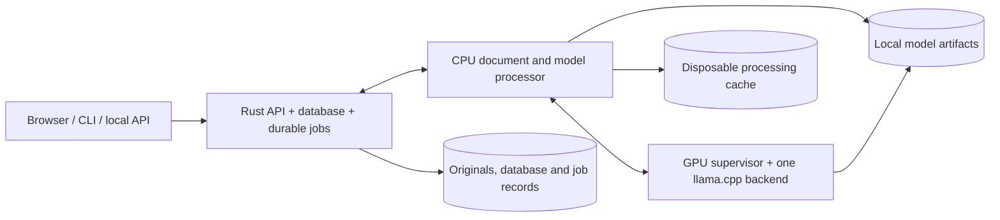

# VectorNext architecture

Current implementation reference. Last updated: 2026-10-16 (UTC).

This document describes the supported application and its invariants. Active work and proposals belong in [plan.md](plan.md); completed specifications, experiments, measurements and rollout decisions are in [tasks-done.md](tasks-done.md#historical-architecture-handoff). Explicit user instructions can revise this architecture. Keep historical scores and deployment diaries out of this document.

## Purpose and boundaries

VectorNext implements its own vector storage, exact similarity search, keyword index and query behavior. The local workflow is document upload, retrieval, source-linked factual answers and optional presentation drafts. TXT, PDF and JSON are supported. General-purpose parsing, numerical, serialization and model-runtime libraries are dependencies; an external vector database is not the storage backend.

The target is a single user on a Windows PC running Linux containers through Docker Desktop/WSL 2, with one RTX 4060 (8 GB VRAM) and roughly 64 GB RAM. The initial workload is about 400 short documents of 10–30 KB; file size alone does not establish token counts, memory use or PDF complexity. Normal operation is offline after explicit image/model setup. Host NVIDIA drivers remain a prerequisite.

Local content-addressed originals, bounded in-process indexes and disposable disk caches provide storage/reuse without MinIO or Redis. Remote inference is never substituted for an unavailable local model. Mechanical source validation does not guarantee semantic correctness or broad retrieval quality.

## Components and ownership

The supported [Compose deployment](../compose.app.yaml) has three long-running services:

| Service | Implementation | Ownership and access |
| --- | --- | --- |
| `vectornext` | Rust, Axum/Tokio, utoipa; bundled React assets | Sole database writer; ingestion and answer-job coordinators; search, source validation, API, browser and local documentation. Only service with the durable data volume. |
| `processor` | Python with separately pinned PDF and model environments | CPU Docling/Tesseract, ONNX embeddings/reranking and generation request orchestration. Separate bounded interactive/background admission; read-only model files and disposable cache, no database mount. |
| `llm` | Python supervisor/admission wrapper and pinned CUDA llama.cpp | One GPU backend at a time, identity-bound model leases, activation and inference. Read-only model artifacts; no database mount. |

Parsing and model inference run outside database transactions and mutex-held work. Rust performs deterministic TXT/JSON preparation and validates processor artifacts before durable stages. Processor/generator endpoints stay on an internal network; the API is published on loopback, normally port 8088. Source browsing does not acquire a model lane and remains available during model outages or switching when storage is healthy.

The CLI and offline admin are on-demand tools, not additional runtime services. General developer ingestion tooling has separate storage; its Python child has no database handle but shares the CLI's filesystem permissions, so that boundary is not a security sandbox. See [deployment contracts](deployment.md).

## Stored data and durability

| Entity | Contract |
| --- | --- |
| Document revision | Logical document ID, immutable revision, original hash/length, media type, processing configuration, blocks and complete required chunks/vectors. Staging state is separate from published revisions. |
| Block and chunk | Parsed structure, exact evidence, UTF-8 block spans, source locators, structural context, separate generated annotations, typed attributes and parent/neighbor relationships. |
| Embedding space | Content-derived identity covering artifacts, tokenizer/preprocessing, dimensions, limits, query/document encoding conventions and normalization. Equal dimensions do not imply compatibility. |
| Source reference | TXT normalized-to-original byte/line mappings; PDF revision/page/box/extraction diagnostics; JSON revision, RFC 6901 pointer and record identity. Array positions alone are not stable across revisions. |

Originals are content-addressed under `blobs/<sha256>`. Derived PDF/OCR text and JSON search text are not mislabeled as unchanged source bytes. JSON values retain arbitrary precision and exact types, with missing fields distinct from stored nulls. Generated annotations never replace original evidence.

An OS-held lock enforces one writer. Publication durably stores originals, writes and fsyncs matching journal prepare/commit frames, then exposes one immutable reader generation. Revisions and operation receipts enforce compare-and-swap updates and idempotent publication. Replacement is atomic; new readers exclude removed/replaced revisions, while existing snapshots remain consistent. Old revision IDs remain reserved after deletion.

Recovery validates checksums and the checkpoint's retained journal prefix, trims incomplete journal tails and rejects complete corrupt frames. It restores persisted vectors without models. Version-2 checkpoints serialize through numbered 1 MiB segments with CRCs and a terminal length/count/SHA-256 manifest, then file-fsync, atomic rename and directory-fsync. Legacy checkpoints remain readable; older binaries reject the newer format and need an untouched pre-upgrade copy for rollback. Write/checkpoint failures require reopening rather than clearing poisoned state in place.

This bounds checkpoint serialization buffers, not the full in-memory database. Individual journal/job frames retain their 64 MiB limit; database export retains an 8 GiB total limit. Journal/blob/receipt reclamation and compaction are not implemented. Durability requires Linux filesystem locking, fsync and atomic rename; native Windows storage is unsupported. [Storage contract](storage.md) · [Record types](../src/contracts.rs).

## Ingestion and contextualization

The durable sequence is `Uploaded → Parsed → Chunked → Contextualized → Embedded → Committed`. Atomic checksummed job files retain input/configuration identities, completed stages and failures. A stable batch receipt reconciles publication after interruption. Saved failures require explicit retry; no partial revision becomes searchable.

Browser uploads use stable identifiers and reconcile uncertain acknowledgements before resubmission. Files are admitted sequentially through existing limits. PDF preparation precedes durable job acknowledgement and is shown separately. Filenames are optional metadata, omitted from legacy serialization when absent. Replacement/removal requires the current revision and rejects changes during unfinished ingestion; removal does not erase historical jobs or reclaim original blobs.

| Format | Preparation and chunking |
| --- | --- |
| TXT | Strict UTF-8 and preserved originals; normalized newlines with byte mappings; headings, lists and paragraphs; combine within sections and split oversized prose at safe sentence/word boundaries. Keep parent/neighbor references and source-significant structure. |
| PDF | CPU Docling layout/tables plus local English Tesseract OCR. Rust validates versioned source/profile/artifact hashes and page/box mappings. Preserve reading order, cross-page prose, table units/headers/captions and extraction warnings; repeated headers/footers remain parsed but are excluded from evidence. Strict partial-extraction rejection is the default; explicit opt-in keeps warnings. |
| JSON | Preserve exact types, numbers and pointer provenance; reject duplicate keys/record IDs. Root arrays or an explicit nested record pointer select records. Whole records remain intact when they fit; oversized containers split at child boundaries and long narrative values split with their record/path. Deterministic key/value text supports search without model extraction of explicit fields. |

The application uses a 180-token chunk target and no TXT overlap. The current MiniLM encoder admits at most 256 tokens for the complete embedding input, including context and special tokens. Whole JSON records can exceed the soft target while fitting that hard limit. Final inputs are counted with the actual tokenizer; indivisible values or required context that exceed limits fail explicitly, without silent truncation. Reranking and answer assembly enforce separate budgets.

| Context policy | Embedding representation |
| --- | --- |
| `plain` | Evidence text. |
| `structural` (default) | Evidence plus available headings, table labels, captions or JSON record/field structure. |
| `generated` | Structural input plus a separate local Gemma annotation for eligible prose/list chunks; explicit JSON, tables and headings are skipped. |

Generated context reserves 64 embedding tokens. Scope uses complete parsed text within 8,000 bytes when possible, otherwise exact chunk spans, mandatory structural sources and complete nearby blocks; rendered model tokens are checked before inference. Generation may abstain. Persist scope/input digests, prompt, artifact/runtime/settings and annotation separately; source links establish supplied context, not entailment. Optional enrichment keeps its saved Gemma identity regardless of answer mode. New identities do not silently reassign unfinished jobs.

Structural fields remain stored under every policy for source expansion. Keyword weights are independent of the embedding policy: fully plain retrieval also requires structural/generated keyword weights of zero. [Ingestion](ingestion.md) · [PDF/OCR](pdf-ingestion.md) · [Context and model identities](model-ingestion.md).

## Retrieval and evidence assembly

`SearchIndex` is immutable and bound to one committed snapshot and embedding space. It builds disposable in-memory postings/vector references without modifying stored vectors. The application caches up to four spaces and rebuilds for a new generation; old readers retain their snapshot. Committed vectors live in the database, not only in a disposable cache.

- Exact cosine uses float64 accumulation over stored float32 vectors, with deterministic hit-key ties.
- Per-field BM25 indexes evidence, structural and generated text independently (`k1=1.2`, `b=0.75`). Unicode normalization changes search keys, not evidence. Application weights default to 1/1/1; the core library defaults to 1/1/0.
- Explicit typed filters apply before branch limits. They preserve exact numeric comparisons, missing/null distinctions, three-valued logic and provenance trust. Generated attributes are unknown unless explicitly allowed; no model invents hard filters.
- Document/media postings and bounded top-level scalar indexes accelerate filters. Nested, container or over-budget predicates use the complete scan evaluator, never a partial index that silently drops eligible evidence.
- Weighted reciprocal rank fusion (`k=60`) combines branch ranks; conservative deduplication preserves distinct documents, revisions and source locations. Rankings, exclusions and suppression decisions remain inspectable.

Default answering retrieves 30 candidates per branch, reranks 20 and selects five primary passages. Assembly merges source overlaps, retains required headings/table labels and complete JSON records, and admits same-scope/filter neighbors within actual rendered-token bounds. The answer input budget is 3,328 tokens plus 768 reserved output tokens in a 4,096-token context; pointer catalogs count toward that input budget. Omitted expansions and failures are recorded.

`coverage_v1` is an opt-in field-focused reranking/selection strategy within the existing candidate pool. `facet_coverage_v1` also adds up to four field-derived candidate queries and chooses complementary passages, avoiding heading-only and substantially overlapping primaries. Both keep explicit scope/filter contracts and disable automatic neighbor expansion; required labels and complete records remain. They are relevance heuristics, not completeness guarantees. Ranked remains the default. [Retrieval contract](retrieval.md) · [Evidence strategies](answers.md).

## Answer construction and validation

Each attempt preserves the original question, completed history, selected documents/revisions and caller options. An ordinary question first makes one schema-constrained local planning call from question/history only. The planner proposes 1–12 requested field definitions (facet mode allows at most four); it cannot produce answers, infer filters, select JSON pointers, judge unavailable evidence or replace the search question. Explicit fields bypass planning. Clarification, unsupported calculations and invalid plans are distinct outcomes.

After retrieval/assembly, the selected model separately assesses answerability and extracts fields for supported requests. The schema permits explicit supported, ambiguous and insufficient-evidence outcomes. There is no silent output repair or retry within an attempt. Optional question/answer prose is a separately labeled draft; deterministic templates format validated fields, and prose failure does not discard valid facts.

JSON extraction schemas bind each evidence ID to type-compatible RFC 6901 pointers from that admitted record, including escaped keys and arrays. They respect caller-supplied exact pointers and do not use a cross-record union of allowed paths. Catalog bounds are 256 scalar/null leaves per record, depth 64, 2,048 UTF-8 bytes per pointer and 32,768 catalog bytes; overflow fails explicitly. The model selects a record/pointer with a null placeholder; Rust materializes the source value and validates it. Placeholder null, stored raw null, a missing pointer and zero remain distinct; a non-nullable count backed only by null yields insufficient evidence.

For prose, Rust validates exact quoted evidence, typed values and boundaries against the complete supplied passage. Numeric support permits exact English comma grouping, bounded named-month date years and complete unsigned two-endpoint ranges separated by a hyphen, en dash or `to`. It rejects clipped fragments, signed/negative ranges, multi-segment dates/ranges, identifiers and inferred interior values. This is mechanical support, not arithmetic, general language understanding or a multilingual number parser.

Explicit `structured_lookup` scans caller-selected eligible JSON records and materializes specified pointers without model extraction. Automatic planning cannot invent those pointers. Corpus-wide aggregation is unsupported; top-k passages must not be used as complete-record totals. [Answer contract](answers.md) · [Planning and browser contract](browser-api.md).

## Durable answer jobs and fallback

Rust owns routing after final validation; the CPU worker does not decide fallback.

| Mode | Behavior |
| --- | --- |
| `hybrid` (default) | Try repaired NuExtract3; accept only supported, validated facts; queue at most one Gemma attempt for an eligible unsuccessful result. |
| `gemma` | Gemma only, no model fallback. |
| `nuextract` | NuExtract3 only, no model fallback. |

Eligible fallback includes model declines, ambiguity, insufficient evidence, malformed outputs, rejected proofs and model failures. Invalid requests, deterministic pre-inference unsupported operations, stale bindings, cancellation and admission failures finish directly. Gemma receives original inputs and independently plans automatic fields; explicit fields remain unchanged. Rejected NuExtract output never becomes Gemma evidence or conversation history. Return Gemma's validated outcome, including legitimate negatives; there is no third attempt. A plausible semantic mistake that passes validation can still avoid fallback.

The coordinator persists original requests, mode, document-revision bindings, attempt states and exact reports in atomic checksummed files. Identical client IDs reconcile to one job; conflicting reuse fails. Both attempts use the same bound revisions, and newly added documents do not silently join their scope.

| Queue bound | Behavior |
| --- | --- |
| 16 unfinished jobs | Separate from HTTP admission. |
| 256 MiB retention | Reserve 16 MiB per unfinished record; terminal records use actual size. Reject admission when full instead of deleting history. |
| Four attempts / 30-second opposite wait | Hand off after active work when the batch empties, four attempts finish with opposite work waiting, or opposite waiting reaches 30 seconds. |
| 15-minute wait | Expire a job that has not begun its next attempt. |

Cancellation immediately ends queued work and prevents further stages after an active backend call finishes. Terminal records remain until explicitly cleared. Queued jobs survive restart. Interrupted loading/running attempts become uncertain: Hybrid NuExtract may spend its one remaining Gemma attempt only after backend reconciliation; interrupted Gemma/forced attempts require explicit resubmission. Changed or unreconstructable source bindings make jobs stale rather than substituting current revisions. Failed/poisoned coordinators stop admission until restart. [Answer-job contract](answer-jobs.md).

## Local models and GPU ownership

| Role | Current artifact/profile | Execution |
| --- | --- | --- |
| Embedding | `all-MiniLM-L6-v2` | CPU FP32 ONNX; 384 dimensions, masked mean/L2, no query/document prefixes, 256-token input cap. |
| Reranking | `ms-marco-MiniLM-L6-v2` | CPU FP32 ONNX; 512-token question/passage pair cap, raw relevance logits. |
| General generation / enrichment | Gemma 4 12B QAT Q4_0, profile `12b` | Answer temperature 0; saved enrichment identity remains Gemma. |
| First Hybrid attempt / forced specialist | NuExtract3 Q4_K_M, profile `nuextract3-requested-facts-v1` | Native template adapter, requested-facts planner, answer temperature 0.2. |

Supported artifacts and checksum-verified downloads live in [model_assets](../model_assets/); the [generator profile catalog](../model_worker/generator_profiles.json) binds artifact, alias and runtime identity. The two generator profiles use pinned llama.cpp b11617/CUDA 12.8, 4,096 context tokens, one inference slot, f16 KV, seed 42, disabled reasoning and `cache_prompt: false`. Two-call answering and existing operation/output budgets remain authoritative. Experimental CPU profiles have distinct spaces and do not change application defaults; alternative generator experiments are not runtime choices.

The supervisor initially loads NuExtract, retains the last model while idle and switches only for queued work. An identity-bound lease spans planning, template rendering, token counting, assessment, extraction and optional prose. Every generation operation carries that identity. Finish active work, stop/reap the backend, verify the next artifact/command and allow up to 240 seconds for activation. Never overlap GPU backends or silently alter quantization/offload settings. Uncertain backends must be terminated and reconciled before another model runs.

Interactive attempts outrank waiting background enrichment without preempting active inference. The inner generation scheduler's bounded in-memory admission and operation deadlines remain separate from durable answer jobs. Actual model/runtime identities enter audits and generated-context cache keys. GPU allocation does not guarantee WDDM residency or a fixed VRAM safety margin.

## HTTP API and browser workspace

Axum/Tokio routes share synchronous `Application` state. Blocking work runs through `spawn_blocking` under immediate 16-request admission; excess requests receive the existing `503 busy` response. A running operation retains its permit after client disconnect. Framework defaults do not redefine method/origin/rejection/status/header behavior, introduce automatic HEAD success or add retries/timeouts. Wire schemas and contracts stay explicit.

The API provides ingestion/status/retry, document inspection, search and structured answers; `/v1/ui/` adds multipart uploads, compact library views, replacement/removal, revision-bound sources/original PDFs and ordinary questions. `/v1/answer-jobs` provides submit/list/status/cancel/clear. Synchronous ask routes adapt to that same durable coordinator. The CLI reconciles stable request IDs after uncertain transport outcomes.

POST requests require the client header, positive Content-Length and the documented content type. JSON is bounded to 64 KiB except base64 ingestion at 23 MiB. Multipart accepts one metadata JSON-text field (8 KiB) and one binary file (16 MiB), within a 16 MiB + 16 KiB envelope, rejecting duplicates. Browser origins must match the permitted local origin; CLI requests may omit Origin. Source endpoints retain revision/path checks and security headers.

utoipa/utoipa-axum registers OpenAPI definitions with routes. `/openapi.json` and vendored Swagger UI at `/docs` are local, use no CDN/external validator and preserve raw numeric response text. Rust 1.87 is supported; `tiny_http` is only a test dependency. [API/deployment](deployment.md) · [Browser contracts](browser-api.md) · [Wire schemas](../src/service/http/schemas.json).

React/TypeScript/Vite/shadcn assets are built in Docker and served by the API at the same origin. The library, conversation and evidence panels support uploads, readiness/failures, answer-mode choice, citations, replacement, confirmed removal and job history. PDF evidence is extracted text/page references plus revision-checked original access; no integrated bounding-box viewer is implemented.

IndexedDB in the current browser/origin stores conversations, captured evidence, preferences and pending IDs. One unfinished turn per conversation is reserved atomically across tabs; full concurrent-tab history merging is not implemented. Other conversations/API callers can queue concurrently. The visible context window contains at most four complete supported exchanges, bounded to 4 KiB per turn; rejected drafts are excluded and oversized turns are refused. Scope changes start a new conversation. Historical evidence is never silently replaced by a newer document revision.

Browser values use exact text plus types, and reports remain opaque JSON text for saving/export. Reload polls saved job IDs. UI state reports recorded waiting/running/loading outcomes and elapsed time, without invented percentages. Model availability, the loaded model and queue readiness are separate capabilities.

## Operations, caches and diagnostics

Windows Setup checks Docker/GPU prerequisites and explicitly prepares images plus both supported models and CPU/PDF artifacts. Start reuses installed files/images offline, checks unfinished ingestion policies before cutover and opens the browser when the API is live. Rebuild is explicit. Stop targets only the normal Compose project and retains documents/models/caches. The [README](../README.md#compose-files) lists the five supported app/setup/developer Compose configurations; completed experiment YAML and deployment commands belong to [history](tasks-done.md#experiment-compose-cleanup).

Database state and ingestion jobs live in the API volume; for `/storage/db`, answer jobs live beside it at `/storage/db.answer-jobs`. Offline export takes exclusive writer ownership, checkpoints and writes exact file/hash manifests; restore verifies into a new destination. It excludes answer-job history, model weights and disposable caches. Preserve answer jobs separately through a stopped-volume copy, and browser conversations through their own export. Upgrades retain verified storage copies and prior images; saved incompatible ingestion policies must be handled without rewriting them.

Bounded processing caches key exact inputs and model/tokenizer/preprocessing/runtime/prompt configuration. Checksummed atomic cache files and interprocess locking protect file operations; they do not guarantee coalesced concurrent inference. Corrupt entries are misses. Lost caches or unavailable models cannot erase committed sources, vectors or readable revisions.

Workflow reports and the browser's explanation view use recorded processing data. CLI `--explain`, `--report`, `--capture` and offline `explain` show source previews, outcomes, warnings, counts and available timings. Client arguments, API handlers and high-level code references distinguish recorded versus recovered provenance; code references are mappings, not instrumented call stacks. Skipped/unrecorded stages remain explicit. Rendering adds no model narration or inferred reasoning.

Keep queue, activation, attempt work, inference and total user-visible latency separate; missing audits mean unknown inference time, not zero. Storage, ingestion coordinator, model and answer-queue readiness are distinct from liveness. [Workflow reporting](workflow-debugging.md) · [Recovery](reliability.md) · [Operations and backup commands](development.md).

## Current limits and change discipline

The implementation is local and single-user. Remote authentication/hosting, multi-user isolation, token streaming, integrated PDF highlighting, chart understanding, corpus aggregation, approximate/incremental indexes, compaction, replication and distributed storage are outside the current implementation. Broader OCR/language support, context-generation usefulness and semantic answer reliability remain limited; see [plan.md](plan.md) for proposed work rather than treating proposals as architecture.

Any change to these contracts must be explicit and reflected here before implementation. Evaluation separates source fidelity, candidate/final evidence coverage, answer correctness/support, negative outcomes, stage/total latency, resources and recovery. Preserve frozen sources, labels, manifests, captures, failures and source-review exceptions; the original holdout remains unused. Do not promote experimental models or retrieval settings solely because they are available. Record completed experiments and dated decisions in [tasks-done.md](tasks-done.md), with detailed evidence in `docs/reports/`.
