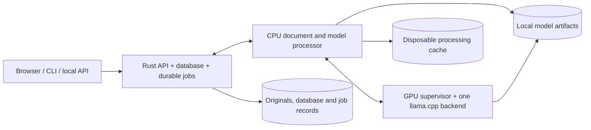

# VectorNext architecture

Current implementation reference. Last updated: 2026-10-16 (UTC).

This document describes the supported application and its invariants. Active work and proposals belong in [plan.md](plan.md); completed specifications, experiments, measurements and rollout decisions are in [tasks-done.md](tasks-done.md#historical-architecture-handoff). Explicit user instructions can revise this architecture. Keep historical scores and deployment diaries out of this document.

## Purpose and boundaries

VectorNext implements its own vector storage, exact similarity search, keyword index and query behavior. The local workflow is document upload, retrieval, source-linked factual answers and optional presentation drafts. TXT, PDF and JSON are supported. General-purpose parsing, numerical, serialization and model-runtime libraries are dependencies; an external vector database is not the storage backend.

The target is a single user on a Windows PC running Linux containers through Docker Desktop/WSL 2, with one RTX 4060 (8 GB VRAM) and roughly 64 GB RAM. The initial workload is about 400 short documents of 10–30 KB; file size alone does not establish token counts, memory use or PDF complexity. Normal operation is offline after explicit image/model setup. Host NVIDIA drivers remain a prerequisite.

Local content-addressed originals, bounded in-process indexes and disposable disk caches provide storage/reuse without MinIO or Redis. Remote inference is never substituted for an unavailable local model. Mechanical source validation does not guarantee semantic correctness or broad retrieval quality.

## Components and ownership

The supported [Compose deployment](../compose.app.yaml) has three long-running services:

| Service | Implementation | Ownership and access |
| --- | --- | --- |
| `vectornext` | Rust, Axum/Tokio, utoipa; bundled React assets | Sole database writer; ingestion and answer-job coordinators; search, source validation, API, browser and local documentation. Only service with the durable data volume. |
| `processor` | Python with separately pinned PDF and model environments | CPU Docling/Tesseract, ONNX embeddings/reranking and generation request orchestration. Separate bounded interactive/background admission; read-only model files and disposable cache, no database mount. |
| `llm` | Python supervisor/admission wrapper and pinned CUDA llama.cpp | One GPU backend at a time, identity-bound model leases, activation and inference. Read-only model artifacts; no database mount. |

Parsing and model inference run outside database transactions and mutex-held work. Rust performs deterministic TXT/JSON preparation and validates processor artifacts before durable stages. Processor/generator endpoints stay on an internal network; the API is published on loopback, normally port 8088. Source browsing does not acquire a model lane and remains available during model outages or switching when storage is healthy.

The CLI and offline admin are on-demand tools, not additional runtime services. General developer ingestion tooling has separate storage; its Python child has no database handle but shares the CLI's filesystem permissions, so that boundary is not a security sandbox. See [deployment contracts](deployment.md).

## Stored data and durability

| Entity | Contract |
| --- | --- |
| Document revision | Logical document ID, immutable revision, original hash/length, media type, processing configuration, blocks and complete required chunks/vectors. Staging state is separate from published revisions. |
| Block and chunk | Parsed structure, exact evidence, UTF-8 block spans, source locators, structural context, separate generated annotations, typed attributes and parent/neighbor relationships. |
| Embedding space | Content-derived identity covering artifacts, tokenizer/preprocessing, dimensions, limits, query/document encoding conventions and normalization. Equal dimensions do not imply compatibility. |
| Source reference | TXT normalized-to-original byte/line mappings; PDF revision/page/box/extraction diagnostics; JSON revision, RFC 6901 pointer and record identity. Array positions alone are not stable across revisions. |

Originals are content-addressed under `blobs/<sha256>`. Derived PDF/OCR text and JSON search text are not mislabeled as unchanged source bytes. JSON values retain arbitrary precision and exact types, with missing fields distinct from stored nulls. Generated annotations never replace original evidence.

An OS-held lock enforces one writer. Publication durably stores originals, writes and fsyncs matching journal prepare/commit frames, then exposes one immutable reader generation. Revisions and operation receipts enforce compare-and-swap updates and idempotent publication. Replacement is atomic; new readers exclude removed/replaced revisions, while existing snapshots remain consistent. Old revision IDs remain reserved after deletion.

Recovery validates checksums and the checkpoint's retained journal prefix, trims incomplete journal tails and rejects complete corrupt frames. It restores persisted vectors without models. Version-2 checkpoints serialize through numbered 1 MiB segments with CRCs and a terminal length/count/SHA-256 manifest, then file-fsync, atomic rename and directory-fsync. Legacy checkpoints remain readable; older binaries reject the newer format and need an untouched pre-upgrade copy for rollback. Write/checkpoint failures require reopening rather than clearing poisoned state in place.

This bounds checkpoint serialization buffers, not the full in-memory database. Individual journal/job frames retain their 64 MiB limit; database export retains an 8 GiB total limit. Explicit offline compaction reclaims obsolete journal payloads and unreferenced blobs under the retention rules below; receipts never expire. Durability requires Linux filesystem locking, fsync and atomic rename; native Windows storage is unsupported. [Storage contract](storage.md) · [Record types](../src/contracts.rs).

### Offline compaction and retention

The admin CLI provides `storage-plan DB` for dry-run accounting and `compact DB --apply` for offline compaction/GC. The API must be stopped; maintenance takes the same exclusive writer lock and invokes no model. A dry run validates an existing store without creating a database, repairing its journal, or deleting files. Follow the [maintenance guide](maintenance.md) for backup, apply and recovery. Search/index changes and ANN remain deferred until a representative workload establishes a bottleneck.

Retention is reference-based, never age-based:

- Preserve current document revisions, exact evidence/values/vectors, embedding identities and generation unchanged.
- Preserve **all** operation receipts and reserved revision IDs indefinitely. Identical retries retain their original receipt; conflicting ID reuse and revision resurrection remain rejected. No retry-expiration window is introduced.
- Preserve **all ingestion jobs byte-for-byte**, including completed, failed and unfinished jobs, their original blobs, and available PDF artifacts or other blob hashes referenced by their configuration/processing metadata. Historical ingestion job inspection and restart reconciliation remain unchanged.
- Reclaim only blobs unreferenced by current documents or retained ingestion jobs/processing metadata. Replaced/deleted revisions retained only in the obsolete journal are not a supported historical-revision API; their operation receipts remain. Captured browser evidence and answer diagnostics keep their existing historical/stale-source behavior.
- Leave the sibling answer-job store, browser history, caches, downloaded models and external backups untouched. Answer-job clearing remains its existing explicit operation.

Compaction writes a fresh version-2 checkpoint with the same complete state and an empty journal, copies retained jobs/blobs into a sibling staging directory, verifies the replacement, then atomically exchanges directories on the same Linux filesystem. The replacement shares the original writer-lock inode, so publication cannot admit a second writer through a renamed lock. Sync the exchange before reclaiming the displaced files; no in-place journal truncation or multi-file publication window is allowed. Unsupported exchange/hard-link filesystems fail closed. The on-disk format and public HTTP contracts stay unchanged.

Reports distinguish current data, retained history, unreferenced blobs, journal/pending bytes, replacement size and actual reclaimed bytes. Sufficient temporary disk space is required for a separate compacted copy. Interrupted attempts may leave explicitly reported sibling maintenance directories; do not automatically delete unknown or unverifiable leftovers. Preserve a verified backup before production maintenance. Full ingestion history and compact receipt/revision metadata still grow with accepted work: this feature reclaims obsolete payloads, not all historical information, and does not promise a fixed disk bound. Expiring history would require a separately approved retention/retry contract.

## Ingestion and contextualization

The durable sequence is `Uploaded → Parsed → Chunked → Contextualized → Embedded → Committed`. Atomic checksummed job files retain input/configuration identities, completed stages and failures. A stable batch receipt reconciles publication after interruption. Saved failures require explicit retry; no partial revision becomes searchable.

Browser uploads use stable identifiers and reconcile uncertain acknowledgements before resubmission. Files are admitted sequentially through existing limits. PDF preparation precedes durable job acknowledgement and is shown separately. Filenames are optional metadata, omitted from legacy serialization when absent. Replacement/removal requires the current revision and rejects changes during unfinished ingestion; removal does not erase historical jobs or reclaim original blobs.

| Format | Preparation and chunking |
| --- | --- |
| TXT | Strict UTF-8 and preserved originals; normalized newlines with byte mappings; headings, lists and paragraphs; combine within sections and split oversized prose at safe sentence/word boundaries. Keep parent/neighbor references and source-significant structure. |
| PDF | CPU Docling layout/tables plus local English Tesseract OCR. Rust validates versioned source/profile/artifact hashes and page/box mappings. Preserve reading order, cross-page prose, table units/headers/captions and extraction warnings; repeated headers/footers remain parsed but are excluded from evidence. Strict partial-extraction rejection is the default; explicit opt-in keeps warnings. |
| JSON | Preserve exact types, numbers and pointer provenance; reject duplicate keys/record IDs. Root arrays or an explicit nested record pointer select records. Whole records remain intact when they fit; oversized containers split at child boundaries and long narrative values split with their record/path. Deterministic key/value text supports search without model extraction of explicit fields. |

The application uses a 180-token chunk target and no TXT overlap. The current MiniLM encoder admits at most 256 tokens for the complete embedding input, including context and special tokens. Whole JSON records can exceed the soft target while fitting that hard limit. Final inputs are counted with the actual tokenizer; indivisible values or required context that exceed limits fail explicitly, without silent truncation. Reranking and answer assembly enforce separate budgets.

| Context policy | Embedding representation |
| --- | --- |
| `plain` | Evidence text. |
| `structural` (default) | Evidence plus available headings, table labels, captions or JSON record/field structure. |
| `generated` | Structural input plus a separate local annotation (NuExtract by default) for eligible prose/list chunks; explicit JSON, tables and headings are skipped. |

Generated context reserves 64 embedding tokens. Scope uses complete parsed text within 8,000 bytes when possible, otherwise exact chunk spans, mandatory structural sources and complete nearby blocks; rendered model tokens are checked before inference. Generation may abstain. Persist scope/input digests, prompt, artifact/runtime/settings and annotation separately; source links establish supplied context, not entailment. Optional enrichment keeps its saved generator identity regardless of answer mode, including existing Gemma jobs. New identities do not silently reassign unfinished jobs.

Structural fields remain stored under every policy for source expansion. Keyword weights are independent of the embedding policy: fully plain retrieval also requires structural/generated keyword weights of zero. [Ingestion](ingestion.md) · [PDF/OCR](pdf-ingestion.md) · [Context and model identities](model-ingestion.md).

## Retrieval and evidence assembly

`SearchIndex` is immutable and bound to one committed snapshot and embedding space. It builds disposable in-memory postings/vector references without modifying stored vectors. The application caches up to four spaces and rebuilds for a new generation; old readers retain their snapshot. Committed vectors live in the database, not only in a disposable cache.

- Exact cosine uses float64 accumulation over stored float32 vectors, with deterministic hit-key ties.
- Per-field BM25 indexes evidence, structural and generated text independently (`k1=1.2`, `b=0.75`). Unicode normalization changes search keys, not evidence. Application weights default to 1/1/1; the core library defaults to 1/1/0.
- Explicit typed filters apply before branch limits. They preserve exact numeric comparisons, missing/null distinctions, three-valued logic and provenance trust. Generated attributes are unknown unless explicitly allowed; no model invents hard filters.
- Document/media postings and bounded top-level scalar indexes accelerate filters. Nested, container or over-budget predicates use the complete scan evaluator, never a partial index that silently drops eligible evidence.
- Weighted reciprocal rank fusion (`k=60`) combines branch ranks; conservative deduplication preserves distinct documents, revisions and source locations. Rankings, exclusions and suppression decisions remain inspectable.

Default answering retrieves 30 candidates per branch, reranks 20 and selects five primary passages. Assembly merges source overlaps, retains required headings/table labels and complete JSON records, and admits same-scope/filter neighbors within actual rendered-token bounds. The answer input budget is 3,328 tokens plus 768 reserved output tokens in a 4,096-token context; pointer catalogs count toward that input budget. Omitted expansions and failures are recorded.

`coverage_v1` is an opt-in field-focused reranking/selection strategy within the existing candidate pool. `facet_coverage_v1` also adds up to four field-derived candidate queries and chooses complementary passages, avoiding heading-only and substantially overlapping primaries. Both keep explicit scope/filter contracts and disable automatic neighbor expansion; required labels and complete records remain. They are relevance heuristics, not completeness guarantees. Ranked remains the default. [Retrieval contract](retrieval.md) · [Evidence strategies](answers.md).

## Answer construction and validation

Each attempt preserves the original question, completed history, selected documents/revisions and caller options. An ordinary question first makes one schema-constrained local planning call from question/history only. The planner proposes 1–12 requested field definitions (facet mode allows at most four); it cannot produce answers, infer filters, select JSON pointers, judge unavailable evidence or replace the search question. Explicit fields bypass planning. Clarification, unsupported calculations and invalid plans are distinct outcomes.

After retrieval/assembly, the selected model separately assesses answerability and extracts fields for supported requests. The schema permits explicit supported, ambiguous and insufficient-evidence outcomes. There is no silent output repair or retry within an attempt. Optional question/answer prose is a separately labeled draft; deterministic templates format validated fields, and prose failure does not discard valid facts.

JSON extraction schemas bind each evidence ID to type-compatible RFC 6901 pointers from that admitted record, including escaped keys and arrays. They respect caller-supplied exact pointers and do not use a cross-record union of allowed paths. Catalog bounds are 256 scalar/null leaves per record, depth 64, 2,048 UTF-8 bytes per pointer and 32,768 catalog bytes; overflow fails explicitly. The model selects a record/pointer with a null placeholder; Rust materializes the source value and validates it. Placeholder null, stored raw null, a missing pointer and zero remain distinct; a non-nullable count backed only by null yields insufficient evidence.

For prose, Rust validates exact quoted evidence, typed values and boundaries against the complete supplied passage. Numeric support permits exact English comma grouping, bounded named-month date years and complete unsigned two-endpoint ranges separated by a hyphen, en dash or `to`. It rejects clipped fragments, signed/negative ranges, multi-segment dates/ranges, identifiers and inferred interior values. This is mechanical support, not arithmetic, general language understanding or a multilingual number parser.

Explicit `structured_lookup` scans caller-selected eligible JSON records and materializes specified pointers without model extraction. Automatic planning cannot invent those pointers. Corpus-wide aggregation is unsupported; top-k passages must not be used as complete-record totals. [Answer contract](answers.md) · [Planning and browser contract](browser-api.md).

## Durable answer jobs and fallback

Rust owns routing after final validation; the CPU worker does not decide fallback.

| Mode | Behavior |
| --- | --- |
| `hybrid` | Try repaired NuExtract3; accept only supported, validated facts; queue at most one Gemma attempt for an eligible unsuccessful result. |
| `gemma` | Gemma only, no model fallback. |
| `nuextract` (default) | NuExtract3 only, no model fallback. |

Eligible fallback includes model declines, ambiguity, insufficient evidence, malformed outputs, rejected proofs and model failures. Invalid requests, deterministic pre-inference unsupported operations, stale bindings, cancellation and admission failures finish directly. Gemma receives original inputs and independently plans automatic fields; explicit fields remain unchanged. Rejected NuExtract output never becomes Gemma evidence or conversation history. Return Gemma's validated outcome, including legitimate negatives; there is no third attempt. A plausible semantic mistake that passes validation can still avoid fallback.

The coordinator persists original requests, mode, document-revision bindings, attempt states and exact reports in atomic checksummed files. Identical client IDs reconcile to one job; conflicting reuse fails. Both attempts use the same bound revisions, and newly added documents do not silently join their scope.

| Queue bound | Behavior |
| --- | --- |
| 16 unfinished jobs | Separate from HTTP admission. |
| 256 MiB retention | Reserve 16 MiB per unfinished record; terminal records use actual size. Reject admission when full instead of deleting history. |
| Four attempts / 30-second opposite wait | Hand off after active work when the batch empties, four attempts finish with opposite work waiting, or opposite waiting reaches 30 seconds. |
| 15-minute wait | Expire a job that has not begun its next attempt. |

Cancellation immediately ends queued work and prevents further stages after an active backend call finishes. Terminal records remain until explicitly cleared. Queued jobs survive restart. Interrupted loading/running attempts become uncertain: Hybrid NuExtract may spend its one remaining Gemma attempt only after backend reconciliation; interrupted Gemma/forced attempts require explicit resubmission. Changed or unreconstructable source bindings make jobs stale rather than substituting current revisions. Failed/poisoned coordinators stop admission until restart. [Answer-job contract](answer-jobs.md).

## Local models and GPU ownership

| Role | Current artifact/profile | Execution |
| --- | --- | --- |
| Embedding | `all-MiniLM-L6-v2` | CPU FP32 ONNX; 384 dimensions, masked mean/L2, no query/document prefixes, 256-token input cap. |
| Reranking | `ms-marco-MiniLM-L6-v2` | CPU FP32 ONNX; 512-token question/passage pair cap, raw relevance logits. |
| Explicit Gemma / Hybrid fallback / retained enrichment | Gemma 4 12B QAT Q4_0, profile `12b` | Temperature 0; existing saved enrichment identities remain valid. |
| Default generation and new optional enrichment | NuExtract3 Q4_K_M, profile `nuextract3-requested-facts-v1` | Native template adapter, requested-facts planner, temperature 0.2. |

Supported artifacts and checksum-verified downloads live in [model_assets](../model_assets/); the [generator profile catalog](../model_worker/generator_profiles.json) binds artifact, alias and runtime identity. The two generator profiles use pinned llama.cpp b11617/CUDA 12.8, 4,096 context tokens, one inference slot, f16 KV, seed 42, disabled reasoning and `cache_prompt: false`. Two-call answering and existing operation/output budgets remain authoritative. Experimental CPU profiles have distinct spaces and do not change application defaults; alternative generator experiments are not runtime choices.

The supervisor initially loads NuExtract, retains the last model while idle and switches only for queued work. An identity-bound lease spans planning, template rendering, token counting, assessment, extraction and optional prose. Every generation operation carries that identity. Finish active work, stop/reap the backend, verify the next artifact/command and allow up to 240 seconds for activation. Never overlap GPU backends or silently alter quantization/offload settings. Uncertain backends must be terminated and reconciled before another model runs.

Interactive attempts outrank waiting background enrichment without preempting active inference. The inner generation scheduler's bounded in-memory admission and operation deadlines remain separate from durable answer jobs. Actual model/runtime identities enter audits and generated-context cache keys. GPU allocation does not guarantee WDDM residency or a fixed VRAM safety margin.

## HTTP API and browser workspace

Axum/Tokio routes share synchronous `Application` state. Blocking work runs through `spawn_blocking` under immediate 16-request admission; excess requests receive the existing `503 busy` response. A running operation retains its permit after client disconnect. Framework defaults do not redefine method/origin/rejection/status/header behavior, introduce automatic HEAD success or add retries/timeouts. Wire schemas and contracts stay explicit.

The API provides ingestion/status/retry, document inspection, search and structured answers; `/v1/ui/` adds multipart uploads, compact library views, replacement/removal, revision-bound sources/original PDFs and ordinary questions. `/v1/answer-jobs` provides submit/list/status/cancel/clear. Synchronous ask routes adapt to that same durable coordinator. The CLI reconciles stable request IDs after uncertain transport outcomes.

POST requests require the client header, positive Content-Length and the documented content type. JSON is bounded to 64 KiB except base64 ingestion at 23 MiB. Multipart accepts one metadata JSON-text field (8 KiB) and one binary file (16 MiB), within a 16 MiB + 16 KiB envelope, rejecting duplicates. Browser origins must match the permitted local origin; CLI requests may omit Origin. Source endpoints retain revision/path checks and security headers.

utoipa/utoipa-axum registers OpenAPI definitions with routes. `/openapi.json` and vendored Swagger UI at `/docs` are local, use no CDN/external validator and preserve raw numeric response text. Rust 1.87 is supported; `tiny_http` is only a test dependency. [API/deployment](deployment.md) · [Browser contracts](browser-api.md) · [Wire schemas](../src/service/http/schemas.json).

React/TypeScript/Vite/shadcn assets are built in Docker and served by the API at the same origin. The library, conversation and evidence panels support uploads, readiness/failures, answer-mode choice, citations, replacement, confirmed removal and job history. PDF evidence is extracted text/page references plus revision-checked original access; no integrated bounding-box viewer is implemented.

IndexedDB in the current browser/origin stores conversations, captured evidence, preferences and pending IDs. One unfinished turn per conversation is reserved atomically across tabs; full concurrent-tab history merging is not implemented. Other conversations/API callers can queue concurrently. The visible context window contains at most four complete supported exchanges, bounded to 4 KiB per turn; rejected drafts are excluded and oversized turns are refused. Scope changes start a new conversation. Historical evidence is never silently replaced by a newer document revision.

Browser values use exact text plus types, and reports remain opaque JSON text for saving/export. Reload polls saved job IDs. UI state reports recorded waiting/running/loading outcomes and elapsed time, without invented percentages. Model availability, the loaded model and queue readiness are separate capabilities.

## Operations, caches and diagnostics

Windows Setup checks Docker/GPU prerequisites and explicitly prepares images plus both supported models and CPU/PDF artifacts. Start reuses installed files/images offline, checks unfinished ingestion policies before cutover and opens the browser when the API is live. Rebuild is explicit. Stop targets only the normal Compose project and retains documents/models/caches. The [README](../README.md#compose-files) lists the five supported app/setup/developer Compose configurations; completed experiment YAML and deployment commands belong to [history](tasks-done.md#experiment-compose-cleanup).

Database state and ingestion jobs live in the API volume; for `/storage/db`, answer jobs live beside it at `/storage/db.answer-jobs`. Offline export takes exclusive writer ownership, checkpoints and writes exact file/hash manifests; restore verifies into a new destination. It excludes answer-job history, model weights and disposable caches. Preserve answer jobs separately through a stopped-volume copy, and browser conversations through their own export. Upgrades retain verified storage copies and prior images; saved incompatible ingestion policies must be handled without rewriting them.

Bounded processing caches key exact inputs and model/tokenizer/preprocessing/runtime/prompt configuration. Checksummed atomic cache files and interprocess locking protect file operations; they do not guarantee coalesced concurrent inference. Corrupt entries are misses. Lost caches or unavailable models cannot erase committed sources, vectors or readable revisions.

Workflow reports and the browser's explanation view use recorded processing data. CLI `--explain`, `--report`, `--capture` and offline `explain` show source previews, outcomes, warnings, counts and available timings. Client arguments, API handlers and high-level code references distinguish recorded versus recovered provenance; code references are mappings, not instrumented call stacks. Skipped/unrecorded stages remain explicit. Rendering adds no model narration or inferred reasoning.

Keep queue, activation, attempt work, inference and total user-visible latency separate; missing audits mean unknown inference time, not zero. Storage, ingestion coordinator, model and answer-queue readiness are distinct from liveness. [Workflow reporting](workflow-debugging.md) · [Recovery](reliability.md) · [Operations and backup commands](development.md).

## Measurement foundation

Gold review uses versioned successors, preserving D1–D7, original labels and source
bytes. The accepted six-case changes and case 107's explicitly waived Level A
activation are recorded in [v1.5](reports/t39-gold-review-v1.5.md) and
[v1.6](reports/t39-gold-review-v1.6.md). They are internal source review and user
adjudication, not independent approval. Recompute family summaries and control
rosters from the current successor plus its whole-family exclusion overlay.

On 2026-10-17 the user delegated the remaining sealed-candidate screening and
family-collision check to the implementation assistant ("you will have to do that
part"). The current T39 continuation therefore uses an explicitly internal review
for these 60 candidates, not an independent custodian attestation. Preserve the
original package and record access/exposure in a new audit. Keep questions, labels
and detailed review artifacts private; publish aggregate findings and affected
development families. Any candidate inspected by the implementation assistant is
exposed and cannot support a blind-holdout claim. Continue the same source-only
D3-D5 screening and D6 family rules; never manufacture an independent receipt.
This delegation applies only to the T39 candidate package, not the original unused
holdout or unrelated private data. Report the resulting pilot's independence and
quota limitations before any measured run; no default promotion follows from it.

The [internal v1.7 review](reports/t39-internal-review-v1.7.md) records 55 primary,
two derived and three stress candidates. Four established company collisions
exclude nine development questions through a separate overlay, leaving 92 primary,
three derived and sixteen stress development cases. The combined primary count is
147, below the 150-question target, with no blind holdout remaining in this pilot.
Unresolved corporate lineage/republication stays uncertified. The new receipt is
a distinct internal type; the independent-custodian validator remains unchanged.
Keep candidate content private and bind the complete private audit by hash. A
separate committed successor/runtime freeze must integrate the actual typed
scorer, source coordinates and question-only controls before measured requests.

D7 limits this pilot to benchmark-harness validation and bounded source-grounded
strategy diagnostics. The current tracks are **TXT prose QA**, **PDF text ingestion
(clean render)** and **structured-table QA (JSON)**. Clean rendered paragraphs do
not exercise original page layouts, OCR or table extraction. Only matched questions
over the same source paragraphs can estimate a TXT/PDF ingestion effect; report
unpaired format scores as descriptive strata and an unavailable paired gap explicitly.
Keep source-quality exclusions separate from ingestion failures. The pilot cannot
support enterprise-document or broad PDF claims; its exact claim limits and
conditional, separately scored real-layout probe are in the
[D7 scope/control contract](../evals/measurement/pilot-scope-v1.4.md).

Before retrieval runs, execute one question-only closed-book diagnostic for every
finally admitted primary case and each evaluated model, under frozen prompts,
schema, model identity and scoring lists. It receives no sources, history or gold
field hints. Report all primary items and the subset without positive closed-book
gold matches, retaining source-relative negatives and exposing missing/failed
controls. Closed-book matching measures answer availability without the supplied
source, not proven memorization; nonmatching does not establish uncontaminated
data. The same fixed mask applies to every retrieval strategy for a model. Sealed
controls remain custodian-private with aggregate reporting. These controls do not
change production answering or its validation. NASA/USGS historical scores retain
their original questions/gold and separate denominators; no fresh extension joins
this pilot. Final execution remains gated by D1–D6 review and runtime integration.

D6 uses company/filer lineage, not annual-report identity, as the conservative
financial source family; company plus fiscal year remains a secondary diagnostic
key. Article/paper identity and their derivatives unify nonfinancial TXT/PDF cases.
Trace every provisional primary case using development material and public
sources only, recording provenance confidence and unresolved aliases/ownership.
Never equate missing name matches with independent families. Report established,
candidate and unknown provenance separately, with family cluster-size distributions
and family-resampled intervals. The designated reviewer (now internal under the explicit delegation) privately applies the same D3 defects,
D4 typed scoring requirements and D5 source-context/proof checks to sealed items.
Only aggregate screening/provenance/quota counts and colliding development family
keys return; no sealed IDs, questions, content, aliases or per-item hashes. Move
colliding development families to diagnostics, never move sealed items into
development. Unknown provenance remains uncertified. Freeze a development-only,
noncolliding reserve inventory and format/label/size strata before deterministic
draws, or report the smaller set and shortfalls. Recompute all quotas and clusters
after screening/collisions. One final execution freeze follows D1–D5, family tracing,
custodian reconciliation and replacements; earlier review hashes are preserved.
[Family and custodian policy](../evals/measurement/families-v1.3.md).

D5 supersedes D4's proof-dependent benchmark primary score: typed value/format correctness is primary, evidence grounding and joint value-plus-grounding correctness are separate reported axes. A correct value from the wrong cell is explicitly recorded as correct-answer/wrong-evidence; production validation remains unchanged and rejected drafts never become primary answers. Preserve D4's frozen scorer/artifacts as a prior definition. Table-context repair and proof identity are separate evaluation components. Use a versioned, source-only annotation registry for every development table, explicitly classifying caption/header/group rows, span-derived header mappings, finite group scope and unit scope. The generic adapter applies only declared mappings, never guesses a header or extends a scope through blanks/indentation. Original cells stay exact; derived structural relations are tagged, referenced and kept distinct from literal facts. Unspecified units stay unspecified. Coordinate proofs include value and disambiguating source cells, with separately reviewed alternatives. Corrected representation is the predeclared primary and v1 the ablation; context serialized into row records changes retrieval input, so report proof-cell/context recall at k separately from answers. Header paths remain structured strings with refs; freeze their renderer, D4 instruction and scorer together. Automatic planning continues to see only the original question/history, not table annotations. D3 membership changes require source-only predeclared resolution rules, never model outcomes; 092 remains stress and 002/080 primary. [Table-context and grounding policy](../evals/measurement/table-context-v1.2.md).

The reviewed benchmark's typed-fact contract uses string-valued direct extraction, exact source-location proofs and per-case alternatives. Freeze the output-format instruction with the scorer: preserve table cell spelling, units, qualifiers and placeholders; JSON answers still use source pointers and Rust materialization. Only NFC and trim/collapse of ASCII whitespace and NBSP apply globally. Explicit per-case aliases handle all other spelling, field mappings and set parsing. Exact scale conversions belong to a separate derived view, and approximations remain diagnostics. Never infer a cell's unit from an unrelated column or from a dataset annotation alone. Collision scans cover every table cell and text occurrence; equal values under different roles require different proofs. Unlisted answers fail primary scoring and enter a separate, initially unreviewed sensitivity queue. Diagnostic formatting rules never award correctness. This is an evaluation contract, not a production prompt or validator change. A field-only oracle must reuse the automatic arm's evidence to estimate planning cost; a gold-evidence oracle changes retrieval/selection too. Apply D1–D3 before producing the reviewed candidate, retain unresolved cases, and create one execution freeze only after remaining review gates pass. [Typed-fact scoring contract](../evals/measurement/typed-facts-v1.1.md).

Evaluation format integration stays outside the production worker entry point.
A dedicated measurement worker wraps the existing planning/assessment/extraction
operations with the same frozen D4 instruction before both native-template token
counting and generation. Audit the effective messages and schema, reject non-string
plans without coercion, and retain two-call answering. A separate question-only
operation uses D7's frozen prompt/schema, no evidence or gold-derived fields, and
one bounded call. Its failed or malformed controls remain unknown. These helpers
are installed only in an isolated, frozen evaluation process; normal API routes,
production images, prompts and inference budgets are unchanged. Runtime capture
must distinguish original wire bytes from decoded transport observations.

Internal review of development candidates may check source fidelity, proposed labels and capability fit, and prepare a concise decision document for the user. Keep that review separate from independent approval: it neither signs the independent-review attestation nor opens sealed questions or labels. Preserve the original proposal and record suggested corrections in a separate review artifact.

Benchmark answerability is relative to the complete scoped source supplied for a question, without outside knowledge; unambiguous source-grounded aliases and explicitly tagged local entailments may be accepted, while unresolved entity/premise readings are ambiguous. Keep literal extraction, inference-required and attributed-claim cases distinguishable. Original labels and versioned adjudications are separate scoring views over the same captures. Corpus answerability must not be replaced with a negative label when retrieval omits required evidence: record retrieved-context sufficiency separately, using captured bytes and provenance. Case corrections record source hashes, half-open evidence offsets, exact gold types/aliases, reviewer decisions and known versus unknown annotation rationale. Internal screening and a user's adjudication do not establish two independent blinded reviews. [Current adjudication policy](../evals/measurement/answerability-v1.1.md).

A versioned, offline measurement layer operates over immutable captures. Historical fixtures, scorers, captures and scores are never rewritten. Outcome reporting separates answered-correct, answered-wrong, abstained-correct and abstained-missed from system errors, unscorable captures, incorrect negative decisions and unsupported answers. Exact typed values and annotated source support are distinct axes. A gold-matching rejected draft is a diagnostic, not automatically a validator false rejection; absent or truncated drafts remain unobservable. Report denominators and capture completeness explicitly. Per-arm Wilson intervals describe distinct questions; repeated models/strategies/cache passes are not independent samples. Future comparative gates use paired cases and document/source-family grouping.

Development label review separates answerability amendments (D1) from tightened alternatives, precision rules and gold replacements (D2). Numeric scoring distinguishes faithful answers, source-supported but imprecise answers, and wrong claims; approximation direction, units, quantity, entity and time scope must survive. Imprecise answers remain separate diagnostics, not full-credit successes. Apply the policy to every numeric development item without opening sealed labels or silently resolving pending scope/type decisions. Run a reproducible development-only scan of all accepted alternatives for clipping, qualifier loss, numeric differences and evidence mismatch; flags are review leads, not automatic corrections. Freeze each amendment list before inference, retain original-label scoring, and record the user's explicit waiver when activating case 107's Level A definition replacement in v1.6. The earlier two-reviewer requirement remains visible in its immutable historical record. [Numeric review policy](../evals/measurement/numeric-scoring-v1.1.md).

The development benchmark separates primary direct extraction (including clean negative cases), derived/inference, and stress/adjudication views before inference. Assign one primary exclusion reason per non-primary case, retaining secondary tags and the upstream source-versus-adapter loss diagnosis; stress behaviors (recognizing ambiguity, explicit assumptions, conditional source-backed answers) are reported separately from factual accuracy. Preserve original questions and original-label scores. D1 entailment/attribution and entity-ambiguity decisions follow the same taxonomy. Do not cherry-pick replacements: freeze a reserve registry, seed and matching strata before inspecting candidates, otherwise retain a smaller primary set and report coverage losses. The user waived the proposed two-reviewer D3 screening pass; mark this review internal and non-blind, without fabricating independent approval. The separate case-107 review requirement was subsequently waived explicitly. Neither waiver attests sealed custody, source-family separation or independent review. [Tier/exclusion and reserve policy](../evals/measurement/tiers-v1.1.md).

Stage measurements reuse existing audits and add only missing observations. Per-request/attempt reporting includes planning, query encoding, candidate retrieval, reranking, evidence assembly/tokenization, assessment, extraction, validation, queueing, activation and observed overhead; tokens are counts, not durations. Nested timings must not be summed, failure/skip/unrecorded states remain distinct, and missing values never become zero. Separate resident NuExtract, explicit Gemma, Hybrid fallback and queue-loaded operation. New observational diagnostics must not alter prompts, model budgets, retrieval or answer validation.

The benchmark uses 150–300 independently labelled questions, 25–30% unanswerable/ambiguous, and at least 30% sealed by document/source family. The user selected existing public human annotations, with an independent reviewer approving adaptations and holding sealed labels. Public availability does not make previously inspected questions a fresh holdout. Format and content structure are separate strata; unsupported arithmetic/aggregation belongs to a separate capability track. Independent annotation/adjudication and sealed-label custody remain prerequisites for an independent benchmark claim. The explicit 2026-10-17 delegation permits internal candidate screening, with exposed-case and independence limitations recorded instead of asserting those prerequisites were met. Keep the original holdout untouched. Freeze protocol and decision rules before measured runs; retain failures and permit an inconclusive result with no strategy change. [Benchmark protocol](../evals/measurement/protocol.md) defines the gate, review handoff and execution prerequisites.

Evaluation-only oracle tooling supplies reviewer-approved evidence directly to the existing processor answering operation under a complete model lease. It preserves the actual token limit, two-call assessment/extraction, model settings and original question. Compare a single captured candidate with validation enabled and disabled; the disabled branch is diagnostic data, never an application answer. Both branches retain Rust's exact JSON materialization; source-null abstention and mechanical rejection are reported separately. No public bypass endpoint or production validator switch is added. Gold evidence and optional gold field definitions isolate ingestion, planning, candidate retrieval, selection, assessment, extraction and validation without claiming every failure has one cause. Unavailable observations and unresolved materialization stay unobservable. A CPU-only residue audit runs real ingestion/replacement/removal and offline compaction in isolated storage, inventorying bytes, jobs, receipts and revision reservations under the existing retention policy.

The running user-selected default is NuExtract for new answer submissions, planning, optional prose and new optional generated enrichment. Hybrid/Gemma remain explicit choices; structural ingestion remains the ingestion default. Defaults are consistent across API, CLI, browser, launcher and model tools. A visible one-time preference migration applies the new default to future work; captured turns and durable jobs retain their saved modes. Existing Gemma enrichment jobs continue with their exact saved identity and model. Default changes are user preferences, not benchmark promotion claims.

Enrichment configuration accepts the supported temperatures `0` and `0.2` as exact JSON numbers. The previous integer-zero representation remains byte-for-byte stable when serializing existing policies and retry identities. The worker matches the complete saved generator configuration to its supported profile before acquiring a lease; accepting fractional configuration does not authorize arbitrary temperatures, profile substitution or policy rewriting. This extends the accepted configuration values without changing existing storage records.

## Current limits and change discipline

The implementation is local and single-user. Remote authentication/hosting, multi-user isolation, token streaming, integrated PDF highlighting, chart understanding, corpus aggregation, approximate/incremental indexes, online compaction, history expiry, replication and distributed storage are outside the current implementation. Broader OCR/language support, context-generation usefulness and semantic answer reliability remain limited; see [plan.md](plan.md) for proposed work rather than treating proposals as architecture.

Any change to these contracts must be explicit and reflected here before implementation. Evaluation separates source fidelity, candidate/final evidence coverage, answer correctness/support, negative outcomes, stage/total latency, resources and recovery. Preserve frozen sources, labels, manifests, captures, failures and source-review exceptions; the original holdout remains unused. Do not promote experimental models or retrieval settings solely because they are available. Record completed experiments and dated decisions in [tasks-done.md](tasks-done.md), with detailed evidence in `docs/reports/`.

The authorized internal runtime follows [execution amendment v1.8](../evals/measurement/internal-execution-v1.8.md): frozen isolated ingestion, exact durable-job captures, controls for both supported models, NuExtract strategy comparisons and separate oracle/validator diagnostics. Exposed candidates cannot establish independent generalization or promote a default. NuExtract and ranked-five remain selected.
