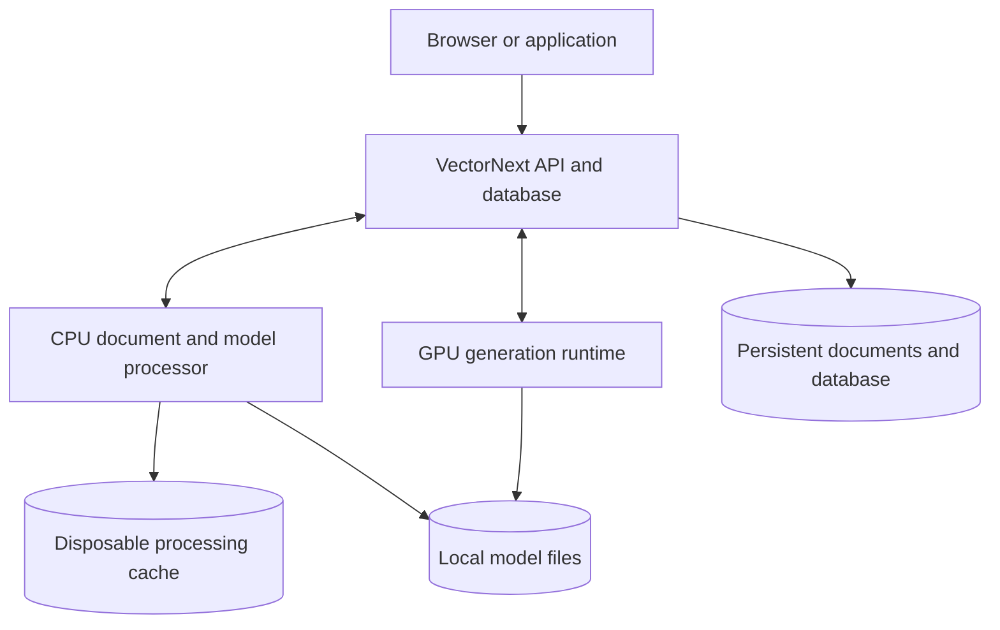

# VectorNext architecture

Status: implemented T01–T22 local application, evaluations, workflow reports, recovery, numeric proof support, browser workspace, Axum API with local OpenAPI documentation, isolated pgvector comparison, bounded checkpoint/export repair and filter indexing. T23 candidate retrieval and T24 final passage selection are complete as separate experiments; T25 integrates opt-in facet coverage and T26 repairs automatic field planning in the application. T27 implements shared model profiles and completes the 416-request 12B/26B comparison, retaining 26B after accuracy-gate failures. T28 implements ranked JSON pointer constraints, completes 208 regression requests and promotes 12B after passing the declared gates and activation checks. T29 single-call and T30 Q8 KV experiments are complete but fail their no-regression gates; T31 adds an isolated experimental BGE profile without improving final-five coverage. Conservative range endpoints are implemented in current source. At that point production remained T28/12B with two-call answering, f16 KV and MiniLM; T37 supersedes the generation default below. T32 completes the bounded Nomic/Ettin pilot; T33 adds experimental Qwen/Granite generation profiles and completes 24 requests, retaining Gemma after planner regressions. T34 adds Ministral/Phi/Liquid profiles and accounts for 24 scheduled outcomes (12 dispatched, 12 blocked), retaining Gemma after correctness/preflight failures. T35 completes the published-temperature/NuExtract pilot: no temperature-only correctness gain, promising specialist speed with one planning failure. T36 repairs that planning behavior in a separate profile and completes 24 fresh requests: fixed NuExtract matches Gemma at 8/8 after separate scorer reviews, with a 64.7% lower common-supported median; production defaults retained. T37 implements and activates Hybrid with durable answer jobs, queued Gemma fallback and a single-backend supervisor; its 24-case integration and bounded live recovery drill passed. Earlier LLM profiles/runners are archived, leaving only the two supported models. Remaining proposals are identified below.
Last updated: 2026-10-16 (UTC).

This document condenses the project discussion into an implementation reference. It is not a claim that the system is implemented or that every proposed technology has been selected. Explicit user instructions can revise it.

Track current work and proposed next steps in [plan.md](plan.md). Completed task definitions, verification and historical handoffs are retained in [tasks-done.md](tasks-done.md); archived priorities do not override the active tracker or this design.

**Repository configuration policy (adopted 2026-10-16):** keep Compose files for the supported application, model/PDF setup and general developer tooling. Per-experiment and completed verification-run Compose files are historical artifacts: remove their standalone YAML files from the current tree and record their purpose and prior Git revision in the task history. This user-requested cleanup also applies to embedding/reranker experiments and supersedes their earlier Compose-file retention. Preserve reports, fixtures, labels, scorers, frozen manifests and existing source archives; historical deployment commands require the recorded source environment rather than the current checkout. Application behavior, runtime images, stored data and running services are unchanged.

## 1. Confirmed requirements

- Build our own vector database, including the storage/search core. Do not substitute an existing vector database as the product implementation.
- Locate relevant text for a question, retrieve its supporting chunks, answer from that evidence, and optionally rewrite the question or format/rewrite the response.
- Run locally with two supported generation models: pinned Gemma 4 12B QAT Q4_0 and NuExtract3 Q4_K_M with requested-facts-v1. T37 uses Hybrid as the verified active default, with explicit Gemma-only and NuExtract-only modes. Earlier model comparisons remain historical evidence, not supported runtime choices.
- Containerize the application and its processing dependencies, with local NVIDIA GPU access.
- Support TXT, PDF, and JSON in the initial ingestion design.
- Initial workload: approximately 400 documents, each 10–30 KB. File sizes do not establish extracted token counts, especially for PDFs.
- Initial machine: Windows, RTX 4060 with approximately 8 GB VRAM, roughly 64 GB system RAM. GPU memory and system RAM were inspected during the discussion.
- MinIO and Redis may be removed or replaced. Their use is not a requirement.
- Aim for exceptional retrieval quality, but demonstrate improvements through evaluation; there is no measured state-of-the-art claim yet.
- Provide human-readable debug information showing how the workflow ran, covering its major steps and outcomes without deep internal detail. T12 implements this in the existing CLI.

T01 evaluation fixtures/contracts, T02 local-model feasibility, T03's Rust storage library, T04 retrieval, T05 TXT/JSON ingestion, T06 PDF/OCR ingestion, T07 model ingestion, and T08 answering are implemented. The core stores source-linked records, commits atomic revisions, recovers from a journal/checkpoints, and performs exact cosine/BM25 retrieval with filters, fusion, and source-preserving deduplication. T07 connects real CPU MiniLM tokenization/embeddings and optional Gemma 4 26B context generation to durable stages. T08 adds CPU reranking, evidence assembly, typed answers/templates, optional prose drafts, and bounded GPU generation priority. T09 adds a shared database owner/API, bounded CPU admission, the integrated three-service deployment, a client, and exercised offline export/restore. See the [storage contract](storage.md), [retrieval contract](retrieval.md), [ingestion contract](ingestion.md), [PDF contract](pdf-ingestion.md), [model ingestion contract](model-ingestion.md), and [answer contract](answers.md) for boundaries and limitations.

T10 adds source/answer scoring, isolated cold/warm API comparisons, stage/queue/resource measurements, bounded answer options and independent keyword-field weights. The [evaluation report](reports/t10-evaluation.md) retains structural context and exact search as defaults. Two primary passages reduced median response time by 30–32% on the 13 development questions; the later [T11 public-source comparison](reports/t11-independent.md) found lost answers with two, so five remain the general default. Generated context did not improve final answers and cost substantially more to ingest. These results do not establish broad retrieval quality.

## 2. Integrated deployment

### T37 — Hybrid answering (implemented and activated)

The Rust application owns fallback after final schema, exact-value and source-proof validation. Hybrid tries repaired NuExtract3, accepting only a supported validated factual answer; otherwise it queues exactly one Gemma attempt. Model clarification/unsupported decisions, ambiguity, insufficient evidence, malformed outputs, rejected proofs and model failures qualify. Invalid requests, deterministic unsupported operations, stale bindings, cancellation and admission failures do not. Forced modes never cross models. Gemma receives the unchanged original question, completed history, scope and retrieval options; it plans automatic fields independently and preserves explicit fields. Failed NuExtract output is never evidence/history. Prose is a separate optional draft whose failure cannot discard validated facts. Diagnostics retain both exact attempts, model identities, reasons and timings. Observable proof validation does not guarantee semantic correctness.

A separate durable answer-job coordinator allows 16 unfinished jobs and retains terminal records until explicitly cleared. A 256 MiB budget reserves bounded record space before admission; full storage rejects work rather than evicting diagnostics. Stable client IDs reconcile identical payloads and reject conflicting reuse. Original requests, modes, document revision bindings, attempt transitions and exact reports are persisted atomically. Answer jobs live beside the database in the API volume and are excluded from the unchanged database export format. Queued work survives restart. Uncertain in-flight work is never silently repeated: interrupted Hybrid NuExtract may use its remaining Gemma attempt only after backend reconciliation; interrupted Gemma/forced work requires explicit resubmission. Changed or unreconstructable bound revisions make a job stale.

The coordinator groups attempts by model, switching when the current queue empties, after four attempts with opposite work waiting, or after the opposite queue has waited 30 seconds (after the active attempt). A job waiting 15 minutes to begin its next attempt expires visibly. Interactive work outranks background enrichment without preempting inference. Cancellation immediately ends queued work and prevents subsequent stages after an active call returns. HTTP admission remains independently bounded at 16 requests, with running work retaining its permits after disconnect.

The existing GPU service gains a supervisor owning one llama.cpp child. Initially load NuExtract; keep the last model while idle. Hold an identity-bound lease across planning, template rendering, token counting, assessment, extraction and optional prose. Switching finishes active work, terminates and reaps the old child, verifies the next artifact/command, and activates within 240 seconds; inference deadlines remain unchanged. Uncertain backends are terminated/reconciled before reuse, never unpoisoned in place. Keep pinned runtime, context 4096, one slot, f16 KV, two-call answering, cache_prompt false, seed 42, existing budgets, NuExtract temperature 0.2 and Gemma temperature 0. Structural ingestion and MiniLM/ranked 30/20/5 remain unchanged. Optional generated enrichment continues with its saved Gemma generator identity; mode selection never rewrites ingestion policy.

Add `/v1/answer-jobs` submission/list/status/result/cancel/clear interfaces, wrapping existing browser or structured payloads with request ID and `hybrid`, `gemma` or `nuextract`. Synchronous ask routes become adapters over the same coordinator; old payloads remain valid and omitted mode means Hybrid. CLI submission reconciles uncertain transport outcomes by ID. Browser mode is remembered and captured per turn, with one unfinished turn per conversation, reload polling, job history/attempt export/cancellation/clearing and honest queued/running/loading/fallback states. Preserve exact value text, captured revision evidence, opaque reports and IndexedDB conversations. Readiness distinguishes installed model availability, queue readiness and the resident model; document browsing continues during activation.

Production setup/configuration supports only these two artifacts. Move production utilities and locks out of experimental directories before removing obsolete LLM runners and Compose configurations. Archive exact public source snapshots, including uncommitted experiment code; preserve reports, protocols, frozen sources/labels/scores/checksums and embedding/reranker experiments. Never delete weights, private data, images or rollback copies. Setup prepares both models; Start does not build or download. Migrate legacy launcher selection visibly to Hybrid. Before cutover retain prior images and a verified storage backup and refuse incompatible unfinished ingestion. Verify isolated candidate behavior and the original library before activating the three-service Hybrid app; document rollback to the previous Gemma deployment.

Acceptance requires deterministic routing/recovery/quotas/fairness/lease tests, relevant Rust/Python/HTTP/OpenAPI/launcher/frontend/offline browser checks, 24 live questions (eight retained regression cases per mode) with corrected scoring frozen beforehand, and a separate bounded switching/outage drill. Report queue, activation, inference and total latency separately, including failures. Historical large suites and the original holdout remain unused. Completion requires archived cleanup and verified normal-app activation, not merely passing unit tests.

**Verified outcome:** all 24 scheduled cases passed the scoring rules frozen beforehand (8/8 per mode; unchanged prior scorer 6/8). Hybrid used fallback for two of seven admitted questions. Five common supported cases had median attempt work 3.62/3.54/12.55 s for Hybrid/NuExtract/Gemma; this excludes queue/loading. The missing-evidence fallback took 90.29 s including a 60.94 s model activation. PC sleep affected one retained observation, excluded only from derived timing. Six live switching/cancellation/outage/restart checks passed with at most one backend in 236 process samples. Rust/Python/HTTP/OpenAPI/launcher and offline browser checks passed. The full-volume copy and export/restore were verified before activation; the original one-PDF/35-chunk library and ingestion jobs remained identical. Hybrid runs on `:t37-hybrid`; the measured API image remains `:t37-measured` after a separately verified browser-only readiness amendment. See [results, limitations and rollback](reports/t37-hybrid.md) and [answer-job contracts](answer-jobs.md).

### T36 — NuExtract requested-field planning (implemented and measured)

Repair NuExtract3's extra-field planning from T35 without changing the public plan schema, extraction/assessment prompts, model artifact, temperature, retrieval or source validation. Introduce a separate experimental profile with a validated, versioned planner instruction: distinguish facts the user asks to receive from entity/date/location constraints that identify those facts. Keep identifying constraints in descriptions; do not emit them as additional fields unless explicitly requested. Preserve multiple requested outputs, follow-up resolution, true clarification/aggregation declines, nullable semantics and exact typed source values. Do not trim fields after generation, force every question to one field, infer answers in planning, add an inference call or silently retry.

Apply the instruction only to the new profile; preserve Gemma and the original NuExtract profile byte-for-byte. Bind the planner variant into runtime/cache identity and planning prompt/version audits. Planning still receives only original question/history, never source documents or labels. Synthetic unit checks cover legacy prompt identity, original question/history, one-call behavior, schema/field bounds and variant rejection. A separate bounded development check replays the known T35 question plus a contrasting explicitly multi-field request, retaining raw plans and failures; development results are not fresh evaluation evidence.

Freeze eight new synthetic browser questions and source/label bytes before running them. Compare three arms: production Gemma 12B at temperature zero, unchanged NuExtract3 at 0.2 and the new NuExtract planner profile at 0.2. **24 scored requests total**, one pass, seed 42. Include single requested facts with several identifying constraints, deliberately requested identifying fields, follow-up, exact large JSON integer, missing/null count, genuine clarification and unsupported aggregation. Use fresh TXT/JSON/PDF sources, isolated storage, one committed corpus and separate caches/processes. Keep structural context, MiniLM/MiniLM, ranked 30/20/5, two-call answering, 4,096 context, one slot, f16 KV, existing runtime/budgets and native NuExtract template. No new model download or production activation.

Capture field cardinality/meaning/types, exact values, source citations, outcomes/errors, available model audits, timings and sampled resources. Score excess or omitted fields as contract failures even when the requested value is present. Match planner-generated names by predeclared semantic criteria, not fixed names. Negative cases must decline for the declared reason, not merely fail HTTP. Preserve all ingestion/preflight/measured failures in denominators; no post-result tuning or retries. Compare the fixed and unfixed NuExtract on the same fresh cases and report common-success latency against Gemma. This small internally authored set is a pilot, not broad reliability proof.

Use retained API and common candidate worker/generator images; freeze implementation/image/command/artifact/scoring identities before measured requests. Only the selected profile differs across arms. Verify full-context/restart operation and focused offline worker/planner/scheduler/scorer checks. Pause only the normal generator, preserve browsing and unrelated services, restore the same container/configuration and verify library/jobs/readiness after every run or failure. Retain original freezes, models, images, captures and the unused historical holdout. Completion requires the original planning regression to pass, all 24 fresh outcomes to be reported honestly and normal restoration; a fresh regression must be recorded rather than hidden or tuned away. Keep default selection separate.

**Measured outcome:** both known development probes passed, then all 24 fresh requests completed without retries. Gemma/original NuExtract/fixed NuExtract scored 6/4/6 of eight under the frozen rules, or **8/5/8** after separately documented PDF-heading/API-guard reviews. The fixed profile recovered two extra-field failures and a clarification failure, retained all explicitly requested fields and lost no reviewed Gemma success. Five common source-supported answers had median latency **10.59 → 3.74 s (64.7% lower)**; sampled device peak was 3,390 versus 7,728 MiB. All 13 legacy profiles/identities remain unchanged. Verified 58 offline checks, seven final scorer rechecks, two review checks, all preflights/restarts, 144 frozen files and 53 available audits. Same normal generator/library/jobs restored; defaults retained. Keep this small pilot, frozen scores and post-run exceptions distinct from a broad reliability or promotion claim. [Results and limitations](reports/t36-planning.md).

### T35 — published-temperature comparison and NuExtract3 (implemented and measured)

Compare Gemma 4 12B at temperature 1.0, Qwen 3.5 9B at 0.7, Granite 4.2 8B at 1.0 and NuExtract3 at 0.2 (publisher non-thinking extraction recommendation). Run 24 scored requests: the same four explicit TXT/JSON/PDF requests and two browser planning/follow-up requests used in T34, six per model. Preserve frozen sources, labels and the existing separate PDF support review. This is a small observed-regression temperature/compatibility pilot, not a full publisher-sampling benchmark or default-promotion gate. Retain seed 42 and all other existing sampler/runtime settings; one sample cannot establish stochastic reliability.

Add distinct validated experimental profiles binding temperature and any template adaptation into generation/cache/audit identities. Preserve every existing profile and saved-job identity. Use the existing pinned runtime and Q4 artifacts; explicitly download and checksum-verify the official NuExtract3 Q4_K_M artifact. NuExtract3's publisher template requires an explicit extraction template: adapt its prompt representation without changing authoritative JSON Schema, status/proof semantics, exact JSON pointer materialization or Rust validation. Count the actual adapted prompt during admission; fail clearly on unsupported schema/template behavior. Record this adapter as an additional variable, not a temperature-only change. Do not weaken evidence validation, fabricate missing values or silently upgrade runtime.

Keep two-call answering, 4,096 context, one slot, f16 KV, output limits/deadlines, no reasoning/prompt cache, structural ingestion, MiniLM/MiniLM and ranked 30/20/5. Ingest once in fresh isolated storage; use identical committed evidence, separate caches and recreated processes. Freeze code, images, sources, artifact hashes, commands, settings and scoring before measured queries. Retain failures and blocked preflight outcomes in all denominators, with no measured retries or tuning after results. Capture raw replies, audits, latency, memory, startup/restart and paired changes against fresh Gemma and corresponding retained temperature-zero cases.

Preflight each profile with synthetic constrained full-context output and restart; preserve failed raw responses. Pause only the normal generator while keeping browsing available, then restore the same container/profile, readiness, library and jobs. Run focused offline profile/scheduler/worker/scorer tests; unchanged Rust/API uses the retained production image. Preserve historical captures and the original holdout. Completion requires all 24 outcomes accounted for, reproducible results and restored normal services. Keep production defaults unchanged.

**Measured outcome:** all 24 requests ran. Gemma/Qwen/Granite/NuExtract frozen scores were 5/3/5/4 of six; the existing PDF review gives 6/4/5/5. Published temperatures changed no matching historical correctness outcomes. NuExtract passed all four explicit cases and the follow-up but planned three unrequested fields for the count question. Its five common successes were 66.7% faster than fresh Gemma; sampled peak GPU use was 3,368 versus 7,725 MiB. Its unknown-count assessment was inconsistent, although extraction correctly abstained. Keep Gemma at temperature zero. Verified 49 offline checks, all full-context/restart preflights, 124 frozen files, 44 available operation temperatures and unchanged normal generator/library/jobs. Native template adaptation is an additional variable; no broad or stochastic quality claim. [Results and limitations](reports/t35-temperatures.md).

### T34 — Ministral / Phi / Liquid generation pilot (implemented and measured)

Compare Ministral 3 8B Instruct, Phi-4-mini-instruct (3.8B) and LFM2.5-1.2B-Instruct against a fresh Gemma 4 12B control in **24 scheduled scored requests**, six per model, one pass. Use standard Q4_K_M GGUF for the three candidates, publisher exports where available and an attributed pinned conversion otherwise. Keep Gemma QAT Q4_0, the existing runtime, model deadlines and production defaults unchanged. Model selection authorizes explicit checksum-verified setup; no multimodal projector is needed for these text requests.

Reuse four unchanged explicit regression requests (TXT pressure, exact JSON integer, unknown JSON count and PDF correction) plus the two T33 browser-planning/follow-up requests, preserving labels and the existing separate PDF support review. This increases the planning share while keeping the user's small-batch constraint. Freeze selection, source bytes, labels, scorer, code/images/commands and artifact identities before measured queries. This is observed regression data, not independent proof, a promotion gate, an ambiguity benchmark or a larger historical rerun.

Run all four models through the same GPU-backed application path: MiniLM/MiniLM, structural context, ranked 30/20/5, two-call answering, temperature 0, seed 42, 4,096-token context, one slot, f16 KV, full GPU-layer offload, batch 512/ubatch 128, no prompt cache/reasoning and unchanged output limits. Use each artifact's embedded instruction template with existing reasoning-off behavior. Validate any required model-specific configuration, record it in identities and preserve old profiles byte-for-byte. Retain runtime/schema/memory preflight failures rather than silently swapping models or runtime. CPU-only Liquid planning or routing between models remains a separate experiment.

Ingest once in isolated storage and compare identical committed snapshots, with separate caches and recreated processes per arm. Capture exact replies, citations, planner outcomes/errors, available audits/tokens/timings, startup/restart and sampled device/container memory. Report paired correctness and common-success latency, including failures in denominators. One synthetic near-full-context check and one post-restart warmup per model are outside scored latency. No prompt tuning, extra quality batches or measured retries.

Temporarily pause only the normal generator, preserve document browsing, normal jobs and all prior images/models, and restore the same container/profile even on failure. Completion requires accounting for 24 scheduled outcomes, focused offline checks, frozen identities/source preservation, a reproducible report and normal readiness/library/job restoration. Remove only experiment containers/networks after capturing logs; retain data/caches and all attempts. Leave defaults unchanged regardless of pilot outcome.

**Measured outcome:** 12 requests dispatched; Phi and Liquid's six cases each blocked by synthetic preflight failures. Gemma/Ministral frozen scores were 5/6 and 2/6; the existing PDF review raises Gemma to 6/6. Ministral's two common successes were 48.6% faster, but altered prose quotes, false clarification and a missed supplied fact lose four successes. Phi returned the wrong long-prompt color; Liquid passed that check/restart but failed the worker's answer warmup. Keep Gemma and all defaults. Forty-two pre-run offline checks plus three reporting checks passed; original normal generator/library/jobs restored. A separate offline reporter handles text-free rejection metadata without rewriting frozen code/scoring rules. [Results and retained limitations](reports/t34-generators.md).

### T33 — bounded Qwen / Granite generation comparison (implemented and measured)

Compare Qwen 3.5 9B and Granite 4.2 8B, both standard Q4_K_M GGUF, against the current Gemma 4 12B QAT Q4_0 in **24 scored requests total**: eight fixed requests per model, one pass. Reuse six unchanged observed T32 regression requests and add two frozen browser-planning/follow-up cases on the same synthetic sources. Report historical literal-source scores and the already recorded alternate PDF citation separately. No historical large suite, original holdout, prompt tuning, measured-request retries or default promotion is authorized by this pilot.

Use publisher IBM Granite and attributed Unsloth Qwen exports with pinned revisions, sizes and SHA-256 through the explicit setup flow. Preflight the existing pinned llama.cpp runtime first. Preserve 4,096-token context, one slot, full GPU placement, f16 KV, temperature 0, seed 42, cache_prompt=false, two-call answering, output budgets and deadlines. Disable thinking through each model's supported template controls, binding any new profile options into launch validation and runtime/cache identities without changing legacy identities. Unsupported runtime, memory, constrained output or template behavior must produce a retained preflight failure, never a silent fallback or runtime upgrade.

Keep MiniLM embedding/reranking, structural context and ranked 30/20/5 fixed. Ingest once into isolated storage and reuse exactly the same committed documents, vectors and revisions across arms; recreate API/processor processes with separate model caches. Freeze requests, labels, code, images, artifacts and commands before measured calls. Capture exact raw responses, source support, planner outcomes, errors, tokens/timings, startup/restart and sampled resources. Separate synthetic warmup from scored latency. Small samples establish compatibility and comparative observations, not broad model quality or WDDM residency.

Run one GPU model at a time. Temporarily stop only the normal generator, keep its API/document browsing available, and restore the previous generator after testing even on failure. Preserve normal library/jobs, prior images/models, generated annotations and saved policies. Use experimental Compose selection; do not add automatic migration or alter routine Start. Completion requires all 24 attempts accounted for (including preflight-blocked cases), focused profile/worker/scorer verification, retained failures, a reproducible report and verified restoration.

Completed 2026-10-16: all 24 requests ran without retry against one ten-document/49-chunk corpus. Gemma/Qwen/Granite scored 6/4/6 of eight under the frozen literal-source rules, or 7/5/6 with the pre-existing PDF support review. All explicit-field outcomes and assembled evidence matched after that review; Qwen lost both planner cases and Granite lost the follow-up. Common-success median reductions were 37.8% and 46.1%, with sampled whole-device peaks 7,774/5,740/6,361 MiB. All passed full-input constrained output, offline startup and restart; WDDM residency remains unproven. Preserve Gemma defaults. Verified 42 focused Python checks, frozen input/image/command identities and normal generator/library/jobs restoration. Two zero-query setup attempts and all final captures/volumes are retained; experiment containers/networks were removed. See [report and limitations](reports/t33-generators.md). Any planner adaptation or further quality batch needs a separate scope.

### T32 — bounded embedding/reranker replacement pilot (implemented and measured)

Authorized 2026-10-16: compare MiniLM/MiniLM, Nomic/MiniLM, MiniLM/Ettin-17M and Nomic/Ettin-17M in **24 scored end-to-end requests total** (six fixed questions per combination, one pass). This supersedes a larger replacement benchmark: do not run historical suites or extra quality batches. Freeze fresh synthetic TXT/PDF/JSON fixtures, questions, exact expected values/source support and scoring before model queries. Include distractors, multi-source evidence, a longer JSON record and an unknown-count negative; do not use the original holdout. Report this as a small engineering pilot, not independent proof or a promotion gate sufficient by itself.

Pin publisher FP32 ONNX/tokenizer/config artifacts for nomic-ai/nomic-embed-text-v1.5 and cross-encoder/ettin-reranker-17m-v1 through explicit checksum-verified setup. Keep CPU-only inference, structural context, the 180-token chunk target, ranked 30/20/5, current two-call Gemma/temperature/seed and existing deadlines. Nomic initially uses 768 dimensions, masked mean pooling, layer normalization then L2, search_query/search_document prefixes and a conservative tested 1,024-token limit; no unverified 8K-export claim. Ettin uses raw logits and a 512-token pair admission cap for this comparison. Validate actual tokenizer padding/specials and graph inputs/outputs, not MiniLM-specific assumptions.

Make embedding dimensions/prefixes/processing and reranker identity profile-driven while preserving default MiniLM space/cache identities exactly. No storage or public API schema change. Ingest once per embedding profile into fresh isolated storage; each reranker uses those same committed revisions/vectors. Separate query caches/processes per combination and counterbalance execution order. Use explicit answer fields to isolate retrieval from field planning; retain exact responses, candidate/final/source coverage, validated answer outcomes, failures, stage timings, CPU/RAM and model/image/source identities. Small synthetic preflight/unit checks are separate from the 24 scored requests. No tuning or retrying failed measured answers into success.

Normal defaults, images, documents and GPU allocation remain unchanged. A dedicated API/processor pair may use the normal generator's existing bounded scheduler, one request at a time, without restarting it; verify readiness/library preservation and stop only experiment services afterward. Better final evidence/correctness with no lost baseline successes and acceptable measured cost justifies a follow-up recommendation; this six-question pilot alone does not activate a replacement. Preserve all attempts and historical freezes. Larger chunks, quantization and deployment migration remain separate work.

Completed 2026-10-16: all 24 attempts retained. MiniLM/Ettin improved frozen correctness 4/6 → 5/6, assembled coverage 4/5 → 5/5 and median end-to-end latency 12.80 → 9.68 s, with no lost baseline success. A separately documented valid alternate PDF citation raises reviewed scores to 5/6 → 6/6 without changing gold. Both Nomic arms scored 1/6 frozen (2/6 reviewed), with four 503 failures each: the 557-token whole JSON record fits the new embedding cap but its 519–576-token query pairs exceed the unchanged 512-token reranker cap. Existing JSON preparation can exceed the ordinary 180-token target when a whole record fits the embedding space; future changes must reconcile all stage budgets rather than silently truncate or skip evidence. No model promotion or budget repair was made in this pilot.

The publisher Ettin ONNX is a backbone, so its pinned CLS/Dense/GELU/LayerNorm/Dense head is included in the CPU implementation and cache identity. Profile-driven dimensions/prefixes, publisher tokenizer padding and preprocessing retain exact legacy identities. Verified 64 Python/163 top-level Rust checks, offline packaging and unchanged normal library/readiness. All ten sources admitted per embedder; paired rerankers share identical snapshots; experiment containers are stopped with data/caches retained. See [results, source review and reproduction](reports/t32-replacements.md). Normal MiniLM defaults remain; model selection here is an experimental worker/Compose option, not a new launcher feature.

### Completed follow-on work — documentation, range proofs, T29–T31

Execute in this order: remove ticket labels from README narrative while preserving links/tables; implement conservative two-segment numeric range endpoint recognition; evaluate single-call answering (T29); independently evaluate Q8 KV storage (T30); benchmark a second CPU embedding profile (T31). These changes were authorized on 2026-10-15. Experimental results do not automatically change the production defaults.

Range proofs inspect the complete supplied source, with exactly two unsigned numeric endpoints separated by a hyphen, en dash, or the word `to`. Accept only a complete endpoint inside the submitted exact quote. Preserve rejection of clipped numbers, signed/negative expressions, multi-segment dates/ranges, alphanumeric identifiers, decimals/grouping fragments and interior values. No arithmetic or inferred values; exact source values and existing JSON contracts remain authoritative.

T29 keeps the current extraction prompt, discriminated schema, pointer constraints, prompt admission (including the existing assessment token reserve), cache_prompt=false, model/runtime and retrieval settings. A validated experimental worker setting skips the preliminary assessment and records its strategy in audits. Replay all 208 unchanged public regression requests against the retained T28 baseline, preserving corpus, failures and freezes. Use the retained T28 API image to exclude the new numeric validator from the model-call comparison. Promotion is outside this experiment: require no correct-case/source-support loss or newly falsely supported negatives before recommending adoption; measure median/p95 and common-success latency without promising a speedup.

T29 completed all 208 requests: ranked five preserved 13/16 and 18/28 with 35.6–40.7% lower medians, but coverage lost two correct abstention classifications in each pass. Global adoption is rejected; the production two-call default remains. See [results](reports/t29-single-call.md).

T30 uses the production two-call answer path independently of T29, with a distinct 12B runtime profile containing explicit K/V cache types q8_0. Keep weights, context, runtime binary, batch settings, deadlines and all other generation parameters. Validate command/profile/audit/cache identity separation, full-context/repeated constrained output, restart, peak device memory and quality against the same retained baseline. Replay 208 requests if hardware preflight passes. Estimate roughly 200–230 MiB KV savings from the measured 464 MiB f16 allocation; report measured savings and do not claim WDDM residency from nvidia-smi alone.

T30 completed all 208 requests and hardware preflight: KV allocation saved 217.5 MiB, but unknown_count regressed in four ranked blocks. Retain f16; the distinct Q8 profile remains experimental. See [results](reports/t30-kv-cache.md).

T31 benchmarks pinned BAAI/bge-small-en-v1.5 ONNX CPU embeddings with CLS pooling, normalized outputs, 512-token capacity and the model's query instruction tracked in the embedding-space hash. Keep the existing 180-token chunk target, reranker and retrieval configuration for the first comparison. Use fresh isolated ingestion, record actual chunk/token differences, include failures, and preserve old vectors/spaces. Compare MiniLM and BGE source coverage plus CPU ingestion/query latency before considering larger chunks or migration. Longer embedding capacity does not remove the reranker's 512-token query-plus-passage bound or the answer prompt budget. No production migration, approximate indexing, prompt tuning or original holdout use.

T31 completed 192 offline CPU requests without errors. BGE improved NIST selected-20 coverage 18/20 → 19/20 but final-five stayed 16/20 on both corpora; ingestion was 33.6–39.6% slower. Retain MiniLM. The implemented profile uses VECTORNEXT_EMBEDDING_PROFILE=bge-small-en-v1.5, pinned CLS/L2 ONNX artifacts, a query-only instruction and distinct immutable space/cache identity. Actual 180-token chunk text/spans remained identical; longer-record and migration benefits are untested. See [results](reports/t31-embeddings.md). The normal app remains on retained T28 images; the source range repair requires an explicit rebuild/activation.

Each experiment freezes its own source/configuration/model/image identities before inference, retains interrupted/failed attempts, uses isolated storage/caches and restores the normal generator/library after GPU work. No historical execution freezes, labels, captures or scores are rewritten.

### Adopted ranked extraction constraints — T28 (implemented and evaluated 2026-10-15)

Close the JSON extraction-schema gap identified in T27 without changing weights, retrieval ranking or source-proof validation. Rust already supplies revision-bound complete JSON records and exact source text in `AnswerInput`; `model_worker/answers.py` already builds bounded pointer catalogs and evidence-specific schema branches for coverage modes. Reuse that implementation for ranked extraction, including the two-passage compatibility configuration, rather than introducing a second Rust grammar generator. Rust remains authoritative for evidence admission, exact value materialization and final validation. Keep the two existing assessment/extraction operations; no extra model call, output repair or automatic retry.

Each permitted JSON proof must bind its evidence ID to an existing RFC 6901 pointer for that requested field's type and any caller-supplied exact pointer. Derive paths only from records actually admitted to the final prompt, including admitted neighbors; never from the database as a whole or from candidates omitted by the context budget. Preserve escaping, array indices, exact numeric type inspection, the null placeholder and Rust's distinction between a stored raw null, non-nullable source-null abstention, missing fields and zero. Retain prose proof branches for mixed evidence. Do not restrict paths with a single cross-record enum.

Retain existing catalog limits (256 scalar/null leaves per record, depth 64, 2,048 UTF-8 bytes per pointer, 32,768 catalog bytes), context/output budgets and explicit failures at bounds. The visible catalog must participate in actual prompt token counting during evidence assembly; record any changes to admitted evidence and omissions. Catalog construction and grammar decoding may add cost or reduce available evidence space. Do not promise unchanged latency or silently truncate paths, evidence text or schemas to meet a target. Preserve coverage behavior and ordinary public API/storage contracts; audit the changed request/schema identity.

Grammar plus validation can exclude nonexistent paths and wrong evidence/path combinations from accepted output. It cannot establish that a permitted field answers the question or guarantee a correct ambiguous/insufficient-evidence decision when several valid paths remain. Keep those statuses available and retain Rust's final checks. An interrupted or malformed generation still fails visibly. Freeze fresh synthetic contract/source cases before candidate inference, including semantically wrong but type-compatible alternatives; mechanical schema validation alone does not establish correctness.

Evaluate the 12B candidate only on all unchanged T14 and T11 blocks: 96 + 112 = 208 requests, with a new T28 runner/execution freeze and fresh captures/caches. Compare per-case correctness and source support against both retained T27 arms; this is a sequential regression comparison, not a new paired 26B run or independent quality evidence. Preserve identical committed corpus content/revisions using isolated copies, retaining original admission failures and all denominators. Preserve every historical freeze, score, source review and attempt, plus T27 source archives/images. Keep the original holdout unused. Record retrieval/admitted-evidence changes separately from extraction changes and retain exact responses, schema/audit hashes, tokens, stage timings, latency, startup and resource samples.

Promotion requires no loss of T27's correct 26B control cases or associated source support across any strategy/pass, preservation of the candidate's existing correct cases, correct negative outcomes and no newly falsely supported negatives. Ranked five must reach T14 >=13/16 and T11 >=16/28 in both passes. The T14 target is T27's current-runtime control, distinct from the historical 8/16 floor. Recheck fresh source cases, T26 planner/source/regression cases, ranked browser exact-value/follow-up/export behavior, relevant engine/worker/HTTP/browser regressions and full-context/restart operation. Measure whether T27's 52.7–60.7% ranked-five median reduction survives; retain the existing minimum 20% promotion gate on each suite/pass overall and on common successes, without calling that minimum preservation of the observed speedup. Report the limitations of timing against a retained control.

T27's 12B peak left only 324 MiB of sampled GPU headroom; its 8.80-second restart used a verified Linux weight volume. Neither is a guaranteed T28 result. Record comparable storage/runtime conditions and actual memory/startup measurements. No OOM/backend failure is required; claims about absent WDDM paging require suitable host telemetry, since layer-offload logs and `nvidia-smi` samples do not establish it. Any unsupported residency claim remains explicitly unverified. Keep unrelated GPU workloads untouched and restore the normal generator after isolated testing.

On a passing, documented decision, select the existing `12b` profile consistently across app, model tools and launcher rather than renaming its identity to `12b-default`. Retain `26b-offload22` for rollback and `26b-gpu` as the unverified larger-card option. Preserve previous images, model files, a verified pre-activation storage copy and unfinished jobs' saved generator policies. Corpus aggregation remains unsupported with either model. A failed gate leaves 26B as default and 12B experimental; negative results can complete the experiment. Implementation and the isolated 208-request evaluation were authorized on 2026-10-15; documents were updated before code. Disposition: all 208 requests completed, with no correct-case/source-support loss against either retained T27 arm. Ranked-five T14/T11 scores are 13/16 and 18/28 in both passes; median latency is 50.4–62.8% lower than retained 26B, exceeding all minimum gates. T11 medians are about 5% slower than prior 12B. Catalog token costs alter a prose neighbor in two Tohoku requests; all other admitted key lists match. These are sequential observed-regression results, not independent quality evidence.

The 25 original application cases, 16 new fixed/source checks, facet/ranked browser workflows and engineering/operational checks passed. Peak sampled GPU use is 7,880/8,188 MiB; no OOM/backend failure was observed, but WDDM page-outs and larger-card compatibility remain unverified. Linux-volume restart measured 7.48 seconds; normal Windows activation took 67.33 seconds. The existing numeric validator still rejects year-range endpoints; a separate normal-library text answer passed with the correct model audit and source display.

The shared default is now `12b`; app/model tools/ingestion/launcher agree. Normal services run `:t28-12b`, with the existing library unchanged and a verified stopped-state storage archive retained. Measured `:t28` images, all T27 inputs and previous models/images remain available. Release configuration intentionally differs from the immutable experiment freeze; reproduce from the archived tree. No storage schema, saved policy or historical score was changed. See [results, commands and rollback](reports/t28-ranked-pointers.md).

### Adopted model comparison — T27 (implemented and evaluated 2026-10-15)

Evaluate the official pinned Gemma 4 12B QAT Q4_0 against the current 26B A4B QAT with 22 CPU-offloaded expert layers on the current application. Introduce shared validated generation profiles across workers, scheduler, launchers and setup; preserve immutable artifact/runtime identities, generated-context cache separation, saved job policies, API/storage contracts and existing embedding/reranker identities. Keep the pinned llama.cpp runtime, 4,096-token context, one slot, temperature 0, seed 42 and existing budgets/deadlines. Attempt full GPU placement for 12B without silently shrinking context or changing quantization. Runtime incompatibility or insufficient memory fails preflight. Provide optional full-GPU 26B configuration for 16–24 GB hardware, explicitly unverified on this 8 GB card.

Before measured requests, freeze a new T27 execution manifest and reuse unchanged T11/T14 sources, requests, labels and scorers as observed regression data. Run their complete blocks for each model (416 requests), paired by block with alternating model order, separate model/strategy caches and identical committed corpus. Preserve historical freezes and all failures; no historical holdout or tuning. Record exact answers, proof support, stage/token/latency/resource measurements and failures in denominators. Separate synthetic warmup and model startup from measured request time. Run only one generator at once; temporarily stop only the normal app's generator and restore it afterward.

Promotion requires stable full-context operation on the RTX 4060, passing T26 planner/source/browser regressions, no lost currently correct cases or associated source support in any strategy/pass, preservation of correct negative outcomes and no newly falsely supported negatives. Ranked five must reach at least T14 8/16 and T11 16/28 in each pass. Require at least 20% lower ranked-five median latency on each suite/pass, both failure-inclusive and on common successful requests. The proposed 65–75% speedup is measured, not assumed. If any gate fails, keep 26B as the app default and retain 12B as experimental; honest negative results complete evaluation. On success, update model/app/ingestion/Windows defaults together, retain rollback images/model files/storage copy and verify the existing library. Never reassign unfinished jobs to another generation identity.

At T27 completion, profiles were `26b-offload22` (default and unchanged generation identity), `12b` (experimental), and `26b-gpu` (unverified larger-card placement). T28 above supersedes the default decision while preserving this experiment. The catalog and immutable model locks feed worker aliases/audits/cache identities and the validating GPU launcher. `compose.app.models.yaml` selects processor and generator together; the Windows launcher persists an explicit selection only after startup. Existing generated annotations remain unchanged, and saved jobs reject a different generator configuration. All 416 paired requests completed. Ranked-five scores in both passes were T14 13/16 versus 10/16 and T11 16/28 versus 14/28 (26B versus 12B). Overall median reductions of 52.7–60.7% passed the speed gate, but correctness/source-support losses and T11's historical-floor failure prohibit promotion. Keep 26B; no prompt or retrieval repair was made during this experiment. The 12B full-context/restart, 12 planner/eight source/five regression and live browser checks passed. Measured-query GPU peak was 7,864/8,188 MiB; larger-card compatibility remains unverified. Normal services were restored with the library unchanged. See the [T27 report](reports/t27-model-comparison.md).

### Adopted field-planning reliability — T26 (implemented 2026-10-15)

Repair false automatic-planning declines for directly reported counts, multiple requested facts and references resolved by complete conversation history. Keep planning limited to field definitions from the original question/history; it receives no documents and must not judge evidence availability. Distinguish a named entity's reported count from unsupported computation across records. Preserve genuine clarification and unsupported-aggregation outcomes, schema constraints, 1–12 field bounds (facet mode still allows at most four), exact values, explicit document scope and all retrieval/proof-validation behavior. Explicit fields continue to bypass planning.

Diagnose raw planner responses before choosing a minimal prompt/schema repair. Preserve the existing generator/model/temperature, queue deadlines and one bounded planning operation; do not introduce silent retries, fallback fabricated fields or answer-producing query rewrites. If a format change is necessary, adapt it at the worker boundary with explicit validation and a versioned audit, retaining the existing public ready/needs_clarification/unsupported plan contract. Invalid outputs fail clearly. Expose distinct, understandable planning errors without weakening the HTTP error envelope. Record the evidence supporting the diagnosis and limitations rather than assuming every decline is an aggregation mistake.

The first frozen candidate (`field-planning-v2`) passed 15/15 planner checks but misclassified a decimal amount as integer in source-backed verification. Preserve that run and prompt unchanged as observed evidence. A separately frozen follow-on verification will address independent per-field type selection and explicit numeric kinds; it must not coerce returned plans or weaken source/type validation. See [the T26 amendment](../experiments/t26/protocol-amendment-01.md).

Update architecture and task definitions before code. Preserve T25's reports and original failures, source tree and model identities. Use those cases only as observed regressions, never as an independent quality score or prompt-tuning set. Freeze new, separately authored planner verification cases before candidate inference: direct quantities, multiple facts, contextual references, missing referents, true aggregates, untrusted instructions and bounded/malformed outputs. Include fresh end-to-end source fixtures and separate source/answer checks. Measure classification, field/type/constraint preservation, failures and cost; all attempts remain in denominators. Do not use historical holdouts or tune on the frozen verification outputs. Run relevant Rust/Python/API/browser checks and isolated local-model verification before declaring completion or activating new local images. Keep the normal three-service deployment and ranked/facet defaults unchanged.

Disposition: the adopted `field-planning-v3` prompt preserves the original schema and validates bounds at both worker and Rust boundaries. Audit adds operation/version/input hash and `evidence_available: false`. First comparison: baseline 6/15, v2 15/15 planner checks; v2's subsequent decimal-type failure is retained. Final v3 passed 12 separately frozen planner checks, eight fresh source-backed checks, five observed regression replays, and application/browser verification. Prompt-injection coverage is deterministic boundary/schema testing, not a demonstrated semantic immunity. At T26 completion, API/client/admin and processor used `:t26`, with generator `:t18` and the library unchanged; T28 supersedes that deployment. [Results, latency and limitations](reports/t26-planning.md).

### Adopted application facet coverage — T25 (implemented 2026-10-15)

Expose `facet_coverage_v1` as an opt-in answer strategy in the API, CLI and browser Advanced controls; retain ranked 30/20/5 as the default and preserve `coverage_v1`. Derive one facet per requested field from its name and description (1–4 fields, reject larger plans explicitly). Existing browser field planning supplies these definitions; no additional generation operation or answer values are introduced. Facet-only text drives extra CPU embeddings/searches and reranking. The original question plus latest user question remains the main retrieval query; complete authoritative history still reaches extraction. Empty descriptions use the field name, and all encoder/pair/context budgets remain enforced without silent truncation.

Merge the main and facet search results round-robin into at most 20 unique candidates, using the identical immutable snapshot, explicit filter and per-query candidate budgets. Preserve the main search response separately; record each auxiliary search and the merged shortlist. Apply T24's original non-heading span selector (at most five primaries, four facets, 80% shorter-span overlap within the same document revision); do not infer hard filters or JSON pointers. Original source bundles, exact JSON materialization and proof validation remain authoritative. Disable neighbor expansion in this mode, constrain JSON pointers to supplied records, and report planned versus context-admitted primaries and budget omissions. A selected passage is not a semantic coverage guarantee.

Add readable strategy/facet/selection information with exact opaque diagnostic export. Keep old responses unchanged when the new mode is absent. Verify deterministic selection, scope/history, malformed/over-budget plans, context exhaustion, all source formats, exact values, no-evidence and rejected answers, offline browser persistence and real local model smoke on fresh synthetic fixtures. This is application integration, not a new quality benchmark. Preserve T24's committed sources and byte-exact archive before edits. Build and activate the new API/UI image after verification, retain prior images and a pre-upgrade storage copy, and publish meaningful commits as requested.

Disposition at T25 completion: integration and activation passed, including deterministic/API/browser checks and source-linked TXT/PDF/JSON answers. Three automatic field-planning requests declined before retrieval; explicit-field controls succeeded. Keep the mode opt-in. T25 activated `:t25` with a stopped-state pre-upgrade storage copy retained; T26 subsequently repairs planning and advances the deployment. [Historical verification and limitations](reports/t25-facet-integration.md).

### Adopted final passage selection — T24 (experiment completed 2026-10-15)

Isolate final selection from upstream retrieval: compare whole-question ranked selection with a bounded facet-focused selector on the identical expanded shortlist of at most 20 original source passages. Keep five primary slots, the same real CPU embeddings/cross-encoder, structural ingestion context and original question. The candidate reranks each explicit question-derived facet separately, selects each facet's best available passage before filling remaining slots from the general ranking, and avoids substantially overlapping spans from the same revision. Heading-only chunks cannot satisfy candidate primary slots. Facet ranks are relevance heuristics, not proof of answerability. Record exclusions, selected keys, per-facet rankings and all extra model work. Never invent filters, answer values or source identifiers from labels.

Implement this in isolated experimental tooling first; do not change production `ranked` or `coverage_v1`, API/storage formats, model identities or normal services. Freeze fresh attributed sources, positive/negative questions, source-bound labels, budgets and selection rules before measured retrieval. Preserve T23 and earlier freezes/captures and leave the original holdout unused. The main comparison holds the candidate shortlist constant, so any change in final evidence coverage can be attributed to selection; report upstream misses separately. Use a separate synthetic smoke fixture, paired offline CPU runs, immutable source revisions, failure-inclusive denominators and cost/coverage measurements. No GPU generation or answer-quality claim. Publish adverse/neutral results without tuning on the new observed data; adoption requires a separate decision.

Disposition: ten fresh NASA sources admitted 388 chunks; 96/96 offline CPU requests completed with identical shortlists/general scores across arms. The candidate improves complete frozen final evidence coverage 16/20 → 18/20 and fact requirements 32/37 → 35/37, with no observed regressions. First-pass median latency rises 685 → 1,437 ms; the small correlated, agent-authored set and literal-label exceptions limit the claim. Eight Rust/nine Python checks, format/Clippy, source validation and separate real-model smoke passed. Keep ranked 30/20/5 and coverage_v1 unchanged. Scope opt-in application integration and automatic facet/context/answer validation separately. [Results and source review](reports/t24-final-selection.md).

### Adopted filter optimization — T22 (implemented 2026-10-15)

Profile the existing exact-search filter stage before editing production code, then add disposable, immutable indexes scoped to the same snapshot and embedding space as `SearchIndex`. Index document IDs, media types and a bounded set of top-level scalar attribute columns. Use exact canonical numeric keys, source/generated trust information and true/unknown row sets to preserve three-valued Boolean semantics. Nested pointers, containers and columns outside the indexing budget retain the existing evaluator. Prefer a complete correct scan to an incomplete index; indexed fields and build/posting/key budgets must be deterministic and reported.

Keep HTTP/storage formats, query validation, exact cosine scores/ties, BM25 corpus statistics, RRF/deduplication, eligibility traces and unknown counts unchanged. Do not add inferred filters, ANN, model calls or persistent indexes. Measure index build cost, index size counters, filter/search latency and result equivalence with trace on/off on fresh isolated copies. Preserve T20/T21 data and reports; compare frozen baseline and optimized binaries on identical inputs and resource limits, with warm/cold-build boundaries explicit. Normal application services are not upgraded by this experiment.

T22 passed 135 Rust tests, format/Clippy, 4,224 release requests with identical response groups, and offline API/UI/docs startup. At 51,232 vectors, scalar equality median fell from 16.302 to 0.252 ms in the isolated in-process profile; index construction costs more. Nested fields retain scans. [Results and limits](reports/t22-filters.md). Compose selects the built T22 API image; normal services remain running their previous images.

### Adopted fresh evidence experiment — T23 (completed 2026-10-15)

Run a separately frozen, CPU-only evidence-retrieval experiment using fresh attributed public reference documents, real pinned MiniLM embeddings and the existing reranker. Compare the original-question ranked baseline with a bounded field-focused candidate expansion strategy in experiment tooling. Keep original questions, explicit scopes, source evidence, structural context, actual token budgets and the baseline 30/20/5 configuration authoritative. Auxiliary queries are recorded retrieval aids, never evidence or automatic hard filters. Production defaults remain unchanged unless separately justified and adopted.

Freeze source snapshots, queries, evidence labels, candidate budgets, comparison/scoring rules and execution identities before measured retrieval. Separate source admission, candidate recall, final evidence recall/complete coverage and latency; include missing sources and failed requests in denominators. Author labels without inspecting experiment retrieval outputs, document that agent-authored labels are not independent human adjudication, and retain all attempts. This experiment measures evidence retrieval, not generated-answer quality. Do not use the original holdout or change T11/T14/T20/T21 artifacts. GPU generation is unnecessary.

Disposition: the frozen twelve-source NIST corpus admitted 188 chunks; all 96 CPU retrieval requests passed. Authored question hints plus round-robin candidate merging improved complete frozen evidence coverage at 20 reranker inputs from 18/20 to 20/20 positive questions, but both arms retained only 16/20 in the final five. Keep production ranked 30/20/5 unchanged. This experiment does not implement automatic query decomposition or replace production answer assembly. Source-review exceptions and cache/latency limits are in [T23 results](reports/t23-evidence.md); the observed corpus is now regression data. A future final-selection/coverage experiment needs new frozen data and a separately adopted design.

### Adopted scalable checkpoints — T21 (implemented 2026-10-15)

Replace the complete-state single-frame checkpoint with a versioned stream of bounded frames in the same `snapshot.bin` file. Serialize the existing checkpoint JSON directly from the immutable state through 1 MiB data segments; do not clone the complete state or allocate a complete serialized snapshot. A header identifies version 2; numbered data frames and a terminal manifest bind segment count, JSON byte length and SHA-256. Each frame retains CRC validation. Reject missing/reordered/duplicated segments, invalid lengths/checksums, a missing or mismatched footer, trailing bytes and unknown versions. Read incrementally into the existing in-memory state; this bounds serialization buffers, not total database memory.

Preserve the sole writer, `snapshot.pending` write/file-fsync/atomic-rename/directory-fsync publication, poisoned-writer semantics on checkpoint failure, and verification of the exact retained journal prefix before suffix replay. The document journal, job files, exact numbers, embedding identities, revisions and retry receipts keep their current contracts and frame limits. Export continues to checkpoint under the writer lock, stream checked files and restore only into a new destination. Keep the existing 8 GiB total export limit; T21 fixes the checkpoint bottleneck, not all capacity limits or compaction.

New readers accept both legacy kind-3 checkpoints and the new stream. The `VNXSTORE1` journal marker and backup manifest remain unchanged; new snapshot frame kinds make older binaries fail closed. Writing a new checkpoint is a one-way compatibility boundary for those older binaries; retain an untouched pre-upgrade copy for rollback. Do not delete checkpoints to simulate a supported downgrade. T20's matching source archive, manifests, data and scores are preserved. Migration, corruption/partial publication, suffix replay, exact values/retries/history and large export/restore passed: 132 Rust checks and 768 exact queries on fresh copies of both former failing T20 states. [Verification and limits](reports/t21-checkpoints.md). Compose selects the new API/client/admin image `:t21`; processor/generator and the three-service boundary stay unchanged. The normal running application was not migrated during verification.

### Adopted database comparison — T20 (completed 2026-10-15)

Benchmark the existing VectorNext core against PostgreSQL with pgvector in an isolated, CPU-only Docker project. PostgreSQL is a benchmark competitor, not a replacement backend or an added production dependency. Preserve the normal three-service application and historical evaluation artifacts.

Use deterministic 384-dimensional float32 vectors and identical chunk text, document identities and filter attributes. Validate exact cosine top-k against an independent float64 reference before interpreting performance. Measure pgvector HNSW separately with recall. Parsing, model inference, BM25, reranking and final answer quality remain outside this first storage/vector-search comparison because they require separate matched pipelines.

Freeze corpus/query hashes, filters, resource limits and measurement rules before timed queries. Include 400 and 1,600 documents, filtered/unfiltered/empty results, initial and warm latency, ingestion/index preparation, resource/storage measurements and acknowledged-data recovery after interruption. Report client and engine timing boundaries honestly; the supplied-vector benchmark adapter is not the ordinary text-query API. Retain failed attempts and disclose cache, transport, schema and maturity differences. No superiority claim follows without matching evidence.

Both corpora completed: 4,096 timed requests, 2,048/2,048 exact requests correct, and 512/512 post-interruption exact checks passed. PostgreSQL exact was faster in every warm group; HNSW's larger-corpus unfiltered recall was 99.0625%. VectorNext checkpointing failed at both sizes because the complete JSON snapshot exceeds the existing 64 MiB frame limit. Export calls checkpoint and inherits that limit. Journal recovery preserved acknowledged data; this does not establish working large-state checkpoint/export. [Results and qualifications](reports/t20-pgvector.md) record the protocol amendment, failed attempts, schemas, timing boundaries and retained artifacts. T20 proposed bounded checkpoint/export work, subsequently implemented and verified in T21; its original benchmark results remain unchanged.

### Adopted HTTP migration — T19 (implemented 2026-10-15)

The production adapter uses Axum/Tokio and utoipa/utoipa-axum, retaining the synchronous Application, processor client, ingestion coordinator and all existing API behavior. HTTP parsing runs asynchronously; blocking application work runs through spawn_blocking under the existing non-waiting 16-request admission limit. A running operation owns its permit even if its caller disconnects. Existing interactive/background lanes, deadlines and durable retry reconciliation remain authoritative; no automatic retries or new operation timeouts are introduced.

Preserve request/response schemas, exact numeric serialization, status/error envelopes, browser origin checks, Content-Length/custom-header requirements, limits, multipart validation, revision/source rules, static asset restrictions and security headers. Explicit compatibility adapters override framework rejection, routing and HEAD/OPTIONS defaults. Storage/model/retrieval contracts and the three-service runtime do not change.

T19 adds only GET /openapi.json and /docs (with local documentation assets). Route registration also collects OpenAPI definitions. Swagger UI is vendored, works without a CDN or external validator, uses same-origin requests with the existing client header, and preserves raw response text. Dependencies are pinned for Rust 1.87; tiny_http remains only for test mocks. Schema-only definitions describe the existing serialization without changing application types. The 71-case baseline captured before replacement, isolated Docker regressions and offline browser documentation checks passed; see [T19 verification and limitations](reports/t19-axum.md). Historical evaluations and the original holdout are not rerun or modified.

### Adopted browser workspace — T16–T18 (implemented 2026-10-15)

The approved interface is React + TypeScript + Vite with shadcn/ui, compiled in Docker and served by the Rust API at the same local origin. Normal operation retains the API, CPU processor and GPU generator only. Assets/fonts are local; no cloud inference or frontend runtime service is introduced.

T16 adds additive `/v1/ui/` endpoints for multipart ingestion with stable upload identities, compact library metadata, revision-checked replacement/removal and source reads, and simple questions. Existing CLI routes remain compatible. Browser requests require the configured local origin; arbitrary cross-origin access remains rejected. Optional source filenames are bound to new ingestion configurations and omitted from legacy serialization when absent. Replacement/removal cannot race unfinished ingestion. Deletion removes searchable documents, not historical jobs or unreclaimed blobs.

Simple questions use one bounded, schema-constrained local planning call to propose fields from the original question/history. Planning cannot supply answers, pointers, hard filters or replacement queries. Explicit field requests bypass planning. The existing extraction, exact JSON reads, T15 proof checks and 30/20/5 ranked defaults remain authoritative. Browser answer values are text plus type so JavaScript cannot round them; raw diagnostic JSON is exported as opaque text.

T17 presents a document library, conversation and evidence panel. Factual fields link to exact captured passages/locations; optional prose remains a labelled draft. PDF evidence uses extracted text/page references and opening the original, not coordinate overlays. Processing/readiness/error states are factual; live phase percentages are not invented. Advanced controls expose fields, templates, retrieval options, JSON record selection and explicit partial PDF extraction.

Conversations and captured evidence persist only in this browser's IndexedDB, with export/clear controls. The last four complete validated question/answer exchanges form a visible context window; rejected drafts are excluded, oversized turns are refused, and changing document scope starts a new conversation. Replaced/deleted sources are marked historical rather than silently substituted. Removal requires user confirmation.

T18 supplies Windows Setup, Start, Rebuild and Stop actions. Setup performs prerequisite checks and existing checksum-verified downloads/builds; routine Start reuses local images/models, opens the browser when the API is live and lets capability readiness finish visibly. Stop targets only the normal VectorNext project and preserves volumes.

Acceptance passed with browser-only workflows, compatibility/integrity tests, Docker browser checks and focused local-Gemma smoke checks; see [T16–T18 verification](reports/t16-t18-local-app.md). Authentication, remote hosting, integrated PDF highlighting, token streaming and new retrieval-quality experiments remain separate follow-ups. Historical freezes/results and the unused holdout stay intact.

Use Docker Compose with three long-running services:

| Service | Implementation | Responsibility |
| --- | --- | --- |
| vectornext | Rust library and server | Database, API, query planning, durable jobs, scheduling, caches, and bundled React browser assets |
| processor | Python service, CPU | PDF/OCR artifacts, dedicated embeddings, compact reranking, and model request orchestration; deterministic TXT/JSON stays in Rust |
| llm | CUDA-enabled llama.cpp server | Local generation for contextual enrichment, fact extraction, and flexible rewriting |

Rust is adopted for the storage core in T03 and application server in T09. Earlier T07 tooling provides a Docker CLI with a persistent Python model child and an isolated llama.cpp GPU container. The child receives text/configuration over bounded JSON-lines and has no database handle, but shares the CLI's filesystem permissions; this is a dependency boundary, not a security sandbox. T09 combines PDF/model runtimes in one CPU service using separate Python environments, preserving their pinned dependencies.

T09 adopts the three-service arrangement in [deployment.md](deployment.md): a shared Rust database owner/API, a CPU processor with separately pinned PDF/model Python environments, and the existing GPU priority wrapper. The processor has no database mount. Rust keeps deterministic TXT/JSON parsing and stage validation outside its short database mutex, while model/PDF calls cross the internal network. A command-line client provides the initial interface. Backups are explicit offline, lock-protected, checksummed exports restored only into a new destination. These implementation choices preserve T03–T08 contracts and avoid changing PDF/model identities merely to combine dependencies.

T05 adopts deterministic TXT/JSON preparation in the existing Rust library, behind a serializable processor-stage contract. This reuses exact JSON types and provenance contracts without a second serialization stack. The processor has no database handle; parsing and encoding stay outside write transactions. T06 adopts Python Docling/Tesseract for PDF conversion, returning versioned artifacts over a file boundary to Rust's `PdfProcessor`. This is partial Compose tooling, not a production service/API. Durable jobs use separate atomic checksummed files owned by the existing sole writer, preserving the version-1 document journal. See [ingestion.md](ingestion.md) and [pdf-ingestion.md](pdf-ingestion.md).

VectorNext is the sole database writer. The processor returns stage results through internal APIs and does not edit database files. Inference and parsing occur outside database write transactions.

Use persistent Docker volumes for documents/database state, model artifacts, and any reusable disk cache. Expose the application on localhost by default; model and processor endpoints stay on the internal service network. Model artifacts persist across container rebuilds. Normal operation must work offline after images and models have been acquired.

The implemented T02 experiment uses a persistent local `models/` bind mount, read-only at inference time, and a Docker internal network with no published model ports. T09 retains this model-storage arrangement and verifies integrated volume/export behavior. Its API alone also joins an ingress bridge for localhost publishing; internal services have no external route. Its transient download, device-check, and benchmark services are experiment tooling, not additional production services.

On the initial Windows host, Docker Desktop's WSL 2 backend and a compatible host NVIDIA driver are prerequisites. Docker does not package the host GPU driver. Compose GPU access does not impose a model VRAM budget: the runtime and scheduler must control memory use.

### Why no MinIO or Redis initially

Local content-addressed files provide document storage for the single-machine workload. A bounded in-process cache and a disposable disk cache provide reuse without another server. Preserve a BlobStore boundary so an S3-compatible implementation can be added if shared storage becomes useful. Add shared-cache infrastructure only for a measured need.

This is a proposed initial simplification, not a permanent prohibition. Do not implement speculative adapters before they are useful.

## 3. Database core we own

- Persistent vector and chunk records, document identities/revisions, and source references.
- Exact vector similarity search over eligible records as the initial implementation and correctness baseline.
- Inverted keyword index with BM25 scoring.
- Typed attribute storage and filtering.
- Reciprocal rank fusion of keyword and vector candidates.
- Visibility of committed document revisions, deletions, and query snapshots.
- Checksummed write journal, snapshots, and recovery.

General-purpose libraries for serialization, compression, tokenization, numerical operations, parsing, and inference are compatible with building our own database.

T04 implements the retrieval core in `src/search/`; it does not wrap an external search engine. `SearchIndex::build` constructs disposable in-memory postings and vector references from one immutable committed snapshot and embedding-space ID. Exact cosine uses float64 accumulation over stored float32 vectors. BM25 indexes evidence, structural context, and generated context separately; generated-field weight defaults to zero. Explicit filters preserve exact numeric values and three-valued missing/unknown behavior. Weighted RRF combines branch ranks, and conservative deduplication keeps different documents/source locations distinct. Dense, keyword, fused, deduplicated, and final lists are inspectable. Details and initial parameter choices are in [retrieval.md](retrieval.md).

Indexes rebuild explicitly for each new generation; they retain shared document records and never modify stored vectors. An old index stays a consistent old reader after replacement/deletion. Incremental postings, language-specific tokenization, and production freshness orchestration remain future work. The supplied-vector [diagnostics](reports/t04-retrieval.md) test algorithms and source-coverage traces, not semantic embedding quality.

Keep search structures in system RAM initially. With T02's baseline of 384 float32 dimensions, 10,000 vectors consume approximately 15.4 MB before metadata and index overhead. Actual chunk counts remain unknown; dimensions belong to each embedding-space identity rather than a global database constant.

Add an approximate index, such as our own HNSW implementation, only when measured scale or latency justifies it. Compare approximate results against exact search. Quantization, distributed search, replication, and object-store-native indexes are future investigations, not initial requirements.

## 4. Data contracts and invariants

### Document, block, and chunk

- Document: logical ID, source content hash, immutable revision, media type, original-file reference, processing configuration, and ingestion state.
- Block: a parsed paragraph, heading, list, table, or JSON subtree with hierarchy and source references.
- Chunk: one or more block references, split boundaries where needed, evidence content, structural context, optional generated context, typed attributes with provenance, parent/neighbor links, and vector representation.
- Embedding space: exact model identity, dimensions, tokenizer/preprocessing version, query/document encoding conventions, and normalization.

A chunk can refer to several source spans, pages, or table regions. Store generated text separately from evidence. PDF extraction/OCR and JSON serialization are derived representations of an original source; do not label them as unchanged source bytes.

Source references are format-specific:

| Format | Locator |
| --- | --- |
| TXT | Encoding, line ranges, and offsets with mappings between normalized text and the original |
| PDF | Document revision, page numbers, bounding boxes, extraction method, and available quality diagnostics |
| JSON | Document revision, JSON Pointer, and a source record identifier when present |

JSON array positions can change across revisions; a pointer alone is not a stable record identity. Chunk deduplication must not discard document identity or provenance.

### Invariants

T03's [Rust contracts](../src/contracts.rs) implement the record boundaries above. A stored `DocumentRevision` is published; T05 stages drafts and ingestion jobs separately. Original references contain content hashes and lengths; chunk spans use UTF-8 block offsets. JSON numbers retain arbitrary precision and missing attributes remain distinct from null. Locators are checked structurally by storage; T05's deterministic parsers establish TXT/JSON mappings. Each document declares required embedding spaces, with every chunk supplying a vector for each space. Content-derived space IDs include versioned model/tokenizer/preprocessing and encoding conventions.

1. A published document revision has complete required chunks, vectors, and indexing state.
2. A query reads a consistent database generation; it does not mix a document's replacement with its old revision.
3. Query vectors and indexed vectors belong to compatible embedding spaces. Model changes build a separate index generation before switching.
4. Recovery restores stored embeddings; it does not depend on rerunning models.
5. Generated context helps search but is not independent source evidence.
6. Schema-valid output is not proof that an answer is supported.
7. Losing a disposable cache cannot lose committed source data or database state.
8. No remote inference is silently substituted for a local model.

## 5. Ingestion and chunking

Shared pipeline:

`uploaded -> parsed -> chunked -> contextualized -> embedded -> committed`

Keep originals immutable. Record durable job/stage progress and failures. Retries should be idempotent through stable input/configuration identities. A replacement remains in staging until its complete revision is ready to commit. Low-quality or incomplete extraction must be visible in diagnostics; do not silently report incomplete coverage as full success.

T05 implements that stage sequence for UTF-8 TXT/JSON, including a structural-only contextualization pass. Complete input/configuration hashes bind revisions and processor results. Job updates use atomic checksummed files; publication uses the existing batch journal and a stable operation ID, so a missing completion marker can be reconciled without another publication. The [ingestion contract](ingestion.md) records source conventions, versioned chunking, limits, and the explicit synthetic test encoder. Real model policies remain T07.

Chunk size is a soft target. For prose, start around 300–500 tokens when the embedding model allows it. Enforce the hard input limit on the final serialized input, including context and special tokens. Adjust the target down when necessary. Keep short complete records short. Use limited overlap only when useful for forced prose splits, and deduplicate overlapping evidence at retrieval time.

### TXT

- Decode with a recorded encoding; keep original bytes and a normalized-to-source mapping.
- Identify paragraphs, lists, and recognizable headings without treating uncertain heading inference as source fact.
- Combine adjacent related paragraphs within a section; do not cross unrelated sections to fill a size target.
- Split oversized paragraphs at sentence boundaries, then token boundaries if necessary.
- Retain parent-section and neighbor references for context expansion.
- Do not indiscriminately collapse newlines: they can encode list or record structure.

### PDF

Adopted in T06: pinned Docling Slim 2.139.0 with Heron layout, accurate TableFormer, and English Tesseract 5.5.0 in a CPU-only processor container. Python returns layout/table/source artifacts; Rust validates them and creates token-budgeted sections and table-row chunks. Original, profile, and canonical artifact hashes bind durable jobs. See [the implementation contract](pdf-ingestion.md) and [measured fixture results](reports/t06-pdf.md).

- Extract usable native text and layout; run local OCR for scanned content or regions needing it.
- Handle mixed pages without indexing native text and OCR duplicates twice.
- Preserve reading order, headings, paragraphs, captions, tables, and source coordinates.
- Treat pages as source locations, not mandatory chunk boundaries. Cross-page content can have multiple source references.
- Separate repeated headers/footers from the main body while preserving them in the parsed representation.
- Split large tables into row groups that retain needed column headers, units, captions, and row identifiers. Preserve links to relevant footnotes.
- Store extraction method and available quality diagnostics. OCR text is fallible.
- Text extraction, tables, and OCR are the initial scope; understanding charts or non-text diagrams requires a separate vision capability and must not be implied by basic PDF support.

T06 preserves repeated headers/footers in blocks but excludes them from indexed evidence, combines same-section prose across pages, and retains table header units and context sources. Mixed native/scanned pages and searchable scans are checked for duplicate evidence. Strict ingestion rejects partial extraction; explicit partial opt-in preserves recovered text and warnings. The current bounds are two CPUs, 4 GiB memory, English OCR, 32 pages, 16 MiB input/output, 1440-point page dimensions, and a 180-second CLI timeout. Ambiguous multi-page table cell assignment is reported as partial. The small synthetic fixtures do not establish broad PDF/OCR accuracy.

Prefetch and pin parser/OCR models for offline use. Start with bounded CPU processing so parsing does not compete for the generation model's GPU memory.

### JSON

- Parse the tree and preserve types, numeric fidelity, and the distinction between null and missing values.
- Root arrays of objects normally yield one logical record per object. Keep small root objects together.
- Support a configurable record path, such as `/matches`, for arrays inside larger documents.
- Split large objects at nested-object or array-element boundaries while retaining relevant parent identity and field paths.
- Split long narrative fields into passages linked to their record and field path.
- Generate search text deterministically from keys and values. No LLM extraction is needed for already-explicit fields.
- Keep nested field meanings distinct, for example `publication.year` versus `match.year`; semantic field mappings belong in an explicit ingestion profile.
- Use typed records for exact filters and, when implemented, complete-record aggregation. Never calculate corpus-wide totals from a top-k chunk sample or count multiple chunks of a record as multiple events.

## 6. Modified contextual retrieval

Implement three selectable, measurable policies:

| Policy | Embedding input |
| --- | --- |
| plain | Chunk content only; evaluation baseline |
| structural | Available title, heading path, captions, table headers, or JSON field/record identity |
| generated | Structural context plus a short local-model explanation supported by the surrounding source |

Generated context is particularly relevant for ambiguous prose. Ordinary explicit JSON records often need none. The policy deciding which chunks get generated context is an experiment, not a proven quality improvement.

For short documents, context generation may use the whole document within the configured input budget. Otherwise use the relevant section, headings, and neighboring passages. Record the source scope and generation configuration. Do not silently truncate required evidence.

Keep original/evidence text and generated context as separate keyword fields so their contributions can be tuned. Initially embed the selected contextualized representation. Preserve original evidence for reranking, source inspection, and answering.

The stored structural fields survive all policies because source expansion needs headings and table units. Keyword weights are independent of the embedding policy: the application defaults to evidence/structural/generated weights 1/1/1; library defaults are 1/1/0. T10 exposes structural/generated weights as process configuration. A fully plain retrieval comparison must explicitly set structural/generated keyword weights to zero; selecting plain ingestion alone only removes context from embedding inputs.

Cache a processing result by the complete relevant input plus exact model, prompt, and preprocessing versions. A changed parent heading or context can invalidate an otherwise unchanged chunk's embedding.

T07 implements these policies with an optional configuration that preserves legacy job serialization. The generated policy reserves 64 embedding tokens while preparing chunks, selects prose/list chunks, and skips headings/tables/JSON. Generation may abstain with null context. Exact scopes, input digests, prompt text/hash, artifact identity, runtime and sampling settings persist separately from evidence. Scope selection uses complete parsed text within 8,000 bytes, otherwise exact chunk spans, mandatory structural-source blocks, and complete nearest blocks; actual rendered LLM tokens are checked before inference. Overflows fail explicitly. Source links document what was supplied, not whether the model's prose is entailed.

The T07 fixture run produced several redundant summaries despite the prompt's abstention instruction. T10 measured one improved intermediate table rank but no final answer gain, with generated ingestion taking 72.157 seconds versus structural 24.757 seconds. Keep enrichment optional; useful selectivity remains unproven beyond this seed. Generated BM25 weight stays zero in the core default; the diagnostic CLI explicitly chooses field weights for the requested policy. Its CPU embedding worker uses a bounded token-count LRU and a 64-MiB checksummed disk cache for inference outputs, with interprocess locking and atomic replacement. New model/configuration identities require new job IDs; old committed revisions remain readable without models or caches.

## 7. Query and answer flow

1. Preserve the original question and explicit constraints.
2. Resolve conversational references only when needed, keeping original context available. A stylistic rewrite is not a replacement search query.
3. Produce a compatible query embedding and run dense and keyword retrieval.
4. Apply trustworthy filters; use uncertain extracted attributes as soft evidence or provide a fallback path so extraction errors do not silently hide matches.
5. Fuse rankings and deduplicate candidates.
6. Rerank candidates against the original/resolved question using a compact local reranker.
7. Expand selected passages with necessary headings, neighboring text, table labels, or parent-record context within a token budget.
8. Extract an answer with source-linked fields; distinguish supported answers, ambiguous questions, and insufficient evidence.
9. Validate types and source references, then render fixed formats with templates or use the local model for flexible rewriting.

The implemented default retrieves 30 candidates from each path, reranks 20 merged candidates, and assembles up to five primary passages with bounded source expansion. T10 measured these budgets and optional smaller contexts, but the narrow seed does not establish optimal general defaults. One primary missed a table answer; two restored it and were faster. Bounded request options make the tradeoff explicit while retaining five by default. Valid citations and schemas do not by themselves prove semantic correctness.

### T14 evidence selection experiment (evaluated; opt-in)

The optional `coverage_v1` answer strategy uses the current question/latest user turn for retrieval, field-specific CPU reranking within the existing 20-candidate pool, and a bounded round-robin selection of up to two candidates per field (five maximum in the comparison). Full original history remains authoritative input to answer generation. It retains source labels and exact filters, and disables automatic neighbor expansion. This is a reversible experiment, not a semantic completeness guarantee or a new default.

The same option constrains JSON evidence IDs to existing typed scalar/null pointers from the actual record. The visible path catalog counts against the generation budget; Rust still materializes and validates exact values. Catalog limits fail closed. No generated rewrite, inferred hard filter, entity-specific rule or benchmark label enters retrieval. Separate data/execution freezes and annotation v2 preserve the original T11 measurements; see [T14 protocol](t14-protocol.md). The storage, model identities and service boundaries remain unchanged.

The new eight-source/16-question comparison completed all 96 requests: five 8/16, two 7/16 and coverage 8/16 in both passes. Coverage reduced median latency 43.5–44.4%, but the predeclared gate failed; one ambiguity label has a separately recorded wording limitation. Keep ranked five. T15 subsequently repairs numeric quote validation; field-specific candidate retrieval requires a separate experiment. See the unchanged [results](reports/t14-evidence-coverage.md) and [source review](reports/t14-source-review.md).

T15 validates numeric prose quotes against their occurrence in complete supplied evidence, including characters outside the quote. It permits exact English three-digit comma grouping and a bounded named-month date-year boundary exception, preserving original quotes and typed values without floating-point conversion. Clipped numeric fragments and ambiguous unsupported notation fail closed. This is mechanical source support, not semantic entailment or a multilingual number/date parser. JSON materialization, API/storage contracts, model settings and 30/20/5 defaults are unchanged. See [precise rules](answers.md#numeric-prose-support-t15) and [verification](reports/t15-numeric-proofs.md). The matching T14 source tree was archived before edits; its freezes and scores remain immutable.

T04's callable hybrid search defaults to 30 candidates per branch and 10 final diagnostic results, without reranking or context assembly. Its request keeps all budgets explicit, including the final limit. T08's `answers::ask` separately applies the 30/20/5 starting budgets; these are implemented, not quality-optimal defaults. Source/deterministic attribute provenance is eligible for filters by default; generated attributes produce an inspectable unknown result unless the caller explicitly opts in. No LLM infers hard filters.

T08 implements the [answer contract](answers.md) as a Rust library and Docker CLI. It appends bounded conversational context while retaining the original question; reranks original evidence; merges overlapping source spans/headers and complete record copies; expands neighbors within scope/filter/budget; and requires exact per-field quotes or typed JSON pointers. Gemma separately assesses answerability before extracting fields, because the initial combined call mishandled ambiguity. For JSON, it selects a record/pointer; Rust reads the exact value without model transcription, preserving precision, zero, and null. A source null for a non-nullable count becomes insufficient evidence with a recorded reason. Status and record/field selection remain fallible. Templates are deterministic; optional question/answer prose remains a separately labeled draft. Explicit filtered JSON lookup scans all eligible records in the selected index without an LLM. Corpus aggregation is rejected. Format/source validation and semantic correctness remain separate.

T09 implements ingest/status/retry, document inspection and replacement, keyword/hybrid search, typed ask with explain traces, and offline export/restore. T10 adds bounded answer options and cumulative processing metrics. Exact routes are in [deployment.md](deployment.md). Document deletion exists in the storage library; a public delete route and web UI remain future work.

### Human-readable workflow reports — T12, implemented

T12 exposes a concise account of ingestion, search and answering through the existing CLI using `--explain`, `--report`, `--capture` and offline `explain`. Saved Markdown explains major steps in execution order: reading/parsing, chunking/context, embeddings/storage, retrieval/reranking, selected evidence, model answerability/extraction, validation and presentation. It includes the input, useful counts, source names/locations, short evidence excerpts, final outcome, warnings and failures. Measured times/cache use appear when recorded; optional stages are marked skipped and missing observations unrecorded. See the [usage guide](workflow-debugging.md) and [fresh Voyager example](reports/t12-voyager-workflow.md).

Reports are deterministic views of recorded API data, with no model narration or inferred hidden reasoning. The CLI preserves raw structured output and optionally reads a matching committed document for counts/configuration/quality, rejecting a different revision. Ingestion progress comes from durable job state, not a sampled timeline. Missing error traces and per-stage timing remain explicit gaps. This shallow explanation adds no tracing service or dashboard and changes no retrieval/inference behavior. T13 subsequently implemented recovery; T14 separately evaluated evidence selection.

The user-requested T12 extension adds client arguments to new capture envelopes and shows an equivalent command, API handler and high-level implementation references beside recorded steps. The optional invocation field preserves compatibility with earlier captures; recovered historical arguments carry separate provenance. References describe the renderer's current code mapping, not an instrumented runtime stack, and are omitted for skipped/unrecorded steps. No shell command is executed during rendering.

### Recovery and failure diagnostics — T13, implemented

T13 separates ingestion coordinator readiness from storage readiness. Unexpected coordinator failure stops ingestion admission and requires an API restart; committed source reads remain available when storage is healthy. Explicit busy admission is a distinct retryable error, with a bounded client retry budget and visible attempt records; uncertain transport failures and durable failed jobs are not automatically retried. Job inspection exposes the stored PDF extraction report before publication, retaining strict `allow_partial` policy and artifact/source identity. Rejected answers carry bounded diagnostic drafts and selected source references inside an error envelope; validation and supported-answer rules remain unchanged. See the [recovery guide](reliability.md) and [T13 verification](reports/t13-reliability.md).

## 8. Model roles and scheduling

- Dedicated local embedding model: T02 measured `sentence-transformers/all-MiniLM-L6-v2`, publisher FP32 ONNX on CPU, 384 dimensions, masked mean pooling and L2 normalization, identical query/document encoding without prefixes, maximum 256 tokens including special tokens.
- Compact local reranker: T02 measured `cross-encoder/ms-marco-MiniLM-L6-v2`, publisher FP32 ONNX on CPU, paired question/passage input, maximum 512 combined tokens, raw relevance logits rather than probabilities.
- Small quantized generation model: T02 measured Google's Gemma 4 E2B instruction-tuned QAT Q4_0 artifact in llama.cpp b11617/CUDA 12.8, with a 4,096-token deployment context and 256 requested output tokens. It uses GPU layers and CPU-mapped embedding buffers.
- Larger generation candidate: the requested Gemma 4 26B A4B QAT Q4_0 comparison uses the same runtime/limits, with the first 22 layers' expert weights on CPU and remaining eligible tensors on CUDA. Its optional Compose override preserves E2B as the base configuration. Exact artifacts are in [models.26b.lock.json](../experiments/t02/models.26b.lock.json).

These are reproducible feasibility baselines, not final quality selections. Exact revisions/checksums are in [models.lock.json](../experiments/t02/models.lock.json), encoding/runtime details in the [experiment guide](../experiments/t02/README.md), and results in the T02 report. Chunking with this embedding candidate must budget structural/generated context inside 256 tokens and reduce the initial prose target accordingly. Oversized encoder inputs are rejected rather than silently truncated.

The first generation configuration produced schema-valid responses but failed ambiguity, zero/null, and longer-context cases. Preserve the planned deterministic handling of explicit JSON fields and separate schema validity from factual correctness. No model output should be treated as trusted solely because hardware feasibility passed.

The [26B comparison](reports/t02-gemma4-26b.md) improved outcome classification from 10/13 to 13/13 dev questions and exact status/fields from 8/13 to 10/13, and answered the longer-context probe correctly. The selected hybrid configuration measured 4.14 s median repeated short requests, 18.08 s for the larger prompt, 6,889 MiB sampled whole-device GPU peak, and 16.33 GiB generation-container peak memory including file cache. It is the preferred candidate for further generation-quality experiments if this latency is acceptable. At that stage, status-dependent output shape and incomplete citation support remained unresolved; this small dev set does not establish broad reliability.

A subsequent [status-schema experiment](reports/t02-status-schema.md) kept temperature at 0 and changed only the response schema: supported answers require all requested fields, while ambiguous/insufficient-evidence answers require empty fields. It resolved the three formatting failures, reaching 13/13 exact status/fields in both dev passes and a correct larger probe. Nullable supported values remain possible for raw-null questions. Citation completeness stayed 13/23; structural constraints do not establish semantic correctness or complete evidence support. T08 integrates these status semantics with actual retrieval, source validation, and deterministic JSON value reads; its development results are a separate experiment.

T08 schedules generation with a bounded priority wrapper inside the GPU container; the llama.cpp backend listens only on loopback. Interactive answering precedes waiting background enrichment, with FIFO within each class and no preemption of active inference. Waiting jobs expire after 30 seconds; admission is bounded to 16 waiting requests with one interactive slot reserved. Backend timeout/disconnection poisons admission until restart to prevent overlapping unfinished work. Health checks bypass the queue. Ingestion retains durable retries; the GPU queue itself is in memory. T09 adds separate bounded CPU lanes and shared API admission; source-only reads do not acquire a model lane. Exact request/output/timeout bounds are in [answers.md](answers.md).

Hybrid expert placement also consumes CPU resources and system RAM. Account for that alongside the processor's workload; concurrent parsing, embedding, and generation performance has not been established by the sequential T02 checks.

Keep database reads/writes independent of model availability. Expose capability-specific errors when embedding or generation is unavailable instead of pretending an answer succeeded. Bound CPU work too, so ingestion does not starve query embedding and reranking.

## 9. Durability and cache behavior

T03 implements a checksummed append-only journal and explicit checkpoints, specified in [storage.md](storage.md). A batch atomically registers embedding spaces and replaces/deletes complete document revisions. Preserve originals durably first; write and fsync the prepare frame, write and fsync its matching commit, then publish an immutable reader snapshot. Recovery trims incomplete tails and rejects complete corrupt frames. Checkpoints use a flushed temporary file, atomic rename, and directory fsync. They retain the full journal and bind to its prefix by SHA-256; disk compaction is deferred.

T20 exposed a capacity limitation in legacy checkpoints: the complete state exceeded one 64 MiB frame at both supplied-vector corpus sizes. T21 replaces that path with the bounded stream specified in [storage.md](storage.md#t21-bounded-checkpoint-stream), preserving publication and journal recovery. Both former failing states now checkpoint/export/restore correctly. The complete in-memory state model, retained journal, individual journal/job frame limits and 8 GiB total export limit still constrain capacity; old binaries require an untouched pre-upgrade copy for rollback.

The supported durability environment is a Linux local filesystem inside Docker with working file/directory fsync and atomic rename. Native Windows storage explicitly returns unsupported; the Windows host uses Docker. An OS-held lock enforces one writer. Write failures require reopening before further mutations. Operation IDs persist exact retry receipts, revisions use compare-and-swap preconditions, and old revision IDs stay reserved after deletion. Recovery needs stored vectors and originals, never a model service. The tests simulate truncation, corruption, I/O failures, and forced process termination; they do not certify physical power-loss behavior of a host disk.

New queries exclude deleted records. Reclaim obsolete revisions later while respecting active readers. Backups must capture a consistent database snapshot and referenced original files, not just copy changing files opportunistically.

Use bounded RAM and disk caches. Query-cache identities, if introduced, must include the database generation, query, filters, and relevant retrieval configuration. Normal committed embeddings belong in the database, not solely in a disposable cache.

## 10. Evaluation and open choices

Measure separately:

- Parsing/source-mapping fidelity, including PDF reading order, OCR digits, table labels, and JSON types.
- Candidate evidence recall before reranking and relevance after reranking.
- Answer field accuracy and support in the cited original evidence.
- Insufficient-evidence and ambiguity handling.
- End-to-end and per-stage latency, including queue time; peak RAM/VRAM; ingestion time; cache behavior.
- Recovery, atomic replacement, deletion visibility, and embedding-space isolation.

Compare plain, structural, and generated-context pipelines on the same corpus/questions and model configurations. No latency, accuracy, or scale target has been established yet.

T01 implements the initial [evaluation dataset contract](../evals/README.md) and [measurement definitions](../evals/metrics.md). Its source references are tied to exact document hashes and independent of runtime chunk boundaries. The seed corpus has five synthetic documents, 22 evidence references, and 19 questions, covering supported, ambiguous, and insufficient-evidence outcomes. Its validator checks fixture integrity; T10 separately implements pipeline/source/answer scoring and records original-source review. Evaluation-only schemas do not finalize database storage or API contracts.

T10 compared six configurations on all 13 development questions in two cache passes, retaining every outcome and leaving the six holdout questions unused. Baseline and two-primary runs answered 13/13 correctly in each pass; one primary returned insufficient evidence for the nominal table row. Raw chunk recall and recall with original table labels are distinct; source density is only a proxy because exhaustive relevance labels do not exist. Prepared extraction size fell from 1,078 to 648 median tokens with two primaries, and median latency fell from 18.077/17.952 to 12.577/12.229 seconds. Generation dominated latency. A separate capacity probe with 400 synthetic documents and 12,800 supplied vectors measured 9.946-ms median hybrid search and 79.3-MiB process peak RSS; it excludes real ingestion and semantic quality. No approximate index or extra services are justified by those measurements. Methods, amendments and limitations are in [evaluation.md](evaluation.md) and [the results](reports/t10-evaluation.md).

T11 completed the first public-source comparison: 20 NASA/USGS documents, 28 predeclared questions, four paired blocks and unchanged models. Eighteen documents / 658 chunks were admitted; six questions from unavailable PDFs remain in the denominator. Five primaries scored 16/28 per pass versus 15/28 for two. Two reduced median response time by 46–50% but lost a three-document answer and a conversational follow-up, while removing a distractor in another case. Keep structural context and 30/20/5 defaults. The pre-query UTF-8 line-mapping repair preserves storage/source contracts; source-overlap annotation limitations are reported separately. See [T11 results](reports/t11-independent.md).

Open choices include final production model selection, broader parser/OCR language coverage, additional JSON record profiles, stable public API compatibility, useful context-generation selection and measurable acceptance thresholds. Existing model/PDF profiles and API routes are implemented and documented. T12 makes workflow execution human-readable. T13 implements ingestion recovery/admission and rejected-answer diagnostics; T14 evaluated question-aware source coverage and structured pointer selection on new frozen data; the option remains experimental. T15 implements numeric proof-validation repairs; field-specific candidate retrieval and clearer ambiguity evaluation remain to be scoped. Preserve T11 as observed regression evidence and the original unused holdout. T03 adopts the version-1 storage format and Rust library; format migration and reclamation remain future work.

## 11. Decision record

| Date | Status | Decision or proposal | Reason |
| --- | --- | --- | --- |
| 2026-10-15 | Implemented/evaluated (T28) | Evidence-specific typed JSON pointer constraints in ranked extraction; promote the existing 12B profile consistently | All 208 requests completed with no lost correct cases/source support versus either T27 arm, ranked scores 13/16 and 18/28, and 50.4–62.8% lower median latency versus retained 26B. Application/hardware gates and guarded activation passed; narrow GPU headroom, paging uncertainty and numeric-range rejection remain documented |
| 2026-10-15 | Implemented (T21) | Stream version-2 checkpoints in bounded frames; read legacy snapshots; retain journal and backup envelopes | Removes T20's aggregate snapshot bottleneck without a whole-state serialization buffer. Both former failing states passed checkpoint/export/restore and interruption checks; old binaries fail closed on the new snapshot kinds |
| 2026-10-15 | Evaluated (T20); repair proposed | Retain the own-database production design; scope bounded checkpoint/export before further capacity claims | Exact searches and journal recovery passed, but PostgreSQL was faster and both VectorNext snapshots exceeded the 64 MiB frame limit. The isolated comparison adds no production PostgreSQL dependency or storage-format change |
| 2026-10-14 | Implemented (T13) | Supervised coordinator, stored PDF diagnostics, bounded busy-admission retries and rejected-answer error envelopes | Make operational failures observable without weakening publication/validation. Verified restart/retry and explicit partial-text policy in a fresh CPU drill |
| 2026-10-14 | Confirmed | Build our own vector database | Explicit user direction; an existing vector database must not replace the core |
| 2026-10-14 | Confirmed | Local models, GPU, and Docker | Explicit operating/deployment requirements |
| 2026-10-14 | Confirmed | TXT, PDF, and JSON | User selected the initial formats |
| 2026-10-14 | Confirmed | MinIO and Redis are optional | User authorized architectural changes and removal |
| 2026-10-14 | Implemented (T01) | Synthetic source-linked evaluation seed and offline Docker validator | Establish reviewable correctness cases before choosing models or implementing retrieval |
| 2026-10-14 | Implemented (T03) | Rust library, local content-addressed originals, framed journal, immutable reader generations, checkpoints, and retry/revision contracts | Establish storage correctness independently of model availability before implementing retrieval; Linux/Docker is the supported durability platform |
| 2026-10-14 | Implemented (T04) | Own exact cosine/BM25 retrieval, typed filters, RRF, source-preserving deduplication, and generation/space-scoped indexes | Verify algorithms and inspect candidate loss with supplied vectors before integrating parsers and models |
| 2026-10-14 | Implemented (T05) | Rust TXT/JSON preparation, serializable processor stages, typed records, token-aware chunks, and separate durable job files | Reuse exact source/storage contracts, preserve format-1 document journal compatibility, and prove restart/publication behavior before PDF/model integration |
| 2026-10-14 | Implemented (T06) | CPU Docling/Tesseract adapter, checksum-pinned local artifacts, Rust PDF validation/chunking, quality policy, and source coordinates | Fixture checks demonstrated native/scanned/mixed extraction, cross-page prose, table units, offline conversion, and durable publication while preserving the sole-writer boundary |
| 2026-10-14 | Implemented (T07) | Real MiniLM encoder, three context policies, provenance-bound Gemma 4 26B annotations, persistent CPU worker, disposable model caches, and Docker ingestion CLI | Reuse pinned T02 conventions and existing Rust stages; keep source evidence immutable, reject truncation, and retain atomic revision publication across model failures |
| 2026-10-14 | Implemented (T09) | Shared Rust API, isolated CPU lanes, three-service Compose, client and offline checksummed export/restore | Eliminate concurrent CLI writer contention, preserve exact model/PDF identities, expose capability failures and prove durable restart/restore without introducing extra storage/cache services |
| 2026-10-14 | Implemented (T08) | CPU reranking, bounded source evidence assembly, separate answerability assessment, exact JSON pointer reads, typed proofs/templates, and generation priority | Live development exposed ambiguity and null-transcription failures; retain original constraints, make explicit source values deterministic, and keep semantic quality separate from mechanical validation |
| 2026-10-14 | Evaluated; defaults retained (T10) | Structural context, exact search and 30/20/5 budgets; two primaries as an explicit experiment | Two primaries reduced dev median latency by 30–32% with all 13 outcomes correct in both passes; one primary lost the table answer. Generated context added ingestion cost without final answer gain. Supplied-vector capacity did not justify approximate indexing or extra services; broader quality remains unproven |
| 2026-10-14 | Evaluated; defaults retained (T11) | Keep five primary passages after the public-source comparison | Two reduced median latency by 46–50% but scored 15/28 versus 16/28 in both passes, losing multi-document and conversational evidence while fixing one distractor. Investigate coverage and reliability before reducing context; no new index, cache service or model change follows from these results |
| 2026-10-14 | Implemented (T12) | Human-readable CLI reports and offline captures before the other follow-ups | User requested a shallow explanation of what the workflow did. Verified recorded stages/evidence/outcomes without extra inference; reliability and evidence-coverage work remains T13/T14 |
| 2026-10-14 | Evaluated; opt-in (T14) | Field-focused evidence selection and actual-record pointer constraints; ranked five retained | 96 local requests: five 8/16, two 7/16, coverage 8/16 in each pass. Coverage was 43.5–44.4% faster at the median; source/validation gaps and a documented ambiguity-label limitation prevent a general quality claim. T15 targets numeric proof support |
| 2026-10-14 | Adopted (T15) | Exact grouped numeric proofs and full supplied-source boundaries | Preserves quotes and typed values; rejects clipped numeric fragments; bounded English date-year support. No API/storage change or new quality claim; T14 archived before edits |
| 2026-10-14 | Measured baseline (T02) | Gemma 4 E2B QAT Q4_0 on CUDA; MiniLM embedding/reranking on CPU | Fits the target hardware at the tested limits; generation quality remains provisional |
| 2026-10-14 | Measured candidate (T02 follow-up) | Gemma 4 26B A4B QAT Q4_0 with 22 layers' experts on CPU | Better dev answer/status results at approximately 5.4 times the repeated short-request latency; explicit optional profile leaves more GPU headroom than the initial 20-layer split |
| 2026-10-14 | Implemented (T02) | Package checksum-pinned official llama.cpp release binaries in Docker | Official GHCR image returned access errors on this host; maintain the proposed runtime without using a third-party image |
| 2026-10-14 | Implemented (T09); retained after T10 | Three services, local volumes, no mandatory MinIO/Redis | Separate runtime dependencies while keeping ownership simple; measured search/storage needs do not justify more services |
| 2026-10-14 | Implemented | Exact search/BM25 fusion in T04 and local CPU reranking in T08 | Match the initial workload and retain a correctness baseline |
| 2026-10-14 | Implemented selection baseline; optional after T10 | Prose/list enrichment with structural baseline and model abstention | T10 found redundant summaries and no final answer gain at greater ingestion cost; broader usefulness remains unproven |

Add a concise dated rationale here when the design changes. Introduce separate decision records only when a topic needs substantial supporting detail.

## References

These references informed the proposal; their techniques are not proof of VectorNext performance. Recheck changing APIs, images, and model support before implementation.

- [Anthropic contextual retrieval](https://www.anthropic.com/engineering/contextual-retrieval)
- [Docling document model](https://docling-project.github.io/docling/concepts/docling_document/)
- [Docling chunking](https://docling-project.github.io/docling/concepts/chunking/)
- [Docling offline and advanced options](https://docling-project.github.io/docling/usage/advanced_options/)
- [JSON Pointer, RFC 6901](https://www.rfc-editor.org/info/rfc6901/)
- [Gemma model documentation](https://ai.google.dev/gemma/docs/core)
- [llama.cpp server](https://github.com/ggml-org/llama.cpp/blob/master/tools/server/README.md)
- [llama.cpp Docker images](https://github.com/ggml-org/llama.cpp/blob/master/docs/docker.md)
- [Docker Desktop GPU support](https://docs.docker.com/desktop/features/gpu/)
- [Compose GPU configuration](https://docs.docker.com/compose/how-tos/gpu-support/)
- [HNSW original paper](https://arxiv.org/abs/1603.09320)
