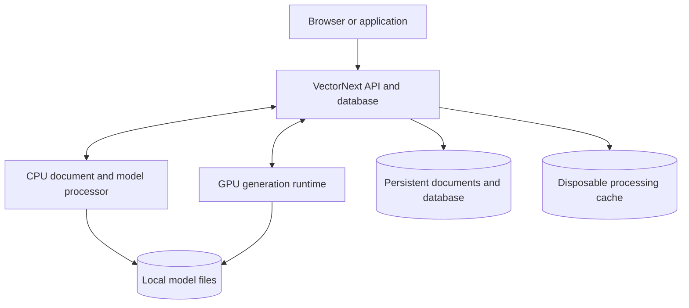

# VectorNext architecture

Status: proposed architecture, with confirmed user requirements identified below.
Last updated: 2026-10-14.

This document condenses the project discussion into an implementation reference. It is not a claim that the system is implemented or that every proposed technology has been selected. Explicit user instructions can revise it.

## 1. Confirmed requirements

- Build our own vector database, including the storage/search core. Do not substitute an existing vector database as the product implementation.
- Locate relevant text for a question, retrieve its supporting chunks, answer from that evidence, and optionally rewrite the question or format/rewrite the response.
- Run locally with local models. Gemma 4 is a model family the user mentioned; an exact model artifact has not been chosen.
- Containerize the application and its processing dependencies, with local NVIDIA GPU access.
- Support TXT, PDF, and JSON in the initial ingestion design.
- Initial workload: approximately 400 documents, each 10–30 KB. File sizes do not establish extracted token counts, especially for PDFs.
- Initial machine: Windows, RTX 4060 with approximately 8 GB VRAM, roughly 64 GB system RAM. GPU memory and system RAM were inspected during the discussion.
- MinIO and Redis may be removed or replaced. Their use is not a requirement.
- Aim for exceptional retrieval quality, but demonstrate improvements through evaluation; there is no measured state-of-the-art claim yet.

The discussion is still in the creative/design phase. Recording this architecture does not mean implementation has started.

## 2. Proposed deployment

Use Docker Compose with three long-running services:

| Service | Proposed implementation | Responsibility |
| --- | --- | --- |
| vectornext | Rust library and server | Database, API, query planning, durable jobs, scheduling, caches, and static web assets when a UI exists |
| processor | Python service, CPU initially | Format parsing, chunk preparation, dedicated embeddings, and compact reranking |
| llm | CUDA-enabled llama.cpp server | Local generation for contextual enrichment, fact extraction, and flexible rewriting |

These language and runtime choices are proposals. Parser and model artifacts must be validated and pinned during implementation.

VectorNext is the sole database writer. The processor returns stage results through internal APIs and does not edit database files. Inference and parsing occur outside database write transactions.

Use persistent Docker volumes for documents/database state, model artifacts, and any reusable disk cache. Expose the application on localhost by default; model and processor endpoints stay on the internal service network. Model artifacts persist across container rebuilds. Normal operation must work offline after images and models have been acquired.

On the initial Windows host, Docker Desktop's WSL 2 backend and a compatible host NVIDIA driver are prerequisites. Docker does not package the host GPU driver. Compose GPU access does not impose a model VRAM budget: the runtime and scheduler must control memory use.

### Why no MinIO or Redis initially

Local content-addressed files provide document storage for the single-machine workload. A bounded in-process cache and a disposable disk cache provide reuse without another server. Preserve a BlobStore boundary so an S3-compatible implementation can be added if shared storage becomes useful. Add shared-cache infrastructure only for a measured need.

This is a proposed initial simplification, not a permanent prohibition. Do not implement speculative adapters before they are useful.

## 3. Database core we own

- Persistent vector and chunk records, document identities/revisions, and source references.
- Exact vector similarity search over eligible records as the initial implementation and correctness baseline.
- Inverted keyword index with BM25 scoring.
- Typed attribute storage and filtering.
- Reciprocal rank fusion of keyword and vector candidates.
- Visibility of committed document revisions, deletions, and query snapshots.
- Checksummed write journal, snapshots, and recovery.

General-purpose libraries for serialization, compression, tokenization, numerical operations, parsing, and inference are compatible with building our own database.

Keep search structures in system RAM initially. As a sizing example, 10,000 vectors with 768 float32 dimensions consume approximately 30.7 MB before metadata and index overhead. Actual chunk counts and dimensions remain unknown.

Add an approximate index, such as our own HNSW implementation, only when measured scale or latency justifies it. Compare approximate results against exact search. Quantization, distributed search, replication, and object-store-native indexes are future investigations, not initial requirements.

## 4. Data contracts and invariants

### Document, block, and chunk

- Document: logical ID, source content hash, immutable revision, media type, original-file reference, processing configuration, and ingestion state.
- Block: a parsed paragraph, heading, list, table, or JSON subtree with hierarchy and source references.
- Chunk: one or more block references, split boundaries where needed, evidence content, structural context, optional generated context, typed attributes with provenance, parent/neighbor links, and vector representation.
- Embedding space: exact model identity, dimensions, tokenizer/preprocessing version, query/document encoding conventions, and normalization.

A chunk can refer to several source spans, pages, or table regions. Store generated text separately from evidence. PDF extraction/OCR and JSON serialization are derived representations of an original source; do not label them as unchanged source bytes.

Source references are format-specific:

| Format | Locator |
| --- | --- |
| TXT | Encoding, line ranges, and offsets with mappings between normalized text and the original |
| PDF | Document revision, page numbers, bounding boxes, extraction method, and available quality diagnostics |
| JSON | Document revision, JSON Pointer, and a source record identifier when present |

JSON array positions can change across revisions; a pointer alone is not a stable record identity. Chunk deduplication must not discard document identity or provenance.

### Invariants

1. A published document revision has complete required chunks, vectors, and indexing state.
2. A query reads a consistent database generation; it does not mix a document's replacement with its old revision.
3. Query vectors and indexed vectors belong to compatible embedding spaces. Model changes build a separate index generation before switching.
4. Recovery restores stored embeddings; it does not depend on rerunning models.
5. Generated context helps search but is not independent source evidence.
6. Schema-valid output is not proof that an answer is supported.
7. Losing a disposable cache cannot lose committed source data or database state.
8. No remote inference is silently substituted for a local model.

## 5. Ingestion and chunking

Shared pipeline:

`uploaded -> parsed -> chunked -> contextualized -> embedded -> committed`

Keep originals immutable. Record durable job/stage progress and failures. Retries should be idempotent through stable input/configuration identities. A replacement remains in staging until its complete revision is ready to commit. Low-quality or incomplete extraction must be visible in diagnostics; do not silently report incomplete coverage as full success.

Chunk size is a soft target. For prose, start around 300–500 tokens when the embedding model allows it. Enforce the hard input limit on the final serialized input, including context and special tokens. Adjust the target down when necessary. Keep short complete records short. Use limited overlap only when useful for forced prose splits, and deduplicate overlapping evidence at retrieval time.

### TXT

- Decode with a recorded encoding; keep original bytes and a normalized-to-source mapping.
- Identify paragraphs, lists, and recognizable headings without treating uncertain heading inference as source fact.
- Combine adjacent related paragraphs within a section; do not cross unrelated sections to fill a size target.
- Split oversized paragraphs at sentence boundaries, then token boundaries if necessary.
- Retain parent-section and neighbor references for context expansion.
- Do not indiscriminately collapse newlines: they can encode list or record structure.

### PDF

Proposed parser: Docling in the processor container, adapted into our block model. Use its document structure rather than flattening the entire PDF to plain text before chunking. Our chunking policy remains explicit and versioned.

- Extract usable native text and layout; run local OCR for scanned content or regions needing it.
- Handle mixed pages without indexing native text and OCR duplicates twice.
- Preserve reading order, headings, paragraphs, captions, tables, and source coordinates.
- Treat pages as source locations, not mandatory chunk boundaries. Cross-page content can have multiple source references.
- Separate repeated headers/footers from the main body while preserving them in the parsed representation.
- Split large tables into row groups that retain needed column headers, units, captions, and row identifiers. Preserve links to relevant footnotes.
- Store extraction method and available quality diagnostics. OCR text is fallible.
- Text extraction, tables, and OCR are the initial scope; understanding charts or non-text diagrams requires a separate vision capability and must not be implied by basic PDF support.

Prefetch and pin parser/OCR models for offline use. Start with bounded CPU processing so parsing does not compete for the generation model's GPU memory.

### JSON

- Parse the tree and preserve types, numeric fidelity, and the distinction between null and missing values.
- Root arrays of objects normally yield one logical record per object. Keep small root objects together.
- Support a configurable record path, such as `/matches`, for arrays inside larger documents.
- Split large objects at nested-object or array-element boundaries while retaining relevant parent identity and field paths.
- Split long narrative fields into passages linked to their record and field path.
- Generate search text deterministically from keys and values. No LLM extraction is needed for already-explicit fields.
- Keep nested field meanings distinct, for example `publication.year` versus `match.year`; semantic field mappings belong in an explicit ingestion profile.
- Use typed records for exact filters and, when implemented, complete-record aggregation. Never calculate corpus-wide totals from a top-k chunk sample or count multiple chunks of a record as multiple events.

## 6. Modified contextual retrieval

Implement three selectable, measurable policies:

| Policy | Indexing context |
| --- | --- |
| plain | Chunk content only; evaluation baseline |
| structural | Available title, heading path, captions, table headers, or JSON field/record identity |
| generated | Structural context plus a short local-model explanation supported by the surrounding source |

Generated context is particularly relevant for ambiguous prose. Ordinary explicit JSON records often need none. The policy deciding which chunks get generated context is an experiment, not a proven quality improvement.

For short documents, context generation may use the whole document within the configured input budget. Otherwise use the relevant section, headings, and neighboring passages. Record the source scope and generation configuration. Do not silently truncate required evidence.

Keep original/evidence text and generated context as separate keyword fields so their contributions can be tuned. Initially embed the selected contextualized representation. Preserve original evidence for reranking, source inspection, and answering.

Cache a processing result by the complete relevant input plus exact model, prompt, and preprocessing versions. A changed parent heading or context can invalidate an otherwise unchanged chunk's embedding.

## 7. Query and answer flow

1. Preserve the original question and explicit constraints.
2. Resolve conversational references only when needed, keeping original context available. A stylistic rewrite is not a replacement search query.
3. Produce a compatible query embedding and run dense and keyword retrieval.
4. Apply trustworthy filters; use uncertain extracted attributes as soft evidence or provide a fallback path so extraction errors do not silently hide matches.
5. Fuse rankings and deduplicate candidates.
6. Rerank candidates against the original/resolved question using a compact local reranker.
7. Expand selected passages with necessary headings, neighboring text, table labels, or parent-record context within a token budget.
8. Extract an answer with source-linked fields; distinguish supported answers, ambiguous questions, and insufficient evidence.
9. Validate types and source references, then render fixed formats with templates or use the local model for flexible rewriting.

Initial tuning hypothesis: retrieve 30 candidates from each path, rerank 20 merged candidates, and assemble up to five passages. These are tunable starting values, not benchmarked defaults. Valid citations and schemas do not by themselves prove semantic correctness.

Proposed API capabilities: ingest/status, search, ask, explain, document replace/delete, and snapshot/export. Exact routes and payload schemas remain to be designed.

## 8. Model roles and scheduling

- Dedicated local embedding model: CPU initially; exact artifact and dimensions undecided.
- Compact local reranker: CPU initially; artifact and score handling undecided.
- Small quantized generation model, initially evaluating Gemma 4 variants: GPU for enrichment, extraction, and rewriting.

Use one loaded generation model and one active generation request initially. Bound input/output tokens and model memory. Interactive answers take priority over queued background enrichment. An already-running inference is not instantly preempted; keep background requests bounded and allow cancellation where supported.

Keep database reads/writes independent of model availability. Expose capability-specific errors when embedding or generation is unavailable instead of pretending an answer succeeded. Bound CPU work too, so ingestion does not starve query embedding and reranking.

## 9. Durability and cache behavior

The proposed persistence mechanism is a checksummed append-only journal plus periodic snapshots. Commit a prepared document mutation as one batch, flush it durably, then make it visible. Recovery ignores incomplete/uncommitted records and replays committed operations. Exact framing, fsync ordering, snapshot publication, and truncation protocols need a tested specification before claiming durability.

New queries exclude deleted records. Reclaim obsolete revisions later while respecting active readers. Backups must capture a consistent database snapshot and referenced original files, not just copy changing files opportunistically.

Use bounded RAM and disk caches. Query-cache identities, if introduced, must include the database generation, query, filters, and relevant retrieval configuration. Normal committed embeddings belong in the database, not solely in a disposable cache.

## 10. Evaluation and open choices

Measure separately:

- Parsing/source-mapping fidelity, including PDF reading order, OCR digits, table labels, and JSON types.
- Candidate evidence recall before reranking and relevance after reranking.
- Answer field accuracy and support in the cited original evidence.
- Insufficient-evidence and ambiguity handling.
- End-to-end and per-stage latency, including queue time; peak RAM/VRAM; ingestion time; cache behavior.
- Recovery, atomic replacement, deletion visibility, and embedding-space isolation.

Compare plain, structural, and generated-context pipelines on the same corpus/questions and model configurations. No latency, accuracy, or scale target has been established yet.

Open choices include exact model artifacts, parser configuration and OCR languages, JSON record profiles, wire/file formats, the context-generation selection policy, API schemas, and measurable acceptance thresholds. The proposed technology stack is also subject to implementation evidence.

## 11. Decision record

| Date | Status | Decision or proposal | Reason |
| --- | --- | --- | --- |
| 2026-10-14 | Confirmed | Build our own vector database | Explicit user direction; an existing vector database must not replace the core |
| 2026-10-14 | Confirmed | Local models, GPU, and Docker | Explicit operating/deployment requirements |
| 2026-10-14 | Confirmed | TXT, PDF, and JSON | User selected the initial formats |
| 2026-10-14 | Confirmed | MinIO and Redis are optional | User authorized architectural changes and removal |
| 2026-10-14 | Proposed | Three services, local volumes, no mandatory MinIO/Redis | Separate runtime dependencies while keeping ownership simple |
| 2026-10-14 | Proposed | Exact search first, BM25 fusion, local reranking | Match the initial workload and retain a correctness baseline |
| 2026-10-14 | Proposed | Selective generated context with structural baseline | Evaluate retrieval gains against local processing costs |

Add a concise dated rationale here when the design changes. Introduce separate decision records only when a topic needs substantial supporting detail.

## References

These references informed the proposal; their techniques are not proof of VectorNext performance. Recheck changing APIs, images, and model support before implementation.

- [Anthropic contextual retrieval](https://www.anthropic.com/engineering/contextual-retrieval)
- [Docling document model](https://docling-project.github.io/docling/concepts/docling_document/)
- [Docling chunking](https://docling-project.github.io/docling/concepts/chunking/)
- [Docling offline and advanced options](https://docling-project.github.io/docling/usage/advanced_options/)
- [JSON Pointer, RFC 6901](https://www.rfc-editor.org/info/rfc6901/)
- [Gemma model documentation](https://ai.google.dev/gemma/docs/core)
- [llama.cpp server](https://github.com/ggml-org/llama.cpp/blob/master/tools/server/README.md)
- [llama.cpp Docker images](https://github.com/ggml-org/llama.cpp/blob/master/docs/docker.md)
- [Docker Desktop GPU support](https://docs.docker.com/desktop/features/gpu/)
- [Compose GPU configuration](https://docs.docker.com/compose/how-tos/gpu-support/)
- [HNSW original paper](https://arxiv.org/abs/1603.09320)
