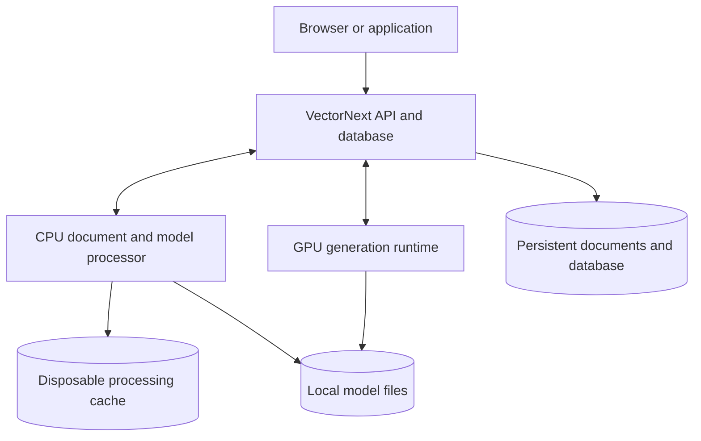

# VectorNext completed tasks and history

Archived: 2026-10-16 (UTC).
Current tracker: [plan.md](plan.md). Design reference: [architecture.md](architecture.md).

This archive preserves completed-task definitions, verification results, decisions and session handoffs from the former build plan, [historical AGENTS.md notes](#historical-agentsmd-handoff), [historical architecture notes](#historical-architecture-handoff) and [historical README results](#historical-readme-results). Detailed reports and frozen evaluation artifacts remain at their existing paths.

The statuses, next steps, work queue and session-maintenance instructions below are historical snapshots. Use [the active tracker](plan.md) for current priorities and task-maintenance rules; an archived proposal does not authorize new work. Add future completed-task records here with their completion date, results, limitations and report links.

## T38 — Safe offline compaction and garbage collection

Status: complete (2026-10-16). Depends on: T21 checkpoint/export repair and T37 durable jobs. Design: [offline compaction and retention](architecture.md#offline-compaction-and-retention).

Scope: add offline dry-run storage accounting and explicit compaction/GC to the Rust admin CLI. Preserve the complete logical state, all receipts/reserved revisions, byte-identical ingestion jobs, and their referenced originals/available artifacts. No age-based eviction or retry expiry. Leave answer jobs, browser history, caches, models and backups untouched. Compact into a verified sibling store and publish by atomic directory exchange while retaining one writer-lock inode; reclaim only proven obsolete files after durable publication. Keep the existing storage format and API behavior.

Acceptance and verification:

- Dry run changes no store files, rejects nonexistent/invalid paths and reports retention roots, journal size, unreferenced blobs and disk-space needs honestly.
- Repeated replace/delete cycles reclaim journal payloads and unreferenced blobs; current search results, exact values, provenance, generation, model identities and saved ingestion states remain identical.
- Identical/conflicting operation and ingestion retries, old revision reuse, PDF artifact retention and unfinished-job recovery preserve existing behavior after maintenance.
- Exclusive locking, path/symlink/non-file rejection, insufficient-space/write/sync failures and interruption before/after publication fail safely. Restart yields the old or complete new store; no missing committed evidence or split checkpoint/journal pair.
- Existing and legacy checkpoints remain readable; compacted stores accept subsequent commits/checkpoints and pass export/restore. Sibling answer-job records remain byte-identical.
- Run focused isolated CPU durability/recovery tests, Rust all-target regressions, format/Clippy and appropriate CLI/HTTP compatibility checks. No GPU/quality reruns or historical fixture changes. Record actual reclamation measurements and limitations, update operations/README, then archive the completed task.

Verification: 186 Rust checks, formatting and Clippy passed; twelve injected-error and twelve process-kill boundaries preserve state/retries. Four release CLI checks on isolated disk/low-space filesystems, 71 frozen HTTP cases, five browser boundaries, mocked launcher and prior-binary smoke passed. Synthetic churn reclaimed 4,225,194 of 4,513,752 logical bytes (93.6%). [Full report, commands, image identities, failed invocations and limitations](reports/t38-compaction.md).

Delivery: API/client/admin now select the verified `:t38` image; normal services remain on their healthy previous `:t37-hybrid` images until a later Start/Rebuild. The user library was not compacted. Test containers and their scratch volume were removed. Full job/retry history has no expiry; no online maintenance, fixed disk bound or automatic abandoned-workspace deletion is promised. See [maintenance operations](maintenance.md).

### Pre-compaction deployment handoff

The following current-state snapshot preceded T38; its measured Hybrid results are unchanged:

- **T01–T37 are complete.** Definitions, acceptance criteria and historical handoffs are in [tasks-done.md](tasks-done.md); detailed evidence remains in [reports/](reports/).
- **Running defaults:** three-service `:t37-hybrid` deployment on localhost:8088. Hybrid uses repaired NuExtract3 first, with one queued Gemma 4 12B fallback. Forced Gemma/NuExtract modes are available. Two-call answering, f16 KV, MiniLM, structural ingestion and ranked 30/20/5 remain unchanged.
- **Latest result:** all 24 integration cases passed the predeclared scoring rules (**8/8 per mode**, unchanged historical scorer **6/8**). Hybrid accepted all five supported NuExtract answers and fell back on two of seven admitted questions. Common-supported median attempt work: **3.62/3.54/12.55 s** for Hybrid/NuExtract/Gemma. This excludes queue/loading; the missing-evidence fallback took **90.29 s**, including **60.94 s** loading. [Results, interruption and limits](reports/t37-hybrid.md).
- **Verified:** Rust regressions/format/Clippy; 89 Python checks; 71 frozen HTTP cases, five boundaries, three OpenAPI checks; six components and thirteen offline workspace plus two adapter/browser scenarios; launcher/scorer contracts and eleven retained CPU-profile checks. Six bounded live switching/cancellation/outage/restart checks passed; 236 process samples observed at most one backend. The PC-sleep observation stays in raw captures and correctness, excluded only from derived timing.
- **Activation and preservation:** full-volume copy plus export/restore verified; original PDF, 35 chunks, revision and ingestion jobs unchanged. Hybrid readiness, source-linked browser answer, original PDF, reload and export passed. A final browser-only readiness amendment is separately verified; Rust binary and all non-UI files match the measured image retained as `:t37-measured`. Prior images, private backup, all data/caches/freezes and 189-file public pre-cleanup archive are retained. Test services are stopped; original holdout unused.

### Completed repository and documentation cleanups

**Repository configuration cleanup — complete.** Removed seven standalone experiment/verification Compose files; the README lists the five retained app/setup/developer configurations. [History and prior revision](tasks-done.md#experiment-compose-cleanup) preserve their purpose and recovery path, and affected guides identify deployment commands as historical. All five retained configurations passed `docker compose -f <file> config --quiet`; launcher references and 26 added local documentation links/anchors passed inspection. Supported configuration bytes, application code and frozen evaluation artifacts are unchanged; no services or GPU evaluations were run.

**Development handoff cleanup — complete.** `AGENTS.md` now contains only current development instructions; its former summary and task notes are in the [historical handoff](tasks-done.md#historical-agentsmd-handoff). Verified text preservation with rebased links, 98 local links/anchors and a documentation-only diff. No active implementation work remains.

**Architecture cleanup — complete.** The [architecture](architecture.md) describes the current system; completed-task specifications, comparisons, rollout notes and the decision record are in the [historical architecture handoff](tasks-done.md#historical-architecture-handoff). Checked current defaults/bounds against implementation/contracts, preserved all 102 task-numbered paragraphs and validated 103 links/anchors. Current contract references use named sections; frozen protocols/reports remain unchanged. Documentation-only diff; no runtime changes or model tests.

**README cleanup — complete.** The entry page now focuses on current features, setup and usage, with a compact report index. Complete result tables and six historical notes are preserved in [historical README results](tasks-done.md#historical-readme-results). Verified text preservation, 128 local links/anchors, nine CLI argument examples, eight PowerShell blocks and a documentation-only diff. No services or model evaluations were run.

## Experiment Compose cleanup

Requested 2026-10-16: remove standalone deployment YAML for completed experiments and verification runs from the current checkout. This includes the embedding/reranker pilot and Hybrid verification; their earlier retention is superseded. Keep the supported app, explicit model/PDF setup and general developer tooling.

| Removed configuration | Historical purpose | Retained evidence |
| --- | --- | --- |
| `compose.eval.yaml` | Development answer/context comparisons (T10). | [Evaluation results](reports/t10-evaluation.md) |
| `compose.independent.yaml` | NASA/USGS two-versus-five passage comparison (T11). | [Public-source results](reports/t11-independent.md) |
| `compose.reliability.yaml` | Isolated ingestion/recovery drill (T13). | [Reliability verification](reports/t13-reliability.md) |
| `compose.coverage.yaml` | Ranked versus evidence-coverage comparison (T14). | [Coverage results](reports/t14-evidence-coverage.md) |
| `compose.benchmark.yaml` | VectorNext versus PostgreSQL/pgvector (T20). | [Database benchmark](reports/t20-pgvector.md) |
| `compose.t32.yaml` | MiniLM/Nomic embeddings and MiniLM/Ettin reranking. | [Replacement pilot](reports/t32-replacements.md) |
| `compose.t37.yaml` | Isolated Hybrid answering and live recovery verification. | [Hybrid verification](reports/t37-hybrid.md) |

All seven final pre-cleanup files are available at [commit 818b61a](https://github.com/dpittaluga76/VectorNext/tree/818b61a3eafb305816dd4fa3c533b64003c3bd11). Older generator Compose files removed during Hybrid rollout are recorded in the [LLM archive](../archives/llm/README.md).

For historical inspection, use a separate checkout of the referenced revision. For exact reproduction, use the particular experiment's recorded source archive/commit, image identities and execution freeze; the final pre-cleanup revision is not necessarily the measured runtime. Existing deployment commands and runners remain historical references and are not runnable unchanged from the current checkout. Never rewrite frozen manifests or restore historical runtime files over the supported installation.

This cleanup preserves results, protocols, source fixtures, labels, scorers, manifests and existing archives. It does not start or stop services, remove Docker volumes/images, delete model files or change application behavior. The [README configuration guide](../README.md#compose-files) lists the five retained Compose files.

Verification: `docker compose -f <file> config --quiet` passed for all five retained files; their contents are unchanged. Launcher file references, the seven historical Git paths and 26 added local documentation links/anchors were checked. The diff contains only documentation, removal of the seven YAML files and removal of the deleted coverage file's Git-attributes rule. No application/model regression rerun was needed for this configuration cleanup; no services were started or stopped.

---

Last updated: 2026-10-16 (UTC).
Design reference: [architecture.md](architecture.md).

## Current state

- T32 complete: 24 fresh synthetic TXT/PDF/JSON requests across four combinations. MiniLM/Ettin improved frozen correctness 4/6 → 5/6 (separate source review: 5/6 → 6/6), assembled coverage 4/5 → 5/5 and median latency 12.80 → 9.68 s, with no lost baseline case. Nomic's larger JSON chunk exceeded both rerankers' 512-token cap: four retained failures per arm, 1/6 frozen / 2/6 reviewed. Keep MiniLM defaults. Verified 64 Python/163 Rust checks, offline packaging and unchanged normal library/readiness; experiment containers stopped, all captures/volumes retained. [Results and limitations](reports/t32-replacements.md).

- Ordered follow-up complete: README cleanup and range endpoint support (163 Rust checks, format/Clippy), T29 single-call (208 requests; global adoption rejected), T30 Q8 KV (208 requests; adoption rejected), T31 BGE embeddings (192 requests; no final-five gain). Final worker/transport/profile suite passed 49 checks plus 11 legacy model contracts; Docker packaging/offline profile checks passed. Normal T28 library/services are unchanged. Source-only range repair awaits explicit activation. Reports: [range](reports/range-endpoints.md), [T29](reports/t29-single-call.md), [T30](reports/t30-kv-cache.md), [T31](reports/t31-embeddings.md).

- T28 complete: ranked extraction uses admitted-record typed pointer constraints before prompt budgeting. All 208 requests completed; no correct-case/source-support loss against either retained T27 arm. Ranked five scores 13/16 (T14) and 18/28 (T11) in both passes, with 50.4–62.8% lower median latency than retained 26B. All declared gates passed. Default `12b` and `:t28-12b` normal services are active, with unchanged library and verified pre-activation storage copy. Narrow 308 MiB sampled GPU headroom, unverified WDDM paging and the existing numeric-range rejection remain explicit. See [results and rollback](reports/t28-ranked-pointers.md).

- T27 complete: shared validated model profiles and all 416 paired regression requests. T27 retained 26B (superseded by T28): ranked-five T14 scores were 13/16 versus 10/16 and T11 16/28 versus 14/28 in both passes; 12B's 52.7–60.7% median reduction passed speed gates but lost correctness/source support and missed T11's floor. Full-context/restart, T26 planner12/source8/regression5, live browser, outage/alias, Rust/Python/HTTP/frontend/launcher and packaging checks passed. Earlier harness failures and all raw captures remain; normal services restored, library unchanged. See [results and limits](reports/t27-model-comparison.md).

- T26 complete: field-only automatic planning distinguishes reported counts, separate facts, contextual references and independent numeric types. Final v3 passed 12 new planner cases, eight fresh source-backed checks and five observed regressions; initial v2 failures remain recorded. 158 Rust / 62 Python checks, HTTP/schema, frontend and browser verification passed. At completion API/client/admin and processor `:t26` were active with the library unchanged, generator `:t18`; T28 supersedes that deployment. [Results and limitations](reports/t26-planning.md).

- T25 complete: opt-in `facet_coverage_v1` spans API/CLI/browser; ranked defaults unchanged. 157 available Rust checks, format/Clippy, 62 Python checks, HTTP/schema and 13 browser scenarios verified. Six live outcomes/controls passed; three automatic planner declines are retained and documented. At T25 completion, the API/UI activated `:t25`; pre-upgrade storage and prior images remain retained. T26 supersedes that deployment. [Historical results and limits](reports/t25-facet-integration.md).

- Phase: T01 through T32 complete. Architecture/task definitions were updated before implementation. Facet coverage remains opt-in and ranked 30/20/5 is retained; ranked JSON extraction now constrains source pointers. Historical activation entries below remain records of their task completion; T28 defines the current deployment.
- T24 complete: ten fresh NASA TXT sources / 388 chunks, 24 frozen questions and 96 successful CPU requests. Same shortlists/general scores across arms; final frozen coverage improves 16/20 → 18/20, with median initially-empty-cache latency 685 → 1,437 ms. Eight Rust/nine Python checks, source/hash validation, format/Clippy and separate synthetic smoke passed. [Results, cost and alternate-support limits](reports/t24-final-selection.md). All experiment containers exited; data/caches retained and normal services unchanged.
- T23 complete: twelve fresh attributed NIST sources, 24 frozen questions and 96 offline CPU requests; 188 chunks admitted. Expanded candidates improve complete shortlist coverage 18/20 → 20/20, but final-five coverage remains 16/20 in both arms. Five scorer checks, one experimental Rust check, fixture/source freezes, format/Clippy and synthetic smoke passed. [Results and source-review limits](reports/t23-evidence.md). All experiment containers exited; data/caches retained, normal app unchanged.
- T22 complete: immutable bounded scalar/document/media filter postings, exact scan fallback and unchanged search/API contracts. Verified 135 Rust checks, format/Clippy, 4,224 paired release requests, retained original volume hashes and offline production startup. [Results](reports/t22-filters.md). At T22 completion, Compose selected T22 while the normal app still ran T19; T25 now supersedes that deployment.
- T21 complete: bounded version-2 checkpoint stream with legacy reads, unchanged publication/journal/backup contracts and nine new regressions. Both formerly failing T20 states checkpoint/export/restore correctly on fresh copies; 132 Rust and 768 exact-query checks passed. Old-binary rollback requires a pre-upgrade copy; batch/job and total backup limits remain. [Results](reports/t21-checkpoints.md). T21 services stopped; original T20 data unchanged; the normal app was left on T19 at that task completion (upgraded in T25).
- T20 complete: isolated CPU comparison at 12,800/51,200 supplied vectors, independent exact oracle, pgvector exact/HNSW, fixed filters, load/resource measurements and interruption recovery. All 4,096 timed requests completed; 2,048 exact requests and 512 recovery checks passed. PostgreSQL exact was faster in every warm group. VectorNext checkpoints failed at both sizes (64 MiB frame); journal recovery passed, but the dependent export path is blocked at those states. Verified 123 Rust/eight Python checks, format/Clippy, builds, smoke and manifests. [Results and limitations](reports/t20-pgvector.md). All benchmark services stopped; failed attempts, data and volumes retained; normal application unchanged.
- T15 complete: exact English numeric grouping, named-month date-year boundaries and numeric-fragment checks in complete supplied evidence. Preserves quotes/typed values, JSON pointer/null semantics and API/storage contracts. Verified 108 Rust/90 Python checks, format/lint, the three-case probe, release image build/liveness and T14 archive integrity. [Results](reports/t15-numeric-proofs.md). No GPU benchmark rerun or revised T14 quality score.
- T14 complete: opt-in field-focused selection and actual-record JSON pointer constraints, annotation v2 and a new eight-source/16-question frozen comparison. All 96 local requests completed: five 8/16, two 7/16, coverage 8/16 in each pass. Coverage cut median latency 43.5–44.4%; retain five by default. [Results](reports/t14-evidence-coverage.md), [workflow](reports/t14-coverage-workflow.md) and [source-review limitations](reports/t14-source-review.md). All T14 services stopped; volumes/captures retained. 101 Rust/116 Python checks passed; a separate probe exposed numeric proof-boundary defects for T15.
- T13 complete: supervised coordinator, pre-publication PDF diagnostics, bounded busy-admission retries and rejected-answer error envelopes. Verified 97 Rust/90 Python checks and a fresh CPU operational drill with real illustrated NASA PDFs, interruption/retry, unchanged committed data and idempotent publication. [Results and limits](reports/t13-reliability.md). Test services stopped; captures and volumes retained.
- Implemented: Rust storage/retrieval and TXT/JSON/PDF ingestion, durable jobs, and 66 foundation tests (18 storage, 20 TXT/JSON/job durability, 8 PDF, 18 retrieval, 2 diagnostic); offline CPU Docling/Tesseract adapter with 13 tests; synthetic fixtures/schema/validator and 27 T01 tests; an offline Docker local-model experiment with pinned downloads, GPU generation, CPU embeddings/reranking, 11 T02 contract tests, optional status-dependent output constraints, and archived measurements.
- T07 implemented: real MiniLM embeddings, three context policies, separately attributed Gemma 4 26B annotations, bounded caches, Docker ingestion/inspection/probe tools, seven additional Rust tests and five Python worker tests. Total core checks: 73.
- T08 implemented: snapshot-scoped hybrid retrieval/CPU reranking, budgeted source evidence assembly, two-stage Gemma answers, exact JSON pointer reads, source/type checks, deterministic templates, separate prose drafts, complete filtered structured lookup, and bounded generation priority. Ten additional Rust tests bring the core total to 83; Python worker/answer/scheduler coverage totals 18. All 13 source-authored development cases passed; see [T08 results](reports/t08-answers.md) for qualifications and prior failures.
- T09 implemented: shared Rust API/database owner, isolated CPU service with bounded lanes, local client, capability readiness, three-service Compose, and offline checksummed export/restore. Six new Rust checks bring the total to 89; four CPU transport checks bring Python worker coverage to 22. Integrated TXT/JSON/PDF ingestion, actual GPU answers, full model outages, restart/rebuild, interrupted work and exact restoration passed; see [T09 results](reports/t09-deployment.md).
- T10 complete: isolated evaluation runner, source-coverage/answer scorer, independent keyword weights, bounded answer budgets and stage/resource/queue measurements. Six configurations produced 156 responses on the same 13 development questions, cold/warm; only one-primary context failed the table question in both passes. Two primaries passed 26/26 and reduced median response time by 30–32%, but five remain the general default. Generated context added ingestion cost without final answer gain. The 400-document/12,800-vector capacity probe measured 9.946-ms median hybrid search; this is supplied-vector capacity, not corpus quality. Verified 90 Rust, 36 fixture/scorer and 22 worker/transport checks, Linux formatting/Clippy and Compose. See [T10 results](reports/t10-evaluation.md). Six holdout questions remain unused.
- T11 complete: 20 attributed NASA/USGS source snapshots, 28 frozen questions, 47 source references and four counterbalanced two-versus-five blocks. Admitted 18 documents / 658 chunks; six questions from unavailable PDFs remain in the denominator. Five scored 16/28 and two 15/28 in both passes. Two cut median latency by 46–50% but lost two answers and improved one; retain five by default. Repaired a UTF-8 line-mapping panic before any comparison queries and preserved the initial attempt. Verified 91 Rust, 54 evaluation and 22 worker/transport checks, formatting/Clippy, Compose and the real NASA Voyager README demo. See [T11 results](reports/t11-independent.md). This first public-source set is Codex-authored, not independently administered; broad quality remains unproven.
- T12 complete: opt-in human-readable ingestion/search/answer reports, client commands, API/function references, exact-response captures and offline replay in the existing CLI. Verified 25 new reporting/client checks and 58 existing evaluation/transport checks, a fresh Docker Voyager ingestion/search/Gemma answer, and retained failure/abstention examples. Command references were added through offline replay without new inference. Read [the Voyager report](reports/t12-voyager-workflow.md), [usage guide](workflow-debugging.md) and [verification](reports/t12-workflow.md). T12 services are stopped; captures and volumes retained. The original T11 execution freeze remains unchanged; the intentional client extension requires a historical checkout to repeat that exact experiment.
- Not implemented: public authentication/multi-user service, corpus aggregates, approximate indexing, or broad independently administered quality validation.
- Available: public project overview and quickstart in the [README](../README.md), detailed [development/operations commands](development.md), repository instructions, architecture, this task plan, the [storage specification](storage.md), [retrieval specification](retrieval.md), [source-coverage diagnostics](reports/t04-retrieval.md), and [evaluation guide](../evals/README.md).
- User-confirmed scope: our own vector database; local models and GPU; Docker; TXT/PDF/JSON; approximately 400 files of 10–30 KB; MinIO/Redis optional.
- Adopted: Rust storage/retrieval and deterministic TXT/JSON preparation, CPU Python Docling/Tesseract PDF artifacts, source-preserving PDF chunking and partial-quality policy, serializable processor stages, separate durable jobs, version-1 journal/checkpoint contracts, Linux/Docker durability, immutable per-space indexes, exact cosine, BM25, typed filters, RRF, and conservative evidence deduplication. T07 adopts a persistent Python child in the CLI container and a separate GPU generation service. T08 adds CPU reranking, source-linked typed answers, and bounded GPU priority. T09 adds shared application ownership, CPU admission, isolated services and verified backups.
- Exact model artifacts are pinned as T02 feasibility baselines; final quality selection, stable public API compatibility, and quality/latency thresholds remain open. The synthetic contract and first public-source comparison are implemented; future quality changes require new frozen validation data.
- Requested T02 follow-ups complete: Gemma 4 26B A4B QAT Q4_0 with 22 CPU expert layers improves dev outcome classification to 13/13. The subsequent status-dependent schema, still at temperature 0, improves exact outputs from 10/13 to 13/13 in both passes with a correct larger probe. Repeated short requests measured 4.39 s. Strict citation completeness remains 13/23; see the [schema result](reports/t02-status-schema.md) and earlier [model comparison](reports/t02-gemma4-26b.md). T03's scope is unchanged.

### Environment observations

Observed during discussion on 2026-10-14:

- NVIDIA RTX 4060, approximately 8 GB VRAM.
- Approximately 64 GB system RAM (63.1 GiB reported by the OS).
- Docker CLI installed; desktop-linux context present.
- WSL default distribution Ubuntu, default version 2.
- Docker engine was not reachable at the time of the check.

During T01 on the same date, Docker became reachable (server 29.6.2). The evaluation image built and CPU-only validation/tests ran successfully with container networking disabled. This does not prove GPU device access or inference. No model was downloaded and no inference/container GPU test was performed.

T02 subsequently demonstrated container GPU visibility and actual CUDA inference on the RTX 4060 (driver 616.92), with all 36 transformer/output layers offloaded and CPU-mapped embedding buffers retained. Models were downloaded and checksum-verified, then used offline across container recreation. Final sampled whole-device VRAM peak: 2,857 MiB; process startup to healthy: 19.62 s. The generation service was stopped afterward. Full evidence and qualifications: [T02 report](reports/t02-local-models.md).

## Next useful step

T32 is complete; normal deployment remains T28/12B/two-call/f16/MiniLM. Recommended next scope: reconcile JSON chunk admission with downstream reranker budgets, then use a small fresh confirmation set for Ettin's observed evidence gain and Nomic compatibility. Do not start that work or another quality batch automatically. T32 changes are local and await explicit Git publication; T29–T31/source range work is already pushed as 1c8a0a7. Preserve all captures/defaults/historical freezes and the unused original holdout.

### T32 — Small Nomic/Ettin replacement comparison

Status: complete. Architecture and task were updated before implementation. Depends on T31. User limit honored: **six questions × four combinations = 24 scored requests total**, without cold/warm repeats or historical-suite replays. All attempts are accounted for (16 HTTP successes/eight retained token-budget failures); four separate synthetic warmups and unit checks are excluded. Input/code/image/source freezes and exact captures remain under `experiments/t32/` and `data/t32/pilot-v1/`. [Report](reports/t32-replacements.md), [separate source-label exception](reports/t32-source-review.md).

- Pin Nomic v1.5 and Ettin-17M publisher artifacts, verify offline CPU operation and correct pooling/normalization/prefix/tokenizer behavior. Generalize worker dimensions/reranker profiles without changing legacy MiniLM identities; test invalid profiles, cache separation, exact dimensions and token bounds.
- Freeze fresh synthetic TXT/PDF/JSON sources/labels, six requests and scoring before measured queries. Include a longer record, distractors, multiple sources, exact values and missing-count abstention. Keep 180-token structural chunks, 30/20/5, explicit fields and current Gemma settings fixed.
- Fresh storage per embedder; share committed documents/vectors between its two rerankers. Separate query caches/new processes per arm. Account for all 24 attempts, ingestion failures, source coverage at candidate/final stages, answer outcomes, exact captures, stage/median latency and CPU/RAM. Preserve failures without tuning/retries; no holdout.
- Verify relevant Rust/Python/packaging contracts; normal generator remains running under its existing scheduler. Stop only experiment services and confirm normal readiness/library unchanged. Document results and limitations before completion; defaults remain until stronger evidence supports a separately reviewed switch.

Acceptance: all four arms executed or explicit compatibility failures retained, 24 outcomes accounted for, reproducible identities/source archive, trustworthy comparison and an explicit retain/follow-up recommendation. A negative result completes the pilot honestly. Small preflight/unit checks are separately reported, not additional quality batches.

### Prerequisites — README clarity and conservative range endpoints

Status: complete. Depends on T28. Verified 163 top-level Rust checks, 32 answer integration checks, both range unit matrices, format/Clippy and preserved README links/table rows. [Results and deployment boundary](reports/range-endpoints.md). Remove T01–T28 labels from README narrative and display labels, keeping all links, tables, numbers, commands and provenance. Then add complete-source two-segment unsigned range recognition in `src/answers/numeric.rs`, with strict date/sign/identifier/fragment guards. Verify positive endpoints and adversarial clipped quotes through Rust unit/integration checks, format/Clippy and existing numeric regressions. Record results before T29; keep model and API contracts unchanged.

### T29 — Single-call assessment and extraction experiment

Status: complete; global adoption rejected. All 208 requests completed (202 HTTP 200, six retained rejections). Ranked five preserved 13/16 and 18/28 with 35.6–40.7% lower medians, but coverage lost unknown_count/absent_fact in both passes (12/16 → 10/16). No source-support losses/new falsely supported negatives. Seventeen worker tests passed; normal generator restored/library unchanged. [Results](reports/t29-single-call.md). Depends on the completed prerequisites. Add an explicit validated experimental answer mode, retaining the two-call default. Skip assessment only; keep extraction prompt/schema, pointer constraints, cache_prompt=false and evidence admission unchanged. Freeze a new runner and replay the unchanged 96+112 requests against T28's retained 208-request baseline on copied corpora. Preserve all failure denominators, exact captures, hashes, source support, status/false-support outcomes, tokens, stage timings and median/p95/common-success latency. Report any independent numeric-validation effect. Restore the normal app; no automatic promotion. Acceptance: all 208 attempted outcomes accounted for and an auditable regression/speed decision, with relevant worker/Rust compatibility checks.

### T30 — Independent Q8 KV memory experiment

Status: complete; adoption rejected. All 208 requests completed, with the unknown_count regression in four ranked blocks; other cases/source support preserved, no new falsely supported negatives. KV allocation fell by 217.5 MiB; full-context/restart and 25 worker checks passed. Ranked-five medians were 10.6–14.5% lower against the retained baseline. Normal app restored/library unchanged. [Results](reports/t30-kv-cache.md). Add a separate validated 12B q8_0 K/V profile/runtime identity. Preserve every other setting and saved job identity. Run full-context/repetition/restart preflight, memory sampling and 208 frozen requests if preflight passes. Verify wrong-profile/identity isolation and restore production. Acceptance: measured memory/latency/quality tradeoffs, retained errors, no unsupported page-out claim and an explicit adoption recommendation; a documented preflight failure also completes the experiment honestly.

### T31 — CPU embedding profile benchmark

Status: complete; MiniLM retained. All 192 requests succeeded, with unchanged final-five fact sets/16-of-20 complete coverage on each corpus. BGE raised NIST selected-20 coverage 18/20 → 19/20 and partial NASA coverage, but ingestion cost increased 33.6–39.6%. All 22 sources admitted per profile; chunk text/spans/token counts match. Forty-nine final worker/profile/transport and 11 legacy model checks passed, with packaged offline vectors and three image builds. [Results](reports/t31-embeddings.md). Depends on completed T30. BGE revision 5c38ec7c405ec4b44b94cc5a9bb96e735b38267a and seven artifact hashes are pinned; explicit download verified. Thirty-five worker/profile checks passed, including exact legacy-space compatibility, actual CLS pooling and the 512-token boundary. The 192-request CPU comparison uses unchanged question-only 30/20/5 retrieval on both existing NIST/NASA corpora, with 180-token targets. Explicitly download and checksum-pin BGE-small-en-v1.5 ONNX/tokenizer artifacts, with CLS pooling and query instruction in the space identity. Compare against MiniLM with existing 180-token chunking, unchanged reranker and isolated fresh databases on the existing public retrieval regression corpora. Freeze inputs/scorers/model/image identities before measurement. Record ingestion failures, chunks, source coverage, CPU cost, query latency and reranker token admission. Acceptance: valid isolated spaces, pooling/prefix/token boundary tests, reproducible comparison and documented recommendation. Keep production MiniLM and old vectors unchanged; larger chunks and migration are separate decisions.

### T28 — Dynamic pointer-constrained ranked extraction and 12B re-evaluation

Status: complete; 12B promoted and activated. Depends on T27. User authorized implementation and the 208-request evaluation on 2026-10-15; architecture and task definitions preceded implementation. This changes the extraction contract, not retrieval ranking or storage. [Full report](reports/t28-ranked-pointers.md) and [all case/gate records](reports/t28-ranked-pointers.json).

Implementation scope:

- Preserve the exact T27 source archive, frozen manifests, images, model pins, captures and scores before changing their execution inputs. Use new T28 image tags, run names, storage copies and caches. Never overwrite historical execution freezes or turn failed measured requests into successes by retrying.
- In Rust evidence assembly, enable the existing worker's pointer-constrained path for ranked answers. Reuse `pointer_catalog`, `messages` and `schema` in `model_worker/answers.py`; avoid duplicating path enumeration or grammar construction in Rust. Apply consistently to ranked five and ranked two; keep existing coverage/facet constraints and TXT/PDF proof behavior compatible.
- Bind each evidence ID and requested field to that record's existing, type-compatible RFC 6901 paths, respecting an explicit caller pointer. Include only admitted records, including admitted neighbors. Preserve complete source JSON, exact Rust value materialization, raw-null/non-nullable abstention, zero and missing-pointer distinctions. Keep ambiguous/insufficient statuses available; valid path existence is not semantic support.
- Preserve catalog bounds, explicit bound failures, token budgets and final source validation. Include visible pointer catalogs in prompt counting and record admitted keys/omissions; a larger catalog can displace evidence. Do not add model calls, repair dot notation after generation, relax proof checks or silently fall back to unconstrained output.
- Keep model/runtime/profile settings, queue deadlines, ranked 30/20/5 defaults, embedding/reranker identities and API/storage shapes unchanged. Retain request/schema hashes in audits and make the changed extraction contract identifiable without altering saved ingestion policies.

Verification sequence:

1. Freeze new synthetic cases and scoring before candidate inference: nested records, escaped `/` and `~` keys, arrays, exact large integers/decimals, boolean-versus-integer types, nullable/non-nullable raw null, zero, absent fields, explicit pointer mismatch, evidence-ID mismatch, same-type distractors, ambiguity, mixed prose/JSON, omitted records and catalog/context bounds. Check rejected malformed output and visibly reported budget failures. Use fixed assembled evidence for focused extraction checks, then real ingestion/retrieval to detect evidence-admission changes.
2. Run meaningful Rust/worker/schema checks, formatting/Clippy, frozen HTTP compatibility and offline browser regressions. Demonstrate that current 26B-compatible schema contracts remain valid without changing weights, runtime or the coverage modes. The measured historical replay is 12B-only.
3. Freeze a T28 execution manifest and run unchanged T14 blocks (five/cold, two/cold, coverage/cold, coverage/warm, two/warm, five/warm: 96 requests), followed by unchanged T11 blocks (five/cold, two/cold, two/warm, five/warm: 112 requests). Keep question order, source bytes, public requests, labels and scorers unchanged. Use verified isolated copies of T27's committed corpora, preserving revisions/vectors and the two T11 PDF failures in every applicable denominator. Keep separate corpus/strategy caches and recreate API/processor processes between blocks. Warm only with a separate synthetic request; report loading separately.
4. Compare every case to both retained T27 arms, including source support and correct negative outcomes. Publish all 208 planned outcomes, raw responses, exact values, available audits, token/stage/latency measurements, selected/admitted evidence, startup and sampled GPU/RAM data. Keep frozen scores separate from source-review exceptions. Call this a sequential observed-regression comparison; there is no fresh paired 26B timing arm.
5. Recheck T26's 12 planner, eight source-backed and five observed-regression cases with unchanged fixtures/scorers. Retain its existing facet scenario and additionally verify the default ranked browser follow-up/exact-value/citation/IndexedDB/export workflow on separate frozen fixtures. Verify full-context constrained generation, repeated requests, offline startup/restart, model outage, alias/identity separation and rollback. Only one GPU generator runs; leave unrelated workloads untouched and restore normal capabilities/library afterward.

Decision gates:

- Recover every T27 correct 26B case and its validated source support across every strategy/pass, while preserving existing correct 12B cases and negatives. No new falsely supported negative is acceptable. Aggregate scores alone cannot offset a lost case. Ranked-five targets in both passes: T14 >=13/16 and T11 >=16/28. T14's 13/16 is the fresh T27 control, not its historical 8/16 result.
- Target retention of the measured 52.7–60.7% ranked-five median reduction; report actual change versus T27's 12B and 26B results, including p95 and common-success subsets. Retain T27's minimum >=20% median improvement on each suite/pass overall and on common successful requests for promotion. Do not claim the larger speedup was retained merely because the minimum passed. Keep timing conditions comparable and disclose cross-run limitations.
- Require no OOM/backend failure at unchanged context/batch/runtime settings and report actual memory headroom and startup/restart. The previous 7,864/8,188 MiB peak is narrow headroom, and 8.80 seconds is an observed Linux-volume restart, not a guarantee. Capture host paging/residency evidence if available; otherwise report WDDM page-outs as unverified rather than claiming none.
- Require fresh contract/source checks, application regressions and operational verification to pass. Schema constraints prevent accepted invalid paths; they do not guarantee correct field semantics or abstention. No prompt tuning on frozen outputs, scorer changes or default switch to conceal failures.

Conditional rollout: after a passing documented decision, select the existing `12b` profile as default consistently in app/model tools/ingestion/Windows setup and startup. Keep `26b-offload22` and optional unverified `26b-gpu`, previous images/weights and a verified pre-activation storage copy; handle unfinished jobs with their saved generator identity. Verify capability readiness, preserved library and a source-linked ranked browser answer. Both profiles continue to reject unsupported aggregation. Update README, architecture, report and handoff with measured results, commands and rollback. Failed gates retain 26B and experimental 12B.

Acceptance: implemented bounded ranked pointer constraints with source-integrity checks, an auditable 12B evaluation and explicit gate decision, or a retained preflight failure preventing evaluation. Honest negative results complete the experiment; unexecuted checks never count as passed.

Verified: ranked JSON admission enables the existing schema before token counting and restores the prior flag on budget rejection; prose-only prompts remain unchanged. Passed 160 top-level Rust tests/format/Clippy, 81 Python checks, 71 frozen HTTP cases/five boundaries/two OpenAPI checks, five components and 12 offline/adapter browser scenarios. All 25 original T26 cases, 16 fresh fixed/source checks and both facet/ranked live browser scenarios passed. Full-context/restart/alias/outage/identity checks passed. All 208 requests completed without retries: 202 HTTP 200, six retained rejections; both PDF admission failures remain in denominators. No correctness/source-support regressions against either T27 arm; all declared score/latency gates passed. Evidence keys match in 206/208; added catalog tokens change a Tohoku prose neighbor in both five-passage passes.

Release verification passed 35 focused Python checks, eight launcher contracts under both PowerShell variants, three profile configurations and offline model/tool checks. Normal 26B was restored after evaluation, then the approved conditional release selected `12b` consistently. All normal jobs were committed; a verified six-file stopped-state storage copy was retained. Real Windows Start reached readiness in 67.33 seconds, library byte-identical, and a source-linked ranked text answer carried the 12B artifact audit. The first normal-library range-year question was rejected by the existing numeric proof rule; no validator was weakened. An audit-alias harness assertion was corrected using the captured supported response for browser citation/history replay, without a repeated inference. All attempts remain. Measured `:t28` images/source freeze and prior images/weights remain; current `:t28-12b` configuration intentionally differs. All isolated services stopped, normal app ready. No Git publication or holdout use.

### T27 — Evaluate Gemma 4 12B and gate default promotion

Status: complete, with promotion rejected. Depends on T26. User authorized implementation, model setup and isolated evaluation on 2026-10-15. The [report](reports/t27-model-comparison.md) and [machine-readable results](reports/t27-model-comparison.json) record all blocks, gates, case changes, verification and limitations.

- Pin official 12B revision `29d097773436b69ff9feafd636ab4cf873786537`, artifact `gemma-4-12b-it-qat-q4_0.gguf`, SHA-256 `93567e57a8fe10b23569b9d9ec38cd005deedf71e29477c421a4b83f418a538b`; preserve prior locks and CPU model identities.
- Replace hard-coded generator assumptions with shared validated profiles; bind alias, artifact, runtime and cache/audit identities, preserving strict admission and unfinished job policies. Keep current offloaded 26B control and provide unverified optional full-GPU 26B placement.
- First verify 12B startup/full-context constrained output/repetition/restart at unchanged runtime/budgets on the 8 GB RTX 4060. Incompatibility/OOM fails preflight; no silent fallback or context reduction.
- Freeze new runner/execution identities, then reuse T14 six blocks (96/model) and T11 four blocks (112/model), alternating model order per block. Same committed structural corpus, separate caches, current code/scorers and all failures retained. Preserve old freezes/scores/volumes and keep holdout unused.
- Verify relevant Rust/Python/HTTP/offline browser regressions and T26 12 planner/eight source/five observed checks plus live browser follow-up/exact-value/export under 12B. Test identity separation, aliases, corrupt artifacts, outages and rollback.
- Promote only with no per-case correctness/source-support regressions, preserved correct negatives/no newly false supported negatives, ranked-five floors 8/16 and 16/28, and >=20% lower median on both suites/passes (all requests and common successes). Otherwise retain 26B and document 12B experimental status. No assumed 65–75% speedup or time promise.
- Report commands, identities, resource/cost/quality results and failures; update README/architecture/handoff. Promotion updates Compose/app/ingestion/Windows together after preserving rollback artifacts and checking unfinished work; normal Start stays offline. Restore normal generator after tests and retain all isolated data.

Acceptance: an auditable comparison and explicit gate decision, or a recorded hardware/runtime preflight failure that prevents an honest comparison. Do not mark unexecuted checks passed. No API/storage schema changes, prompt tuning, unrelated runtime upgrades or retrieval changes.

Verified: 158 top-level Rust checks, 68 Python checks, four protocol checks, formatting/Clippy, 71 frozen HTTP cases, five boundaries, two schemas, five components, 12 offline/adapter browser scenarios plus the live 12B scenario, six launcher contracts under both PowerShell variants and offline tool packaging. All 25 T26 planner/source/regression cases passed under 12B. Wrong aliases were rejected; model outage preserved browsing and returned unavailable answers; restart and restoring 26B passed. The 416-query comparison retained all failures and matched frozen identities; its 18 failed gate entries comprise correctness/source-support losses and two T11 floor failures. No new falsely supported negative was introduced under frozen scoring. At T27 completion, normal API/processor remained `:t26`, generator `:t18`; built `:t27` images selected offload22. T28 supersedes this deployment. No promotion/storage migration was activated. All test services are stopped with captures, volumes, weights and prior images retained.

## Work queue

Dependencies refer to task IDs, not to required separate chats or agents. Task status is recorded beside each task.

### T01 — Establish fixtures and evaluation contracts

Status: done. Dependencies: none.

Create small synthetic TXT, PDF, and JSON fixtures with answer questions and exact supporting source references. Include a wrapped paragraph, a cross-page passage, a table with headers/units, a scanned page, nested JSON, and close-match distractors with different years/opponents. Include missing evidence and ambiguous questions.

Acceptance:

- Fixture content is synthetic or appropriately licensed and its origin is documented.
- Any Pelé/1954 example is explicitly hypothetical; do not treat it as verified sports history.
- Expected answers distinguish correct evidence, missing evidence, ambiguity, and exact structured values.
- Metrics distinguish parsing, candidate retrieval, reranking, answer extraction, and latency.
- A minimal evaluation schema and runnable validation command exist and are documented.

Completion evidence (2026-10-14):

- Five synthetic documents, 22 exact evidence references, and 19 questions (13 dev, 6 holdout) in `evals/`. Includes every requested fixture category, explicit hypothetical labeling, typed answers, ambiguity, and missing evidence.
- JSON Schema plus semantic/source checks validate hashes, UTF-8 byte ranges/lines, typed JSON Pointers, PDF page regions, references, and deterministic answer templates.
- `evals/metrics.md` separates parsing, retrieval, reranking, assembly, answer/status correctness, presentation, and runtime measurements.
- Docker image built; `docker compose run --rm evals` passed; all 27 tests passed in the offline container. Includes deliberately corrupt labels/references and generator repeatability within one toolchain.
- All three final PDF pages were rendered and visually reviewed. Native PDF text was verified against its page regions; the scan is image-only and its J2/6 N m transcription was visually checked. No OCR engine or search/model quality was evaluated.
- Run instructions and limitations are in [evals/README.md](../evals/README.md).

### T02 — Validate local models and GPU container execution

Status: done. Dependencies: T01 for representative inputs.

Evaluate a small quantized local generation model and dedicated embedding/reranking candidates. Pin runtime images and model identities after checking current compatibility. Prepare a small repeatable Docker GPU smoke test.

Acceptance:

- NVIDIA device access and actual inference inside a container are demonstrated separately.
- Peak VRAM, context/output limits, cold start, and representative latency are recorded.
- Embeddings have reproducible dimensions and documented query/document encoding conventions.
- Reranking and structured extraction are exercised on representative fixtures.
- Model files persist outside container layers; normal inference works without remote model calls after setup.
- Commands, artifact versions, and limitations are recorded; no unsupported performance claims.

Completion evidence (2026-10-14):

- `compose.models.yaml` and `experiments/t02/` provide explicit pinned setup, offline model verification, device visibility checks, GPU generation, CPU embedding/reranking, and a repeatable host measurement driver.
- Exact public model revisions and 14 SHA-256-verified artifacts persist under ignored `models/`, mounted read-only for inference. Official llama.cpp b11617/CUDA 12.8 release binaries are checksum-pinned; base images and Python packages are pinned.
- Final run `20261014T135900Z`: all 36 transformer/output layers on CUDA; 2,857 MiB sampled total device peak (1,302 MiB before); 19.62 s process startup; 0.764 s median repeated short generation; 384-dimensional normalized embeddings, repeated-vector max difference 0.0; CPU reranking exercised on four representative questions.
- All five T02 contract tests passed. Final offline smoke driver exited 0; 27 responses had valid JSON schemas/source IDs; larger-context execution and server overflow rejection were exercised. Model files were reverified offline before fresh container creation. T01 fixture integrity and Compose configuration also passed.
- Quality limitation: only 8/13 dev questions matched status and typed fields exactly in each pass; the 3,723-token probe also answered incorrectly. Ambiguity and zero/null handling remain unresolved. This completes feasibility, not retrieval or answer-quality acceptance. Holdout questions were not used.
- See [measured results](reports/t02-local-models.md), [machine-readable evidence](reports/t02-local-models.json), and [run instructions](../experiments/t02/README.md). No database ingestion, PDF/OCR processing, or end-to-end retrieval was implemented in T02.
- Requested 26B follow-up: two CPU/GPU placements completed the same 27 requests, with all prompt payloads verified against the archived baseline. Selected `--n-cpu-moe 22` for 813 MiB less sampled GPU use than 20 layers at roughly 7% more repeated-request latency. Both scored 13/13 statuses and 10/13 exact status/fields per pass, plus a correct larger probe; strict citation completeness was 13/23 versus E2B's 14/23. Seven contract tests and negative comparison checks passed. Complete evidence: [26B report](reports/t02-gemma4-26b.md).

### T03 — Define core contracts and durable storage

Status: done. Dependencies: T01; embedding configuration informed by T02.

Implementation contract: [storage.md](storage.md). Rust core, Linux/Docker durability, supplied vectors, and explicit crash/retry semantics; no GPU dependency.

Implement document/block/chunk records, source references, revisions, embedding-space identities, a write journal, and snapshots. Specify framing, checksums, commit/flush order, atomic publication, and recovery. Keep model operations outside transactions.

Acceptance:

- Round trips preserve text, typed metadata, provenance, and stored vectors.
- Crash/truncation tests distinguish committed batches from incomplete writes.
- Replacement is atomic to readers; deletion affects new query snapshots.
- Snapshot/replay restores state without rerunning an LLM or embedding model.
- Duplicate/retried operations and incompatible embedding configurations have explicit behavior.

Completion evidence (2026-10-14):

- `src/contracts.rs`: documents/revisions, blocks, chunk spans, TXT/PDF/JSON locators, typed attributed values, generated context kept separate from evidence, and immutable embedding-space identities. Supplied vectors are checked for space membership, dimensions, finiteness, nonzero length, and declared normalization. Tests include 384-dimensional baseline-shaped vectors and other dimensions; no model inference occurs.
- `src/storage.rs`, `src/frame.rs`, and `src/blob.rs`: exclusive writer lock, durable content-addressed originals, CRC-framed prepare/commit journal, explicit file/directory flush order, atomic reader generations, compare-and-swap revisions, permanent retry receipts/revision reservations, checkpoint publication, and replay. Complete corruption fails closed; incomplete tails are repaired. Write/checkpoint errors require reopening.
- `docker compose build core` passed with Rust 1.87.0 and locked dependencies. Final image: `sha256:dcf5ff94891ff9e523f71288f1b2276e794ced5cb700227c7d992ab4ded59247`. `docker compose run --rm core` passed all 18 tests (2.27 s test execution), then the same suite passed with test databases on a temporary Docker disk volume (82.23 s). One ignored helper is invoked by the subprocess test. Temporary verification volumes and containers were removed afterward.
- Coverage includes every byte truncation across two transactions; complete-header/payload/commit corruption; old/new reader replacement and deletion; exact large integers, decimals, null/zero/missing/string IDs and float32 bits; source provenance; retry/revision conflicts; unknown/incompatible spaces; real OS write errors; injected transaction/checkpoint boundary failures; process writer exclusion and forced termination without destructors. A concurrent subprocess lock-lifetime race found during verification was fixed with explicit RAII unlock.
- Offline `cargo fmt --check` and `cargo clippy --locked --offline --all-targets -- -D warnings` passed in the container. Base and model-override Compose configurations validated. The existing T01 integrity validator still passed (5 documents, 22 evidence records, 19 questions). No GPU service or model benchmark was run.
- Limits: storage is a Rust library, not a server; Linux local filesystem/Docker only. Format 1 caps each batch/checkpoint frame at 64 MiB, retains the whole journal, old originals, and retry/revision history, and has no migration/compaction/export API. Raising the checkpoint limit or streaming checkpoints will be needed if measured state exceeds the cap. Source mappings are structurally checked, not parsed/verified for factual accuracy. Failure simulations do not certify host power-loss behavior. These limits do not block supplied-vector retrieval in T04.

### T04 — Implement exact and keyword retrieval

Status: done. Dependencies: T03.

Implementation contract: [retrieval.md](retrieval.md). Build immutable per-space indexes from committed snapshots, with supplied vectors, inspectable branch/fusion results, exact typed filters, and conservative source-preserving deduplication.

Implement exact vector search, BM25 postings, typed filters, ranking fusion, and candidate deduplication. Keep the core callable with supplied vectors so correctness tests do not require model inference.

Acceptance:

- Exact similarity results match an independent reference on meaningful fixtures, including ties and filtered subsets.
- Keyword, dense, and fused rankings can be inspected separately.
- Hidden/deleted revisions are not returned and embedding spaces cannot be mixed.
- Search evaluation records where relevant evidence enters or leaves the candidate set.

Completion evidence (2026-10-14):

- `src/search/` implements exact cosine with float64 accumulation, our own field-separated BM25 postings, explicit typed/Boolean filters, weighted RRF, and evidence deduplication. Indexes retain shared records from one committed generation/embedding space; same-dimensional but different spaces cannot mix. No storage-format changes or model calls.
- Filters use exact decimal magnitude comparisons (including huge exponents), nested JSON Pointers, explicit presence tests, and three-valued missing/untrusted behavior. Generated attributes require opt-in for filtering. Evidence/structural/generated keyword fields remain separate, with generated-field weight zero by default.
- Dense, keyword, fused, deduplicated, and final candidates are returned separately, with keyword contributions, filter diagnostics, suppression mappings, and source-resolvable keys. Deduplication never merges different documents or source locations; partial overlaps remain for later context assembly.
- The offline Docker suite passed 38 tests: all 18 storage regressions, 18 retrieval tests, and two example/coverage tests. Exact cosine matched an independently normalized reference over 64 deterministic vectors; hand-calculated BM25/RRF checks passed. Coverage includes stable ties, filtering before top-k, null/missing/type fidelity, provenance trust, vector/space/config rejection, old/new revision visibility, recovery, and concurrent reads.
- Container formatting and Clippy checks passed. A lint issue in the diagnostic helper was fixed and its two tests reran successfully. Final report image: `sha256:1fee548049054007b5e52edfe4631aecf25755abb0f41a17488c738ac166b90f`. The core service now runs `--all-targets` so example diagnostics are included by default.
- `examples/search_eval.rs` recorded eight cases over six prepared synthetic TXT documents/eight chunks. Gold source intervals are scored after retrieval. The report records keyword recovery of a dense omission, losses from wrong filters/final limits, two-span support, duplicate suppression, ambiguity alternatives, and undefined insufficient-evidence recall. Exact code/corpus/case identities and all ranking stages are archived in [T04 results](reports/t04-retrieval.md) and JSON. Archived source hashes matched the workspace. No T01 holdout labels, model inference, or GPU service were used.
- Limits: no ingestion or semantic/model-quality benchmark yet; indexes rebuild explicitly per snapshot; basic Unicode/diacritic tokenizer without language-specific segmentation; filters do not provide tenant/security isolation; partial-overlap assembly/reranking remain T08. The 64 MiB storage frame/checkpoint limit and deferred compaction remain unchanged. T05 is ready.

### T05 — Build TXT/JSON ingestion and durable jobs

Status: done. Dependencies: T03; model stages can use deterministic substitutes until T07.

Implement the processor contract, job/stage persistence, source preservation, TXT block parsing, typed JSON records, and versioned chunking. Keep structural context separate from evidence.

Acceptance:

- TXT source mappings survive normalization and splitting.
- JSON retains types, null/missing distinction, record identity, and nested field meaning.
- JSON pointers are revision-scoped; large narrative fields stay linked to their records.
- Chunk inputs respect tokenizer limits, including context overhead.
- Restarting/retrying a job does not duplicate published records or expose partial revisions.

Completion evidence (2026-10-14):

- `src/ingestion/` implements versioned `Processor` request/result contracts, `Encoder` token-count/vector boundaries, and local deterministic TXT/JSON preparation. Parsing/encoding occurs before durable mutation. [ingestion.md](ingestion.md) specifies adopted behavior and limits; the architecture records why deterministic preparation reuses Rust while Python remains the proposed PDF/model adapter.
- TXT retains immutable UTF-8 originals, optional BOM handling, CRLF/CR-to-LF maps, original byte/line ranges, heading/list/paragraph blocks, section-bounded merging, sentence/word/character fallback splitting, and parent/neighbor links. Tests reconstruct mapped source ranges and every indexed block span across Unicode and forced splits.
- JSON retains exact types/precision, null versus missing, full nested `record` attributes, subtree `value` attributes, revision-scoped escaped pointers, optional source IDs, and sibling metadata outside a configured record array. Oversized containers split at children; long narrative strings retain their record and field links. Duplicate keys/IDs, reserved serializer keys, unsupported encodings, and impossible budgets fail visibly. Original bytes remain available after failure.
- Jobs bind source/configuration/document/CAS identities, persist each stage and failures in atomic checksummed files, reject stale worker results, and publish through a stable T03 batch receipt. Pending drafts never enter search. Tests cover each restart boundary, competing replacements, corrupted/truncated jobs, real I/O errors, injected write/sync/rename/directory-sync failures, process termination without destructors, and publication before the completion marker—even after later deletion.
- The offline Docker suite passed all 58 tests (38 prior core regressions plus 20 ingestion/durability checks), formatting, Clippy with warnings denied, and Compose configuration validation. The three existing TXT/JSON source fixtures ingest, checkpoint, reopen, and return keyword results; no holdout question labels were read or changed. `examples/ingest.rs` is a Docker-runnable ingestion inspector using the synthetic encoder.
- All 20 ingestion/durability checks also passed on the `vectornext-core-checks` Docker disk volume. Final verified core image: `sha256:411c65666dfcb96c2aab4d8c64178b5b17e2ab5847a9aba4bfcd316886524c9b`. The documented inspector ran in fresh offline containers against `vectornext-ingestion-demo`: TXT produced 6 blocks/4 chunks at generation 1; nested JSON with `/matches` produced 7 blocks/7 chunks at generation 2. Retrying the TXT job returned its original generation-1 receipt while the database stayed at generation 2. The demo volume is retained for repeatable inspection; test containers were removed automatically.
- Limits: strict UTF-8 TXT; explicit heading syntax; zero forced-split overlap; scalar/narrative JSON rather than domain-specific semantic mapping; copied full-record attributes are not independent aggregate records; reserved serializer key rejected; bounded in-memory processing and 64 MiB frames; no cleanup/cancellation/leases/server yet. Real semantic embeddings, generated context, GPU scheduling, and answering remain later tasks. No GPU workload or model benchmark was started.

### T06 — Add PDF structure, tables, and OCR

Status: done. Dependencies: T05.

Validate the proposed Docling adapter on fixtures, then integrate structure-preserving PDF extraction and local OCR in the CPU processor.

Acceptance:

- Native, scanned, and mixed-content fixtures produce traceable evidence without duplicate OCR/native text.
- Reading order, cross-page spans, table headers/units, and page coordinates are checked against the source.
- Partial/low-quality extraction is reported honestly; chart understanding is not implied.
- Parser/OCR models are pinned and available offline; processing resources are bounded.

Completion evidence (2026-10-14):

- `processor/` implements a versioned Docling Slim 2.139.0/Heron/TableFormer/Tesseract 5.5.0 CPU adapter with exact model revisions, file hashes, runtime/data hashes, locked Python packages, and explicit setup. `compose.processor.yaml` runs normal conversion offline with two CPUs, 4 GiB memory, 128 processes/threads, 512 MiB temporary storage, and no GPU/database mount. CLI limits: 16 MiB input/output, 32 pages, 1440-point dimensions, 10,000 items, 180 seconds.
- `src/ingestion/pdf.rs` binds source/profile/canonical artifact identities, checks geometry/UTF-8 spans/structure, preserves furniture separately, builds section-aware cross-page and table-row chunks with header units and context sources, and integrates with existing durable jobs/publication. Optional PDF fields preserve old TXT/JSON serialization. Strict mode rejects partial extraction; explicit opt-in retains warnings. Real embeddings remain T07.
- Two existing PDFs and three separately authored synthetic fixtures were converted offline; all six source pages were visually checked. Native table values/coordinates, the cross-page C7 passage, scanned J2/6 N m text, mixed-page methods, and duplicate-free searchable-scan output were verified. The invisible-layer fixture is honestly labeled OCR. Diagrams remain partial. Controlled tests exercise low confidence, missing pages, omitted text, and page/dimension limits.
- Final offline verification: all 66 Rust tests, all 13 Python tests, formatting, and Clippy with warnings denied passed. The 8 PDF tests also passed on a Docker disk volume. Compose configurations and T01 fixture integrity passed. The documented CLI published 25 blocks/14 chunks to `vectornext-pdf-demo`; a fresh-container retry reused the receipt at generation 1. Test captures match the final profile; prior extraction payloads were unchanged apart from that identity.
- Measured CPU conversion calls: 15.045 s native guide including lazy model initialization, then 4.545–7.188 s for the remaining fixtures with a reused converter. Python peak RSS: 1,314,572 KiB (~1.25 GiB), not container-wide memory. These are single small-fixture observations. Exact images, source/code hashes, measurements, limitations, and commands: [T06 report](reports/t06-pdf.md), [JSON](reports/t06-pdf.json), [contract](pdf-ingestion.md), and README.
- Limits: English clean-scan baseline; no chart/diagram semantics or broad layout-quality claim; region rather than glyph provenance; ambiguous multi-page tables reported partial; repeated-header heuristic; no production scheduler/API, semantic embeddings, generated context, or answers. Holdout answers were not used for tuning or changed. No GPU service or model benchmark was started.

### T07 — Integrate embeddings and contextualization

Status: done. Dependencies: T02, T04, T05, T06.

Connect plain, structural, and generated-context ingestion modes. Add dedicated embeddings, model/version-aware cache identities, and complete revision publication.

Acceptance:

- Generated annotations remain distinguishable from original evidence.
- Context sources, prompts, and model versions are recorded.
- Changing a heading/context/model invalidates affected cached results appropriately.
- CPU/GPU stages can fail and resume without corrupting committed data.
- The same fixture corpus can be indexed under each policy for comparison.

Completed 2026-10-14:

- Added versioned context policies, deterministic bounded scopes, separate reports/annotations, exact input identities, strict stage mutation checks, and a persistent Rust-to-Python model bridge. Optional configuration preserves old job serialization. MiniLM reuses the pinned T02 artifacts/tokenizer/pooling conventions with an explicit real embedding-space identity.
- Added a 64-MiB checksummed atomic cache with file-operation locking, complete input/model/prompt keys, exact token-limit checks, temperature-zero Gemma 4 26B generation, and Docker ingestion/inspection/retrieval-probe tools. PDF input reuses unchanged T06 validated artifacts.
- Verification: 73 core tests; seven new tests also passed on disk; five CPU-model/injected-generation tests; formatting and Clippy with warnings denied. Five source fixtures committed under all three policies (28 chunks each); nine eligible prose chunks yielded eight annotations and one abstention. A technical retrieval probe found the equipment document first for every policy.
- Cache replay into fresh databases succeeded with Gemma stopped, identical receipts, and zero new embedding/generation inference. An empty-cache run reproduced its receipt. A real uncached service outage left a durable `Chunked` job and zero publication, then resumed and committed once after restart. Committed data reopened without models/cache/network. See [T07 report](reports/t07-model-ingestion.md).
- Limits: redundant summaries, unmeasured retrieval improvement, fixed scope/token bounds, sequential inference, all JSON generation skipped, no answers or production scheduling/API. Source fixtures and labels were not regenerated or tuned. The GPU service was stopped; database/cache volumes and ignored raw reports remain available.

### T08 — Add reranking, evidence assembly, and answers

Status: done. Dependencies: T07.

Implement query embedding, reranking, context expansion, source-linked structured extraction, template formatting, optional prose rewriting, and explain output. Add a bounded generation scheduler with interactive priority.

Acceptance:

- Original question constraints survive rewriting and conversational reference resolution.
- Context assembly includes needed headers/labels and removes duplicate evidence within its budget.
- Supported, ambiguous, and insufficient-evidence cases are distinguishable.
- Enforce status-dependent field requirements without collapsing supported raw nulls, zero, missing values, or unsupported counts. The T02 schema experiment is a tested starting contract, not completed T08 integration.
- Schema validation, source-reference validity, and answer correctness are evaluated separately.
- Interactive requests are not indefinitely starved by ingestion; active-generation behavior is documented.
- Corpus-wide aggregates are not fabricated from top-k passages. Full structured aggregation remains explicit scope if implemented.

Completed 2026-10-14:

- Added `src/answers.rs`, the Docker `ask` CLI, CPU reranking, budgeted source expansion/deduplication, status assessment and field proofs, templates, optional prose drafts, and explain/audit output. JSON uses model-selected record/pointer locations with exact Rust source reads; filtered structured lookup bypasses generation. Corpus aggregation is explicitly rejected.
- Added a bounded GPU admission wrapper with interactive priority, FIFO within class, non-preemptive active work, overload/expiry errors, separate health, and fail-closed uncertain backend state. Existing T07 enrichment requests use background priority without changing their cache/configuration identities.
- Verification: 83 Rust tests, 10 answer tests repeated on disk, 18 Python worker/answer/scheduler checks in the recorded test sequence, formatting and Linux Clippy. All 13 development cases passed in a complete pass, followed by a successful prose check after preserving exact numeric display literals across the Python boundary. Typical observed model CLI timings were 10.23–26.91 seconds, median 17.79 seconds; these include CPU startup and are not a general benchmark.
- Live queue order was active background, interactive, waiting background; health responded in 8.1 ms during generation. After stopping Gemma, exact zero/null lookup still worked, generation-dependent asking failed explicitly, and the database remained generation 5 with five documents/28 chunks and committed jobs.
- Earlier ambiguity, bad prose/quote, null transcription, and duplicate table expansion failures are retained and explained in [T08 results](reports/t08-answers.md) and [JSON evidence](reports/t08-answers.json). The development suite informed implementation; it is not held-out quality evidence. No source/label regeneration occurred.
- Limits: fallible semantic assessment and record/pointer selection; bounded evidence may omit ambiguity; optional prose remains a draft; no aggregates, shared CPU admission/API, or concurrent same-database CLI owner. Background generation can starve under sustained interactive traffic; long active work can expire waiting requests. Next: T09 integrated deployment and export/restore.

### T09 — Package the integrated Docker deployment

Status: done. Dependencies: T02 through T08.

Package the three services with pinned images, persistent volumes, internal networking, configurable model paths, capability health/readiness, and a minimal API client or inspection interface. Earlier tasks may use partial Compose setups; this task validates the integrated deployment.

Acceptance:

- A documented fresh-start procedure works on the target host.
- GPU inference is proven in the integrated deployment, with only the intended service using GPU access initially.
- Restart/rebuild preserves documents, committed records, model files, and job progress.
- Search/answer capability failures are explicit and do not corrupt data.
- A consistent export/restore procedure is exercised; Docker volumes alone are not described as backups.

Delivered: `compose.app.yaml`, `src/service/`, `src/backup.rs`, `deployment/`, Docker images, setup/restore commands and [deployment contract](deployment.md). Verified 89 Rust checks, six new checks on disk, 22 Python checks, formatting/Clippy, five fixture ingestions, two actual GPU answers, source-only operation with models stopped, durable failures, interrupted-stage recovery, rebuild/recreation and byte-identical restored records/jobs/receipts. See [T09 results](reports/t09-deployment.md). Local API/client only; no public-service hardening or quality tuning.

### T10 — Evaluate and tune the architecture

Status: done. Dependencies: T09. Protocol: [evaluation.md](evaluation.md).

Compare plain, structural, and generated context on the same evaluation set and hardware. Tune chunking, candidate budgets, field weights, reranking, and model sizing from observed failures.

Acceptance:

- Report evidence recall, final relevance, answer accuracy/support, insufficient-evidence handling, ingestion time, per-stage/end-to-end latency, and peak memory.
- Separate cold/warm runs and include queue time and all local model processing costs.
- Preserve a held-out question set when tuning to reduce overfitting.
- Document what improved, what regressed, and what remains uncertain.
- Propose approximate indexes or additional infrastructure only against a demonstrated bottleneck.

Completed 2026-10-14:

- Added reproducible API ingestion/query runs, explicit dev-only requests, source/hash/type-aware scoring, original-source review, stage/cumulative metrics, memory sampling, bounded answer options and independent keyword weights. Compared plain, structural and generated policies, retained a corrected fully plain retrieval run and both one-/two-primary trials. All policies kept the same 28 original chunk bodies/spans; six holdout questions stayed unused.
- Baseline and two-primary settings answered 13/13 correctly in each cache pass. One primary missed the nominal table row in both passes and abstained; retain that failure. Two primaries reduced median response time from 18.077/17.952 seconds to 12.577/12.229 seconds. Keep five as the general default pending independent multi-passage tests. Generated ingestion took 72.157 seconds versus structural 24.757 seconds with no final answer gain; structural remains the default.
- Recorded all 156 HTTP outcomes, 118 supported outputs with 14 distinct reviewed proof signatures, raw/source-label/final-context recall, exact fields and status handling, parsing fidelity, resource/startup/queue measurements, 48 offline configurations and 39 exact baseline retrieval replays. A separate supplied-vector 400-document/12,800-chunk probe measured 9.946-ms median search and 79.3-MiB peak RSS. Generation dominates latency; no measured need for approximate search or additional services.
- Verified 90 Rust checks, 36 Python fixture/scorer checks, 22 worker/answer/scheduler/transport checks, Linux formatting/Clippy, Compose and unchanged dataset integrity. Live queue priority and 136.817-second model restart were recorded; maximum sampled whole-device usage was 6,352 MiB. All T10 services stopped, data/caches/models retained, T07/T09 data untouched. See [report](reports/t10-evaluation.md) and [JSON evidence](reports/t10-evaluation.json).
- Limits: related synthetic development questions, unmeasured real-corpus precision, Codex source inspection rather than independent human judgment, sequential cache passes with uncontrolled OS caches, sampled memory, and a capacity-only scale probe. Free-form presentation, alternative model sizes and chunk boundaries were not retuned without supporting failures. Next: independent corpus and explicit acceptance targets.

### T11 — Evaluate independent public sources and publish a real demo

Status: done. Dependencies: T10. Protocol: [t11-protocol.md](t11-protocol.md).

Completion evidence (2026-10-14):

- Froze 20 real NASA/USGS sources, 28 public requests and 47 evidence references before inference. The first ingestion attempt exposed a UTF-8 end-byte panic; the [pre-query amendment](t11-protocol-amendment-01.md) preserves it and documents the minimal regression-tested repair. No answer queries preceded the repair; source questions, labels, models and scoring rules were unchanged.
- The replacement run ingested 18/20 documents into 658 chunks. Apollo was rejected under strict partial-extraction policy and Perseverance hit a busy processing lane. Their six questions remain in every denominator; this does not measure PDF retrieval quality.
- Completed five/cold, two/cold, two/warm and five/warm: 112 requests, 104 HTTP successes and eight retained HTTP 400 errors. Five scored 16/28 in each pass; two scored 15/28. Cold medians were 22.269 s versus 11.081 s; warm medians 21.173 s versus 11.515 s. Two lost a three-document answer and the Uranus follow-up while fixing the Galileo distractor case; the conservative decision gate fails, so five remain the default.
- Inspected 17 distinct proof groups covering all 46 supported responses. Preserved raw source-overlap failures for valid alternative passages and three annotation spans crossing blank separators; separate [review evidence](reports/t11-source-review.json) explains them without rewriting labels or scores. Rejected drafts remain unavailable for full diagnosis.
- Packaged the real NASA Voyager source/request and verified README ingest/search/ask in a fresh separate database. Verified 167 automated checks (91 Rust, 54 evaluation, 22 worker/transport), formatting/Clippy, Compose and 86 frozen inputs. See [full results](reports/t11-independent.md) and [machine-readable evidence](reports/t11-independent.json).
- Stopped all T11 services; retained both attempts, caches and raw captures. All T01/T10 records and six holdout questions remain unchanged. The reliability/coverage follow-ups, now T13/T14, are not part of this completed evaluation.

User requested an independent factual dataset, two-versus-five passage comparison, and a real README example. Adopt this as an additional task without changing the original regression fixtures.

Acceptance:

- Source snapshots have primary-source URLs, acquisition dates, hashes, transformation and reuse notes; real source facts replace synthetic data only in the new corpus/demo.
- Freeze questions, typed expectations and exact source references before model evaluation; separate public requests from gold labels. Preserve the original holdout.
- Include distractors, source-spanning questions, TXT/PDF/JSON, ambiguity and unavailable evidence; report all planned cases and ingestion failures.
- Compare identical corpus/model/search settings with only two versus five primary passages changed; report paired quality/support/context coverage, latency/tokens/resources and every failed attempt.
- Apply the protocol's conservative decision rule; retain five by default unless justified, and disclose dataset/measurement limits.
- Replace README example/quickstart with a cited real fact, verify it live, and update report, reproducible commands and handoff.

### T12 — Explain the workflow with human-readable debug information

Status: done. Dependencies: T09–T11. Implemented following the user's request to run T12.

Generate a short, readable account of what happened during ingestion, search and answering. A reader should be able to follow the workflow from the input to the result without understanding the internals or reading raw logs. Cover every major stage that ran; keep each stage's explanation shallow and concrete.

Scope:

- Ingestion: identify the document and format; summarize reading/parsing or OCR, records/chunks created, context policy, embedding and storage; show warnings and the final job outcome.
- Search: show the question, any history or rewrite actually used, keyword/vector search, filtering/fusion, reranking and selected passages. Include useful counts, source names/locations and short excerpts rather than vectors, large payloads or score dumps.
- Answering: show the evidence supplied, local model used, answerability decision, extraction, validation and formatting; end with the answer or a clear ambiguity, insufficient-evidence or failure outcome. Label optional rewrites separately when they ran.
- Present steps in execution order with plain-language status, measured elapsed time and known cache reuse when available. Distinguish completed, skipped, failed and unrecorded steps; do not invent events, timings, reasons or model reasoning.
- Include the client invocation, API handler and high-level function references. Preserve missing/recovered command provenance and distinguish implementation references from measured runtime calls.
- Add an opt-in readable view to the existing CLI that can be saved as text or Markdown. Keep the existing structured API reports available. Build the explanation from recorded execution data, without additional LLM calls or another service.

Acceptance:

- A reader can identify the input, what the workflow did, which source passages informed the result, and where it stopped or failed from one concise report.
- Ingestion, standalone search and question answering each have readable coverage. Include TXT/PDF/JSON-specific steps when applicable, and make skipped optional stages visible.
- Exercise a successful factual answer plus ambiguous/insufficient-evidence and failed-ingestion or failed-answer cases. Reports match actual recorded stages and source references; unavailable details are explicitly marked.
- Preserve existing answers, exact typed values, source provenance, retrieval/model defaults and normal JSON output. Reporting does not change retrieval or inference behavior.
- Document the implemented commands and provide a readable report for the real Voyager example. Check the presentation using retained captures or targeted fixtures; no broad GPU benchmark is needed for formatting work.

Boundary: this task explains the workflow at a high level. Deep profiling, full prompt/token/vector dumps, a web dashboard and the reliability/retrieval fixes below remain outside its scope. Minimal stage metadata may be added where needed to explain actual execution; worker recovery and detailed rejected-draft diagnostics remain T13.

Completion evidence (2026-10-14):

- Implemented `deployment/workflow.py` and CLI `--explain`, `--report`, `--capture`, plus offline `explain`. Reports preserve execution outcomes, source excerpts/locations and exact typed values, label skipped/unrecorded steps, and add no inference or services. Extra document inspection is read-only and revision-checked.
- Passed 78 offline checks: 20 new workflow/client regressions, four existing transport checks and 54 existing evaluation checks. Verified default raw JSON output, precise outbound filter literals, null/string-null distinction, safe Markdown, failures and non-overwrite behavior.
- Fresh isolated Docker run on port 8092 ingested the real Voyager TXT into 86 blocks/25 chunks, returned three search hits, and answered the 1977/1979/1980 timeline with local Gemma. The combined [workflow report](reports/t12-voyager-workflow.md) was rendered offline from those exact captures. Four retained T11 responses exercise ambiguity, insufficient evidence, rejected JSON-pointer and PDF-ingestion failures.
- Published seven public-source captures, [usage instructions](workflow-debugging.md) and [verification evidence](reports/t12-workflow.md). Stopped only `vectornext-t12`; retained its database/cache and `data/t12/20261014-workflow/` records. No Rust, model, prompt or default changes. T11's old freeze and results remain intact; the new CLI intentionally differs from the historical execution hash.
- Follow-up: added recorded client arguments, API handlers and stage function references; regenerated the Voyager/failure reports offline. The three published Voyager envelopes recover command arguments from the saved run record; original responses and raw drill files remain unchanged. Fixed the report's disabled-reranking status. Passed 83 offline checks (25 workflow/client, four transport, 54 evaluation); no model rerun.

### T13 — Harden ingestion recovery and failure diagnostics

Status: done. Dependencies: T11–T12. Findings motivating the scope are preserved in T11; do not change its sources, labels, captures or scores.

Implemented: supervised coordinator state through readiness/job inspection; restart from durable stages; stored PDF diagnostics before publication; bounded client retries only for explicit busy admission, recording every rejection in stderr/captures. Saved stage failures still require explicit retry. Rejected-answer drafts remain inside error envelopes. No quality retuning or GPU run.

- Make a failed ingestion coordinator visible to readiness/job inspection; exercise recovery after an unexpected worker failure without losing committed documents or silently hanging queued work.
- Expose actionable PDF extraction diagnostics before publication and exercise the existing explicit partial-text policy with real illustrated PDFs. Preserve warnings; do not silently weaken strict ingestion.
- Handle transient busy admission through a bounded, observable retry path that preserves job idempotency and records every rejected attempt.
- Preserve useful rejected-answer diagnostics for missing JSON pointers and quoted-value failures without reporting invalid drafts as supported answers.
- Verify with targeted regressions and a fresh operational drill. Existing T11 outcomes become regression evidence, not fresh independent quality validation.

Completion evidence (2026-10-14): 97 Rust and 90 Python checks passed, plus formatting/Clippy/Compose and final image builds. The fresh `vectornext-t13` CPU drill preserved five busy rejections, strict rejection and explicit partial-text publication of two illustrated NASA PDFs (48/four warnings), actual API termination, one durable processor-outage failure and explicit retry into 500 chunks. The committed Voyager revision stayed unchanged and publication remained idempotent. Coordinator panic and rejected-answer envelopes have deterministic regressions. All T13 services stopped, volumes/captures retained; [report](reports/t13-reliability.md), [workflow](reports/t13-operational-workflow.md) and [recovery guide](reliability.md) record limits and commands. Historical T11 sources/labels/scores/freezes remain unchanged.

### T14 — Evaluate question-aware evidence coverage

Status: done. Dependencies: T11 and T13. Keep the general five-primary default. The [T14 protocol](t14-protocol.md) fixed the candidate, annotation v2, new eight-source/16-question corpus, six comparison blocks and adoption gate before inference.

- Evaluate source diversity and constraint coverage before selecting a smaller context; a fixed count alone can omit another mission or a distant passage in the same document.
- Investigate conversational retrieval: in T11, the Uranus follow-up ranks Neptune passages first despite carrying the original history.
- Address structured pointer selection using the actual record schema, without copying gold answers into requests or embedding evaluation labels.
- Separate orbit counts from moon-encounter counts and other numeric distractors through evidence selection and verified field support; do not hard-code benchmark entities or answers.
- Version an improved annotation protocol for duplicate supporting passages and source spans separated only by whitespace. Retain T11's original metrics and its separately reviewed exceptions.
- Freeze a new evaluation set before measuring any proposed adaptive strategy. Preserve the six original T01 holdout questions and do not claim benchmark gains from tuning on T11.

Completion evidence (2026-10-14): eight sources/201 chunks, all 27 source references faithful, 96 requests across six completed blocks. Five scored 8/16 with 29.18/28.53-second medians, two 7/16 with 18.19/17.34 seconds, coverage 8/16 with 16.50/15.86 seconds. The gate failed; one ambiguity label has a separately documented wording limitation. Coverage recovered some fields but missed others and cannot restore absent candidates. JSON pointer constraints ran with real local Gemma; defaults and T11 labels/scores/freezes remain unchanged. Verified 101 Rust/116 Python checks, formatting/Clippy/Compose/images; separate diagnostic confirms numeric-quote false negatives and a fragment false positive. See [results](reports/t14-evidence-coverage.md). Stopped only T14 services; retain data and captures.

### T15 — Source-exact numeric proof validation

Status: complete. Dependencies: T14. Implemented after T14's frozen comparison. Preserved the matching 272-file tree in `backups/t14-source-before-t15.zip` before runtime changes; both original freezes and every archived file hash verified.

- Accept defensible thousands-separated numbers and date-year quotations while preserving the exact original quote and typed value. T14 exposed correct drafts rejected for `7,329`/`7329` and `Feb. 25,1969`/`1969`.
- Validate numeric boundaries against the full source occurrence, not only the model's submitted quote. The deterministic `examples/proof_boundaries.rs` probe exposes acceptance of quote `3` from source `Count: 3,000.`; preserve it as a regression.
- Reject numeric fragments, changed signs/decimals, ambiguous separators and precision loss. Keep exact JSON source reads and missing/null/zero semantics unchanged. No blanket punctuation stripping or benchmark-specific values.
- Add focused source-support regressions and verify unchanged API/storage contracts. T14 is now observed regression evidence; any new quality claim needs a fresh protocol/corpus. Keep its original freezes, responses, scores and source-review exception intact.

Completion evidence (2026-10-14): added `src/answers/numeric.rs`, routed prose numeric validation through full supplied-source boundaries, and added seven focused Rust regressions. Exact English grouping and named-month date years pass; clipped signs/digits/decimals and ambiguous unsupported notation fail. The unchanged probe now reports accepted/rejected/accepted. Passed 108 Rust/90 Python checks, format/lint, release API build/liveness and archive/data integrity checks. Fixed an initial lint finding; final checks are clean. API/storage/JSON/null contracts and retrieval/model defaults are unchanged. [Report](reports/t15-numeric-proofs.md). No GPU rerun or new quality claim; T14's historical evidence remains byte-identical.

### T16 — Browser API and simple questions

Status: complete (2026-10-15). Depends on T15. [Verification](reports/t16-t18-local-app.md).

- Serve UI assets and same-origin browser requests through the Rust API while preserving CLI routes and rejecting unrelated origins.

- Add `/v1/ui/` multipart uploads, automatic IDs, compact library summaries, revision-bound sources and replacement/removal. Preserve optional filenames without changing absent-field legacy serialization.

- Sequential uploads retain an identity across bounded busy retries; unknown outcomes are reconciled before resubmission. PDF preparation is distinct from durable job progress. Existing limits and structural context remain defaults.

- Require current revisions for replacement/removal and reject changes during unfinished ingestion. Preserve historical jobs and existing reclamation behavior.

- Add bounded local field planning from question/history only, followed by existing answer validation. No inferred answers, pointers, filters or replacement queries; advanced fields bypass planning and aggregates remain unsupported.

- Return exact answer literals/types, citations and recorded workflow data, with raw reports as opaque JSON text.

- Acceptance: browser-compatible uploads of TXT/PDF/JSON and ordinary factual questions without manually supplied IDs/fields. Verify API/CLI compatibility, retry/revision races, planner failures, null/zero and exact numeric fidelity.

### T17 — React document and answer workspace

Status: complete (2026-10-15). Depends on T16. [Verification](reports/t16-t18-local-app.md).

- React + TypeScript + Vite + shadcn/ui; responsive library/conversation/evidence layout, system fonts, accessible controls and light/dark themes. Docker builds static assets into the API image.

- Drag/drop sequential uploads, real processing states, failure/retry, revision-safe replacement and confirmed removal. Advanced JSON pointer/partial-PDF controls.

- Ordinary questions default to factual fields with clickable sources; clearly distinguish ambiguity, missing evidence and rejected drafts. Optional prose remains labelled.

- Exact TXT/PDF/JSON evidence, page/pointer references and original PDF opening; captured historical evidence cannot silently become a newer revision. Readable recorded workflow with detailed function references, honest waiting states and elapsed time.

- IndexedDB browser-only conversation/evidence persistence, export/clear and visible four-exchange context; exclude rejected drafts, reject oversized turns, start new conversations when scope changes.

- Advanced field/template/retrieval controls retain ranked 30/20/5. No CDN/runtime frontend server.

- Acceptance: upload/ask/source/replace/remove workflows require no terminal or request JSON after startup. Verify reload/history, precision, keyboard/narrow layouts, untrusted text and storage/transport/model failures in browser tests.

### T18 — Setup and startup

Status: complete (2026-10-15). Depends on T17. [Verification](reports/t16-t18-local-app.md).

- Windows PowerShell launcher and double-click command entry point with separate Setup, Start, Rebuild and Stop actions.

- Setup checks Docker/GPU and invokes existing pinned model/image preparation with progress; Start reuses installed artifacts and opens the browser after API liveness.

- Capability readiness remains visible while models load; unavailable generation does not block browsing. Stop only the normal project, preserving all persistent data.

- Update README/handoff and verify prerequisite failures, cached offline startup, rebuild and stop behavior.

- Acceptance: one shortcut reaches a usable UI after setup, with clear readiness feedback.

### T19 — Migrate the API to Axum with OpenAPI documentation

Status: complete (2026-10-15). Depends on T18. [Verification and limitations](reports/t19-axum.md).

- Replace production tiny_http with Axum/Tokio; register routes and collect schemas through utoipa-axum. Keep tiny_http only for existing test mocks and pin dependencies compatible with Rust 1.87.
- Preserve all legacy/browser endpoint contracts, exact values, origin checks, body/multipart limits, custom headers, static/PDF sources, revision guards and retry reconciliation. Override framework routing/extractor defaults to retain current rejection behavior.
- Run synchronous Application calls in bounded spawn_blocking work. Preserve immediate 16-handler admission and separate model lanes. Work retains its permit after disconnect; no new operation timeouts/retries or database/model rewrites.
- Add /openapi.json and locally bundled /docs with interactive Swagger UI, no CDN/external validation, exact raw responses and same-origin Try it out. Add the workspace link and README instructions.
- Capture deterministic HTTP behavior before replacement, using isolated data and processor substitutes. Verify route/method/query/error compatibility, limits, origin handling, revisions, admission saturation/disconnects, recovery, all answer outcomes, exact large numbers/null/zero and OpenAPI coverage.
- Run Rust tests/format/Clippy, relevant Python regressions, frontend checks and Docker browser workflows including offline documentation. Preserve the old API image for rollback; do not rerun GPU quality benchmarks or historical evaluation sets.
- Acceptance met: existing browser/CLI workflows passed, local API documentation worked with external networking disabled, and deployment remains three services. Verified 122 Rust, 118 Python unit/regression, 71 frozen HTTP cases plus five boundary/two schema checks, five component and eleven browser tests; format/Clippy/builds passed. Normal API upgraded with unchanged documents and dependency containers; T18 image retained.

### T20 — Benchmark VectorNext against PostgreSQL + pgvector

Status: complete (2026-10-15). Depends on T19. Architecture and task updated before implementation. [Protocol](t20-protocol.md), [recovery amendment](t20-protocol-amendment-01.md), [results](reports/t20-pgvector.md) and [reproduction](../experiments/t20/README.md).

- Add a dedicated CPU-only Compose project with isolated storage and adapters. Pin PostgreSQL/pgvector, runner dependencies and image identities. Do not change the production backend, search implementation or normal services.
- Freeze a protocol and deterministic corpus/query manifests before measurements: 400 and 1,600 documents, 32 chunks each, 384-dimensional supplied float32 vectors, matching text/attributes, top-10 queries and unfiltered/5%-document/1%-attribute/empty scopes. This measures vector storage/search, not semantic relevance or end-to-end RAG quality.
- Validate exact results against an independent float64 cosine reference with documented numerical/tie tolerance. Include failures in denominators. Compare pgvector HNSW separately at fixed search budgets with recall; no tuning on observed results.
- Apply equal service CPU/RAM limits; record hardware, versions, configuration, input/source hashes and query plans. Report initial-pass and warm p50/p95/p99 across counterbalanced passes, retaining per-query results. Separate client round-trip from engine diagnostics; explain adapter differences and do not claim a cold disk cache.
- Measure acknowledged per-document ingestion, index preparation, database disk usage and idle/query memory with explicit scope. Exercise interruption/restart and verify acknowledged records/query results. Do not imply physical power-loss certification or maturity parity.
- Add generator/oracle/scorer/filter checks; run relevant Rust tests, formatting/Clippy and isolated verification. Preserve historical evaluations and the unused holdout; no GPU/model quality rerun.
- Acceptance: reproducible commands and retained measurements for both corpus sizes, exact-result correctness or explicit failures, separate ANN recall/latency, recovery checks, comparison report and README summary. Record limitations and stop only benchmark services, retaining volumes/artifacts, before marking complete.

Completion evidence:

- Final run `20261015-fixed-v3`: 4,096 requests completed, no query errors; both exact engines passed all 2,048 exact timed checks. Warm unfiltered medians were VectorNext/PostgreSQL 8.818/5.673 ms at 12,800 vectors and 43.862/22.729 ms at 51,200. HNSW ef=40 medians were 0.586/0.843 ms with 100%/99.0625% recall. Selectively filtered HNSW-labelled configurations used exact B-tree/sort plans; report this distinction.
- Both VectorNext checkpoint attempts failed on the existing 64 MiB frame limit. Amendment 01 records rejection/reopening and journal recovery without changing engine code or queries. PostgreSQL checkpointed; both engines retained the full acknowledged-data digest including sentinel documents and passed 512/512 post-kill exact checks. Offline export depends on checkpoint and inherits the limit (code-derived, not separately executed).
- Verified 123 Rust tests, eight benchmark Python tests, formatting/Clippy, release/runner builds, a separate two-document smoke test, 39 execution-source hashes, corpus hashes and all capture denominators. No GPU/model, semantic-quality or concurrent-load claim. Production code and historical evaluation artifacts remain unchanged.
- Initial Decimal-report failure and the earlier completed small-corpus run/checkpoint failure remain under separate v1/v2 directories with matching source archives. All three attempts have identical input hashes. All benchmark services are stopped; isolated volumes, networks and captures remain. Normal application services remain healthy. Benchmark acceptance is complete; the storage defect is an explicit follow-up.

### T21 — Remove the checkpoint/export state-size bottleneck

Status: complete (2026-10-15). Depends on T20. Architecture and plan updated before implementation. [Verification](reports/t21-checkpoints.md), [format/compatibility](storage.md#t21-bounded-checkpoint-stream) and [reproduction](../experiments/t21/README.md). Matching T20 sources are preserved in `backups/t20-source-before-t21.zip` (SHA-256 `32e41ca95f4a86f4bd4c5fcd6bd2150449cb16fb521a3348c40cd3550da9d1fc`).

- Preserve the matching pre-T21 T20 source tree and all benchmark evidence. Add a versioned, bounded checkpoint stream with 1 MiB data segments, sequence checks, per-frame CRCs and a terminal count/length/SHA-256 manifest. Stream JSON without a complete-state clone/serialized buffer; retain the existing in-memory database model.
- Read legacy snapshots and emit new snapshots with the same complete state, journal offset/prefix digest, exact values, spaces, receipts and revision history. Keep document/job frame limits and the VNXSTORE1 journal marker; older readers must fail closed on new snapshot kinds. Document the rollback boundary and keep backup manifest compatibility.
- Preserve temporary-file publication, file/directory fsync, atomic rename, sole-writer exclusion and poisoning after failed/uncertain checkpoint writes. Never silently fall back from a corrupt published checkpoint. Reject missing, duplicate, reordered, oversized, truncated, mismatched and trailing segments before returning a database.
- Verify legacy migration, multi-segment boundaries, all publication faults, journal suffix replay, exact large numbers/null/zero, retries and tombstoned revisions, unfinished jobs, missing originals and malformed snapshots. Export/restore must retain checked file manifests, new-destination publication and the separate 8 GiB total backup bound.
- Exercise checkpoints larger than 64 MiB and export/restore at the two T20 sizes on fresh copies/new volumes; verify complete record/vector digests and exact search against frozen references. Keep original volumes/captures untouched. No PostgreSQL timing rerun, GPU/model run or historical holdout use.
- Run relevant Rust tests, formatting/Clippy, container builds and CPU operational checks. Record results, remaining limits and compatibility before marking complete. Normal services remain unchanged unless separately requested.
- Acceptance: both former failing T20 sizes checkpoint and export/restore correctly; legacy and new recovery paths pass; corrupt/partial publication fails safely; bounded serialization is exercised; all exact data/retry/provenance contracts remain intact and reproducible evidence is retained.

Completion evidence:

- Replaced whole-state clone/serialization with numbered 1 MiB segments and strict header/footer integrity checks. Legacy snapshots remain readable; journal/job frames, sole-writer publication, exact values and backup envelope/limits remain unchanged.
- Fresh copies of T20's 401/1,601-document post-sentinel states produced 86.29/344.52 MiB checkpoints, survived SIGKILL with an additional acknowledged transaction, and exported/restored successfully. Full records/receipts/space and T20 vector digests match; all 768 exact queries passed. Independent inspection confirmed 87/345 segments and identical source/export/restored snapshot hashes. All 2,013 original-volume file hashes remain unchanged.
- Verified 132 Rust checks (full 131 plus the added >64 MiB regression), format/Clippy, core/release/app builds, actual T19 export migration with identical records and old-reader rejection, and four offline production API/UI/docs smoke routes. Existing future-compatibility notices remain; no GPU/model or historical-quality rerun.
- Compose selects built API/client/admin `:t21`; processor/generator stay unchanged. Normal app remains healthy on T19 until the next Start/Rebuild. All T21 test containers are stopped; new data/export/restored volumes and `data/t21/` reports/logs are retained. Old releases need an untouched pre-upgrade copy after new checkpoint publication. Next: scope filter profiling.

### T22 — Filter profiling and indexing

Status: complete (2026-10-15). Depends on T21. Architecture/plan updated before implementation. [Results](reports/t22-filters.md), [protocol](t22-protocol.md), [reproduction](../experiments/t22/README.md).

- Freeze a baseline binary/source identity and a fixed profiling workload before production edits. Use fresh copies/new capture paths; preserve historical stores and evaluation artifacts.
- Profile filter/tokenization, dense/keyword/ranking stages and complete query latency separately. Include 12,800/51,200 base-vector sizes, unfiltered, document, scalar equality/range, empty, Boolean, trust/unknown and fallback cases; record index construction and indexing budgets.
- Add immutable per-snapshot document/media postings and bounded top-level scalar attribute indexes. Preserve exact decimal/large-number comparisons, null/missing/type distinctions, generated-attribute trust, three-valued All/Any/Not behavior and full eligibility traces. Unsupported/over-budget columns use the original evaluator.
- Preserve API and storage contracts, exact cosine/tie ordering, BM25 statistics, default retrieval budgets and model identities. No ANN, GPU work or production service migration.
- Verify indexed versus scan decisions and complete search responses, boundary values, fallback/budget cases, compound filters, snapshot replacement/removal and concurrent readers. Run Rust regressions, formatting/Clippy and offline release checks.
- Acceptance: unchanged results across deterministic equivalence checks and the frozen profile; reproducible latency/build/memory-counter evidence demonstrates the targeted improvement or reports its limits honestly. Update retrieval documentation, README and handoff; retain all captures and stop isolated containers before marking complete.

Completion evidence: 135 Rust tests, formatting/Clippy, release/core/app builds and offline startup passed. The 4,224 profile requests match complete response hashes across 352 unique groups; large-corpus equality/empty/range medians improved from 16.302/16.693/25.177 ms to 0.252/0.059/1.024 ms. Build cost and fallback limits are reported. All 2,013 original T20 file hashes are unchanged; T22 captures/volume remain and isolated services are stopped. Normal app remains T19; Compose selects built T22.

### T23 — Fresh evidence-retrieval improvement experiment

Status: complete (2026-10-15). Depends on T22. Authorized after the filter work. [Protocol](t23-protocol.md), [results](reports/t23-evidence.md), [reproduction](../evals/evidence/README.md).

- Select fresh attributed public reference documents; freeze snapshots, source terms, questions and source-bound evidence labels before retrieval runs. Keep original holdout and all historical comparisons unused/unchanged.
- Use pinned real CPU embeddings/reranking, structural context and the existing ranked 30/20/5 baseline. Compare a fixed bounded field-focused candidate expansion in experiment tooling; retain original questions/scopes and record every auxiliary query.
- Keep gold labels out of runtime queries and prompts. Freeze per-variant candidate/rerank/final budgets and disclose extra retrieval/encoding work. Do not tune on measured outcomes or silently promote the variant into production.
- Measure source admission, candidate evidence recall, final evidence recall, complete-question coverage and latency, retaining failures and per-question captures. Include multi-source/detail questions and clearly scoped missing-evidence cases. No GPU/answer-generation quality claim.
- Validate fixtures/scoring and run paired comparisons on identical admitted source revisions/model identities. Preserve execution/input hashes and failed attempts. Publish results/limitations even if the proposed strategy does not improve retrieval.
- Acceptance: reproducible completed comparison on fresh data, source-linked scoring and honest conclusions, frozen artifacts and updated handoff. Agent-authored labels must not be described as independent human adjudication.

Completion evidence: all 12 sources admitted (188 chunks); 96/96 requests succeeded in baseline/expanded/expanded/baseline order, with identical paired ranking/score outputs. Fixed 20-input coverage improved 18/20 → 20/20 questions (31/34 → 34/34 fact requirements); final-five coverage stayed 16/20 and 28/34. Empty-cache medians were 624.6/619.0 ms; cached medians 1.52/3.35 ms. Five Python scorer tests, one experimental Rust test, Docker fixture validation, format/Clippy, release build and separate synthetic real-model smoke passed. Post-run alternative time support is documented without rewriting gold. Production defaults, historical evaluations and normal services are unchanged. New sources/code/image identities and all captures/volumes remain available.

### T24 — Final passage selection with facet coverage

Status: complete (2026-10-15). Depends on T23. Authorized by the user's request to target discarded final evidence. Architecture/plan updated before implementation. [Protocol](t24-protocol.md), [results](reports/t24-final-selection.md), [reproduction](../evals/selection/README.md).

- Freeze new attributed reference documents, question-derived facets and separate source-bound evidence labels before retrieval. Preserve all historical inputs, holdouts, manifests, results and volumes.
- Compare whole-question ranked selection with facet-focused round-robin selection on the same expanded maximum-20 shortlist and maximum-five primary budget. Candidate uses at most four explicit facets, excludes heading-only chunks and suppresses substantial original-span overlap within one document revision. Fill remaining slots from the original-question ranking; no cross-document deduplication or inferred filters.
- Keep facet queries free of answer values/source IDs; use them alone for facet reranking so the full question does not drown out individual requests. Record general/facet ranks, exclusions, selection reasons, identities, actual token limits and extra pair evaluations. This is heuristic coverage, not semantic verification.
- Implement and exercise isolated CPU tooling with the current real embeddings/reranker; preserve production ranked/coverage_v1 behavior, API/storage contracts and normal services. Use a separate synthetic smoke fixture and fresh Docker data/caches; no GPU/LLM generation.
- Validate deterministic selection, ties, duplicate/overlap handling, source/revision boundaries, empty/heading-only cases and invalid model scores. Validate frozen sources/labels/scorer without regeneration. Compare paired runs with failure-inclusive positive denominators, undefined negative recall, candidate/final coverage, per-question changes and latency/cache distinctions.
- Acceptance: reproducible completed comparison on fresh data, unchanged shortlists across arms, tested bounded selector, recorded source/code/image identities, honest results and updated handoff. Do not promote to production automatically, even if this set improves.

Completion evidence: all ten sources admitted (388 chunks), 96/96 requests successful, 72 identical shortlist/general-score comparisons and 48 identical paired selection comparisons. Complete frozen final coverage improves 16/20 → 18/20, with 32/37 → 35/37 fact requirements; no measured coverage regressions. First-pass median latency 685.1 → 1,437.0 ms, cached 3.77 → 4.29 ms. Eight Rust/nine Python checks, format/Clippy, release build, frozen-source validation and separate real-model smoke passed. Alternate Earth-tilt/Sun-rotation support is recorded without revising labels/scores. Runtime/input freezes and captures retained; all experiment containers exited, normal app remains T19 and Compose remains T22. Prototype is isolated; no API/model/storage/default change or GPU inference.

### T25 — Opt-in facet coverage in the application

Status: complete (2026-10-15). Depends on T24. User authorized integration and publication; architecture/plan updated before runtime edits.

- Add bounded `facet_coverage_v1`: 1–4 field-derived facets, original-plus-facet candidate expansion, at most 20 reranker inputs and five primary passages, tested T24 selection and unchanged source/answer validation.
- Preserve original search diagnostics separately from extra searches; record facet queries, ranks, omissions, costs and planned/admitted keys. Keep full extraction history, explicit filters, exact JSON values, revision identities and context budgets. Reject unsupported budgets/field counts; never silently drop fields.
- Expose an accessible browser choice, CLI flag and OpenAPI schema; readable workflow and opaque exports must survive saved conversation reloads. Ranked and coverage_v1 remain compatible.
- Verify Rust regressions/format/Clippy, relevant Python and schema checks, frontend type/component/offline browser checks, and fresh isolated TXT/JSON/PDF local inference smoke (including automatic planning and follow-ups). Preserve every attempt, no historical quality rerun or holdout use.
- Acceptance: supported source-linked answers through the opted-in browser/API path, visible recorded selector behavior, explicit errors and verified boundaries, updated docs/handoff, new local API/UI active with rollback copy retained, meaningful commits pushed. Report smoke limitations honestly; no broad quality claim.

### T26 — Automatic field-planning reliability

Status: complete. Depends on T25. Architecture/task updated before implementation; user authorized fixing the automatic declines. Final `field-planning-v3` passed 12 separately frozen planner cases, eight source-backed checks, five observed regression replays and application/browser verification. Activated API/processor `:t26` without changing the library or generator. [Full results and retained failures](reports/t26-planning.md).

First verification: `field-planning-v2` passed 15/15 frozen planner checks. The decimal/zero/raw-null request incorrectly planned its amount as integer; source validation withheld the answer. Retain this failure and freeze a separate type-selection verification before the next candidate. This remains T26; do not change the first protocol, inputs or scores. The live runner scored 6/8: besides the type failure, its expected aggregation message differed from the valid existing pre-planning refusal (7/8 after separate contract review).

- Capture actual planner outputs for the observed failure classes and identify prompt/schema/transport versus semantic classification errors. Preserve the original T25 captures, scores and source version.
- Separate field-definition planning from evidence answerability: directly stated quantities and separately requested facts can be planned without source knowledge. Use the original bounded history for reference resolution; retain genuine missing-referent and unsupported aggregate errors.
- Keep one bounded field-only planning operation, strict validation, no fabricated defaults/automatic retries, no inferred filters/pointers or answer values. Preserve explicit-field bypass, limits, queue/deadline/model configuration, retrieval defaults and numeric/source integrity. Version any revised prompt/schema audit; keep public request/response envelopes compatible.
- Freeze fresh planner cases and separate end-to-end source fixtures before candidate inference, then report classification, requested fields/types/constraints, latency and downstream answer outcomes including every failure. T25 cases are regressions only; never consume the original holdout or alter historical fixtures.
- Verify malformed/over-budget plans and model outages, no-plan explicit fields, HTTP error contracts, Rust/Python checks, frontend/browser behavior and isolated local GPU inference. Keep storage and caches separate from the normal library; retain attempts and volumes.
- Acceptance: the observed decline classes plan and answer automatically on declared source-backed checks, unsupported/unclear requests fail clearly without relaxing evidence validation, regressions pass, architecture/handoff/README record results and limitations, and the verified local app uses the fix. Do not mark complete based on formatting alone or hide failed cases.

### Later — Clarification and ambiguity evaluation

Scope a separate clarification workflow and clearly worded ambiguity evaluation after T23. Candidate-retrieval evidence does not establish answerability or ambiguity quality. Keep production defaults and historical freezes intact.

## Session handoff discipline

Keep the Current state and Next useful step sections accurate. For each meaningful work session, add one concise entry below with changed files/capabilities, task IDs, verification actually performed, unresolved issues, and the next step. Do not paste full chat transcripts or command logs.

### 2026-10-15 — README model comparison

- Added the requested 26B / original 12B / current 12B comparison under Measured results, covering scores, cold/warm latency, placement, GPU/system memory and default decisions. Added a before/after T28 extraction table and linked it from the model configuration section.
- Kept the retained-control comparison, unmeasured updated 26B, catalog overhead/evidence changes, narrow GPU headroom, paging uncertainty, explicit-field timing and remaining quality failures visible. Checked the table against the existing T27/T28 reports and local documentation links; no runtime changes or benchmark reruns.
- User authorized committing and pushing this documentation update. T27/T28 implementation commits are already published; frozen inputs, scores, private data and the running app remain unchanged. Next quality work remains separately scoped.

### 2026-10-15 — T27/T28 publication preparation

- User authorized committing and pushing both completed tasks. Separated the validated model-profile/T27 comparison state from ranked pointer constraints and the T28 12B promotion, using the verified pre-T28 archive without changing running files or services.
- Reused the completed Rust/Python/HTTP/browser/application and 416/208-request evaluation results. Checked publication diffs, report privacy, frozen artifacts and current release state; no new GPU run or runtime change was needed. Added Git attributes preserving T28's exact fixture/scorer/browser bytes, then verified all eight input hashes from the staged Git tree without rewriting the manifest.
- Retain the existing history archive tag. Model weights, private library data, storage backups, generated caches and local raw captures remain outside Git. The reports retain their historical scores, failures and reproduction caveats.

### 2026-10-15 — T28 completed; 12B default activated

- Updated design/task first, archived T27, and reused existing typed per-record pointer constraints in ranked evidence admission. Fresh synthetic cases froze before inference; no prompt tuning, extra model call or proof relaxation.
- Completed all 208 frozen requests with no lost correct cases/source support against either T27 arm; ranked five scored 13/16 and 18/28 in both passes, 50.4–62.8% lower median latency than retained 26B. Six HTTP rejections, two PDF failures and unchanged strict-label exceptions remain visible. Catalog tokens changed two prose-neighbor admissions; all other evidence keys matched.
- Passed Rust/Python/HTTP/browser, 25 original application cases, 16 fresh cases, full-context/restart/outage/identity and release/launcher checks. GPU peak left 308 MiB sampled headroom; WDDM page-outs remain unverified. Report preserves engineering failures and a normal-library numeric-range rejection.
- Restored normal 26B after testing, verified a stopped-state storage archive, then activated `:t28-12b` through Windows Start. Capabilities ready, library unchanged, source-linked text answer verified. Historical captures/freezes/images/models and all test data remain; no commit/push performed. Next separately scope ambiguity/range interpretation with fresh data.

### 2026-10-15 — T28 proposal scoped before implementation

- Inspected Rust evidence assembly, Python per-record pointer schemas/catalog bounds and T27's recorded case/resource results. Added T28 to the architecture and plan ahead of other proposed experiments; no runtime files or model defaults changed.
- Defined a 208-request 12B-only replay against retained T27 controls, fresh contract/source checks, per-case/source-support gates and conditional rollout. Corrected the T14 baseline (fresh 13/16 versus historical 8/16), latency range and narrow GPU headroom; preserved the limits of semantic and WDDM-residency claims.
- Documentation checks only; no new model download, service change or GPU evaluation. Next: implement and verify the scoped extraction change when requested, preserving all T27 artifacts first.

### 2026-10-15 — T27 completed; 12B promotion rejected

- Added the pinned official 12B lock, shared generator profiles, profile-aware worker/scheduler/launcher and Windows setup selection. Preserved old 26B generation identities and historical locks; built dedicated `:t27` app/tool images and kept prior images.
- Completed all 416 paired current-runtime T11/T14 requests on identical committed corpora. Ranked-five scores in both passes were T14 13/16 versus 10/16 and T11 16/28 versus 14/28. All speed gates passed, but correctness/source-support losses and T11's floor failure keep 26B default. Full results and per-case records: [T27 report](reports/t27-model-comparison.md).
- Passed the 8 GB preflight, 25 T26 application cases, live browser exact-value/export scenario, alias/outage/restart checks, 158 Rust / 68 Python / four protocol checks, HTTP/schema/frontend checks, both PowerShell launcher variants and offline tool packaging. Hardware headroom is narrow; full-GPU 26B remains unverified.
- Restored normal containers and verified their library unchanged; stopped isolated services and retained every capture, volume, model, failed harness attempt and exact frozen source snapshot. No prompt tuning, default promotion, storage change, historical relabelling or holdout use. Next: separately scope a fresh JSON-pointer/output-contract experiment if desired, without tuning on these observed cases.

### 2026-10-15 — README refresh and publication

- User authorized committing and pushing the completed T26 changes. Updated README capability descriptions, final planning results and cost, current verification counts/image tags, offline planner-test command and implementation links. Clarified default versus opt-in retrieval behavior and retained the original failed-run results.
- Reused the completed T26 implementation verification. Local README/report/reproduction links, all three frozen input manifests and whitespace checks passed; the documented offline planner command passed all six tests. Model weights, private documents, databases, caches and local captures remain excluded from Git.

### 2026-10-15 — T26 completed

- Updated architecture/task first, diagnosed actual T25 planning declines, froze new cases and source fixtures, and repaired planning without extra inference/retries or changes to retrieval/proof rules. Added versioned planning audits and distinct clarification/aggregation errors.
- Preserved the v2 decimal-type failure and a separately reviewed refusal-message harness mismatch. An amendment and new frozen cases preceded v3's independent per-field type repair. Final checks: 12/12 planner, 8/8 source-backed, 5/5 observed regressions; 158 Rust, 62 Python, formatting/Clippy, frozen HTTP/OpenAPI, five components and 13 browser scenarios passed, plus a captured-response browser replay. Browser harness locator/startup failures are retained in the report.
- Activated API/client/admin and processor `:t26`, generator unchanged, all capabilities ready and library byte-for-byte unchanged. Test services stopped; volumes, images, captures and source archives retained. No holdout use, historical score changes or automatic Git publication. Next: separately scope clarification/ambiguity evaluation.

### 2026-10-15 — T25 completed

- Updated architecture/plan first, preserved T24 in commit `a4efed3` and a byte-exact archive, then integrated bounded field-derived retrieval/selection with API, CLI, OpenAPI, browser controls and captured workflow details. Ranked defaults and historical inputs/scores remain unchanged.
- Verified Rust/format/Clippy, Python, frozen HTTP and schema contracts, offline workspace/docs and a live model browser check. The synthetic smoke retained three automatic planning declines; six other outcomes/controls passed, including TXT/PDF, multi-document evidence, follow-up with fields, exact decimals/zero/null and missing evidence. See the T25 report for original attempts and limits.
- Activated API/UI `:t25` on localhost:8088 after a stopped-state storage backup; all capabilities ready. Only the normal API was recreated. Test services are stopped, data/caches retained. Next: user feedback, then separately scope planner/clarification quality.

### 2026-10-15 — T24 completed

- Updated architecture/plan first; froze ten fresh NASA sources, 24 question/facet requests, source-bound labels and the comparison protocol before inference. Added the bounded experimental selector, auditable driver and source/comparison checks without changing production or historical execution code.
- All 96 CPU requests completed. Final frozen coverage improved 16/20 → 18/20 on identical shortlists at roughly 2.10× median first-pass cost. Recorded source-review exceptions without changing frozen metrics. Eight Rust/nine Python checks, format/Clippy, source validation and real-model smoke passed.
- All experiment containers exited; captures/data/caches remain. Normal services and production defaults are unchanged. Next scope opt-in integration and end-to-end answer verification on separate new data.

### 2026-10-15 — T23 completed

- Froze twelve attributed NIST text sources, 24 question/hint requests and separate source-bound labels before inference. Built an isolated CPU candidate-expansion experiment, validation/scoring tests and reproducible runner; preserved all inputs, code/image identities and captures.
- All 96 requests succeeded. Expansion improves the shortlist but not final-five evidence coverage; retain production defaults. Recorded conservative source-label limitations and separate real-inference versus result-cache latency.
- Experimental containers exited; data/caches retained. Normal T19 app remains healthy, Compose selects built T22. Next scope final evidence selection with new data; no further implementation is started.

### 2026-10-15 — T22 completed; T23 next

- Updated architecture/plan first, froze and profiled T21, then implemented immutable bounded scalar/document/media indexes with the original scan evaluator as fallback. Added equivalence/revision/budget tests, paired profiling, reports and reproduction.
- Verified 135 Rust tests, format/Clippy, 4,224 complete response checks, image builds and four offline API/UI/docs routes. Recorded filter gains plus index-build costs; original stores and historical evaluation artifacts are unchanged.
- T22 containers stopped, captures and data retained; normal app stays on T19 while Compose selects T22. Next run the separately authorized fresh T23 evidence experiment, without GPU generation or production-default changes.

### 2026-10-15 — T21 completed

- Updated architecture/plan first, archived matching T20 execution sources, then implemented bounded checkpoint framing with legacy reads and unchanged journal/publication/backup contracts. Added format/upgrade documentation, regression tests, an isolated release drill, independent frame inspection and Markdown/JSON results.
- Both formerly failing T20 states passed checkpoint, forced-restart recovery, export/restore and all 768 exact queries. Verified 132 Rust checks, format/Clippy, builds and real old/new binary compatibility; preserved original source-volume/input hashes and all historical results. Failed early harness builds/smoke attempts remain in logs; only final checks are counted.
- New Compose API/client/admin image is `:t21`; the running normal app remains on T19, healthy and unchanged. All T21 containers stopped, data/reports retained. Preserve old store copies for rollback and the unchanged 8 GiB backup limit. Next: scope filter profiling before retrieval-quality experiments.

### 2026-10-15 — T20 completed

- Updated architecture and plan before implementation; added the isolated Rust supplied-vector adapter, pinned PostgreSQL/runner Compose tooling, frozen protocol, independent reference/scorer, recovery amendment, reproduction guide and Markdown/JSON results. README now includes the comparison and checkpoint/export limitation; its preceding technical expansion is preserved.
- Both corpus sizes completed the fixed four-configuration comparison. Exact correctness and journal recovery passed, PostgreSQL was faster in all exact warm groups, and larger-corpus HNSW recall was 99.0625%. VectorNext checkpointing failed at both sizes; do not hide this behind successful recovery or advertise backup at those states.
- Verified 123 Rust/eight Python checks, format/Clippy, builds, separate smoke, manifest integrity, summaries and stopped benchmark services. Retain `data/t20/20261015-fixed-v1`, `-v2`, `-v3`, all project volumes and earlier source archives. Normal app is healthy; no production code, GPU run, historical dataset or original holdout changed. Next: scope checkpoint/export repair before filter-performance and retrieval-quality work.

### 2026-10-15 — Technical README expanded

- Expanded the public README with the pinned Rust/Axum/Tokio/utoipa and frontend/worker stack, storage durability, format-specific ingestion, retrieval/answer pipeline, local models, API routes/contracts, scheduling, browser persistence and Docker resource/configuration details.
- Checked claims against manifests, Compose and the relevant implementation/contracts. Verified local links/anchors, Markdown fences, pinned versions, route coverage and whitespace. Documentation only; no application code, services, model runs or historical results changed. T19 remains complete; candidate retrieval and ambiguity evaluation remain the next work to scope.

### 2026-10-15 — T19 completed

- Updated architecture/plan first, captured the old server's 71-case HTTP baseline, and migrated only the HTTP boundary to Axum/Tokio with bounded blocking work. Added utoipa route definitions, explicit wire schemas and vendored Swagger documentation with exact raw response displays/downloads.
- Verified 122 Rust tests, 118 Python unit/regression checks, the 71-case baseline, five HTTP boundary/two OpenAPI schema checks, five frontend component checks and eleven offline browser scenarios. Rust format/Clippy, TypeScript/production builds, CLI reads, revision/restart/cancellation checks and normal startup passed. [Results and limitations](reports/t19-axum.md).
- Fixed a Swagger renderer registration that initially rounded displayed numbers, made legacy header checks case-insensitive, and corrected the worker test model mount. Launcher image checks now follow Compose. No production model/retrieval/storage behavior or historical evaluations changed; the original holdout remains unused.
- Normal API now runs `vectornext-app:t19` on localhost:8088; processor/generator container IDs and committed document listing are unchanged. Retained `vectornext-app:t18` for rollback and ignored `data/t19/` verification logs. T19 test containers stopped. No GPU quality rerun.
- Next: scope candidate retrieval and ambiguity evaluation separately on fresh data.

### 2026-10-15 — T16–T18 completed

- Updated architecture and sequence before code. Added the browser API, field-only Gemma planning, exact text projections, revision-safe document workflows, React/shadcn workspace with IndexedDB history, and Windows Setup/Start/Rebuild/Stop launchers. README now leads with the browser quickstart and an actual local-model screenshot.
- Verified 116 Rust checks, 90 Python regressions, 28 worker/planner checks, five live HTTP boundary checks, five frontend component/storage checks, nine offline browser scenarios and one production-browser scenario with local Gemma. Format/lint, type/build, all three upload formats, exact decimal/null/zero, missing evidence, source invalidation, offline browsing and launcher actions passed. See [the complete report](reports/t16-t18-local-app.md).
- Preserved the initial stage-casing harness failure and an automatic planning decline. Released only this session's stopped test networks after Docker pool exhaustion; retained test volumes/captures. Repeated normal Setup passed. The normal app remains running at localhost:8088; unrelated workloads were untouched.
- Limits: browser-local history/no tab merging, fallible planning and semantics, no failed-job cancellation, Chromium-only browser testing, reused model-download verification. Historical freezes/results and the original holdout remain unchanged. Next: separately scope candidate retrieval and ambiguity evaluation; no quality-default changes.

### 2026-10-14 — T15 completed

- Followed [architecture.md](architecture.md); repaired numeric prose proof handling without changing storage, JSON reads, model calls or retrieval defaults. Documented the strict English grammar and its conservative limitations in [answers.md](answers.md).
- Preserved the entire matching T14 source tree before edits. Archive and original data/execution manifests verified; historical T14 reports/captures remain unchanged. Current execution correctly differs at `src/answers.rs`; do not rewrite the old freeze.
- Verified 198 checks (108 Rust/90 Python), formatting/Clippy, before/after deterministic probe behavior and the rebuilt `vectornext-app:t15` release API liveness. Initial lint finding corrected. Temporary smoke container removed; no persistent services started or user data changed.
- Updated README, contracts, handoff and [T15 report](reports/t15-numeric-proofs.md). Next: independently scope candidate retrieval and ambiguity evaluation; keep the original holdout unused.

### 2026-10-14 — T14 completed

- Followed [architecture.md](architecture.md) and the pre-inference protocol. Added opt-in field selection, pointer constraints, exact-value/client/workflow compatibility checks, a separate v2 scorer and frozen new public corpus. No storage format, model identity or default strategy changed.
- Completed all six comparison blocks and retained every response/error: five 8/16, two 7/16, coverage 8/16 in both passes; coverage median 43.5–44.4% lower. Published the full report, source-review exception, readable successful/failure workflows and a deterministic numeric-boundary probe. This is an evaluated tradeoff, not a required quality improvement or broad superiority claim.
- 217 automated checks passed, plus format/lint/Compose and live JSON grammar/source-value checks. Fixed an initial pinned-compiler syntax issue and test invocation/environment mistakes before the freeze. New numeric proof defects remain explicit T15 scope, not silently repaired during measurement.
- All T14 services stopped; isolated volumes/cache, 96 raw responses and source downloads retained under `data/t14/20261014-coverage/`. T11/T14 freezes are unchanged; the original holdout is unused. Next: T15 numeric proof validation, then separately scoped candidate retrieval and clearer ambiguity evaluation.

### 2026-10-14 — T12 completed

- Added readable CLI workflow reports, exact-response capture and offline rendering; documented commands and published the fresh Voyager report plus retained failure examples. Followed the reporting scope in [architecture.md](architecture.md); no new service or inference narration was introduced.
- Verified 78 checks and one fresh Docker ingestion/search/answer run. The final report records the correct Voyager timeline and real supporting quotes. Original JSON output and exact numeric literals remain intact; missing timing/trace information is labeled unrecorded.
- All T12 services stopped; raw data and volumes retained. Published report: `docs/reports/t12-voyager-workflow.md`. Full verification and limitations: [T12 report](reports/t12-workflow.md). Next proposed work: T13 reliability/diagnostics, then T14 evidence coverage. Historical T11 reproduction requires its recorded pre-T12 code rather than changing the original freeze.

### 2026-10-14 — Workflow explanation prioritized as T12

- Added the user-requested T12: concise human-readable debug reports covering ingestion, search and answering from actual execution data, with readable steps, evidence, timings where available and outcomes.
- Moved the previous reliability and evidence-coverage tasks to the bottom of the work queue as T13 and T14; updated current priorities, dependencies and documentation references. Recorded the requirement in [architecture.md](architecture.md).
- Planning/documentation only; T12 implementation has not started. Checked task ordering, references, local links and whitespace; no application tests or GPU services were run. Next: implement T12 when requested.

### 2026-10-14 — T11 completed

- Added the attributed public-source dataset, explicit acquisition/authoring tools, frozen public requests/gold, isolated runner, comparison summaries, source review and reports. Replaced the fictional README example with a verified NASA Voyager timeline. Followed [architecture.md](architecture.md); no storage/search/model default or service boundary changed.
- Preserved the initial ingestion interruption and repaired only UTF-8 line counting before queries. The complete 112-request comparison retains all PDF admission and answer-validation failures: five 16/28 versus two 15/28 in each pass, despite two reducing median latency by 46–50%. Keep five; separate failure causes and annotation limitations are in [T11 results](reports/t11-independent.md).
- Verified 167 checks, format/lint, Compose, input hashes, source proofs and the standalone Docker CLI demo. Raw data remains under `data/t11/20261014-independent-fixed/`, the earlier attempt under `data/t11/20261014-independent/`, and the demo under `data/t11/readme-voyager-20261014/`. All T11 services stopped; volumes/caches retained, prior projects untouched.
- Follow-ups identified at completion: reliability/diagnostics, then evidence coverage on new frozen data (now T13 and T14 after the requested T12 insertion). Do not reuse the observed T11 cases as independent tuning validation or consume the six original holdout questions without a new explicit protocol.

### 2026-10-14 — Public repository README

- Reworked README.md for GitHub visitors: project pitch, exact fictional demo, implemented capabilities, three-service architecture, scoped measurements, fresh-install quickstart, source navigation and license. Preserved detailed setup, backup, lower-level experiments and verification commands in [development.md](development.md); updated working-instruction links.
- Checked local links/anchors, Markdown fences/whitespace, demo JSON against the actual request fixture and reported figures against the T10 archive. This was a documentation-only change; application tests and GPU benchmarks were not rerun, services were not started, and nothing was published. Architecture and implementation scope are unchanged. The next implementation step remains an independent corpus and explicit quality/latency targets.

### 2026-10-14 — T10 completed

- Added isolated end-to-end evaluation, source/answer scoring and review, stage/resource/queue measurements, answer budgets and independent keyword weights. Archived all six trials and the one-primary table failure; same fixtures/model prompts, no holdout use. See [T10 results](reports/t10-evaluation.md) for complete methods, numerators and limitations.
- Two-primary context passed both 13-question passes at roughly 12 seconds median versus 18 seconds with five; retain five as the general default. Generated context increased ingestion cost without final answer improvement. Exact search measured 9.946 ms for 12,800 supplied vectors; no new indexing or storage infrastructure is warranted by this test.
- Verified 90 Rust, 36 fixture/scorer and 22 worker/transport checks, formatting/Clippy, Compose and dataset integrity. Retained `vectornext-t10` volumes and ignored raw captures; stopped all three test services. Next: scope an independent corpus and quality/latency thresholds; the original T01–T10 queue is complete.

### 2026-10-14 — T09 completed

- Added the three-service application, shared sole database owner/API, short-lock snapshot/stage boundary, bounded interactive/background CPU lanes, source-exact client, capability readiness, and offline export/restore into a new destination. Preserved storage, model, PDF and answer contracts.
- Verified 89 Rust checks, six new checks on a Docker disk volume, 22 Python checks, Linux format/Clippy, Compose configuration, five source fixtures (TXT/two JSON/two PDF), actual Gemma answers, generation/CPU outages, concurrent committed reads, failed/interrupted job recovery after rebuild/recreation, and exact export/restore plus new writes. Fixed localhost publishing by giving only the API an ingress bridge. See [the report](reports/t09-deployment.md) for identities, measurements and limits.
- Retained isolated `vectornext-t09_data` with original generation 6 and restored generation 7, cache, ignored captures and `backups/20261014-t09`; stopped only the T09 services after checks. Existing T07 data is untouched. No holdout labels, source regeneration or prompt tuning.
- Next: T10 quality/performance comparison; avoid inferring retrieval quality from deployment smoke checks.

### 2026-10-14 — T08 completed

- Implemented local retrieval-to-answer flow, original-source expansion, CPU reranking, typed proofs/exact JSON reads, deterministic formatting and separate rewrites, complete filtered structured lookup, and bounded GPU priority. Preserved T07 storage/model identities and original evidence.
- Verified 83 Rust tests, 10 disk-volume answer tests, 18 Python checks, formatting/Clippy, 13/13 live development outcomes, an additional final prose check, real queue priority/health, and model-off source lookup/read integrity. Recorded earlier failures and final code/image/model/source identities in [T08 results](reports/t08-answers.md).
- Stopped only VectorNext's Gemma service. T07 corpus/cache volumes and ignored raw `data/t08/` reports remain available. Semantic correctness beyond these development examples remains unproven. T09 must provide shared application ownership, CPU admission, API/readiness, and exercised export/restore.

### 2026-10-14 — T07 completed

- Connected real CPU MiniLM embeddings, three context policies, separate Gemma 4 26B annotations with recorded source scope/configuration, bounded caches, durable failures/resume, and Docker ingestion/probe tools. Preserved source evidence, PDF metadata, exact JSON values, and old job serialization.
- Verified 73 Rust checks, seven context checks on disk, five Python model-worker checks, all five fixtures under each policy, exact cached replay with Gemma stopped, empty-cache recomputation, a real service outage/resume/retry, and reopening without models or caches. Final review added mandatory distant-heading provenance to bounded scopes. See [T07 results](reports/t07-model-ingestion.md).
- Retained T07 database/cache volumes and ignored raw reports; stopped Gemma after verification. Eight annotations included redundant summaries; retrieval improvement and factual entailment remain unproven. Next: T08 reranking, evidence assembly, supported answers, and model scheduling.

### 2026-10-14 — T06 completed

- Added the pinned offline CPU PDF/OCR adapter, explicit model setup, three synthetic PDF fixtures, source-linked table/section chunking, strict partial-quality policy, and artifact-bound Rust processor integration. Preserved the sole writer, original evidence, existing journal format, and old TXT/JSON request serialization.
- Verified all 66 core tests, 13 live/diagnostic processor checks, 8 disk-volume PDF checks, formatting/lint, Compose configurations, and T01 integrity. Reviewed all six source pages visually. The documented fresh-container CLI ingestion/retry produced 25 blocks/14 chunks and one publication. Exact evidence is in [T06 results](reports/t06-pdf.md).
- Retained downloaded CPU models under ignored `models/`, conversion artifacts under ignored `tmp/pdf/`, and the `vectornext-pdf-demo` volume. No GPU workload was started. English OCR, partial complex tables/graphics, synthetic embeddings, and the lack of a production API/scheduler remain explicit boundaries.
- Next: T07 embeddings and context policies; preserve quality/source metadata and T02's unresolved citation completeness when later implementing answers.

### 2026-10-14 — Initial repository handoff

- Captured confirmed requirements and the architecture proposal from the design conversation.
- Added AGENTS.md, this plan, and architecture.md; expanded README.md with navigation and resume prompts.
- Application code and implementation tasks remain untouched.
- Verification: all local Markdown links resolved; git diff --check passed; all four documentation files had no trailing whitespace. No application tests were run because no application exists yet.
- Next: continue the requested design discussion, or begin T01 when implementation is requested.

### 2026-10-14 — T01 completed

- Implemented `evals/` sources, generator, dataset/schema, validator, measurement contract, and tests; added the evaluation Dockerfile/Compose service and text-line-ending rules. Preserved existing ignore rules and added local artifact paths.
- Verified: five documents / 22 evidence references / 19 questions; 27 tests passed; all final PDF pages visually reviewed; Compose configuration validated. Tests run with network access disabled. Source hashes are recorded in `evals/dataset.json` (SHA-256 `69452ab10e1197d9d3a3a844d4ba596b48d91d462908dd3c6868780f212b0138`).
- Environment: Docker server 29.6.2; evaluation container Python 3.12.13, Poppler 25.03.0, ReportLab 4.4.9, pdfplumber 0.11.9, jsonschema 4.25.1. Python base image digest and package versions are pinned; Debian repositories are not a frozen snapshot.
- Limitations: small synthetic correctness corpus; scan is clean rasterized text; OCR transcription remains manually reviewed; no database/search/inference implementation or measured retrieval quality. Fixture regeneration may change raster hashes across Poppler/font environments and requires review.
- Next: T02 local GPU/model feasibility; storage and retrieval implementation follow in T03/T04.

### 2026-10-14 — T02 completed

- Added the model lock/downloader, official-release CUDA runtime image, CPU ONNX image, dedicated Compose experiment, bounded encoder wrappers, dev-only model smoke checks, host GPU/startup sampler, and five contract tests.
- Archived final and prior-run outcomes in `docs/reports/t02-local-models.json`; documented performance, quality failures, exact model conventions, offline reproduction, and runtime packaging. Updated architecture and instructions without introducing an existing vector database.
- Verification: five T02 tests passed; final GPU smoke exited 0; 14 artifacts verified offline; generation logged 36/36 CUDA layers; 27 responses completed; source/encoder length and server context overflow checks passed; T01 data validation passed. Models persisted across restart/recreation. Services stopped after testing.
- An initial larger-context probe exceeded the reserved input/output budget and was rejected before inference; corrected the test input and reran. The final 3,723-token probe executed but returned an incorrect answer, retained in the report. Earlier results were not discarded.
- Remaining: no database or end-to-end retrieval yet; Gemma E2B with the tested prompt is a hardware baseline with known correctness failures, not a final answer-quality selection.
- Next: T03 core contracts and durability using deterministic vectors; defer further GPU tuning until relevant integration/quality tasks.

### 2026-10-14 — Requested T02 Gemma 4 26B comparison completed

- Added a pinned 26B A4B QAT Q4_0 lock, optional Compose override, model-selection/run variant, request fingerprints and comparison verifier. Large model downloads now use bounded resumable ranges with final whole-file checksums. E2B remains the base configuration; both sets of weights persist locally.
- Two offline GPU runs completed: `20261014T143215Z` with 20 CPU expert layers and selected `20261014T143745Z` with 22. Every baseline request payload reproduced exactly apart from the model alias. Same CPU models/settings, no holdout questions, no prompt/schema tuning. Seven contract tests passed; comparison checks rejected changed prompts/settings, missing cases, and holdout usage.
- Both candidate placements returned correct outcome statuses on 13/13 dev questions, exact status/fields on 10/13, and the correct longer-context answer. Selected placement: 4.136 s median repeated short request, 18.079 s larger probe, 64.56 s startup, 6,889 MiB sampled device peak, 16.33 GiB container peak memory including file cache. All 27 responses schema-valid; overflow rejection passed; services stopped afterward.
- Remaining issues: non-answer fields are null-valued instead of empty objects; table/cross-page citations can omit necessary context. Strict citation completeness fell from 14/23 to 13/23, partly because of redundant JSON gold references and partly real context omissions. No answer postprocessing was used to improve scores. Dataset size remains too small for production-quality conclusions.
- Archived both runs, identities, responses, comparisons, and source hashes in `docs/reports/t02-gemma4-26b.json`; explanation in the matching Markdown report. The 26B profile is the preferred generation-quality experiment candidate, not a database dependency or final product selection.
- Next: T03 contracts/storage with deterministic vectors. Address status-specific schemas and complete evidence citations in T07/T08/T10; no further model benchmark is required for storage work.

### 2026-10-14 — T02 output-schema experiment completed

- Confirmed both generation baselines already used temperature 0. Added optional `--schema-mode status` with separate complete schema branches: supported outputs require all requested typed/nullable fields; non-answers require empty fields. Original prompts, model configuration, and legacy reproduction remain available.
- Added four contract tests (11 total) and schema-specific comparison verification. The original model comparison still validates all 27 archived requests; schema comparisons reject unrelated prompt, temperature, model, and dataset changes.
- First run `20261014T145123Z` was interrupted because another workload already occupied about 5.3 GiB at 97% GPU utilization before model startup. Zero answers completed. Stopped only our service and retained the error/evidence. Retried after the user requested it and GPU usage fell.
- Successful run `20261014T145846Z`: 13/13 exact status/fields in both passes; 27/27 including the larger probe; all responses schema-valid with valid source IDs; explicit zero and supported raw null preserved; overflow rejection passed. Repeated short median 4.389 s, longer request 18.507 s. Service stopped afterward.
- Citation completeness stayed 13/23. No output cleanup or gold-dependent constraints were used. Full evidence and limitations are in `docs/reports/t02-status-schema.md` and its JSON record, including the interrupted attempt.
- Next: T03. Transfer the tested status-dependent contract into T08 when the production answer pipeline exists; complete context/citation support remains unresolved.

### 2026-10-14 — T04 completed

- Added the retrieval contract, Rust exact/keyword/filter/fusion/dedup modules, independent ranking tests, and an offline source-coverage diagnostic example/report. Extended the core Docker build to include integration/example tests; preserved T03 storage format and all prior model/evaluation work.
- Verified 38 core tests, clean formatting/lint, eight recorded diagnostic cases, and archived source hashes. The controlled cases intentionally retain losses caused by candidate/final budgets and incorrect filters; no real-embedding or answer-quality claim follows from these results.
- Updated README, architecture, instructions, and evaluation metrics guidance. No model service ran and no holdout questions were used.
- Next: T05 TXT/JSON ingestion and durable jobs, with deterministic model substitutes and publication through existing storage contracts.

- 2026-10-16 (UTC): completed ordered README/range and T29–T31 work. Architecture/protocols preceded changes; 608 measured requests retained without prompt tuning. Single-call and Q8 failed strict no-loss gates; BGE improved shortlist evidence only. New raw attempts/source archives and stopped volumes remain; historical fixtures/holdout unchanged. Normal services restored, library unchanged. Next: review/commit and explicit source activation; no automatic default change.

## T33 — Qwen 3.5 9B / Granite 4.2 8B generation pilot

**Status:** complete, 2026-10-16. **Depends on:** T28 generation contracts and T32 synthetic pilot fixtures. User requested testing both candidates; previous bounded-pilot preference was retained.

**Scope and acceptance:** pin standard Q4_K_M artifacts; preserve Gemma defaults and historical inputs; add validated experimental profiles without changing legacy identities; use current runtime and fixed inference/retrieval settings; ingest once into isolated shared storage; freeze eight cases per model (24 total); score exact values, source support, planning and failures; record latency/resources/startup; verify focused tests and restore the normal app. No prompt tuning, failed measured retries, full historical suite, holdout use or promotion.

**Implementation:** shared template options permit only explicit enable_thinking=false and bind it into launch validation/runtime/cache identities. Candidate locks are checksum-verified IBM Granite and Unsloth Qwen exports. Docker packaging includes both; compose.t33.yaml isolates API/processor/generator, caches and storage. The runner freezes code/images/commands/artifacts and preserves exact responses. Two browser cases supplement six unchanged observed regressions. Frozen literal-source scores remain separate from the pre-existing valid PDF citation review.

**Results:** all 24 requests completed on one ten-document/49-chunk corpus. Gemma/Qwen/Granite frozen scores 6/4/6 of eight; reviewed 7/5/6. Explicit-field reviewed outcomes and assembled evidence match (5/6 each); automatic cases pass 2/0/1 of two. Qwen falsely declines the count as aggregation and the follow-up as unclear; Granite loses the follow-up. Shared-success medians improve 37.8% for Qwen and 46.1% for Granite, on different pair sets. Same-six explicit-request medians: 9.20/6.14/5.08 s. Sampled peak device memory: 7,774/5,740/6,361 MiB. Preserve Gemma as default.

**Verification:** 42 offline Docker Python tests, Compose/whitespace checks, model hashes, actual backend commands, frozen execution/image/source identities and identical snapshots passed. All three models passed 3,300-token synthetic constrained output, offline startup, restart and repeated requests. The same normal generator container/configuration was restored; readiness/library/jobs unchanged. Normal document browsing remained available during the GPU pause. No Rust/HTTP change or broad Rust/GPU suite rerun. Test containers/networks removed, named volumes/caches and all captures retained.

**Preservation/limitations:** data/t33/pilot-v1 retains a zero-query preflight scorer correction; pilot-v2 retains a zero-query Docker subnet conflict and successful restoration. pilot-v3 is the sole measured run. Fixed sequential order, eight cases/model, reused synthetic sources and temperature-zero non-thinking settings limit generalization. Host-bind startup costs differ from older measurements. Sampled memory does not prove WDDM residency. Existing HTTP 400 planner-decline envelopes omit raw planner audits/token counts; exact errors and end-to-end timing are retained. Original holdout, historical datasets/labels/freezes and prior scores remain unchanged.

**Handoff:** [report](reports/t33-generators.md), [protocol](t33-protocol.md), [commands](../experiments/t33/README.md). Current production remains :t28-12b, Gemma 12B, two-call/f16, MiniLM/MiniLM, structural context and ranked 30/20/5. A small Granite planner/follow-up experiment is proposed separately; nothing further is started or activated.

## T34 — Ministral / Phi / Liquid generation pilot

**Status:** complete, 2026-10-16 UTC. **Depends on:** T33 generation-profile/harness contracts and T32 synthetic fixtures. User authorized all three recommended candidates against Gemma; retained the small-batch preference.

**Scope and acceptance:** pin verified Q4_K_M artifacts for Ministral 3 8B Instruct, Phi-4-mini (3.8B) and LFM2.5-1.2B; preserve current Gemma/defaults/identities; freeze four explicit TXT/JSON/PDF requests plus two browser planning/follow-up requests per model, 24 scheduled total. Ingest once into isolated shared storage. Require runtime/full-context/restart/warmup checks, no silent substitutions or retries, exact source/value scoring, paired timings/resources and normal restoration. CPU-only planner routing and promotion are out of scope.

**Implementation:** generator-only locks and validated profiles packaged into isolated :t34 processor/generator images; API stays retained :t28-12b. Current llama.cpp, two-call/f16/temperature-zero settings and MiniLM structural ranked 30/20/5 remain fixed. Run/source/image/command freeze precedes measured calls; historical fixture/label bytes and previous reports are preserved.

**Results:** sole run data/t34/pilot-v1 contains 12 dispatched requests and 12 preflight-blocked outcomes. Gemma/Ministral frozen scores 5/6 and 2/6; existing PDF citation review raises Gemma to 6/6. Ministral lost two exact-quote validations, one count-planning case and one follow-up assessment despite matching source evidence. Two common successful cases had medians 8.53 vs 4.38 seconds (48.6% lower), insufficient to justify replacement. Phi returned color c instead of yellow in the synthetic long-context check; Liquid passed it and restart but failed the worker answer warmup. Both keep all six blocked cases in denominators, with no application-latency claims. Sampled GPU peaks Gemma/Ministral/Phi/Liquid: 7,838/5,889/3,541/1,398 MiB, last two preflight only.

**Verification:** 42 focused offline tests plus three reporting tests passed. Ten documents/49 chunks committed, snapshots preserved, all 109 execution files matched at completion and model/actual-command/image identities verified. Original summary command exposed missing text in rejected-answer metadata; separate report.py fixes reporting only and keeps frozen code/rules unchanged. Its initial browser-label test failed, then passed after adaptation. Nine HTTP 200 scores match the frozen scorer exactly; non-200/blocked cases always fail. No measured retries or additional quality batch. Normal browsing stayed available; same generator container/config restored, readiness/library/jobs unchanged. Test containers/networks removed, volumes/cache/models/captures retained.

**Limitations and preservation:** observed synthetic regressions, fixed sequential order, six scheduled questions/model and one 8 GB card do not establish broad quality. Phi/Liquid blocked scores are operational failures, not measured question accuracy. No OOM/backend failure observed; WDDM paging remains unverified. Startup includes Windows bind-mount verification/loading. Existing warmup raises before printing a failed draft, so Liquid's exact failure reason is unavailable. Rejected API envelopes omit full model audits. The reproduction README was corrected after completion; original text remains in the execution ZIP. Frozen source/input manifests and original holdout remain untouched.

**Handoff:** [results](reports/t34-generators.md), [protocol](t34-protocol.md), [reporting addendum](t34-reporting-addendum.md), [commands](../experiments/t34/README.md). Normal deployment remains :t28-12b Gemma, two-call/f16, MiniLM/MiniLM, structural ranked 30/20/5. Granite planner compatibility remains a proposed next step; no new batch, activation, commit or push was performed.

## T35 — Published temperatures and NuExtract3

Status: complete, 2026-10-16 UTC. Depends on: T33–T34.

Scope: 24 scheduled requests, six each for Gemma (1.0), Qwen (0.7), Granite (1.0) and NuExtract3 (0.2), using the unchanged T34 selection and isolated application. Add validated experimental temperature profiles and a source-preserving NuExtract template adapter; keep production defaults and historical inputs unchanged. See [historical architecture](#t35--published-temperature-comparison-and-nuextract3-implemented-and-measured).

Acceptance: verified pinned artifacts/settings/identities, synthetic full-context/restart preflight, all 24 outcomes retained, exact-value/citation/planning scoring and paired latency against fresh Gemma and historical temperature-zero runs; focused offline checks and normal generator/library/job restoration. No automatic promotion, measured retries or prompt tuning. Report stochastic and adapter limitations.

Progress and verification: design/task preceded implementation. Official NuExtract GGUF downloaded and checksum verified; validated answer temperatures, scheduler enforcement and native-template guidance preserve all legacy profiles and original schema/proof rules. All 24 requests ran on the same ten documents/49 chunks, with no retries. Gemma/Qwen/Granite/NuExtract frozen scores were 5/3/5/4 of six, reviewed 6/4/5/5. No matching historical correctness outcome changed with temperature. NuExtract passed four explicit cases and the follow-up but added unrequested count-plan fields; five common successes were 66.7% faster than fresh Gemma. Peak GPU use was 7,725/5,646/6,182/3,368 MiB.

Verification: 49 offline Docker checks, Compose/whitespace validation, all 3,300-token/restart/warmup preflights, 124 execution files, actual model/image/command identities and 44 recorded operation temperatures passed. Nine existing profiles/default/runtime remained identical. Same normal generator container/config restored; readiness/library/jobs unchanged. Browsing stayed available; unrelated services untouched. Test containers/networks removed; data/t35/pilot-v1, source ZIP, models, caches and volumes retained. No Rust/API changes, holdout, extra quality batch or production activation.

Remaining limitations: six observed cases/model, one seed, sequential historical controls and temperature-only rather than full publisher recipes. NuExtract's native template adapter is an additional variable and cannot express every schema dependency; original grammar remains authoritative. Its unknown-count assessment said supported before extraction correctly abstained. Planner-decline envelopes lack raw operation audits; sampled memory does not establish WDDM residency. Keep production Gemma/temperature zero and all retrieval defaults.

Handoff: [results](reports/t35-temperatures.md), [protocol](t35-protocol.md), [commands](../experiments/t35/README.md). Proposed next step: separately scope a fresh NuExtract planning/assessment confirmation; no further experiment, activation, commit or push is implied.

### T36 — NuExtract requested-field planning

Status: complete, 2026-10-16. Depends on: T35. Architecture and active task were updated before implementation.

Scope: add a versioned NuExtract-only planner instruction separating requested outputs from identifying constraints, preserving multiple requested fields and all API/evidence contracts. Verify the known failure with two development probes, then run 24 requests on eight fresh TXT/JSON/PDF cases across production Gemma, unchanged NuExtract and the repaired profile. No production promotion, extra inference call, output pruning, measured retries or prompt tuning on fresh results.

Acceptance: original extra-field failure passes; fresh field/type/value/citation/negative-outcome scores and paired latency reported for all 24 cases. Focused offline checks, full-context/restart checks, frozen execution/source/artifact identities and unchanged normal generator/library/jobs after restoration. Honest failures and separate scorer reviews retained.

Implementation and results: `nuextract3-requested-facts-v1` binds its instruction into planner/runtime/cache audits while preserving all 13 existing profiles/identities and the original prompt. Both known probes passed without another prompt version. Five fresh documents committed six chunks once; all 24 requests ran. Gemma/original NuExtract/fixed NuExtract frozen scores 6/4/6 of eight; separately reviewed scores 8/5/8. Fixed NuExtract recovered extra fields on TXT count and PDF pressure plus unresolved-subject clarification, with no lost reviewed Gemma successes. Five common supported-answer medians: 10.59 → 3.74 s (64.7% lower); sampled device peaks 7,728 → 3,390 MiB. Original NuExtract's already-correct cases are slightly slower with the longer prompt.

Verification: 58 focused offline checks, seven final scorer rechecks and two post-run review checks passed. All 3,300-token/restart/application warmups, 144 execution files/source ZIP entries, image/command/artifact identities and 53 available audits verified. Comparable six-case evidence and original inputs identical. Same normal generator/container/configuration/library/jobs restored; readiness passed and browsing remained available. Test containers/networks removed; volumes, cache, data/t36/pilot-v1 and development-v1 retained. No Rust/API implementation change or historical holdout use.

Remaining limitations: eight authored cases/model, fixed order and one seed are not broad reliability proof. The frozen scorer incorrectly rejected original-heading PDF assembly and expected a later aggregation rejection message; source/API review is separate and does not rewrite gold or scores. The aggregation guard ran before planning, so planner score denominator is seven. Correct declines do not expose raw planner audits. Requested-field semantics are instructed, not guaranteed by grammar; T35's earlier assessment issue was not changed. Normal deployment remains Gemma/temperature zero, two-call/f16/MiniLM/ranked 30/20/5.

Handoff: [results and reproduction](reports/t36-planning.md), [source/API review](reports/t36-source-review.md), [protocol](t36-protocol.md). A separately scoped confirmation/activation decision is proposed; no further run, default switch, commit or push is implied.

### T37 — Hybrid answering with queued Gemma fallback

Status: complete, 2026-10-16. Depends on: T36. Architecture and active plan updated before implementation.

Scope and acceptance: make Hybrid the default with repaired NuExtract first and at most one independently planned Gemma attempt after unsuccessful validation. Keep forced modes, original inputs/revisions, exact values, two-call answering and existing budgets. Add durable answer jobs (16 unfinished, 256 MiB reserved retention), stable IDs, fairness, cancellation, restart reconciliation and no uncertain replay. Lease one GPU backend per complete attempt, preserving background Gemma enrichment identity. Add browser/CLI/API job workflows and honest readiness; archive obsolete LLM runtime choices before removal. Verify offline contracts, 24 isolated API cases, bounded GPU faults, backup/restore and normal-library activation.

Implementation: Rust owns routing and final proof validation; a separate atomic checksummed queue binds revisions and retains exact diagnostics until explicit clearing. The Python supervisor verifies two supported artifacts/aliases, owns one backend, reaps before switching and rejects subsequent stages on cancelled leases. Browser modes/pending IDs/history/export and CLI reconciliation use the same coordinator as synchronous compatibility routes. Setup prepares both models; Start is offline and refuses incompatible saved ingestion policies. Production assets moved to `model_assets`; 63 obsolete runners/configurations were removed only after a verified 189-file public archive, including preexisting uncommitted experiments. Historical reports/fixtures/labels/scores/locks and embedding/reranking experiments remain.

Measured outcome: five source documents committed once; all 24 scheduled requests accounted for. Hybrid/NuExtract/Gemma each **8/8** under the protocol's predeclared PDF-heading/API-guard corrections, **6/8** with the unchanged earlier scorer. Five supported NuExtract answers skipped fallback; two of seven admitted Hybrid questions used Gemma for legitimate insufficient-evidence/clarification outcomes. Unsupported aggregation was rejected before inference. Common-supported median attempt work **3.62/3.54/12.55 s**; these exclude queue/loading. Missing-evidence fallback **90.29 s**, including **60.94 s** activation. One user-confirmed overnight sleep observation remains intact and is excluded only from derived latency summaries, without replaying measured questions. This is observed regression integration evidence, not independent quality proof.

Verification: Rust all-target regressions plus twelve final routing/queue/recovery/cancellation/upgrade checks, format/Clippy; 89 Python checks; 71 HTTP/five boundary/three OpenAPI checks; six components, TypeScript/build, thirteen offline workspace scenarios and two adapter/browser scenarios; ten scorer checks, launcher contracts and eleven retained CPU-profile checks. The production setup image verified all 14 existing model artifacts offline with read-only files. Six separate live operations passed: three model transitions, queued cancellation, killed-backend fallback and API restart without NuExtract replay. Maximum one backend across 236 process samples. All captures/freezes retained, original holdout unused.

Activation: old generator restored after testing; prior images retained/tagged. Full-volume TAR/hash manifest and database export verified, restored to a new volume with exact snapshot/ingestion-job equality. `check-generator` passed. Actual Windows Start activated Hybrid without build/download, preserving the original one-PDF/35-chunk library, generation/revision and jobs. Live browser answer, revision-bound PDF, reload and opaque export passed. One browser-helper relative-URL error is retained separately; it was not an application or scoring failure. A final two-file browser readiness/layout amendment passed focused offline and live non-inference checks; measured API `:t37-measured` retained, release Rust binary/non-UI files and both model-service images identical. Normal app runs `:t37-hybrid`; test services stopped.

Limits/handoff: model switches cost roughly 28–31 s for NuExtract and 61–67 s for Gemma in these runs. Device peak 7,735/8,188 MiB; WDDM paging unmeasured. Mechanical support can accept plausible semantic mistakes. Cancellation is non-preemptive; full browser-tab history merging remains unsupported, though pending-turn reservation is atomic. Answer-job history is outside database export; preserve its sibling directory separately. Read [results/rollback](reports/t37-hybrid.md), [contract](answer-jobs.md), [protocol](t37-protocol.md) and [reproduction](../experiments/t37/README.md). Private backup: `backups/t37-preactivation-20261016/`; restored verification volume: `vectornext_t37_rollback_verified`. No new experiment, commit or push is implied.

## Historical AGENTS.md handoff

Moved from `AGENTS.md` on 2026-10-16, from [commit d9b4200](https://github.com/dpittaluga76/VectorNext/blob/d9b42002b95809c4aad2fbcd4ae37911dbd3ee3e/AGENTS.md). The project summary and task notes below retain their original wording; Markdown link targets are adjusted for this directory. They describe different points in the project history, including superseded defaults, commands, limitations and next steps. They are historical records, not current development instructions. Use [AGENTS.md](../AGENTS.md), [architecture.md](architecture.md) and [plan.md](plan.md) for current work. Unlinked paths and commands remain relative to the repository root. Removed experiment configurations are covered by the [configuration history](#experiment-compose-cleanup).

Maintenance verification: `AGENTS.md` decreased from 4,269 to 819 words. The former project summary and complete verification/task-note text were compared with the prior Git revision; only relative Markdown link targets changed in the moved text. All 98 local links/anchors in the current instructions and moved handoff passed inspection. Only documentation changed; no application, model or GPU tests were needed.

### Former project summary

VectorNext is an original vector database and local document-retrieval system. The repository contains Rust storage/retrieval and TXT/JSON/PDF ingestion, CPU PDF/OCR and model workers, durable jobs, real MiniLM embeddings/reranking, optional local Gemma context generation, source-linked answers, bounded GPU generation priority, and runnable evaluation fixtures. T09 adds the shared API, isolated CPU admission, Compose, CLI and verified offline export/restore. T10 completes development evaluation and a capacity probe. T11 adds a public NASA/USGS comparison, a UTF-8 ingestion repair and a verified real README demo. T16–T18 add a local React browser workspace and Windows launcher. T11 exposes ingestion and answer-quality gaps, and broad independently administered quality remains unproven.

### Former verification and completed-task notes

T03 storage contracts and durability rules are in [docs/storage.md](storage.md), implemented in `src/`. Run `docker compose build core`, then `docker compose run --rm core` (all storage, search, and diagnostic tests). Format/lint commands are in README.md. Core tests use supplied vectors, no model service or network, and target Linux/Docker; native Windows storage is unsupported. Keep model calls outside transactions. Preserve exact typed values, revision-scoped provenance, immutable embedding identities, and retry semantics.

T04 retrieval is in `src/search/`, specified in [docs/retrieval.md](retrieval.md). `SearchIndex` is immutable and scoped to one committed snapshot/embedding space; build a fresh index for a new generation. Exact cosine, per-field BM25, explicit typed filters, RRF, and conservative source-preserving deduplication are implemented. The [diagnostic report](reports/t04-retrieval.md) uses hand-prepared records and supplied vectors; it is not a model-quality benchmark or T01 holdout run.

T05 ingestion is in `src/ingestion/`, specified in [docs/ingestion.md](ingestion.md). Rust performs deterministic TXT/JSON preparation through a serializable processor contract; the processor never receives a database handle. Jobs use separate atomic checksummed files under the sole writer lock and publish complete revisions with stable batch receipts. Preserve UTF-8 source mappings, exact `record`/`value` attributes, revision-scoped JSON pointers, and actual encoder token budgets. `TestEncoder` is deliberately synthetic and has its own embedding-space identity; do not treat its vectors as semantic quality or reuse its identity for MiniLM. The runnable inspector and disk-volume tests are in [the developer guide](development.md). T06 adds PDF/OCR; T07 connects real models and context policies. Do not rerun GPU benchmarks for parser/storage changes.

The T01 evaluation service is runnable: `docker compose build evals`, `docker compose run --rm evals`, and `docker compose run --rm evals python -m unittest evals.test_validate -v`. Rebuild after editing evaluation files. See evals/README.md for source-location conventions and regeneration rules. Do not report the database application as runnable until it has been implemented and exercised.

T06 PDF/OCR is in `processor/` and `src/ingestion/pdf.rs`, specified in [docs/pdf-ingestion.md](pdf-ingestion.md). Use `compose.processor.yaml` for explicit model setup and offline CPU checks. The processor has no database mount; its versioned artifacts bind source/profile hashes and are validated by Rust before durable stages. Preserve page/box provenance, OCR diagnostics, table header sources, and strict partial-extraction handling. Test captures live in `tests/fixtures/pdf/`; review changed captures against sources instead of treating them as gold. Never regenerate PDFs/labels during tests. See [T06 results](reports/t06-pdf.md).

T02 model setup and measurement commands are in experiments/t02/README.md. Model files live under ignored models/; setup downloads are explicit, and inference stays offline. Read docs/reports/t02-local-models.md before using the candidate models: hardware feasibility passed, but answer correctness remains limited. Reuse its exact embedding-space identity as a baseline, not a hard-coded database restriction. Do not rerun GPU/model benchmarks for unrelated storage or documentation changes.

The larger-model comparison is in docs/reports/t02-gemma4-26b.md. The optional 26B profile uses CPU expert offload. The later docs/reports/t02-status-schema.md records 13/13 exact dev outputs with `--schema-mode status` at temperature 0; citation gaps remain. Legacy schema mode and the E2B base Compose configuration preserve earlier comparisons. T03 needs supplied vectors, not a running generation service.

T07 model integration is in `src/ingestion/context.rs`, `worker.rs`, and `model_worker/`, specified in [docs/model-ingestion.md](model-ingestion.md). `compose.ingestion.yaml` runs the Rust CLI/Python child plus the pinned 26B GPU service. Preserve separate generated annotations, complete context/configuration identities, token budgets, bounded caches, permitted stage mutations, and old job serialization. The Python child has no database handle but shares CLI filesystem permissions. Read [T07 results](reports/t07-model-ingestion.md) before quality claims: annotations can be redundant; the smoke probe is not a quality benchmark.

T08 answering is in `src/answers.rs`, `examples/ask.rs`, and `model_worker/answers.py`; generation admission is in `model_worker/scheduler.py`. Read [the answer contract](answers.md) and [T08 results](reports/t08-answers.md). Keep original questions/history, snapshot generation, source evidence, and exact JSON values authoritative. JSON model output selects a record/pointer with a null placeholder; Rust materializes the source value before validating. Never confuse that placeholder, a supported raw null, an unknown count, and a missing pointer. Prose drafts cannot replace validated fields or become retrieval inputs. Mechanical support does not establish semantics. Preserve bounded queue deadlines, interactive priority, non-preemptive active work, and fail-closed backend uncertainty. Use T09’s shared API for concurrent work; older separate CLIs still contend for the initial writer lock. Do not rerun model benchmarks for unrelated changes.

T09 is in `src/service/`, `src/backup.rs`, `deployment/`, and `compose.app.yaml`. Read [the deployment contract](deployment.md) and [T09 results](reports/t09-deployment.md). The API alone mounts durable storage; the processor has separate bounded interactive/background lanes and no database mount; only the generation service gets GPU access. Keep parsing/inference outside the database mutex. Check capability readiness separately from liveness. Failed jobs need explicit retry; interrupted stages may recompute but publish once. Backups require the exclusive writer lock, exact file/hash manifests and restoration into a new destination. Preserve exact numeric HTTP/client output and existing model/PDF identities. The T09 drill stops/recreates only its dedicated project; do not reuse user data for fresh-volume tests. See README for the quickstart and [the developer guide](development.md) for setup/restore details. Do not rerun GPU quality benchmarks for unrelated changes.

T10 is in `evals/run.py`, `score.py`, `summarize.py`, `requests.py`, the replay/capacity examples and `compose.eval.yaml`. Read [the protocol and amendments](evaluation.md), [results](reports/t10-evaluation.md) and [reproduction guide](../evals/README.md). Keep structural context and 30/20/5 answer defaults; T11 confirms losses with two primaries despite their speed advantage. Keyword weights are independent of embedding policy: fully plain retrieval requires structural/generated weights 0/0. Preserve raw body, original source-label and assembled-context metrics separately; generated text is never evidence. The 400-document probe uses supplied vectors and makes no semantic-quality claim. T10 services are stopped, data/caches/captures retained, and the six holdout questions unused. Use fresh capture and database paths for any authorized repeat; do not rerun GPU benchmarks for unrelated changes.

T11 uses `evals/independent/` and `compose.independent.yaml`. Read the [frozen protocol](t11-protocol.md), [pre-query UTF-8 repair amendment](t11-protocol-amendment-01.md), [results](reports/t11-independent.md) and [source/reproduction guide](../evals/independent/README.md). The 20 NASA/USGS sources, 28 questions and labels are frozen; never regenerate them during tests or tune on observed comparison results. The runner sends only the separate public request file, isolates `vectornext-t11` on port 8091, preserves ingestion/HTTP failures in denominators and never deletes volumes. Both limits use the same corpus/images. All four blocks completed: five scored 16/28, two 15/28 in each cache pass; retain five. PDF admission, conversational/multi-document selection and structured-answer validation failures remain explicit. Preserve separate source-review exceptions without rewriting gold. All T11 services are stopped; retain volumes, the interrupted attempt and both execution freezes. The original six T01 holdout questions remain unused.

T12 implements human-readable reports in `deployment/workflow.py` and the CLI's `--explain`, `--report`, `--capture` and offline `explain` command. Read the [usage guide](workflow-debugging.md), [Voyager example](reports/t12-voyager-workflow.md) and [verification](reports/t12-workflow.md). Preserve exact server JSON, typed values, revision-matched inspection, bounded source previews and honest skipped/unrecorded statuses. Do not add narration inference or infer model reasoning. Reporting checks are `deployment.test_workflow`; no GPU benchmark is needed for formatting changes. T12 services are stopped and captures/volumes retained. The client intentionally differs from T11's execution freeze; reproduce that historical run from its recorded pre-T12 commit, never rewrite the freeze. T13 reliability, T14 evidence coverage and T15 numeric proof validation are implemented.

T12 reports also include client arguments, API handlers and high-level function references. Preserve recorded versus recovered invocation provenance and compatibility with older captures. Code references describe the current implementation, not instrumented calls; skipped/unrecorded steps must not list calls. The current reporting suite contains 26 tests.

T13 adds `src/service/coordinator.rs`, bounded CLI busy retries, PDF job diagnostics and rejected-answer error envelopes. Read [recovery instructions](reliability.md) and [verification](reports/t13-reliability.md). Never clear poisoned locks in place or automatically retry unknown transport outcomes/saved stage failures. Keep invalid drafts inside `error.diagnostics`, strict PDF defaults, immutable job policies, exact values and matching artifact hashes. `deployment.test_reliability` and six new Rust regressions cover these contracts. The dedicated `vectornext-t13` CPU drill is stopped with all data/captures retained; no GPU quality rerun was needed. Historical T11 execution inputs now intentionally differ in eight files after T14; preserve the original freeze and reproduce from its recorded commit.

T14 adds opt-in `coverage_v1` in `src/answers/coverage.rs`, actual-record typed pointer constraints in `model_worker/answers.py`, and the separately frozen `evals/coverage/` corpus/scorer. Read [protocol](t14-protocol.md), [results](reports/t14-evidence-coverage.md), [source review](reports/t14-source-review.md) and [reproduction](../evals/coverage/README.md). Five/two/coverage scored 8/7/8 of 16 in each pass; keep ranked five. Preserve full answer history, explicit filters, exact JSON values, catalog bounds and baseline messages. The 96 responses and stopped T14 volumes/caches remain available. T15 must address grouped/date numeric quotes and validate boundaries in full source text; the no-model `examples/proof_boundaries.rs` probe demonstrates both rejection and fragment-acceptance defects. Before changing frozen execution files, preserve the matching T14 tree in version control or a source snapshot; never rewrite its original freezes/scores. T11/T14 are observed regression sets, and one T14 ambiguity label has a recorded alternate reading. Keep the six original holdout questions unused. No GPU benchmark is needed for unrelated reporting/storage edits.

T15 repairs prose numeric support in `src/answers/numeric.rs`; read [rules](answers.md#numeric-prose-support-t15) and [verification](reports/t15-numeric-proofs.md). Preserve exact quoted evidence/typed values, full supplied-source boundaries, conservative English grouping/date rules and the unchanged JSON/null contracts. Seven new Rust regressions bring the suite to 108; 90 Python checks also passed, with format/lint and release image/liveness verification. The matching pre-T15 T14 tree is preserved locally in ignored `backups/t14-source-before-t15.zip`; hash and restore instructions are in the report. Current runtime intentionally fails its historical execution freeze. Do not overwrite original manifests, scores, captures or source-review exceptions. No GPU rerun was needed. Next scope candidate retrieval and clearer ambiguity cases on fresh evaluation data.

Fixture validation must never regenerate sources or gold labels automatically. It checks fixture integrity, not retrieval quality or factual entailment. OCR transcriptions need visual review; holdout questions must stay out of model prompts and tuning decisions.

Prioritize tests for persistence and crash recovery, atomic document updates, exact-search correctness, source mapping, structured-data fidelity, and retrieval quality. Format compliance alone does not establish answer correctness. Run checks appropriate to the change and record limitations honestly.

T16–T18 are complete; read [browser contracts](browser-api.md) and [verification/limitations](reports/t16-t18-local-app.md). Rust serves React/TypeScript/Vite/shadcn assets from `frontend/`; runtime remains three services. `/v1/ui/` adds stable multipart upload identities/reconciliation, compact metadata, revision-bound changes/sources and field-only local Gemma planning. Preserve legacy `/v1/` wire shapes, absent-filename serialization, existing model/retrieval defaults, exact numeric text projections and opaque raw-report export. Never promote rejected drafts into factual fields. Browser history is IndexedDB-only, with four complete supported exchanges, visible limits and no silent truncation or source-revision substitution.

Use `VectorNext.cmd` for Setup/Start/Rebuild/Stop/Status and `Start VectorNext.cmd` for routine startup. Normal Start must not build/download; Stop must target only `vectornext` and retain volumes. Build frontend checks with `docker build -f docker/ui-test.Dockerfile -t vectornext-ui-test:t18 .`; run `npm test` and `npm run e2e -- workspace.spec.ts` in that image with networking disabled. Live `deployment.ui_smoke` / browser tests require explicit fresh operational work and isolated data. T18 test volumes/captures remain; only its stopped containers/networks were removed to resolve Docker pool exhaustion. The normal app was left running on localhost:8088. No historical datasets/freezes/scores or original holdout were changed. Current known limits include no saved-job cancellation and no concurrent-tab history merge. Next scope candidate retrieval and ambiguity evaluation separately.

T20 compares the unchanged core with PostgreSQL/pgvector through `experiments/t20/`, `examples/vector_bench.rs` and `compose.benchmark.yaml`. Read [protocol](t20-protocol.md), [recovery amendment](t20-protocol-amendment-01.md), [results](reports/t20-pgvector.md) and [reproduction](../experiments/t20/README.md). All 2,048 exact timed checks and 512 recovery checks passed; PostgreSQL exact was faster in every warm group. VectorNext's full snapshot exceeds its 64 MiB frame limit at both measured sizes, blocking checkpoint and dependent export; journal recovery passed. T21 implements the storage repair; retain T20 as historical evidence. Preserve v1/v2 failures and source archives, final v3 manifests/captures and all stopped T20 volumes; use fresh projects/run names for repeats. Synthetic vectors establish no semantic quality, and filtered HNSW-labelled runs used exact plans. Verified 123 Rust/eight Python checks, format/Clippy and offline smoke; no GPU or historical holdout use. PostgreSQL remains benchmark-only; the normal three-service app is unchanged.

T19 replaces the production HTTP layer with Axum/Tokio and utoipa; see [verification, reproduction and rollback](reports/t19-axum.md). Keep synchronous application work inside bounded `spawn_blocking` closures that retain admission permits after client cancellation. Preserve explicit rejection/method/origin/body-limit behavior and the frozen T18 HTTP baseline. `/docs` and `/openapi.json` use local assets and exact raw response text. Wire schemas live in `src/service/http/schemas.json`; update their contract checks with API changes. `tiny_http` is for test mocks only; Rust 1.87 remains supported. T21 advances Compose API/client/admin to `:t21`, retaining processor/generator `:t18`; launcher image checks follow Compose. T18/T19 API images are retained. T19 passed 122 Rust, 118 Python unit/regression checks, 71 frozen HTTP cases, five boundary/two schema checks, five component and eleven browser scenarios; no GPU quality rerun or holdout use.

T21 fixes the T20 checkpoint bottleneck in `src/storage/checkpoint.rs`; read [format/compatibility](storage.md#t21-bounded-checkpoint-stream), [results](reports/t21-checkpoints.md) and [reproduction](../experiments/t21/README.md). Stream version-2 checkpoints in 1 MiB segments with strict terminal integrity; preserve legacy reads, journal-prefix validation, atomic publication/poisoning and unchanged journal/job/backup limits. Older binaries reject new snapshots: keep an untouched pre-upgrade copy for rollback. Both copied T20 sizes passed checkpoint/export/restore, forced restart and 768 exact queries; 132 Rust checks and format/Clippy passed. T20 inputs/original volumes remain unchanged, with matching sources archived in `backups/t20-source-before-t21.zip`; current sources intentionally differ from its freeze. T21 volumes/reports are retained and test containers stopped. Compose selects the built `:t21` API image, but the normal app was left running on T19 until the next Start/Rebuild. Next scope filter profiling; do not start quality/GPU experiments automatically.

T22 implements immutable bounded scalar/document/media filter indexes in `src/search/filter_index.rs`; read [contract](retrieval.md#filter-execution-indexes-t22), [protocol](t22-protocol.md), [results](reports/t22-filters.md) and [reproduction](../experiments/t22/README.md). Preserve scan fallback for nested/container/over-budget fields, exact values, three-valued logic, trust and trace/count semantics. All 135 Rust tests and 4,224 release requests passed; original T20 volumes remain unchanged. Compose selects built API/client/admin `:t22`, but the normal app remains on T19; T22 test containers are stopped, data/captures retained. T23 is complete; its small attributed public-source fixtures are permitted repository artifacts. Do not use historical holdout or promote an experiment into production by default.

T23 is in `evals/evidence/` and `examples/evidence_retrieval.rs`; read [protocol](t23-protocol.md), [results](reports/t23-evidence.md) and [reproduction](../evals/evidence/README.md). Twelve frozen NIST TXT sources admitted 188 chunks; 96 offline CPU requests completed. Expanded candidates improved complete shortlist coverage 18/20 → 20/20, but final-five coverage stayed 16/20. Keep ranked 30/20/5 defaults. Preserve source/input/execution freezes, original captures and post-run alternate-support exceptions; this is now observed regression data, not independent or answer-quality validation. Five scorer checks, one experimental Rust check, fixture validation, format/Clippy and synthetic smoke passed. All T23 containers exited; data/caches retained. Next scope final evidence selection on fresh data separately; do not automatically implement it.

T24 adds the isolated selector in `examples/support/final_selection.rs` and driver/fixtures in `examples/final_passages.rs` and `evals/selection/`. Read [protocol](t24-protocol.md), [results](reports/t24-final-selection.md) and [reproduction](../evals/selection/README.md). Ten attributed NASA TXT fixtures are permitted repository artifacts; keep their hashes, labels and execution freeze unchanged. All 96 CPU requests succeeded: identical shortlists, final frozen coverage 16/20 → 18/20, median first-pass latency 685 → 1,437 ms. Eight Rust/nine Python checks, format/Clippy, source validation and synthetic smoke passed. Preserve alternate-support exceptions without rescoring gold. Production ranked/coverage_v1 and normal services remain unchanged; experiment containers exited, data/caches retained. Next scope opt-in integration and end-to-end answer verification on fresh data separately.

T25 integrates opt-in `facet_coverage_v1` in `src/answers/facets.rs` and a production copy of the frozen T24 selector. Read [contract](answers.md#facet-coverage-t25-opt-in) and [verification/limits](reports/t25-facet-integration.md). Preserve ranked/coverage_v1 compatibility, explicit scope, 1–4 field-derived facets, 20 candidates/five primaries, exact source values and planned/admitted diagnostics. Normal API/UI/client/admin now select built `:t25`; processor/generator remain `:t18`. 157 Rust checks available, 62 Python checks, HTTP/schema checks and 13 browser scenarios passed. Live smoke retained three automatic planner declines; explicit controls succeeded. Do not claim broad answer improvement or tune on these fixtures. Historical T24 code is committed at `a4efed3` and archived before changes; all earlier inputs/scores/holdouts remain untouched. Test containers stopped, volumes/captures and pre-upgrade storage backup retained. Next scope planner/clarification reliability separately.

T26 repairs automatic planning in `model_worker/planning.py` and `src/service/ui.rs`; read [results](reports/t26-planning.md) and [frozen reproduction/amendment](../experiments/t26/README.md). Keep field-only question/history inputs, independent types, explicit raw-null semantics, one bounded model call, original schemas and distinct clarification/aggregation errors. Final v3 passed 12 new planner checks, eight source-backed checks and five observed regressions; v2's decimal-type failure remains historical evidence. Verified 158 Rust / 62 Python checks plus HTTP/schema/frontend/browser checks. Normal API/client/admin and processor use `:t26`, generator remains `:t18`, library unchanged. T26 test services stopped, data/caches/captures/source archives retained; original holdout unused. Do not treat the small synthetic checks as broad semantic quality or automatically start the proposed ambiguity experiment.

T27 adds shared profiles in `model_worker/generator_profile.py` / `generator_profiles.json` and the frozen paired runner in `experiments/t27/`. Read [results, commands and limits](reports/t27-model-comparison.md). All 416 T11/T14 requests completed: ranked-five 26B/12B scores were 13/10 of 16 and 16/14 of 28 in both passes. At T27 completion, `26b-offload22` remained default despite 52.7–60.7% median reductions; T28 supersedes that decision below. 12B failed correctness/source-support gates and T11's floor. Its 8 GB full-context/restart and T26 planner12/source8/regression5/browser checks passed. Profiles bind artifact, alias, runtime and cache/job identities; never silently reassign saved enrichment. Explicit selection uses the Windows launcher's `-ModelProfile` or `compose.app.models.yaml` with matching processor/generator settings. Full-GPU 26B remains unverified. Built app/processor/generator/ingestion `:t27` images are available; normal containers were restored to API/processor `:t26`, generator `:t18`, library unchanged. Test services are stopped; retain all volumes, weights, attempts and the byte-exact 148-file snapshot in `data/t27/paired-v1/source.zip`. Preserve historical freezes/scores and the unused holdout. Do not tune on this observed regression set or automatically start another GPU experiment.

T28 reuses evidence-specific typed pointer constraints for ranked JSON in `src/answers.rs`; read [results/rollout/rollback](reports/t28-ranked-pointers.md) and [contract](answers.md#ranked-json-pointer-constraints-t28). All 208 requests completed: ranked-five T14/T11 scored 13/16 and 18/28 in both passes, with no lost correct case/source support versus either T27 arm and 50.4–62.8% lower median latency versus retained 26B. This is sequential observed-regression evidence, not independent quality. All application/fresh/hardware gates passed; normal `:t28-12b` services now use default `12b`, with library unchanged and verified pre-activation storage ZIP retained. Explicit saved profiles still win; never rewrite unfinished jobs' generator policies. Keep `26b-offload22` rollback and unverified `26b-gpu`. Sampled VRAM headroom is only 308 MiB; WDDM paging is unverified. Numeric-range endpoints can still be rejected by the unchanged proof validator. 160 Rust/81 Python, HTTP/schema/browser, 25 original application cases, 16 new cases, release/profile and both PowerShell launcher checks passed. Preserve six evaluation rejections, PDF failures and engineering/activation attempts. Measured `:t28` images and the 209-file execution snapshot are retained; promoted configuration intentionally differs from its immutable freeze. Use the archived source for exact reproduction. All test services stopped; keep data/caches/weights/holdout intact. Next scope ambiguity/range cases separately; no automatic new GPU run or Git publication.

T29–T31 and the preceding README/range work are complete; read [range rules/activation boundary](reports/range-endpoints.md), [single-call results](reports/t29-single-call.md), [Q8 results](reports/t30-kv-cache.md) and [BGE results](reports/t31-embeddings.md). All 608 requests completed. Keep two-call/f16/MiniLM defaults: single-call lost coverage abstentions, Q8 lost unknown-count classifications, BGE improved selected evidence but not final-five coverage. Profiles remain explicit experiments; never relabel old vectors or silently switch saved generation policies. Normal :t28-12b services/library remain unchanged; range endpoint support is source-only until explicit rebuild. Verified 163 Rust checks/format/Clippy, 49 final worker/transport/profile checks, 11 legacy model contracts and offline packaging. Preserve data/t29, data/t30 and data/t31 raw captures/source archives/freezes/volumes; later shared-source edits intentionally differ from earlier freezes. No automatic new experiment, model promotion, migration or Git publication.

T32 adds experimental Nomic v1.5 / Ettin-17M CPU profiles and a 24-request four-combination pilot in `experiments/t32/`; read [results](reports/t32-replacements.md) and [separate label review](reports/t32-source-review.md). MiniLM/Ettin improved frozen correctness 4/6 → 5/6 (reviewed 5/6 → 6/6) and median latency 12.80 → 9.68 s. Both Nomic arms hit the 512-token reranker cap in four requests; whole-record JSON admission follows the embedding budget, exposing a cross-stage mismatch. Keep all MiniLM defaults. Ettin requires its pinned scoring head as well as ONNX; preserve legacy identities, dimension/prefix/tokenizer checks and new cache separation. Verified 64 Python/163 Rust checks and offline packaging. All ten sources admitted per embedder; raw failures/freezes/snapshots/caches/volumes remain in `data/t32/pilot-v1/`, test services stopped and normal library unchanged. Do not rewrite frozen labels, retry measured failures, activate profiles or start another batch automatically. The recommended next scope is compatible stage budgets and a small fresh Ettin confirmation, subject to a new user request.

T33 adds experimental Qwen/Granite Q4_K_M generation profiles; see [results](reports/t33-generators.md) and [reproduction](../experiments/t33/README.md). The 24-request pilot kept Gemma: reviewed scores 7/8 vs Qwen 5/8 and Granite 6/8, with candidate planner/follow-up failures despite faster explicit answers. Preserve strict non-thinking template identities, existing Gemma defaults and saved policies. Verified 42 focused checks, all model preflights and unchanged normal library/jobs after restoration. Retain all data/t33 attempts and volumes; do not tune prompts, promote profiles or start another batch automatically.

T34 adds experimental Ministral/Phi/Liquid profiles; see [results](reports/t34-generators.md) and [reporting addendum](t34-reporting-addendum.md). Of 24 scheduled cases, 12 ran and 12 were blocked by Phi/Liquid synthetic preflight failures. Gemma/Ministral reviewed scores 6/6 versus 2/6; keep Gemma. Preserve frozen scorer/code/inputs; report.py alone tolerates text-free rejection metadata without accepting drafts. Verified 42+3 offline checks, nine successful-score parity checks and unchanged normal generator/library/jobs. Retain data/t34/pilot-v1 and named volumes; no prompt tuning, extra batch, promotion or Git publication is implied.

T35 adds experimental answer-temperature profiles and NuExtract3 native template guidance; see [results](reports/t35-temperatures.md) and [protocol](t35-protocol.md). All 24 requests ran: reviewed Gemma/Qwen/Granite/NuExtract scores 6/4/5/5 of six, with no temperature-only correctness improvement. NuExtract passed explicit extraction and the follow-up but planned extra count fields; retain Gemma/temperature zero. Keep original hard schemas, exact source validation, background temperature-zero policies and legacy identities. Verified 49 offline checks, all preflights/restarts, 124 frozen files and 44 operation temperatures; normal generator/library/jobs restored. Preserve data/t35/pilot-v1 and historical captures; no tuning, further batch, promotion or publication is implied.

T36 repairs NuExtract planning through experimental `nuextract3-requested-facts-v1`; see [results](reports/t36-planning.md) and [separate source/API review](reports/t36-source-review.md). Two known probes and 24 fresh requests completed: reviewed Gemma/original/fixed scores 8/5/8 of eight, frozen 6/4/6. Fixed common-supported median is 3.74 versus Gemma's 10.59 s. Preserve original profiles/prompts, exact source validation and the separate scorer exceptions. Verified 58 offline checks, seven scorer rechecks, two review checks, 144 frozen files and 53 available audits; normal generator/library/jobs restored unchanged. Retain data/t36 snapshots/captures and unchanged Gemma defaults. No further comparison, activation or publication is implied.

T37 is complete and active on `:t37-hybrid`; read [answer-job contracts](answer-jobs.md), [verification/rollback](reports/t37-hybrid.md) and [reproduction](../experiments/t37/README.md). This supersedes earlier generator-selection/setup instructions: only pinned Gemma 12B and repaired NuExtract3 are supported, with Hybrid default and forced modes. Rust validates before one queued fallback; preserve original request/revisions, exact diagnostics, cancellation and uncertain-attempt recovery without replay. The supervisor leases one backend for a complete attempt and reaps before switching. Keep two-call/f16/MiniLM/ranked 30/20/5 and saved enrichment identities. Setup installs both; Start stays offline and checks unfinished ingestion policies. Answer jobs live in `db.answer-jobs`, excluded from database exports; browser conversations stay in IndexedDB. The 24-case comparison scored 8/8 per mode under predeclared corrections (historical scorer 6/8); separate live fault/restart checks passed. Preserve PC-sleep timing, all raw captures and the unchanged freeze; a two-file browser-only release amendment is documented, measured API retained as `:t37-measured`. The original library is unchanged and backup/restore verified. Public pre-cleanup sources (including uncommitted experiments) are archived under `archives/llm/`; historical runners must be restored in a separate tree, not reintroduced as app options. No automatic new quality run or Git publication.

## Historical architecture handoff

Moved from `architecture.md` on 2026-10-16, from [commit 9e6b2db](https://github.com/dpittaluga76/VectorNext/blob/9e6b2db1a39f4056c107490c43d6977a43e43e7f/docs/architecture.md). These completed-task specifications, comparisons, rollout notes and decisions preserve their original wording and links; headings are nested for this archive. Mixed contract/implementation paragraphs are retained together so their historical context is not lost. Defaults, future-work statements and instructions below describe earlier stages and do not override the [current architecture](architecture.md) or [active plan](plan.md). The final pre-cleanup document is also recoverable at the referenced Git revision.

Maintenance verification: the active architecture decreased from 15,316 to approximately 3,400 words and was reconciled with current Compose ownership, generator profiles, worker/queue limits and application contracts. All 102 task-numbered paragraphs were retained; the selected historical sections were compared with the prior revision with only heading nesting changed. All 103 distinct current, moved, added and inbound architecture links/anchors passed inspection. Five current contract references now use named sections, while frozen protocols/reports remain unchanged. Only documentation changed; no application/model tests or service changes were needed.

### Former status and implementation summary

Status: implemented T01–T22 local application, evaluations, workflow reports, recovery, numeric proof support, browser workspace, Axum API with local OpenAPI documentation, isolated pgvector comparison, bounded checkpoint/export repair and filter indexing. T23 candidate retrieval and T24 final passage selection are complete as separate experiments; T25 integrates opt-in facet coverage and T26 repairs automatic field planning in the application. T27 implements shared model profiles and completes the 416-request 12B/26B comparison, retaining 26B after accuracy-gate failures. T28 implements ranked JSON pointer constraints, completes 208 regression requests and promotes 12B after passing the declared gates and activation checks. T29 single-call and T30 Q8 KV experiments are complete but fail their no-regression gates; T31 adds an isolated experimental BGE profile without improving final-five coverage. Conservative range endpoints are implemented in current source. At that point production remained T28/12B with two-call answering, f16 KV and MiniLM; T37 supersedes the generation default below. T32 completes the bounded Nomic/Ettin pilot; T33 adds experimental Qwen/Granite generation profiles and completes 24 requests, retaining Gemma after planner regressions. T34 adds Ministral/Phi/Liquid profiles and accounts for 24 scheduled outcomes (12 dispatched, 12 blocked), retaining Gemma after correctness/preflight failures. T35 completes the published-temperature/NuExtract pilot: no temperature-only correctness gain, promising specialist speed with one planning failure. T36 repairs that planning behavior in a separate profile and completes 24 fresh requests: fixed NuExtract matches Gemma at 8/8 after separate scorer reviews, with a 64.7% lower common-supported median; production defaults retained. T37 implements and activates Hybrid with durable answer jobs, queued Gemma fallback and a single-backend supervisor; its 24-case integration and bounded live recovery drill passed. Earlier LLM profiles/runners are archived, leaving only the two supported models. Remaining proposals are identified below.
Last updated: 2026-10-16 (UTC).

- Build our own vector database, including the storage/search core. Do not substitute an existing vector database as the product implementation.
- Locate relevant text for a question, retrieve its supporting chunks, answer from that evidence, and optionally rewrite the question or format/rewrite the response.
- Run locally with two supported generation models: pinned Gemma 4 12B QAT Q4_0 and NuExtract3 Q4_K_M with requested-facts-v1. T37 uses Hybrid as the verified active default, with explicit Gemma-only and NuExtract-only modes. Earlier model comparisons remain historical evidence, not supported runtime choices.
- Containerize the application and its processing dependencies, with local NVIDIA GPU access.
- Support TXT, PDF, and JSON in the initial ingestion design.
- Initial workload: approximately 400 documents, each 10–30 KB. File sizes do not establish extracted token counts, especially for PDFs.
- Initial machine: Windows, RTX 4060 with approximately 8 GB VRAM, roughly 64 GB system RAM. GPU memory and system RAM were inspected during the discussion.
- MinIO and Redis may be removed or replaced. Their use is not a requirement.
- Aim for exceptional retrieval quality, but demonstrate improvements through evaluation; there is no measured state-of-the-art claim yet.
- Provide human-readable debug information showing how the workflow ran, covering its major steps and outcomes without deep internal detail. T12 implements this in the existing CLI.

T01 evaluation fixtures/contracts, T02 local-model feasibility, T03's Rust storage library, T04 retrieval, T05 TXT/JSON ingestion, T06 PDF/OCR ingestion, T07 model ingestion, and T08 answering are implemented. The core stores source-linked records, commits atomic revisions, recovers from a journal/checkpoints, and performs exact cosine/BM25 retrieval with filters, fusion, and source-preserving deduplication. T07 connects real CPU MiniLM tokenization/embeddings and optional Gemma 4 26B context generation to durable stages. T08 adds CPU reranking, evidence assembly, typed answers/templates, optional prose drafts, and bounded GPU generation priority. T09 adds a shared database owner/API, bounded CPU admission, the integrated three-service deployment, a client, and exercised offline export/restore. See the [storage contract](storage.md), [retrieval contract](retrieval.md), [ingestion contract](ingestion.md), [PDF contract](pdf-ingestion.md), [model ingestion contract](model-ingestion.md), and [answer contract](answers.md) for boundaries and limitations.

T10 adds source/answer scoring, isolated cold/warm API comparisons, stage/queue/resource measurements, bounded answer options and independent keyword-field weights. The [evaluation report](reports/t10-evaluation.md) retains structural context and exact search as defaults. Two primary passages reduced median response time by 30–32% on the 13 development questions; the later [T11 public-source comparison](reports/t11-independent.md) found lost answers with two, so five remain the general default. Generated context did not improve final answers and cost substantially more to ingest. These results do not establish broad retrieval quality.

### 2. Integrated deployment

#### T37 — Hybrid answering (implemented and activated)

The Rust application owns fallback after final schema, exact-value and source-proof validation. Hybrid tries repaired NuExtract3, accepting only a supported validated factual answer; otherwise it queues exactly one Gemma attempt. Model clarification/unsupported decisions, ambiguity, insufficient evidence, malformed outputs, rejected proofs and model failures qualify. Invalid requests, deterministic unsupported operations, stale bindings, cancellation and admission failures do not. Forced modes never cross models. Gemma receives the unchanged original question, completed history, scope and retrieval options; it plans automatic fields independently and preserves explicit fields. Failed NuExtract output is never evidence/history. Prose is a separate optional draft whose failure cannot discard validated facts. Diagnostics retain both exact attempts, model identities, reasons and timings. Observable proof validation does not guarantee semantic correctness.

A separate durable answer-job coordinator allows 16 unfinished jobs and retains terminal records until explicitly cleared. A 256 MiB budget reserves bounded record space before admission; full storage rejects work rather than evicting diagnostics. Stable client IDs reconcile identical payloads and reject conflicting reuse. Original requests, modes, document revision bindings, attempt transitions and exact reports are persisted atomically. Answer jobs live beside the database in the API volume and are excluded from the unchanged database export format. Queued work survives restart. Uncertain in-flight work is never silently repeated: interrupted Hybrid NuExtract may use its remaining Gemma attempt only after backend reconciliation; interrupted Gemma/forced work requires explicit resubmission. Changed or unreconstructable bound revisions make a job stale.

The coordinator groups attempts by model, switching when the current queue empties, after four attempts with opposite work waiting, or after the opposite queue has waited 30 seconds (after the active attempt). A job waiting 15 minutes to begin its next attempt expires visibly. Interactive work outranks background enrichment without preempting inference. Cancellation immediately ends queued work and prevents subsequent stages after an active call returns. HTTP admission remains independently bounded at 16 requests, with running work retaining its permits after disconnect.

The existing GPU service gains a supervisor owning one llama.cpp child. Initially load NuExtract; keep the last model while idle. Hold an identity-bound lease across planning, template rendering, token counting, assessment, extraction and optional prose. Switching finishes active work, terminates and reaps the old child, verifies the next artifact/command, and activates within 240 seconds; inference deadlines remain unchanged. Uncertain backends are terminated/reconciled before reuse, never unpoisoned in place. Keep pinned runtime, context 4096, one slot, f16 KV, two-call answering, cache_prompt false, seed 42, existing budgets, NuExtract temperature 0.2 and Gemma temperature 0. Structural ingestion and MiniLM/ranked 30/20/5 remain unchanged. Optional generated enrichment continues with its saved Gemma generator identity; mode selection never rewrites ingestion policy.

Add `/v1/answer-jobs` submission/list/status/result/cancel/clear interfaces, wrapping existing browser or structured payloads with request ID and `hybrid`, `gemma` or `nuextract`. Synchronous ask routes become adapters over the same coordinator; old payloads remain valid and omitted mode means Hybrid. CLI submission reconciles uncertain transport outcomes by ID. Browser mode is remembered and captured per turn, with one unfinished turn per conversation, reload polling, job history/attempt export/cancellation/clearing and honest queued/running/loading/fallback states. Preserve exact value text, captured revision evidence, opaque reports and IndexedDB conversations. Readiness distinguishes installed model availability, queue readiness and the resident model; document browsing continues during activation.

Production setup/configuration supports only these two artifacts. Move production utilities and locks out of experimental directories before removing obsolete LLM runners and Compose configurations. Archive exact public source snapshots, including uncommitted experiment code; preserve reports, protocols, frozen sources/labels/scores/checksums and embedding/reranker experiments. Never delete weights, private data, images or rollback copies. Setup prepares both models; Start does not build or download. Migrate legacy launcher selection visibly to Hybrid. Before cutover retain prior images and a verified storage backup and refuse incompatible unfinished ingestion. Verify isolated candidate behavior and the original library before activating the three-service Hybrid app; document rollback to the previous Gemma deployment.

Acceptance requires deterministic routing/recovery/quotas/fairness/lease tests, relevant Rust/Python/HTTP/OpenAPI/launcher/frontend/offline browser checks, 24 live questions (eight retained regression cases per mode) with corrected scoring frozen beforehand, and a separate bounded switching/outage drill. Report queue, activation, inference and total latency separately, including failures. Historical large suites and the original holdout remain unused. Completion requires archived cleanup and verified normal-app activation, not merely passing unit tests.

**Verified outcome:** all 24 scheduled cases passed the scoring rules frozen beforehand (8/8 per mode; unchanged prior scorer 6/8). Hybrid used fallback for two of seven admitted questions. Five common supported cases had median attempt work 3.62/3.54/12.55 s for Hybrid/NuExtract/Gemma; this excludes queue/loading. The missing-evidence fallback took 90.29 s including a 60.94 s model activation. PC sleep affected one retained observation, excluded only from derived timing. Six live switching/cancellation/outage/restart checks passed with at most one backend in 236 process samples. Rust/Python/HTTP/OpenAPI/launcher and offline browser checks passed. The full-volume copy and export/restore were verified before activation; the original one-PDF/35-chunk library and ingestion jobs remained identical. Hybrid runs on `:t37-hybrid`; the measured API image remains `:t37-measured` after a separately verified browser-only readiness amendment. See [results, limitations and rollback](reports/t37-hybrid.md) and [answer-job contracts](answer-jobs.md).

#### T36 — NuExtract requested-field planning (implemented and measured)

Repair NuExtract3's extra-field planning from T35 without changing the public plan schema, extraction/assessment prompts, model artifact, temperature, retrieval or source validation. Introduce a separate experimental profile with a validated, versioned planner instruction: distinguish facts the user asks to receive from entity/date/location constraints that identify those facts. Keep identifying constraints in descriptions; do not emit them as additional fields unless explicitly requested. Preserve multiple requested outputs, follow-up resolution, true clarification/aggregation declines, nullable semantics and exact typed source values. Do not trim fields after generation, force every question to one field, infer answers in planning, add an inference call or silently retry.

Apply the instruction only to the new profile; preserve Gemma and the original NuExtract profile byte-for-byte. Bind the planner variant into runtime/cache identity and planning prompt/version audits. Planning still receives only original question/history, never source documents or labels. Synthetic unit checks cover legacy prompt identity, original question/history, one-call behavior, schema/field bounds and variant rejection. A separate bounded development check replays the known T35 question plus a contrasting explicitly multi-field request, retaining raw plans and failures; development results are not fresh evaluation evidence.

Freeze eight new synthetic browser questions and source/label bytes before running them. Compare three arms: production Gemma 12B at temperature zero, unchanged NuExtract3 at 0.2 and the new NuExtract planner profile at 0.2. **24 scored requests total**, one pass, seed 42. Include single requested facts with several identifying constraints, deliberately requested identifying fields, follow-up, exact large JSON integer, missing/null count, genuine clarification and unsupported aggregation. Use fresh TXT/JSON/PDF sources, isolated storage, one committed corpus and separate caches/processes. Keep structural context, MiniLM/MiniLM, ranked 30/20/5, two-call answering, 4,096 context, one slot, f16 KV, existing runtime/budgets and native NuExtract template. No new model download or production activation.

Capture field cardinality/meaning/types, exact values, source citations, outcomes/errors, available model audits, timings and sampled resources. Score excess or omitted fields as contract failures even when the requested value is present. Match planner-generated names by predeclared semantic criteria, not fixed names. Negative cases must decline for the declared reason, not merely fail HTTP. Preserve all ingestion/preflight/measured failures in denominators; no post-result tuning or retries. Compare the fixed and unfixed NuExtract on the same fresh cases and report common-success latency against Gemma. This small internally authored set is a pilot, not broad reliability proof.

Use retained API and common candidate worker/generator images; freeze implementation/image/command/artifact/scoring identities before measured requests. Only the selected profile differs across arms. Verify full-context/restart operation and focused offline worker/planner/scheduler/scorer checks. Pause only the normal generator, preserve browsing and unrelated services, restore the same container/configuration and verify library/jobs/readiness after every run or failure. Retain original freezes, models, images, captures and the unused historical holdout. Completion requires the original planning regression to pass, all 24 fresh outcomes to be reported honestly and normal restoration; a fresh regression must be recorded rather than hidden or tuned away. Keep default selection separate.

**Measured outcome:** both known development probes passed, then all 24 fresh requests completed without retries. Gemma/original NuExtract/fixed NuExtract scored 6/4/6 of eight under the frozen rules, or **8/5/8** after separately documented PDF-heading/API-guard reviews. The fixed profile recovered two extra-field failures and a clarification failure, retained all explicitly requested fields and lost no reviewed Gemma success. Five common source-supported answers had median latency **10.59 → 3.74 s (64.7% lower)**; sampled device peak was 3,390 versus 7,728 MiB. All 13 legacy profiles/identities remain unchanged. Verified 58 offline checks, seven final scorer rechecks, two review checks, all preflights/restarts, 144 frozen files and 53 available audits. Same normal generator/library/jobs restored; defaults retained. Keep this small pilot, frozen scores and post-run exceptions distinct from a broad reliability or promotion claim. [Results and limitations](reports/t36-planning.md).

#### T35 — published-temperature comparison and NuExtract3 (implemented and measured)

Compare Gemma 4 12B at temperature 1.0, Qwen 3.5 9B at 0.7, Granite 4.2 8B at 1.0 and NuExtract3 at 0.2 (publisher non-thinking extraction recommendation). Run 24 scored requests: the same four explicit TXT/JSON/PDF requests and two browser planning/follow-up requests used in T34, six per model. Preserve frozen sources, labels and the existing separate PDF support review. This is a small observed-regression temperature/compatibility pilot, not a full publisher-sampling benchmark or default-promotion gate. Retain seed 42 and all other existing sampler/runtime settings; one sample cannot establish stochastic reliability.

Add distinct validated experimental profiles binding temperature and any template adaptation into generation/cache/audit identities. Preserve every existing profile and saved-job identity. Use the existing pinned runtime and Q4 artifacts; explicitly download and checksum-verify the official NuExtract3 Q4_K_M artifact. NuExtract3's publisher template requires an explicit extraction template: adapt its prompt representation without changing authoritative JSON Schema, status/proof semantics, exact JSON pointer materialization or Rust validation. Count the actual adapted prompt during admission; fail clearly on unsupported schema/template behavior. Record this adapter as an additional variable, not a temperature-only change. Do not weaken evidence validation, fabricate missing values or silently upgrade runtime.

Keep two-call answering, 4,096 context, one slot, f16 KV, output limits/deadlines, no reasoning/prompt cache, structural ingestion, MiniLM/MiniLM and ranked 30/20/5. Ingest once in fresh isolated storage; use identical committed evidence, separate caches and recreated processes. Freeze code, images, sources, artifact hashes, commands, settings and scoring before measured queries. Retain failures and blocked preflight outcomes in all denominators, with no measured retries or tuning after results. Capture raw replies, audits, latency, memory, startup/restart and paired changes against fresh Gemma and corresponding retained temperature-zero cases.

Preflight each profile with synthetic constrained full-context output and restart; preserve failed raw responses. Pause only the normal generator while keeping browsing available, then restore the same container/profile, readiness, library and jobs. Run focused offline profile/scheduler/worker/scorer tests; unchanged Rust/API uses the retained production image. Preserve historical captures and the original holdout. Completion requires all 24 outcomes accounted for, reproducible results and restored normal services. Keep production defaults unchanged.

**Measured outcome:** all 24 requests ran. Gemma/Qwen/Granite/NuExtract frozen scores were 5/3/5/4 of six; the existing PDF review gives 6/4/5/5. Published temperatures changed no matching historical correctness outcomes. NuExtract passed all four explicit cases and the follow-up but planned three unrequested fields for the count question. Its five common successes were 66.7% faster than fresh Gemma; sampled peak GPU use was 3,368 versus 7,725 MiB. Its unknown-count assessment was inconsistent, although extraction correctly abstained. Keep Gemma at temperature zero. Verified 49 offline checks, all full-context/restart preflights, 124 frozen files, 44 available operation temperatures and unchanged normal generator/library/jobs. Native template adaptation is an additional variable; no broad or stochastic quality claim. [Results and limitations](reports/t35-temperatures.md).

#### T34 — Ministral / Phi / Liquid generation pilot (implemented and measured)

Compare Ministral 3 8B Instruct, Phi-4-mini-instruct (3.8B) and LFM2.5-1.2B-Instruct against a fresh Gemma 4 12B control in **24 scheduled scored requests**, six per model, one pass. Use standard Q4_K_M GGUF for the three candidates, publisher exports where available and an attributed pinned conversion otherwise. Keep Gemma QAT Q4_0, the existing runtime, model deadlines and production defaults unchanged. Model selection authorizes explicit checksum-verified setup; no multimodal projector is needed for these text requests.

Reuse four unchanged explicit regression requests (TXT pressure, exact JSON integer, unknown JSON count and PDF correction) plus the two T33 browser-planning/follow-up requests, preserving labels and the existing separate PDF support review. This increases the planning share while keeping the user's small-batch constraint. Freeze selection, source bytes, labels, scorer, code/images/commands and artifact identities before measured queries. This is observed regression data, not independent proof, a promotion gate, an ambiguity benchmark or a larger historical rerun.

Run all four models through the same GPU-backed application path: MiniLM/MiniLM, structural context, ranked 30/20/5, two-call answering, temperature 0, seed 42, 4,096-token context, one slot, f16 KV, full GPU-layer offload, batch 512/ubatch 128, no prompt cache/reasoning and unchanged output limits. Use each artifact's embedded instruction template with existing reasoning-off behavior. Validate any required model-specific configuration, record it in identities and preserve old profiles byte-for-byte. Retain runtime/schema/memory preflight failures rather than silently swapping models or runtime. CPU-only Liquid planning or routing between models remains a separate experiment.

Ingest once in isolated storage and compare identical committed snapshots, with separate caches and recreated processes per arm. Capture exact replies, citations, planner outcomes/errors, available audits/tokens/timings, startup/restart and sampled device/container memory. Report paired correctness and common-success latency, including failures in denominators. One synthetic near-full-context check and one post-restart warmup per model are outside scored latency. No prompt tuning, extra quality batches or measured retries.

Temporarily pause only the normal generator, preserve document browsing, normal jobs and all prior images/models, and restore the same container/profile even on failure. Completion requires accounting for 24 scheduled outcomes, focused offline checks, frozen identities/source preservation, a reproducible report and normal readiness/library/job restoration. Remove only experiment containers/networks after capturing logs; retain data/caches and all attempts. Leave defaults unchanged regardless of pilot outcome.

**Measured outcome:** 12 requests dispatched; Phi and Liquid's six cases each blocked by synthetic preflight failures. Gemma/Ministral frozen scores were 5/6 and 2/6; the existing PDF review raises Gemma to 6/6. Ministral's two common successes were 48.6% faster, but altered prose quotes, false clarification and a missed supplied fact lose four successes. Phi returned the wrong long-prompt color; Liquid passed that check/restart but failed the worker's answer warmup. Keep Gemma and all defaults. Forty-two pre-run offline checks plus three reporting checks passed; original normal generator/library/jobs restored. A separate offline reporter handles text-free rejection metadata without rewriting frozen code/scoring rules. [Results and retained limitations](reports/t34-generators.md).

#### T33 — bounded Qwen / Granite generation comparison (implemented and measured)

Compare Qwen 3.5 9B and Granite 4.2 8B, both standard Q4_K_M GGUF, against the current Gemma 4 12B QAT Q4_0 in **24 scored requests total**: eight fixed requests per model, one pass. Reuse six unchanged observed T32 regression requests and add two frozen browser-planning/follow-up cases on the same synthetic sources. Report historical literal-source scores and the already recorded alternate PDF citation separately. No historical large suite, original holdout, prompt tuning, measured-request retries or default promotion is authorized by this pilot.

Use publisher IBM Granite and attributed Unsloth Qwen exports with pinned revisions, sizes and SHA-256 through the explicit setup flow. Preflight the existing pinned llama.cpp runtime first. Preserve 4,096-token context, one slot, full GPU placement, f16 KV, temperature 0, seed 42, cache_prompt=false, two-call answering, output budgets and deadlines. Disable thinking through each model's supported template controls, binding any new profile options into launch validation and runtime/cache identities without changing legacy identities. Unsupported runtime, memory, constrained output or template behavior must produce a retained preflight failure, never a silent fallback or runtime upgrade.

Keep MiniLM embedding/reranking, structural context and ranked 30/20/5 fixed. Ingest once into isolated storage and reuse exactly the same committed documents, vectors and revisions across arms; recreate API/processor processes with separate model caches. Freeze requests, labels, code, images, artifacts and commands before measured calls. Capture exact raw responses, source support, planner outcomes, errors, tokens/timings, startup/restart and sampled resources. Separate synthetic warmup from scored latency. Small samples establish compatibility and comparative observations, not broad model quality or WDDM residency.

Run one GPU model at a time. Temporarily stop only the normal generator, keep its API/document browsing available, and restore the previous generator after testing even on failure. Preserve normal library/jobs, prior images/models, generated annotations and saved policies. Use experimental Compose selection; do not add automatic migration or alter routine Start. Completion requires all 24 attempts accounted for (including preflight-blocked cases), focused profile/worker/scorer verification, retained failures, a reproducible report and verified restoration.

Completed 2026-10-16: all 24 requests ran without retry against one ten-document/49-chunk corpus. Gemma/Qwen/Granite scored 6/4/6 of eight under the frozen literal-source rules, or 7/5/6 with the pre-existing PDF support review. All explicit-field outcomes and assembled evidence matched after that review; Qwen lost both planner cases and Granite lost the follow-up. Common-success median reductions were 37.8% and 46.1%, with sampled whole-device peaks 7,774/5,740/6,361 MiB. All passed full-input constrained output, offline startup and restart; WDDM residency remains unproven. Preserve Gemma defaults. Verified 42 focused Python checks, frozen input/image/command identities and normal generator/library/jobs restoration. Two zero-query setup attempts and all final captures/volumes are retained; experiment containers/networks were removed. See [report and limitations](reports/t33-generators.md). Any planner adaptation or further quality batch needs a separate scope.

#### T32 — bounded embedding/reranker replacement pilot (implemented and measured)

Authorized 2026-10-16: compare MiniLM/MiniLM, Nomic/MiniLM, MiniLM/Ettin-17M and Nomic/Ettin-17M in **24 scored end-to-end requests total** (six fixed questions per combination, one pass). This supersedes a larger replacement benchmark: do not run historical suites or extra quality batches. Freeze fresh synthetic TXT/PDF/JSON fixtures, questions, exact expected values/source support and scoring before model queries. Include distractors, multi-source evidence, a longer JSON record and an unknown-count negative; do not use the original holdout. Report this as a small engineering pilot, not independent proof or a promotion gate sufficient by itself.

Pin publisher FP32 ONNX/tokenizer/config artifacts for nomic-ai/nomic-embed-text-v1.5 and cross-encoder/ettin-reranker-17m-v1 through explicit checksum-verified setup. Keep CPU-only inference, structural context, the 180-token chunk target, ranked 30/20/5, current two-call Gemma/temperature/seed and existing deadlines. Nomic initially uses 768 dimensions, masked mean pooling, layer normalization then L2, search_query/search_document prefixes and a conservative tested 1,024-token limit; no unverified 8K-export claim. Ettin uses raw logits and a 512-token pair admission cap for this comparison. Validate actual tokenizer padding/specials and graph inputs/outputs, not MiniLM-specific assumptions.

Make embedding dimensions/prefixes/processing and reranker identity profile-driven while preserving default MiniLM space/cache identities exactly. No storage or public API schema change. Ingest once per embedding profile into fresh isolated storage; each reranker uses those same committed revisions/vectors. Separate query caches/processes per combination and counterbalance execution order. Use explicit answer fields to isolate retrieval from field planning; retain exact responses, candidate/final/source coverage, validated answer outcomes, failures, stage timings, CPU/RAM and model/image/source identities. Small synthetic preflight/unit checks are separate from the 24 scored requests. No tuning or retrying failed measured answers into success.

Normal defaults, images, documents and GPU allocation remain unchanged. A dedicated API/processor pair may use the normal generator's existing bounded scheduler, one request at a time, without restarting it; verify readiness/library preservation and stop only experiment services afterward. Better final evidence/correctness with no lost baseline successes and acceptable measured cost justifies a follow-up recommendation; this six-question pilot alone does not activate a replacement. Preserve all attempts and historical freezes. Larger chunks, quantization and deployment migration remain separate work.

Completed 2026-10-16: all 24 attempts retained. MiniLM/Ettin improved frozen correctness 4/6 → 5/6, assembled coverage 4/5 → 5/5 and median end-to-end latency 12.80 → 9.68 s, with no lost baseline success. A separately documented valid alternate PDF citation raises reviewed scores to 5/6 → 6/6 without changing gold. Both Nomic arms scored 1/6 frozen (2/6 reviewed), with four 503 failures each: the 557-token whole JSON record fits the new embedding cap but its 519–576-token query pairs exceed the unchanged 512-token reranker cap. Existing JSON preparation can exceed the ordinary 180-token target when a whole record fits the embedding space; future changes must reconcile all stage budgets rather than silently truncate or skip evidence. No model promotion or budget repair was made in this pilot.

The publisher Ettin ONNX is a backbone, so its pinned CLS/Dense/GELU/LayerNorm/Dense head is included in the CPU implementation and cache identity. Profile-driven dimensions/prefixes, publisher tokenizer padding and preprocessing retain exact legacy identities. Verified 64 Python/163 top-level Rust checks, offline packaging and unchanged normal library/readiness. All ten sources admitted per embedder; paired rerankers share identical snapshots; experiment containers are stopped with data/caches retained. See [results, source review and reproduction](reports/t32-replacements.md). Normal MiniLM defaults remain; model selection here is an experimental worker/Compose option, not a new launcher feature.

#### Completed follow-on work — documentation, range proofs, T29–T31

Execute in this order: remove ticket labels from README narrative while preserving links/tables; implement conservative two-segment numeric range endpoint recognition; evaluate single-call answering (T29); independently evaluate Q8 KV storage (T30); benchmark a second CPU embedding profile (T31). These changes were authorized on 2026-10-15. Experimental results do not automatically change the production defaults.

Range proofs inspect the complete supplied source, with exactly two unsigned numeric endpoints separated by a hyphen, en dash, or the word `to`. Accept only a complete endpoint inside the submitted exact quote. Preserve rejection of clipped numbers, signed/negative expressions, multi-segment dates/ranges, alphanumeric identifiers, decimals/grouping fragments and interior values. No arithmetic or inferred values; exact source values and existing JSON contracts remain authoritative.

T29 keeps the current extraction prompt, discriminated schema, pointer constraints, prompt admission (including the existing assessment token reserve), cache_prompt=false, model/runtime and retrieval settings. A validated experimental worker setting skips the preliminary assessment and records its strategy in audits. Replay all 208 unchanged public regression requests against the retained T28 baseline, preserving corpus, failures and freezes. Use the retained T28 API image to exclude the new numeric validator from the model-call comparison. Promotion is outside this experiment: require no correct-case/source-support loss or newly falsely supported negatives before recommending adoption; measure median/p95 and common-success latency without promising a speedup.

T29 completed all 208 requests: ranked five preserved 13/16 and 18/28 with 35.6–40.7% lower medians, but coverage lost two correct abstention classifications in each pass. Global adoption is rejected; the production two-call default remains. See [results](reports/t29-single-call.md).

T30 uses the production two-call answer path independently of T29, with a distinct 12B runtime profile containing explicit K/V cache types q8_0. Keep weights, context, runtime binary, batch settings, deadlines and all other generation parameters. Validate command/profile/audit/cache identity separation, full-context/repeated constrained output, restart, peak device memory and quality against the same retained baseline. Replay 208 requests if hardware preflight passes. Estimate roughly 200–230 MiB KV savings from the measured 464 MiB f16 allocation; report measured savings and do not claim WDDM residency from nvidia-smi alone.

T30 completed all 208 requests and hardware preflight: KV allocation saved 217.5 MiB, but unknown_count regressed in four ranked blocks. Retain f16; the distinct Q8 profile remains experimental. See [results](reports/t30-kv-cache.md).

T31 benchmarks pinned BAAI/bge-small-en-v1.5 ONNX CPU embeddings with CLS pooling, normalized outputs, 512-token capacity and the model's query instruction tracked in the embedding-space hash. Keep the existing 180-token chunk target, reranker and retrieval configuration for the first comparison. Use fresh isolated ingestion, record actual chunk/token differences, include failures, and preserve old vectors/spaces. Compare MiniLM and BGE source coverage plus CPU ingestion/query latency before considering larger chunks or migration. Longer embedding capacity does not remove the reranker's 512-token query-plus-passage bound or the answer prompt budget. No production migration, approximate indexing, prompt tuning or original holdout use.

T31 completed 192 offline CPU requests without errors. BGE improved NIST selected-20 coverage 18/20 → 19/20 but final-five stayed 16/20 on both corpora; ingestion was 33.6–39.6% slower. Retain MiniLM. The implemented profile uses VECTORNEXT_EMBEDDING_PROFILE=bge-small-en-v1.5, pinned CLS/L2 ONNX artifacts, a query-only instruction and distinct immutable space/cache identity. Actual 180-token chunk text/spans remained identical; longer-record and migration benefits are untested. See [results](reports/t31-embeddings.md). The normal app remains on retained T28 images; the source range repair requires an explicit rebuild/activation.

Each experiment freezes its own source/configuration/model/image identities before inference, retains interrupted/failed attempts, uses isolated storage/caches and restores the normal generator/library after GPU work. No historical execution freezes, labels, captures or scores are rewritten.

#### Adopted ranked extraction constraints — T28 (implemented and evaluated 2026-10-15)

Close the JSON extraction-schema gap identified in T27 without changing weights, retrieval ranking or source-proof validation. Rust already supplies revision-bound complete JSON records and exact source text in `AnswerInput`; `model_worker/answers.py` already builds bounded pointer catalogs and evidence-specific schema branches for coverage modes. Reuse that implementation for ranked extraction, including the two-passage compatibility configuration, rather than introducing a second Rust grammar generator. Rust remains authoritative for evidence admission, exact value materialization and final validation. Keep the two existing assessment/extraction operations; no extra model call, output repair or automatic retry.

Each permitted JSON proof must bind its evidence ID to an existing RFC 6901 pointer for that requested field's type and any caller-supplied exact pointer. Derive paths only from records actually admitted to the final prompt, including admitted neighbors; never from the database as a whole or from candidates omitted by the context budget. Preserve escaping, array indices, exact numeric type inspection, the null placeholder and Rust's distinction between a stored raw null, non-nullable source-null abstention, missing fields and zero. Retain prose proof branches for mixed evidence. Do not restrict paths with a single cross-record enum.

Retain existing catalog limits (256 scalar/null leaves per record, depth 64, 2,048 UTF-8 bytes per pointer, 32,768 catalog bytes), context/output budgets and explicit failures at bounds. The visible catalog must participate in actual prompt token counting during evidence assembly; record any changes to admitted evidence and omissions. Catalog construction and grammar decoding may add cost or reduce available evidence space. Do not promise unchanged latency or silently truncate paths, evidence text or schemas to meet a target. Preserve coverage behavior and ordinary public API/storage contracts; audit the changed request/schema identity.

Grammar plus validation can exclude nonexistent paths and wrong evidence/path combinations from accepted output. It cannot establish that a permitted field answers the question or guarantee a correct ambiguous/insufficient-evidence decision when several valid paths remain. Keep those statuses available and retain Rust's final checks. An interrupted or malformed generation still fails visibly. Freeze fresh synthetic contract/source cases before candidate inference, including semantically wrong but type-compatible alternatives; mechanical schema validation alone does not establish correctness.

Evaluate the 12B candidate only on all unchanged T14 and T11 blocks: 96 + 112 = 208 requests, with a new T28 runner/execution freeze and fresh captures/caches. Compare per-case correctness and source support against both retained T27 arms; this is a sequential regression comparison, not a new paired 26B run or independent quality evidence. Preserve identical committed corpus content/revisions using isolated copies, retaining original admission failures and all denominators. Preserve every historical freeze, score, source review and attempt, plus T27 source archives/images. Keep the original holdout unused. Record retrieval/admitted-evidence changes separately from extraction changes and retain exact responses, schema/audit hashes, tokens, stage timings, latency, startup and resource samples.

Promotion requires no loss of T27's correct 26B control cases or associated source support across any strategy/pass, preservation of the candidate's existing correct cases, correct negative outcomes and no newly falsely supported negatives. Ranked five must reach T14 >=13/16 and T11 >=16/28 in both passes. The T14 target is T27's current-runtime control, distinct from the historical 8/16 floor. Recheck fresh source cases, T26 planner/source/regression cases, ranked browser exact-value/follow-up/export behavior, relevant engine/worker/HTTP/browser regressions and full-context/restart operation. Measure whether T27's 52.7–60.7% ranked-five median reduction survives; retain the existing minimum 20% promotion gate on each suite/pass overall and on common successes, without calling that minimum preservation of the observed speedup. Report the limitations of timing against a retained control.

T27's 12B peak left only 324 MiB of sampled GPU headroom; its 8.80-second restart used a verified Linux weight volume. Neither is a guaranteed T28 result. Record comparable storage/runtime conditions and actual memory/startup measurements. No OOM/backend failure is required; claims about absent WDDM paging require suitable host telemetry, since layer-offload logs and `nvidia-smi` samples do not establish it. Any unsupported residency claim remains explicitly unverified. Keep unrelated GPU workloads untouched and restore the normal generator after isolated testing.

On a passing, documented decision, select the existing `12b` profile consistently across app, model tools and launcher rather than renaming its identity to `12b-default`. Retain `26b-offload22` for rollback and `26b-gpu` as the unverified larger-card option. Preserve previous images, model files, a verified pre-activation storage copy and unfinished jobs' saved generator policies. Corpus aggregation remains unsupported with either model. A failed gate leaves 26B as default and 12B experimental; negative results can complete the experiment. Implementation and the isolated 208-request evaluation were authorized on 2026-10-15; documents were updated before code. Disposition: all 208 requests completed, with no correct-case/source-support loss against either retained T27 arm. Ranked-five T14/T11 scores are 13/16 and 18/28 in both passes; median latency is 50.4–62.8% lower than retained 26B, exceeding all minimum gates. T11 medians are about 5% slower than prior 12B. Catalog token costs alter a prose neighbor in two Tohoku requests; all other admitted key lists match. These are sequential observed-regression results, not independent quality evidence.

The 25 original application cases, 16 new fixed/source checks, facet/ranked browser workflows and engineering/operational checks passed. Peak sampled GPU use is 7,880/8,188 MiB; no OOM/backend failure was observed, but WDDM page-outs and larger-card compatibility remain unverified. Linux-volume restart measured 7.48 seconds; normal Windows activation took 67.33 seconds. The existing numeric validator still rejects year-range endpoints; a separate normal-library text answer passed with the correct model audit and source display.

The shared default is now `12b`; app/model tools/ingestion/launcher agree. Normal services run `:t28-12b`, with the existing library unchanged and a verified stopped-state storage archive retained. Measured `:t28` images, all T27 inputs and previous models/images remain available. Release configuration intentionally differs from the immutable experiment freeze; reproduce from the archived tree. No storage schema, saved policy or historical score was changed. See [results, commands and rollback](reports/t28-ranked-pointers.md).

#### Adopted model comparison — T27 (implemented and evaluated 2026-10-15)

Evaluate the official pinned Gemma 4 12B QAT Q4_0 against the current 26B A4B QAT with 22 CPU-offloaded expert layers on the current application. Introduce shared validated generation profiles across workers, scheduler, launchers and setup; preserve immutable artifact/runtime identities, generated-context cache separation, saved job policies, API/storage contracts and existing embedding/reranker identities. Keep the pinned llama.cpp runtime, 4,096-token context, one slot, temperature 0, seed 42 and existing budgets/deadlines. Attempt full GPU placement for 12B without silently shrinking context or changing quantization. Runtime incompatibility or insufficient memory fails preflight. Provide optional full-GPU 26B configuration for 16–24 GB hardware, explicitly unverified on this 8 GB card.

Before measured requests, freeze a new T27 execution manifest and reuse unchanged T11/T14 sources, requests, labels and scorers as observed regression data. Run their complete blocks for each model (416 requests), paired by block with alternating model order, separate model/strategy caches and identical committed corpus. Preserve historical freezes and all failures; no historical holdout or tuning. Record exact answers, proof support, stage/token/latency/resource measurements and failures in denominators. Separate synthetic warmup and model startup from measured request time. Run only one generator at once; temporarily stop only the normal app's generator and restore it afterward.

Promotion requires stable full-context operation on the RTX 4060, passing T26 planner/source/browser regressions, no lost currently correct cases or associated source support in any strategy/pass, preservation of correct negative outcomes and no newly falsely supported negatives. Ranked five must reach at least T14 8/16 and T11 16/28 in each pass. Require at least 20% lower ranked-five median latency on each suite/pass, both failure-inclusive and on common successful requests. The proposed 65–75% speedup is measured, not assumed. If any gate fails, keep 26B as the app default and retain 12B as experimental; honest negative results complete evaluation. On success, update model/app/ingestion/Windows defaults together, retain rollback images/model files/storage copy and verify the existing library. Never reassign unfinished jobs to another generation identity.

At T27 completion, profiles were `26b-offload22` (default and unchanged generation identity), `12b` (experimental), and `26b-gpu` (unverified larger-card placement). T28 above supersedes the default decision while preserving this experiment. The catalog and immutable model locks feed worker aliases/audits/cache identities and the validating GPU launcher. `compose.app.models.yaml` selects processor and generator together; the Windows launcher persists an explicit selection only after startup. Existing generated annotations remain unchanged, and saved jobs reject a different generator configuration. All 416 paired requests completed. Ranked-five scores in both passes were T14 13/16 versus 10/16 and T11 16/28 versus 14/28 (26B versus 12B). Overall median reductions of 52.7–60.7% passed the speed gate, but correctness/source-support losses and T11's historical-floor failure prohibit promotion. Keep 26B; no prompt or retrieval repair was made during this experiment. The 12B full-context/restart, 12 planner/eight source/five regression and live browser checks passed. Measured-query GPU peak was 7,864/8,188 MiB; larger-card compatibility remains unverified. Normal services were restored with the library unchanged. See the [T27 report](reports/t27-model-comparison.md).

#### Adopted field-planning reliability — T26 (implemented 2026-10-15)

Repair false automatic-planning declines for directly reported counts, multiple requested facts and references resolved by complete conversation history. Keep planning limited to field definitions from the original question/history; it receives no documents and must not judge evidence availability. Distinguish a named entity's reported count from unsupported computation across records. Preserve genuine clarification and unsupported-aggregation outcomes, schema constraints, 1–12 field bounds (facet mode still allows at most four), exact values, explicit document scope and all retrieval/proof-validation behavior. Explicit fields continue to bypass planning.

Diagnose raw planner responses before choosing a minimal prompt/schema repair. Preserve the existing generator/model/temperature, queue deadlines and one bounded planning operation; do not introduce silent retries, fallback fabricated fields or answer-producing query rewrites. If a format change is necessary, adapt it at the worker boundary with explicit validation and a versioned audit, retaining the existing public ready/needs_clarification/unsupported plan contract. Invalid outputs fail clearly. Expose distinct, understandable planning errors without weakening the HTTP error envelope. Record the evidence supporting the diagnosis and limitations rather than assuming every decline is an aggregation mistake.

The first frozen candidate (`field-planning-v2`) passed 15/15 planner checks but misclassified a decimal amount as integer in source-backed verification. Preserve that run and prompt unchanged as observed evidence. A separately frozen follow-on verification will address independent per-field type selection and explicit numeric kinds; it must not coerce returned plans or weaken source/type validation. See [the T26 amendment](../experiments/t26/protocol-amendment-01.md).

Update architecture and task definitions before code. Preserve T25's reports and original failures, source tree and model identities. Use those cases only as observed regressions, never as an independent quality score or prompt-tuning set. Freeze new, separately authored planner verification cases before candidate inference: direct quantities, multiple facts, contextual references, missing referents, true aggregates, untrusted instructions and bounded/malformed outputs. Include fresh end-to-end source fixtures and separate source/answer checks. Measure classification, field/type/constraint preservation, failures and cost; all attempts remain in denominators. Do not use historical holdouts or tune on the frozen verification outputs. Run relevant Rust/Python/API/browser checks and isolated local-model verification before declaring completion or activating new local images. Keep the normal three-service deployment and ranked/facet defaults unchanged.

Disposition: the adopted `field-planning-v3` prompt preserves the original schema and validates bounds at both worker and Rust boundaries. Audit adds operation/version/input hash and `evidence_available: false`. First comparison: baseline 6/15, v2 15/15 planner checks; v2's subsequent decimal-type failure is retained. Final v3 passed 12 separately frozen planner checks, eight fresh source-backed checks, five observed regression replays, and application/browser verification. Prompt-injection coverage is deterministic boundary/schema testing, not a demonstrated semantic immunity. At T26 completion, API/client/admin and processor used `:t26`, with generator `:t18` and the library unchanged; T28 supersedes that deployment. [Results, latency and limitations](reports/t26-planning.md).

#### Adopted application facet coverage — T25 (implemented 2026-10-15)

Expose `facet_coverage_v1` as an opt-in answer strategy in the API, CLI and browser Advanced controls; retain ranked 30/20/5 as the default and preserve `coverage_v1`. Derive one facet per requested field from its name and description (1–4 fields, reject larger plans explicitly). Existing browser field planning supplies these definitions; no additional generation operation or answer values are introduced. Facet-only text drives extra CPU embeddings/searches and reranking. The original question plus latest user question remains the main retrieval query; complete authoritative history still reaches extraction. Empty descriptions use the field name, and all encoder/pair/context budgets remain enforced without silent truncation.

Merge the main and facet search results round-robin into at most 20 unique candidates, using the identical immutable snapshot, explicit filter and per-query candidate budgets. Preserve the main search response separately; record each auxiliary search and the merged shortlist. Apply T24's original non-heading span selector (at most five primaries, four facets, 80% shorter-span overlap within the same document revision); do not infer hard filters or JSON pointers. Original source bundles, exact JSON materialization and proof validation remain authoritative. Disable neighbor expansion in this mode, constrain JSON pointers to supplied records, and report planned versus context-admitted primaries and budget omissions. A selected passage is not a semantic coverage guarantee.

Add readable strategy/facet/selection information with exact opaque diagnostic export. Keep old responses unchanged when the new mode is absent. Verify deterministic selection, scope/history, malformed/over-budget plans, context exhaustion, all source formats, exact values, no-evidence and rejected answers, offline browser persistence and real local model smoke on fresh synthetic fixtures. This is application integration, not a new quality benchmark. Preserve T24's committed sources and byte-exact archive before edits. Build and activate the new API/UI image after verification, retain prior images and a pre-upgrade storage copy, and publish meaningful commits as requested.

Disposition at T25 completion: integration and activation passed, including deterministic/API/browser checks and source-linked TXT/PDF/JSON answers. Three automatic field-planning requests declined before retrieval; explicit-field controls succeeded. Keep the mode opt-in. T25 activated `:t25` with a stopped-state pre-upgrade storage copy retained; T26 subsequently repairs planning and advances the deployment. [Historical verification and limitations](reports/t25-facet-integration.md).

#### Adopted final passage selection — T24 (experiment completed 2026-10-15)

Isolate final selection from upstream retrieval: compare whole-question ranked selection with a bounded facet-focused selector on the identical expanded shortlist of at most 20 original source passages. Keep five primary slots, the same real CPU embeddings/cross-encoder, structural ingestion context and original question. The candidate reranks each explicit question-derived facet separately, selects each facet's best available passage before filling remaining slots from the general ranking, and avoids substantially overlapping spans from the same revision. Heading-only chunks cannot satisfy candidate primary slots. Facet ranks are relevance heuristics, not proof of answerability. Record exclusions, selected keys, per-facet rankings and all extra model work. Never invent filters, answer values or source identifiers from labels.

Implement this in isolated experimental tooling first; do not change production `ranked` or `coverage_v1`, API/storage formats, model identities or normal services. Freeze fresh attributed sources, positive/negative questions, source-bound labels, budgets and selection rules before measured retrieval. Preserve T23 and earlier freezes/captures and leave the original holdout unused. The main comparison holds the candidate shortlist constant, so any change in final evidence coverage can be attributed to selection; report upstream misses separately. Use a separate synthetic smoke fixture, paired offline CPU runs, immutable source revisions, failure-inclusive denominators and cost/coverage measurements. No GPU generation or answer-quality claim. Publish adverse/neutral results without tuning on the new observed data; adoption requires a separate decision.

Disposition: ten fresh NASA sources admitted 388 chunks; 96/96 offline CPU requests completed with identical shortlists/general scores across arms. The candidate improves complete frozen final evidence coverage 16/20 → 18/20 and fact requirements 32/37 → 35/37, with no observed regressions. First-pass median latency rises 685 → 1,437 ms; the small correlated, agent-authored set and literal-label exceptions limit the claim. Eight Rust/nine Python checks, format/Clippy, source validation and separate real-model smoke passed. Keep ranked 30/20/5 and coverage_v1 unchanged. Scope opt-in application integration and automatic facet/context/answer validation separately. [Results and source review](reports/t24-final-selection.md).

#### Adopted filter optimization — T22 (implemented 2026-10-15)

Profile the existing exact-search filter stage before editing production code, then add disposable, immutable indexes scoped to the same snapshot and embedding space as `SearchIndex`. Index document IDs, media types and a bounded set of top-level scalar attribute columns. Use exact canonical numeric keys, source/generated trust information and true/unknown row sets to preserve three-valued Boolean semantics. Nested pointers, containers and columns outside the indexing budget retain the existing evaluator. Prefer a complete correct scan to an incomplete index; indexed fields and build/posting/key budgets must be deterministic and reported.

Keep HTTP/storage formats, query validation, exact cosine scores/ties, BM25 corpus statistics, RRF/deduplication, eligibility traces and unknown counts unchanged. Do not add inferred filters, ANN, model calls or persistent indexes. Measure index build cost, index size counters, filter/search latency and result equivalence with trace on/off on fresh isolated copies. Preserve T20/T21 data and reports; compare frozen baseline and optimized binaries on identical inputs and resource limits, with warm/cold-build boundaries explicit. Normal application services are not upgraded by this experiment.

T22 passed 135 Rust tests, format/Clippy, 4,224 release requests with identical response groups, and offline API/UI/docs startup. At 51,232 vectors, scalar equality median fell from 16.302 to 0.252 ms in the isolated in-process profile; index construction costs more. Nested fields retain scans. [Results and limits](reports/t22-filters.md). Compose selects the built T22 API image; normal services remain running their previous images.

#### Adopted fresh evidence experiment — T23 (completed 2026-10-15)

Run a separately frozen, CPU-only evidence-retrieval experiment using fresh attributed public reference documents, real pinned MiniLM embeddings and the existing reranker. Compare the original-question ranked baseline with a bounded field-focused candidate expansion strategy in experiment tooling. Keep original questions, explicit scopes, source evidence, structural context, actual token budgets and the baseline 30/20/5 configuration authoritative. Auxiliary queries are recorded retrieval aids, never evidence or automatic hard filters. Production defaults remain unchanged unless separately justified and adopted.

Freeze source snapshots, queries, evidence labels, candidate budgets, comparison/scoring rules and execution identities before measured retrieval. Separate source admission, candidate recall, final evidence recall/complete coverage and latency; include missing sources and failed requests in denominators. Author labels without inspecting experiment retrieval outputs, document that agent-authored labels are not independent human adjudication, and retain all attempts. This experiment measures evidence retrieval, not generated-answer quality. Do not use the original holdout or change T11/T14/T20/T21 artifacts. GPU generation is unnecessary.

Disposition: the frozen twelve-source NIST corpus admitted 188 chunks; all 96 CPU retrieval requests passed. Authored question hints plus round-robin candidate merging improved complete frozen evidence coverage at 20 reranker inputs from 18/20 to 20/20 positive questions, but both arms retained only 16/20 in the final five. Keep production ranked 30/20/5 unchanged. This experiment does not implement automatic query decomposition or replace production answer assembly. Source-review exceptions and cache/latency limits are in [T23 results](reports/t23-evidence.md); the observed corpus is now regression data. A future final-selection/coverage experiment needs new frozen data and a separately adopted design.

#### Adopted scalable checkpoints — T21 (implemented 2026-10-15)

Replace the complete-state single-frame checkpoint with a versioned stream of bounded frames in the same `snapshot.bin` file. Serialize the existing checkpoint JSON directly from the immutable state through 1 MiB data segments; do not clone the complete state or allocate a complete serialized snapshot. A header identifies version 2; numbered data frames and a terminal manifest bind segment count, JSON byte length and SHA-256. Each frame retains CRC validation. Reject missing/reordered/duplicated segments, invalid lengths/checksums, a missing or mismatched footer, trailing bytes and unknown versions. Read incrementally into the existing in-memory state; this bounds serialization buffers, not total database memory.

Preserve the sole writer, `snapshot.pending` write/file-fsync/atomic-rename/directory-fsync publication, poisoned-writer semantics on checkpoint failure, and verification of the exact retained journal prefix before suffix replay. The document journal, job files, exact numbers, embedding identities, revisions and retry receipts keep their current contracts and frame limits. Export continues to checkpoint under the writer lock, stream checked files and restore only into a new destination. Keep the existing 8 GiB total export limit; T21 fixes the checkpoint bottleneck, not all capacity limits or compaction.

New readers accept both legacy kind-3 checkpoints and the new stream. The `VNXSTORE1` journal marker and backup manifest remain unchanged; new snapshot frame kinds make older binaries fail closed. Writing a new checkpoint is a one-way compatibility boundary for those older binaries; retain an untouched pre-upgrade copy for rollback. Do not delete checkpoints to simulate a supported downgrade. T20's matching source archive, manifests, data and scores are preserved. Migration, corruption/partial publication, suffix replay, exact values/retries/history and large export/restore passed: 132 Rust checks and 768 exact queries on fresh copies of both former failing T20 states. [Verification and limits](reports/t21-checkpoints.md). Compose selects the new API/client/admin image `:t21`; processor/generator and the three-service boundary stay unchanged. The normal running application was not migrated during verification.

#### Adopted database comparison — T20 (completed 2026-10-15)

Benchmark the existing VectorNext core against PostgreSQL with pgvector in an isolated, CPU-only Docker project. PostgreSQL is a benchmark competitor, not a replacement backend or an added production dependency. Preserve the normal three-service application and historical evaluation artifacts.

Use deterministic 384-dimensional float32 vectors and identical chunk text, document identities and filter attributes. Validate exact cosine top-k against an independent float64 reference before interpreting performance. Measure pgvector HNSW separately with recall. Parsing, model inference, BM25, reranking and final answer quality remain outside this first storage/vector-search comparison because they require separate matched pipelines.

Freeze corpus/query hashes, filters, resource limits and measurement rules before timed queries. Include 400 and 1,600 documents, filtered/unfiltered/empty results, initial and warm latency, ingestion/index preparation, resource/storage measurements and acknowledged-data recovery after interruption. Report client and engine timing boundaries honestly; the supplied-vector benchmark adapter is not the ordinary text-query API. Retain failed attempts and disclose cache, transport, schema and maturity differences. No superiority claim follows without matching evidence.

Both corpora completed: 4,096 timed requests, 2,048/2,048 exact requests correct, and 512/512 post-interruption exact checks passed. PostgreSQL exact was faster in every warm group; HNSW's larger-corpus unfiltered recall was 99.0625%. VectorNext checkpointing failed at both sizes because the complete JSON snapshot exceeds the existing 64 MiB frame limit. Export calls checkpoint and inherits that limit. Journal recovery preserved acknowledged data; this does not establish working large-state checkpoint/export. [Results and qualifications](reports/t20-pgvector.md) record the protocol amendment, failed attempts, schemas, timing boundaries and retained artifacts. T20 proposed bounded checkpoint/export work, subsequently implemented and verified in T21; its original benchmark results remain unchanged.

#### Adopted HTTP migration — T19 (implemented 2026-10-15)

The production adapter uses Axum/Tokio and utoipa/utoipa-axum, retaining the synchronous Application, processor client, ingestion coordinator and all existing API behavior. HTTP parsing runs asynchronously; blocking application work runs through spawn_blocking under the existing non-waiting 16-request admission limit. A running operation owns its permit even if its caller disconnects. Existing interactive/background lanes, deadlines and durable retry reconciliation remain authoritative; no automatic retries or new operation timeouts are introduced.

Preserve request/response schemas, exact numeric serialization, status/error envelopes, browser origin checks, Content-Length/custom-header requirements, limits, multipart validation, revision/source rules, static asset restrictions and security headers. Explicit compatibility adapters override framework rejection, routing and HEAD/OPTIONS defaults. Storage/model/retrieval contracts and the three-service runtime do not change.

T19 adds only GET /openapi.json and /docs (with local documentation assets). Route registration also collects OpenAPI definitions. Swagger UI is vendored, works without a CDN or external validator, uses same-origin requests with the existing client header, and preserves raw response text. Dependencies are pinned for Rust 1.87; tiny_http remains only for test mocks. Schema-only definitions describe the existing serialization without changing application types. The 71-case baseline captured before replacement, isolated Docker regressions and offline browser documentation checks passed; see [T19 verification and limitations](reports/t19-axum.md). Historical evaluations and the original holdout are not rerun or modified.

#### Adopted browser workspace — T16–T18 (implemented 2026-10-15)

The approved interface is React + TypeScript + Vite with shadcn/ui, compiled in Docker and served by the Rust API at the same local origin. Normal operation retains the API, CPU processor and GPU generator only. Assets/fonts are local; no cloud inference or frontend runtime service is introduced.

T16 adds additive `/v1/ui/` endpoints for multipart ingestion with stable upload identities, compact library metadata, revision-checked replacement/removal and source reads, and simple questions. Existing CLI routes remain compatible. Browser requests require the configured local origin; arbitrary cross-origin access remains rejected. Optional source filenames are bound to new ingestion configurations and omitted from legacy serialization when absent. Replacement/removal cannot race unfinished ingestion. Deletion removes searchable documents, not historical jobs or unreclaimed blobs.

Simple questions use one bounded, schema-constrained local planning call to propose fields from the original question/history. Planning cannot supply answers, pointers, hard filters or replacement queries. Explicit field requests bypass planning. The existing extraction, exact JSON reads, T15 proof checks and 30/20/5 ranked defaults remain authoritative. Browser answer values are text plus type so JavaScript cannot round them; raw diagnostic JSON is exported as opaque text.

T17 presents a document library, conversation and evidence panel. Factual fields link to exact captured passages/locations; optional prose remains a labelled draft. PDF evidence uses extracted text/page references and opening the original, not coordinate overlays. Processing/readiness/error states are factual; live phase percentages are not invented. Advanced controls expose fields, templates, retrieval options, JSON record selection and explicit partial PDF extraction.

Conversations and captured evidence persist only in this browser's IndexedDB, with export/clear controls. The last four complete validated question/answer exchanges form a visible context window; rejected drafts are excluded, oversized turns are refused, and changing document scope starts a new conversation. Replaced/deleted sources are marked historical rather than silently substituted. Removal requires user confirmation.

T18 supplies Windows Setup, Start, Rebuild and Stop actions. Setup performs prerequisite checks and existing checksum-verified downloads/builds; routine Start reuses local images/models, opens the browser when the API is live and lets capability readiness finish visibly. Stop targets only the normal VectorNext project and preserves volumes.

Acceptance passed with browser-only workflows, compatibility/integrity tests, Docker browser checks and focused local-Gemma smoke checks; see [T16–T18 verification](reports/t16-t18-local-app.md). Authentication, remote hosting, integrated PDF highlighting, token streaming and new retrieval-quality experiments remain separate follow-ups. Historical freezes/results and the unused holdout stay intact.

Use Docker Compose with three long-running services:

| Service | Implementation | Responsibility |
| --- | --- | --- |
| vectornext | Rust library and server | Database, API, query planning, durable jobs, scheduling, caches, and bundled React browser assets |
| processor | Python service, CPU | PDF/OCR artifacts, dedicated embeddings, compact reranking, and model request orchestration; deterministic TXT/JSON stays in Rust |
| llm | CUDA-enabled llama.cpp server | Local generation for contextual enrichment, fact extraction, and flexible rewriting |

Rust is adopted for the storage core in T03 and application server in T09. Earlier T07 tooling provides a Docker CLI with a persistent Python model child and an isolated llama.cpp GPU container. The child receives text/configuration over bounded JSON-lines and has no database handle, but shares the CLI's filesystem permissions; this is a dependency boundary, not a security sandbox. T09 combines PDF/model runtimes in one CPU service using separate Python environments, preserving their pinned dependencies.

T09 adopts the three-service arrangement in [deployment.md](deployment.md): a shared Rust database owner/API, a CPU processor with separately pinned PDF/model Python environments, and the existing GPU priority wrapper. The processor has no database mount. Rust keeps deterministic TXT/JSON parsing and stage validation outside its short database mutex, while model/PDF calls cross the internal network. A command-line client provides the initial interface. Backups are explicit offline, lock-protected, checksummed exports restored only into a new destination. These implementation choices preserve T03–T08 contracts and avoid changing PDF/model identities merely to combine dependencies.

T05 adopts deterministic TXT/JSON preparation in the existing Rust library, behind a serializable processor-stage contract. This reuses exact JSON types and provenance contracts without a second serialization stack. The processor has no database handle; parsing and encoding stay outside write transactions. T06 adopts Python Docling/Tesseract for PDF conversion, returning versioned artifacts over a file boundary to Rust's `PdfProcessor`. This is partial Compose tooling, not a production service/API. Durable jobs use separate atomic checksummed files owned by the existing sole writer, preserving the version-1 document journal. See [ingestion.md](ingestion.md) and [pdf-ingestion.md](pdf-ingestion.md).

VectorNext is the sole database writer. The processor returns stage results through internal APIs and does not edit database files. Inference and parsing occur outside database write transactions.

Use persistent Docker volumes for documents/database state, model artifacts, and any reusable disk cache. Expose the application on localhost by default; model and processor endpoints stay on the internal service network. Model artifacts persist across container rebuilds. Normal operation must work offline after images and models have been acquired.

The implemented T02 experiment uses a persistent local `models/` bind mount, read-only at inference time, and a Docker internal network with no published model ports. T09 retains this model-storage arrangement and verifies integrated volume/export behavior. Its API alone also joins an ingress bridge for localhost publishing; internal services have no external route. Its transient download, device-check, and benchmark services are experiment tooling, not additional production services.

On the initial Windows host, Docker Desktop's WSL 2 backend and a compatible host NVIDIA driver are prerequisites. Docker does not package the host GPU driver. Compose GPU access does not impose a model VRAM budget: the runtime and scheduler must control memory use.

#### Why no MinIO or Redis initially

Local content-addressed files provide document storage for the single-machine workload. A bounded in-process cache and a disposable disk cache provide reuse without another server. Preserve a BlobStore boundary so an S3-compatible implementation can be added if shared storage becomes useful. Add shared-cache infrastructure only for a measured need.

This is a proposed initial simplification, not a permanent prohibition. Do not implement speculative adapters before they are useful.

### Former core and ingestion implementation notes

T04 implements the retrieval core in `src/search/`; it does not wrap an external search engine. `SearchIndex::build` constructs disposable in-memory postings and vector references from one immutable committed snapshot and embedding-space ID. Exact cosine uses float64 accumulation over stored float32 vectors. BM25 indexes evidence, structural context, and generated context separately; generated-field weight defaults to zero. Explicit filters preserve exact numeric values and three-valued missing/unknown behavior. Weighted RRF combines branch ranks, and conservative deduplication keeps different documents/source locations distinct. Dense, keyword, fused, deduplicated, and final lists are inspectable. Details and initial parameter choices are in [retrieval.md](retrieval.md).

Indexes rebuild explicitly for each new generation; they retain shared document records and never modify stored vectors. An old index stays a consistent old reader after replacement/deletion. Incremental postings, language-specific tokenization, and production freshness orchestration remain future work. The supplied-vector [diagnostics](reports/t04-retrieval.md) test algorithms and source-coverage traces, not semantic embedding quality.

Keep search structures in system RAM initially. With T02's baseline of 384 float32 dimensions, 10,000 vectors consume approximately 15.4 MB before metadata and index overhead. Actual chunk counts remain unknown; dimensions belong to each embedding-space identity rather than a global database constant.

T03's [Rust contracts](../src/contracts.rs) implement the record boundaries above. A stored `DocumentRevision` is published; T05 stages drafts and ingestion jobs separately. Original references contain content hashes and lengths; chunk spans use UTF-8 block offsets. JSON numbers retain arbitrary precision and missing attributes remain distinct from null. Locators are checked structurally by storage; T05's deterministic parsers establish TXT/JSON mappings. Each document declares required embedding spaces, with every chunk supplying a vector for each space. Content-derived space IDs include versioned model/tokenizer/preprocessing and encoding conventions.

T05 implements that stage sequence for UTF-8 TXT/JSON, including a structural-only contextualization pass. Complete input/configuration hashes bind revisions and processor results. Job updates use atomic checksummed files; publication uses the existing batch journal and a stable operation ID, so a missing completion marker can be reconciled without another publication. The [ingestion contract](ingestion.md) records source conventions, versioned chunking, limits, and the explicit synthetic test encoder. Real model policies remain T07.

Chunk size is a soft target. For prose, start around 300–500 tokens when the embedding model allows it. Enforce the hard input limit on the final serialized input, including context and special tokens. Adjust the target down when necessary. Keep short complete records short. Use limited overlap only when useful for forced prose splits, and deduplicate overlapping evidence at retrieval time.

Adopted in T06: pinned Docling Slim 2.139.0 with Heron layout, accurate TableFormer, and English Tesseract 5.5.0 in a CPU-only processor container. Python returns layout/table/source artifacts; Rust validates them and creates token-budgeted sections and table-row chunks. Original, profile, and canonical artifact hashes bind durable jobs. See [the implementation contract](pdf-ingestion.md) and [measured fixture results](reports/t06-pdf.md).

T06 preserves repeated headers/footers in blocks but excludes them from indexed evidence, combines same-section prose across pages, and retains table header units and context sources. Mixed native/scanned pages and searchable scans are checked for duplicate evidence. Strict ingestion rejects partial extraction; explicit partial opt-in preserves recovered text and warnings. The current bounds are two CPUs, 4 GiB memory, English OCR, 32 pages, 16 MiB input/output, 1440-point page dimensions, and a 180-second CLI timeout. Ambiguous multi-page table cell assignment is reported as partial. The small synthetic fixtures do not establish broad PDF/OCR accuracy.

The stored structural fields survive all policies because source expansion needs headings and table units. Keyword weights are independent of the embedding policy: the application defaults to evidence/structural/generated weights 1/1/1; library defaults are 1/1/0. T10 exposes structural/generated weights as process configuration. A fully plain retrieval comparison must explicitly set structural/generated keyword weights to zero; selecting plain ingestion alone only removes context from embedding inputs.

T07 implements these policies with an optional configuration that preserves legacy job serialization. The generated policy reserves 64 embedding tokens while preparing chunks, selects prose/list chunks, and skips headings/tables/JSON. Generation may abstain with null context. Exact scopes, input digests, prompt text/hash, artifact identity, runtime and sampling settings persist separately from evidence. Scope selection uses complete parsed text within 8,000 bytes, otherwise exact chunk spans, mandatory structural-source blocks, and complete nearest blocks; actual rendered LLM tokens are checked before inference. Overflows fail explicitly. Source links document what was supplied, not whether the model's prose is entailed.

The T07 fixture run produced several redundant summaries despite the prompt's abstention instruction. T10 measured one improved intermediate table rank but no final answer gain, with generated ingestion taking 72.157 seconds versus structural 24.757 seconds. Keep enrichment optional; useful selectivity remains unproven beyond this seed. Generated BM25 weight stays zero in the core default; the diagnostic CLI explicitly chooses field weights for the requested policy. Its CPU embedding worker uses a bounded token-count LRU and a 64-MiB checksummed disk cache for inference outputs, with interprocess locking and atomic replacement. New model/configuration identities require new job IDs; old committed revisions remain readable without models or caches.

### 7. Query and answer flow

1. Preserve the original question and explicit constraints.
2. Resolve conversational references only when needed, keeping original context available. A stylistic rewrite is not a replacement search query.
3. Produce a compatible query embedding and run dense and keyword retrieval.
4. Apply trustworthy filters; use uncertain extracted attributes as soft evidence or provide a fallback path so extraction errors do not silently hide matches.
5. Fuse rankings and deduplicate candidates.
6. Rerank candidates against the original/resolved question using a compact local reranker.
7. Expand selected passages with necessary headings, neighboring text, table labels, or parent-record context within a token budget.
8. Extract an answer with source-linked fields; distinguish supported answers, ambiguous questions, and insufficient evidence.
9. Validate types and source references, then render fixed formats with templates or use the local model for flexible rewriting.

The implemented default retrieves 30 candidates from each path, reranks 20 merged candidates, and assembles up to five primary passages with bounded source expansion. T10 measured these budgets and optional smaller contexts, but the narrow seed does not establish optimal general defaults. One primary missed a table answer; two restored it and were faster. Bounded request options make the tradeoff explicit while retaining five by default. Valid citations and schemas do not by themselves prove semantic correctness.

#### T14 evidence selection experiment (evaluated; opt-in)

The optional `coverage_v1` answer strategy uses the current question/latest user turn for retrieval, field-specific CPU reranking within the existing 20-candidate pool, and a bounded round-robin selection of up to two candidates per field (five maximum in the comparison). Full original history remains authoritative input to answer generation. It retains source labels and exact filters, and disables automatic neighbor expansion. This is a reversible experiment, not a semantic completeness guarantee or a new default.

The same option constrains JSON evidence IDs to existing typed scalar/null pointers from the actual record. The visible path catalog counts against the generation budget; Rust still materializes and validates exact values. Catalog limits fail closed. No generated rewrite, inferred hard filter, entity-specific rule or benchmark label enters retrieval. Separate data/execution freezes and annotation v2 preserve the original T11 measurements; see [T14 protocol](t14-protocol.md). The storage, model identities and service boundaries remain unchanged.

The new eight-source/16-question comparison completed all 96 requests: five 8/16, two 7/16 and coverage 8/16 in both passes. Coverage reduced median latency 43.5–44.4%, but the predeclared gate failed; one ambiguity label has a separately recorded wording limitation. Keep ranked five. T15 subsequently repairs numeric quote validation; field-specific candidate retrieval requires a separate experiment. See the unchanged [results](reports/t14-evidence-coverage.md) and [source review](reports/t14-source-review.md).

T15 validates numeric prose quotes against their occurrence in complete supplied evidence, including characters outside the quote. It permits exact English three-digit comma grouping and a bounded named-month date-year boundary exception, preserving original quotes and typed values without floating-point conversion. Clipped numeric fragments and ambiguous unsupported notation fail closed. This is mechanical source support, not semantic entailment or a multilingual number/date parser. JSON materialization, API/storage contracts, model settings and 30/20/5 defaults are unchanged. See [precise rules](answers.md#numeric-prose-support-t15) and [verification](reports/t15-numeric-proofs.md). The matching T14 source tree was archived before edits; its freezes and scores remain immutable.

T04's callable hybrid search defaults to 30 candidates per branch and 10 final diagnostic results, without reranking or context assembly. Its request keeps all budgets explicit, including the final limit. T08's `answers::ask` separately applies the 30/20/5 starting budgets; these are implemented, not quality-optimal defaults. Source/deterministic attribute provenance is eligible for filters by default; generated attributes produce an inspectable unknown result unless the caller explicitly opts in. No LLM infers hard filters.

T08 implements the [answer contract](answers.md) as a Rust library and Docker CLI. It appends bounded conversational context while retaining the original question; reranks original evidence; merges overlapping source spans/headers and complete record copies; expands neighbors within scope/filter/budget; and requires exact per-field quotes or typed JSON pointers. Gemma separately assesses answerability before extracting fields, because the initial combined call mishandled ambiguity. For JSON, it selects a record/pointer; Rust reads the exact value without model transcription, preserving precision, zero, and null. A source null for a non-nullable count becomes insufficient evidence with a recorded reason. Status and record/field selection remain fallible. Templates are deterministic; optional question/answer prose remains a separately labeled draft. Explicit filtered JSON lookup scans all eligible records in the selected index without an LLM. Corpus aggregation is rejected. Format/source validation and semantic correctness remain separate.

T09 implements ingest/status/retry, document inspection and replacement, keyword/hybrid search, typed ask with explain traces, and offline export/restore. T10 adds bounded answer options and cumulative processing metrics. Exact routes are in [deployment.md](deployment.md). Document deletion exists in the storage library; a public delete route and web UI remain future work.

#### Human-readable workflow reports — T12, implemented

T12 exposes a concise account of ingestion, search and answering through the existing CLI using `--explain`, `--report`, `--capture` and offline `explain`. Saved Markdown explains major steps in execution order: reading/parsing, chunking/context, embeddings/storage, retrieval/reranking, selected evidence, model answerability/extraction, validation and presentation. It includes the input, useful counts, source names/locations, short evidence excerpts, final outcome, warnings and failures. Measured times/cache use appear when recorded; optional stages are marked skipped and missing observations unrecorded. See the [usage guide](workflow-debugging.md) and [fresh Voyager example](reports/t12-voyager-workflow.md).

Reports are deterministic views of recorded API data, with no model narration or inferred hidden reasoning. The CLI preserves raw structured output and optionally reads a matching committed document for counts/configuration/quality, rejecting a different revision. Ingestion progress comes from durable job state, not a sampled timeline. Missing error traces and per-stage timing remain explicit gaps. This shallow explanation adds no tracing service or dashboard and changes no retrieval/inference behavior. T13 subsequently implemented recovery; T14 separately evaluated evidence selection.

The user-requested T12 extension adds client arguments to new capture envelopes and shows an equivalent command, API handler and high-level implementation references beside recorded steps. The optional invocation field preserves compatibility with earlier captures; recovered historical arguments carry separate provenance. References describe the renderer's current code mapping, not an instrumented runtime stack, and are omitted for skipped/unrecorded steps. No shell command is executed during rendering.

#### Recovery and failure diagnostics — T13, implemented

T13 separates ingestion coordinator readiness from storage readiness. Unexpected coordinator failure stops ingestion admission and requires an API restart; committed source reads remain available when storage is healthy. Explicit busy admission is a distinct retryable error, with a bounded client retry budget and visible attempt records; uncertain transport failures and durable failed jobs are not automatically retried. Job inspection exposes the stored PDF extraction report before publication, retaining strict `allow_partial` policy and artifact/source identity. Rejected answers carry bounded diagnostic drafts and selected source references inside an error envelope; validation and supported-answer rules remain unchanged. See the [recovery guide](reliability.md) and [T13 verification](reports/t13-reliability.md).

### 8. Model roles and scheduling

- Dedicated local embedding model: T02 measured `sentence-transformers/all-MiniLM-L6-v2`, publisher FP32 ONNX on CPU, 384 dimensions, masked mean pooling and L2 normalization, identical query/document encoding without prefixes, maximum 256 tokens including special tokens.
- Compact local reranker: T02 measured `cross-encoder/ms-marco-MiniLM-L6-v2`, publisher FP32 ONNX on CPU, paired question/passage input, maximum 512 combined tokens, raw relevance logits rather than probabilities.
- Small quantized generation model: T02 measured Google's Gemma 4 E2B instruction-tuned QAT Q4_0 artifact in llama.cpp b11617/CUDA 12.8, with a 4,096-token deployment context and 256 requested output tokens. It uses GPU layers and CPU-mapped embedding buffers.
- Larger generation candidate: the requested Gemma 4 26B A4B QAT Q4_0 comparison uses the same runtime/limits, with the first 22 layers' expert weights on CPU and remaining eligible tensors on CUDA. Its optional Compose override preserves E2B as the base configuration. Exact artifacts are in [models.26b.lock.json](../experiments/t02/models.26b.lock.json).

These are reproducible feasibility baselines, not final quality selections. Exact revisions/checksums are in [models.lock.json](../experiments/t02/models.lock.json), encoding/runtime details in the [experiment guide](../experiments/t02/README.md), and results in the T02 report. Chunking with this embedding candidate must budget structural/generated context inside 256 tokens and reduce the initial prose target accordingly. Oversized encoder inputs are rejected rather than silently truncated.

The first generation configuration produced schema-valid responses but failed ambiguity, zero/null, and longer-context cases. Preserve the planned deterministic handling of explicit JSON fields and separate schema validity from factual correctness. No model output should be treated as trusted solely because hardware feasibility passed.

The [26B comparison](reports/t02-gemma4-26b.md) improved outcome classification from 10/13 to 13/13 dev questions and exact status/fields from 8/13 to 10/13, and answered the longer-context probe correctly. The selected hybrid configuration measured 4.14 s median repeated short requests, 18.08 s for the larger prompt, 6,889 MiB sampled whole-device GPU peak, and 16.33 GiB generation-container peak memory including file cache. It is the preferred candidate for further generation-quality experiments if this latency is acceptable. At that stage, status-dependent output shape and incomplete citation support remained unresolved; this small dev set does not establish broad reliability.

A subsequent [status-schema experiment](reports/t02-status-schema.md) kept temperature at 0 and changed only the response schema: supported answers require all requested fields, while ambiguous/insufficient-evidence answers require empty fields. It resolved the three formatting failures, reaching 13/13 exact status/fields in both dev passes and a correct larger probe. Nullable supported values remain possible for raw-null questions. Citation completeness stayed 13/23; structural constraints do not establish semantic correctness or complete evidence support. T08 integrates these status semantics with actual retrieval, source validation, and deterministic JSON value reads; its development results are a separate experiment.

T08 schedules generation with a bounded priority wrapper inside the GPU container; the llama.cpp backend listens only on loopback. Interactive answering precedes waiting background enrichment, with FIFO within each class and no preemption of active inference. Waiting jobs expire after 30 seconds; admission is bounded to 16 waiting requests with one interactive slot reserved. Backend timeout/disconnection poisons admission until restart to prevent overlapping unfinished work. Health checks bypass the queue. Ingestion retains durable retries; the GPU queue itself is in memory. T09 adds separate bounded CPU lanes and shared API admission; source-only reads do not acquire a model lane. Exact request/output/timeout bounds are in [answers.md](answers.md).

Hybrid expert placement also consumes CPU resources and system RAM. Account for that alongside the processor's workload; concurrent parsing, embedding, and generation performance has not been established by the sequential T02 checks.

Keep database reads/writes independent of model availability. Expose capability-specific errors when embedding or generation is unavailable instead of pretending an answer succeeded. Bound CPU work too, so ingestion does not starve query embedding and reranking.

### 9. Durability and cache behavior

T03 implements a checksummed append-only journal and explicit checkpoints, specified in [storage.md](storage.md). A batch atomically registers embedding spaces and replaces/deletes complete document revisions. Preserve originals durably first; write and fsync the prepare frame, write and fsync its matching commit, then publish an immutable reader snapshot. Recovery trims incomplete tails and rejects complete corrupt frames. Checkpoints use a flushed temporary file, atomic rename, and directory fsync. They retain the full journal and bind to its prefix by SHA-256; disk compaction is deferred.

T20 exposed a capacity limitation in legacy checkpoints: the complete state exceeded one 64 MiB frame at both supplied-vector corpus sizes. T21 replaces that path with the bounded stream specified in [storage.md](storage.md#t21-bounded-checkpoint-stream), preserving publication and journal recovery. Both former failing states now checkpoint/export/restore correctly. The complete in-memory state model, retained journal, individual journal/job frame limits and 8 GiB total export limit still constrain capacity; old binaries require an untouched pre-upgrade copy for rollback.

The supported durability environment is a Linux local filesystem inside Docker with working file/directory fsync and atomic rename. Native Windows storage explicitly returns unsupported; the Windows host uses Docker. An OS-held lock enforces one writer. Write failures require reopening before further mutations. Operation IDs persist exact retry receipts, revisions use compare-and-swap preconditions, and old revision IDs stay reserved after deletion. Recovery needs stored vectors and originals, never a model service. The tests simulate truncation, corruption, I/O failures, and forced process termination; they do not certify physical power-loss behavior of a host disk.

New queries exclude deleted records. Reclaim obsolete revisions later while respecting active readers. Backups must capture a consistent database snapshot and referenced original files, not just copy changing files opportunistically.

Use bounded RAM and disk caches. Query-cache identities, if introduced, must include the database generation, query, filters, and relevant retrieval configuration. Normal committed embeddings belong in the database, not solely in a disposable cache.

### 10. Evaluation and open choices

Measure separately:

- Parsing/source-mapping fidelity, including PDF reading order, OCR digits, table labels, and JSON types.
- Candidate evidence recall before reranking and relevance after reranking.
- Answer field accuracy and support in the cited original evidence.
- Insufficient-evidence and ambiguity handling.
- End-to-end and per-stage latency, including queue time; peak RAM/VRAM; ingestion time; cache behavior.
- Recovery, atomic replacement, deletion visibility, and embedding-space isolation.

Compare plain, structural, and generated-context pipelines on the same corpus/questions and model configurations. No latency, accuracy, or scale target has been established yet.

T01 implements the initial [evaluation dataset contract](../evals/README.md) and [measurement definitions](../evals/metrics.md). Its source references are tied to exact document hashes and independent of runtime chunk boundaries. The seed corpus has five synthetic documents, 22 evidence references, and 19 questions, covering supported, ambiguous, and insufficient-evidence outcomes. Its validator checks fixture integrity; T10 separately implements pipeline/source/answer scoring and records original-source review. Evaluation-only schemas do not finalize database storage or API contracts.

T10 compared six configurations on all 13 development questions in two cache passes, retaining every outcome and leaving the six holdout questions unused. Baseline and two-primary runs answered 13/13 correctly in each pass; one primary returned insufficient evidence for the nominal table row. Raw chunk recall and recall with original table labels are distinct; source density is only a proxy because exhaustive relevance labels do not exist. Prepared extraction size fell from 1,078 to 648 median tokens with two primaries, and median latency fell from 18.077/17.952 to 12.577/12.229 seconds. Generation dominated latency. A separate capacity probe with 400 synthetic documents and 12,800 supplied vectors measured 9.946-ms median hybrid search and 79.3-MiB process peak RSS; it excludes real ingestion and semantic quality. No approximate index or extra services are justified by those measurements. Methods, amendments and limitations are in [evaluation.md](evaluation.md) and [the results](reports/t10-evaluation.md).

T11 completed the first public-source comparison: 20 NASA/USGS documents, 28 predeclared questions, four paired blocks and unchanged models. Eighteen documents / 658 chunks were admitted; six questions from unavailable PDFs remain in the denominator. Five primaries scored 16/28 per pass versus 15/28 for two. Two reduced median response time by 46–50% but lost a three-document answer and a conversational follow-up, while removing a distractor in another case. Keep structural context and 30/20/5 defaults. The pre-query UTF-8 line-mapping repair preserves storage/source contracts; source-overlap annotation limitations are reported separately. See [T11 results](reports/t11-independent.md).

Open choices include final production model selection, broader parser/OCR language coverage, additional JSON record profiles, stable public API compatibility, useful context-generation selection and measurable acceptance thresholds. Existing model/PDF profiles and API routes are implemented and documented. T12 makes workflow execution human-readable. T13 implements ingestion recovery/admission and rejected-answer diagnostics; T14 evaluated question-aware source coverage and structured pointer selection on new frozen data; the option remains experimental. T15 implements numeric proof-validation repairs; field-specific candidate retrieval and clearer ambiguity evaluation remain to be scoped. Preserve T11 as observed regression evidence and the original unused holdout. T03 adopts the version-1 storage format and Rust library; format migration and reclamation remain future work.

### 11. Decision record

| Date | Status | Decision or proposal | Reason |
| --- | --- | --- | --- |
| 2026-10-15 | Implemented/evaluated (T28) | Evidence-specific typed JSON pointer constraints in ranked extraction; promote the existing 12B profile consistently | All 208 requests completed with no lost correct cases/source support versus either T27 arm, ranked scores 13/16 and 18/28, and 50.4–62.8% lower median latency versus retained 26B. Application/hardware gates and guarded activation passed; narrow GPU headroom, paging uncertainty and numeric-range rejection remain documented |
| 2026-10-15 | Implemented (T21) | Stream version-2 checkpoints in bounded frames; read legacy snapshots; retain journal and backup envelopes | Removes T20's aggregate snapshot bottleneck without a whole-state serialization buffer. Both former failing states passed checkpoint/export/restore and interruption checks; old binaries fail closed on the new snapshot kinds |
| 2026-10-15 | Evaluated (T20); repair proposed | Retain the own-database production design; scope bounded checkpoint/export before further capacity claims | Exact searches and journal recovery passed, but PostgreSQL was faster and both VectorNext snapshots exceeded the 64 MiB frame limit. The isolated comparison adds no production PostgreSQL dependency or storage-format change |
| 2026-10-14 | Implemented (T13) | Supervised coordinator, stored PDF diagnostics, bounded busy-admission retries and rejected-answer error envelopes | Make operational failures observable without weakening publication/validation. Verified restart/retry and explicit partial-text policy in a fresh CPU drill |
| 2026-10-14 | Confirmed | Build our own vector database | Explicit user direction; an existing vector database must not replace the core |
| 2026-10-14 | Confirmed | Local models, GPU, and Docker | Explicit operating/deployment requirements |
| 2026-10-14 | Confirmed | TXT, PDF, and JSON | User selected the initial formats |
| 2026-10-14 | Confirmed | MinIO and Redis are optional | User authorized architectural changes and removal |
| 2026-10-14 | Implemented (T01) | Synthetic source-linked evaluation seed and offline Docker validator | Establish reviewable correctness cases before choosing models or implementing retrieval |
| 2026-10-14 | Implemented (T03) | Rust library, local content-addressed originals, framed journal, immutable reader generations, checkpoints, and retry/revision contracts | Establish storage correctness independently of model availability before implementing retrieval; Linux/Docker is the supported durability platform |
| 2026-10-14 | Implemented (T04) | Own exact cosine/BM25 retrieval, typed filters, RRF, source-preserving deduplication, and generation/space-scoped indexes | Verify algorithms and inspect candidate loss with supplied vectors before integrating parsers and models |
| 2026-10-14 | Implemented (T05) | Rust TXT/JSON preparation, serializable processor stages, typed records, token-aware chunks, and separate durable job files | Reuse exact source/storage contracts, preserve format-1 document journal compatibility, and prove restart/publication behavior before PDF/model integration |
| 2026-10-14 | Implemented (T06) | CPU Docling/Tesseract adapter, checksum-pinned local artifacts, Rust PDF validation/chunking, quality policy, and source coordinates | Fixture checks demonstrated native/scanned/mixed extraction, cross-page prose, table units, offline conversion, and durable publication while preserving the sole-writer boundary |
| 2026-10-14 | Implemented (T07) | Real MiniLM encoder, three context policies, provenance-bound Gemma 4 26B annotations, persistent CPU worker, disposable model caches, and Docker ingestion CLI | Reuse pinned T02 conventions and existing Rust stages; keep source evidence immutable, reject truncation, and retain atomic revision publication across model failures |
| 2026-10-14 | Implemented (T09) | Shared Rust API, isolated CPU lanes, three-service Compose, client and offline checksummed export/restore | Eliminate concurrent CLI writer contention, preserve exact model/PDF identities, expose capability failures and prove durable restart/restore without introducing extra storage/cache services |
| 2026-10-14 | Implemented (T08) | CPU reranking, bounded source evidence assembly, separate answerability assessment, exact JSON pointer reads, typed proofs/templates, and generation priority | Live development exposed ambiguity and null-transcription failures; retain original constraints, make explicit source values deterministic, and keep semantic quality separate from mechanical validation |
| 2026-10-14 | Evaluated; defaults retained (T10) | Structural context, exact search and 30/20/5 budgets; two primaries as an explicit experiment | Two primaries reduced dev median latency by 30–32% with all 13 outcomes correct in both passes; one primary lost the table answer. Generated context added ingestion cost without final answer gain. Supplied-vector capacity did not justify approximate indexing or extra services; broader quality remains unproven |
| 2026-10-14 | Evaluated; defaults retained (T11) | Keep five primary passages after the public-source comparison | Two reduced median latency by 46–50% but scored 15/28 versus 16/28 in both passes, losing multi-document and conversational evidence while fixing one distractor. Investigate coverage and reliability before reducing context; no new index, cache service or model change follows from these results |
| 2026-10-14 | Implemented (T12) | Human-readable CLI reports and offline captures before the other follow-ups | User requested a shallow explanation of what the workflow did. Verified recorded stages/evidence/outcomes without extra inference; reliability and evidence-coverage work remains T13/T14 |
| 2026-10-14 | Evaluated; opt-in (T14) | Field-focused evidence selection and actual-record pointer constraints; ranked five retained | 96 local requests: five 8/16, two 7/16, coverage 8/16 in each pass. Coverage was 43.5–44.4% faster at the median; source/validation gaps and a documented ambiguity-label limitation prevent a general quality claim. T15 targets numeric proof support |
| 2026-10-14 | Adopted (T15) | Exact grouped numeric proofs and full supplied-source boundaries | Preserves quotes and typed values; rejects clipped numeric fragments; bounded English date-year support. No API/storage change or new quality claim; T14 archived before edits |
| 2026-10-14 | Measured baseline (T02) | Gemma 4 E2B QAT Q4_0 on CUDA; MiniLM embedding/reranking on CPU | Fits the target hardware at the tested limits; generation quality remains provisional |
| 2026-10-14 | Measured candidate (T02 follow-up) | Gemma 4 26B A4B QAT Q4_0 with 22 layers' experts on CPU | Better dev answer/status results at approximately 5.4 times the repeated short-request latency; explicit optional profile leaves more GPU headroom than the initial 20-layer split |
| 2026-10-14 | Implemented (T02) | Package checksum-pinned official llama.cpp release binaries in Docker | Official GHCR image returned access errors on this host; maintain the proposed runtime without using a third-party image |
| 2026-10-14 | Implemented (T09); retained after T10 | Three services, local volumes, no mandatory MinIO/Redis | Separate runtime dependencies while keeping ownership simple; measured search/storage needs do not justify more services |
| 2026-10-14 | Implemented | Exact search/BM25 fusion in T04 and local CPU reranking in T08 | Match the initial workload and retain a correctness baseline |
| 2026-10-14 | Implemented selection baseline; optional after T10 | Prose/list enrichment with structural baseline and model abstention | T10 found redundant summaries and no final answer gain at greater ingestion cost; broader usefulness remains unproven |

Add a concise dated rationale here when the design changes. Introduce separate decision records only when a topic needs substantial supporting detail.

### References

These references informed the proposal; their techniques are not proof of VectorNext performance. Recheck changing APIs, images, and model support before implementation.

- [Anthropic contextual retrieval](https://www.anthropic.com/engineering/contextual-retrieval)
- [Docling document model](https://docling-project.github.io/docling/concepts/docling_document/)
- [Docling chunking](https://docling-project.github.io/docling/concepts/chunking/)
- [Docling offline and advanced options](https://docling-project.github.io/docling/usage/advanced_options/)
- [JSON Pointer, RFC 6901](https://www.rfc-editor.org/info/rfc6901/)
- [Gemma model documentation](https://ai.google.dev/gemma/docs/core)
- [llama.cpp server](https://github.com/ggml-org/llama.cpp/blob/master/tools/server/README.md)
- [llama.cpp Docker images](https://github.com/ggml-org/llama.cpp/blob/master/docs/docker.md)
- [Docker Desktop GPU support](https://docs.docker.com/desktop/features/gpu/)
- [Compose GPU configuration](https://docs.docker.com/compose/how-tos/gpu-support/)
- [HNSW original paper](https://arxiv.org/abs/1603.09320)

## Historical README results

Archived on 2026-10-16 from [the preceding README](https://github.com/dpittaluga76/VectorNext/blob/dfea2ab4c551a3a19768d46791784fde9cd4dc14/README.md). The entry page now focuses on current features, setup and usage. The original result tables, explanations, verification summaries and caveats below retain their wording; headings are nested and relative links are rebased for this archive. These are historical measurements of the recorded versions, not new measurements of the current application.

Cleanup verification: the complete measured-results section and six historical notes match the preceding README after only heading/link adjustments. The current README, new archive links, plan links and incoming README anchors passed 128 local-link checks. Nine documented CLI examples passed argument parsing without executing application operations; all eight PowerShell blocks passed syntax checks. Setup services, bundled examples and check-module paths were inspected against repository configuration. Only Markdown documentation changed; no services, models, fixtures, captures or historical reports were modified or rerun.

### Measured results

#### Hybrid answering and model comparisons

The supported app uses NuExtract3 first and queues one Gemma attempt when its factual result fails validation or does not answer the question. Forced Gemma and NuExtract modes make behavior explicit. The bounded integration check passed **8/8 cases in each mode**: five source-supported answers and three correct negative/API outcomes. Hybrid accepted all five supported NuExtract answers and used fallback for two of seven admitted questions. These are observed regression cases, not independent quality evidence.

| Observed integration result | Hybrid | NuExtract only | Gemma only |
| --- | ---: | ---: | ---: |
| Correct cases under rules frozen before testing | 8/8 | 8/8 | 8/8 |
| Median attempt work, five common supported answers | 3.62 s | 3.54 s | 12.55 s |
| Model fallbacks | 2 | 0 | 0 |

Attempt work excludes queueing and model loading and includes CPU retrieval. **Fallback is substantially slower:** the measured missing-evidence case took **90.29 s**, including 60.94 s loading Gemma. The batch timing comparison also includes cold switches and an overnight PC-sleep interruption, retained in raw captures and excluded from derived latency summaries. Live switching, backend failure and API restart checks passed with at most one backend observed across 236 samples. [Complete measurements, scoring corrections and limitations](reports/t37-hybrid.md) · [Frozen protocol](t37-protocol.md) · [Reproduce](../experiments/t37/README.md).

The [historical model comparisons](../archives/llm/comparisons.md) retain the complete 12B/26B table, pointer-constraint changes, accuracy/latency measurements, NuExtract planning repair and limitations. Archived model experiments are not runtime choices. MiniLM remains the embedding/reranking default; [embedding/reranker measurements](reports/t32-replacements.md) remain separate from generation routing.

#### Database comparison: PostgreSQL + pgvector

The database benchmark compares the existing VectorNext core with **PostgreSQL 18.6 + pgvector 0.8.7**, using identical synthetic 384-dimensional vectors and equal limits of **2 CPUs / 4 GiB per database**. PostgreSQL exact search was faster in all tested warm query groups; both exact engines returned correct results throughout.

| Vectors | VectorNext exact median | PostgreSQL exact median | PostgreSQL HNSW median (ef=40) | HNSW recall@10 |
| ---: | ---: | ---: | ---: | ---: |
| 12,800 | 8.818 ms | 5.673 ms | 0.586 ms | 100% |
| 51,200 | 43.862 ms | 22.729 ms | 0.843 ms | 99.0625% |

These are **warm, unfiltered client timings**, with 32 independent query vectors repeated three times per corpus. The full run includes filtered and empty searches: 4,096 timed requests, no query errors, and 2,048/2,048 exact requests correct. This measures supplied-vector search/storage, not semantic relevance or end-to-end answer quality; HTTP/PostgreSQL protocols and storage schemas differ.

**The benchmark exposed a checkpoint limit:** VectorNext's snapshot exceeded its 64 MiB frame at both sizes, while PostgreSQL checkpointed successfully. **Streaming checkpoints fix that limit** with streamed checkpoints: fresh copies now checkpoint, recover after SIGKILL, export and restore, with 768/768 exact-query checks passing. The original benchmark results remain unchanged; no new comparative speed claim follows. PostgreSQL remains benchmark tooling, not a production dependency. [Checkpoint results and compatibility](reports/t21-checkpoints.md).

[Full results, filters and limitations](reports/t20-pgvector.md) · [Measurements and hashes](reports/t20-pgvector.json) · [Run the benchmark](../experiments/t20/README.md)

#### Indexed filter execution

The filter benchmark profiles the same synthetic stores with baseline and optimized Rust release binaries. At 51,232 vectors, warm in-process scalar equality fell from **16.302 ms to 0.252 ms**, empty-result filtering from **16.693 ms to 0.059 ms**, and numeric-range queries from **25.177 ms to 1.024 ms**. All 4,224 requests matched complete response hashes across repeated groups. Index construction costs more; nested JSON/container predicates retain scan behavior. These exclude HTTP/serialization and are not new PostgreSQL comparison results. [Protocol, full measurements and limitations](reports/t22-filters.md).

The candidate-retrieval experiment tests evidence retrieval on **12 fresh NIST references / 188 chunks**, using real CPU embeddings and reranking. Across 96 successful requests, question-focused candidate expansion improved complete evidence coverage in the 20-passage shortlist from **18/20 to 20/20 questions**, but final-five coverage stayed **16/20**. This motivated the separate final-evidence selection experiment below. These are agent-authored literal-source coverage measurements, not generated-answer accuracy or independent human adjudication. [Frozen protocol, results and limitations](reports/t23-evidence.md) · [Reproduce](../evals/evidence/README.md).

The final-selection experiment holds the expanded shortlist constant and tests final passage selection on **10 fresh NASA references / 388 chunks**. Facet-focused selection improves complete frozen final evidence coverage from **16/20 to 18/20 questions**, with no measured regressions, but median uncached retrieval latency rises from **685 ms to 1,437 ms**. All 96 requests succeeded. The application exposes this selector as an opt-in mode; those frozen scores measure authored facets and passage coverage, not the automatic app or generated-answer quality. [Results, cost and source-review limitations](reports/t24-final-selection.md) · [Reproduce](../evals/selection/README.md).

#### Automatic field-planning verification

The planner repair addresses follow-up/count failures exposed during application integration, then separately addresses a mixed numeric-type failure discovered during verification. Its final `field-planning-v3` candidate passed:

| Check | Result |
| --- | --- |
| Newly frozen planner cases | **12/12** — independent field types, counts, follow-ups, units/date constraints, raw nulls and appropriate refusals. |
| Fresh source-backed API workflows | **8/8** — TXT/PDF/JSON, separate document counts, a conversational follow-up, exact decimal/zero/null values, missing evidence and invalid requests. |
| Previously observed planner failures and controls | **5/5** — regression checks kept separate from the new cases. |
| Live browser workflow | Automatic questions, history/scope handling, clickable sources, IndexedDB reload and exact diagnostic export passed. |

The final planner's median call took **7.11 seconds** on its 12-case set. Ordinary questions add this one planning operation before retrieval and the existing answer operations; explicit fields bypass it. These small, agent-authored synthetic checks establish the tested integration behavior. Broad semantic accuracy remains unproven. The first candidate's decimal-type failure and all original scores remain recorded. [Results and retained failures](reports/t26-planning.md) · [Machine-readable results](reports/t26-planning.json) · [Reproduce with isolated data](../experiments/t26/README.md).

#### Retrieval and answer evaluations

Measured on an **RTX 4060 with 8 GB VRAM, Ryzen 5 7600 and approximately 64 GB system RAM**, using Docker on Windows/WSL 2.

**Public-source answer comparison: question-aware evidence coverage.** Eight new NASA/USGS sources, 201 chunks and 16 frozen questions compare three strategies across 96 local requests:

| Configuration | Exact outcomes, each pass | Median, cold / warm |
| --- | --- | --- |
| Ranked five — default | 8/16 | 29.18 / 28.53 s |
| Ranked two | 7/16 | 18.19 / 17.34 s |
| Field coverage — experimental | 8/16 | 16.50 / 15.86 s |

Coverage reduced median latency by **43.5–44.4%**, but did not increase strict answer accuracy or clear the adoption gate. **Ranked five remains the default.** The experiment distinguishes missing candidates, evidence selection and quote-validation failures. One question also permits a reasonable interpretation different from its frozen ambiguity label; the score and source-review exception are both retained. This is a small diagnostic corpus, not an independently administered benchmark.

The evidence-coverage experiment found numeric proof defects. **The numeric validator repairs them:** exact English grouped numbers and named-month date years validate, while shortened numeric quotes are checked against the complete supplied passage. For example, `3,000` supports `3000`; clipping it to `3` cannot support `3`. Original quotes, exact values and historical scores are preserved. These mechanical checks do not guarantee factual correctness. [Numeric-proof verification and limits](reports/t15-numeric-proofs.md) · [Evidence-coverage results](reports/t14-evidence-coverage.md) · [Readable coverage trace](reports/t14-coverage-workflow.md) · [Try the experimental option](../evals/coverage/README.md).

**Earlier public-source comparison:** **20 NASA/USGS documents and 28 questions**, with the same corpus, models and retrieval settings for both passage limits. Its corpus/annotation protocol differs from the evidence-coverage suite, so the answer rates are not directly comparable.

| Answer configuration | Median, cold cache | Median, warm cache | Correct outcomes / planned |
| --- | --- | --- | --- |
| Structural context, five primary passages — default | 22.27 s | 21.17 s | 16/28 in each pass |
| Structural context, two primary passages — opt-in experiment | 11.08 s | 11.51 s | 15/28 in each pass |

Two passages reduced median response time by **46–50%**, but lost a three-document answer and a conversational follow-up that five handled. It improved one answer by removing a numeric distractor. **Five remain the default.** Latencies include errors and abstentions; faster responses do not necessarily mean successful answers.

Only **18/20 documents were admitted, producing 658 chunks**. One PDF failed strict partial-extraction admission; the other hit a busy processing lane. Their six questions remain in the denominator. This exposes real ingestion and evidence-selection gaps, and does not establish PDF retrieval quality. The 112 requests repeat 28 questions across four blocks. Codex authored and reviewed this public-source set; it is independent of the old synthetic corpus, not an independently administered benchmark. The original six holdout questions remain unused.

A separate **core-only capacity probe** searched **12,800 supplied 384-dimensional vectors across 400 synthetic documents** in **9.95 ms median**, with **79.3 MiB peak process RSS**. This measures hybrid search capacity; it excludes document parsing, embeddings and answer generation.

Evidence-coverage verification passed **217 automated checks** (101 Rust, 116 Python), plus formatting, lint and Compose validation. Those checks are separate from answer quality and the newly recorded numeric-boundary diagnostic. Reliability verification also completed a CPU recovery/PDF drill; see [results](reports/t13-reliability.md). The earlier public-source evaluation found and fixed a UTF-8 ingestion panic; the earlier failed attempt is retained.

The earlier synthetic development comparison passed 13/13 questions with both limits. Generated context increased its five-file ingestion from **24.76 s to 72.16 s** without improving final answers, so structural context remains the default. Broader quality and sustained-load performance remain open.

[Public-source evaluation and failures](reports/t11-independent.md) · [Machine-readable evidence](reports/t11-independent.json) · [Dataset and reproduction](../evals/independent/README.md) · [Earlier development/capacity results](reports/t10-evaluation.md)

### Former verification, hardware and implementation notes

Use Docker Desktop with WSL 2, Linux containers and NVIDIA GPU support. The tested PC has an RTX 4060 (8 GB VRAM) and about 64 GB RAM. Setup installs **both** supported GGUFs, plus CPU/PDF models; allow additional disk space for images and documents. The Hybrid integration run sampled **7,735 MiB whole-device GPU use**, leaving only 453 MiB at that sample. One model is loaded at a time. These observations are not minimum system requirements or a guarantee that concurrent GPU workloads fit; WDDM paging was not instrumented. See [artifact sizes and hashes](../model_assets/setup.lock.json) and [hardware measurements](reports/t37-hybrid.md).

Facet selection remains experimental: the final-selection passage-coverage results do not establish end-to-end answer accuracy. The planner repair addresses the measured automatic-planning failures from its application integration; broader relevance and ambiguity handling still need evaluation. [Planning results](reports/t26-planning.md) · [Historical integration results](reports/t25-facet-integration.md).

Hybrid verification passed Rust regressions and formatting/Clippy, **89 Python checks**, 71 frozen HTTP cases, five browser boundaries, three OpenAPI checks, six component checks and thirteen offline workspace scenarios, plus two real-adapter documentation/browser scenarios. The 24-question integration comparison and separate switching/outage drill are retained with their raw diagnostics. The existing library survived verified backup/restore and activation; a live source-linked browser answer, PDF opening, reload and export passed. [Verification, retained interruptions and rollback](reports/t37-hybrid.md). The original holdout remains unused.

Browser workspace and launcher verification passed 116 Rust, 118 Python unit/regression checks, five live HTTP checks, five frontend component checks, nine offline browser scenarios and a production-browser scenario with real Gemma. [Results, retained failures and limitations](reports/t16-t18-local-app.md). These are operational checks, not a new retrieval-quality benchmark.

The Axum migration additionally passed the frozen 71-case HTTP comparison, two OpenAPI schema checks and two browser scenarios against the real Axum adapter, including exact numeric requests/responses. See [the migration report](reports/t19-axum.md) for isolated reproduction commands, rollback and limitations.

- **Streaming checkpoints:** The checkpoint format removes the aggregate 64 MiB snapshot limit with numbered 1 MiB segments, per-frame CRCs and a terminal SHA-256 manifest. Legacy snapshots remain readable; older binaries reject new snapshots. Verified checkpoint, forced-restart recovery and export/restore at both formerly failing benchmark sizes. Individual journal/job frames still have a 64 MiB limit, and exports retain an 8 GiB total bound. [Format and rollback boundary](storage.md#t21-bounded-checkpoint-stream) · [Verification](reports/t21-checkpoints.md).
